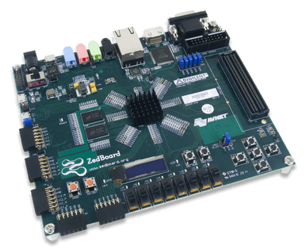

.. _board_zedboard:

ZedBoard
########

ZedBoard 是 Digilent 基于 AMD（Xilinx）Zynq-7000 XC7Z020 APSoC 的开发板。
openEuler Embedded 为它提供 **arm32 验证镜像**：内核、glibc 等组件与 openEuler
基线对齐，处理器运行在 armv7a/Cortex-A9、soft-float 模式。

.. raw:: html

   <html xmlns="http://www.w3.org/1999/xhtml"><head></head><body>
ZedBoard（图片来源：Digilent）
</body></html>

板卡规格
========

.. list-table::
   :header-rows: 1
   :widths: 30 70

   * - 项目
     - 说明
   * - SoC
     - Zynq-7000 XC7Z020-CLG484（PS：双核 Cortex-A9；PL：Artix-7 逻辑）
   * - 内存
     - 512 MB DDR3
   * - 存储
     - SD 卡（启动介质）、256 MB QSPI Flash
   * - 网络
     - 10/100/1000 Mbps 以太网（GEM0）
   * - 调试
     - USB-UART（PS UART1，``ttyPS0``，115200 8N1）、USB-JTAG
   * - 扩展
     - FMC、Pmod、XADC
   * - 视频/音频
     - HDMI（ADV7511）、音频 Codec（ADAU1761）——openeuler 镜像未启用
   * - 显示
     - 128x32 OLED（Pmod，SSD1306 兼容控制器）

文档内容
========

.. toctree::
   :maxdepth: 1

   hardware.rst
   boot.rst
   update.rst
   usage.rst

BSP 源码位于仓库 ``bsp/meta-zedboard/``，构建入口
``.oebuild/platform/zedboard.yaml``。