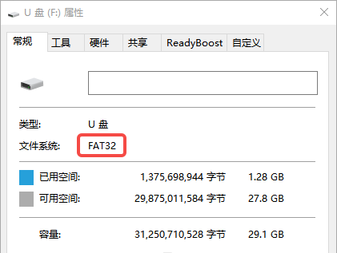
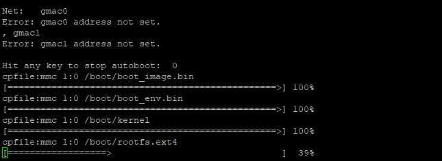
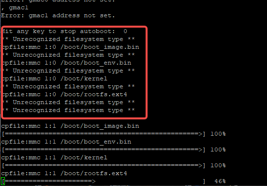
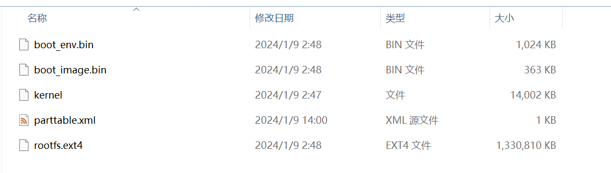
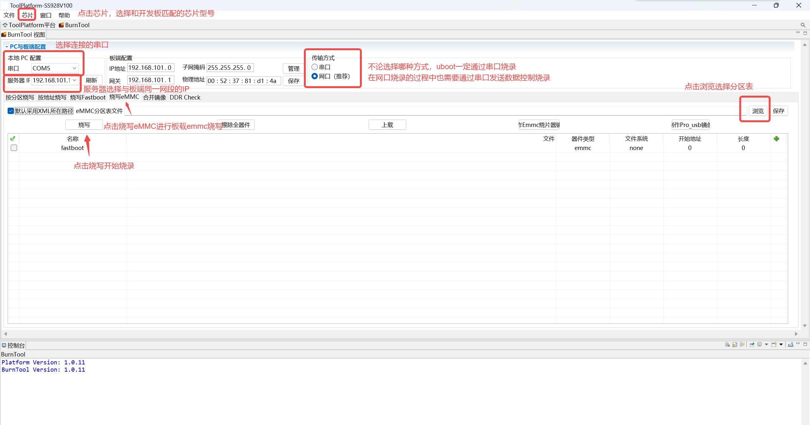
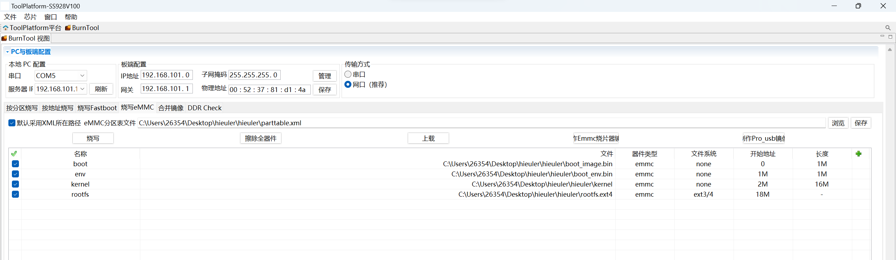
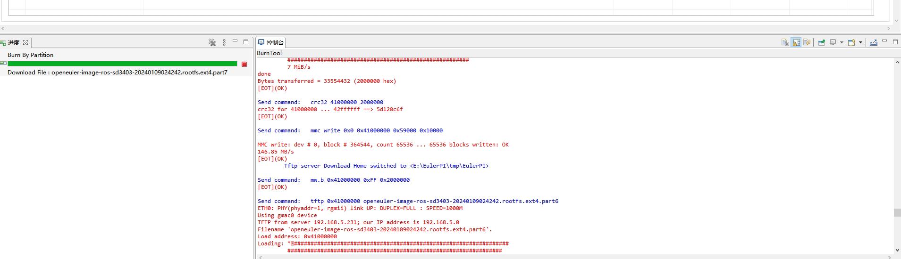

.. _hieuler_update:

海鸥派镜像在线升级与启动
============================

一、简介
--------

**欧拉派-海鸥** 系列支持以下升级方式：

1. 主机工具在线升级（推荐，SD 卡暂存）

2. 手动 SD 卡升级（旧版/无网络）

3. ToolPlatform 工具（裸板或 bootloader 损坏时使用）

以上方式都会把镜像写入板载 eMMC，系统默认从 eMMC 启动。此外还支持
SD 卡启动，需要额外配置启动参数，具体操作参考 :ref:`SD卡启动` 的部分。

二、主机工具在线升级（推荐）
----------------------------

适用于板卡已正常启动、网络可达、SD 卡已插入的场景。主机工具位于
``bsp/meta-hisilicon/tools/hieulerpi1-upgrade.sh``，直接把
``kernel-pi`` 和 ``rootfs.ext4`` 写入板卡 SD 卡，设置
``update=yes`` 后重启；U-Boot 在下次启动时把镜像刷入 eMMC。

1) 准备
~~~~~~~

- 同一次构建输出的 ``kernel-pi`` 和 ``rootfs.ext4``。
- 已插入 SD 卡（默认 ``/dev/mmcblk1p1``），文件系统可挂载，剩余空间
  大于根文件系统大小（约 600MB）。
- 板卡 IP、SSH 可达；工具默认使用仓库内的测试私钥，也可用
  ``--password`` 指定密码。
- 使用密码认证时，主机需要安装 ``sshpass``。

2) 执行
~~~~~~~

.. code-block:: console

   ./bsp/meta-hisilicon/tools/hieulerpi1-upgrade.sh \
     --ip 192.168.7.3 \
     --kernel <build>/kernel-pi \
     --rootfs <build>/openeuler-image-hieulerpi1-<时间戳>.rootfs.ext4

常用参数：

- ``--no-reboot``：只写 SD 卡并设置升级标志，不重启。
- ``--sd-dev`` / ``--sd-mount``：指定 SD 分区/挂载点。
- ``--key`` / ``--password``：SSH 认证。
- ``-y``：跳过确认。
- ``--wait N``：重启后等待板卡恢复（要求 IP 不变）。

工具执行流程：

1. SSH 登录板卡，挂载 SD 卡到 ``/mnt/sd``。
2. 直接 scp ``kernel-pi`` 和 ``rootfs.ext4`` 到 SD 卡
   ``/mnt/sd/boot``，并安装一次性 ``env_append.txt``。
3. 校验远端文件大小，卸载 SD 卡。
4. 执行 ``fw_setenv update yes``，然后重启板卡。

.. note::

   本板 Linux 对大文件的文件系统读写存在不稳定性，工具跳过远程 md5
   校验（仅校验大小），最终以 U-Boot 实际刷写并启动新系统作为验证。

3) U-Boot 刷写流程
~~~~~~~~~~~~~~~~~~

U-Boot 启动时 ``preboot`` 读取 SD 卡的 ``/boot/env_append.txt``；当
``update=yes`` 时执行 ``updatecmd``：

- ``boot_image_8G.bin`` → p1
- ``boot_env_8G.bin`` → p2
- ``kernel`` → p3（2MiB）
- ``rootfs.ext4`` → p4（18MiB）

在线升级通常只放 ``kernel`` 和 ``rootfs.ext4``，没有
``boot_image_8G.bin``/``boot_env_8G.bin`` 时对应步骤跳过，bootloader
和 U-Boot 环境保持原样（环境由 ``saveenv`` 更新）。刷写完成后执行：

.. code-block:: console

   setenv update no
   saveenv
   run bootcmd

新系统启动后，``hieulerpi1-clear-update.service`` 会兜底清除残留的
``update=yes``，避免重复刷写。

4) 验证
~~~~~~~

.. code-block:: console

   fw_printenv update          # 应为 no
   uname -r                    # 新内核版本
   systemctl is-active hieulerpi1-clear-update.service
   resize2fs /dev/mmcblk0p4    # 首次启动后可扩展到整个 p4

镜像默认 IP 为 ``192.168.7.2``（本板测试环境使用 ``192.168.7.3``）。
MAC 由 ``hieulerpi1-set-mac.service`` 从 eMMC CID 派生，重启后保持
不变。

.. note::

   ``--wait`` 使用执行命令时的 IP；如果新镜像的 IP 发生变化，等待会
   失败，需要先通过串口或本地控制台确认新 IP。

三、手动 SD 卡升级（旧版/无网络）
--------------------------------------------

若不清楚这文件系统和系统分区可以忽略下面一小段备注，继续后面的操作。

   【备注】
   ：SD卡升级功能支持fat32格式和ext4格式的文件系统，在升级时会逐个扫描SD卡的每个分区，直到找到升级文件。

1) 检查文件系统格式
~~~~~~~~~~~~~~~~~~~

在windows中插入SD卡，查看SD卡的文件系统格式，若为FAT32则无需操作，若不是则需要格式化。

2) 拷贝固件
~~~~~~~~~~~

若要进行SD卡升级，需要将Boot Loader、kernel和文件系统拷贝到SD卡中，并按以下文件名命名，
放在SD卡根目录的boot目录下。

.. code:: 

   .
   └── boot
       ├── boot_image_8G.bin      # U-Boot 引导镜像
       ├── boot_env_8G.bin        # U-Boot 环境
       ├── kernel                 # 内核（kernel-pi）
       ├── rootfs.ext4            # 根文件系统
       └── env_append.txt         # 一次性升级脚本

由于FAT32文件系统单文件最大仅支持4G的大小，在升级时除正常的单文件升级外还支持分块文件的升级。分块名为原始文件后追加分区编号，\ **编号从0开始**\ ，编号不允许带无意义的0，例如\ **rootfs.ext401**.

.. code:: 

   .
   └── boot
       ├── boot_env.bin          # uboot
       ├── boot_env_8G.bin     # U-Boot 环境
       ├── kernel                 # 内核（kernel-pi）
       ├── rootfs.ext40             # 根文件系统
       ├── rootfs.ext41
       ├── rootfs.ext42
       ├── rootfs.ext43
       ├── rootfs.ext44
       ├── rootfs.ext45
       └── env_append.txt        # 一次性升级脚本

3) 升级固件
~~~~~~~~~~~

按住update按键，点按reset按键，在reset按键松开之后1~2s即可松开update按键。如果能连接串口可以看到以下输出则表示正在升级。

出现以下问题属于正常现象，在分区中未找到升级固件，只要最终出现升级进度条即可。

.. note::

   使用SD卡更新固件时，可以不需要将所有二进制文件放在SD卡中，只需放入需要更新的二进制即可。
   但是，不论更新任何二进制，都需要将env_append.txt文件放入SD卡中，否则无法更新。
   比如，我只希望更新内核，那么只需要将kernel文件放入SD卡中，
   同时将env_append.txt文件放入SD卡中。之后更新的步骤同上，
   但是更新的进度条只会显示内核的更新进度。

   ``env_append.txt`` 中的 ``boot_image``/``boot_env`` 会自动追加
   ``_${total_mem_size}.bin`` 后缀，8GB 板对应
   ``boot_image_8G.bin``/``boot_env_8G.bin``。

.. _ToolPlatform工具:

四、ToolPlatform工具
--------------------

ToolPlatform工具是烧录芯片镜像的最基本工具，未烧录任何芯片的裸板，或者uboot启动损坏都可以使用该工具重新烧录镜像。若正常使用SD卡升级则无需进行本章的操作。

使用ToolPlatform工具烧录时除了四个固件文件，还需要一个分区表，分区表描述了烧录文件的位置，烧录分区的大小等信息。

初次打开软件可能进入以下页面。

点击图中最醒目的BurnTool即可进入正常烧录的界面。

选择分区表后显示以下界面，点击烧写按键开始烧写，烧写开始时须复位开发板。

下方的控制台在烧录过程中会打印大量日志，在烧录过程中若出现错误可提供更多的错误信息以检查问题。

.. _SD卡启动:

五、SD卡启动
------------

1) 创建启动SD卡
~~~~~~~~~~~~~~~

从SD卡启动需在SD卡中创建对应boot文件分区表及rootfs系统分区表，可以通过修改\ ``sd_rootfs_num``\ 环境变量指定正确的分区。

   【注】：

   1. 若正常进行分区sd卡的第一分区，分区号为1，后续分区以此类推。

   2. 默认从2号分区启动。

.. code:: bash

   # 使用 fdisk 创建两个分区表，具体设备节点根据实际情况修改，此处需创建好对应1和2分区
   sudo fdisk /dev/sdb
   # 将分区号为1的分区格式化为 FAT32 格式，用于存储boot相关文件
   sudo mkfs.vfat -F 32 /dev/sdb1
   # 将该FAT32分区表挂载
   sudo mount  /dev/sdb1 /mnt/xxx
   # 并在挂载后的路径内创建boot文件夹后拷入boot/kernel/rootfs等文件
   # 注意此处boot文件夹内不要放入env_append.txt文件
   .
   └── boot
      ├── boot_image_8G.bin      # U-Boot 引导镜像
      ├── boot_env_8G.bin           # U-Boot 环境
      ├── kernel                 # 内核（kernel-pi）
      └── rootfs.ext4              # 根文件系统

   # 将分区号为2的分区格式化为 ext4，用于写入rootfs
   sudo mkfs.ext4 /dev/sdb2
   # 将rootfs镜像写入2号分区
   sudo dd if=rootfs.ext4 of=/dev/sdb2

2) 从SD卡启动
~~~~~~~~~~~~~

若要从SD卡启动则需要在uboot内修改启动参数\ ``boot_media``\ ，在uboot的串口终端中输入\ ``print boot_media``\ 命令可查看当前的启动方式，boot_media为\ ``emmc``\ 时从板载的emmc启动，boot_media为\ ``sd``\ 时从SD卡启动。

.. code:: 

   # print boot_media
   boot_media=emmc

设置从SD卡启动

.. code:: bash

   # 设置从SD卡启动
   setenv boot_media sd
   # 设置从EMMC启动
   setenv boot_media emmc

..

   【注】：

   1. SD卡启动必须为ext4格式的文件系统

   2. 默认从SD卡的第二分区启动，若要修改启动分区可修改环境变量\ ``sd_rootfs_num``

   3. 完成对应操作后需要使用\ ``saveenv``\ 保存环境变量

六、常见问题
------------

-  系统无法启动

   1. 验证环境变量和分区规划是否匹配

   2. 指定的分区位置根文件系统是否损坏

-  系统无法升级

   1. 验证升级分区是否正常

   2. 升级文件的路径是否正确

   3. 文件系统格式是否正确

   【注】：可直接执行\ ``run updatecmd``\ 尝试升级查看报错

-  主机工具在线升级失败

   1. 确认 SD 卡已插入且可挂载

   2. 确认 SSH 密钥/密码正确

   3. 使用 ``--wait`` 时确认新系统 IP 未变化

-  升级后反复刷写

   1. 执行 ``fw_printenv update``，确认结果为 ``no``

   2. 确认 ``hieulerpi1-clear-update.service`` 为 active

   3. 可手动执行 ``fw_setenv update no`` 后重启

-  无法看到系统打印信息，过一段时间会弹出一段编码

   这种情况可能是uboot损坏导致的无法启动，参考 :ref:`ToolPlatform工具` 重新烧录uboot和env

   .. image:: images/image-20240118173740655.png

