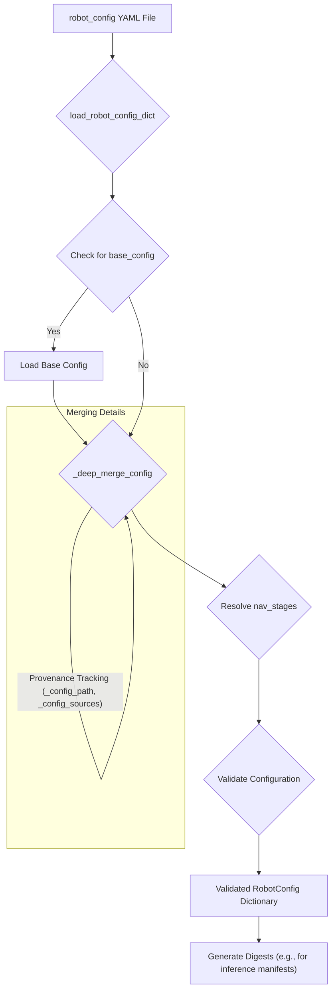
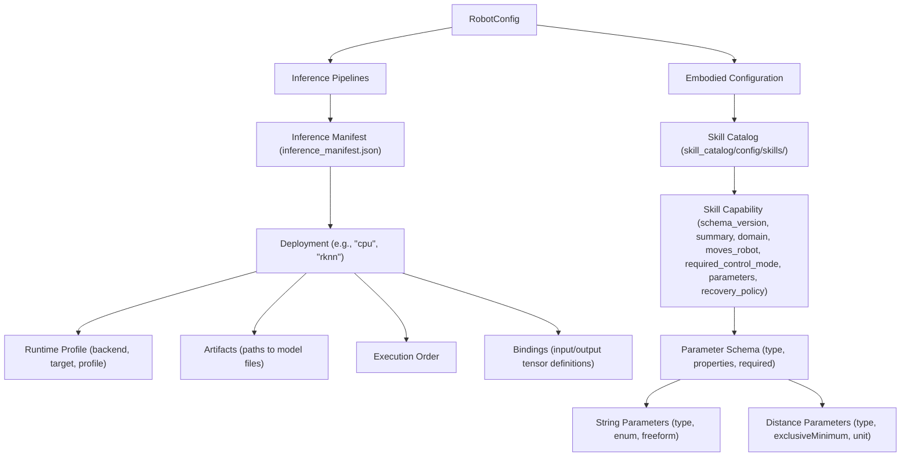
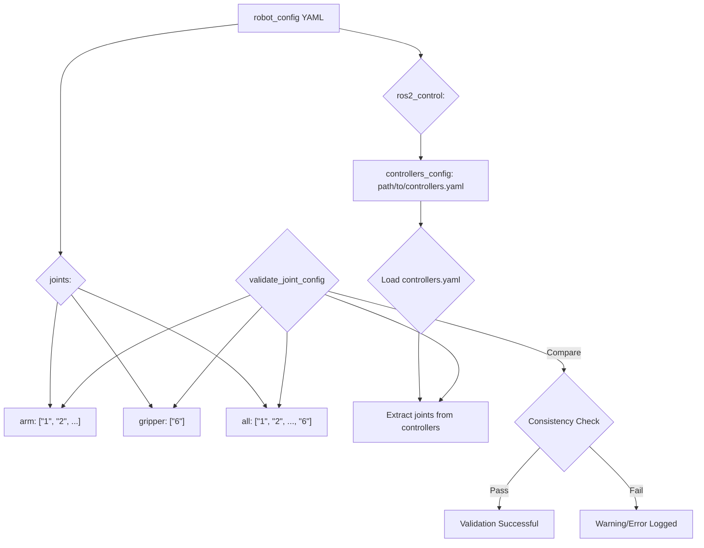

# 配置加载与校验

<details>
<summary>相关源码文件</summary>

以下文件被用作生成此 wiki 页面的上下文：

- [src/inference_service/README.en.md](https://atomgit.com/openeuler/IB_Robot/blob/openEuler-26.09/src/inference_service/README.en.md)
- [src/inference_service/README.md](https://atomgit.com/openeuler/IB_Robot/blob/openEuler-26.09/src/inference_service/README.md)
- [src/robot_config/README.en.md](https://atomgit.com/openeuler/IB_Robot/blob/openEuler-26.09/src/robot_config/README.en.md)
- [src/robot_config/README.md](https://atomgit.com/openeuler/IB_Robot/blob/openEuler-26.09/src/robot_config/README.md)
- [src/robot_config/config/contracts/act_grab_pan.yaml](https://atomgit.com/openeuler/IB_Robot/blob/openEuler-26.09/src/robot_config/config/contracts/act_grab_pan.yaml)
- [src/robot_config/config/contracts/pi05_multi_tasks.yaml](https://atomgit.com/openeuler/IB_Robot/blob/openEuler-26.09/src/robot_config/config/contracts/pi05_multi_tasks.yaml)
- [src/robot_config/config/robots/so101_dual_arm.yaml](https://atomgit.com/openeuler/IB_Robot/blob/openEuler-26.09/src/robot_config/config/robots/so101_dual_arm.yaml)
- [src/robot_config/config/robots/so101_single_arm.yaml](https://atomgit.com/openeuler/IB_Robot/blob/openEuler-26.09/src/robot_config/config/robots/so101_single_arm.yaml)
- [src/robot_config/launch/robot.launch.py](https://atomgit.com/openeuler/IB_Robot/blob/openEuler-26.09/src/robot_config/launch/robot.launch.py)
- [src/robot_config/robot_config/config.py](https://atomgit.com/openeuler/IB_Robot/blob/openEuler-26.09/src/robot_config/robot_config/config.py)
- [src/robot_config/robot_config/launch_builders/__init__.py](https://atomgit.com/openeuler/IB_Robot/blob/openEuler-26.09/src/robot_config/robot_config/launch_builders/__init__.py)
- [src/robot_config/robot_config/launch_builders/hardware_mock.py](https://atomgit.com/openeuler/IB_Robot/blob/openEuler-26.09/src/robot_config/robot_config/launch_builders/hardware_mock.py)
- [src/robot_config/robot_config/launch_builders/speech_direction.py](https://atomgit.com/openeuler/IB_Robot/blob/openEuler-26.09/src/robot_config/robot_config/launch_builders/speech_direction.py)
- [src/robot_config/robot_config/launch_builders/voice_asr.py](https://atomgit.com/openeuler/IB_Robot/blob/openEuler-26.09/src/robot_config/robot_config/launch_builders/voice_asr.py)
- [src/robot_config/robot_config/loader.py](https://atomgit.com/openeuler/IB_Robot/blob/openEuler-26.09/src/robot_config/robot_config/loader.py)
- [src/robot_config/robot_config/scripts/validate_config.py](https://atomgit.com/openeuler/IB_Robot/blob/openEuler-26.09/src/robot_config/robot_config/scripts/validate_config.py)
- [src/robot_config/robot_config/utils.py](https://atomgit.com/openeuler/IB_Robot/blob/openEuler-26.09/src/robot_config/robot_config/utils.py)
- [src/robot_config/test/test_config.py](https://atomgit.com/openeuler/IB_Robot/blob/openEuler-26.09/src/robot_config/test/test_config.py)
- [src/robot_config/test/test_embodied_entry_config.py](https://atomgit.com/openeuler/IB_Robot/blob/openEuler-26.09/src/robot_config/test/test_embodied_entry_config.py)
- [src/robot_config/test/test_joint_conversion.py](https://atomgit.com/openeuler/IB_Robot/blob/openEuler-26.09/src/robot_config/test/test_joint_conversion.py)
- [src/robot_config/test/test_launch_readiness.py](https://atomgit.com/openeuler/IB_Robot/blob/openEuler-26.09/src/robot_config/test/test_launch_readiness.py)
- [src/robot_description/urdf/lerobot/so101/so101_dual.urdf.xacro](https://atomgit.com/openeuler/IB_Robot/blob/openEuler-26.09/src/robot_description/urdf/lerobot/so101/so101_dual.urdf.xacro)
- [src/so101_hardware/config/so101_dual_controllers.yaml](https://atomgit.com/openeuler/IB_Robot/blob/openEuler-26.09/src/so101_hardware/config/so101_dual_controllers.yaml)

</details>

本页面详述 RoboFrame 的配置加载与校验机制，聚焦机器人配置如何被加载、合并、校验，以及关节信息如何处理。该系统保证机器人软硬件配置的单一事实源（SSOT），桥接 `ros2_control`、外围设备与 ML 策略的 I/O 契约。

## 配置加载（`load_robot_config_dict`）

加载机器人配置的核心函数是 `load_robot_config_dict` [src/robot_config/robot_config/loader.py:30](https://atomgit.com/openeuler/IB_Robot/blob/openEuler-26.09/src/robot_config/robot_config/loader.py#L30)。该函数负责读取 YAML 配置文件、解析基础配置并执行深度合并。

### 基础配置合并

机器人配置可以通过 `robot` 键下的 `base_config` 字段扩展既有基础配置 [src/robot_config/README.md:126-145](https://atomgit.com/openeuler/IB_Robot/blob/openEuler-26.09/src/robot_config/README.md#L126-L145)，从而实现模块化、可复用的配置定义。

`_deep_merge_config` 函数 [src/robot_config/robot_config/loader.py:90-133](https://atomgit.com/openeuler/IB_Robot/blob/openEuler-26.09/src/robot_config/robot_config/loader.py#L90-L133) 处理合并逻辑：

- **递归映射合并**：字典递归合并。
- **标量与列表替换**：默认情况下，overlay 中的标量值和列表替换基础配置中的对应项。
- **列表追加**：通过在映射内使用特殊的 `__append__` 键可以追加列表。例如：

  ```yaml
  teleoperation:
    devices:
      __append__:
        - name: extension_device
          type: custom
  ```

  该机制保证只有显式标记为追加的列表才会被扩展，其余一律替换。
- **严格容器类型检查**：合并过程可强制容器类型严格匹配，若 overlay 试图在同一路径把字典换成列表（或反之）则报错 [src/robot_config/robot_config/loader.py:114-122](https://atomgit.com/openeuler/IB_Robot/blob/openEuler-26.09/src/robot_config/robot_config/loader.py#L114-L122)。
- **环检测**：加载器拒绝 `base_config` 中的循环引用，防止死循环。
- **来源跟踪**：归一化后的配置包含 `_config_path`（指明最外层配置文件）与 `_config_sources`（提供从基础到 overlay 的完整文件链），用于审计与调试 [src/robot_config/README.md:143-145](https://atomgit.com/openeuler/IB_Robot/blob/openEuler-26.09/src/robot_config/README.md#L143-L145)。

### Nav 阶段解析

`_resolve_nav_stage` 函数 [src/robot_config/robot_config/loader.py:136-162](https://atomgit.com/openeuler/IB_Robot/blob/openEuler-26.09/src/robot_config/robot_config/loader.py#L136-L162) 处理导航相关配置的选择与合并。若机器人配置中定义了 `nav_stages`，它会基于 `nav_stage` 参数或 `default_nav_stage` 解析当前活跃阶段，支持 `mapping`、`navigation`、`grasp`、`hybrid` 等预定义阶段集合。

### 摘要生成

配置系统为推理 manifest、技能能力等各类组件生成摘要（digest）。这些摘要是唯一标识符，对校验已加载配置的完整性与身份至关重要。例如 `canonical_bundle_digest` [src/robot_config/test/test_launch_readiness.py:155](https://atomgit.com/openeuler/IB_Robot/blob/openEuler-26.09/src/robot_config/test/test_launch_readiness.py#L155) 用于推理 bundle。



**图 1：配置加载与合并流程**

来源：[src/robot_config/README.md:126-145](https://atomgit.com/openeuler/IB_Robot/blob/openEuler-26.09/src/robot_config/README.md#L126-L145), [src/robot_config/robot_config/loader.py:30](https://atomgit.com/openeuler/IB_Robot/blob/openEuler-26.09/src/robot_config/robot_config/loader.py#L30), [src/robot_config/robot_config/loader.py:90-133](https://atomgit.com/openeuler/IB_Robot/blob/openEuler-26.09/src/robot_config/robot_config/loader.py#L90-L133), [src/robot_config/robot_config/loader.py:136-162](https://atomgit.com/openeuler/IB_Robot/blob/openEuler-26.09/src/robot_config/robot_config/loader.py#L136-L162), [src/robot_config/test/test_launch_readiness.py:155](https://atomgit.com/openeuler/IB_Robot/blob/openEuler-26.09/src/robot_config/test/test_launch_readiness.py#L155)

## 配置契约

配置系统为各类组件定义契约，保证一致性与互操作性。

### 推理契约

推理 manifest 定义 ML 模型的契约，包括输入/输出张量、执行顺序与运行时绑定 [src/inference_service/README.md:10-18](https://atomgit.com/openeuler/IB_Robot/blob/openEuler-26.09/src/inference_service/README.md#L10-L18)。manifest 中的 `deployment` 指定执行的后端、目标与 profile [src/inference_service/README.md:68-82](https://atomgit.com/openeuler/IB_Robot/blob/openEuler-26.09/src/inference_service/README.md#L68-L82)。`inference_manifest.json` 是部署信息的 SSOT [src/inference_service/README.md:60-61](https://atomgit.com/openeuler/IB_Robot/blob/openEuler-26.09/src/inference_service/README.md#L60-L61)。

```json
{
  "uuid": "f9ebdcd5-1ce8-4b56-8860-4f32454fc209",
  "revision": 3,
  "execution_contract": {
    "state_scope": "request",
    "execution_structure": "direct",
    "cancellation_granularity": "request_boundary"
  },
  "runtime_profile": {
    "backend": "rknn",
    "target": {
      "soc": "rk3588",
      "runtime": "rknn-lite2"
    },
    "profile": {
      "target_name": "rk3588",
      "core_mask": 7,
      "device_id": 0
    }
  },
  "artifacts": {
    "policy": {
      "path": "artifacts/rknn/rk3588/generations/<uuid>/policy.rknn",
      "format": "rknn"
    }
  },
  "execution": ["policy"],
  "bindings": {
    "policy": {
      "inputs": [
        {
          "semantic": "observation.state",
          "runtime_name": "observation.state",
          "index": 0,
          "dtype": "float32",
          "shape": [1, 6]
        }
      ],
      "outputs": [
        {
          "semantic": "action",
          "runtime_name": "action",
          "index": 0,
          "dtype": "float32",
          "shape": [1, 100, 6]
        }
      ]
    }
  }
}
```

**代码片段 1：推理 manifest deployment 示例**

### 技能网关公共契约

`skill_catalog` 定义了通过 Capability Gateway 暴露的技能的公共契约 [src/robot_config/README.en.md:111-112](https://atomgit.com/openeuler/IB_Robot/blob/openEuler-26.09/src/robot_config/README.en.md#L111-L112)。每个技能必须声明：

- `schema_version: 1`
- `summary`：简要描述。
- `domain`：技能所属领域（如 "manipulation"）。
- `moves_robot`：布尔值，表示该技能是否移动机器人。
- `required_control_mode`：技能所需的控制模式（如 `teleop`、`model_inference`、`moveit_planning`）。必须与全局 `skill_required_control_mode` 匹配 [src/robot_config/README.en.md:123-124](https://atomgit.com/openeuler/IB_Robot/blob/openEuler-26.09/src/robot_config/README.en.md#L123-L124)。
- `parameters`：定义输入参数的严格对象 schema。只允许 `target_name`、`place_name`、`motion_direction`、`motion_distance` 等特定字段 [src/robot_config/README.en.md:125-126](https://atomgit.com/openeuler/IB_Robot/blob/openEuler-26.09/src/robot_config/README.en.md#L125-L126)。
- `recovery_policy`：定义技能如何处理失败（如 `never_retry`、`ask_user`、`recover_safe_pose`）。



**图 2：配置契约**

来源：[src/inference_service/README.md:10-18](https://atomgit.com/openeuler/IB_Robot/blob/openEuler-26.09/src/inference_service/README.md#L10-L18), [src/inference_service/README.md:68-82](https://atomgit.com/openeuler/IB_Robot/blob/openEuler-26.09/src/inference_service/README.md#L68-L82), [src/inference_service/README.md:60-61](https://atomgit.com/openeuler/IB_Robot/blob/openEuler-26.09/src/inference_service/README.md#L60-L61), [src/robot_config/README.en.md:111-112](https://atomgit.com/openeuler/IB_Robot/blob/openEuler-26.09/src/robot_config/README.en.md#L111-L112), [src/robot_config/README.en.md:123-124](https://atomgit.com/openeuler/IB_Robot/blob/openEuler-26.09/src/robot_config/README.en.md#L123-L124), [src/robot_config/README.en.md:125-126](https://atomgit.com/openeuler/IB_Robot/blob/openEuler-26.09/src/robot_config/README.en.md#L125-L126)

## 配置校验（`validate_config`）

`validate_config` 函数 [src/robot_config/test/test_config.py:33](https://atomgit.com/openeuler/IB_Robot/blob/openEuler-26.09/src/robot_config/test/test_config.py#L33) 对已加载的机器人配置执行大量检查，确保其正确性并符合既定 schema 与约束。这是防止运行时错误、保证系统稳定性的关键步骤。

关键校验领域包括：

- **关节配置**：`validate_joint_config` [src/robot_config/robot_config/utils.py:151](https://atomgit.com/openeuler/IB_Robot/blob/openEuler-26.09/src/robot_config/robot_config/utils.py#L151) 检查 `robot_config` 的 `joints` 部分与控制器配置文件之间的一致性。它验证期望的臂、夹爪、底盘与全部关节都已正确定义并与控制器的期望匹配。
- **控制模式**：确保技能的 `required_control_mode` 是受支持的模式之一（`teleop`、`model_inference`、`moveit_planning`）[src/robot_config/robot_config/loader.py:59](https://atomgit.com/openeuler/IB_Robot/blob/openEuler-26.09/src/robot_config/robot_config/loader.py#L59)。
- **外围设备**：校验相机配置，包括驱动类型、分辨率、frame ID 与可选的 ISP 参数 [src/robot_config/config/robots/so101_single_arm.yaml:160-179](https://atomgit.com/openeuler/IB_Robot/blob/openEuler-26.09/src/robot_config/config/robots/so101_single_arm.yaml#L160-L179)。还会对未绑定的串口相机给出警告 [src/robot_config/test/test_config.py:26](https://atomgit.com/openeuler/IB_Robot/blob/openEuler-26.09/src/robot_config/test/test_config.py#L26)。
- **推理流水线**：校验推理流水线结构，确保 `model_path` 与 `deployment` 被正确指定 [src/robot_config/config/robots/so101_single_arm.yaml:88-93](https://atomgit.com/openeuler/IB_Robot/blob/openEuler-26.09/src/robot_config/config/robots/so101_single_arm.yaml#L88-L93)。同时检查合法的执行模式（单体或分布式）与请求超时。
- **具身配置**：校验具身 AI 的各类参数，如技能超时、原语超时与相对运动设置 [src/robot_config/config/robots/so101_single_arm.yaml:183-195](https://atomgit.com/openeuler/IB_Robot/blob/openEuler-26.09/src/robot_config/config/robots/so101_single_arm.yaml#L183-L195)。
- **语音服务**：校验 Voice ASR 与 TTS 的配置，包括 bundle 路径、deployment 与服务端点 [src/robot_config/config/robots/so101_single_arm.yaml:123-171](https://atomgit.com/openeuler/IB_Robot/blob/openEuler-26.09/src/robot_config/config/robots/so101_single_arm.yaml#L123-L171)。
- **观测传输**：`validate_observation_transports` [src/robot_config/robot_config/loader.py:43](https://atomgit.com/openeuler/IB_Robot/blob/openEuler-26.09/src/robot_config/robot_config/loader.py#L43) 与 `validate_robot_config_observation_transports` [src/robot_config/robot_config/loader.py:44](https://atomgit.com/openeuler/IB_Robot/blob/openEuler-26.09/src/robot_config/robot_config/loader.py#L44) 确保观测传输规格（如视频的 RTP）定义正确并与观测契约兼容。
- **语义建图**：校验语义建图配置，包括感知服务到语义角色的绑定 [src/robot_config/README.md:97-102](https://atomgit.com/openeuler/IB_Robot/blob/openEuler-26.09/src/robot_config/README.md#L97-L102)。
- **技能网关契约**：确保技能能力符合公共契约，检查 schema 版本、必填字段与参数定义 [src/robot_config/README.en.md:111-130](https://atomgit.com/openeuler/IB_Robot/blob/openEuler-26.09/src/robot_config/README.en.md#L111-L130)。

`validate_config` 通常在 `load_robot_config_dict` 之后调用，确保加载的数据在结构与语义上正确。

来源：[src/robot_config/test/test_config.py:33](https://atomgit.com/openeuler/IB_Robot/blob/openEuler-26.09/src/robot_config/test/test_config.py#L33), [src/robot_config/robot_config/utils.py:151](https://atomgit.com/openeuler/IB_Robot/blob/openEuler-26.09/src/robot_config/robot_config/utils.py#L151), [src/robot_config/robot_config/loader.py:59](https://atomgit.com/openeuler/IB_Robot/blob/openEuler-26.09/src/robot_config/robot_config/loader.py#L59), [src/robot_config/config/robots/so101_single_arm.yaml:160-179](https://atomgit.com/openeuler/IB_Robot/blob/openEuler-26.09/src/robot_config/config/robots/so101_single_arm.yaml#L160-L179), [src/robot_config/test/test_config.py:26](https://atomgit.com/openeuler/IB_Robot/blob/openEuler-26.09/src/robot_config/test/test_config.py#L26), [src/robot_config/config/robots/so101_single_arm.yaml:88-93](https://atomgit.com/openeuler/IB_Robot/blob/openEuler-26.09/src/robot_config/config/robots/so101_single_arm.yaml#L88-L93), [src/robot_config/config/robots/so101_single_arm.yaml:183-195](https://atomgit.com/openeuler/IB_Robot/blob/openEuler-26.09/src/robot_config/config/robots/so101_single_arm.yaml#L183-L195), [src/robot_config/config/robots/so101_single_arm.yaml:123-171](https://atomgit.com/openeuler/IB_Robot/blob/openEuler-26.09/src/robot_config/config/robots/so101_single_arm.yaml#L123-L171), [src/robot_config/robot_config/loader.py:43](https://atomgit.com/openeuler/IB_Robot/blob/openEuler-26.09/src/robot_config/robot_config/loader.py#L43), [src/robot_config/robot_config/loader.py:44](https://atomgit.com/openeuler/IB_Robot/blob/openEuler-26.09/src/robot_config/robot_config/loader.py#L44), [src/robot_config/README.md:97-102](https://atomgit.com/openeuler/IB_Robot/blob/openEuler-26.09/src/robot_config/README.md#L97-L102), [src/robot_config/README.en.md:111-130](https://atomgit.com/openeuler/IB_Robot/blob/openEuler-26.09/src/robot_config/README.en.md#L111-L130)

## 关节转换工具

`robot_config.utils` 模块提供处理关节配置的工具函数。

### `validate_joint_config`

如上所述，`validate_joint_config` [src/robot_config/robot_config/utils.py:151](https://atomgit.com/openeuler/IB_Robot/blob/openEuler-26.09/src/robot_config/robot_config/utils.py#L151) 对保证关节定义一致性至关重要。它将 `robot_config` YAML（`joints` 键下）中指定的关节与 `ros2_control` 控制器期望的关节进行比对，防止因不匹配导致机器人行为异常或启动失败。

该函数记录 `robot_config` 中定义的规范关节（arm、gripper、base、all）信息，然后尝试加载并解析 `ros2_control` 部分指定的 `controllers_config` YAML，再将控制器中声明的关节与规范定义比对。



**图 3：关节配置校验流程**

来源：[src/robot_config/robot_config/utils.py:151](https://atomgit.com/openeuler/IB_Robot/blob/openEuler-26.09/src/robot_config/robot_config/utils.py#L151), [src/robot_config/config/robots/so101_single_arm.yaml:23-33](https://atomgit.com/openeuler/IB_Robot/blob/openEuler-26.09/src/robot_config/config/robots/so101_single_arm.yaml#L23-L33), [src/robot_config/config/robots/so101_single_arm.yaml:151-154](https://atomgit.com/openeuler/IB_Robot/blob/openEuler-26.09/src/robot_config/config/robots/so101_single_arm.yaml#L151-L154)
