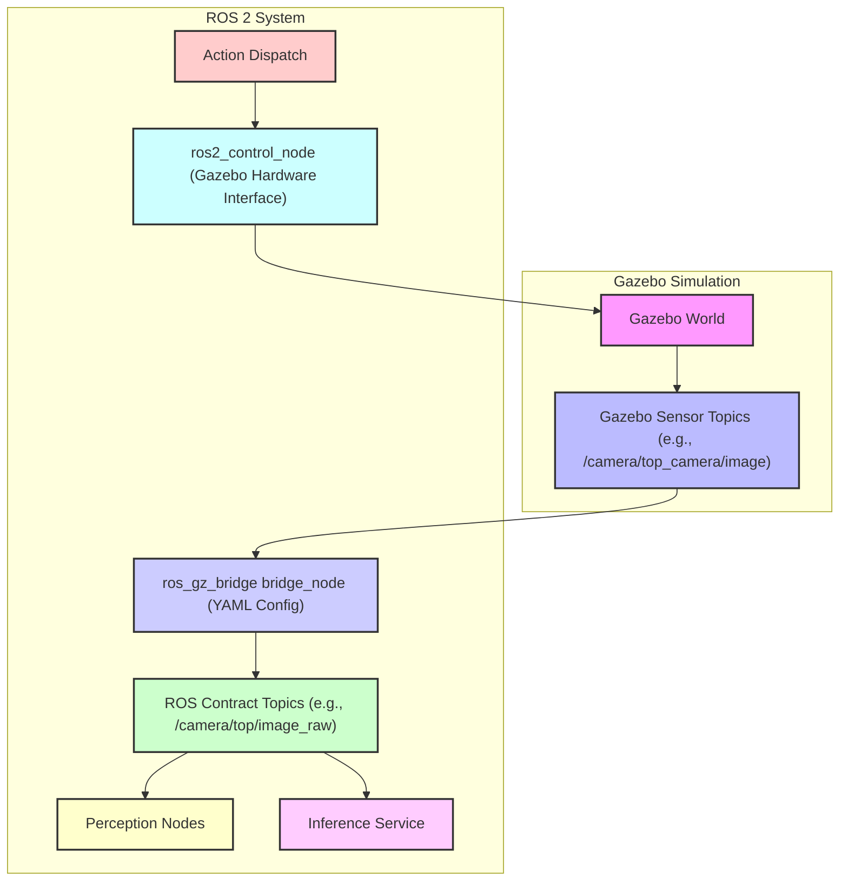
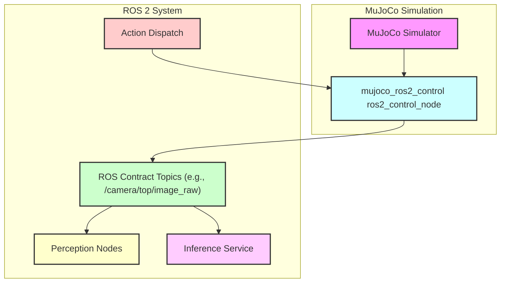
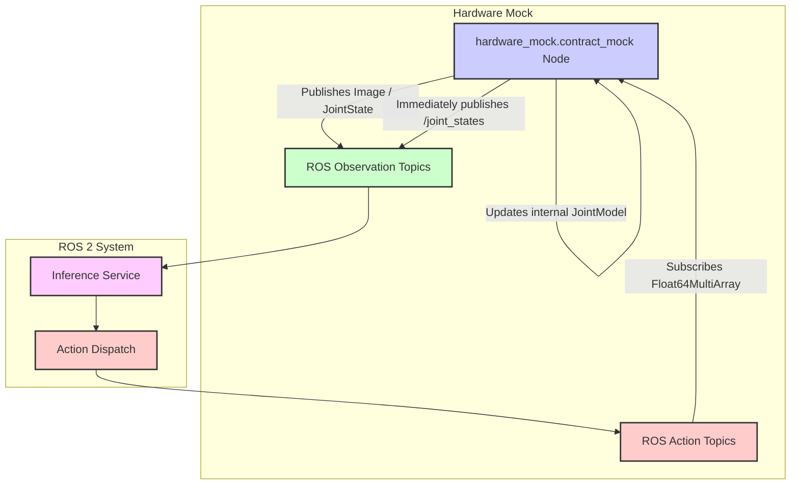

# Launch 构建器

相关源码文件

以下文件被用作生成此 wiki 页面的上下文：

- [scripts/model_infer_panel.py](https://atomgit.com/openeuler/IB_Robot/blob/openEuler-26.09/scripts/model_infer_panel.py)
- [src/dataset_tools/dataset_tools/policy_eval.py](https://atomgit.com/openeuler/IB_Robot/blob/openEuler-26.09/src/dataset_tools/dataset_tools/policy_eval.py)
- [src/dataset_tools/dataset_tools/policy_eval_compare.py](https://atomgit.com/openeuler/IB_Robot/blob/openEuler-26.09/src/dataset_tools/dataset_tools/policy_eval_compare.py)
- [src/dataset_tools/test/test_policy_eval.py](https://atomgit.com/openeuler/IB_Robot/blob/openEuler-26.09/src/dataset_tools/test/test_policy_eval.py)
- [src/hardware_mock/README.md](https://atomgit.com/openeuler/IB_Robot/blob/openEuler-26.09/src/hardware_mock/README.md)
- [src/hardware_mock/launch/hardware_mock.launch.py](https://atomgit.com/openeuler/IB_Robot/blob/openEuler-26.09/src/hardware_mock/launch/hardware_mock.launch.py)
- [src/robot_config/config/robots/lekiwi.yaml](https://atomgit.com/openeuler/IB_Robot/blob/openEuler-26.09/src/robot_config/config/robots/lekiwi.yaml)
- [src/robot_config/config/robots/so101_single_arm_rgbd.yaml](https://atomgit.com/openeuler/IB_Robot/blob/openEuler-26.09/src/robot_config/config/robots/so101_single_arm_rgbd.yaml)
- [src/robot_config/robot_config/launch_builders/__init__.py](https://atomgit.com/openeuler/IB_Robot/blob/openEuler-26.09/src/robot_config/robot_config/launch_builders/__init__.py)
- [src/robot_config/robot_config/launch_builders/control.py](https://atomgit.com/openeuler/IB_Robot/blob/openEuler-26.09/src/robot_config/robot_config/launch_builders/control.py)
- [src/robot_config/robot_config/launch_builders/description.py](https://atomgit.com/openeuler/IB_Robot/blob/openEuler-26.09/src/robot_config/robot_config/launch_builders/description.py)
- [src/robot_config/robot_config/launch_builders/hardware_mock.py](https://atomgit.com/openeuler/IB_Robot/blob/openEuler-26.09/src/robot_config/robot_config/launch_builders/hardware_mock.py)
- [src/robot_config/robot_config/launch_builders/perception.py](https://atomgit.com/openeuler/IB_Robot/blob/openEuler-26.09/src/robot_config/robot_config/launch_builders/perception.py)
- [src/robot_config/robot_config/launch_builders/sim_backend/__init__.py](https://atomgit.com/openeuler/IB_Robot/blob/openEuler-26.09/src/robot_config/robot_config/launch_builders/sim_backend/__init__.py)
- [src/robot_config/robot_config/launch_builders/sim_backend/base_adapter.py](https://atomgit.com/openeuler/IB_Robot/blob/openEuler-26.09/src/robot_config/robot_config/launch_builders/sim_backend/base_adapter.py)
- [src/robot_config/robot_config/launch_builders/sim_backend/camera_presets.py](https://atomgit.com/openeuler/IB_Robot/blob/openEuler-26.09/src/robot_config/robot_config/launch_builders/sim_backend/camera_presets.py)
- [src/robot_config/robot_config/launch_builders/sim_backend/gazebo_adapter.py](https://atomgit.com/openeuler/IB_Robot/blob/openEuler-26.09/src/robot_config/robot_config/launch_builders/sim_backend/gazebo_adapter.py)
- [src/robot_config/robot_config/launch_builders/sim_backend/mock_adapter.py](https://atomgit.com/openeuler/IB_Robot/blob/openEuler-26.09/src/robot_config/robot_config/launch_builders/sim_backend/mock_adapter.py)
- [src/robot_config/robot_config/launch_builders/sim_backend/mujoco_adapter.py](https://atomgit.com/openeuler/IB_Robot/blob/openEuler-26.09/src/robot_config/robot_config/launch_builders/sim_backend/mujoco_adapter.py)
- [src/robot_config/robot_config/launch_builders/sim_peripheral_bridge.py](https://atomgit.com/openeuler/IB_Robot/blob/openEuler-26.09/src/robot_config/robot_config/launch_builders/sim_peripheral_bridge.py)
- [src/robot_config/robot_config/launch_builders/simulation.py](https://atomgit.com/openeuler/IB_Robot/blob/openEuler-26.09/src/robot_config/robot_config/launch_builders/simulation.py)
- [src/robot_config/robot_config/launch_builders/speech_direction.py](https://atomgit.com/openeuler/IB_Robot/blob/openEuler-26.09/src/robot_config/robot_config/launch_builders/speech_direction.py)
- [src/robot_config/robot_config/launch_builders/task_execution.py](https://atomgit.com/openeuler/IB_Robot/blob/openEuler-26.09/src/robot_config/robot_config/launch_builders/task_execution.py)
- [src/robot_config/robot_config/launch_builders/voice_asr.py](https://atomgit.com/openeuler/IB_Robot/blob/openEuler-26.09/src/robot_config/robot_config/launch_builders/voice_asr.py)
- [src/robot_config/robot_config/peripherals/camera.py](https://atomgit.com/openeuler/IB_Robot/blob/openEuler-26.09/src/robot_config/robot_config/peripherals/camera.py)
- [src/robot_config/robot_config/scripts/validate_config.py](https://atomgit.com/openeuler/IB_Robot/blob/openEuler-26.09/src/robot_config/robot_config/scripts/validate_config.py)
- [src/robot_config/test/test_sim_backend.py](https://atomgit.com/openeuler/IB_Robot/blob/openEuler-26.09/src/robot_config/test/test_sim_backend.py)
- [src/task_dispatch/README.en.md](https://atomgit.com/openeuler/IB_Robot/blob/openEuler-26.09/src/task_dispatch/README.en.md)
- [src/task_dispatch/README.md](https://atomgit.com/openeuler/IB_Robot/blob/openEuler-26.09/src/task_dispatch/README.md)
- [src/task_dispatch/package.xml](https://atomgit.com/openeuler/IB_Robot/blob/openEuler-26.09/src/task_dispatch/package.xml)
- [src/task_dispatch/task_dispatch/task_executor_node.py](https://atomgit.com/openeuler/IB_Robot/blob/openEuler-26.09/src/task_dispatch/task_dispatch/task_executor_node.py)

本页面详述 `robot.launch.py` 如何编排机器人系统的各个子图，包括控制、描述、感知、导航、遥操作、录制、追踪与语音。它解释每个 launch 构建器模块在基于单一事实源（SSOT）YAML 配置组装完整 ROS 2 launch 描述中的角色。

## Launch 构建器模块概览

`robot_config.launch_builders` 包包含基于机器人 YAML 配置生成 ROS 2 launch 组件的模块 [src/robot_config/robot_config/launch_builders/__init__.py:1-9](https://atomgit.com/openeuler/IB_Robot/blob/openEuler-26.09/src/robot_config/robot_config/launch_builders/__init__.py#L1-L9)。每个模块聚焦一个特定子系统：

*   `description.py`：处理 URDF 构建，包括 xacro 处理与动态相机注入 [src/robot_config/robot_config/launch_builders/__init__.py:4](https://atomgit.com/openeuler/IB_Robot/blob/openEuler-26.09/src/robot_config/robot_config/launch_builders/__init__.py#L4)。
*   `control.py`：管理 `ros2_control` 节点与控制器 spawner [src/robot_config/robot_config/launch_builders/__init__.py:5](https://atomgit.com/openeuler/IB_Robot/blob/openEuler-26.09/src/robot_config/robot_config/launch_builders/__init__.py#L5)。
*   `perception.py`：生成相机驱动、LiDAR 驱动与静态 TF 发布器 [src/robot_config/robot_config/launch_builders/__init__.py:6](https://atomgit.com/openeuler/IB_Robot/blob/openEuler-26.09/src/robot_config/robot_config/launch_builders/__init__.py#L6)。
*   `simulation.py`：编排 Gazebo 及其他仿真相关节点 [src/robot_config/robot_config/launch_builders/__init__.py:7](https://atomgit.com/openeuler/IB_Robot/blob/openEuler-26.09/src/robot_config/robot_config/launch_builders/__init__.py#L7)。
*   `task_execution.py`：负责 action 分发器与推理节点。
*   `hardware_mock.py`：提供用于开发与测试的 mock 硬件接口。
*   `moveit.py`：生成用于运动规划的 MoveIt 相关节点。
*   `navigation.py`：设置 Nav2 bringup 及相关组件。
*   `voice_asr.py`、`voice_tts.py`、`speech_direction.py`、`audio_io.py`：处理语音与音频处理节点。
*   `benchmark.py`：生成用于策略评估与基准测试的节点。

## 控制子图

`control.py` 模块是搭建机器人控制系统的核心。它生成 `ros2_control` 节点与控制器 spawner，并执行关节配置校验 [src/robot_config/robot_config/launch_builders/control.py:1-7](https://atomgit.com/openeuler/IB_Robot/blob/openEuler-26.09/src/robot_config/robot_config/launch_builders/control.py#L1-L7)。

### `ros2_control` 节点生成

`ros2_control` 节点负责管理机器人的硬件接口与控制器。`generate_ros2_control_nodes` 函数（未完整展示，但由 `__init__.py` 中的 `generate_ros2_control_nodes` 暗示 [src/robot_config/robot_config/launch_builders/__init__.py:64](https://atomgit.com/openeuler/IB_Robot/blob/openEuler-26.09/src/robot_config/robot_config/launch_builders/__init__.py#L64)）通常会为 `ros2_control` 创建一个 `Node` action。

### 控制器 Spawner 创建

控制器使用 `controller_manager` 的 `spawner` 可执行文件生成。`generate_controller_spawners` 函数（由 `__init__.py` 中的 `generate_controller_spawners` 暗示 [src/robot_config/robot_config/launch_builders/__init__.py:65](https://atomgit.com/openeuler/IB_Robot/blob/openEuler-26.09/src/robot_config/robot_config/launch_builders/__init__.py#L65)）会创建 `Node` action 来加载并启动已配置的控制器。

### 关节配置校验

启动前，`validate_joint_config` 函数 [src/robot_config/robot_config/launch_builders/control.py:28](https://atomgit.com/openeuler/IB_Robot/blob/openEuler-26.09/src/robot_config/robot_config/launch_builders/control.py#L28) 确保机器人 YAML 中定义的关节配置有效。这防止了因错误关节定义导致的运行时错误。

### 运行时资源校验

`validate_runtime_resources` 函数 [src/robot_config/robot_config/launch_builders/control.py:64-139](https://atomgit.com/openeuler/IB_Robot/blob/openEuler-26.09/src/robot_config/robot_config/launch_builders/control.py#L64-L139) 检查真实硬件资源（如串口）的冲突，防止多个组件尝试使用同一个独占资源。这对物理机器人部署至关重要。

来源：[src/robot_config/robot_config/launch_builders/control.py:1-162](https://atomgit.com/openeuler/IB_Robot/blob/openEuler-26.09/src/robot_config/robot_config/launch_builders/control.py#L1-L162), [src/robot_config/robot_config/launch_builders/__init__.py:64-68](https://atomgit.com/openeuler/IB_Robot/blob/openEuler-26.09/src/robot_config/robot_config/launch_builders/__init__.py#L64-L68)

## 描述子图

`description.py` 模块负责从 YAML 配置生成机器人的统一机器人描述格式（URDF）[src/robot_config/robot_config/launch_builders/description.py:1-3](https://atomgit.com/openeuler/IB_Robot/blob/openEuler-26.09/src/robot_config/robot_config/launch_builders/description.py#L1-L3)。这包括处理 xacro 文件与动态注入相机描述。

### 基于 Xacro 的 URDF 生成

`generate_robot_description` 函数 [src/robot_config/robot_config/launch_builders/__init__.py:62](https://atomgit.com/openeuler/IB_Robot/blob/openEuler-26.09/src/robot_config/robot_config/launch_builders/__init__.py#L62) 接收机器人配置并生成完整 URDF。该过程包括：

1.  **Xacro 处理**：展开基础 URDF 文件中定义的 xacro 宏。
2.  **动态相机注入**：`_build_cameras_urdf_from_yaml` 函数 [src/robot_config/robot_config/launch_builders/description.py:61-178](https://atomgit.com/openeuler/IB_Robot/blob/openEuler-26.09/src/robot_config/robot_config/launch_builders/description.py#L61-L178) 基于机器人 YAML 的 `peripherals` 节动态添加相机 link、joint 与 Gazebo 传感器定义。这确保相机在仿真与可视化中都正确呈现在机器人模型中。
    *   它处理 `parent_frame="world"` 的相机，基于 `simulation.robot_spawn` 偏移调整其原点，确保它们在 Gazebo 世界中正确放置 [src/robot_config/robot_config/launch_builders/description.py:130-137](https://atomgit.com/openeuler/IB_Robot/blob/openEuler-26.09/src/robot_config/robot_config/launch_builders/description.py#L130-L137)。
    *   它还从垂直视场角（`fovy`）与图像尺寸计算水平视场角（`hfov_rad`）[src/robot_config/robot_config/launch_builders/description.py:147-148](https://atomgit.com/openeuler/IB_Robot/blob/openEuler-26.09/src/robot_config/robot_config/launch_builders/description.py#L147-L148)。

### 模型生成偏移

`_get_model_spawn_offset` 函数 [src/robot_config/robot_config/launch_builders/description.py:25-47](https://atomgit.com/openeuler/IB_Robot/blob/openEuler-26.09/src/robot_config/robot_config/launch_builders/description.py#L25-L47) 从 YAML 的 `simulation.robot_spawn` 节获取机器人的生成位置。该偏移对于在 URDF 中正确定位 `parent="world"` 相机至关重要。

来源：[src/robot_config/robot_config/launch_builders/description.py:1-178](https://atomgit.com/openeuler/IB_Robot/blob/openEuler-26.09/src/robot_config/robot_config/launch_builders/description.py#L1-L178), [src/robot_config/robot_config/launch_builders/__init__.py:62](https://atomgit.com/openeuler/IB_Robot/blob/openEuler-26.09/src/robot_config/robot_config/launch_builders/__init__.py#L62)

## 感知子图

`perception.py` 模块负责启动机器人传感器（主要是相机与 LiDAR）相关的节点 [src/robot_config/robot_config/launch_builders/perception.py:1-8](https://atomgit.com/openeuler/IB_Robot/blob/openEuler-26.09/src/robot_config/robot_config/launch_builders/perception.py#L1-L8)。

### 相机驱动节点

`generate_camera_nodes` 函数 [src/robot_config/robot_config/launch_builders/perception.py:25-147](https://atomgit.com/openeuler/IB_Robot/blob/openEuler-26.09/src/robot_config/robot_config/launch_builders/perception.py#L25-L147) 基于机器人 YAML 中的 `peripherals` 配置为各类相机驱动创建 `Node` action。

*   **OpenCV（`usb_cam`）**：对于标准 USB 相机，它配置 `usb_cam_node_exe`，参数包括 `framerate`、`image_width`、`image_height` 与 `pixel_format` [src/robot_config/robot_config/launch_builders/perception.py:61-75](https://atomgit.com/openeuler/IB_Robot/blob/openEuler-26.09/src/robot_config/robot_config/launch_builders/perception.py#L61-L75)。它还应用来自标定结果的 ISP 覆盖 [src/robot_config/robot_config/launch_builders/perception.py:103-105](https://atomgit.com/openeuler/IB_Robot/blob/openEuler-26.09/src/robot_config/robot_config/launch_builders/perception.py#L103-L105)。
*   **`camera_ros`**：对于特定相机硬件，它使用 `camera_ros` 包 [src/robot_config/robot_config/launch_builders/perception.py:123-147](https://atomgit.com/openeuler/IB_Robot/blob/openEuler-26.09/src/robot_config/robot_config/launch_builders/perception.py#L123-L147)。
*   **RealSense**：它使用 `rs_launch.py` 配置 RealSense 相机，设置流（color、depth、pointcloud）、分辨率与 frame ID 的参数 [src/robot_config/robot_config/launch_builders/perception.py:149-178](https://atomgit.com/openeuler/IB_Robot/blob/openEuler-26.09/src/robot_config/robot_config/launch_builders/perception.py#L149-L178)。

### LiDAR 驱动节点

`generate_lidar_nodes` 函数（由 `__init__.py` 中的 `generate_lidar_nodes` 暗示 [src/robot_config/robot_config/launch_builders/__init__.py:71](https://atomgit.com/openeuler/IB_Robot/blob/openEuler-26.09/src/robot_config/robot_config/launch_builders/__init__.py#L71)）会类似地为 LiDAR 传感器创建 `Node` action。

### 静态 TF 发布器

`generate_tf_nodes` 函数（由 `__init__.py` 中的 `generate_tf_nodes` 暗示 [src/robot_config/robot_config/launch_builders/__init__.py:72](https://atomgit.com/openeuler/IB_Robot/blob/openEuler-26.09/src/robot_config/robot_config/launch_builders/__init__.py#L72)）负责发布外围设备坐标系的静态变换，确保传感器与机器人之间正确的空间关系。

### 虚拟相机中继

`generate_virtual_camera_relays` 函数（由 `__init__.py` 中的 `generate_virtual_camera_relays` 暗示 [src/robot_config/robot_config/launch_builders/__init__.py:73](https://atomgit.com/openeuler/IB_Robot/blob/openEuler-26.09/src/robot_config/robot_config/launch_builders/__init__.py#L73)）处理虚拟相机，可能用于特定仿真或测试场景。

来源：[src/robot_config/robot_config/launch_builders/perception.py:1-178](https://atomgit.com/openeuler/IB_Robot/blob/openEuler-26.09/src/robot_config/robot_config/launch_builders/perception.py#L1-L178), [src/robot_config/robot_config/launch_builders/__init__.py:70-74](https://atomgit.com/openeuler/IB_Robot/blob/openEuler-26.09/src/robot_config/robot_config/launch_builders/__init__.py#L70-L74)

## 仿真子图

`simulation.py` 模块及其后端适配器管理仿真环境。它支持多种仿真平台，如 Gazebo 与 MuJoCo。

### 仿真后端适配器

`robot_config.launch_builders.sim_backend` 包为不同仿真平台提供适配器 [src/robot_config/robot_config/launch_builders/sim_backend/__init__.py](https://atomgit.com/openeuler/IB_Robot/blob/openEuler-26.09/src/robot_config/robot_config/launch_builders/sim_backend/__init__.py)。

*   **`GazeboAdapter`**：处理 Gazebo Ignition 仿真 [src/robot_config/robot_config/launch_builders/sim_backend/gazebo_adapter.py:45-55](https://atomgit.com/openeuler/IB_Robot/blob/openEuler-26.09/src/robot_config/robot_config/launch_builders/sim_backend/gazebo_adapter.py#L45-L55)。它设置环境变量，启动 Gazebo 服务器与 GUI，生成机器人实体，并桥接时钟与关节状态 [src/robot_config/robot_config/launch_builders/sim_backend/gazebo_adapter.py:73-74](https://atomgit.com/openeuler/IB_Robot/blob/openEuler-26.09/src/robot_config/robot_config/launch_builders/sim_backend/gazebo_adapter.py#L73-L74)。
    *   `start_backend` 方法 [src/robot_config/robot_config/launch_builders/sim_backend/gazebo_adapter.py:60-152](https://atomgit.com/openeuler/IB_Robot/blob/openEuler-26.09/src/robot_config/robot_config/launch_builders/sim_backend/gazebo_adapter.py#L60-L152) 编排 Gazebo 的启动，包括设置 `GZ_SIM_RESOURCE_PATH`、`IGN_GAZEBO_RESOURCE_PATH` 与 `GAZEBO_MODEL_PATH` 环境变量 [src/robot_config/robot_config/launch_builders/sim_backend/gazebo_adapter.py:101-109](https://atomgit.com/openeuler/IB_Robot/blob/openEuler-26.09/src/robot_config/robot_config/launch_builders/sim_backend/gazebo_adapter.py#L101-L109)。它还处理世界文件解析与场景覆盖 [src/robot_config/robot_config/launch_builders/sim_backend/gazebo_adapter.py:128-152](https://atomgit.com/openeuler/IB_Robot/blob/openEuler-26.09/src/robot_config/robot_config/launch_builders/sim_backend/gazebo_adapter.py#L128-L152)。
    *   Gazebo 的外围桥接由 `generate_peripheral_sim_bridges` [src/robot_config/robot_config/launch_builders/sim_peripheral_bridge.py:149-173](https://atomgit.com/openeuler/IB_Robot/blob/openEuler-26.09/src/robot_config/robot_config/launch_builders/sim_peripheral_bridge.py#L149-L173) 处理，它使用 YAML 配置创建单个 `bridge_node`，将 Gazebo 传感器 topic 映射到 ROS topic 名称 [src/robot_config/robot_config/launch_builders/sim_peripheral_bridge.py:1-10](https://atomgit.com/openeuler/IB_Robot/blob/openEuler-26.09/src/robot_config/robot_config/launch_builders/sim_peripheral_bridge.py#L1-L10)。
*   **`MujocoAdapter`**：编排加载 `MujocoSystemInterface` 作为硬件插件的 `ros2_control_node` [src/robot_config/robot_config/launch_builders/sim_backend/mujoco_adapter.py:3-5](https://atomgit.com/openeuler/IB_Robot/blob/openEuler-26.09/src/robot_config/robot_config/launch_builders/sim_backend/mujoco_adapter.py#L3-L5)。
    *   `start_backend` 方法 [src/robot_config/robot_config/launch_builders/sim_backend/mujoco_adapter.py:38-125](https://atomgit.com/openeuler/IB_Robot/blob/openEuler-26.09/src/robot_config/robot_config/launch_builders/sim_backend/mujoco_adapter.py#L38-L125) 生成机器人的 MuJoCo XML，解析场景 XML，然后生成带 `MujocoSystemInterface` 插件的 URDF。它还设置 `MUJOCO_PLUGIN_PATH` 并配置相机 topic 重映射 [src/robot_config/robot_config/launch_builders/sim_backend/mujoco_adapter.py:49-121](https://atomgit.com/openeuler/IB_Robot/blob/openEuler-26.09/src/robot_config/robot_config/launch_builders/sim_backend/mujoco_adapter.py#L49-L121)。
*   **`MockAdapter`**：提供面向契约的硬件 mock，用于无真实硬件或完整仿真器的开发与测试 [src/robot_config/robot_config/launch_builders/sim_backend/mock_adapter.py](https://atomgit.com/openeuler/IB_Robot/blob/openEuler-26.09/src/robot_config/robot_config/launch_builders/sim_backend/mock_adapter.py)。
    *   `hardware_mock` 包允许端到端推理流水线在无物理相机、机械臂或 Gazebo 的情况下运行 [src/hardware_mock/README.md:3-5](https://atomgit.com/openeuler/IB_Robot/blob/openEuler-26.09/src/hardware_mock/README.md#L3-L5)。它基于 `robot.contract` 自动发布观测 topic 并订阅动作 topic [src/hardware_mock/README.md:25-27](https://atomgit.com/openeuler/IB_Robot/blob/openEuler-26.09/src/hardware_mock/README.md#L25-L27)。
    *   使用 `sim_platform:=mock` 时，`ros2_control` 节点、相机/LiDAR 驱动与导航被跳过，而 `inference_service` 与 `action_dispatch` 正常启动，伴随 `hardware_mock.contract_mock` [src/hardware_mock/README.md:80-88](https://atomgit.com/openeuler/IB_Robot/blob/openEuler-26.09/src/hardware_mock/README.md#L80-L88)。

### 仿真数据流

仿真后端适配器确保来自仿真器的传感器数据正确发布到 ROS topic，且控制命令被发送到仿真机器人。

#### Gazebo 数据流

Title: Gazebo Simulation Data Flow

来源：[src/robot_config/robot_config/launch_builders/sim_backend/gazebo_adapter.py:1-152](https://atomgit.com/openeuler/IB_Robot/blob/openEuler-26.09/src/robot_config/robot_config/launch_builders/sim_backend/gazebo_adapter.py#L1-L152), [src/robot_config/robot_config/launch_builders/sim_peripheral_bridge.py:1-183](https://atomgit.com/openeuler/IB_Robot/blob/openEuler-26.09/src/robot_config/robot_config/launch_builders/sim_peripheral_bridge.py#L1-L183)

#### MuJoCo 数据流

Title: MuJoCo Simulation Data Flow

来源：[src/robot_config/robot_config/launch_builders/sim_backend/mujoco_adapter.py:1-125](https://atomgit.com/openeuler/IB_Robot/blob/openEuler-26.09/src/robot_config/robot_config/launch_builders/sim_backend/mujoco_adapter.py#L1-L125)

#### 硬件 Mock 数据流

Title: Hardware Mock Data Flow

来源：[src/hardware_mock/README.md:199-200](https://atomgit.com/openeuler/IB_Robot/blob/openEuler-26.09/src/hardware_mock/README.md#L199-L200), [src/hardware_mock/README.md:145-158](https://atomgit.com/openeuler/IB_Robot/blob/openEuler-26.09/src/hardware_mock/README.md#L145-L158), [src/hardware_mock/README.md:25-27](https://atomgit.com/openeuler/IB_Robot/blob/openEuler-26.09/src/hardware_mock/README.md#L25-L27)

来源：[src/robot_config/robot_config/launch_builders/sim_backend/gazebo_adapter.py:1-152](https://atomgit.com/openeuler/IB_Robot/blob/openEuler-26.09/src/robot_config/robot_config/launch_builders/sim_backend/gazebo_adapter.py#L1-L152), [src/robot_config/robot_config/launch_builders/sim_backend/mujoco_adapter.py:1-125](https://atomgit.com/openeuler/IB_Robot/blob/openEuler-26.09/src/robot_config/robot_config/launch_builders/sim_backend/mujoco_adapter.py#L1-L125), [src/robot_config/robot_config/launch_builders/sim_backend/mock_adapter.py](https://atomgit.com/openeuler/IB_Robot/blob/openEuler-26.09/src/robot_config/robot_config/launch_builders/sim_backend/mock_adapter.py), [src/hardware_mock/README.md:1-279](https://atomgit.com/openeuler/IB_Robot/blob/openEuler-26.09/src/hardware_mock/README.md#L1-L279), [src/robot_config/test/test_sim_backend.py:1-184](https://atomgit.com/openeuler/IB_Robot/blob/openEuler-26.09/src/robot_config/test/test_sim_backend.py#L1-L184), [src/robot_config/robot_config/launch_builders/sim_peripheral_bridge.py:1-183](https://atomgit.com/openeuler/IB_Robot/blob/openEuler-26.09/src/robot_config/robot_config/launch_builders/sim_peripheral_bridge.py#L1-L183)

## 导航子图

`navigation.py` 模块负责启动 Nav2 栈及相关组件。`generate_navigation_nodes` 函数（由 `__init__.py` 中的 `generate_navigation_nodes` 暗示 [src/robot_config/robot_config/launch_builders/__init__.py:85](https://atomgit.com/openeuler/IB_Robot/blob/openEuler-26.09/src/robot_config/robot_config/launch_builders/__init__.py#L85)）会配置并启动必要的 Nav2 节点、参数与控制器。这包括在机器人配置指定时与 FAST-LIO/Livox 等 LiDAR 系统的集成。

来源：[src/robot_config/robot_config/launch_builders/__init__.py:85](https://atomgit.com/openeuler/IB_Robot/blob/openEuler-26.09/src/robot_config/robot_config/launch_builders/__init__.py#L85)

## 遥操作子图

遥操作子图通过机器人 YAML 的 `teleoperation` 节配置。`control.py` 模块的 `validate_runtime_resources` 函数 [src/robot_config/robot_config/launch_builders/control.py:92-115](https://atomgit.com/openeuler/IB_Robot/blob/openEuler-26.09/src/robot_config/robot_config/launch_builders/control.py#L92-L115) 检查遥操作设备（如游戏手柄或主臂）使用的独占资源。遥操作节点的实际启动由专用构建器处理（未在提供的代码片段中明确展示，但由 `teleoperation` 配置暗示）。

来源：[src/robot_config/robot_config/launch_builders/control.py:92-115](https://atomgit.com/openeuler/IB_Robot/blob/openEuler-26.09/src/robot_config/robot_config/launch_builders/control.py#L92-L115)

## 录制子图

录制子图由 `dataset_tools` 包（特别是 `episode_recorder`）管理。虽然它不是 `robot_config` 中的直接 launch 构建器，但 `dataset_tools` 内的 `policy_eval.py` 模块演示了如何回放与处理录制数据（rosbag）以进行策略评估 [src/dataset_tools/dataset_tools/policy_eval.py:1-9](https://atomgit.com/openeuler/IB_Robot/blob/openEuler-26.09/src/dataset_tools/dataset_tools/policy_eval.py#L1-L9)。这暗示录制功能将作为更广泛系统的一部分启动。

来源：[src/dataset_tools/dataset_tools/policy_eval.py:1-201](https://atomgit.com/openeuler/IB_Robot/blob/openEuler-26.09/src/dataset_tools/dataset_tools/policy_eval.py#L1-L201), [src/dataset_tools/test/test_policy_eval.py:1-202](https://atomgit.com/openeuler/IB_Robot/blob/openEuler-26.09/src/dataset_tools/test/test_policy_eval.py#L1-L202)

## 追踪子图

追踪子图未在提供的 launch 构建器片段中明确详述，但它是系统用于性能分析与调试的核心组件。它涉及启动收集与可视化追踪数据的节点或工具。

## 语音子图

语音子图包括自动语音识别（ASR）、文本转语音（TTS）与语音方向组件。

### 语音 ASR

`voice_asr.py` 模块生成 ASR 节点 [src/robot_config/robot_config/launch_builders/voice_asr.py:1-191](https://atomgit.com/openeuler/IB_Robot/blob/openEuler-26.09/src/robot_config/robot_config/launch_builders/voice_asr.py#L1-L191)。

*   `generate_voice_asr_nodes` 函数 [src/robot_config/robot_config/launch_builders/voice_asr.py:104-110](https://atomgit.com/openeuler/IB_Robot/blob/openEuler-26.09/src/robot_config/robot_config/launch_builders/voice_asr.py#L104-L110) 为 `voice_asr_service` 创建 `Node` action。
*   它校验 ASR 模型配置（包括 `bundle_path` 与 `deployment`），并在 `active_mode` 需要时检查流式能力 [src/robot_config/robot_config/launch_builders/voice_asr.py:128-138](https://atomgit.com/openeuler/IB_Robot/blob/openEuler-26.09/src/robot_config/robot_config/launch_builders/voice_asr.py#L128-L138)。
*   它还根据节点的 `sample_rate` 与 `chunk_size` 等音频输入参数校验部署的音频契约 [src/robot_config/robot_config/launch_builders/voice_asr.py:45-66](https://atomgit.com/openeuler/IB_Robot/blob/openEuler-26.09/src/robot_config/robot_config/launch_builders/voice_asr.py#L45-L66)。

### 语音 TTS

`generate_voice_tts_nodes` 函数（由 `__init__.py` 中的 `generate_voice_tts_nodes` 暗示 [src/robot_config/robot_config/launch_builders/__init__.py:50](https://atomgit.com/openeuler/IB_Robot/blob/openEuler-26.09/src/robot_config/robot_config/launch_builders/__init__.py#L50)）会为文本转语音功能创建节点。

### 语音方向

`generate_speech_direction_actions` 函数（由 `__init__.py` 中的 `generate_speech_direction_actions` 暗示 [src/robot_config/robot_config/launch_builders/__init__.py:55](https://atomgit.com/openeuler/IB_Robot/blob/openEuler-26.09/src/robot_config/robot_config/launch_builders/__init__.py#L55)）会启动与判定语音方向相关的节点。

来源：[src/robot_config/robot_config/launch_builders/voice_asr.py:1-191](https://atomgit.com/openeuler/IB_Robot/blob/openEuler-26.09/src/robot_config/robot_config/launch_builders/voice_asr.py#L1-L191), [src/robot_config/robot_config/launch_builders/__init__.py:48-56](https://atomgit.com/openeuler/IB_Robot/blob/openEuler-26.09/src/robot_config/robot_config/launch_builders/__init__.py#L48-L56)
