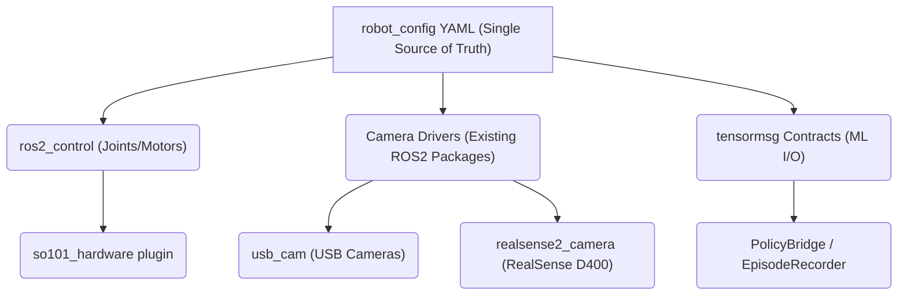
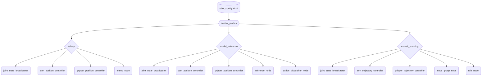
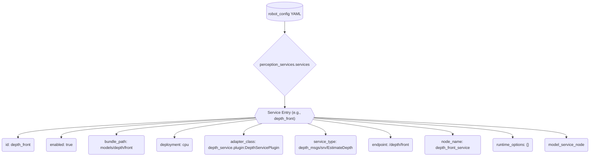

# 配置单一事实源（robot_config）概述

相关源码文件

以下文件被用作生成此 wiki 页面的上下文：

- [src/inference_service/README.en.md](https://atomgit.com/openeuler/IB_Robot/blob/openEuler-26.09/src/inference_service/README.en.md)
- [src/inference_service/README.md](https://atomgit.com/openeuler/IB_Robot/blob/openEuler-26.09/src/inference_service/README.md)
- [src/robot_config/README.en.md](https://atomgit.com/openeuler/IB_Robot/blob/openEuler-26.09/src/robot_config/README.en.md)
- [src/robot_config/README.md](https://atomgit.com/openeuler/IB_Robot/blob/openEuler-26.09/src/robot_config/README.md)
- [src/robot_config/config/robots/so101_single_arm.yaml](https://atomgit.com/openeuler/IB_Robot/blob/openEuler-26.09/src/robot_config/config/robots/so101_single_arm.yaml)
- [src/robot_config/launch/robot.launch.py](https://atomgit.com/openeuler/IB_Robot/blob/openEuler-26.09/src/robot_config/launch/robot.launch.py)
- [src/robot_config/robot_config/config.py](https://atomgit.com/openeuler/IB_Robot/blob/openEuler-26.09/src/robot_config/robot_config/config.py)
- [src/robot_config/robot_config/loader.py](https://atomgit.com/openeuler/IB_Robot/blob/openEuler-26.09/src/robot_config/robot_config/loader.py)
- [src/robot_config/test/test_config.py](https://atomgit.com/openeuler/IB_Robot/blob/openEuler-26.09/src/robot_config/test/test_config.py)
- [src/robot_config/test/test_embodied_entry_config.py](https://atomgit.com/openeuler/IB_Robot/blob/openEuler-26.09/src/robot_config/test/test_embodied_entry_config.py)
- [src/robot_config/test/test_launch_readiness.py](https://atomgit.com/openeuler/IB_Robot/blob/openEuler-26.09/src/robot_config/test/test_launch_readiness.py)

本页面提供 `robot_config` 包的高层概览，它是 RoboFrame 生态中机器人硬件配置的单一事实源（SSOT）。内容包括 YAML 配置文件如何定义 `ros2_control` 接口、外围设备与机器学习（ML）策略 I/O 契约，以及这些配置在 launch 期间如何被编排。

`robot_config` 系统旨在通过集中定义消除冗余，保证机器人各组件间的一致性。它桥接用于关节与电机控制的 `ros2_control`、相机等外围设备的既有 ROS 2 驱动，以及用于 ML 策略 I/O 契约的 `tensormsg`。

关于配置系统各专题的详细信息，请参阅子页面：

- [配置加载与校验](./config_loader_validation.md)
- [Launch 构建器](./launch_builders.md)
- [机器人配置档案与控制模式](./robot_profiles_control_modes.md)

## 配置系统概览

`robot_config` 系统的核心是一个定义整台机器人硬件设置的 YAML 文件，包括 `ros2_control` 参数、相机驱动与 ML 契约。系统自动处理相机坐标系的 TF 发布等事项，并与标准 ROS 2 `camera_info_manager` 集成以完成标定。

一个关键特性是与 `tensormsg` 的集成：ML 契约通过配置中定义的名称引用外围设备，从而保证从传感器到 ML 模型一致的命名方案与数据流。

来源：[src/robot_config/README.md:3-12](https://atomgit.com/openeuler/IB_Robot/blob/openEuler-26.09/src/robot_config/README.md#L3-L12)

### 架构图

下图展示 `robot_config` 系统的高层架构，说明 YAML 配置如何作为各类机器人组件的中央数据源。

来源：[src/robot_config/README.md:53-68](https://atomgit.com/openeuler/IB_Robot/blob/openEuler-26.09/src/robot_config/README.md#L53-L68)

## 配置加载与校验

`robot_config` 系统为机器人配置的加载与校验提供健壮机制。配置从 YAML 文件加载，支持 `base_config` 继承，实现模块化、可扩展的机器人定义。该继承机制允许创建 overlay 配置来扩展或修改既有机器人档案，而无需复制整份 YAML 内容。加载器处理映射的递归合并，以及使用 `__append__` 关键字的列表追加规则，并执行严格校验以防止循环引用、容器类型不匹配等问题。

关于配置如何加载、合并与校验的细节，见[配置加载与校验](./config_loader_validation.md)。

来源：[src/robot_config/README.md:125-143](https://atomgit.com/openeuler/IB_Robot/blob/openEuler-26.09/src/robot_config/README.md#L125-L143), [src/robot_config/robot_config/loader.py:90-133](https://atomgit.com/openeuler/IB_Robot/blob/openEuler-26.09/src/robot_config/robot_config/loader.py#L90-L133)

## Launch 编排

`robot_config` 系统与 ROS 2 launch 系统深度集成，具体通过 `robot.launch.py` 实现。这个中央 launch 文件基于已加载的机器人配置动态生成并编排各类 ROS 2 节点，负责拉起 `ros2_control` 硬件接口与控制器、机器人状态发布器、相机驱动、静态 TF 发布器，以及语音 ASR、语音方向、语音 TTS、推理服务、MoveIt 运动规划等可选组件。

launch 系统支持不同控制模式（如 `teleop`、`model_inference`、`moveit_planning`）与仿真平台（如 Gazebo、MuJoCo、mock 硬件），并相应调整所启动的节点及其参数。它还内置自动 rosbag 录制与 Rerun 实时可视化机制。

关于 `robot.launch.py` 如何组合这些子图的完整说明，参见 [Launch 构建器](./launch_builders.md)。

来源：[src/robot_config/launch/robot.launch.py:1-83](https://atomgit.com/openeuler/IB_Robot/blob/openEuler-26.09/src/robot_config/launch/robot.launch.py#L1-L83)

## 机器人档案与控制模式

`robot_config` 包定义了多种机器人档案，各自面向特定的硬件配置与功能。这些档案是封装机器人完整配置的 YAML 文件，如 `so101_single_arm` 或 `lekiwi_nav_grasp`。每个档案指定机器人的关节、`ros2_control` 设置、外围设备（如相机），并定义不同的 `control_modes`。

控制模式（如 `teleop`、`model_inference`、`moveit_planning`）决定机器人的行为以及活跃的控制器与服务集合。例如 `model_inference` 模式启用端到端控制的推理流水线，而 `moveit_planning` 激活 MoveIt 进行轨迹规划。系统确保只为所选控制模式启动必要的控制器与服务，优化资源使用并避免冲突。

可用机器人 YAML 及其控制模式的详细目录，见[机器人配置档案与控制模式](./robot_profiles_control_modes.md)。

来源：[src/robot_config/config/robots/so101_single_arm.yaml:5-120](https://atomgit.com/openeuler/IB_Robot/blob/openEuler-26.09/src/robot_config/config/robots/so101_single_arm.yaml#L5-L120), [src/robot_config/README.md:15-22](https://atomgit.com/openeuler/IB_Robot/blob/openEuler-26.09/src/robot_config/README.md#L15-L22)

### 控制模式编排

下图展示不同控制模式如何按机器人配置激活特定的控制器与服务集合。

来源：[src/robot_config/config/robots/so101_single_arm.yaml:58-120](https://atomgit.com/openeuler/IB_Robot/blob/openEuler-26.09/src/robot_config/config/robots/so101_single_arm.yaml#L58-L120), [src/robot_config/launch/robot.launch.py:108-110](https://atomgit.com/openeuler/IB_Robot/blob/openEuler-26.09/src/robot_config/launch/robot.launch.py#L108-L110)

## 模型服务配置

`robot_config` 系统还提供编排模型服务的通用机制。这些服务定义在 YAML 配置的顶层 `perception_services` 键下。每个服务条目从 `inference_manifest` 显式选择一个命名 deployment，而非直接指定后端或设备细节，从而保证配置与底层推理运行时细节解耦。

配置加载器校验 `bundle_path`、`deployment`、插件类与服务类型，拒绝任何重复的 ID、节点名或端点。launch 构建器随后为每个启用的服务启动独立的 `model_service_node`，不依赖预定义的模型族白名单。模型产物的完整性在模型打包阶段校验，而非服务启动时。

来源：[src/robot_config/README.md:70-95](https://atomgit.com/openeuler/IB_Robot/blob/openEuler-26.09/src/robot_config/README.md#L70-L95), [src/inference_service/README.md:3-8](https://atomgit.com/openeuler/IB_Robot/blob/openEuler-26.09/src/inference_service/README.md#L3-L8), [src/inference_service/README.en.md:3-5](https://atomgit.com/openeuler/IB_Robot/blob/openEuler-26.09/src/inference_service/README.en.md#L3-L5)

### 模型服务部署

来源：[src/robot_config/README.md:75-89](https://atomgit.com/openeuler/IB_Robot/blob/openEuler-26.09/src/robot_config/README.md#L75-L89)
