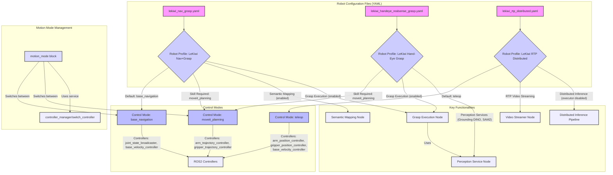
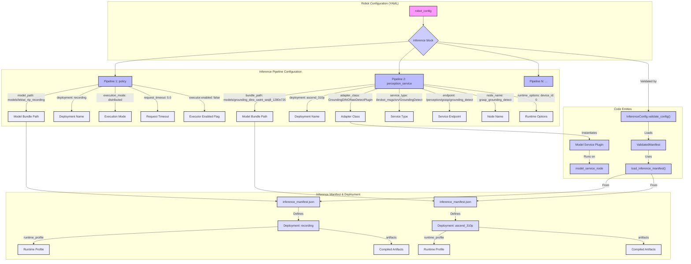

# 机器人配置档案与控制模式

相关源码文件

以下文件被用作生成此 wiki 页面的上下文：

- [.agents/skills/ibrobot-inference-verify/references/board.md](https://atomgit.com/openeuler/IB_Robot/blob/openEuler-26.09/.agents/skills/ibrobot-inference-verify/references/board.md)
- [.agents/skills/ibrobot-inference-verify/references/troubleshooting.md](https://atomgit.com/openeuler/IB_Robot/blob/openEuler-26.09/.agents/skills/ibrobot-inference-verify/references/troubleshooting.md)
- [.agents/skills/ibrobot-inference-verify/scripts/generate_verify_yaml.py](https://atomgit.com/openeuler/IB_Robot/blob/openEuler-26.09/.agents/skills/ibrobot-inference-verify/scripts/generate_verify_yaml.py)
- [docs/embodied_pipeline.md](https://atomgit.com/openeuler/IB_Robot/blob/openEuler-26.09/docs/embodied_pipeline.md)
- [docs/so101_banana_pick_pipeline_commands.md](https://atomgit.com/openeuler/IB_Robot/blob/openEuler-26.09/docs/so101_banana_pick_pipeline_commands.md)
- [docs/so101_handeye_calibration_commands.md](https://atomgit.com/openeuler/IB_Robot/blob/openEuler-26.09/docs/so101_handeye_calibration_commands.md)
- [scripts/download_models.py](https://atomgit.com/openeuler/IB_Robot/blob/openEuler-26.09/scripts/download_models.py)
- [src/ibrobot_msgs/action/ArmReturnHome.action](https://atomgit.com/openeuler/IB_Robot/blob/openEuler-26.09/src/ibrobot_msgs/action/ArmReturnHome.action)
- [src/ibrobot_msgs/action/DispatchInfer.action](https://atomgit.com/openeuler/IB_Robot/blob/openEuler-26.09/src/ibrobot_msgs/action/DispatchInfer.action)
- [src/ibrobot_msgs/msg/DistributedInferenceResult.msg](https://atomgit.com/openeuler/IB_Robot/blob/openEuler-26.09/src/ibrobot_msgs/msg/DistributedInferenceResult.msg)
- [src/ibrobot_msgs/msg/InferenceError.msg](https://atomgit.com/openeuler/IB_Robot/blob/openEuler-26.09/src/ibrobot_msgs/msg/InferenceError.msg)
- [src/ibrobot_msgs/msg/InferenceFeatureSummary.msg](https://atomgit.com/openeuler/IB_Robot/blob/openEuler-26.09/src/ibrobot_msgs/msg/InferenceFeatureSummary.msg)
- [src/ibrobot_msgs/msg/InferencePipelineStatus.msg](https://atomgit.com/openeuler/IB_Robot/blob/openEuler-26.09/src/ibrobot_msgs/msg/InferencePipelineStatus.msg)
- [src/ibrobot_msgs/msg/InferencePolicySummary.msg](https://atomgit.com/openeuler/IB_Robot/blob/openEuler-26.09/src/ibrobot_msgs/msg/InferencePolicySummary.msg)
- [src/perception_service/README.md](https://atomgit.com/openeuler/IB_Robot/blob/openEuler-26.09/src/perception_service/README.md)
- [src/perception_service/perception_service/package_ascend_perception_bundles.py](https://atomgit.com/openeuler/IB_Robot/blob/openEuler-26.09/src/perception_service/perception_service/package_ascend_perception_bundles.py)
- [src/perception_service/test/test_package_ascend_perception_bundles.py](https://atomgit.com/openeuler/IB_Robot/blob/openEuler-26.09/src/perception_service/test/test_package_ascend_perception_bundles.py)
- [src/robot_config/config/lekiwi/lekiwi_gamepad_base.yaml](https://atomgit.com/openeuler/IB_Robot/blob/openEuler-26.09/src/robot_config/config/lekiwi/lekiwi_gamepad_base.yaml)
- [src/robot_config/config/lekiwi/rtp_recording_bundle/config.json](https://atomgit.com/openeuler/IB_Robot/blob/openEuler-26.09/src/robot_config/config/lekiwi/rtp_recording_bundle/config.json)
- [src/robot_config/config/lekiwi/rtp_recording_bundle/inference_manifest.json](https://atomgit.com/openeuler/IB_Robot/blob/openEuler-26.09/src/robot_config/config/lekiwi/rtp_recording_bundle/inference_manifest.json)
- [src/robot_config/config/lekiwi/rtp_recording_bundle/policy_postprocessor.json](https://atomgit.com/openeuler/IB_Robot/blob/openEuler-26.09/src/robot_config/config/lekiwi/rtp_recording_bundle/policy_postprocessor.json)
- [src/robot_config/config/lekiwi/rtp_recording_bundle/policy_preprocessor.json](https://atomgit.com/openeuler/IB_Robot/blob/openEuler-26.09/src/robot_config/config/lekiwi/rtp_recording_bundle/policy_preprocessor.json)
- [src/robot_config/config/robots/lekiwi_handeye_realsense_grasp.yaml](https://atomgit.com/openeuler/IB_Robot/blob/openEuler-26.09/src/robot_config/config/robots/lekiwi_handeye_realsense_grasp.yaml)
- [src/robot_config/config/robots/lekiwi_handeye_realsense_grasp_pc.yaml](https://atomgit.com/openeuler/IB_Robot/blob/openEuler-26.09/src/robot_config/config/robots/lekiwi_handeye_realsense_grasp_pc.yaml)
- [src/robot_config/config/robots/lekiwi_nav_grasp.yaml](https://atomgit.com/openeuler/IB_Robot/blob/openEuler-26.09/src/robot_config/config/robots/lekiwi_nav_grasp.yaml)
- [src/robot_config/config/robots/lekiwi_rtp_distributed.yaml](https://atomgit.com/openeuler/IB_Robot/blob/openEuler-26.09/src/robot_config/config/robots/lekiwi_rtp_distributed.yaml)
- [src/robot_config/robot_config/__init__.py](https://atomgit.com/openeuler/IB_Robot/blob/openEuler-26.09/src/robot_config/robot_config/__init__.py)
- [src/robot_config/robot_config/inference_config.py](https://atomgit.com/openeuler/IB_Robot/blob/openEuler-26.09/src/robot_config/robot_config/inference_config.py)
- [src/robot_config/test/test_phone_teleop_config.py](https://atomgit.com/openeuler/IB_Robot/blob/openEuler-26.09/src/robot_config/test/test_phone_teleop_config.py)
- [src/robot_config/test/test_teleop_home_action.py](https://atomgit.com/openeuler/IB_Robot/blob/openEuler-26.09/src/robot_config/test/test_teleop_home_action.py)
- [src/robot_config/test/test_unified_lekiwi_grasp_navigation_config.py](https://atomgit.com/openeuler/IB_Robot/blob/openEuler-26.09/src/robot_config/test/test_unified_lekiwi_grasp_navigation_config.py)
- [src/robot_config/test/test_voice_tts_launch_builder.py](https://atomgit.com/openeuler/IB_Robot/blob/openEuler-26.09/src/robot_config/test/test_voice_tts_launch_builder.py)
- [src/voice_tts_service/test/test_model_service_plugin.py](https://atomgit.com/openeuler/IB_Robot/blob/openEuler-26.09/src/voice_tts_service/test/test_model_service_plugin.py)
- [src/voice_tts_service/voice_tts_service/model_service_plugin.py](https://atomgit.com/openeuler/IB_Robot/blob/openEuler-26.09/src/voice_tts_service/voice_tts_service/model_service_plugin.py)
- [tests/test_download_models.py](https://atomgit.com/openeuler/IB_Robot/blob/openEuler-26.09/tests/test_download_models.py)

本页面编目 YAML 配置文件中定义的各类机器人配置档案（profile）及其支持的控制模式。它详述这些档案的实现、加载与校验方式，以及机器人操作可用的不同控制模式，包括遥操作、模型推理与 MoveIt 规划。

## 机器人配置档案

机器人配置档案定义于 `src/robot_config/config/robots/` 目录下的 YAML 文件中。这些文件是机器人硬件配置、关节定义、MoveIt 设置、感知服务与控制模式的唯一事实来源（SSOT）。

### LeKiwi 导航与抓取（`lekiwi_nav_grasp.yaml`）

`lekiwi_nav_grasp.yaml` 档案 [src/robot_config/config/robots/lekiwi_nav_grasp.yaml:1-168](https://atomgit.com/openeuler/IB_Robot/blob/openEuler-26.09/src/robot_config/config/robots/lekiwi_nav_grasp.yaml#L1-L168) 配置一台同时执行抓取与导航任务的 LeKiwi 移动操作平台。

**硬件假设：**

*   LeKiwi 全向底盘（关节 7/8/9）与 SO-101 从臂（关节 1-6），由 `LeKiwiSystemHardware` 插件驱动。
*   从臂关节标定来自 `~/.calibrate/so101_follower_calibrate.json`。
*   两台 D435i 相机连接到 310P 板卡：一台装在 SO-101 夹爪上（“wrist”），一台固定在 LeKiwi 底盘上（“front”）用于语义建图。
*   一个 ReSpeaker 麦克风阵列用于语音定向。
*   抓取执行期间底盘保持静止，仅手臂与夹爪运动。
*   导航仅控制底盘关节 7/8/9，运动模式强制互斥。

**关键配置细节：**

*   **关节：** 定义 `arm`、`gripper`、`base` 与 `all` 关节组 [src/robot_config/config/robots/lekiwi_nav_grasp.yaml:32-45](https://atomgit.com/openeuler/IB_Robot/blob/openEuler-26.09/src/robot_config/config/robots/lekiwi_nav_grasp.yaml#L32-L45)。
*   **MoveIt：** 配置 `arm_group_name`、`base_link`、`ee_link`、`shoulder_link` 与运动反馈参数 [src/robot_config/config/robots/lekiwi_nav_grasp.yaml:47-64](https://atomgit.com/openeuler/IB_Robot/blob/openEuler-26.09/src/robot_config/config/robots/lekiwi_nav_grasp.yaml#L47-L64)。MoveIt 主要消费手臂/夹爪关节，同时完整关节状态可用于导航与数据集录制。
*   **运动模式：** 支持操作与导航控制之间的动态切换。`manipulation_controllers` 包括 `arm_trajectory_controller` 与 `gripper_trajectory_controller`，`navigation_controllers` 包括 `base_velocity_controller` [src/robot_config/config/robots/lekiwi_nav_grasp.yaml:68-80](https://atomgit.com/openeuler/IB_Robot/blob/openEuler-26.09/src/robot_config/config/robots/lekiwi_nav_grasp.yaml#L68-L80)。
*   **语义建图：** 默认在 `hybrid` 阶段启用，使用 “front” 相机进行 RGB-D 更新与定位 [src/robot_config/config/robots/lekiwi_nav_grasp.yaml:83-114](https://atomgit.com/openeuler/IB_Robot/blob/openEuler-26.09/src/robot_config/config/robots/lekiwi_nav_grasp.yaml#L83-L114)。它包含 SAM2、RAM++、SigLIP2 等感知后端配置 [src/robot_config/config/robots/lekiwi_nav_grasp.yaml:115-123](https://atomgit.com/openeuler/IB_Robot/blob/openEuler-26.09/src/robot_config/config/robots/lekiwi_nav_grasp.yaml#L115-L123)。
*   **控制模式：** `lekiwi_nav_grasp.yaml` 档案支持不同导航阶段（`hybrid`、`grasp`、`mapping`、`navigation`），动态启停各项功能。例如 `grasp` 阶段禁用导航，仅启用 `respeaker` 与 `wrist` 外设 [src/robot_config/test/test_unified_lekiwi_grasp_navigation_config.py:120-122](https://atomgit.com/openeuler/IB_Robot/blob/openEuler-26.09/src/robot_config/test/test_unified_lekiwi_grasp_navigation_config.py#L120-L122)。

来源：[src/robot_config/config/robots/lekiwi_nav_grasp.yaml:1-168](https://atomgit.com/openeuler/IB_Robot/blob/openEuler-26.09/src/robot_config/config/robots/lekiwi_nav_grasp.yaml#L1-L168), [src/robot_config/test/test_unified_lekiwi_grasp_navigation_config.py:120-122](https://atomgit.com/openeuler/IB_Robot/blob/openEuler-26.09/src/robot_config/test/test_unified_lekiwi_grasp_navigation_config.py#L120-L122)

### LeKiwi 手眼 RealSense 抓取（`lekiwi_handeye_realsense_grasp.yaml`）

该档案 [src/robot_config/config/robots/lekiwi_handeye_realsense_grasp.yaml:1-175](https://atomgit.com/openeuler/IB_Robot/blob/openEuler-26.09/src/robot_config/config/robots/lekiwi_handeye_realsense_grasp.yaml#L1-L175) 聚焦于使用单台安装于夹爪的 RealSense 相机进行抓取。

**硬件假设：**

*   LeKiwi 全向底盘（关节 7/8/9）与 SO-101 从臂（关节 1-6）。
*   一台 RealSense 相机连接到 310P 板卡，刚性安装在 SO-101 夹爪上。
*   无独立的顶部/前部固定相机。
*   抓取执行期间底盘保持静止。

**关键配置细节：**

*   **感知服务：** 配置 `grasp_grounding`（Grounding DINO）与 `grasp_segmentation`（SAM2）服务，均部署于 `ascend_310p` [src/robot_config/config/robots/lekiwi_handeye_realsense_grasp.yaml:71-95](https://atomgit.com/openeuler/IB_Robot/blob/openEuler-26.09/src/robot_config/config/robots/lekiwi_handeye_realsense_grasp.yaml#L71-L95)。
*   **抓取执行：** 启用抓取执行，指定动作名、模型 bundle 路径（`models/graspgen`）与部署目标（`ascend_310p`）[src/robot_config/config/robots/lekiwi_handeye_realsense_grasp.yaml:97-105](https://atomgit.com/openeuler/IB_Robot/blob/openEuler-26.09/src/robot_config/config/robots/lekiwi_handeye_realsense_grasp.yaml#L97-L105)。它还定义规划、校验、检测与 IK/FK 服务。
*   **相机：** 指定 `wrist` 相机的 RGB 与深度话题 [src/robot_config/config/robots/lekiwi_handeye_realsense_grasp.yaml:145-149](https://atomgit.com/openeuler/IB_Robot/blob/openEuler-26.09/src/robot_config/config/robots/lekiwi_handeye_realsense_grasp.yaml#L145-L149)。

面向 PC 的变体 `lekiwi_handeye_realsense_grasp_pc.yaml` 用于在 NVIDIA CUDA 上运行，主要差异在推理后端 [docs/so101_banana_pick_pipeline_commands.md:11-12](https://atomgit.com/openeuler/IB_Robot/blob/openEuler-26.09/docs/so101_banana_pick_pipeline_commands.md#L11-L12)。

来源：[src/robot_config/config/robots/lekiwi_handeye_realsense_grasp.yaml:1-175](https://atomgit.com/openeuler/IB_Robot/blob/openEuler-26.09/src/robot_config/config/robots/lekiwi_handeye_realsense_grasp.yaml#L1-L175), [docs/so101_banana_pick_pipeline_commands.md:11-12](https://atomgit.com/openeuler/IB_Robot/blob/openEuler-26.09/docs/so101_banana_pick_pipeline_commands.md#L11-L12)

### LeKiwi RTP 分布式遥操作（`lekiwi_rtp_distributed.yaml`）

该档案 [src/robot_config/config/robots/lekiwi_rtp_distributed.yaml:1-188](https://atomgit.com/openeuler/IB_Robot/blob/openEuler-26.09/src/robot_config/config/robots/lekiwi_rtp_distributed.yaml#L1-L188) 为带 RTP 视频流的遥操作数据采集设计，支持机器人主机与录制主机之间的分布式运行。

**数据流：**

*   **机器人主机：** 前部/腕部相机编码 H.264 视频经 RTP 发送。关节状态与命令经 DDS 发送。
*   **录制主机：** 接收视频流、关节状态与命令，组装为回合（episode）。

**关键配置细节：**

*   **控制模式：** 默认为 `teleop` [src/robot_config/config/robots/lekiwi_rtp_distributed.yaml:67](https://atomgit.com/openeuler/IB_Robot/blob/openEuler-26.09/src/robot_config/config/robots/lekiwi_rtp_distributed.yaml#L67)。
*   **推理：** 对 `teleop` 控制模式启用，但执行器被禁用（`executor.enabled: false`）以防止策略驱动机器人 [src/robot_config/config/robots/lekiwi_rtp_distributed.yaml:89-98](https://atomgit.com/openeuler/IB_Robot/blob/openEuler-26.09/src/robot_config/config/robots/lekiwi_rtp_distributed.yaml#L89-L98)。这允许流水线为录制目的持有视频编码器与 RTP 发送器。
*   **遥操作：** `teleoperation.enabled` 默认为 `false`，因为主臂与手柄通常连接到单独的工作站。若遥操作硬件位于机器人主机上，应将该标志设为 `true` [src/robot_config/config/robots/lekiwi_rtp_distributed.yaml:24-40](https://atomgit.com/openeuler/IB_Robot/blob/openEuler-26.09/src/robot_config/config/robots/lekiwi_rtp_distributed.yaml#L24-L40)。
*   **导航：** 启用，但 `nav2_bringup` 与 `ekf_rtabmap` 默认禁用。`cmd_vel_bridge` 启用于底盘速度控制 [src/robot_config/config/robots/lekiwi_rtp_distributed.yaml:123-164](https://atomgit.com/openeuler/IB_Robot/blob/openEuler-26.09/src/robot_config/config/robots/lekiwi_rtp_distributed.yaml#L123-L164)。

来源：[src/robot_config/config/robots/lekiwi_rtp_distributed.yaml:1-188](https://atomgit.com/openeuler/IB_Robot/blob/openEuler-26.09/src/robot_config/config/robots/lekiwi_rtp_distributed.yaml#L1-L188)

## 控制模式

控制模式定义机器人如何接收与执行命令。它们在 `robot_config` YAML 文件的 `control_modes` 章节中指定。

### 遥操作（`teleop`）

`teleop` 控制模式允许人类操作员直接控制机器人，通常使用主臂或手柄。

**特征：**

*   **控制器：** 激活 `joint_state_broadcaster`、`arm_position_controller`、`gripper_position_controller` 与 `base_velocity_controller` [src/robot_config/config/robots/lekiwi_rtp_distributed.yaml:73-76](https://atomgit.com/openeuler/IB_Robot/blob/openEuler-26.09/src/robot_config/config/robots/lekiwi_rtp_distributed.yaml#L73-L76)。
*   **推理：** 推理流水线可能为数据采集启用（如 RTP 视频编码），但执行器通常被禁用以防止自主运动 [src/robot_config/config/robots/lekiwi_rtp_distributed.yaml:89-98](https://atomgit.com/openeuler/IB_Robot/blob/openEuler-26.09/src/robot_config/config/robots/lekiwi_rtp_distributed.yaml#L89-L98)。
*   **用例：** 主要用于数据采集或直接人工控制。

来源：[src/robot_config/config/robots/lekiwi_rtp_distributed.yaml:73-76](https://atomgit.com/openeuler/IB_Robot/blob/openEuler-26.09/src/robot_config/config/robots/lekiwi_rtp_distributed.yaml#L73-L76), [src/robot_config/config/robots/lekiwi_rtp_distributed.yaml:89-98](https://atomgit.com/openeuler/IB_Robot/blob/openEuler-26.09/src/robot_config/config/robots/lekiwi_rtp_distributed.yaml#L89-L98)

### 模型推理（`model_inference`）

在该模式下，机器人动作由 AI 模型驱动。这涉及感知、推理与动作分发的流水线。

**特征：**

*   **推理流水线：** 配置具体推理流水线，包括其 `model_path`、`deployment`（如 `ascend_310p`、`torch-cuda`）、`execution_mode`（单体或分布式）与 `request_timeout` [src/robot_config/robot_config/inference_config.py:203-206](https://atomgit.com/openeuler/IB_Robot/blob/openEuler-26.09/src/robot_config/robot_config/inference_config.py#L203-L206)。
*   **执行器：** 执行器节点负责将推理流水线生成的动作分发给机器人的控制器。
*   **感知服务：** 通常依赖 `perception_service` 处理传感器数据并向推理模型提供场景理解 [src/perception_service/README.md:1-12](https://atomgit.com/openeuler/IB_Robot/blob/openEuler-26.09/src/perception_service/README.md#L1-L12)。

来源：[src/robot_config/robot_config/inference_config.py:203-206](https://atomgit.com/openeuler/IB_Robot/blob/openEuler-26.09/src/robot_config/robot_config/inference_config.py#L203-L206), [src/perception_service/README.md:1-12](https://atomgit.com/openeuler/IB_Robot/blob/openEuler-26.09/src/perception_service/README.md#L1-L12)

### MoveIt 规划（`moveit_planning`）

`moveit_planning` 控制模式利用 MoveIt 进行运动规划与执行，支持复杂的操作任务。

**特征：**

*   **控制器：** 通常激活 `joint_state_broadcaster`、`arm_trajectory_controller` 与 `gripper_trajectory_controller`。该模式下 `base_velocity_controller` 可能不激活，以确保手臂运动期间底盘保持静止 [src/robot_config/test/test_unified_lekiwi_grasp_navigation_config.py:110-111](https://atomgit.com/openeuler/IB_Robot/blob/openEuler-26.09/src/robot_config/test/test_unified_lekiwi_grasp_navigation_config.py#L110-L111)。
*   **运动规划：** MoveIt 负责为机器人手臂与夹爪生成无碰撞轨迹。
*   **抓取执行：** 与抓取规划及校验服务集成，执行抓取-放置操作 [src/robot_config/config/robots/lekiwi_handeye_realsense_grasp.yaml:97-105](https://atomgit.com/openeuler/IB_Robot/blob/openEuler-26.09/src/robot_config/config/robots/lekiwi_handeye_realsense_grasp.yaml#L97-L105)。
*   **技能集成：** `pick_object` 等技能可委托 MoveIt 执行运动，确保安全与正确的轨迹生成 [docs/embodied_pipeline.md:26-28](https://atomgit.com/openeuler/IB_Robot/blob/openEuler-26.09/docs/embodied_pipeline.md#L26-L28)。

来源：[src/robot_config/test/test_unified_lekiwi_grasp_navigation_config.py:110-111](https://atomgit.com/openeuler/IB_Robot/blob/openEuler-26.09/src/robot_config/test/test_unified_lekiwi_grasp_navigation_config.py#L110-L111), [src/robot_config/config/robots/lekiwi_handeye_realsense_grasp.yaml:97-105](https://atomgit.com/openeuler/IB_Robot/blob/openEuler-26.09/src/robot_config/config/robots/lekiwi_handeye_realsense_grasp.yaml#L97-L105), [docs/embodied_pipeline.md:26-28](https://atomgit.com/openeuler/IB_Robot/blob/openEuler-26.09/docs/embodied_pipeline.md#L26-L28)

## 控制模式管理

机器人配置中的 `motion_mode` 块 [src/robot_config/config/robots/lekiwi_nav_grasp.yaml:68-80](https://atomgit.com/openeuler/IB_Robot/blob/openEuler-26.09/src/robot_config/config/robots/lekiwi_nav_grasp.yaml#L68-L80) 对管理不同控制模式之间的切换至关重要，尤其是兼具操作与导航能力的机器人。

**关键参数：**

*   `enabled`：激活或停用运动模式管理。
*   `navigation_enabled_on_startup`：决定启动时导航是否激活。
*   `navigation_enabled_topic`：发布导航启用状态的话题。
*   `set_navigation_enabled_service`：请求导航启用变更的服务。
*   `controller_switch_service`：用于切换活动控制器的服务（如手臂/夹爪与底盘控制器之间）。
*   `manipulation_controllers`：操作期间活动的控制器列表。
*   `navigation_controllers`：导航期间活动的控制器列表。
*   `transition_timeout_s`：控制器切换超时。
*   `manipulation_control_mode`：与操作关联的控制模式。
*   `navigation_control_mode`：与导航关联的控制模式。

该机制确保运动所有权的互斥，防止多个子系统试图控制相同关节时产生冲突。

来源：[src/robot_config/config/robots/lekiwi_nav_grasp.yaml:68-80](https://atomgit.com/openeuler/IB_Robot/blob/openEuler-26.09/src/robot_config/config/robots/lekiwi_nav_grasp.yaml#L68-L80)

## 图：机器人配置档案与控制模式

**图题：机器人配置档案与控制模式概览**

来源：[src/robot_config/config/robots/lekiwi_nav_grasp.yaml](https://atomgit.com/openeuler/IB_Robot/blob/openEuler-26.09/src/robot_config/config/robots/lekiwi_nav_grasp.yaml), [src/robot_config/config/robots/lekiwi_handeye_realsense_grasp.yaml](https://atomgit.com/openeuler/IB_Robot/blob/openEuler-26.09/src/robot_config/config/robots/lekiwi_handeye_realsense_grasp.yaml), [src/robot_config/config/robots/lekiwi_rtp_distributed.yaml](https://atomgit.com/openeuler/IB_Robot/blob/openEuler-26.09/src/robot_config/config/robots/lekiwi_rtp_distributed.yaml)

## 图：推理流水线配置

**图题：推理流水线配置流**

此图说明推理流水线如何在 `robot_config` YAML 中配置，并链接到底层 `inference_manifest.json` 文件以及负责其校验与执行的代码实体。`inference_manifest.json` 定义模型 bundle 的结构与 artifacts，包括面向不同硬件目标（如 `ascend_310p`、`recording`）的部署。`InferenceConfig` 类 [src/robot_config/robot_config/inference_config.py:146-217](https://atomgit.com/openeuler/IB_Robot/blob/openEuler-26.09/src/robot_config/robot_config/inference_config.py#L146-L217) 负责校验这些配置，确保指定的 `model_path` 与 `deployment` 对应由 `load_inference_manifest` 加载的有效 `ValidatedManifest` [src/robot_config/robot_config/inference_config.py:22-23](https://atomgit.com/openeuler/IB_Robot/blob/openEuler-26.09/src/robot_config/robot_config/inference_config.py#L22-L23)。模型服务插件（`MSP`）随后基于 `adapter_class` 实例化，运行于 `model_service_node`。

来源：[src/robot_config/robot_config/inference_config.py:22-23](https://atomgit.com/openeuler/IB_Robot/blob/openEuler-26.09/src/robot_config/robot_config/inference_config.py#L22-L23), [src/robot_config/robot_config/inference_config.py:146-217](https://atomgit.com/openeuler/IB_Robot/blob/openEuler-26.09/src/robot_config/robot_config/inference_config.py#L146-L217), [src/robot_config/config/robots/lekiwi_rtp_distributed.yaml:89-98](https://atomgit.com/openeuler/IB_Robot/blob/openEuler-26.09/src/robot_config/config/robots/lekiwi_rtp_distributed.yaml#L89-L98), [src/robot_config/config/robots/lekiwi_handeye_realsense_grasp.yaml:71-95](https://atomgit.com/openeuler/IB_Robot/blob/openEuler-26.09/src/robot_config/config/robots/lekiwi_handeye_realsense_grasp.yaml#L71-L95), [src/perception_service/perception_service/package_ascend_perception_bundles.py:1-67](https://atomgit.com/openeuler/IB_Robot/blob/openEuler-26.09/src/perception_service/perception_service/package_ascend_perception_bundles.py#L1-L67), [tests/test_download_models.py:18-47](https://atomgit.com/openeuler/IB_Robot/blob/openEuler-26.09/tests/test_download_models.py#L18-L47), [scripts/download_models.py:52-139](https://atomgit.com/openeuler/IB_Robot/blob/openEuler-26.09/scripts/download_models.py#L52-L139), [.agents/skills/ibrobot-inference-verify/references/troubleshooting.md:155-164](https://atomgit.com/openeuler/IB_Robot/blob/openEuler-26.09/.agents/skills/ibrobot-inference-verify/references/troubleshooting.md#L155-L164)
