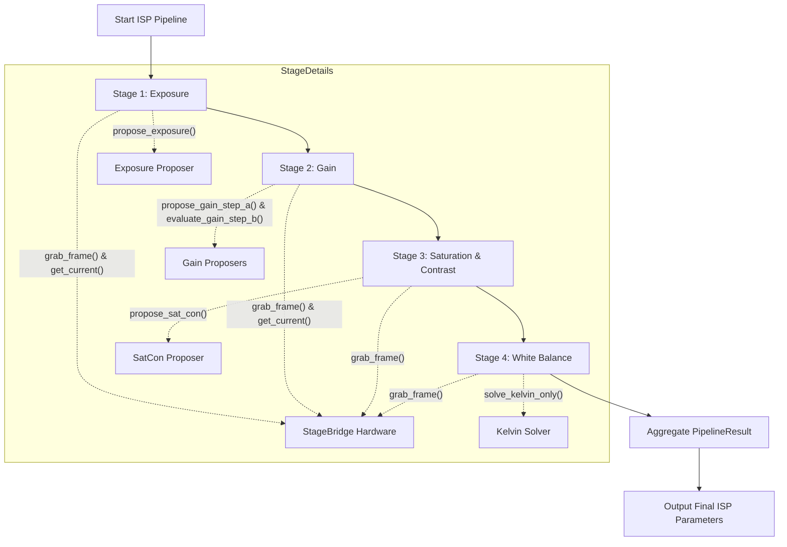
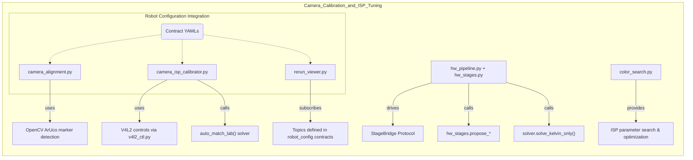
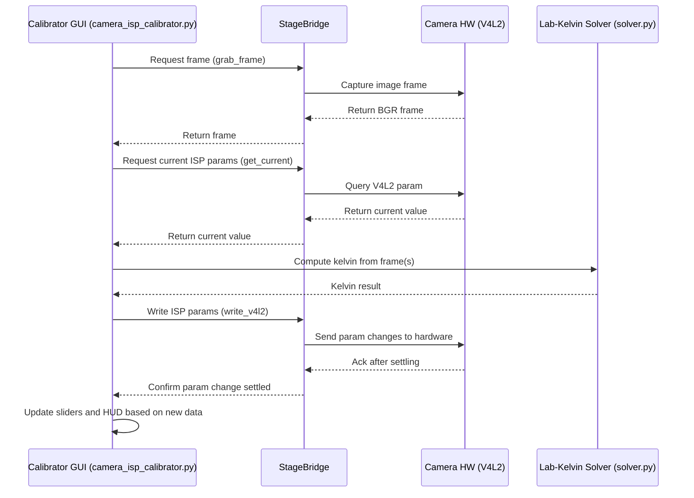

# 相机标定与 ISP 调优

<details>
<summary>相关源码文件</summary>

以下文件被用作生成此 wiki 页面的上下文：

- [docs/calibration_targets/机械臂底座marker0and1.pdf](https://atomgit.com/openeuler/IB_Robot/blob/openEuler-26.09/docs/calibration_targets/机械臂底座marker0and1.pdf)
- [docs/calibration_targets/机械臂底座marker2and3.pdf](https://atomgit.com/openeuler/IB_Robot/blob/openEuler-26.09/docs/calibration_targets/机械臂底座marker2and3.pdf)
- [docs/calibration_targets/标准24色色卡.pdf](https://atomgit.com/openeuler/IB_Robot/blob/openEuler-26.09/docs/calibration_targets/标准24色色卡.pdf)
- [src/dataset_tools/README.md](https://atomgit.com/openeuler/IB_Robot/blob/openEuler-26.09/src/dataset_tools/README.md)
- [src/dataset_tools/dataset_tools/camera_alignment.py](https://atomgit.com/openeuler/IB_Robot/blob/openEuler-26.09/src/dataset_tools/dataset_tools/camera_alignment.py)
- [src/dataset_tools/dataset_tools/camera_isp/__init__.py](https://atomgit.com/openeuler/IB_Robot/blob/openEuler-26.09/src/dataset_tools/dataset_tools/camera_isp/__init__.py)
- [src/dataset_tools/dataset_tools/camera_isp/build_lut.py](https://atomgit.com/openeuler/IB_Robot/blob/openEuler-26.09/src/dataset_tools/dataset_tools/camera_isp/build_lut.py)
- [src/dataset_tools/dataset_tools/camera_isp/camera_isp_offline_tables.json](https://atomgit.com/openeuler/IB_Robot/blob/openEuler-26.09/src/dataset_tools/dataset_tools/camera_isp/camera_isp_offline_tables.json)
- [src/dataset_tools/dataset_tools/camera_isp/color_search.py](https://atomgit.com/openeuler/IB_Robot/blob/openEuler-26.09/src/dataset_tools/dataset_tools/camera_isp/color_search.py)
- [src/dataset_tools/dataset_tools/camera_isp/color_space.py](https://atomgit.com/openeuler/IB_Robot/blob/openEuler-26.09/src/dataset_tools/dataset_tools/camera_isp/color_space.py)
- [src/dataset_tools/dataset_tools/camera_isp/colorchecker24.py](https://atomgit.com/openeuler/IB_Robot/blob/openEuler-26.09/src/dataset_tools/dataset_tools/camera_isp/colorchecker24.py)
- [src/dataset_tools/dataset_tools/camera_isp/exposure_units.py](https://atomgit.com/openeuler/IB_Robot/blob/openEuler-26.09/src/dataset_tools/dataset_tools/camera_isp/exposure_units.py)
- [src/dataset_tools/dataset_tools/camera_isp/hw_pipeline.py](https://atomgit.com/openeuler/IB_Robot/blob/openEuler-26.09/src/dataset_tools/dataset_tools/camera_isp/hw_pipeline.py)
- [src/dataset_tools/dataset_tools/camera_isp/hw_stages.py](https://atomgit.com/openeuler/IB_Robot/blob/openEuler-26.09/src/dataset_tools/dataset_tools/camera_isp/hw_stages.py)
- [src/dataset_tools/dataset_tools/camera_isp/pedestal.py](https://atomgit.com/openeuler/IB_Robot/blob/openEuler-26.09/src/dataset_tools/dataset_tools/camera_isp/pedestal.py)
- [src/dataset_tools/dataset_tools/camera_isp/solver.py](https://atomgit.com/openeuler/IB_Robot/blob/openEuler-26.09/src/dataset_tools/dataset_tools/camera_isp/solver.py)
- [src/dataset_tools/dataset_tools/camera_isp/v4l2_ctl.py](https://atomgit.com/openeuler/IB_Robot/blob/openEuler-26.09/src/dataset_tools/dataset_tools/camera_isp/v4l2_ctl.py)
- [src/dataset_tools/dataset_tools/camera_isp_calibrator.py](https://atomgit.com/openeuler/IB_Robot/blob/openEuler-26.09/src/dataset_tools/dataset_tools/camera_isp_calibrator.py)
- [src/dataset_tools/dataset_tools/opencv_utils.py](https://atomgit.com/openeuler/IB_Robot/blob/openEuler-26.09/src/dataset_tools/dataset_tools/opencv_utils.py)
- [src/dataset_tools/dataset_tools/rerun_viewer.py](https://atomgit.com/openeuler/IB_Robot/blob/openEuler-26.09/src/dataset_tools/dataset_tools/rerun_viewer.py)
- [src/dataset_tools/docs/tools/camera_alignment.md](https://atomgit.com/openeuler/IB_Robot/blob/openEuler-26.09/src/dataset_tools/docs/tools/camera_alignment.md)
- [src/dataset_tools/test/test_camera_alignment.py](https://atomgit.com/openeuler/IB_Robot/blob/openEuler-26.09/src/dataset_tools/test/test_camera_alignment.py)
- [src/dataset_tools/test/test_camera_isp_calibrator.py](https://atomgit.com/openeuler/IB_Robot/blob/openEuler-26.09/src/dataset_tools/test/test_camera_isp_calibrator.py)
- [src/dataset_tools/test/test_rerun_viewer.py](https://atomgit.com/openeuler/IB_Robot/blob/openEuler-26.09/src/dataset_tools/test/test_rerun_viewer.py)
- [src/robot_config/robot_config/launch_builders/sim_backend/camera_overrides.py](https://atomgit.com/openeuler/IB_Robot/blob/openEuler-26.09/src/robot_config/robot_config/launch_builders/sim_backend/camera_overrides.py)
- [src/sim_models/sim_models/aruco_spawner.py](https://atomgit.com/openeuler/IB_Robot/blob/openEuler-26.09/src/sim_models/sim_models/aruco_spawner.py)
- [src/sim_models/sim_models/sim_camera_adjuster.py](https://atomgit.com/openeuler/IB_Robot/blob/openEuler-26.09/src/sim_models/sim_models/sim_camera_adjuster.py)

</details>

本节深入技术性地概览 RoboFrame_stable 代码库中集成的相机标定与 ISP（图像信号处理器）调优工具及流水线。这些工具旨在保证精确的相机对齐、健壮的 ISP 参数标定，以及为机器人系统录制的数据集提供便捷可视化。这里涵盖的主要组件包括相机对齐助手（`camera_alignment`）、ISP 标定器（`camera_isp_calibrator`）、硬件 ISP 调优流水线、色卡，以及用于数据集可视化的 rerun viewer。

---

## 1. 目的与范围

相机标定与 ISP 调优模块的目的在于维护和调校相机的光学安装与 ISP 参数，确保获得一致、高质量的图像，这对感知及下游 AI 任务至关重要。该系统同时支持真实 USB 相机与仿真相机输入，与 ROS 2 topic 集成，并提供交互式手动标定与自动化迭代 ISP 参数优化工具。

标定工具利用基于 ArUco 标记的相机对齐、多阶段硬件 ISP 调优流水线以及新颖的颜色标定策略，收敛出相对参考图像或色卡优化的曝光、增益、白平衡、对比度与饱和度参数。

附加功能包括：保存 ISP 参数覆盖以便在机器人运行期间持久应用；与 ROS 2 单一事实源机器人配置集成；以及通过 rerun viewer 为录制数据集提供可视化支持。

---

## 2. 相机对齐（`camera_alignment`）

### 概览

`camera_alignment` 工具是一个交互式的、基于 ArUco 标记的相机对齐实用程序，旨在确保物理相机的位姿与预先建立的“黄金”位姿一致，这对感知模型与训练数据的一致性至关重要。

- 在相机实时画面中检测 ArUco 标记。
- 相对保存的参考帧计算平均像素误差。
- 提供实时的、颜色编码的对齐状态反馈。
- 支持“鬼影叠加”模式，将当前画面与参考画面进行视觉比对。
- 既可配合真实相机（使用 OpenCV VideoCapture），也可配合仿真相机（订阅 ROS 2 图像 topic）。
- 保存参考标记角点配置与参考图像，保证对齐会话可重复。

### 关键特性

- CLI 参数允许指定相机源设备、分辨率、fps、视频格式与参考文件位置。
- 参考文件（`camera_reference_multi.json` 与 `reference_img.png`）存储标定板角点与图像。
- 颜色编码 UI：
  - 对齐误差 < 3 像素时为绿色
  - 无参考或标记丢失时为黄色
  - 误差 ≥ 3 像素时为红色
- 支持将当前画面中稳定的标记集保存为参考。
- `/docs/calibration_targets/` 中提供打印标定板 PDF 的指引。
- 与 ROS 2 紧密集成，遵循 robot_config 契约与 topic 来源。

### 实现要点

- 使用 OpenCV 的 ArUco 标记检测（`cv2.aruco`）进行标记定位。
- 将检测到的角点与存储的参考对齐，计算重投影误差。
- 支持 CLI 命令：
  - `s` 保存参考标记集
  - `v` 进入鬼影叠加对齐模式
  - `q` 退出工具
- 支持无 GUI 与有 GUI 两种模式，并具备健壮的错误处理。

### 主要类与函数

- `CaptureSettings` / `CaptureStatus` 数据类：表示请求的与实际的相机采集参数。
- `compute_alignment_error(reference_data, detected_markers)`：对齐期间对每个检测到的 ArUco 标记计算平均像素重投影误差。
- `get_status_color(error_value)`：将对齐误差映射为 UI 颜色码。
- `OpenCVFrameSource`：以请求的设置（分辨率、fps、格式）从相机设备读取帧的抽象。

### 用法示例

```bash
ros2 run dataset_tools camera_alignment \
  --camera-source /dev/video0 \
  --width 640 --height 480 --fps 60 --format MJPG \
  --reference-path /tmp/camera_reference_multi.json \
  --reference-image-path /tmp/reference_img.png
```

### 数据流

1. 通过 OpenCV 或 ROS 2 图像 topic 采集相机帧。
2. 在每帧中检测 ArUco 角点。
3. 对照保存的参考标记角点检查对齐误差。
4. UI 更新对齐状态颜色与消息。
5. 用户输入时，可将当前标记集保存为新参考。

---

## 3. ISP 标定（`camera_isp_calibrator`）

### 概览

`camera_isp_calibrator` 是一个交互式工具，用于健壮地调校所连接相机的曝光、白平衡、增益、亮度、对比度、饱和度与锐度等 ISP 参数。

- 支持与相机驱动的直接交互。
- 提供带滑杆与按键命令的单窗口 OpenCV GUI。
- 对滑杆变更做防抖，避免向相机洪泛式下发参数。
- 自动模式运行后台优化线程，向参考图像颜色收敛。
- 安全保留初始 ISP 设置并支持恢复（`r`）。
- 将 ISP 参数覆盖按相机保存为 JSON 以便复用。

### 参数控制

以下 ISP 参数在 UI 中管理与可视化，反映 UVC / V4L2 控制：

| 参数           | 类型           | UI 滑杆范围 / 描述              |
|---------------------|----------------|--------------------------------------------|
| `exposure`          | 整数        | 1–10000（代码值）                        |
| `white_balance`     | 整数（开尔文）| 2000–8000 开尔文                            |
| `gain`              | 整数        | 0–255                                      |
| `brightness`        | 整数        | -64 到 64（两个互斥滑杆） |
| `contrast`          | 整数        | 0–255                                      |
| `saturation`        | 整数        | 0–255                                      |
| `sharpness`         | 整数        | 0–255                                      |
| `auto_white_balance`| 布尔        | 开/关                                     |
| `autoexposure`      | 布尔        | 开/关                                     |
| `autofocus`         | 布尔        | 开/关                                     |
| `focus`             | 整数        | 手动对焦控制                        |

### 实现要点

- 使用 V4L2 封装（`v4l2_ctl.py`）处理 Linux UVC 驱动的特殊行为与后备控制名。
- 滑杆变更防抖：最后一次交互 400ms 后才发送更新参数，避免硬件被频繁刷写。
- 自动模式求解器使用基于颜色匹配的算法（`auto_match_lab`）异步运行。
- 支持独立相机索引模式（直接 OpenCV + V4L2 控制，无需 ROS）。
- 覆盖保存于 `~/.ros/ibrobot/camera_isp_overrides/{camera}.json`。
- 处理连接错误，透明重连并在 HUD 中显示状态消息。
- 提供持久的平视显示（HUD），展示当前模式与按键提示。

### 主要类与函数

- `CameraBridge` Protocol 接口，抽象实时帧采集与 ISP 参数读写，便于测试与后端切换。
- `_LatestFrame`：保存最新相机帧的线程安全容器。
- ISP 参数滑杆定义于 `_SLIDERS` 元组。
- 使用 `auto_match_lab()` 求解器在 Lab 颜色空间调校白平衡。
- 负责保存/加载 ISP 覆盖 JSON 文件的函数。
- 自动模式求解器在后台线程中调用，输出 V4L2 参数并由标定器写入。

### 用法示例

```bash
ros2 run dataset_tools camera_isp_calibrator --camera top --reference ref.png
ros2 run dataset_tools camera_isp_calibrator --camera top --camera_index /dev/video0 --reference ref.png
```

---

## 4. 硬件 ISP 调优流水线（`hw_pipeline.py` 与 `hw_stages.py`）

### 概览

硬件 ISP 调优流水线编排一条 **4 阶段** ISP 参数优化流水线，依次收敛曝光、增益、饱和度/对比度与白平衡。

流水线的实现做了清晰分离：

- `hw_pipeline.py` 实现与硬件桥接的顺序阶段运行器状态机。
- `hw_stages.py` 包含每个阶段的**纯函数、无副作用提议函数**。
- `solver.py` 提供白平衡计算中使用的色度到开尔文转换。

### 流水线阶段

1. **曝光阶段**  
   目标是亮度均值约 128（8-bit 标度的 50% 亮度），带过曝规避与 fps 感知的曝光上限。

2. **增益阶段**  
   以基于 SNR 的逻辑调整模拟增益。若 SNR 低于下限（20dB），将增益减半并施加亮度偏移。

3. **饱和度与对比度阶段**  
   将饱和度与对比度向驱动默认值调整（CC24 模式），或以 ±30% 截断向参考图像统计量缩放（REF 模式）。

4. **白平衡阶段**  
   使用开尔文普朗克轨迹求解器，基于色度统计调整色温。

### 关键特性与保证

- 每阶段迭代参数提议，在有界最大迭代次数内收敛。
- 每次硬件写入后重新获取新鲜帧，以反映参数稳定后的效果。
- 安全的参数写入协议，阻塞直至硬件变更稳定。
- 通过环境变量 `IBROBOT_HW_PIPELINE_VERBOSE` 启用每阶段详细日志。
- 汇总最终流水线结果，用于 HUD 展示与元数据保存。

### 主要接口

- `StageBridge` Protocol 抽象硬件控制与图像抓取。
- `run_stage_exposure()`、`run_stage_gain()`、`run_stage_satcon()` 与 `run_stage_kelvin()` 函数实现调用提议函数的迭代调优循环。
- 数据类：`StageRecord`（记录迭代结果）、`PipelineResult`（汇总结果）。

### 数据流图



---

## 5. 色卡与统一颜色搜索（`color_search.py`）

### 概览

统一颜色搜索模块通过对照标准靶标（尤其是 24 色块 ColorChecker 色卡）进行颜色标定，实现高级 ISP 参数调优。

- 支持三种模式，均以 Lab 空间的 ΔE2000 度量色差作为代价函数：
  - 完整 24 卡模式：对所有色块的 ΔE2000 误差求和。
  - 自动参考模式：对颜色聚类并使用匈牙利匹配进行配对。
  - ROI 模式：基于感兴趣区域的平均颜色匹配，带正则化。

- 实现坐标下降与网格搜索两种迭代参数优化策略。

- 与 ROS/OpenCV 隔离，纯 numpy 与 scipy 实现，便于单元测试与灵活组合。

- 代价函数与搜索行为通过 `SearchConfig` 数据类配置，可调节搜索粒度与策略。

### 关键组件

- `HwWriter` 与 `FrameGrabber` protocol 定义硬件抽象接口。
- `ClusterPoint`、`KCS`（开尔文、对比度、饱和度）三元组数据类，表示参数候选。
- `SearchTraceEntry` 用于诊断性地记录搜索进度。
- 可配置的搜索方式（`coord` 与 `grid`）与终止条件。

---

## 6. 使用 Rerun Viewer 的数据集可视化（`rerun_viewer.py`）

### 概览

`rerun_viewer` 节点在数据集录制期间提供相机图像、关节状态与动作命令的实时可视化。

- 订阅 `robot_config` 契约中定义的全部机器人观测 topic。
- 通过 gRPC 或本地拉起的进程将同步数据流式送到 Rerun viewer。
- 帮助调试数据采集质量，且不影响录制完整性。
- 支持运行时控制，如 FPS 限制与图像降采样以提升性能。

### 实现要点

- 使用 ROS 2 Python API（`rclpy`）与多线程执行器。
- 通过快速路径与后备的 `TensorMsgConverter` 将 sensor_msgs 图像数据转换为 NumPy 数组。
- 对长边超过可配置最大值（默认：320 像素）的图像做降采样。
- 关节与动作曲线渲染的调色板硬编码于 `_COLORS`。
- 配置参数支持连接已有 viewer 或保存到 `.rrd` 文件供离线查看。

---

## 7. 与机器人配置（`robot_config`）的集成

- 所有工具遵循单一事实源的机器人配置 YAML 文件。
- 标定覆盖路径与工具默认参数与 `robot_config` 约定一致，保证从标定到运行时的平滑过渡。
- ISP 参数覆盖、相机位姿等标定结果可保存，并在机器人 launch 时自动重载。

---

## 汇总图：工具及其核心代码实体



---

### ISP 标定流水线的详细数据流



---

### 关键类与职责汇总

| 组件                   | 主要类 / 函数                   | 角色 / 职责                      |
|----------------------------|----------------------------------------------|--------------------------------------------|
| 相机对齐            | `CaptureSettings/Status`、`compute_alignment_error` | 交互式 ArUco 标记对齐、UI 反馈  |
| ISP 标定器             | `CameraBridge` Protocol、滑杆处理、`auto_match_lab` | 交互式 ISP 调优、参数控制、自动求解 |
| 硬件 ISP 流水线       | `StageBridge` Protocol、`run_stage_*()`、`StageRecord` | ISP 调优的顺序阶段编排 |
| 硬件 ISP 阶段求解器  | `propose_exposure()`、`propose_gain_step_a()`、`evaluate_gain_step_b()`、`propose_sat_con()`、`solve_kelvin_only()` | 基于帧与当前硬件值提议新 ISP 参数的纯函数 |
| 颜色搜索                | `SearchConfig`、`ClusterPoint`、`KCS`、代价函数 | 通过最小化相对参考靶标的颜色误差搜索 ISP 参数 |
| 数据集 Rerun Viewer        | `_image_msg_to_numpy`、`rerun_viewer` 节点 | 数据集录制期间 ROS topic 的可视化 |

---

### 源文件参考

- `camera_alignment.py`（1–1309 行）：相机对齐、ArUco 标记检测、UI 与 CLI 接口
- `camera_isp_calibrator.py`（1–4419 行）：交互式 ISP 标定器、GUI、ROS/V4L2 桥接处理
- `hw_pipeline.py`（1–552 行）：四阶段 ISP 硬件流水线编排器
- `hw_stages.py`（1–786 行）：无状态硬件 ISP 阶段提议函数
- `color_search.py`（1–1219 行）：使用色卡进行 ISP 参数优化搜索
- `rerun_viewer.py`（1–768 行）：录制相机与机器人数据的数据集可视化工具
- `v4l2_ctl.py`（1–243 行）：底层 V4L2 控制名解析与参数设置

来源：`src/dataset_tools/dataset_tools/camera_alignment.py`[1-1308](https://atomgit.com/openeuler/IB_Robot/blob/openEuler-26.09/src/dataset_tools/dataset_tools/camera_alignment.py#L1-L1308), `src/dataset_tools/dataset_tools/camera_isp_calibrator.py`[1-4418](https://atomgit.com/openeuler/IB_Robot/blob/openEuler-26.09/src/dataset_tools/dataset_tools/camera_isp_calibrator.py#L1-L4418), `src/dataset_tools/dataset_tools/camera_isp/hw_pipeline.py`[1-551](https://atomgit.com/openeuler/IB_Robot/blob/openEuler-26.09/src/dataset_tools/dataset_tools/camera_isp/hw_pipeline.py#L1-L551), `src/dataset_tools/dataset_tools/camera_isp/hw_stages.py`[1-785](https://atomgit.com/openeuler/IB_Robot/blob/openEuler-26.09/src/dataset_tools/dataset_tools/camera_isp/hw_stages.py#L1-L785), `src/dataset_tools/dataset_tools/camera_isp/color_search.py`[1-1218](https://atomgit.com/openeuler/IB_Robot/blob/openEuler-26.09/src/dataset_tools/dataset_tools/camera_isp/color_search.py#L1-L1218), `src/dataset_tools/dataset_tools/rerun_viewer.py`[1-767](https://atomgit.com/openeuler/IB_Robot/blob/openEuler-26.09/src/dataset_tools/dataset_tools/rerun_viewer.py#L1-L767), `src/dataset_tools/dataset_tools/camera_isp/v4l2_ctl.py`[1-242](https://atomgit.com/openeuler/IB_Robot/blob/openEuler-26.09/src/dataset_tools/dataset_tools/camera_isp/v4l2_ctl.py#L1-L242)
