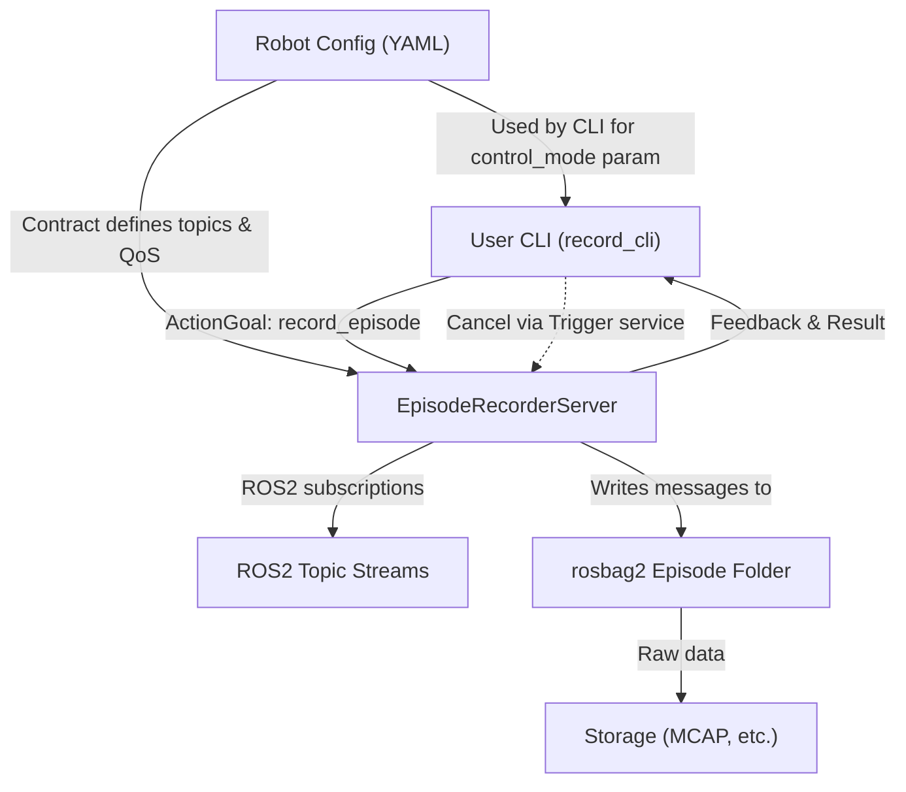
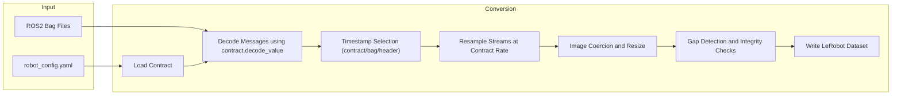

# 数据集录制与转换

<details>
<summary>相关源码文件</summary>

以下文件被用作生成此 wiki 页面的上下文：

- [src/action_dispatch/package.xml](https://atomgit.com/openeuler/IB_Robot/blob/openEuler-26.09/src/action_dispatch/package.xml)
- [src/dataset_tools/dataset_tools/annex_b_input_adapter.py](https://atomgit.com/openeuler/IB_Robot/blob/openEuler-26.09/src/dataset_tools/dataset_tools/annex_b_input_adapter.py)
- [src/dataset_tools/dataset_tools/bag_to_lerobot.py](https://atomgit.com/openeuler/IB_Robot/blob/openEuler-26.09/src/dataset_tools/dataset_tools/bag_to_lerobot.py)
- [src/dataset_tools/dataset_tools/episode_recorder.py](https://atomgit.com/openeuler/IB_Robot/blob/openEuler-26.09/src/dataset_tools/dataset_tools/episode_recorder.py)
- [src/dataset_tools/dataset_tools/lerobot_action_gap_repair.py](https://atomgit.com/openeuler/IB_Robot/blob/openEuler-26.09/src/dataset_tools/dataset_tools/lerobot_action_gap_repair.py)
- [src/dataset_tools/dataset_tools/record_cli.py](https://atomgit.com/openeuler/IB_Robot/blob/openEuler-26.09/src/dataset_tools/dataset_tools/record_cli.py)
- [src/dataset_tools/package.xml](https://atomgit.com/openeuler/IB_Robot/blob/openEuler-26.09/src/dataset_tools/package.xml)
- [src/dataset_tools/setup.py](https://atomgit.com/openeuler/IB_Robot/blob/openEuler-26.09/src/dataset_tools/setup.py)
- [src/dataset_tools/test/test_annex_b_input_adapter.py](https://atomgit.com/openeuler/IB_Robot/blob/openEuler-26.09/src/dataset_tools/test/test_annex_b_input_adapter.py)
- [src/dataset_tools/test/test_bag_to_lerobot.py](https://atomgit.com/openeuler/IB_Robot/blob/openEuler-26.09/src/dataset_tools/test/test_bag_to_lerobot.py)
- [src/dataset_tools/test/test_episode_recorder.py](https://atomgit.com/openeuler/IB_Robot/blob/openEuler-26.09/src/dataset_tools/test/test_episode_recorder.py)
- [src/dataset_tools/test/test_lerobot_action_gap_repair.py](https://atomgit.com/openeuler/IB_Robot/blob/openEuler-26.09/src/dataset_tools/test/test_lerobot_action_gap_repair.py)
- [src/inference_service/inference_service/h264_stream_recorder.py](https://atomgit.com/openeuler/IB_Robot/blob/openEuler-26.09/src/inference_service/inference_service/h264_stream_recorder.py)
- [src/inference_service/package.xml](https://atomgit.com/openeuler/IB_Robot/blob/openEuler-26.09/src/inference_service/package.xml)
- [src/inference_service/setup.py](https://atomgit.com/openeuler/IB_Robot/blob/openEuler-26.09/src/inference_service/setup.py)
- [src/inference_service/tests/test_h264_stream_recorder.py](https://atomgit.com/openeuler/IB_Robot/blob/openEuler-26.09/src/inference_service/tests/test_h264_stream_recorder.py)
- [src/robot_config/robot_config/contract_builder.py](https://atomgit.com/openeuler/IB_Robot/blob/openEuler-26.09/src/robot_config/robot_config/contract_builder.py)
- [src/robot_config/robot_config/launch_builders/recording.py](https://atomgit.com/openeuler/IB_Robot/blob/openEuler-26.09/src/robot_config/robot_config/launch_builders/recording.py)
- [src/robot_config/test/test_recording_launch_builder.py](https://atomgit.com/openeuler/IB_Robot/blob/openEuler-26.09/src/robot_config/test/test_recording_launch_builder.py)

</details>

本页面记录 RoboFrame_stable 代码库中数据集录制与转换工具的技术细节，聚焦分段录制系统及其 CLI 接口、ROS 2 bag 到 LeRobot 数据集的转换工具、视频流处理、缺失修复工具，以及相关的 launch 构建器集成。

---

## 目的与范围

数据集录制与转换是 RoboFrame 的关键组件，将机器人运行中的传感器、动作与状态数据可靠采集为结构化数据集。这些数据集服务于下游具身智能训练、策略评估或基准测试工作流。

这里涵盖的核心能力包括：

- **Episode 录制服务**：基于 action 的分段录制器，将数据流采集到相互隔离的 rosbag2 episode 中。
- **录制 CLI 工具**：通过 ROS 2 Action/服务触发分段录制并管理录制生命周期的客户端。
- **rosbag2 转 LeRobot**：将 ROS2 bag 录制转换为对齐的 LeRobot v3.0 数据集格式以供 ML 训练的工具。
- **H.264 流与 sidecar 缺失修复**：处理带关联元数据的压缩视频流，确保帧完整性。
- **launch 构建器集成**：在机器人配置 launch 中创建录制节点的工具，同时支持连续 bag 录制与分段录制模式。

---

## 1. Episode 录制服务器（`episode_recorder`）

### 概览

`EpisodeRecorderServer` 类以 ROS 2 节点形式提供分段数据集录制器。它：

- 按机器人配置契约（单一事实源）的指定订阅相关观测与动作 topic。
- 将消息写入相互独立的 rosbag2 episode 目录（`bag_base_dir/dataset_name/episodes/episode_XXXXXX`）。
- 提供 `record_episode` ROS 2 Action，支持以编程方式启停分段录制。
- 支持通过专用的 `record_episode/cancel` 服务取消。
- 为每个 episode 管理独立的 writer、反馈定时器与超时定时器，以限制录制时长。

该设计将 episode 隔离为独立 rosbag，简化数据集组织、并行处理与标注，并利用 rosbag2 内部消息缓存实现平滑的高吞吐写入。

### 关键参数

- `robot_config_path`（必填）：YAML 机器人配置路径，用于推导 topic 与契约。
- `bag_base_dir`（默认 `/tmp/episodes`）：数据集存储根目录。
- `dataset_name`（默认取自机器人配置或契约的机器人类型）：episode 数据集的子目录名。
- `control_mode`：持久化的控制模式元数据。
- `storage_preset_profile`：可选的 rosbag2 存储预设（如 `zstd_fast`）。
- `storage_config_uri`：可选的 rosbag2 后端配置文件。

### 订阅与写入逻辑

- 订阅在节点启动时按契约一次性创建。
- 启动 episode 录制时：
  - 创建指向新 episode 子目录的 rosbag2 writer 实例。
  - 向 writer 注册全部契约 topic。
  - 订阅 topic 上的到达消息经序列化后带相应时间戳写入。
- 每 episode 定时器：
  - 反馈定时器（2 Hz）通过 action server 发送进度更新。
  - 最大时长定时器在超时后自动停止 episode。
- 停止时关闭 writer，并将元数据（含用户提供的 prompt）追加到 bag。

### 错误处理与持久化

- 写入失败会导致 episode 立即终止并记录错误。
- 订阅跨 episode 持久存在，降低 DDS 开销。
- 数据集与 episode 目录从显式配置解析，否则回退到合理默认值。
- 消息序列化保证存储数据与 rosbag2 兼容。

---

## 2. 录制 CLI（`record_cli`）

### 概览

`record_cli` 可执行程序提供命令行接口，通过 ROS 2 Action 客户端接口与分段 `EpisodeRecorderServer` 交互。

### 特性

- 向 `record_episode` action 发送带可选 prompt 的目标。
- 接收并展示 action 反馈与最终结果。
- 支持通过 ROS 2 服务调用取消。
- 在录制新 episode 前管理推理调度器的重置，保证干净状态。
- 支持等待服务器可用与优雅的错误处理。

### 实现细节

- 实现带 `RecordEpisode` `ActionClient` 的 ROS 2 节点。
- 维护线程安全的事件，协调目标提交、完成与拒绝。
- 在开始新 episode 前调用 dispatcher、policy 的重置服务，以及可选的调度器重启服务。
- 录制反馈显示剩余时间与状态。
- CLI 打印用户指引（回车停止并检查、`d` 丢弃、`r` 重试 prompt）。

---

## 3. rosbag2 转 LeRobot 数据集（`bag_to_lerobot`）

### 目的

该工具将一份或多份 ROS 2 rosbag2 录制转换为结构化的 LeRobot v3.0 数据集。它复用与在线推理共享的基于契约的处理工具，确保转换精确反映契约规范。

### 转换流水线

1. 加载 `robot_config.yaml`，抽取契约作为单一事实源。
2. 扫描 bag 并使用共享的 `decode_value` 工具解码契约 topic。
3. 按可配置策略选择时间戳：
   - `contract`（默认）：使用契约指定的 `stamp_src`。
   - `bag`：使用 bag 接收时间。
   - `header`：优先 `msg.header.stamp`，带回退。
4. 基于所选时间戳将各 topic 流重采样到契约频率。
5. 使用共享辅助函数对图像做强制转换与缩放，保证形状与类型一致。
6. 写出结构如下的数据集：

```text
<out_root>/
  videos/<image_key>/chunk-*/file-*.mp4  (or images/*/*.png if no-videos)
  data/chunk-*/file-*.parquet
  meta/info.json
  meta/episodes/*/*.parquet
  meta/tasks.parquet
  meta/stats.json
```

### 视频与图像处理

- 默认按观测键将视频编码为 MP4（H.264）分块。
- 指定 `--no-videos` 时回退为 PNG 图像。
- 使用 Annex-B sidecar 文件检测并报告丢帧或丢包。
- 跟踪帧完整性，生成并入数据集元数据的报告。

---

## 4. H.264 流录制器与缺失修复

### H.264 流录制器

- 由 `inference_service` 包处理。
- 能够将 H.264 RTP 流直接录制到磁盘并附带 sidecar 元数据。
- 保证帧时间戳的对齐与完整。
- 处理关键帧检测、丢包计数、sidecar JSON 生成与错误报告。

### 缺失修复（`lerobot_action_gap_repair`）

- 修复数据集录制中时间戳或序列缺失的工具，尤其针对动作流。
- 使用遵循契约的插值或序列补全维持时序一致性。
- 产出可用于训练或评估的修正数据集文件。

---

## 5. launch 构建器集成（`robot_config.launch_builders.recording`）

### 概览

该模块帮助将录制节点集成进机器人 launch 配置，支持两种录制模式：

- **连续模式**：以进程方式启动经典 `ros2 bag record` 命令，将所有 topic 持续录制到单个 bag 文件。
- **分段模式**：启动 `episode_recorder` ROS 2 节点，通过 `record_cli` 或其他客户端触发录制单个 episode。

### 特性

- 基于机器人配置与请求模式生成录制节点/action。
- 从契约与机器人配置自动发现待录制 topic。
- 支持强制使用连续录制模式的语义数据集。
- 为 `record_cli` 工具生成按当前控制模式与调度器调整的 CLI 命令串。

---

## 数据流图：数据集录制组件到代码实体



---

## 数据流图：Bag 转 LeRobot 转换流水线



---

## 关键类与函数

| 组件                     | 关键类 / 函数                        | 文件路径                                          | 行号       | 描述                                                                                     |
|-------------------------------|-----------------------------------------------|---------------------------------------------------|-------------|-------------------------------------------------------------------------------------------------|
| Episode 录制器               | `EpisodeRecorderServer`                        | `src/dataset_tools/dataset_tools/episode_recorder.py` | 1-189+      | 核心服务器节点，管理 ROS 订阅、rosbag2 episode 写入、action 接口          |
| CLI 工具                      | `RecordCLI`                                    | `src/dataset_tools/dataset_tools/record_cli.py`   | 1-159       | 通过 action 客户端与服务与 `EpisodeRecorderServer` 交互的 CLI                 |
| Bag 转 LeRobot 转换     | `export_bags_to_lerobot` 及相关类  | `src/dataset_tools/dataset_tools/bag_to_lerobot.py` | 1-225+      | 使用契约感知解码、重采样、图像/视频处理的转换脚本             |
| 录制 launch 构建器  | `generate_recording_nodes`、`_record_cli_command` | `src/robot_config/robot_config/launch_builders/recording.py` | 1-185       | 为分段或连续录制创建 ROS launch 节点与进程                      |
| 缺失修复                    | `lerobot_action_gap_repair.main`               | `src/dataset_tools/dataset_tools/lerobot_action_gap_repair.py` (not shown here) | —           | 修复数据集时间缺失与不一致的工具                                |
| H.264 流录制器         | `H264StreamRecorderNode` (inference_service)  | `src/inference_service/inference_service/h264_stream_recorder.py` | —           | 录制带 sidecar 元数据的 H.264 压缩流，管理帧完整性                 |

---

## 详细实现说明

### Episode 录制服务器（`episode_recorder.py`）

- 消息写入前用 `rclpy.serialization.serialize_message` 序列化。
- 写入 episode 元数据时做健壮重试。
- topic 过滤掉基于 RTP 传输的 topic，因为这些流由 H.264 流录制器单独录制（防止重复流导致发布者变慢）。
- 每个 episode 创建 writer，路径形如 `/tmp/episodes/<dataset_name>/episodes/episode_000001`。
- Action 反馈提供 `seconds_remaining` 与人类可读消息。
- 使用 ROS 2 `ReentrantCallbackGroup` 处理并发。

### 录制 CLI（`record_cli.py`）

- 使用连接到 `record_episode` 的 `rclpy.action.ActionClient`。
- 发送 prompt 字符串目标并监听反馈。
- 通过可选服务名支持 dispatcher、policy 与会话管理的重置服务。
- 通过 `record_episode/cancel` Trigger 服务实现取消逻辑。
- 提供基于事件的同步以保证 UI 响应性。

### Bag 转 LeRobot（`bag_to_lerobot.py`）

- 加载并使用契约解码取值，保证离线转换与在线推理一致。
- 图像经处理保证形状、dtype 与颜色顺序符合模型期望。
- 支持多 bag 输入，转换并追加进统一的 LeRobot 数据集。
- 从 Annex-B 流 sidecar 文件计算并合并每条流的完整性报告。
- 输出带 `meta/info.json` 与 episode 统计的数据集，便于审计。

### launch 构建器（`launch_builders/recording.py`）

- 提供 `generate_recording_nodes` 函数，返回：
  - 运行分段 `episode_recorder` 服务器的节点，或
  - 运行 `ros2 bag record` 做连续录制的 `ExecuteProcess` action。
- 依据机器人配置自动调整录制路径、预设与 topic。
- 按配置支持语义数据集预览进程。
- 为 `record_cli` 生成命令串，提供手动触发 episode 的便捷入口。

---

## CLI 命令与 ROS 2 接口汇总表

| 工具/节点               | 关键 ROS 接口                     | 命令/launch 用法                                                  |
|------------------------|--------------------------------------|----------------------------------------------------------------------|
| `episode_recorder` 节点 | `record_episode` Action、`record_episode/cancel` Service | 以 launch 节点启动，提供录制 episode 的 Action 接口 |
| `record_cli`            | `record_episode` Action 客户端 + 服务 | `ros2 run dataset_tools record_cli` 发送录制命令           |
| `bag_to_lerobot`        | 无（独立脚本）              | `python3 bag_to_lerobot.py --bag <path> --robot-config <yaml> --out <dir>` |
| 连续录制    | 无（终端进程）                | 通过 launch action 启动 `ros2 bag record -o <output>`                |

---

## 附加资源与相关 Wiki 页面

- 标定相关的数据集工具见 [9.2 相机标定与 ISP 调优]。
- 已录数据集的评估见 [9.3 策略评估与基准运行时]。
- 视频流录制内部机制见 `inference_service/h264_stream_recorder.py`。
- 数据集时序缺失修复工具见 `lerobot_action_gap_repair.py`。

---

### 参考与来源

- `src/dataset_tools/dataset_tools/episode_recorder.py:1-189`（episode 录制器核心）
- `src/dataset_tools/dataset_tools/record_cli.py:1-159`（录制 CLI）
- `src/dataset_tools/dataset_tools/bag_to_lerobot.py:1-225`（bag 转 lerobot）
- `src/robot_config/robot_config/launch_builders/recording.py:1-185`（录制 launch 构建器）
- `src/dataset_tools/package.xml`（包元数据）
- `src/dataset_tools/setup.py`（CLI 入口点）
- 测试覆盖参考 `src/dataset_tools/test/test_bag_to_lerobot.py` 与 `test_episode_recorder.py`

---

至此完成 RoboFrame_stable 数据集录制与转换组件的详细技术文档。
