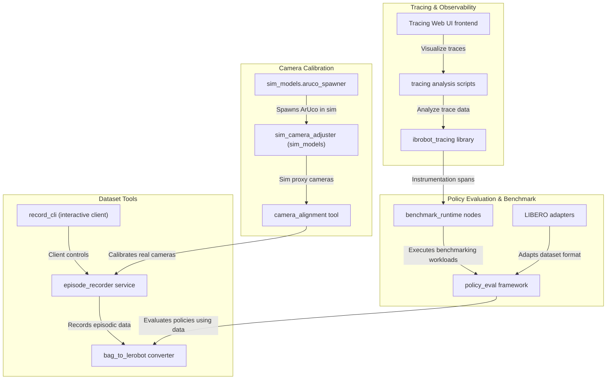
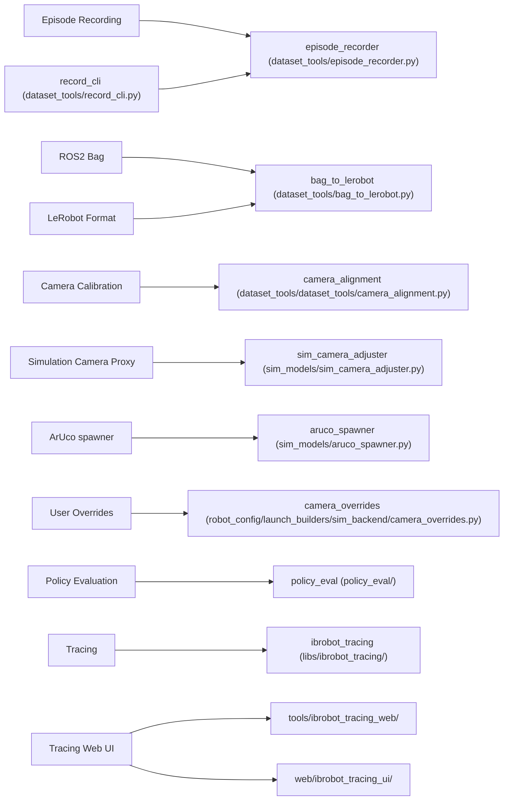

# 数据工具、基准测试与可观测性概述

<details>
<summary>相关源码文件</summary>

以下文件被用作生成此 wiki 页面的上下文：

- [docs/calibration_targets/机械臂底座marker0and1.pdf](https://atomgit.com/openeuler/IB_Robot/blob/openEuler-26.09/docs/calibration_targets/机械臂底座marker0and1.pdf)
- [docs/calibration_targets/机械臂底座marker2and3.pdf](https://atomgit.com/openeuler/IB_Robot/blob/openEuler-26.09/docs/calibration_targets/机械臂底座marker2and3.pdf)
- [docs/calibration_targets/标准24色色卡.pdf](https://atomgit.com/openeuler/IB_Robot/blob/openEuler-26.09/docs/calibration_targets/标准24色色卡.pdf)
- [src/dataset_tools/README.md](https://atomgit.com/openeuler/IB_Robot/blob/openEuler-26.09/src/dataset_tools/README.md)
- [src/dataset_tools/dataset_tools/camera_alignment.py](https://atomgit.com/openeuler/IB_Robot/blob/openEuler-26.09/src/dataset_tools/dataset_tools/camera_alignment.py)
- [src/dataset_tools/dataset_tools/opencv_utils.py](https://atomgit.com/openeuler/IB_Robot/blob/openEuler-26.09/src/dataset_tools/dataset_tools/opencv_utils.py)
- [src/dataset_tools/docs/tools/camera_alignment.md](https://atomgit.com/openeuler/IB_Robot/blob/openEuler-26.09/src/dataset_tools/docs/tools/camera_alignment.md)
- [src/dataset_tools/test/test_camera_alignment.py](https://atomgit.com/openeuler/IB_Robot/blob/openEuler-26.09/src/dataset_tools/test/test_camera_alignment.py)
- [src/robot_config/robot_config/launch_builders/sim_backend/camera_overrides.py](https://atomgit.com/openeuler/IB_Robot/blob/openEuler-26.09/src/robot_config/robot_config/launch_builders/sim_backend/camera_overrides.py)
- [src/sim_models/sim_models/aruco_spawner.py](https://atomgit.com/openeuler/IB_Robot/blob/openEuler-26.09/src/sim_models/sim_models/aruco_spawner.py)
- [src/sim_models/sim_models/sim_camera_adjuster.py](https://atomgit.com/openeuler/IB_Robot/blob/openEuler-26.09/src/sim_models/sim_models/sim_camera_adjuster.py)

</details>

本节高层概览 RoboFrame_stable 代码库中健壮的工具基础设施，涵盖数据集录制与转换、相机标定与 ISP 调优、策略评估与基准测试，以及系统追踪与可观测性。这些工具支撑以数据为中心的工作流，对在机器人平台上训练、测试和部署具身智能模型至关重要。

以下小节概述各主要数据相关组件的角色与关系，并链接到全面覆盖各主题的详细子页面。

---

## 9.1 数据集录制与转换

dataset_tools ROS 2 包负责 IB-Robot 系统的分段（episodic）数据录制与数据集格式转换，主要面向 LeRobot v3 数据集格式。

**关键能力：**

- *分段录制器*：通过 Action Server 接口控制分段 episode 录制，便于捕获与任务提示关联的一致数据。
- *ROS2 Bag 转 LeRobot*：将 ROS2 bag 文件转换为 LeRobot v3 数据集格式，保留元数据与标定快照。
- *录制 launch 集成*：支持通过 ros2 launch 文件在 launch 期编排，可灵活选择仿真模式、控制模式（teleop/model_inference）以及 Rerun 等可视化器。

**架构与配置：**

- 所有数据集工具使用中央 `robot_config` 单一事实源 YAML 配置文件，包括观测/动作契约、采样率与按机器人档案（如 `so101_single_arm.yaml`）定义的控制模式。
- 单位转换与关节命名空间所需的标定数据通过这些配置透明处理，保证录制与推理阶段的一致解读。

**用法示例：**

以 teleop 分段模式为 SO101 机器人启动录制服务：

```bash
ros2 launch robot_config robot.launch.py \
    robot_config:=so101_single_arm \
    control_mode:=teleop \
    record:=true \
    record_mode:=episodic \
    use_sim:=false
```

运行交互式录制 CLI 客户端：

```bash
ros2 run dataset_tools record_cli
```

将已录制的 ROS2 bag 转换为 LeRobot v3 数据集：

```bash
ros2 run dataset_tools bag_to_lerobot \
    --bags-dir ~/rosbag/episodes/so101_single_arm \
    --robot-config src/robot_config/config/robots/so101_single_arm.yaml \
    --out /path/to/output_dataset
```

录制的数据集在磁盘上规整组织，带元数据与 episode 分段，支撑下游训练与评估。

[数据集录制与转换](./dataset_recording_conversion.md)

---

## 9.2 相机标定与 ISP 调优

相机标定工具支撑可靠感知与模型推理所需的精确传感器对齐。该子系统同时提供面向物理与仿真相机平台的实用程序。

**核心组件：**

- `camera_alignment` 工具：交互式、基于 ArUco 标记的相机对齐实用程序。它检测 ArUco 角点并相对保存的黄金参考计算像素对齐误差，帮助操作者复现已标定的相机位姿。
- `sim_camera_adjuster`（sim_models）：在 Gazebo 中提供带可调位姿滑杆的交互式代理相机，发布 ROS2 图像 topic 用于仿真对齐工作流。
- 基于色卡（`24色色卡`）的 ISP 调优流水线，支持通过离线 rerun 可视化进行精细传感器调校。

**标定工作流：**

- 真实相机使用物理 ArUco 标记（仓库 `docs/calibration_targets/` 内含可打印标定靶）作为对齐参考。
- 仿真场景中，Gazebo 或 MuJoCo 世界可生成 ArUco 标定纸（`sim_models.aruco_spawner`），标定覆盖保存到用户主目录（如 `~/.ros/ibrobot/sim_camera_overrides`），供仿真 launcher 动态加载。
- 这套多层机制支持可回放、精确的相机位姿配置，与机器人档案及仿真后端保持一致。

**用法要点：**

面向物理相机设备运行相机对齐工具：

```bash
ros2 run dataset_tools camera_alignment \
  --camera-source /dev/video0 \
  --width 640 \
  --height 480 \
  --fps 60 \
  --format MJPG \
  --reference-path /tmp/camera_reference_multi.json \
  --reference-image-path /tmp/reference_img.png
```

标定界面中的命令：

- `s`：将当前帧的 ArUco 角点保存为新参考。
- `v`：进入“鬼影”叠加模式进行视觉对齐。
- `q`：退出工具。

标定位姿与覆盖被透明管理，支持通过关联的 `sim_models` 代理相机持续更新与仿真对齐。

[相机标定与 ISP 调优](./camera_calibration_isp_tuning.md)

---

## 9.3 策略评估与基准运行时

该子系统在真实或仿真环境中评估学习到的或脚本化的机器人控制策略，对其性能与正确性进行基准测试。

**亮点包括：**

- `policy_eval` 框架与 `benchmark_runtime` 节点，用于环境仿真、策略执行与结果记录。
- 连接 LIBERO 数据集与策略基准的适配层。
- launch 构建器支持按数据集 episode 与模型选择参数编排的定时基准实验。

这些工具确保感知-动作流水线在部署前符合预期，并产出标准化评估报告。

评估工作流与录制转换工具、标定及策略后端深度交换数据，维持端到端一致性。

[策略评估与基准运行时](./policy_evaluation_benchmark_runtime.md)

---

## 9.4 追踪与 Web UI

追踪与可观测性基础设施支持在多节点、多进程机器人框架内进行深度运行时内省。

**关键要素：**

- `ibrobot_tracing` 库捕获分布式 span 并识别运行时执行中的关键路径。
- 分析脚本关联流水线处理步骤与动作分发时序。
- 专用 Web 前端（`tools/ibrobot_tracing_web` 与 `web/ibrobot_tracing_ui`）可视化追踪数据，帮助开发者诊断性能瓶颈或异常行为。

这为异步 ROS2 流水线与推理调度的复杂调试提供支撑。

[追踪与 Web UI](./tracing_web_ui.md)

---

## 总览图：数据工具高层架构



---

## 自然语言概念到代码实体的桥接



---

## 总结

数据工具、基准测试与可观测性一节封装了机器人学习全生命周期的基础设施：

- 数据集录制与格式标准化保证一致的数据捕获与复用。
- 相机标定工具确保对感知精度至关重要的传感器对齐。
- 评估框架对学习策略与运行时性能提供严格评估。
- 追踪与可观测性工具揭示详细执行洞察，用于调试与优化。

这些共同构成大规模开发、调优与部署具身智能系统的骨干。

完整的详细指引与用法请查阅链接的子页面：

- [数据集录制与转换](./dataset_recording_conversion.md)
- [相机标定与 ISP 调优](./camera_calibration_isp_tuning.md)
- [策略评估与基准运行时](./policy_evaluation_benchmark_runtime.md)
- [追踪与 Web UI](./tracing_web_ui.md)

---

### Sources

- `src/dataset_tools/README.md:1-214`
- `src/dataset_tools/dataset_tools/camera_alignment.py:1-223`
- `src/dataset_tools/docs/tools/camera_alignment.md:1-185`
- `src/sim_models/sim_models/aruco_spawner.py:1-205`
- `src/robot_config/robot_config/launch_builders/sim_backend/camera_overrides.py:1-73`
- `src/sim_models/sim_models/sim_camera_adjuster.py:1-175`
- `src/dataset_tools/dataset_tools/opencv_utils.py:1-118`
