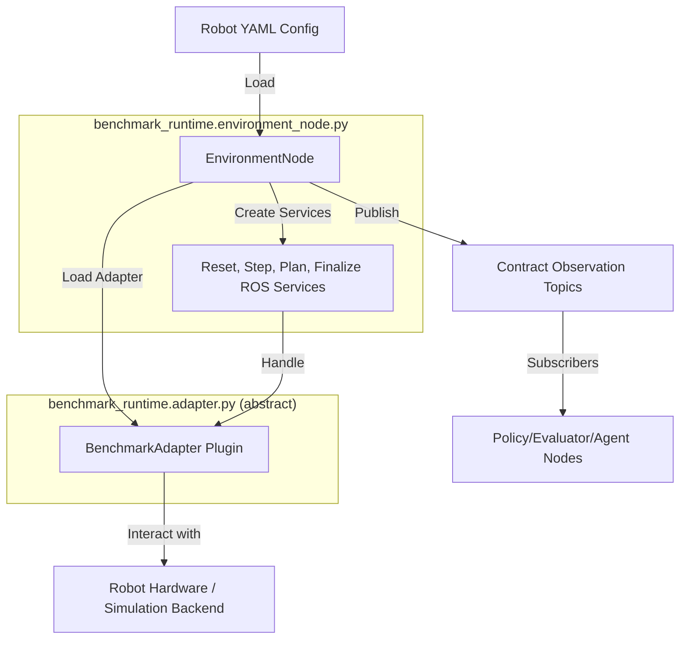
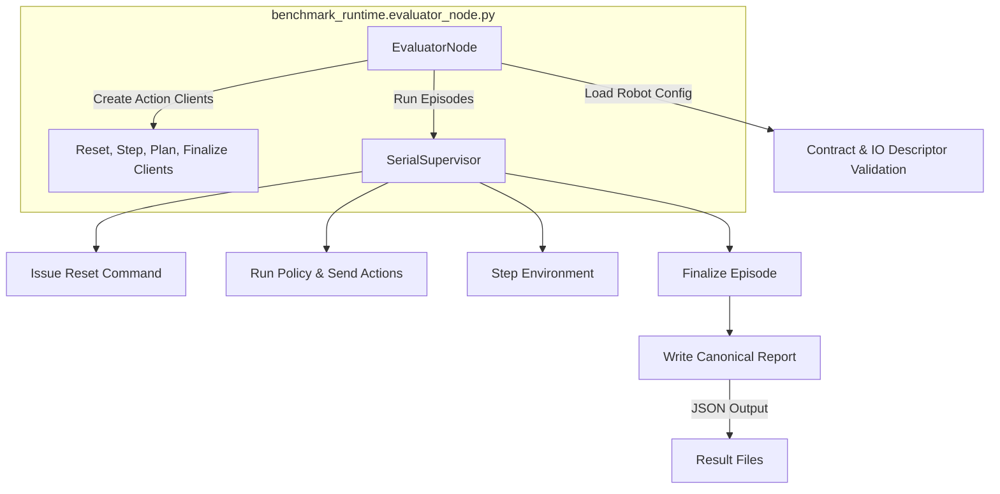
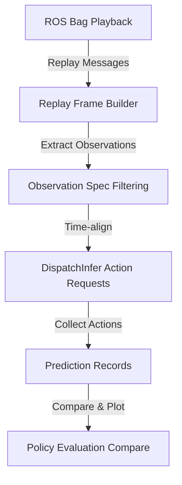
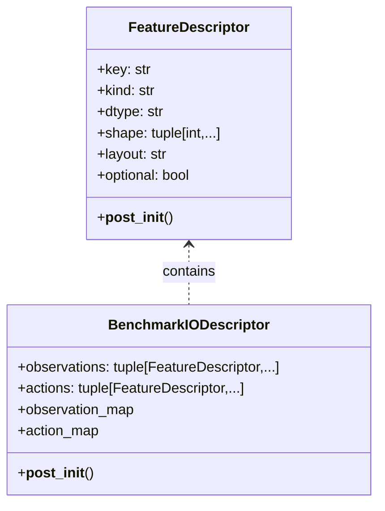
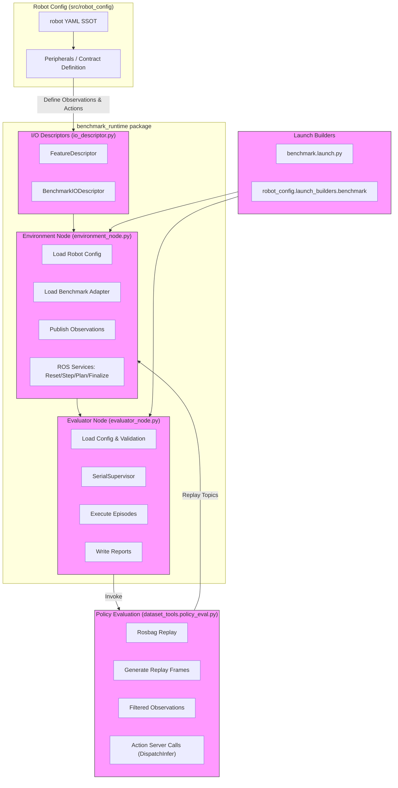

# 策略评估与基准运行时

相关源码文件

以下文件被用作生成此 wiki 页面的上下文：

- [src/benchmark/benchmark_runtime/benchmark_runtime/environment_node.py](https://atomgit.com/openeuler/IB_Robot/blob/openEuler-26.09/src/benchmark/benchmark_runtime/benchmark_runtime/environment_node.py)
- [src/benchmark/benchmark_runtime/benchmark_runtime/evaluator_node.py](https://atomgit.com/openeuler/IB_Robot/blob/openEuler-26.09/src/benchmark/benchmark_runtime/benchmark_runtime/evaluator_node.py)
- [src/benchmark/benchmark_runtime/benchmark_runtime/io_descriptor.py](https://atomgit.com/openeuler/IB_Robot/blob/openEuler-26.09/src/benchmark/benchmark_runtime/benchmark_runtime/io_descriptor.py)
- [src/dataset_tools/dataset_tools/policy_eval.py](https://atomgit.com/openeuler/IB_Robot/blob/openEuler-26.09/src/dataset_tools/dataset_tools/policy_eval.py)
- [src/dataset_tools/dataset_tools/policy_eval_compare.py](https://atomgit.com/openeuler/IB_Robot/blob/openEuler-26.09/src/dataset_tools/dataset_tools/policy_eval_compare.py)
- [src/dataset_tools/test/test_policy_eval.py](https://atomgit.com/openeuler/IB_Robot/blob/openEuler-26.09/src/dataset_tools/test/test_policy_eval.py)
- [src/observation_transport/observation_transport/__init__.py](https://atomgit.com/openeuler/IB_Robot/blob/openEuler-26.09/src/observation_transport/observation_transport/__init__.py)
- [src/observation_transport/observation_transport/ascend_ffmpeg_video_codec.py](https://atomgit.com/openeuler/IB_Robot/blob/openEuler-26.09/src/observation_transport/observation_transport/ascend_ffmpeg_video_codec.py)
- [src/robot_config/config/robots/lekiwi.yaml](https://atomgit.com/openeuler/IB_Robot/blob/openEuler-26.09/src/robot_config/config/robots/lekiwi.yaml)
- [src/robot_config/config/robots/so101_single_arm_rgbd.yaml](https://atomgit.com/openeuler/IB_Robot/blob/openEuler-26.09/src/robot_config/config/robots/so101_single_arm_rgbd.yaml)
- [src/robot_config/robot_config/launch_builders/perception.py](https://atomgit.com/openeuler/IB_Robot/blob/openEuler-26.09/src/robot_config/robot_config/launch_builders/perception.py)
- [src/robot_config/robot_config/launch_builders/sim_peripheral_bridge.py](https://atomgit.com/openeuler/IB_Robot/blob/openEuler-26.09/src/robot_config/robot_config/launch_builders/sim_peripheral_bridge.py)
- [src/robot_config/robot_config/peripherals/camera.py](https://atomgit.com/openeuler/IB_Robot/blob/openEuler-26.09/src/robot_config/robot_config/peripherals/camera.py)

本页面详述 RoboFrame 中策略评估与基准运行时节点的实现与集成，重点介绍环境与评估器 ROS 节点、它们与 LIBERO 适配器的交互，以及相应的 launch 构建器。这些组件共同支持针对机器人配置与录制或仿真数据流对具身 AI 策略进行测试、验证与基准评测。

---

## 目的与范围

RoboFrame 中的策略评估与基准运行时系统提供工具与 ROS 2 节点，用于：

- 针对机器人数据回放或仿真评估学习型或启发式策略。
- 以可配置的重置、步进、规划与收尾契约执行基准测试。
- 支持与提供方无关的机器人硬件或仿真后端适配器（LIBERO 适配器）。
- 发布符合契约的观测并向受控机器人或仿真器发送动作。
- 与 RoboFrame 机器人配置（SSOT）紧密集成并利用契约定义。
- 为基准评测结果生成标准化报告与诊断。

本页面覆盖关键 ROS 节点（`environment_node.py`、`evaluator_node.py`）、基准运行时接口抽象（`io_descriptor.py`）、策略评估工具（`policy_eval.py`），以及支撑这些组件的 launch 编排。

---

## 核心组件

### 1. 基准运行时环境节点

#### 概览

**环境节点**（`benchmark_runtime.environment_node`）充当桥接机器人环境与基准基础设施的 ROS 2 节点。它加载实现基准提供方接口的已配置后端适配器，并管理以下服务：

- 重置环境。
- 应用策略动作推进环境时间。
- 规划执行序列。
- 收尾与报告提交。

它发布遵循机器人契约的观测，并维护回合/步骤标识以保证一致性。

---

#### 实现要点

- 直接从 YAML 文件加载机器人配置（`_load_robot_config_dict`），不导入 `robot_config` 以避免循环依赖。
- 从节点参数读取基准端点参数（ROS 服务名）。
- 执行机器人与模型 I/O 描述子之间的兼容性检查。
- 使用 `BenchmarkAdapter` 插件接口抽象底层机器人或仿真控制。
- 协调向符合契约的 ROS 话题发布观测的流量。
- 通过 `observation_transport.create_managed_frame_ingress` 管理图像与传感器数据流的帧入口。
- 以就绪标签处理生命周期状态，并通过日志标签上报错误。

---

#### 数据流与关键类/函数

- `EnvironmentNode` 以指定重置、步进、规划与收尾服务的基准端点参数初始化。
- 观测依据动态解析的契约规范，通过 DDS 或 ROS 话题发布。
- 提供方适配器处理实际的环境操纵命令与策略环境步进。
- 来自相机或传感器的帧入口由 `ManagedFrameIngress` 实例管理。

---

### 2. 基准运行时评估器节点

#### 概览

**评估器节点**（`benchmark_runtime.evaluator_node`）执行串行基准评估。它编排以下循环：

- 环境重置（开启回合）。
- 运行策略以产生动作。
- 调用步进服务。
- 查询收尾报告。

它记录记录回合结果与整体运行摘要的规范化报告。

---

#### 实现要点

- 启动时加载并校验机器人配置以及与模型描述子的契约兼容性。
- 维护驱动评估状态机的串行监督器（`SerialSupervisor`）。
- 支持诊断就绪检查（`ReadinessBarrier`），确保基准测试前所有组件可运行。
- 使用 ROS 2 ActionClient 驱动步进动作。
- 以预定义错误码与条件处理错误状态。
- 写入包含回合动作成功指标的持久化 JSON 报告。

---

#### 数据流与关键类/函数

- 评估器节点严格校验输入以保证稳健性。
- 通过监督器命令协调策略执行与回合生命周期。
- 对回合结果分类以生成指标（成功、失败、中止）。
- 产出与规范评估标准兼容的报告。

---

### 3. 策略评估工具

#### 概览

**策略评估**（`dataset_tools.policy_eval.py`）模块提供：

- 用于离线策略评估的 rosbag 消息帧门控回放。
- 按策略输入特征过滤观测的工具。
- 构建并校验带定时观测注入的回放帧的工具。
- 记录预测、诊断与标注动作的数据结构。
- 标定检视与时间戳兼容性校验。

这些功能支持针对录制数据集开发并校验与机器人契约一致的策略。

---

#### 关键函数与数据流

- `load_contract_context` 从机器人配置与策略 manifest 构建上下文。
- `filter_observations_by_input_features` 确保仅回放与策略匹配的输入。
- `build_replay_frames` 按时间戳同步消息以构造回放帧。
- 预测记录为可 JSON 序列化的结构（`PredictionRecord`）。
- 支持就绪与标定状态检查的诊断。

---

### 4. 基准 I/O 描述子

#### 概览

**I/O 描述子**模块（`benchmark_runtime.io_descriptor.py`）为基准观测与动作定义规范化格式描述子：

- 定义 `FeatureDescriptor`，按 key、种类（image/state/action）、dtype、形状与布局精确描述每个观测或动作特征。
- 定义 `BenchmarkIODescriptor` 表示完整的观测与动作集合。
- 包含确保机器人契约与已部署模型之间描述子兼容性的校验例程。
- 定义 `ObservationSample` 表示采集的观测。

该抽象将基准运行时与适配器同 ROS 消息细节隔离，提供稳定的语义 I/O 界面。

---

#### 关键概念与校验

- 支持的特征种类：`"image"`、`"state"`、`"action"`。
- 图像布局限定为 `"CHW"` 或 `"HWC"`；状态与动作为 1D。
- 观测与动作之间的 key 重叠被禁止。
- 用于兼容性检查与运行时校验。

---

### 5. Launch 构建器：集成点

#### 基准 Launch 构建器

基准运行时的 launch 系统导入机器人专用参数并解析所需的 ROS 服务端点（`reset_service`、`step_service`、`plan_service`、`finalize_service`）。

- 接收机器人配置输入。
- 以正确的重映射与参数构建 `environment_node` 与 `evaluator_node` 节点。
- 使用传输适配器设置帧入口。
- 与其他系统 launch 协同编排整体基准测试台。

---

### 6. LIBERO 适配器

- 基准运行时使用 LIBERO（一种 ROS 中间件抽象）适配器将环境节点接口到不同机器人后端或仿真器。
- 适配器模式支持与提供方无关的基准评测，在真实或仿真硬件上透明地校验策略。
- `BenchmarkAdapter` 抽象接口定义适配器必须实现的服务，支持即插即用的环境控制。

---

## 汇总图：系统概览与关键代码实体

---

## 代码文件参考

- **环境节点**： [src/benchmark/benchmark_runtime/benchmark_runtime/environment_node.py:1-156](https://atomgit.com/openeuler/IB_Robot/blob/openEuler-26.09/src/benchmark/benchmark_runtime/benchmark_runtime/environment_node.py#L1-L156)
- **评估器节点**： [src/benchmark/benchmark_runtime/benchmark_runtime/evaluator_node.py:1-160](https://atomgit.com/openeuler/IB_Robot/blob/openEuler-26.09/src/benchmark/benchmark_runtime/benchmark_runtime/evaluator_node.py#L1-L160)
- **I/O 描述子**： [src/benchmark/benchmark_runtime/benchmark_runtime/io_descriptor.py:1-167](https://atomgit.com/openeuler/IB_Robot/blob/openEuler-26.09/src/benchmark/benchmark_runtime/benchmark_runtime/io_descriptor.py#L1-L167)
- **策略评估工具**： [src/dataset_tools/dataset_tools/policy_eval.py:1-201](https://atomgit.com/openeuler/IB_Robot/blob/openEuler-26.09/src/dataset_tools/dataset_tools/policy_eval.py#L1-L201)
- **策略评估测试**： [src/dataset_tools/test/test_policy_eval.py:1-202](https://atomgit.com/openeuler/IB_Robot/blob/openEuler-26.09/src/dataset_tools/test/test_policy_eval.py#L1-L202)

---

## 附加说明

- 该系统重度依赖 ROS 2，以动作服务器与服务作为控制与数据传输原语。
- 强制执行严格的运行时类型与契约校验，以维护基准完整性。
- 独立的纯 Python 策略评估辅助工具帮助独立于 ROS 对策略回放逻辑做单元测试。
- 基准运行时设计为不依赖任何特定硬件后端，支持公平且可复现的具身 AI 评估。
- 通过 `observation_transport` 库的帧入口将来自相机流的原生帧数据抽象为规范化观测形式。

---

至此完成 RoboFrame 中策略评估与基准运行时的详细技术概览。
