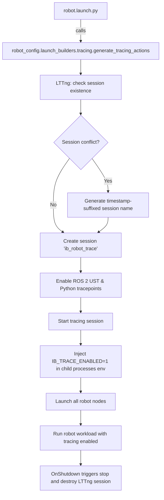

# 追踪与 Web UI

<details>
<summary>相关源码文件</summary>

以下文件被用作生成此 wiki 页面的上下文：

- [scripts/openharmony/build_roboframe_oh.sh](https://atomgit.com/openeuler/IB_Robot/blob/openEuler-26.09/scripts/openharmony/build_roboframe_oh.sh)
- [scripts/pack_roboframe_release.sh](https://atomgit.com/openeuler/IB_Robot/blob/openEuler-26.09/scripts/pack_roboframe_release.sh)
- [scripts/robooh_1.0.1.env](https://atomgit.com/openeuler/IB_Robot/blob/openEuler-26.09/scripts/robooh_1.0.1.env)
- [scripts/tracing/README.en.md](https://atomgit.com/openeuler/IB_Robot/blob/openEuler-26.09/scripts/tracing/README.en.md)
- [scripts/tracing/README.md](https://atomgit.com/openeuler/IB_Robot/blob/openEuler-26.09/scripts/tracing/README.md)
- [src/robot_config/package.xml](https://atomgit.com/openeuler/IB_Robot/blob/openEuler-26.09/src/robot_config/package.xml)
- [src/robot_config/robot_config/launch_builders/tracing.py](https://atomgit.com/openeuler/IB_Robot/blob/openEuler-26.09/src/robot_config/robot_config/launch_builders/tracing.py)
- [src/robot_config/robot_config/tracing_utils.py](https://atomgit.com/openeuler/IB_Robot/blob/openEuler-26.09/src/robot_config/robot_config/tracing_utils.py)
- [src/robot_config/setup.py](https://atomgit.com/openeuler/IB_Robot/blob/openEuler-26.09/src/robot_config/setup.py)

</details>

本页详述 RoboFrame（IB-Robot）代码库中的**追踪基础设施**，重点介绍 `ibrobot_tracing` 库及其与 LTTng 等 ROS 2 追踪工具的集成。内容涵盖结构化追踪 span 的实现、关键路径分析、相关追踪脚本，以及位于 `tools/ibrobot_tracing_web` 与 `web/ibrobot_tracing_ui` 目录的离线追踪分析 Web UI。

追踪为推理流水线与机器人控制执行提供细粒度可观测性，支持性能诊断、瓶颈识别，以及跨分布式组件的时间行为验证。

---

## 概述

RoboFrame 的追踪采用 [ROS 2 追踪机制](https://github.com/ros2/ros2_tracing)，底层使用 **LTTng** 实现低开销、高精度的事件记录。它集成了以 Python 与 C++ 标注的用户空间 tracepoint，围绕映射机器人推理与控制执行流水线的 **span**、**事件**与**流**进行结构化。

关键技术要素包括：

- **`ibrobot_tracing`** Python 库：提供按 `IBTRACE1` 事件 schema 发射结构化 tracepoint、span 与流的 API。

- **通过 `robot_config.launch_builders.tracing` 集成 launch**：在机器人启动与关机时自动化管理 LTTng 追踪会话的生命周期，实现无缝追踪采集。

- **追踪 CLI 与分析工具**：用于汇总与分析追踪目录的命令行工具，包括关键路径分析与 span 剖析。

- **Web UI 前端（`tools/ibrobot_tracing_web` + `web/ibrobot_tracing_ui`）**：基于 Vue.js 的工具，用于在浏览器中加载并交互式探索追踪数据。

追踪通过可选的 `enable_tracing` 标志原生集成于机器人 launch 中，同时完全支持通过 `scripts/tracing/` 中的辅助脚本进行手动追踪会话管理。采集的追踪数据以**通用追踪格式（CTF）**输出到标准 ROS 2 追踪目录（`~/.ros/tracing`），便于离线全面性能分析。

来源：`src/robot_config/robot_config/launch_builders/tracing.py:1-186`, `scripts/tracing/README.en.md:1-159`, `scripts/tracing/README.md:1-179`

---

## ibrobot_tracing 库：结构化 Span、事件与关键路径

RoboFrame 业务级追踪的核心是 `ibrobot_tracing` 包。它通过定义丰富的词汇表扩展 ROS 2 追踪：

- **Span**：封装处理阶段的持续区间，例如模型推理、分发解码或队列补充。

- **事件**：记录原子发生或状态标注，例如分发请求或观测接收。

- **流**：建模追踪组件间的因果边，跨分布式节点或处理阶段链接生命周期事件。

### Tracepoint 注册表

tracepoint 身份的权威定义位于名为 `BUILTIN_TRACEPOINT_REGISTRY` 的注册表（见追踪文档），关联组件 ID、事件/span 名称、logger 与语义描述。主要 tracepoint 包括：

| 组件 ID             | 名称                 | Logger           | 描述                             |
|-------------------------|----------------------|------------------|-----------------------------------------|
| `action_dispatcher.request` | `dispatch_request`   | `ib_trace.dispatch` | 策略请求的开始                 |
| `action_dispatcher.decode`  | `dispatch_result`    | `ib_trace.dispatch` | 解码动作块的结果状态    |
| `policy`                   | `policy_pipeline`    | `ib_trace.policy`   | 整个策略节点请求流          |
| `policy.inference`         | `model_call`         | `ib_trace.policy`   | 本地模型前向推理             |
| `global_scheduler`         | `scheduler_dispatch` | `ib_trace.scheduler`| 被调度的请求接纳与路由  |

Span 与事件通过调用 `TraceEmitter`、装饰器、`span()` 与 `event()` 的上下文管理器以及传播因果链的流链接 API，在真实业务代码路径中插桩。

### 关键路径与 Span 分析

追踪工具链从已完成的追踪中提取**关键路径**分析，通过聚合 span 时长与流依赖识别请求处理流水线中的瓶颈。结构化的 `IBTRACE1` 事件同时支持传统 `[event] key=value` 解析与新式插桩方式，允许迁移期间双发射。

这一关键路径洞察对以下场景至关重要：

- 性能瓶颈定位
- 分布式节点执行的时间对齐
- 动作分发时序验证
- 模型推理延迟诊断

### 兼容性与历史导入

为简化过渡，`robot_config.robot_config.tracing_utils` 从 `embodied_common.tracing` 与 `ibrobot_tracing.instrumentation` 命名空间重新导出关键插桩函数，在建议直接从归属包导入新接口的同时保持既有调用方的兼容性。

来源：`scripts/tracing/README.en.md:95-177`, `src/robot_config/robot_config/tracing_utils.py:1-32`

---

## Launch 期追踪会话管理

`robot_config.launch_builders.tracing` 中的轻量级 Python **launch 构建器**模块管理完全集成于 `robot.launch.py` 的 LTTng 会话生命周期。

### 生命周期与环境注入

- 在 **launch 启动**时，构建器创建通常命名为 `"ib_robot_trace"` 的 LTTng 会话（名称冲突时自动加后缀）。
- 它启用 ROS 2 用户空间 tracepoint（`ros2:*`）与 Python tracepoint（`ib_trace.*`）。
- 它向所有子 ExecuteProcess 动作注入作用域限定的环境变量 `IB_TRACE_ENABLED=1`，在派生节点中启用业务 tracepoint 发射。关机或中断时保证环境恢复，防止 launch 运行之间的泄漏。
- 在**关机**时，它干净地停止并销毁 LTTng 会话。

### 会话管理辅助函数

包括：

- `_trace_session_exists(session_name: str) -> bool`：通过 `lttng list` 查询既有 LTTng 会话。
- `_resolve_trace_session(session_name: str, trace_root: Path)`：名称冲突时自动重命名会话以保留既有数据。
- `_start_trace_session(session_name: str, trace_dir: Path)`：启用事件并开始记录。
- `_make_trace_shutdown_handler(session_name: str)`：返回在关机时停止并销毁会话的 launch 事件处理器。

入口点 `generate_tracing_actions` 基于参数产生准备环境变量与控制 LTTng 会话生命周期所需的全部 launch 动作：

```python
def generate_tracing_actions(
    enable_tracing: bool,
    requested_session_name: str,
    trace_root: Path | None = None,
) -> list[RegisterEventHandler | SetEnvironmentVariable]:
    # Orchestrates LTTng session creation, event enabling, and sets IB_TRACE_ENABLED
```

### 作用域环境注入

`scope_tracing_environment(actions: list[Action]) -> GroupAction` 辅助函数将 `IB_TRACE_ENABLED=1` 应用于所有直接子 `ExecuteProcess` 动作的环境，支持控制器就绪 launch 等延迟或动态包含的动作。

---

#### Launch 工作流图：追踪会话生命周期集成



来源：`src/robot_config/robot_config/launch_builders/tracing.py:1-186`, `scripts/tracing/README.en.md:113-179`

---

## 追踪脚本与用法

`scripts/tracing/` 中的脚本便于手动控制或检查追踪会话：

- `start_trace.sh`：启动 LTTng 会话，带安全自动后缀以避免覆盖活动会话。
- `stop_trace.sh`：停止并销毁命名追踪会话以完成追踪记录。
- `analyze_trace.py`：用于分析追踪目录的传统兼容 CLI。
- `ibrobot-trace`：来自 `ibrobot_tracing` 的主 CLI 入口，用于汇总、span 剖析与关键路径查询。

### 两种主要用法

**方案 A —— 集成 Launch 追踪（推荐）：**

```bash
ros2 launch robot_config robot.launch.py \
    robot_config:=so101_single_arm \
    use_sim:=true \
    control_mode:=model_inference \
    enable_tracing:=true
```

这会自动化 LTTng 会话管理与环境设置，注入 Python 与 ROS 2 tracepoint。

**方案 B —— 手动追踪会话控制：**

```bash
# Terminal 1: start trace session
bash scripts/tracing/start_trace.sh

# Terminal 2: enable Python tracing & launch robot nodes
export IB_TRACE_ENABLED=1
ros2 launch robot_config robot.launch.py ...

# Afterwards, stop tracing
bash scripts/tracing/stop_trace.sh
```

手动模式需要在启动终端显式设置 `IB_TRACE_ENABLED=1` 以启用 Python 级追踪发射。

### 可选拓扑声明

面向高级分析，可通过以下方式生成描述已启动组件与阶段的拓扑 JSON：

```bash
ros2 run robot_config ibrobot-trace-topology \
    src/robot_config/config/robots/so101_single_arm.yaml \
    --control-mode model_inference > /tmp/ibrobot-topology.json
```

该 CLI 使用机器人配置解析逻辑输出预期组件的静态元数据拓扑，对离线追踪分析有用，但正常追踪操作并不要求。

来源：`scripts/tracing/README.en.md:21-159`, `scripts/tracing/README.md:21-179`, `src/robot_config/package.xml:21`, `src/robot_config/setup.py:46-54`

---

## Web UI：ibrobot_tracing_web 与 ibrobot_tracing_ui

RoboFrame 为事后交互式追踪可视化提供专用 **Web UI 前端**，位于：

- `tools/ibrobot_tracing_web/`（后端与 API 服务器工具）
- `web/ibrobot_tracing_ui/`（Vue.js 前端应用）

### 能力

- **从本地 CTF 或转换后的 JSON 文件加载追踪数据**
- **使用 `ibrobot_tracing` 查询 API 查询结构化事件与 span**
- **可视化关键路径时间线、span 嵌套与组件交互**
- **提供过滤、高亮与 span 剖析统计**
- **展示节点级与流水线级时序，获得更深入的性能洞察**

### 部署与平台说明

该 Web UI 及其关联工具主要在 **Ubuntu** 上支持，因其依赖原生包。在 openEuler 等其他支持平台上，追踪采集与核心分析本地运行，但追踪文件需传出设备，在 Ubuntu 上进行基于浏览器的分析。

### 从追踪采集到 Web UI 的数据流

```mermaid
flowchart LR
    A["Robot Nodes"] -->|"Emit tracepoints (ib_trace.* & ros2:*)"| B[LTTng tracing session]
    B -->|"Save recordings (CTF / structured logs)"| C["Trace Storage (~/.ros/tracing)"]
    C -->|Offline analysis/processing| D[ibrobot_tracing AnalysisService CLI & API]
    D -->|Processed trace + queries| E["ibrobot_tracing_web (backend server)"]
    E -->|Serve trace data| F["ibrobot_tracing_ui (Vue frontend in browser)"]
    F -->|Interactive exploration| User["Developer / Operator"]
```



---

## 小结

RoboFrame 的追踪基础设施是一个全面且深度集成的系统，利用 ROS 2 最佳实践与 LTTng 为推理与控制流水线提供丰富洞察。其主要组件与流程为：

1. **`ibrobot_tracing` 库**：实现 span、事件、流与关键路径分析。
2. **Launch 构建器辅助**：在 `robot.launch.py` 中透明管理 LTTng 会话生命周期与环境注入。
3. **追踪脚本**：便于手动会话管理与传统兼容。
4. **追踪 CLI 工具**：事后汇总与分析追踪。
5. **Web UI 前端**：用于性能剖析与瓶颈调试的交互式可视化。

它们共同构成健壮的可观测性套件，用于基准测试、调试并优化复杂的机器人推理与控制工作流。

---

## 参考与来源

- `src/robot_config/robot_config/launch_builders/tracing.py:1-186`
- `scripts/tracing/README.en.md:1-159`
- `scripts/tracing/README.md:1-179`
- `src/robot_config/robot_config/tracing_utils.py:1-32`
- `src/robot_config/package.xml:21`
- `src/robot_config/setup.py:46-54`
