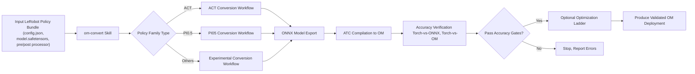
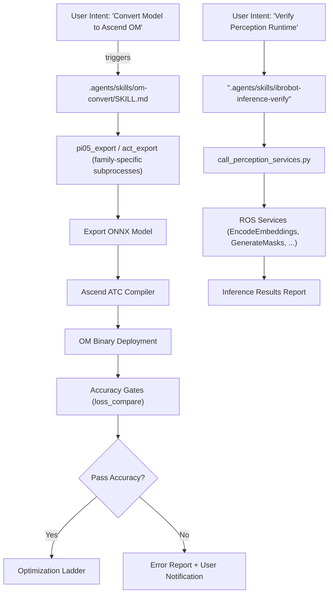
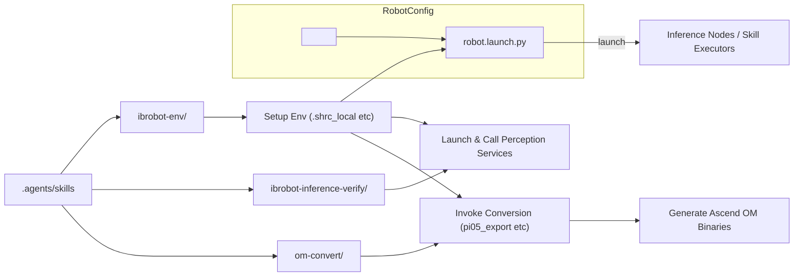

# AI Agent 技能框架

相关源码文件

以下文件被用作生成此 wiki 页面的上下文：

- [.agents/skills/ibrobot-architecture/SKILL.md](https://atomgit.com/openeuler/IB_Robot/blob/openEuler-26.09/.agents/skills/ibrobot-architecture/SKILL.md)
- [.agents/skills/ibrobot-architecture/references/data-flow.md](https://atomgit.com/openeuler/IB_Robot/blob/openEuler-26.09/.agents/skills/ibrobot-architecture/references/data-flow.md)
- [.agents/skills/ibrobot-architecture/references/key-files.md](https://atomgit.com/openeuler/IB_Robot/blob/openEuler-26.09/.agents/skills/ibrobot-architecture/references/key-files.md)
- [.agents/skills/ibrobot-architecture/references/launch-and-troubleshooting.md](https://atomgit.com/openeuler/IB_Robot/blob/openEuler-26.09/.agents/skills/ibrobot-architecture/references/launch-and-troubleshooting.md)
- [.agents/skills/ibrobot-build/SKILL.md](https://atomgit.com/openeuler/IB_Robot/blob/openEuler-26.09/.agents/skills/ibrobot-build/SKILL.md)
- [.agents/skills/ibrobot-env/SKILL.md](https://atomgit.com/openeuler/IB_Robot/blob/openEuler-26.09/.agents/skills/ibrobot-env/SKILL.md)
- [.agents/skills/ibrobot-inference-verify/scripts/bench_fullsubnet.py](https://atomgit.com/openeuler/IB_Robot/blob/openEuler-26.09/.agents/skills/ibrobot-inference-verify/scripts/bench_fullsubnet.py)
- [.agents/skills/ibrobot-inference-verify/scripts/call_perception_services.py](https://atomgit.com/openeuler/IB_Robot/blob/openEuler-26.09/.agents/skills/ibrobot-inference-verify/scripts/call_perception_services.py)
- [.agents/skills/ibrobot-inference-verify/scripts/call_tts.py](https://atomgit.com/openeuler/IB_Robot/blob/openEuler-26.09/.agents/skills/ibrobot-inference-verify/scripts/call_tts.py)
- [.agents/skills/ibrobot-inference-verify/scripts/make_speech_wav.py](https://atomgit.com/openeuler/IB_Robot/blob/openEuler-26.09/.agents/skills/ibrobot-inference-verify/scripts/make_speech_wav.py)
- [.agents/skills/ibrobot-inference-verify/scripts/run_board_tier6.sh](https://atomgit.com/openeuler/IB_Robot/blob/openEuler-26.09/.agents/skills/ibrobot-inference-verify/scripts/run_board_tier6.sh)
- [.agents/skills/ibrobot-inference-verify/scripts/run_fullsubnet.sh](https://atomgit.com/openeuler/IB_Robot/blob/openEuler-26.09/.agents/skills/ibrobot-inference-verify/scripts/run_fullsubnet.sh)
- [.agents/skills/ibrobot-inference-verify/scripts/run_perception_services.sh](https://atomgit.com/openeuler/IB_Robot/blob/openEuler-26.09/.agents/skills/ibrobot-inference-verify/scripts/run_perception_services.sh)
- [.agents/skills/ibrobot-launch/SKILL.md](https://atomgit.com/openeuler/IB_Robot/blob/openEuler-26.09/.agents/skills/ibrobot-launch/SKILL.md)
- [.agents/skills/ibrobot-worktree-env/SKILL.md](https://atomgit.com/openeuler/IB_Robot/blob/openEuler-26.09/.agents/skills/ibrobot-worktree-env/SKILL.md)
- [.agents/skills/om-convert/SKILL.md](https://atomgit.com/openeuler/IB_Robot/blob/openEuler-26.09/.agents/skills/om-convert/SKILL.md)
- [.agents/skills/om-convert/references/accuracy.md](https://atomgit.com/openeuler/IB_Robot/blob/openEuler-26.09/.agents/skills/om-convert/references/accuracy.md)
- [.agents/skills/om-convert/references/act.md](https://atomgit.com/openeuler/IB_Robot/blob/openEuler-26.09/.agents/skills/om-convert/references/act.md)
- [.agents/skills/om-convert/references/ascend310p-optimization.md](https://atomgit.com/openeuler/IB_Robot/blob/openEuler-26.09/.agents/skills/om-convert/references/ascend310p-optimization.md)
- [.agents/skills/om-convert/references/benchmark.md](https://atomgit.com/openeuler/IB_Robot/blob/openEuler-26.09/.agents/skills/om-convert/references/benchmark.md)
- [.agents/skills/om-convert/references/experience-ledger.md](https://atomgit.com/openeuler/IB_Robot/blob/openEuler-26.09/.agents/skills/om-convert/references/experience-ledger.md)
- [.agents/skills/om-convert/references/multi-host-validation.md](https://atomgit.com/openeuler/IB_Robot/blob/openEuler-26.09/.agents/skills/om-convert/references/multi-host-validation.md)
- [.agents/skills/om-convert/references/optimize.md](https://atomgit.com/openeuler/IB_Robot/blob/openEuler-26.09/.agents/skills/om-convert/references/optimize.md)
- [.agents/skills/om-convert/references/pi05.md](https://atomgit.com/openeuler/IB_Robot/blob/openEuler-26.09/.agents/skills/om-convert/references/pi05.md)
- [.agents/skills/om-convert/references/port-new-policy.md](https://atomgit.com/openeuler/IB_Robot/blob/openEuler-26.09/.agents/skills/om-convert/references/port-new-policy.md)
- [.agents/skills/om-convert/references/precision-troubleshooting.md](https://atomgit.com/openeuler/IB_Robot/blob/openEuler-26.09/.agents/skills/om-convert/references/precision-troubleshooting.md)

本页面记录 RoboFrame_stable 仓库中的 AI Agent 技能框架，重点是 `.agents/skills` 技能库。内容包括架构、构建与启动流程、环境搭建技能，以及核心技能约定。特别关注 `om-convert` 技能——面向 LeRobot policy bundle 的统一昇腾 OM 转换与优化工具——以及与系统一体的推理验证和技能创建约定。

---

## 目的与范围

AI Agent 技能框架提供可复用、模块化的技能，用于管理：

- AI agent 相关工具的架构与编排。
- agent 与技能的构建、启动和环境管理。
- 模型 bundle 到昇腾 OM（Offline Model）格式的转换。
- 推理精度与部署正确性的验证。
- 用于创建新技能的技能模板与命名约定。

该框架充当连接组织，使自然语言 AI agent 与机器人级策略顺畅集成，在 IB-Robot / RoboFrame 生态内实现无缝的模型部署与运行时验证。

---

## 1. `.agents/skills` 总体架构

`.agents/skills` 目录包含模块化的技能定义，每个都封装为一个“技能”概念。每个技能提供与 AI agent 开发、部署或验证相关的聚焦功能。

关键技能组件包括：

- **架构 / 构建 / 环境技能**：处理项目环境、依赖强制约束、构建编排。
- **启动技能**：编排机器人或仿真的启动与配置。
- **Om-convert**：将 LeRobot policy bundle 转换为昇腾 OM 格式的统一技能，内置优化与验证工作流。
- **推理验证**：通过标准方法与服务调用验证感知及其他模型服务运行时的技能。
- **技能创建约定**：用于一致创建技能的命名与模板指南。

### 技能清单结构与约定

技能通常在 `SKILL.md` 文件中声明元数据，详细说明名称、描述、使用场景和内部引用。例如，`om-convert` 技能以 YAML front-matter 开头，定义其作为统一昇腾 OM 转换入口的角色。

技能管理器复用内部引用，将复杂工作流拆分为可读、可维护的分块。用户主要通过紧凑的前置问询表单与技能交互，在启动模型编译或优化等高成本操作之前，一次性捕获所有决策。

---

## 2. `om-convert` 技能：统一的昇腾 OM 转换与优化

`om-convert` 技能是将 LeRobot 策略转换为昇腾 OM 二进制、以部署到昇腾 NPU 的*唯一*面向用户的技能。

### 关键能力

- 使用内部工作流（如 ACT 和 PI0.5，修订版 LeRobot 策略族）将现有 IB-Robot LeRobot policy bundle 转换为昇腾 OM（Offline Model）格式。
- 辅助为新 LeRobot 策略族开发并验证昇腾支持的实验性工作。
- 对已验证的昇腾 OM 二进制执行可选的、基于实测的性能优化。

### 输入与范围

- 输入必须是已存在且已验证的 LeRobot policy bundle，其最终输出为机器人 `action`。
- 裸 Torch 模块或不支持的策略族不在范围内。
- 必须显式指定推荐的目标硬件与工具链（ATC 工具链版本、SoC 修订版）。

### 前置问询与决策模式

转换之前，`om-convert` 在单次用户交互中收集所有关键参数，避免反复提问：

| 字段               | 要求                                                                                     |
|---------------------|----------------------------------------------------------------------------------------------|
| 意图              | `Convert only`、`Convert and then optimize` 或 `Optimize only`                             |
| 决策模式       | `Autonomous (Recommended)` 或 `Approval required`（控制非平凡步骤上的交互）|
| 策略族       | 用户选择的策略族，基于 config 路径确认                           |
| Bundle 路径         | 源 bundle 的显式绝对路径                                                    |
| 目标 SoC          | 精确的 ATC `soc_version` 目标                                                           |
| 精度契约   | 验证限值（最大绝对误差、余弦相似度）                                   |
| 观测来源  | 带版本的观测数据批次或冒烟测试输入                                       |
| Torch 主机          | 本地或远程（带 SSH 配置）                                                             |
| 转换主机     | 本地或远程（带路径）                                                                 |
| 昇腾主机        | 本地或远程（带路径与设备 ID）                                                   |
| 任务与种子       | 实验任务标识符与确定性种子/噪声                                    |
| 远程执行    | 是否允许通过 SSH 下发远程命令                                               |

多个角色可以共享主机拓扑，也可以是完全独立的主机；路径始终独立解析。远程 SSH 访问必须预先通过密钥认证验证；不会请求任何凭据。

### 转换流程

- 校验 bundle 目录及必要文件（`config.json`、`model.safetensors` 等）的存在性。
- 读取并确认策略族类型与用户输入一致。
- 将 bundle 路由到按策略族划分的转换工作流（如 ACT、PI0.5）。
- 生成面向昇腾硬件、嵌入完整 ABI 元数据的 ONNX 模型。
- 运行 Torch-vs-ONNX 与 Torch-vs-OM 精度验证门禁。
- 可选地进入迭代性能优化。

### 决策模式细节

- 在 `Autonomous` 模式下，可逆决策按既定最佳实践做出，并记录到实验台账。
- 在 `Approval required` 模式下，所有非平凡决策都会停下来等待用户确认，并附详细的备选方案与回滚说明。
- 硬性审批门禁（破坏性动作、凭据变更、阈值放宽）始终要求显式批准。

### 内部引用与子组件

该技能提供一组内部引用作为构建块：

- 现有的 ACT 与 PI0.5 工作流。
- 新策略移植的实验流程。
- 多主机验证策略。
- 精度门禁与精度问题排查。
- 性能基线测量。
- 优化阶梯与 Ascend310P 专属优化指南。
- 记录试验与结果的经验台账。

---

## 3. 可选的昇腾 OM 优化工作流

优化阶段严格可选，仅在前置明确要求或基线转换被接受之后才会调用。

### 优化问询

开始优化前，系统会刷新主机拓扑以核实当前环境，然后收集用户对以下事项的偏好：

- 目标性能目标。
- 近似数学的许可。
- 静态输入范围/形状调整。
- 缓存使用与并行角色图切分。
- 是否允许量化。
- 精度放宽阈值。

默认禁止量化等高风险选项，除非显式开启。

### 优化阶梯

优化按照证据驱动、分层的候选步骤推进，按影响排序并经 profiling 确认。早期阶梯包括：

- 冻结基线参考。
- 消除数据通路与结构性低效。
- 用 `msprof` 对瓶颈做 profile 并排序。
- 增量优化，包括 FP16 采用、算子融合与布局重写。

基于加权精度与延迟指标拒绝或接受候选，所有结果均完整记录。为管理磁盘空间，同一时刻只保留一个活跃候选。

### 经验台账

系统维护一份稳定台账（`reports/experience-ledger.json`），编目 12 个规范经验 ID，用于指导未来优化决策、报告成功案例并避免重复尝试。

---

## 4. 推理验证技能

`ibrobot-inference-verify` 技能通过以下方式验证已部署的感知及其他推理服务：

- 启动 mock 感知栈。
- 验证所有 typed ROS 服务已注册并可响应。
- 用生成的样例图像和掩码执行合成推理调用。
- 记录结果，包括推理延迟与成功状态。

### 示例验证流程

1. 以仿真模式使用目标机器人配置 YAML 启动感知栈。
2. 等待所有预期的服务端点完成注册。
3. 用合成输入和超时依次调用每个感知服务（`EncodeEmbeddings`、`RecognizeTags`、`GenerateMasks`、启用时的 `GroundingDetect`）。
4. 收集并打印详细的成功、状态与结果指标。

这种端到端检查有助于在开发或部署早期发现环境、接口与运行时错误。

---

## 5. 技能创建约定

技能使用一致的清单风格（`SKILL.md`）：

- 声明名称、描述、触发条件与使用模式。
- 枚举内部与外部参考文档。
- 解释前置问询设计以尽量减少对用户的打断。
- 强调非侵入式远程操作实践。
- 使用结构化 JSON 报告记录决策、结果与回滚计划。
- 与机器人 YAML 及 manifest 系统协作，保证策略与部署的一致性。

---

## 6. 数据流与关键概念（高层）

**数据流（从转换到部署）**：

**关键概念**：

- *技能*：由命令或用户意图触发的封装逻辑单元；声明于 `.agents/skills/*/SKILL.md`
- *om-convert*：处理昇腾 OM 转换的技能 [`.agents/skills/om-convert/SKILL.md`]
- *转换工作流*：面向每个策略族（ACT、PI0.5）的专用流水线步骤 [见 references/act.md、references/pi05.md]
- *经验台账*：跟踪转换与优化尝试、成功状态及证据的 JSON 台账 [references/experience-ledger.md]
- *推理验证工具*：用合成输入调用 typed ROS 服务以验证运行时行为的脚本与节点 [scripts/call_perception_services.py]
- *决策模式*：自主或审批模式，管理用户交互如何控制流程

来源：`.agents/skills/om-convert/SKILL.md`[1-136], `.agents/skills/om-convert/references/optimize.md`[1-128], `.agents/skills/om-convert/references/experience-ledger.md`[1-118], `.agents/skills/om-convert/references/accuracy.md`[1-139], `.agents/skills/om-convert/references/pi05.md`[1-148], `.agents/skills/om-convert/references/precision-troubleshooting.md`[1-144], `.agents/skills/om-convert/references/ascend310p-optimization.md`[1-129], `.agents/skills/ibrobot-inference-verify/scripts/call_perception_services.py`[1-137]

---

## 7. 图表：AI Agent 技能中自然语言概念到代码实体

来源：`.agents/skills/om-convert/SKILL.md`[1-136], `.agents/skills/ibrobot-inference-verify/scripts/call_perception_services.py`[1-137]

---

## 8. 图表：从技能目录与机器人配置到执行

说明：  
技能目录持有彼此隔离的构建、环境搭建、转换与验证技能。它们与机器人配置系统交互，启动服务节点或执行用于转换与推理验证的批处理。环境搭建技能确保整个工作流拥有正确的 ROS 2 与 Python 环境，从而保证一致的运行时行为。

来源：`.agents/skills/ibrobot-env/SKILL.md` (not shown in excerpts, implied), `.agents/skills/om-convert/SKILL.md`[1-136], `.agents/skills/ibrobot-inference-verify/scripts/call_perception_services.py`[1-137], `.agents/skills/ibrobot-launch/SKILL.md`[1-117] (launch orchestration concepts)

---

## 9. `.agents/skills` 关键组件汇总表

| 技能名         | 用途                                                      | 关键文件/模块                                      | 备注                             |
|--------------------|--------------------------------------------------------------|--------------------------------------------------------|-----------------------------------|
| `om-convert`       | 统一的昇腾 OM 转换与优化                | `.agents/skills/om-convert/SKILL.md`、`pi05_export`     | 支持 ACT/PI0.5 策略        |
| `ibrobot-inference-verify` | 感知与推理服务的运行时验证   | `scripts/call_perception_services.py`                   | 合成输入；服务调用    |
| `ibrobot-build`    | 以正确的环境构建代码库                 | `.agents/skills/ibrobot-build/SKILL.md`                 | 包含 `./scripts/build.sh` 用法|
| `ibrobot-launch`   | 在受支持平台上启动机器人/系统                 | `.agents/skills/ibrobot-launch/SKILL.md`                | 按 OS 划分的启动说明   |
| 技能创建约定 | 技能命名、问询与一致的报告格式       | 从 SKILL.md 清单推断                         | 对可维护性很重要     |

---

## 10. 最佳实践与准则

- **显式用户输入**：转换任务的全部输入都来自显式用户参数或已确认的配置，避免隐式假设或错误。
- **单一事实源**：bundle 路径与机器人 YAML 配置显式定义策略与部署语义。
- **决策模式隔离**：区分自动受信决策与人工审批，平衡自动化与安全。
- **内部引用的暴露**：细粒度子文档引用提供模块化、可组合的工作流步骤体系，又不会让用户不堪重负。
- **关注点分离**：转换、验证、构建与启动解耦为独立技能，利于清晰与复用。
- **对远程拓扑的健壮性**：多主机工作流支持分布式执行、独立路径解析与严格的 SSH 密钥认证要求。
- **经验台账维护**：保留完整的实验结果，用于可追溯、验证与未来的优化排序。

---

以上即 RoboFrame_stable AI Agent 技能框架的详细技术文档，重点介绍了模块化技能集、转换与优化工作流，以及构成具身 AI agent 集成层核心的运行时验证工具。

---

## 附录：引用技能与脚本汇总

| 文件 | 行数 | 描述 |
|-------|-------|-------------|
| `.agents/skills/om-convert/SKILL.md` | 1-136 | om-convert 主技能清单与高层工作流概览 |
| `.agents/skills/om-convert/references/optimize.md` | 1-128 | 详细的优化问询与优化阶梯 |
| `.agents/skills/om-convert/references/experience-ledger.md` | 1-118 | 标准化经验目录与台账细节 |
| `.agents/skills/om-convert/references/accuracy.md` | 1-139 | 精度门禁设计与验证流程 |
| `.agents/skills/om-convert/references/pi05.md` | 1-148 | PI05 策略族昇腾 OM 转换工作流细节 |
| `.agents/skills/om-convert/references/precision-troubleshooting.md` | 1-144 | 转换后精度漂移问题排查 |
| `.agents/skills/om-convert/references/ascend310p-optimization.md` | 1-129 | Ascend310P 专属优化模式与 profiling 建议 |
| `.agents/skills/ibrobot-inference-verify/scripts/call_perception_services.py` | 1-137 | 调用并验证 ROS 感知服务的脚本 |

来源：As listed above throughout the document.
