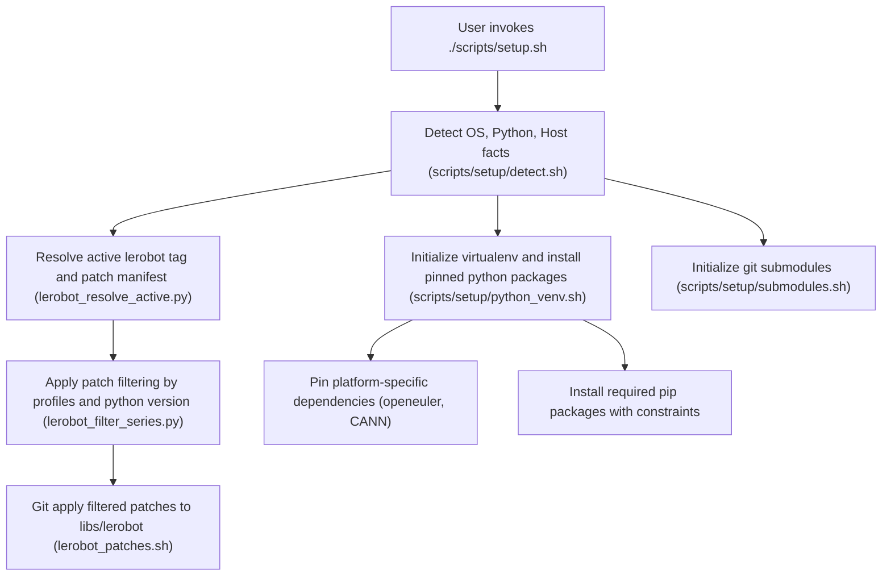
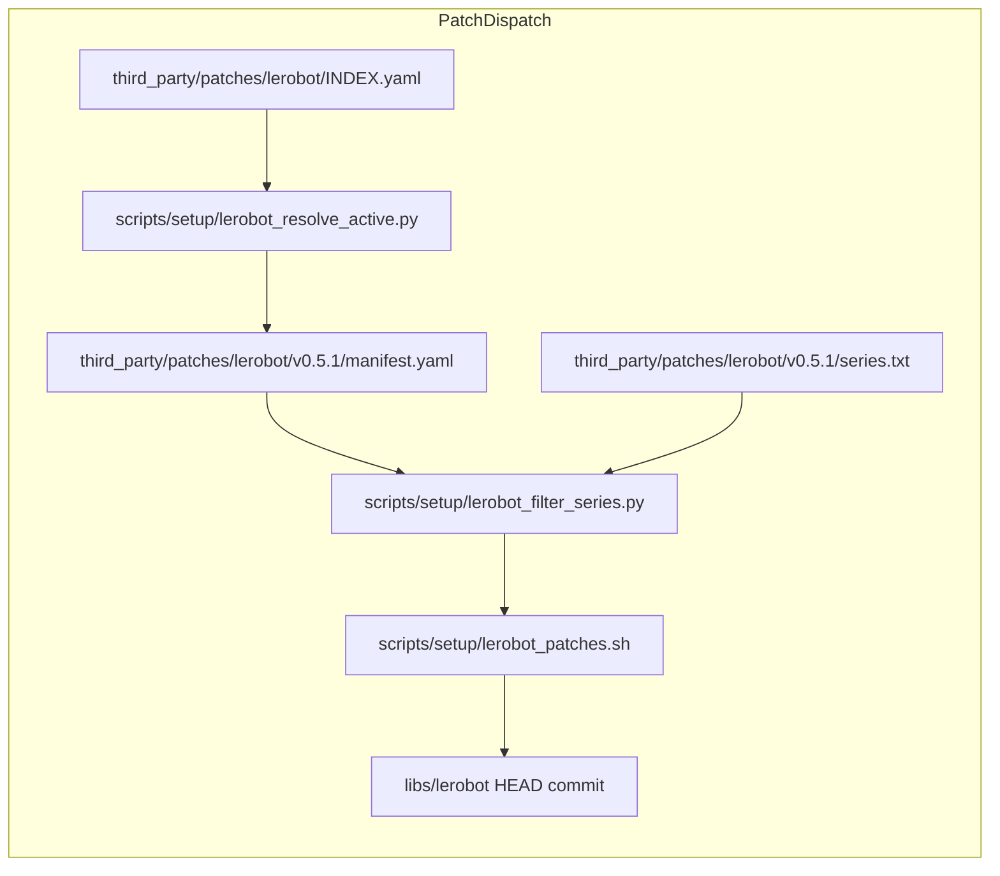
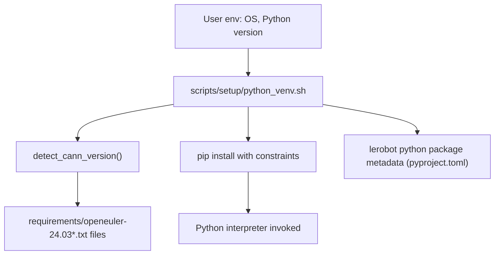

# 依赖与补丁管理

<details>
<summary>相关源码文件</summary>

以下文件被用作生成此 wiki 页面的上下文：

- [.gitattributes](https://atomgit.com/openeuler/IB_Robot/blob/openEuler-26.09/.gitattributes)
- [.gitignore](https://atomgit.com/openeuler/IB_Robot/blob/openEuler-26.09/.gitignore)
- [.gitmodules](https://atomgit.com/openeuler/IB_Robot/blob/openEuler-26.09/.gitmodules)
- [.pre-commit-config.yaml](https://atomgit.com/openeuler/IB_Robot/blob/openEuler-26.09/.pre-commit-config.yaml)
- [requirements/constraints-cann-8.1.txt](https://atomgit.com/openeuler/IB_Robot/blob/openEuler-26.09/requirements/constraints-cann-8.1.txt)
- [requirements/inference.txt](https://atomgit.com/openeuler/IB_Robot/blob/openEuler-26.09/requirements/inference.txt)
- [requirements/accel-cann-8.1.txt](https://atomgit.com/openeuler/IB_Robot/blob/openEuler-26.09/requirements/accel-cann-8.1.txt)
- [requirements/openeuler-24.03.txt](https://atomgit.com/openeuler/IB_Robot/blob/openEuler-26.09/requirements/openeuler-24.03.txt)
- [requirements/perception.txt](https://atomgit.com/openeuler/IB_Robot/blob/openEuler-26.09/requirements/perception.txt)
- [scripts/build_ram_plus_wheel.sh](https://atomgit.com/openeuler/IB_Robot/blob/openEuler-26.09/scripts/build_ram_plus_wheel.sh)
- [scripts/download_perception_models.sh](https://atomgit.com/openeuler/IB_Robot/blob/openEuler-26.09/scripts/download_perception_models.sh)
- [scripts/setup/README.en.md](https://atomgit.com/openeuler/IB_Robot/blob/openEuler-26.09/scripts/setup/README.en.md)
- [scripts/setup/README.md](https://atomgit.com/openeuler/IB_Robot/blob/openEuler-26.09/scripts/setup/README.md)
- [scripts/setup/python_venv.sh](https://atomgit.com/openeuler/IB_Robot/blob/openEuler-26.09/scripts/setup/python_venv.sh)
- [scripts/setup/rosdep.sh](https://atomgit.com/openeuler/IB_Robot/blob/openEuler-26.09/scripts/setup/rosdep.sh)
- [scripts/setup/submodules.sh](https://atomgit.com/openeuler/IB_Robot/blob/openEuler-26.09/scripts/setup/submodules.sh)
- [scripts/setup/tests/test_cann_torch_versions.sh](https://atomgit.com/openeuler/IB_Robot/blob/openEuler-26.09/scripts/setup/tests/test_cann_torch_versions.sh)
- [scripts/setup/tests/test_lerobot_filter.sh](https://atomgit.com/openeuler/IB_Robot/blob/openEuler-26.09/scripts/setup/tests/test_lerobot_filter.sh)
- [scripts/setup/verify_env.sh](https://atomgit.com/openeuler/IB_Robot/blob/openEuler-26.09/scripts/setup/verify_env.sh)
- [src/perception_service/perception_service/ram_plus_wrapper.py](https://atomgit.com/openeuler/IB_Robot/blob/openEuler-26.09/src/perception_service/perception_service/ram_plus_wrapper.py)
- [src/perception_service/perception_service/torch_model_loaders.py](https://atomgit.com/openeuler/IB_Robot/blob/openEuler-26.09/src/perception_service/perception_service/torch_model_loaders.py)
- [src/robot_config/config/hardware/lekiwi_mid360_mount.yaml](https://atomgit.com/openeuler/IB_Robot/blob/openEuler-26.09/src/robot_config/config/hardware/lekiwi_mid360_mount.yaml)
- [src/robot_config/config/navigation/fast_lio_mid360.yaml](https://atomgit.com/openeuler/IB_Robot/blob/openEuler-26.09/src/robot_config/config/navigation/fast_lio_mid360.yaml)
- [src/torch_models/torch_models/pi05_ascend_310p/README.md](https://atomgit.com/openeuler/IB_Robot/blob/openEuler-26.09/src/torch_models/torch_models/pi05_ascend_310p/README.md)
- [third_party/README.md](https://atomgit.com/openeuler/IB_Robot/blob/openEuler-26.09/third_party/README.md)
- [third_party/patches/lerobot/v0.5.1/0009-adaptive-weight-prerequisites.patch](https://atomgit.com/openeuler/IB_Robot/blob/openEuler-26.09/third_party/patches/lerobot/v0.5.1/0009-adaptive-weight-prerequisites.patch)
- [third_party/patches/lerobot/v0.5.1/0010-weighted-training.patch](https://atomgit.com/openeuler/IB_Robot/blob/openEuler-26.09/third_party/patches/lerobot/v0.5.1/0010-weighted-training.patch)
- [third_party/patches/lerobot/v0.5.1/0011-knowledge-distillation.patch](https://atomgit.com/openeuler/IB_Robot/blob/openEuler-26.09/third_party/patches/lerobot/v0.5.1/0011-knowledge-distillation.patch)
- [third_party/patches/lerobot/v0.5.1/0012-mt-act-model.patch](https://atomgit.com/openeuler/IB_Robot/blob/openEuler-26.09/third_party/patches/lerobot/v0.5.1/0012-mt-act-model.patch)
- [third_party/patches/lerobot/v0.5.1/0014-training-logs.patch](https://atomgit.com/openeuler/IB_Robot/blob/openEuler-26.09/third_party/patches/lerobot/v0.5.1/0014-training-logs.patch)
- [third_party/patches/lerobot/v0.5.1/manifest.yaml](https://atomgit.com/openeuler/IB_Robot/blob/openEuler-26.09/third_party/patches/lerobot/v0.5.1/manifest.yaml)
- [third_party/patches/lerobot/v0.5.1/series.master-parity-candidates.txt](https://atomgit.com/openeuler/IB_Robot/blob/openEuler-26.09/third_party/patches/lerobot/v0.5.1/series.master-parity-candidates.txt)
- [third_party/patches/lerobot/v0.5.1/series.openharmony-5.1.0-musl.txt](https://atomgit.com/openeuler/IB_Robot/blob/openEuler-26.09/third_party/patches/lerobot/v0.5.1/series.openharmony-5.1.0-musl.txt)
- [third_party/patches/lerobot/v0.5.1/series.txt](https://atomgit.com/openeuler/IB_Robot/blob/openEuler-26.09/third_party/patches/lerobot/v0.5.1/series.txt)

</details>

本页面详述 RoboFrame_stable 代码库中依赖 profile、环境版本锁定与补丁栈的实现与管理。聚焦分层 Python 环境搭建（含虚拟环境与 CANN（昇腾计算架构）版本锁定）、复杂的 LeRobot 补丁栈管理、third_party 补丁、vendored wheel 以及 Git submodule 集成。本页面面向参与构建与 CI 流程的维护者和贡献者，作为全面的技术参考。

---

## 1. 目的与范围

RoboFrame_stable 的依赖与补丁管理系统保证可复现构建、跨多个受支持平台（Ubuntu、openEuler、OpenHarmony）的运行时兼容性，并将关键自定义补丁集成进第三方库（尤其是核心的 LeRobot submodule）。它管理：

- 与 ROS 2 集成的 Python 虚拟环境（venv）。
- 依赖版本锁定，包括面向 openEuler 与 CANN 的平台相关约束。
- 基于宿主 profile 与 Python 版本过滤的、施加于 `libs/lerobot` submodule 之上的精选补丁栈。
- 面向其他外部库的 third_party 补丁管理。
- 关键二进制 wheel 的 vendoring，避免不可靠的外部依赖。
- 主要组件的 Git submodule 初始化与同步。

---

## 2. Requirements Profile 与 Python 虚拟环境（venv）版本锁定

### 2.1 setup profile

`setup.sh` 通过 `--profile` 参数或环境变量 `IBR_SETUP_PROFILE` 控制依赖安装范围，包含两个主 profile：

- `full`（默认）：完整开发工作区，含硬件、感知、遥操作、语音、仿真与开发工具。
- `inference`：用于边/云推理验证的最小运行时，排除重型依赖。

该区分影响初始化哪些 submodule、安装的 Python 依赖范围以及激活的补丁 profile。

### 2.2 Python 版本兼容与锁定

Python 版本探测遵循 LeRobot 声明的要求（在 `libs/lerobot/pyproject.toml` 中，通常要求 `>=3.10`）。脚本 `python_venv.sh` 实现 `check_lerobot_python_compat()`，从 `pyproject.toml` 提取 Python 版本约束并校验所用解释器，不兼容则失败。

具体而言，它：

- 读取 `libs/lerobot/pyproject.toml` 的 `requires-python` 字段。
- 使用 `packaging.specifiers.SpecifierSet` 强制约束。
- 若 Python 解释器不满足版本规范则记录详细错误。

此外，检测到 Python ≥3.12 时会发出兼容性警告：ROS 2 Humble 使用 NumPy 1.x，而 Python 3.12+ 通常需要 NumPy 2.x，这会导致 `cv_bridge`、`image_transport` 等部分 C++ 扩展出现 ABI 断裂。

### 2.3 CANN（昇腾）版本检测与依赖锁定

昇腾 CANN 工具包版本通过检查可配置根目录（如 `/usr/local/Ascend/ascend-toolkit/latest`）下多个潜在版本元数据文件动态检测。`detect_cann_version()` 的检测流程包括：

- 检查若干标准目录下的 `version.cfg`、`ascend_toolkit_install.info` 等版本文件。
- 元数据缺失时回退到目录名。
- 返回匹配预期模式的版本字符串，否则失败。

依据检测到的 CANN 版本（例如 8.1.x），相应锁定平台包集合与 torch 运行时 ABI：

- `install_openeuler_python_dependencies()` 安装 OS 轴 requirements（`requirements/openeuler-24.03.txt`）。
- `install_accel_requirements()` 在承载 NPU 的任意 OS 上安装由 `accels/cann.sh` 选定的加速器轴 requirements（`requirements/accel-cann-*.txt`）。
- `verify_cann_torch_abi()` 校验运行时 torch、torchvision、torch_npu 版本与 CANN 8.1 的严格 ABI 匹配。

---

## 3. LeRobot 补丁栈管理

### 3.1 多标签补丁布局

`libs/lerobot` 是被大量修补以保障兼容性的关键 submodule。补丁栈按受支持的上游 tag 版本化，位于：

```text
third_party/patches/lerobot/
├── INDEX.yaml            # Active tag pointer and supported tag list
├── v0.5.1/
│   ├── manifest.yaml     # Patch metadata, lerobot tag and commit range
│   ├── series.txt        # Ordered patch list
│   ├── ...patch files
```

当前活跃 tag 的单一事实源是 `INDEX.yaml`。每个 tag 目录的 `manifest.yaml` 描述：

- `lerobot_tag`：版本字符串。
- `lerobot_commit_range`：必须与 `libs/lerobot` HEAD 匹配的最小/最大 commit SHA。
- `patch_stack`：分支与补丁应用元数据。
- `profiles`：预定义宿主 profile 标签。
- `patch_profiles`：命名补丁序列到子分支与 series 文件的映射。
- `patches`：带适用性谓词的详细补丁条目：

  - `python_min` / `python_max`：版本边界（PEP 440 规范）。
  - `profiles`：适用 profile 标签列表。

### 3.2 补丁过滤与应用

专用 Python 脚本 `lerobot_filter_series.py`：

- 接受 `manifest.yaml` 与补丁 `series.txt`。
- 读取活跃宿主事实：Python 版本、活跃 profile 集合（来自 CLI、环境或平台脚本）。
- 通过要求全部谓词匹配（profile 交集与 Python 版本区间）过滤补丁。
- 输出待应用补丁的子集列表。

该过滤防止在特定宿主上应用不兼容或多余的补丁，避免构建损坏。

实际补丁应用由 `lerobot_patches.sh` 完成，对过滤后的序列调用 `git am`。补丁栈使用 `git am` 以获得干净应用。

### 3.3 profile 解析优先级

用于过滤补丁的活跃 profile 集按以下优先级解析：

1. `setup.sh` 的 CLI 参数：`--lerobot-profiles core,ascend,...`
2. 环境变量 `IBR_LEROBOT_PROFILES`
3. 平台脚本回调 `platform_lerobot_profiles()`
4. 默认回退：`core,ros,hardware,dev`

常见 profile 示例：

- `core`：通用桌面/开发
- `ros`：ROS 2 图构建
- `hardware`：物理机器人宿主
- `openeuler`：openEuler 嵌入式目标
- `ascend`：配备华为昇腾 NPU 的宿主

硬件 bring-up 覆盖示例：

```bash
./scripts/setup.sh --yes --lerobot-profiles core,ros,hardware,ascend
```

强制绕过过滤（危险）：

```bash
IBR_LEROBOT_FORCE_UNFILTERED=1 ./scripts/setup.sh --yes
```

### 3.4 新增补丁工作流

新增补丁的步骤：

1. 将补丁文件加入活跃 tag 目录 `third_party/patches/lerobot/<tag>/`。
2. 将补丁文件名追加到 `series.txt`。
3. 在 `manifest.yaml` 中注册补丁元数据，含 `python_min`/`python_max` 与 `profiles`。
4. 在 `scripts/setup/tests/test_lerobot_filter.sh` 中添加回归 fixture，保证过滤逻辑被覆盖。
5. 可选：为特定场景创建新的补丁 profile 与 series 文件。

### 3.5 测试与验证

`scripts/setup/tests/test_lerobot_filter.sh` 是一个 Bash 回归测试框架，在多种模拟宿主环境下调用 `lerobot_filter_series.py`，验证期望的补丁列表与宿主 profile 门控。它将实际输出与期望的 CSV 格式补丁列表比对，捕获回归或配置错误的补丁。

---

## 4. 第三方补丁与 vendored wheel

除 LeRobot 外，代码库还维护 third_party 补丁与 vendored wheel 包，用于保证确定性构建与兼容性，尤其是复杂的原生扩展或二进制模型。

- 其他外部库的补丁集位于 `third_party/patches/`。
- vendored wheel 防止运行时 ABI 断裂，并便于离线/隔离网络构建。
- setup 流水线按检测到的平台安装有效 wheel。

该系统与 LeRobot 补丁栈互补，并集成到整体 setup 流程中。

---

## 5. 用于依赖治理的 Git submodule

工作区使用 Git submodule 对主要依赖做版本控制，包括：

- `libs/lerobot` —— 应用了补丁栈的 LeRobot 主仓库。
- `src/pymoveit2` —— MoveIt 2 Python 绑定。
- `src/rosclaw` —— Rosclaw 基础包。
- `src/omni_wheel_controller` —— 自定义全向轮控制器。
- `libs/Livox-SDK2` 及其他 LiDAR 支持库。
- 导航与标定（`src/fast_lio`、`src/fast_calib`）。

`.gitmodules` 文件枚举这些子模块的路径、源 URL 与（如相关的）分支指定，实现可复现的初始化与更新：

```ini
[submodule "libs/lerobot"]
    path = libs/lerobot
    url = https://gitcode.com/openharmony-robot/lerobot.git
    ignore = dirty
[submodule "src/pymoveit2"]
    path = src/pymoveit2
    url = https://gitcode.com/ib_robot/pymoveit2.git
    branch = main
    ignore = dirty
...
```

submodule 状态检测与自动同步由 `scripts/setup/submodules.sh` 在工作区引导期间处理，确保所有必需的代码依赖被正确拉取到期望版本。

---

## 6. 依赖与补丁 setup 的数据流



---

## 7. 自然语言到代码实体映射图

### 7.1 LeRobot 补丁栈解析



### 7.2 Python venv 与平台依赖锁定



---

## 8. 关键函数、类与脚本

- `python_venv.sh` 中的 **`check_lerobot_python_compat()`**（4-45 行）：
  依据 `libs/lerobot/pyproject.toml` 中的要求校验 Python 解释器。

- `python_venv.sh` 中的 **`detect_cann_version()`**（106-136 行）：
  探测多个版本文件与目录约定，检测已安装的华为昇腾 CANN 版本。

- `python_venv.sh` 中的 **`install_openeuler_python_dependencies()`**（148-166 行）：
  依据检测到的 CANN 版本选择版本 profile，安装平台 Python 依赖。

- **`lerobot_resolve_active.py`**：
  从 `third_party/patches/lerobot/INDEX.yaml` 解析活跃 lerobot tag，并交叉检查 tag 元数据一致性。

- **`lerobot_filter_series.py`**：
  读取补丁 manifest 与 series，针对 `IBR_LEROBOT_PROFILES`、Python 版本等应用宿主谓词过滤，并打印结果补丁集。

- **`lerobot_patches.sh`**：
  使用 `git am` 将过滤后的补丁应用到 `libs/lerobot` git submodule。

- **`scripts/setup/submodules.sh`**：
  处理 Git submodule 初始化、状态检查与更新同步。

---

## 9. 补丁 profile 示例汇总（摘自 manifest.yaml）

| Profile 名称            | 用途                                                 |
|------------------------|---------------------------------------------------------|
| core                   | 通用开发                             |
| ros                    | 运行 IB_Robot 图的 ROS 2 宿主                      |
| hardware               | 连接真实机器人硬件的宿主                     |
| dev                    | 带扩展依赖的桌面开发                   |
| openeuler              | openEuler 嵌入式目标                               |
| ascend                 | 配备华为昇腾 NPU 的宿主                            |
| inference              | 仅推理的运行时部署                       |
| training               | 执行训练的宿主                                |
| distillation           | 知识蒸馏宿主                             |
| models                 | 需要额外模型族的宿主                        |
| tooling                | 辅助工具补丁                                |

补丁适用性谓词包括 Python 版本边界（`python_min`、`python_max`）与显式 profile 交集。

---

## 10. 要点说明

- 补丁系统是 fail-closed 的：manifest 不一致、tag 不匹配或 `libs/lerobot` commit 超出范围都会导致 setup 失败。
- 扩展或升级补丁栈时，必须创建新的 tag 目录并更新 `INDEX.yaml` 条目。
- 系统由回归框架（`tests/test_lerobot_filter.sh`）验证，该框架模拟多种宿主条件。
- Python 依赖按平台严格约束，包括 torch/TorchVision/tokenizers 库，以及 openEuler 上 OpenCV/cv_bridge 的 ABI 兼容性。
- vendoring 与 submodule 使第三方及异构依赖保持可复现并受版本控制。

---

来源：`scripts/setup/python_venv.sh:1-195`, `third_party/patches/lerobot/v0.5.1/manifest.yaml`, `third_party/patches/lerobot/v0.5.1/series.txt`, `scripts/setup/tests/test_lerobot_filter.sh`, `.gitmodules`, `scripts/setup/README.md`, `scripts/setup/lerobot_filter_series.py` (referenced indirectly), `scripts/setup/lerobot_resolve_active.py` (referenced indirectly), `scripts/setup/lerobot_patches.sh` (referenced indirectly), `scripts/setup/submodules.sh` (referenced indirectly)
