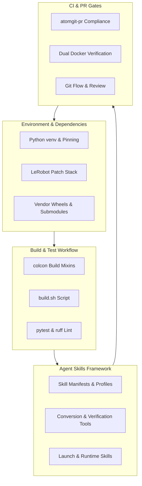
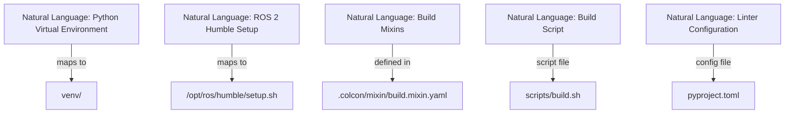
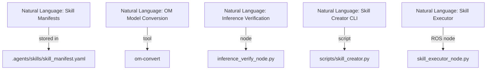

# 开发工作流与工具概述

相关源码文件

以下文件被用作生成此 wiki 页面的上下文：

- [.colcon/defaults.yaml](https://atomgit.com/openeuler/IB_Robot/blob/openEuler-26.09/.colcon/defaults.yaml)
- [.colcon/mixin/build.mixin.yaml](https://atomgit.com/openeuler/IB_Robot/blob/openEuler-26.09/.colcon/mixin/build.mixin.yaml)
- [.colcon/mixin/index.yaml](https://atomgit.com/openeuler/IB_Robot/blob/openEuler-26.09/.colcon/mixin/index.yaml)
- [.vscode/c_cpp_properties.json](https://atomgit.com/openeuler/IB_Robot/blob/openEuler-26.09/.vscode/c_cpp_properties.json)
- [.vscode/extensions.json](https://atomgit.com/openeuler/IB_Robot/blob/openEuler-26.09/.vscode/extensions.json)
- [.vscode/launch.json](https://atomgit.com/openeuler/IB_Robot/blob/openEuler-26.09/.vscode/launch.json)
- [.vscode/settings.json](https://atomgit.com/openeuler/IB_Robot/blob/openEuler-26.09/.vscode/settings.json)
- [.vscode/tasks.json](https://atomgit.com/openeuler/IB_Robot/blob/openEuler-26.09/.vscode/tasks.json)
- [pyproject.toml](https://atomgit.com/openeuler/IB_Robot/blob/openEuler-26.09/pyproject.toml)
- [scripts/validate_config.py](https://atomgit.com/openeuler/IB_Robot/blob/openEuler-26.09/scripts/validate_config.py)

本节提供 RoboFrame_stable 代码库所用开发工作流与工具的高层概览。面向希望了解环境搭建、构建与测试流程、AI agent 技能框架以及持续集成门禁的贡献者。具体技术细节在本概览链接的专门子页面中展开。

## 目的与范围

RoboFrame_stable 的开发聚焦模块化、可复现性与强健验证，以在机器人平台上实现具身 AI。本父页面概述贡献者工作流中的主要阶段与工具，强调环境与依赖管理、构建与测试流程、技能开发以及 CI 门禁之间的关联。

为保持概览简洁，具体配置、约定与验证工具记录在三个子页面中：

- [依赖与补丁管理](./dependency_patch_management.md)
- [AI Agent 技能框架](./ai_agent_skills_framework.md)
- [PR、评审与验证门禁](./pr_review_verification_gates.md)

---

## 1. 环境与依赖管理

开发的基础是严格受控的环境，负责安装并锁定依赖，保证跨平台构建一致。包括：

- 使用 Python 虚拟环境（`venv`）、锁定版本的 ROS 2 Humble 安装与 CANN 工具链。
- 叠加在第三方依赖之上的 LeRobot 补丁栈，管理厂商补丁与 submodule。
- vendoring 包（含预构建 wheel 与源码），简化外部依赖处理。

这种隔离与锁定策略防止开发者环境与生产系统产生分歧。requirements profile、锁定策略与补丁栈等实现细节见[依赖与补丁管理](./dependency_patch_management.md)。

---

## 2. 构建与测试工作流

工作区构建以 ROS 2 的 `colcon` 构建系统为中心，辅以定义构建类型的工作区本地 mixin：

- 常见构建类型包括 `debug`、`release`、`rel-with-deb-info` 与 `test`。
- `build.sh` 脚本自动化环境准备：source ROS Humble setup、激活 Python `venv`，再以相应标志运行 `colcon build`。
- 单元与集成测试配置为在本地开发和 CI 环境中均可运行。

测试与 lint 依赖 Python 工具，如带 `pytest-cov` 覆盖率的 `pytest`，以及针对源码文件配置严格规则的 `ruff` linter（[pyproject.toml:1-39](https://atomgit.com/openeuler/IB_Robot/blob/openEuler-26.09/pyproject.toml#L1-L39)）。

VSCode 任务与 launch 配置便于调试与编辑，包括以正确环境变量和 PYTHONPATH 运行 ROS 2 节点的配置（[.vscode/tasks.json:1-26](https://atomgit.com/openeuler/IB_Robot/blob/openEuler-26.09/.vscode/tasks.json#L1-L26)、[.vscode/launch.json:1-28](https://atomgit.com/openeuler/IB_Robot/blob/openEuler-26.09/.vscode/launch.json#L1-L28)）。

---

## 3. AI Agent 技能框架

`.agents/skills` 目录包含构建、启动与管理实现自主行为的 AI agent 技能的架构与工具：

- 技能定义在 manifest、profile 与校验器方面遵循严格约定。
- 专用工具支持 bundle 创建、模型转换（如 `.om` 文件）与推理验证。
- 技能创建与环境技能、launch 编排集成，实现无缝部署。

这种模块化技能架构以受控方式快速扩展机器人能力，同时与推理和动作分发子系统紧密集成。

技能架构、构建步骤与约定的完整细节见 [AI Agent 技能框架](./ai_agent_skills_framework.md)。

---

## 4. 持续集成与验证门禁

代码质量与系统完整性由验证每个 pull request（PR）的自动化门禁严格守护：

- 定制 `atomgit-pr` 工具强制 AI 模型使用披露与复用自检。
- 双 Docker 验证构建在隔离环境中运行，确认跨环境可复现性。
- PR 流程遵循严格的 git flow，强制评审与合规检查。

这些门禁在变更合入主线分支之前检测配置漂移、构建或运行时错误，并落实团队规范。

关于 PR 工作流、评审指南与验证工具的更多信息见 [PR、评审与验证门禁](./pr_review_verification_gates.md)。

---

## 5. 工作流汇总图

---

## 6. 自然语言到代码实体的桥接

理解从概念工作流组件到代码实体的映射对贡献者至关重要。

### 环境与构建组件

### 技能框架实体

---

## 7. 后续步骤

希望上手的贡献者可使用文档化的引导脚本搭建环境，并按 `build.sh` 与 `pytest` 的构建测试循环推进。扩展 AI agent 能力时，请查阅 AI Agent 技能框架页面了解约定与构建流程。开启 PR 之前，请研究验证门禁与合规检查，确保顺利合入。

---

## 子页面

- [依赖与补丁管理](./dependency_patch_management.md)  
  覆盖 requirements profile、venv 与 CANN 锁定、第三方补丁处理与 submodule。

- [AI Agent 技能框架](./ai_agent_skills_framework.md)  
  详述技能库架构、约定、模型转换与 launch 序列。

- [PR、评审与验证门禁](./pr_review_verification_gates.md)  
  描述 atomgit-pr 工具、AI 披露合规、复用检查、Docker 验证环境与 git 分支策略。

---

来源：`pyproject.toml:1-39`, `.vscode/tasks.json:1-26`, `.vscode/launch.json:1-28`, `.colcon/mixin/build.mixin.yaml:1-19`, `scripts/validate_config.py:1-186` (for configuration validation mentions)
