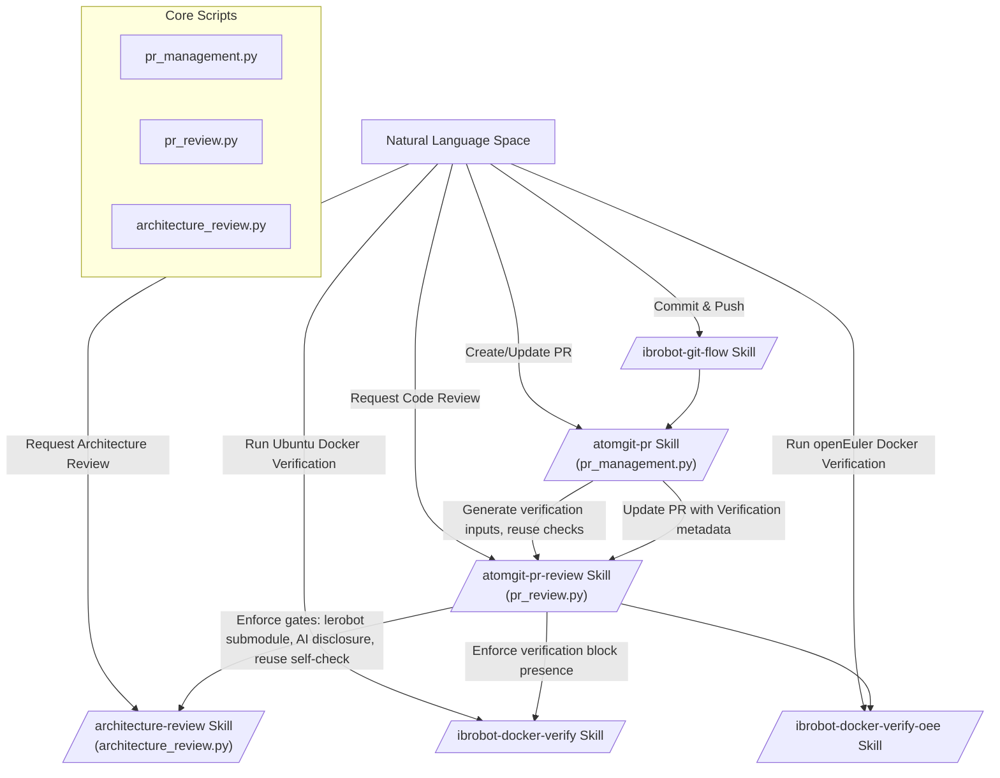
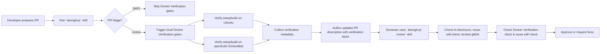

# PR、评审与验证门禁

<details>
<summary>相关源码文件</summary>

以下文件被用作生成此 wiki 页面的上下文：

- [.agents/skills/atomgit-issue/SKILL.md](https://atomgit.com/openeuler/IB_Robot/blob/openEuler-26.09/.agents/skills/atomgit-issue/SKILL.md)
- [.agents/skills/atomgit-issue/scripts/issue_management.py](https://atomgit.com/openeuler/IB_Robot/blob/openEuler-26.09/.agents/skills/atomgit-issue/scripts/issue_management.py)
- [.agents/skills/atomgit-pr-architecture-review/SKILL.md](https://atomgit.com/openeuler/IB_Robot/blob/openEuler-26.09/.agents/skills/atomgit-pr-architecture-review/SKILL.md)
- [.agents/skills/atomgit-pr-architecture-review/lib/__init__.py](https://atomgit.com/openeuler/IB_Robot/blob/openEuler-26.09/.agents/skills/atomgit-pr-architecture-review/lib/__init__.py)
- [.agents/skills/atomgit-pr-architecture-review/lib/comment_formatter.py](https://atomgit.com/openeuler/IB_Robot/blob/openEuler-26.09/.agents/skills/atomgit-pr-architecture-review/lib/comment_formatter.py)
- [.agents/skills/atomgit-pr-architecture-review/lib/llm_architecture_reviewer.py](https://atomgit.com/openeuler/IB_Robot/blob/openEuler-26.09/.agents/skills/atomgit-pr-architecture-review/lib/llm_architecture_reviewer.py)
- [.agents/skills/atomgit-pr-architecture-review/references/json-format.md](https://atomgit.com/openeuler/IB_Robot/blob/openEuler-26.09/.agents/skills/atomgit-pr-architecture-review/references/json-format.md)
- [.agents/skills/atomgit-pr-architecture-review/scripts/architecture_review.py](https://atomgit.com/openeuler/IB_Robot/blob/openEuler-26.09/.agents/skills/atomgit-pr-architecture-review/scripts/architecture_review.py)
- [.agents/skills/atomgit-pr-review/SKILL.md](https://atomgit.com/openeuler/IB_Robot/blob/openEuler-26.09/.agents/skills/atomgit-pr-review/SKILL.md)
- [.agents/skills/atomgit-pr-review/lib/reuse_gate.py](https://atomgit.com/openeuler/IB_Robot/blob/openEuler-26.09/.agents/skills/atomgit-pr-review/lib/reuse_gate.py)
- [.agents/skills/atomgit-pr-review/lib/verification_gate.py](https://atomgit.com/openeuler/IB_Robot/blob/openEuler-26.09/.agents/skills/atomgit-pr-review/lib/verification_gate.py)
- [.agents/skills/atomgit-pr-review/references/api-and-issues-format.md](https://atomgit.com/openeuler/IB_Robot/blob/openEuler-26.09/.agents/skills/atomgit-pr-review/references/api-and-issues-format.md)
- [.agents/skills/atomgit-pr-review/references/ibrobot-mandatory-checks.md](https://atomgit.com/openeuler/IB_Robot/blob/openEuler-26.09/.agents/skills/atomgit-pr-review/references/ibrobot-mandatory-checks.md)
- [.agents/skills/atomgit-pr-review/scripts/pr_review.py](https://atomgit.com/openeuler/IB_Robot/blob/openEuler-26.09/.agents/skills/atomgit-pr-review/scripts/pr_review.py)
- [.agents/skills/atomgit-pr-review/tests/test_ai_metadata_checks.py](https://atomgit.com/openeuler/IB_Robot/blob/openEuler-26.09/.agents/skills/atomgit-pr-review/tests/test_ai_metadata_checks.py)
- [.agents/skills/atomgit-pr-review/tests/test_reuse_self_check_checks.py](https://atomgit.com/openeuler/IB_Robot/blob/openEuler-26.09/.agents/skills/atomgit-pr-review/tests/test_reuse_self_check_checks.py)
- [.agents/skills/atomgit-pr-review/tests/test_verification_commit_checks.py](https://atomgit.com/openeuler/IB_Robot/blob/openEuler-26.09/.agents/skills/atomgit-pr-review/tests/test_verification_commit_checks.py)
- [.agents/skills/atomgit-pr/SKILL.md](https://atomgit.com/openeuler/IB_Robot/blob/openEuler-26.09/.agents/skills/atomgit-pr/SKILL.md)
- [.agents/skills/atomgit-pr/scripts/ai_compliance.py](https://atomgit.com/openeuler/IB_Robot/blob/openEuler-26.09/.agents/skills/atomgit-pr/scripts/ai_compliance.py)
- [.agents/skills/atomgit-pr/scripts/pr_creation.py](https://atomgit.com/openeuler/IB_Robot/blob/openEuler-26.09/.agents/skills/atomgit-pr/scripts/pr_creation.py)
- [.agents/skills/atomgit-pr/scripts/pr_management.py](https://atomgit.com/openeuler/IB_Robot/blob/openEuler-26.09/.agents/skills/atomgit-pr/scripts/pr_management.py)
- [.agents/skills/atomgit-pr/scripts/reuse_gate.py](https://atomgit.com/openeuler/IB_Robot/blob/openEuler-26.09/.agents/skills/atomgit-pr/scripts/reuse_gate.py)
- [.agents/skills/atomgit-pr/scripts/verification_gate.py](https://atomgit.com/openeuler/IB_Robot/blob/openEuler-26.09/.agents/skills/atomgit-pr/scripts/verification_gate.py)
- [.agents/skills/atomgit-pr/tests/test_ai_compliance.py](https://atomgit.com/openeuler/IB_Robot/blob/openEuler-26.09/.agents/skills/atomgit-pr/tests/test_ai_compliance.py)
- [.agents/skills/atomgit-pr/tests/test_verification_gate.py](https://atomgit.com/openeuler/IB_Robot/blob/openEuler-26.09/.agents/skills/atomgit-pr/tests/test_verification_gate.py)
- [.agents/skills/atomgit-review-resolution/SKILL.md](https://atomgit.com/openeuler/IB_Robot/blob/openEuler-26.09/.agents/skills/atomgit-review-resolution/SKILL.md)
- [.agents/skills/atomgit-review-resolution/references/commit-hygiene-examples.md](https://atomgit.com/openeuler/IB_Robot/blob/openEuler-26.09/.agents/skills/atomgit-review-resolution/references/commit-hygiene-examples.md)
- [.agents/skills/atomgit-review-resolution/scripts/review_resolution.py](https://atomgit.com/openeuler/IB_Robot/blob/openEuler-26.09/.agents/skills/atomgit-review-resolution/scripts/review_resolution.py)
- [.agents/skills/ibrobot-docker-verify-oee/SKILL.md](https://atomgit.com/openeuler/IB_Robot/blob/openEuler-26.09/.agents/skills/ibrobot-docker-verify-oee/SKILL.md)
- [.agents/skills/ibrobot-docker-verify-oee/references/discipline.md](https://atomgit.com/openeuler/IB_Robot/blob/openEuler-26.09/.agents/skills/ibrobot-docker-verify-oee/references/discipline.md)
- [.agents/skills/ibrobot-docker-verify-oee/references/pitfalls.md](https://atomgit.com/openeuler/IB_Robot/blob/openEuler-26.09/.agents/skills/ibrobot-docker-verify-oee/references/pitfalls.md)
- [.agents/skills/ibrobot-docker-verify-oee/references/procedure.md](https://atomgit.com/openeuler/IB_Robot/blob/openEuler-26.09/.agents/skills/ibrobot-docker-verify-oee/references/procedure.md)
- [.agents/skills/ibrobot-docker-verify/SKILL.md](https://atomgit.com/openeuler/IB_Robot/blob/openEuler-26.09/.agents/skills/ibrobot-docker-verify/SKILL.md)
- [.agents/skills/ibrobot-docker-verify/references/bootstrap-variant.md](https://atomgit.com/openeuler/IB_Robot/blob/openEuler-26.09/.agents/skills/ibrobot-docker-verify/references/bootstrap-variant.md)
- [.agents/skills/ibrobot-docker-verify/references/discipline.md](https://atomgit.com/openeuler/IB_Robot/blob/openEuler-26.09/.agents/skills/ibrobot-docker-verify/references/discipline.md)
- [.agents/skills/ibrobot-docker-verify/references/pitfalls.md](https://atomgit.com/openeuler/IB_Robot/blob/openEuler-26.09/.agents/skills/ibrobot-docker-verify/references/pitfalls.md)
- [.agents/skills/ibrobot-docker-verify/references/procedure.md](https://atomgit.com/openeuler/IB_Robot/blob/openEuler-26.09/.agents/skills/ibrobot-docker-verify/references/procedure.md)
- [.agents/skills/ibrobot-docker-verify/references/quick-run.md](https://atomgit.com/openeuler/IB_Robot/blob/openEuler-26.09/.agents/skills/ibrobot-docker-verify/references/quick-run.md)
- [.agents/skills/ibrobot-git-flow/SKILL.md](https://atomgit.com/openeuler/IB_Robot/blob/openEuler-26.09/.agents/skills/ibrobot-git-flow/SKILL.md)
- [.agents/skills/intro/scripts/intro.py](https://atomgit.com/openeuler/IB_Robot/blob/openEuler-26.09/.agents/skills/intro/scripts/intro.py)

</details>

本节详述 RoboFrame_stable 中为管理拉取请求（PR）、代码评审与验证门禁而实现的高级工具与流程。该设计确保符合 AI 披露政策、强制高质量 PR 描述、要求大型 PR 进行复用自检，并纳入双平台 Docker 验证门禁（Ubuntu 与 openEuler Embedded）以校验构建与依赖安装的完整性。

---

## 目的与范围

PR、评审与验证门禁系统集成了：

- **atomgit-pr 工具链**，用于 PR 资源的创建与管理，优先于默认 GitHub 能力。
- **AI 披露合规**，在涉及 AI 辅助贡献的 PR 中强制要求详细的元数据与来源字段。
- **复用自检**：在大型 PR 描述（变更超过 2000 行）中强制要求结构化声明，防止冗余重造并鼓励复用既有组件。
- **双 Docker 验证门禁**：在两个受支持平台的干净环境中自动化、可复现地验证 setup/build 流程：
  - Ubuntu 22.04，ROS 2 Humble desktop-full 容器
  - openEuler Embedded aarch64 参考容器
- **Git 流程与提交卫生**，强制范围化提交、标准化提交信息、DCO sign-off 与 AI 协作元数据。

这些确保对 RoboFrame_stable 代码库的所有贡献保持架构一致性、构建可复现性、AI 参与透明度，并避免重复劳动造成的技术债。

---

## 1. PR 创建与管理：`atomgit-pr` skill

`atomgit-pr` skill 管理托管在 AtomGit 上的 RoboFrame_stable 仓库中 PR 描述的创建、更新与维护工作流。它自主处理：

- 从 fork 创建 PR，使用远端名称作为 fork 属主。
- PR 描述与标题的同步。
- PR 描述组成规则的强制执行，包括：
  - 默认以中文为主。
  - 强制以 Markdown 超链接引用相关 Issue、PR 与技术文档。
  - 内容围绕实际变更点组织。
  - 复杂状态或流程变更时按需包含 Mermaid 图。
  - 依赖或构建脚本变更时，提供包含环境、方法与结果细节的精确**验证**章节。
  - PR 变更超过 2000 行时强制包含复用自检块。
- PR 阶段的显式处理：
  - **[WIP]** 前缀表示进行中的 PR，暂缓验证步骤。
  - **review** 阶段移除 `[WIP]` 并触发双 Docker 验证。
- 通过交互式提问工具防止在作者未明确确认时进行任何自动 Docker 验证，尊重用户意图。

### PR 描述格式要点

PR 描述必须包含（如相关）：

| 章节                  | 内容要求                                                                                                                                |
|--------------------------|-----------------------------------------------------------------------------------------------------------------------------------------------------|
| 背景与动机   | 解释根本问题、痛点或需求                                                                                             |
| 方案概述        | 方法总结，含设计决策与可选 Mermaid 图                                                                          |
| 技术细节        | 代码/配置变更的模块化拆解与解释                                                                                           |
| README / 文档   | 明确说明文档是否需要更新，并链接或指出受影响文档                                                             |
| 影响范围             | 注明影响系统行为、接口、依赖、性能或部署的变更                                                        |
| 验证（条件性） | 涉及 Docker 门禁的依赖或构建变更的实际验证场景、方法与结果                                   |
| 复用自检（条件性） | 对变更超过 2000 行的 PR，回答四个固定复用与重造问题的结构化章节                            |

PR 描述中复用自检块示例：

```markdown
## Reuse Self-Check

**Reinvented workflows:** 无：评测直接复用 libs/lerobot 的 benchmark 能力，未新增平行管线  
**Reused components:** lerobot.datasets、robot_config SSOT、inference_service 推理入口与 manifest 结构  
**Reinvention justification:** 无（未重新发明现有流程）  
**Architecture conformance:** 对齐 inference_service 的模型 bundle + manifest 架构，配置一律来自 robot_config
```

---

## 2. PR 评审：`atomgit-pr-review` skill

`atomgit-pr-review` skill 提供专为 AtomGit 上的 RoboFrame_stable 定制的严格结构化代码评审工作流，优先执行：

- **三步评审协议（强制）：**
  1. **理解问题**：评审 PR 标题、描述、相关 Issue 与提交信息以把握目标。
  2. **独立方案提案**：在未看 PR 实现的情况下，阐述一个最小替代方案或设计依据。
  3. **实现比对**：检查 PR 补丁、代码、测试与既有评审意见；识别失败或改进点。

- 检测并校验 **`libs/lerobot` 子模块指针变更**，强制正确的 patch 栈并防止非法的直接子模块更新。
- 基于影响用户可见使用的变更文件，检查 **README 与文档更新一致性**。
- 对修改依赖或构建脚本的 PR，强制 **双平台 Docker 验证证据** 的存在与正确性。
- AI 元数据完整性与正确性检查，包括：
  - Agent 平台/工具名称与版本的模式匹配。
  - PR 披露与声明 AI 模型的提交信息的一致性。
  - 防止 AI 模型数据被 provider 前缀污染。
- 对大型 PR 强制校验复用自检块的存在与格式。
- 禁止评审者本地重复执行 pre-commit 已覆盖的 lint、format、typing 或 build 检查。
- 仅在人工判断后才将验证失败或披露问题标记为阻塞问题。

该 skill 要求提交时明确指定 AI 模型，并在发布评审意见前生成供人工确认的详细 issues JSON。

---

## 3. AI 贡献元数据合规

工作流的核心是校验 AI 辅助代码贡献披露的严格政策：

- 每个 AI 辅助提交必须包含带精确模型名称与语义版本的 `Co-Authored-By:` 行，禁止模糊或泛化标签。
- PR 正文必须包含详述以下内容的章节：
  - Coding Agent 平台/工具与版本。
  - 模型信息（名称与版本）。
  - Prompt 摘要。
  - 人工评审参与情况。
  - 第三方材料与许可证。
- 披露缺失或格式错误会导致阻塞评审问题。
- PR 模型集合必须完整覆盖所有 AI 提交声明，否则 PR 不被接受。
- 手写或占位符披露将被拒绝。

这确保透明度并符合 openEuler AI 编码政策。

---

## 4. 大型 PR 的复用自检门禁

为防止冗余工作造成技术债并确保架构符合性，**复用自检门禁**强制：

- 对变更超过 2000 行（新增 + 删除）的 PR，作者**必须**在描述中包含结构化的 `## Reuse Self-Check` 章节。
- 该章节明确回答：
  - **重造的工作流**：列出仓库或 `libs/lerobot` 中已存在却被重新实现的工作流。
  - **复用的组件**：列出复用的既有组件及其文件/模块位置。
  - **重造理由**：若重造了工作流，说明必要性。
  - **架构符合性**：确认与既有模块或模式的对齐，或解释偏差。
- 无论 PR 标记为 WIP 还是 review，该检查均适用，强调早期自我意识。
- 自动化脚本校验该块的存在与完整性，但无法判断真实性；评审者必须通过 diff 扫描审计声明。
- 缺失将被视为阻塞评审问题。

---

## 5. 双 Docker 验证门禁

对触及全局依赖、setup 或构建文件的 PR，门禁要求：

- 在两个隔离的干净 Docker 容器（代表受支持平台）中执行 `setup.sh` 与 `build.sh`：
  - **Ubuntu 22.04 ROS Humble desktop-full 容器**（`ibrobot-docker-verify` skill）
  - **openEuler Embedded aarch64 chroot rootfs 容器**（`ibrobot-docker-verify-oee` skill）
- Docker 运行：
  - 构建工作区初始化（venv、colcon）。
  - 避免在 `setup.sh` 与 `build.sh` 之外手动安装包。
  - 恢复不一致的基础镜像（如 `lz4` 的 RPM 数据库修复）。
  - 捕获日志并将错误分类为致命或非致命。
- 门禁确认：
  - 两个平台测试的是同一 Git tree SHA。
  - 触发验证的输入文件被哈希以生成指纹。
  - 验证元数据块插入 PR 描述，且 `## Docker Verification` 标题恰好出现一次，包含以下字段：
    - `Docker verification mode:` `full` 或 `reused-environment`。
    - `Verified inputs:` 门禁输入文件变更的 40 字符 SHA1。
    - `Tested source tree:` 被测试提交的 40 字符 tree SHA。
    - `Docker environment:` 平台描述字符串。
- PR 创建/更新要求作者在运行 Docker 验证前明确回答 PR 处于 WIP 还是 review 阶段；WIP PR 暂缓验证。
- 验证结果作为防止 setup/build 可复现性回归的硬性作者侧证据。
- 评审者校验这些验证块的存在、正确性与适用性，但不自动触发 Docker 运行。

### openEuler Embedded Docker 验证细节

- 以 `root` 用户运行，需要 `--privileged` 并 chroot 到 `/root/openeuler_rootfs`。
- 需要特殊处理，包括修复 chroot 环境内的 DNS、`/var/log` 与 Git safe 目录。
- 使用从华为 SWR 拉取的专用 openEuler 容器镜像。
- 预检 RPM 数据库完整性并重装以修复已知损坏。
- 避免在 `setup.sh` 之外直接安装包。

---

## 6. 提交与 Git 流程卫生：`ibrobot-git-flow` skill

git 提交工作流强制：

- **谨慎暂存**：只添加与当前任务相关的变更文件，明确避免盲目 `git add .`（可能意外包含 `libs/lerobot`）。
- `libs/lerobot` 中的变更不得直接提交，必须通过 patch 栈导出为补丁。
- 提交信息必须遵循带 area、subject、body 与 footer 章节的严格格式，并遵守：
  - 仅英文。提交信息中不得出现中文。
  - 标题长度限制。
  - 章节间以一个空行分隔。
  - 通过 `git commit -s` 追加 Signed-off-by 行。
  - 严格执行 DCO sign-off 要求。
- AI 辅助提交的提交信息必须包含带具体模型名称与版本的精确 `Co-Authored-By` 行。
- PR 元数据必须合并所有提交的 AI 模型集合。
- 不允许手写或伪造 sign-off。
- 用户必须在提交前确认提交身份已正确设置。

---

## 数据流与集成概览

下图是高层的数据流图，将对 PR 的自然语言操作与处理各功能块的底层代码实体关联起来。



---

## 关键类与函数

### `pr_management.py`（第 45-190 行）

- 管理 `--fetch-info` 模式，提取完整 PR 元数据与统计，包括提交、变更文件以及验证与复用门禁触发的启发式判断。
- `--update-pr` 模式校验 AI 模型元数据、PR 标题阶段（[WIP|review]）、复用章节完整性，并注入/更新详细的 Docker 验证元数据块。
- 使用 AI 合规、复用检查与验证门禁支持的辅助模块。

### `pr_review.py`（第 46-173 行）

- 实现三步评审协议。
- 生成强制评审检查，包括检测非法的 `libs/lerobot` 子模块 gitlink 变更。
- 校验 PR 描述与提交信息中 AI 贡献元数据的完整性。
- 检查验证块与复用自检章节的存在与正确性。
- 产出带可配置严重级别与支柱标签的评审 issues。

### `verification_gate.py`（第 65-180+ 行）

- 判断某文件是否触发双 Docker 验证（scripts/setup.sh、依赖变更的 package.xml、`third_party/patches/lerobot` 中的补丁）。
- 计算与验证门禁相关的已打补丁输入的 SHA1 指纹。
- 解析、归一化并校验 PR 描述中的 `## Docker Verification` 块。
- 支持 `[WIP]` 与 review 阶段的标题归一化。
- 强制只接受已提交的 Git tree 用于验证。

### Docker 验证 Skills（`ibrobot-docker-verify`、`ibrobot-docker-verify-oee`）

- 提供完全脚本化、分阶段的容器运行，实现：
  - 主机检查与镜像新鲜度。
  - 容器启动与环境修复（包括 DNS、日志目录、Git safe directory 配置）。
  - Setup 与 build 脚本执行。
  - 基础镜像完整性预检与 setup 后修复（如 `lz4` RPM 不一致）。
  - 日志捕获与错误分类。
  - 容器清理与结果报告生成。

---

## 验证门禁触发文件汇总表

| 文件/路径                                   | 门禁触发原因                                            |
|--------------------------------------------|-------------------------------------------------------------------|
| `scripts/setup.sh`                          | 影响依赖与构建的全局 setup 脚本             |
| `scripts/build.sh`                          | 核心构建编排                                          |
| `scripts/setup/platforms/*.sh`              | 平台专用 setup 脚本                                   |
| `requirements/*.txt`                        | Python 包依赖变更                                 |
| `libs/lerobot`                             | 子模块指针变更                                         |
| `third_party/patches/lerobot/`             | 与核心 `libs/lerobot` 相关的补丁                           |
| `*.*/package.xml`（含依赖变更） | 触发重建的 ROS 包依赖声明          |

---

## 验证元数据块格式示例

插入 PR 描述的 `## Docker Verification` 块示例如下：

```markdown
## Docker Verification

**Docker verification mode:** `full`
**Verified inputs:** `0123456789abcdef0123456789abcdef01234567`
**Tested source tree:** `89abcdef0123456789abcdef0123456789abcdef`
**Docker environment:** `Ubuntu 22.04 + openEuler Embedded aarch64`
```

该块被严格解析且必须恰好出现一次，否则校验失败。评审者依赖此证据来批准 PR 的合并就绪状态。

---

## 带验证门禁的 PR 工作流汇总



---

## 附加说明

- 整个门禁与评审流程在从 WIP 切换到 review 状态时强制**显式用户确认**，以避免过早进行昂贵的 Docker 验证运行。
- Docker 验证 skills 避免在评审期间自动运行；仅在显式用户指令或作者侧门禁推进时执行，以优化资源。
- AI 披露检查通过整合提交信息扫描与 PR 正文分析来补充政策合规。
- 复用自检块缓解重复工程劳动，这是既往 PR 揭示出的一个历史上重要的问题。
- Git 提交卫生与 sign-off 实践确保项目来源与信任链完整性。

---

## 参考与来源

- `.agents/skills/atomgit-pr/SKILL.md:1-103`
- `.agents/skills/atomgit-pr/scripts/pr_management.py:1-190`
- `.agents/skills/atomgit-pr-review/SKILL.md:1-113`
- `.agents/skills/atomgit-pr-review/scripts/pr_review.py:1-173`
- `.agents/skills/atomgit-pr/scripts/verification_gate.py:1-168`
- `.agents/skills/ibrobot-docker-verify/SKILL.md:1-131`
- `.agents/skills/ibrobot-docker-verify-oee/SKILL.md:1-155`
- `.agents/skills/ibrobot-docker-verify-oee/references/procedure.md:1-185`
- `.agents/skills/ibrobot-git-flow/SKILL.md:1-102`
- `.agents/skills/atomgit-pr-review/references/ibrobot-mandatory-checks.md:1-143`
- `.agents/skills/atomgit-pr/tests/test_verification_gate.py:1-177`
