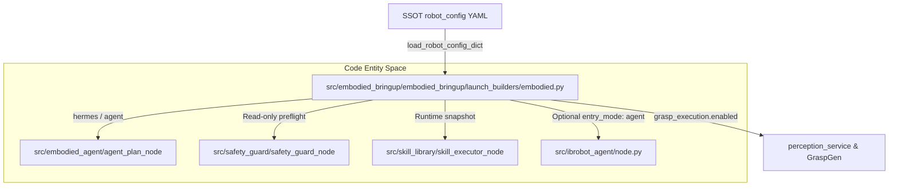
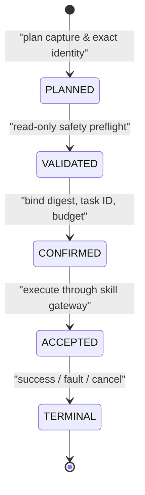
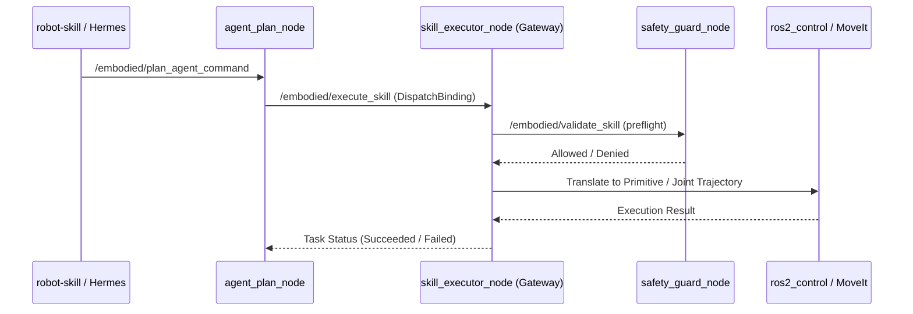

# 具身流水线与智能体节点

相关源码文件

以下文件被用作生成此 wiki 页面的上下文：

- [src/embodied_agent/README.md](https://atomgit.com/openeuler/IB_Robot/blob/openEuler-26.09/src/embodied_agent/README.md)
- [src/embodied_bringup/README.md](https://atomgit.com/openeuler/IB_Robot/blob/openEuler-26.09/src/embodied_bringup/README.md)
- [src/embodied_bringup/embodied_bringup/launch_builders/embodied.py](https://atomgit.com/openeuler/IB_Robot/blob/openEuler-26.09/src/embodied_bringup/embodied_bringup/launch_builders/embodied.py)
- [src/embodied_bringup/launch/embodied_pipeline.launch.py](https://atomgit.com/openeuler/IB_Robot/blob/openEuler-26.09/src/embodied_bringup/launch/embodied_pipeline.launch.py)
- [src/embodied_bringup/test/test_embodied_launch_builder.py](https://atomgit.com/openeuler/IB_Robot/blob/openEuler-26.09/src/embodied_bringup/test/test_embodied_launch_builder.py)
- [src/embodied_common/embodied_common/skill_templates.py](https://atomgit.com/openeuler/IB_Robot/blob/openEuler-26.09/src/embodied_common/embodied_common/skill_templates.py)
- [src/ibrobot_agent/ibrobot_agent/contracts.py](https://atomgit.com/openeuler/IB_Robot/blob/openEuler-26.09/src/ibrobot_agent/ibrobot_agent/contracts.py)
- [src/ibrobot_agent/ibrobot_agent/node.py](https://atomgit.com/openeuler/IB_Robot/blob/openEuler-26.09/src/ibrobot_agent/ibrobot_agent/node.py)
- [src/ibrobot_agent/ibrobot_agent/planner.py](https://atomgit.com/openeuler/IB_Robot/blob/openEuler-26.09/src/ibrobot_agent/ibrobot_agent/planner.py)
- [src/ibrobot_agent/ibrobot_agent/request_store.py](https://atomgit.com/openeuler/IB_Robot/blob/openEuler-26.09/src/ibrobot_agent/ibrobot_agent/request_store.py)
- [src/ibrobot_agent/ibrobot_agent/service.py](https://atomgit.com/openeuler/IB_Robot/blob/openEuler-26.09/src/ibrobot_agent/ibrobot_agent/service.py)
- [src/ibrobot_agent/test/agent_node_gazebo_execution_probe.py](https://atomgit.com/openeuler/IB_Robot/blob/openEuler-26.09/src/ibrobot_agent/test/agent_node_gazebo_execution_probe.py)
- [src/ibrobot_agent/test/agent_node_hardware_execution_probe.py](https://atomgit.com/openeuler/IB_Robot/blob/openEuler-26.09/src/ibrobot_agent/test/agent_node_hardware_execution_probe.py)
- [src/ibrobot_agent/test/agent_node_hardware_stop_probe.py](https://atomgit.com/openeuler/IB_Robot/blob/openEuler-26.09/src/ibrobot_agent/test/agent_node_hardware_stop_probe.py)
- [src/ibrobot_agent/test/test_node.py](https://atomgit.com/openeuler/IB_Robot/blob/openEuler-26.09/src/ibrobot_agent/test/test_node.py)
- [src/ibrobot_agent/test/test_planner.py](https://atomgit.com/openeuler/IB_Robot/blob/openEuler-26.09/src/ibrobot_agent/test/test_planner.py)
- [src/robot_config/robot_config/launch_builders/task_execution.py](https://atomgit.com/openeuler/IB_Robot/blob/openEuler-26.09/src/robot_config/robot_config/launch_builders/task_execution.py)
- [src/safety_guard/README.md](https://atomgit.com/openeuler/IB_Robot/blob/openEuler-26.09/src/safety_guard/README.md)
- [src/skill_library/README.md](https://atomgit.com/openeuler/IB_Robot/blob/openEuler-26.09/src/skill_library/README.md)
- [src/skill_library/package.xml](https://atomgit.com/openeuler/IB_Robot/blob/openEuler-26.09/src/skill_library/package.xml)
- [src/skill_library/skill_library/skill_executor_node.py](https://atomgit.com/openeuler/IB_Robot/blob/openEuler-26.09/src/skill_library/skill_library/skill_executor_node.py)
- [src/skill_library/test/test_skill_executor_node.py](https://atomgit.com/openeuler/IB_Robot/blob/openEuler-26.09/src/skill_library/test/test_skill_executor_node.py)
- [src/task_dispatch/README.en.md](https://atomgit.com/openeuler/IB_Robot/blob/openEuler-26.09/src/task_dispatch/README.en.md)
- [src/task_dispatch/README.md](https://atomgit.com/openeuler/IB_Robot/blob/openEuler-26.09/src/task_dispatch/README.md)
- [src/task_dispatch/package.xml](https://atomgit.com/openeuler/IB_Robot/blob/openEuler-26.09/src/task_dispatch/package.xml)
- [src/task_dispatch/task_dispatch/task_executor_node.py](https://atomgit.com/openeuler/IB_Robot/blob/openEuler-26.09/src/task_dispatch/task_dispatch/task_executor_node.py)

## 目的与范围

本页面详述 RoboFrame 中的具身流水线与智能体节点（`embodied_bringup`、`embodied_agent`、`ibrobot_agent` 与 `task_dispatch`），聚焦 launch 编排（`embodied_bringup`）、agent 规划生命周期（`agent_plan_node`、`ibrobot_agent`）、任务与技能执行（`task_executor_node`、`skill_executor_node`）以及服务集成 [src/embodied_bringup/README.md:1-5](https://atomgit.com/openeuler/IB_Robot/blob/openEuler-26.09/src/embodied_bringup/README.md#L1-L5)。

---

## 1. 具身 Bringup 与 launch 架构（`embodied_bringup`）

`embodied_bringup` 包是具身运行时的主执行 bringup 层 [src/embodied_bringup/README.md:1-5](https://atomgit.com/openeuler/IB_Robot/blob/openEuler-26.09/src/embodied_bringup/README.md#L1-L5)。它读取单一事实源（SSOT）机器人配置字典（`robot_config`），校验约束，并为 agent 规划、安全护栏检查与技能网关操作配置节点 [src/embodied_bringup/README.md:1-5](https://atomgit.com/openeuler/IB_Robot/blob/openEuler-26.09/src/embodied_bringup/README.md#L1-L5)。

### launch 构建器（`embodied.py`）

`embodied_bringup.launch_builders.embodied` 提供 `generate_embodied_nodes()`，基于活跃控制模式、入口模式（`hermes` 或 `agent`）与安全约束组装最小运行时图 [src/embodied_bringup/embodied_bringup/launch_builders/embodied.py:68-77](https://atomgit.com/openeuler/IB_Robot/blob/openEuler-26.09/src/embodied_bringup/embodied_bringup/launch_builders/embodied.py#L68-L77)。

来源：[src/embodied_bringup/README.md:1-35](https://atomgit.com/openeuler/IB_Robot/blob/openEuler-26.09/src/embodied_bringup/README.md#L1-L35), [src/embodied_bringup/embodied_bringup/launch_builders/embodied.py:68-77](https://atomgit.com/openeuler/IB_Robot/blob/openEuler-26.09/src/embodied_bringup/embodied_bringup/launch_builders/embodied.py#L68-L77) [src/embodied_bringup/test/test_embodied_launch_builder.py:81-118](https://atomgit.com/openeuler/IB_Robot/blob/openEuler-26.09/src/embodied_bringup/test/test_embodied_launch_builder.py#L81-L118)

---

## 2. Agent 规划节点（`agent_plan_node` 与 `ibrobot_agent`）

`embodied_agent` 包含 `agent_plan_node`，管理计划编译、安全校验、用户确认与执行流程 [src/embodied_agent/README.md:1-16](https://atomgit.com/openeuler/IB_Robot/blob/openEuler-26.09/src/embodied_agent/README.md#L1-L16)。当配置 `embodied.entry_mode: agent` 时，`ibrobot_agent` 提供通过进程内 planner 适配器通信的自然语言孵化入口 [src/embodied_bringup/README.md:42-47](https://atomgit.com/openeuler/IB_Robot/blob/openEuler-26.09/src/embodied_bringup/README.md#L42-L47)。

### Agent 计划状态机

agent 计划生命周期遵循严格顺序：

来源：[src/embodied_agent/README.md:46-60](https://atomgit.com/openeuler/IB_Robot/blob/openEuler-26.09/src/embodied_agent/README.md#L46-L60)

---

## 3. 技能与任务执行（`skill_executor_node` 与 `task_executor_node`）

### 技能库与 `skill_executor_node`

`skill_library` 管理带版本技能与原语动作的执行。`skill_executor_node` 作为不可变 `RuntimeSnapshot` 的运行时持有者，将原始模板编译为原语序列 [src/skill_library/README.md:34-40](https://atomgit.com/openeuler/IB_Robot/blob/openEuler-26.09/src/skill_library/README.md#L34-L40)。

来源：[src/skill_library/README.md:24-32](https://atomgit.com/openeuler/IB_Robot/blob/openEuler-26.09/src/skill_library/README.md#L24-L32), [src/safety_guard/README.md:16-30](https://atomgit.com/openeuler/IB_Robot/blob/openEuler-26.09/src/safety_guard/README.md#L16-L30)

### 任务分发与 `task_executor_node`

`task_dispatch` 包提供 `task_executor_node`，用于 `moveit_planning` 控制模式下的任务级执行 [src/robot_config/robot_config/launch_builders/task_execution.py:1-9](https://atomgit.com/openeuler/IB_Robot/blob/openEuler-26.09/src/robot_config/robot_config/launch_builders/task_execution.py#L1-L9)。它接受 `ExecuteTaskPlan` action，通过 `moveit_gateway` 将 `TaskSteps` 序列翻译为协调的机械臂动作，并通过 `ros2_control` 下发夹爪命令 [src/robot_config/robot_config/launch_builders/task_execution.py:6-9](https://atomgit.com/openeuler/IB_Robot/blob/openEuler-26.09/src/robot_config/robot_config/launch_builders/task_execution.py#L6-L9)。

---

## Agent 与执行节点汇总

| 包 | 节点可执行程序 | 核心职责 | 来源引用 |
| :--- | :--- | :--- | :--- |
| `embodied_bringup` | `embodied_pipeline.launch.py` | Bringup 编排、环境校验 | [src/embodied_bringup/README.md:20-35](https://atomgit.com/openeuler/IB_Robot/blob/openEuler-26.09/src/embodied_bringup/README.md#L20-L35) |
| `embodied_agent` | `agent_plan_node` | 计划生命周期（`PLANNED` -> `TERMINAL`） | [src/embodied_agent/README.md:9-11](https://atomgit.com/openeuler/IB_Robot/blob/openEuler-26.09/src/embodied_agent/README.md#L9-L11) |
| `ibrobot_agent` | `ibrobot_agent_node` | 自然语言 agent 孵化入口 | [src/embodied_bringup/README.md:42-47](https://atomgit.com/openeuler/IB_Robot/blob/openEuler-26.09/src/embodied_bringup/README.md#L42-L47) |
| `skill_library` | `skill_executor_node` | 带版本快照注册与原语执行 | [src/skill_library/README.md:9-11](https://atomgit.com/openeuler/IB_Robot/blob/openEuler-26.09/src/skill_library/README.md#L9-L11) |
| `task_dispatch` | `task_executor_node` | MoveIt/任务分发模式下的任务级执行 | [src/robot_config/robot_config/launch_builders/task_execution.py:79-94](https://atomgit.com/openeuler/IB_Robot/blob/openEuler-26.09/src/robot_config/robot_config/launch_builders/task_execution.py#L79-L94) |
| `safety_guard` | `safety_guard_node` | 只读预检与工作空间边界检查 | [src/safety_guard/README.md:8-11](https://atomgit.com/openeuler/IB_Robot/blob/openEuler-26.09/src/safety_guard/README.md#L8-L11) |

来源：[src/embodied_bringup/README.md:1-78](https://atomgit.com/openeuler/IB_Robot/blob/openEuler-26.09/src/embodied_bringup/README.md#L1-L78), [src/embodied_agent/README.md:1-68](https://atomgit.com/openeuler/IB_Robot/blob/openEuler-26.09/src/embodied_agent/README.md#L1-L68), [src/skill_library/README.md:1-110](https://atomgit.com/openeuler/IB_Robot/blob/openEuler-26.09/src/skill_library/README.md#L1-L110), [src/safety_guard/README.md:1-100](https://atomgit.com/openeuler/IB_Robot/blob/openEuler-26.09/src/safety_guard/README.md#L1-L100), [src/robot_config/robot_config/launch_builders/task_execution.py:1-97](https://atomgit.com/openeuler/IB_Robot/blob/openEuler-26.09/src/robot_config/robot_config/launch_builders/task_execution.py#L1-L97)
