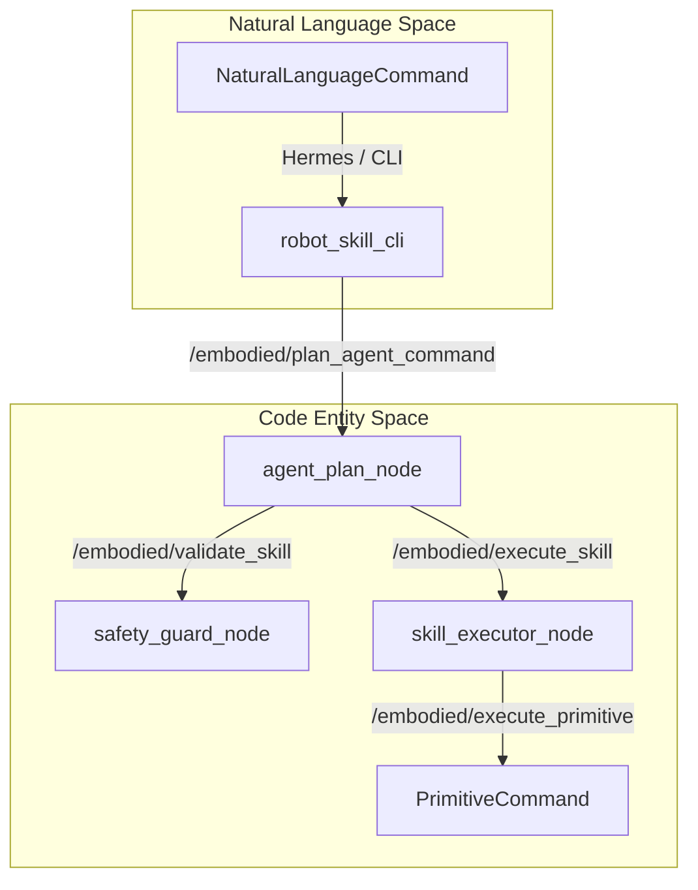
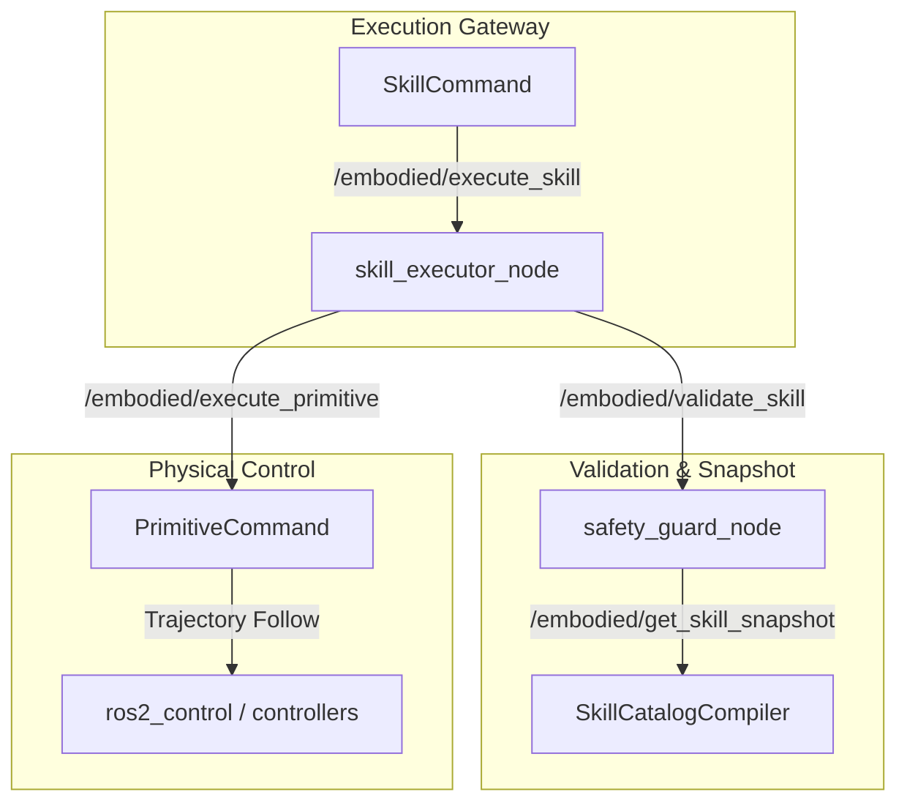

# 具身智能体与技能概述

相关源码文件

以下文件被用作生成此 wiki 页面的上下文：

- [src/embodied_agent/README.md](https://atomgit.com/openeuler/IB_Robot/blob/openEuler-26.09/src/embodied_agent/README.md)
- [src/embodied_bringup/README.md](https://atomgit.com/openeuler/IB_Robot/blob/openEuler-26.09/src/embodied_bringup/README.md)
- [src/embodied_bringup/embodied_bringup/launch_builders/embodied.py](https://atomgit.com/openeuler/IB_Robot/blob/openEuler-26.09/src/embodied_bringup/embodied_bringup/launch_builders/embodied.py)
- [src/embodied_bringup/launch/embodied_pipeline.launch.py](https://atomgit.com/openeuler/IB_Robot/blob/openEuler-26.09/src/embodied_bringup/launch/embodied_pipeline.launch.py)
- [src/embodied_bringup/test/test_embodied_launch_builder.py](https://atomgit.com/openeuler/IB_Robot/blob/openEuler-26.09/src/embodied_bringup/test/test_embodied_launch_builder.py)
- [src/embodied_common/embodied_common/skill_templates.py](https://atomgit.com/openeuler/IB_Robot/blob/openEuler-26.09/src/embodied_common/embodied_common/skill_templates.py)
- [src/safety_guard/README.md](https://atomgit.com/openeuler/IB_Robot/blob/openEuler-26.09/src/safety_guard/README.md)
- [src/skill_library/README.md](https://atomgit.com/openeuler/IB_Robot/blob/openEuler-26.09/src/skill_library/README.md)
- [src/skill_library/package.xml](https://atomgit.com/openeuler/IB_Robot/blob/openEuler-26.09/src/skill_library/package.xml)
- [src/skill_library/skill_library/skill_executor_node.py](https://atomgit.com/openeuler/IB_Robot/blob/openEuler-26.09/src/skill_library/skill_library/skill_executor_node.py)
- [src/skill_library/test/test_skill_executor_node.py](https://atomgit.com/openeuler/IB_Robot/blob/openEuler-26.09/src/skill_library/test/test_skill_executor_node.py)

## 目的与范围

具身智能体与技能层为 RoboFrame 提供编排、规划、安全校验与执行原语。它将自然语言意图、结构化 agent 计划与程序化工作流桥接为在 ROS 2 控制器上运行的、经校验且安全的物理操作。本页面是 agent 层的高层概览，串联 launch 构建器、运行时 agent 节点、技能目录、命令行接口与安全强制护栏。

深入的技术细节请参阅相应子页面：

- [具身流水线与 Agent 节点](./embodied_pipeline_agent_nodes.md)
- [技能目录与技能库](./skill_catalog_skill_library.md)
- [robot-skill CLI 与 Hermes](./robot_skill_cli_hermes.md)
- [安全护栏](./safety_guard.md)

来源：[src/embodied_bringup/README.md:1-42](https://atomgit.com/openeuler/IB_Robot/blob/openEuler-26.09/src/embodied_bringup/README.md#L1-L42), [src/embodied_agent/README.md:1-20](https://atomgit.com/openeuler/IB_Robot/blob/openEuler-26.09/src/embodied_agent/README.md#L1-L20)

---

## 架构总览：从自然语言到代码实体

具身系统通过一条由专用 ROS 2 节点组成的结构化流水线，把高层用户命令或 Hermes 驱动的工作流翻译为具体的机器人动作。

Title: Natural Language Space to Code Entity Space — Agent & Plan Lifecycle

来源：`[src/embodied_bringup/README.md:1-60](https://atomgit.com/openeuler/IB_Robot/blob/openEuler-26.09/src/embodied_bringup/README.md#L1-L60), [src/embodied_agent/README.md:21-40](https://atomgit.com/openeuler/IB_Robot/blob/openEuler-26.09/src/embodied_agent/README.md#L21-L40)`

---

## 7.1 具身流水线与 Agent 节点

`embodied_bringup` 包通过 `embodied_pipeline.launch.py` 协调运行时初始化，支持 `hermes`（默认）与 `agent` 两种入口模式 [src/embodied_bringup/README.md:1-43](https://atomgit.com/openeuler/IB_Robot/blob/openEuler-26.09/src/embodied_bringup/README.md#L1-L43)。它管理 `agent_plan_node`、`safety_guard_node` 与 `skill_executor_node` 的生命周期，并在激活与运动相关的子图之前强制控制器就绪屏障 [src/embodied_bringup/README.md:1-47](https://atomgit.com/openeuler/IB_Robot/blob/openEuler-26.09/src/embodied_bringup/README.md#L1-L47), [src/embodied_bringup/launch/embodied_pipeline.launch.py:53-88](https://atomgit.com/openeuler/IB_Robot/blob/openEuler-26.09/src/embodied_bringup/launch/embodied_pipeline.launch.py#L53-L88)。

关于 launch 参数、节点拓扑与服务绑定的详细信息，见[具身流水线与 Agent 节点](./embodied_pipeline_agent_nodes.md)。

来源：`[src/embodied_bringup/README.md:1-47](https://atomgit.com/openeuler/IB_Robot/blob/openEuler-26.09/src/embodied_bringup/README.md#L1-L47), [src/embodied_bringup/launch/embodied_pipeline.launch.py:53-88](https://atomgit.com/openeuler/IB_Robot/blob/openEuler-26.09/src/embodied_bringup/launch/embodied_pipeline.launch.py#L53-L88)`

---

## 7.2 技能目录与技能库

`skill_library` 包承载 `skill_executor_node`，作为执行核心把高层技能翻译为带版本的原语序列 [src/skill_library/README.md:1-12](https://atomgit.com/openeuler/IB_Robot/blob/openEuler-26.09/src/skill_library/README.md#L1-L12)。它将机器人配置文件与技能 manifest 编译为不可变的 `RuntimeSnapshot` 结构，其中包含严格的能力摘要、工作空间限制与机器人上下文 [src/skill_library/README.md:34-50](https://atomgit.com/openeuler/IB_Robot/blob/openEuler-26.09/src/skill_library/README.md#L34-L50)。

Title: Code Entity Space — Skill Resolution and Safety Validation Flow

来源：`[src/skill_library/README.md:24-64](https://atomgit.com/openeuler/IB_Robot/blob/openEuler-26.09/src/skill_library/README.md#L24-L64), [src/safety_guard/README.md:24-50](https://atomgit.com/openeuler/IB_Robot/blob/openEuler-26.09/src/safety_guard/README.md#L24-L50)`

关于技能 manifest、性能剖析、解析模板与自定义执行器的完整文档，见[技能目录与技能库](./skill_catalog_skill_library.md)。

来源：`[src/skill_library/README.md:1-64](https://atomgit.com/openeuler/IB_Robot/blob/openEuler-26.09/src/skill_library/README.md#L1-L64), [src/skill_library/skill_library/skill_executor_node.py:1-75](https://atomgit.com/openeuler/IB_Robot/blob/openEuler-26.09/src/skill_library/skill_library/skill_executor_node.py#L1-L75)`

---

## 7.3 robot-skill CLI 与 Hermes

与具身运行时的交互通过 `robot_skill_cli` 工具套件和 Hermes 语音/生命周期集成框架管理。这些工具提供交互式命令行控制、工作流分发、原始 ROS 阻塞钩子以及语音驱动的对话管理，且不绕过核心安全与执行网关 [src/embodied_bringup/README.md:64-78](https://atomgit.com/openeuler/IB_Robot/blob/openEuler-26.09/src/embodied_bringup/README.md#L64-L78), [src/embodied_agent/README.md:21-68](https://atomgit.com/openeuler/IB_Robot/blob/openEuler-26.09/src/embodied_agent/README.md#L21-L68)。

详细用法、命令结构与语音桥接配置，见 [robot-skill CLI 与 Hermes](./robot_skill_cli_hermes.md)。

来源：`[src/embodied_bringup/README.md:64-78](https://atomgit.com/openeuler/IB_Robot/blob/openEuler-26.09/src/embodied_bringup/README.md#L64-L78), [src/embodied_agent/README.md:21-68](https://atomgit.com/openeuler/IB_Robot/blob/openEuler-26.09/src/embodied_agent/README.md#L21-L68)`

---

## 7.4 安全护栏

`safety_guard` 包通过 `safety_guard_node` 提供只读的预检校验服务（`/embodied/validate_skill` 与 `/embodied/validate_primitive`）[src/safety_guard/README.md:1-80](https://atomgit.com/openeuler/IB_Robot/blob/openEuler-26.09/src/safety_guard/README.md#L1-L80)。它从 `skill_library` 网关同步精确的已验证快照，并在本地内存中强制严格白名单、工作空间边界、关节限位检查与分发绑定校验，不产生 ROS I/O 延迟 [src/safety_guard/README.md:24-70](https://atomgit.com/openeuler/IB_Robot/blob/openEuler-26.09/src/safety_guard/README.md#L24-L70)。

校验规则、边界约束与错误代码的完整规范，见[安全护栏](./safety_guard.md)。

来源：[src/safety_guard/README.md:1-80](https://atomgit.com/openeuler/IB_Robot/blob/openEuler-26.09/src/safety_guard/README.md#L1-L80)
