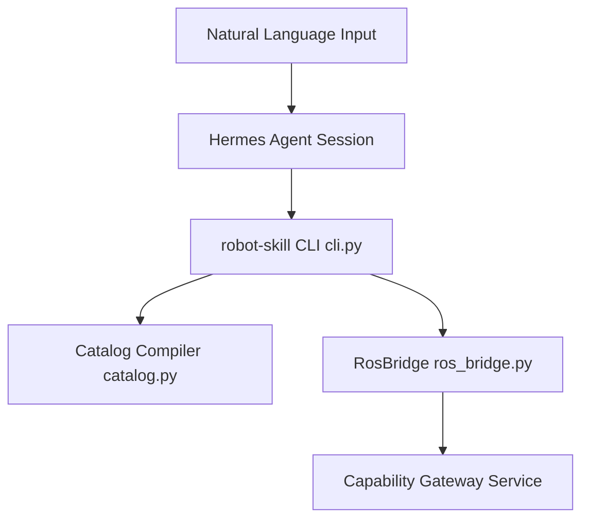
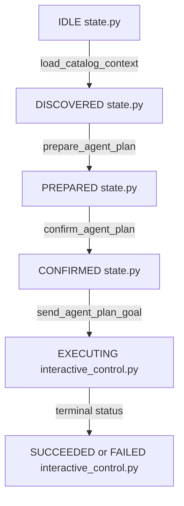
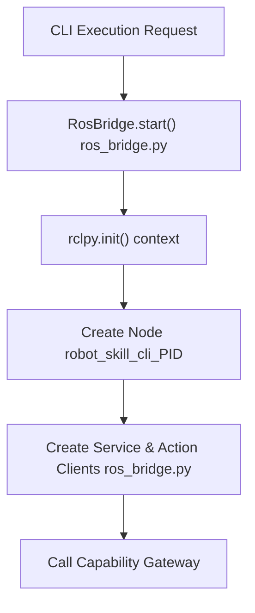

# robot-skill CLI 与 Hermes

相关源码文件

以下文件被用作生成此 wiki 页面的上下文：

- [.agents/skills/ibrobot-control/SKILL.md](https://atomgit.com/openeuler/IB_Robot/blob/openEuler-26.09/.agents/skills/ibrobot-control/SKILL.md)
- [docs/hermes_so101_real_robot_manual_validation_zh.md](https://atomgit.com/openeuler/IB_Robot/blob/openEuler-26.09/docs/hermes_so101_real_robot_manual_validation_zh.md)
- [docs/interactive_closed_loop_control_design.md](https://atomgit.com/openeuler/IB_Robot/blob/openEuler-26.09/docs/interactive_closed_loop_control_design.md)
- [docs/lightweight_skill_package_registry_design_zh.md](https://atomgit.com/openeuler/IB_Robot/blob/openEuler-26.09/docs/lightweight_skill_package_registry_design_zh.md)
- [scripts/check_agent_skill.py](https://atomgit.com/openeuler/IB_Robot/blob/openEuler-26.09/scripts/check_agent_skill.py)
- [scripts/test_check_agent_skill.py](https://atomgit.com/openeuler/IB_Robot/blob/openEuler-26.09/scripts/test_check_agent_skill.py)
- [src/embodied_agent/embodied_agent/agent_plan_node.py](https://atomgit.com/openeuler/IB_Robot/blob/openEuler-26.09/src/embodied_agent/embodied_agent/agent_plan_node.py)
- [src/embodied_agent/embodied_agent/agent_plan_store.py](https://atomgit.com/openeuler/IB_Robot/blob/openEuler-26.09/src/embodied_agent/embodied_agent/agent_plan_store.py)
- [src/embodied_agent/test/test_agent_plan_store.py](https://atomgit.com/openeuler/IB_Robot/blob/openEuler-26.09/src/embodied_agent/test/test_agent_plan_store.py)
- [src/embodied_common/README.md](https://atomgit.com/openeuler/IB_Robot/blob/openEuler-26.09/src/embodied_common/README.md)
- [src/ibrobot_msgs/msg/AgentPlan.msg](https://atomgit.com/openeuler/IB_Robot/blob/openEuler-26.09/src/ibrobot_msgs/msg/AgentPlan.msg)
- [src/robot_skill_cli/README.md](https://atomgit.com/openeuler/IB_Robot/blob/openEuler-26.09/src/robot_skill_cli/README.md)
- [src/robot_skill_cli/package.xml](https://atomgit.com/openeuler/IB_Robot/blob/openEuler-26.09/src/robot_skill_cli/package.xml)
- [src/robot_skill_cli/resource/hermes/POLICY.md](https://atomgit.com/openeuler/IB_Robot/blob/openEuler-26.09/src/robot_skill_cli/resource/hermes/POLICY.md)
- [src/robot_skill_cli/resource/hermes/README.md](https://atomgit.com/openeuler/IB_Robot/blob/openEuler-26.09/src/robot_skill_cli/resource/hermes/README.md)
- [src/robot_skill_cli/resource/hermes/SOUL.md](https://atomgit.com/openeuler/IB_Robot/blob/openEuler-26.09/src/robot_skill_cli/resource/hermes/SOUL.md)
- [src/robot_skill_cli/resource/hermes/hooks/ibrobot-block-raw-ros](https://atomgit.com/openeuler/IB_Robot/blob/openEuler-26.09/src/robot_skill_cli/resource/hermes/hooks/ibrobot-block-raw-ros)
- [src/robot_skill_cli/resource/hermes/hooks/ibrobot-lifecycle-speech](https://atomgit.com/openeuler/IB_Robot/blob/openEuler-26.09/src/robot_skill_cli/resource/hermes/hooks/ibrobot-lifecycle-speech)
- [src/robot_skill_cli/resource/ibrobot-control/SKILL.md](https://atomgit.com/openeuler/IB_Robot/blob/openEuler-26.09/src/robot_skill_cli/resource/ibrobot-control/SKILL.md)
- [src/robot_skill_cli/robot_skill_cli/catalog.py](https://atomgit.com/openeuler/IB_Robot/blob/openEuler-26.09/src/robot_skill_cli/robot_skill_cli/catalog.py)
- [src/robot_skill_cli/robot_skill_cli/cli.py](https://atomgit.com/openeuler/IB_Robot/blob/openEuler-26.09/src/robot_skill_cli/robot_skill_cli/cli.py)
- [src/robot_skill_cli/robot_skill_cli/closed_loop_runner.py](https://atomgit.com/openeuler/IB_Robot/blob/openEuler-26.09/src/robot_skill_cli/robot_skill_cli/closed_loop_runner.py)
- [src/robot_skill_cli/robot_skill_cli/hermes_configure.py](https://atomgit.com/openeuler/IB_Robot/blob/openEuler-26.09/src/robot_skill_cli/robot_skill_cli/hermes_configure.py)
- [src/robot_skill_cli/robot_skill_cli/hermes_launcher.py](https://atomgit.com/openeuler/IB_Robot/blob/openEuler-26.09/src/robot_skill_cli/robot_skill_cli/hermes_launcher.py)
- [src/robot_skill_cli/robot_skill_cli/hermes_lifecycle_speech.py](https://atomgit.com/openeuler/IB_Robot/blob/openEuler-26.09/src/robot_skill_cli/robot_skill_cli/hermes_lifecycle_speech.py)
- [src/robot_skill_cli/robot_skill_cli/hermes_tts_hook.py](https://atomgit.com/openeuler/IB_Robot/blob/openEuler-26.09/src/robot_skill_cli/robot_skill_cli/hermes_tts_hook.py)
- [src/robot_skill_cli/robot_skill_cli/interactive_control.py](https://atomgit.com/openeuler/IB_Robot/blob/openEuler-26.09/src/robot_skill_cli/robot_skill_cli/interactive_control.py)
- [src/robot_skill_cli/robot_skill_cli/perceive_cli.py](https://atomgit.com/openeuler/IB_Robot/blob/openEuler-26.09/src/robot_skill_cli/robot_skill_cli/perceive_cli.py)
- [src/robot_skill_cli/robot_skill_cli/ros_bridge.py](https://atomgit.com/openeuler/IB_Robot/blob/openEuler-26.09/src/robot_skill_cli/robot_skill_cli/ros_bridge.py)
- [src/robot_skill_cli/setup.py](https://atomgit.com/openeuler/IB_Robot/blob/openEuler-26.09/src/robot_skill_cli/setup.py)
- [src/robot_skill_cli/test/test_block_raw_ros.py](https://atomgit.com/openeuler/IB_Robot/blob/openEuler-26.09/src/robot_skill_cli/test/test_block_raw_ros.py)
- [src/robot_skill_cli/test/test_cli_catalog.py](https://atomgit.com/openeuler/IB_Robot/blob/openEuler-26.09/src/robot_skill_cli/test/test_cli_catalog.py)
- [src/robot_skill_cli/test/test_hermes_integration.py](https://atomgit.com/openeuler/IB_Robot/blob/openEuler-26.09/src/robot_skill_cli/test/test_hermes_integration.py)
- [src/robot_skill_cli/test/test_hermes_launcher.py](https://atomgit.com/openeuler/IB_Robot/blob/openEuler-26.09/src/robot_skill_cli/test/test_hermes_launcher.py)
- [src/robot_skill_cli/test/test_hermes_lifecycle_speech.py](https://atomgit.com/openeuler/IB_Robot/blob/openEuler-26.09/src/robot_skill_cli/test/test_hermes_lifecycle_speech.py)
- [src/robot_skill_cli/test/test_interactive_control.py](https://atomgit.com/openeuler/IB_Robot/blob/openEuler-26.09/src/robot_skill_cli/test/test_interactive_control.py)
- [src/robot_skill_cli/test/test_perceive_cli.py](https://atomgit.com/openeuler/IB_Robot/blob/openEuler-26.09/src/robot_skill_cli/test/test_perceive_cli.py)
- [src/robot_skill_cli/test/test_ros_bridge.py](https://atomgit.com/openeuler/IB_Robot/blob/openEuler-26.09/src/robot_skill_cli/test/test_ros_bridge.py)
- [src/voice_asr_service/test/speech_direction/test_pipeline_streaming_schedule.py](https://atomgit.com/openeuler/IB_Robot/blob/openEuler-26.09/src/voice_asr_service/test/speech_direction/test_pipeline_streaming_schedule.py)
- [src/voice_asr_service/voice_asr_service/speech_direction/pipeline_streaming.py](https://atomgit.com/openeuler/IB_Robot/blob/openEuler-26.09/src/voice_asr_service/voice_asr_service/speech_direction/pipeline_streaming.py)

## 目的与范围

本页面详述 `robot_skill_cli` 包的实现、架构与操作工作流，及其与 Hermes Agent 的集成。覆盖命令行参数解析与执行（`robot-skill`）、纯 Python 交互式闭环控制器（`InteractiveController`）、惰性 ROS 2 传输封装（`RosBridge`）、只读感知访问器（`ibrobot-perceive`）、原生 ROS 拦截钩子（`ibrobot-block-raw-ros`）以及生命周期语音/TTS 钩子。

来源：[src/robot_skill_cli/README.md:1-18](https://atomgit.com/openeuler/IB_Robot/blob/openEuler-26.09/src/robot_skill_cli/README.md#L1-L18), [src/robot_skill_cli/robot_skill_cli/cli.py:1-58](https://atomgit.com/openeuler/IB_Robot/blob/openEuler-26.09/src/robot_skill_cli/robot_skill_cli/cli.py#L1-L58), [src/robot_skill_cli/robot_skill_cli/interactive_control.py:1-12](https://atomgit.com/openeuler/IB_Robot/blob/openEuler-26.09/src/robot_skill_cli/robot_skill_cli/interactive_control.py#L1-L12), [src/robot_skill_cli/robot_skill_cli/ros_bridge.py:1-29](https://atomgit.com/openeuler/IB_Robot/blob/openEuler-26.09/src/robot_skill_cli/robot_skill_cli/ros_bridge.py#L1-L29), [src/robot_skill_cli/robot_skill_cli/perceive_cli.py:1-42](https://atomgit.com/openeuler/IB_Robot/blob/openEuler-26.09/src/robot_skill_cli/robot_skill_cli/perceive_cli.py#L1-L42)

---

## 1. `robot-skill` CLI 命令与架构

`robot_skill_cli` 包是限制 LLM 与 Agent 访问 ROS 能力平面的主要受控接口。它避免与原生原语、MoveIt、控制器或任意 `ros2` 子命令直接交互，将所有能力发现、规划校验与执行路由经 ROS 能力网关。

命令解析与子命令路由实现于 `src/robot_skill_cli/robot_skill_cli/cli.py`，使用定制的 `argparse.ArgumentParser` 子类（`_ArgumentParser`），将参数错误映射为结构化 CLI 异常 [src/robot_skill_cli/robot_skill_cli/cli.py:72-100](https://atomgit.com/openeuler/IB_Robot/blob/openEuler-26.09/src/robot_skill_cli/robot_skill_cli/cli.py#L72-L100)。

*图 1：自然语言空间到机器人技能控制的代码实体路由。*

来源：[src/robot_skill_cli/README.md:1-35](https://atomgit.com/openeuler/IB_Robot/blob/openEuler-26.09/src/robot_skill_cli/README.md#L1-L35), [src/robot_skill_cli/robot_skill_cli/cli.py:72-151](https://atomgit.com/openeuler/IB_Robot/blob/openEuler-26.09/src/robot_skill_cli/robot_skill_cli/cli.py#L72-L151)

---

## 2. 交互控制与闭环引擎

模块 `src/robot_skill_cli/robot_skill_cli/interactive_control.py` 提供 `InteractiveController`，一个纯 Python、无 ROS 依赖的交互式闭环状态机参考实现。它处理目录发现、目录外拒绝、进程内工作流准备/执行、确定性终结错误映射以及安全的新状态续接。

*图 2：交互控制器状态机到代码实体的映射。*

### 意图分类与语法

`InteractiveController` 依赖封闭的自然语言语法来映射确认、停止与续接意图，而非将非结构化自由文本解析为任意运动命令 [src/robot_skill_cli/robot_skill_cli/interactive_control.py:36-55](https://atomgit.com/openeuler/IB_Robot/blob/openEuler-26.09/src/robot_skill_cli/robot_skill_cli/interactive_control.py#L36-L55)。

控制器状态迁移由受 `threading.RLock()` 保护的内部状态机管理：

* **`IDLE`**：连接网关前的初始状态。
* **`DISCOVERED`**：已获取快照并加载能力视图。
* **`PREPARED`**：工作流步骤已编译并校验。
* **`CONFIRMED`**：规划令牌已与网关任务预算绑定。
* **`EXECUTING`**：动作目标已在 ROS 执行客户端上激活。
* **`STOPPED / SUCCEEDED / FAILED`**：终结状态。

来源：[src/robot_skill_cli/robot_skill_cli/interactive_control.py:36-185](https://atomgit.com/openeuler/IB_Robot/blob/openEuler-26.09/src/robot_skill_cli/robot_skill_cli/interactive_control.py#L36-L185)

---

## 3. Hermes 集成、SOUL/POLICY 与 `ibrobot-perceive`

目录 `src/robot_skill_cli/resource/hermes/` 是 Hermes 集成资产的唯一发布源，包括人格配置（`SOUL.md`）、限制性策略（`POLICY.md`）、同步脚本（`sync_hermes.sh`）与工具钩子封装 [src/robot_skill_cli/resource/hermes/README.md:1-19](https://atomgit.com/openeuler/IB_Robot/blob/openEuler-26.09/src/robot_skill_cli/resource/hermes/README.md#L1-L19)。

### 只读感知访问（`ibrobot-perceive`）

为允许 Hermes Agent 检视感知变量而不破坏沙箱保证，`ibrobot_skill_cli` 提供 `ibrobot-perceive` 控制台脚本（`src/robot_skill_cli/robot_skill_cli/perceive_cli.py`）。它强制执行硬编码的来源/字段白名单（`PERCEPTION_ALLOWLIST`），将每次读取尝试记录到 `/tmp/hermes-perceive.log`，并以有限超时执行 [src/robot_skill_cli/robot_skill_cli/perceive_cli.py:1-75](https://atomgit.com/openeuler/IB_Robot/blob/openEuler-26.09/src/robot_skill_cli/robot_skill_cli/perceive_cli.py#L1-L75)。

| 感知来源别名 | 真实 ROS 话题来源 | 允许字段 | 配置驱动 |
|---|---|---|---|
| `arm_joint_position` | 从 `robot_config.moveit.joint_state_topic` 解析（回退 `/joint_states`） | `position` | 是（`True`） |
| `voice_direction` | `/voice/speech_direction`（固定 `voice_asr_service` 契约） | `azimuth_rad`, `seq_id` | 否（`False`） |

来源：[src/robot_skill_cli/resource/hermes/README.md:20-54](https://atomgit.com/openeuler/IB_Robot/blob/openEuler-26.09/src/robot_skill_cli/resource/hermes/README.md#L20-L54), [src/robot_skill_cli/robot_skill_cli/perceive_cli.py:63-79](https://atomgit.com/openeuler/IB_Robot/blob/openEuler-26.09/src/robot_skill_cli/robot_skill_cli/perceive_cli.py#L63-L79)

---

## 4. 惰性 ROS 桥与原生 ROS 拦截钩子

### 惰性 ROS 桥（`RosBridge`）

`RosBridge` 封装 ROS 节点初始化与客户端创建于 `src/robot_skill_cli/robot_skill_cli/ros_bridge.py`。通过将 `rclpy` 导入与上下文创建延迟到运行时命令调用，目录检视命令可在不初始化 ROS 上下文或启动线程的情况下运行 [src/robot_skill_cli/robot_skill_cli/ros_bridge.py:28-100](https://atomgit.com/openeuler/IB_Robot/blob/openEuler-26.09/src/robot_skill_cli/robot_skill_cli/ros_bridge.py#L28-L100)。

*图 3：惰性 ROS 桥初始化生命周期。*

### 原生 ROS 拦截钩子（`ibrobot-block-raw-ros`）

深度防御的前置工具调用钩子（`src/robot_skill_cli/resource/hermes/hooks/ibrobot-block-raw-ros`）拦截来自 Hermes 的工具载荷，提取 `tool_input.command` 并用 `shlex` 解析。任何对原生 `ros2`、`rclpy` 或 `roslaunch` 子命令的调用都会被拦截，强制 Agent 使用 `robot-skill` 或 `ibrobot-perceive` [`src/robot_skill_cli/resource/hermes/README.md:39-54`].

来源：[src/robot_skill_cli/robot_skill_cli/ros_bridge.py:28-100](https://atomgit.com/openeuler/IB_Robot/blob/openEuler-26.09/src/robot_skill_cli/robot_skill_cli/ros_bridge.py#L28-L100), [`src/robot_skill_cli/resource/hermes/README.md:39-54`]

---

## 5. 生命周期语音与 TTS 钩子

Hermes 集成注册生命周期语音与文本转语音钩子，在机器人任务执行期间提供音频反馈：

* **`ibrobot-speak`**：封装 `src/robot_skill_cli/robot_skill_cli/hermes_tts_hook.py`，使用 SSOT 配置参数合成语音。
* **`ibrobot-lifecycle-speech`**：使用 `embodied_agent` 与 `embodied_common`，异步为状态检查、规划步骤与规划授权生成描述性文本，通过 `vlm_models.yaml` 经 `gpt-5.6-sol` 路由 prompt [src/robot_skill_cli/resource/hermes/README.md:122-153](https://atomgit.com/openeuler/IB_Robot/blob/openEuler-26.09/src/robot_skill_cli/resource/hermes/README.md#L122-L153)。

音频播放使用单设备进程锁同步，防止并发后台工作线程之间的音频驱动争用。

来源：[src/robot_skill_cli/resource/hermes/README.md:100-181](https://atomgit.com/openeuler/IB_Robot/blob/openEuler-26.09/src/robot_skill_cli/resource/hermes/README.md#L100-L181), [src/robot_skill_cli/robot_skill_cli/hermes_lifecycle_speech.py:1-50](https://atomgit.com/openeuler/IB_Robot/blob/openEuler-26.09/src/robot_skill_cli/robot_skill_cli/hermes_lifecycle_speech.py#L1-L50), [src/robot_skill_cli/robot_skill_cli/hermes_tts_hook.py:1-40](https://atomgit.com/openeuler/IB_Robot/blob/openEuler-26.09/src/robot_skill_cli/robot_skill_cli/hermes_tts_hook.py#L1-L40)
