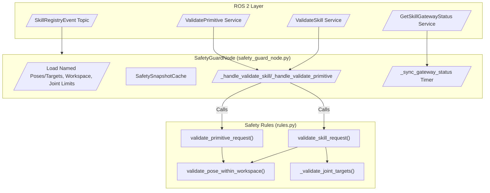
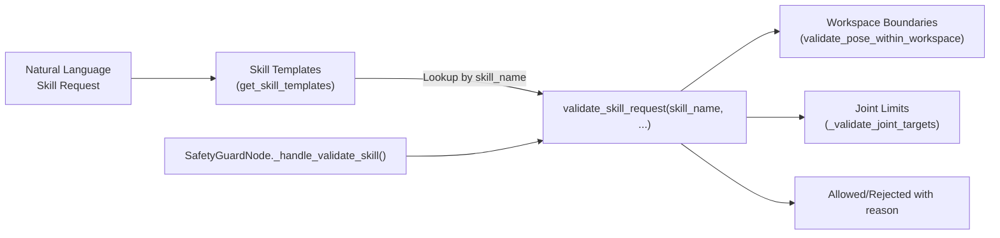
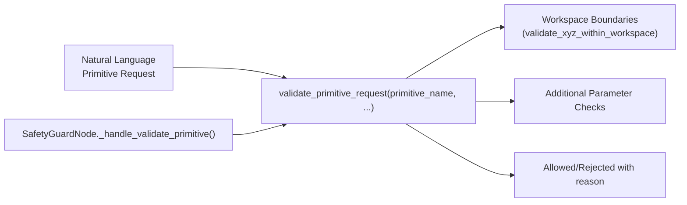

# 安全防护

相关源码文件

以下文件被用作生成此 wiki 页面的上下文：

- [src/embodied_agent/embodied_agent/task_executor_node.py](https://atomgit.com/openeuler/IB_Robot/blob/openEuler-26.09/src/embodied_agent/embodied_agent/task_executor_node.py)
- [src/embodied_common/embodied_common/dispatch_binding.py](https://atomgit.com/openeuler/IB_Robot/blob/openEuler-26.09/src/embodied_common/embodied_common/dispatch_binding.py)
- [src/safety_guard/package.xml](https://atomgit.com/openeuler/IB_Robot/blob/openEuler-26.09/src/safety_guard/package.xml)
- [src/safety_guard/resource/safety_guard](https://atomgit.com/openeuler/IB_Robot/blob/openEuler-26.09/src/safety_guard/resource/safety_guard)
- [src/safety_guard/safety_guard/__init__.py](https://atomgit.com/openeuler/IB_Robot/blob/openEuler-26.09/src/safety_guard/safety_guard/__init__.py)
- [src/safety_guard/safety_guard/rules.py](https://atomgit.com/openeuler/IB_Robot/blob/openEuler-26.09/src/safety_guard/safety_guard/rules.py)
- [src/safety_guard/safety_guard/safety_guard_node.py](https://atomgit.com/openeuler/IB_Robot/blob/openEuler-26.09/src/safety_guard/safety_guard/safety_guard_node.py)
- [src/safety_guard/setup.py](https://atomgit.com/openeuler/IB_Robot/blob/openEuler-26.09/src/safety_guard/setup.py)
- [src/safety_guard/test/test_rules.py](https://atomgit.com/openeuler/IB_Robot/blob/openEuler-26.09/src/safety_guard/test/test_rules.py)

**安全防护**（Safety Guard）组件在 RoboFrame 的具身最小闭环框架内提供严格的安全校验服务。其核心职责包括强制工作空间边界、应用技能与原语的安全规则及白名单，以及在任务执行前校验分发绑定。这对通过尽早发现并拒绝不安全或不受支持的命令来维护安全的机器人操作至关重要。

本叶子页面记录 Safety Guard 系统的实现细节、数据流与关键代码实体，覆盖：

- 技能与原语的安全校验规则。
- 命名位姿与目标白名单。
- 工作空间边界强制。
- 分发绑定校验。
- 暴露校验服务的 SafetyGuardNode ROS 2 节点。

---

## 1. 安全校验规则

校验安全约束的基础逻辑位于模块 `safety_guard.rules`（`src/safety_guard/safety_guard/rules.py`）。该模块提供检查技能请求、原语命令与机器人位姿相对所配置限位的有效性与安全性的函数。

### `rules.py` 中的关键函数：

- `_is_finite_number(value) -> bool`：  
  检查一个值是否为非布尔的有限数。

- `validate_xyz_within_workspace(x, y, z, workspace) -> tuple[bool, str]`：  
  校验提供的 3D 点是否位于定义的工作空间边界内。支持按轴的 min/max 限位，并可选以原点为中心的最大半径约束。

- `validate_pose_within_workspace(pose, workspace) -> tuple[bool, str]`：  
  从位姿字典中提取 XYZ 位置并调用 `validate_xyz_within_workspace`。

- `_validate_quaternion(qx, qy, qz, qw) -> tuple[bool, str]`：  
  校验四元数姿态已归一化且非零。

- `_validate_joint_targets(joint_positions, arm_joint_names, joint_limits, label) -> tuple[bool, str]`：  
  校验关节位置为有限值、（若提供）对应已知关节，且（若指定）遵循关节限位。

- `validate_skill_request(...)`：  
  技能请求的核心校验器。它检查：
  - 技能名称受支持（存在于技能模板中）。
  - 技能未被禁用。
  - 必需字段与参数存在。
  - 请求 schema 版本与预期匹配。
  - 目标位姿与关节在工作空间与限位之内。
  - 委派执行器名称（如适用）受支持。

- `validate_primitive_request(...)`：  
  与技能校验类似但面向原语命令，校验允许的原语、工作空间约束与参数正确性。

这些校验强制所有运动目标、关节命令与技能调用严格遵循所配置的安全约束与白名单。

#### 工作空间定义

位姿校验使用的工作空间参数是一个字典，含可选键 `"x"`、`"y"`、`"z"`，各自映射为 `[min, max]` 浮点限位。它还可包含 `"max_radius_m"` 以强制距原点的最大半径。这允许为机器人操作定义复杂的体积边界。

### 数据流与设计

- 收到待校验的技能或原语请求时，Safety Guard 调用这些规则函数校验请求参数。
- 技能模板、关节限位、命名位姿与工作空间被传入或加载以供检查。
- 校验返回布尔允许标志，以及被拒绝时的字符串原因或错误消息。

该设计将纯安全逻辑（rules.py）与 ROS 2 节点代码干净分离。

---

## 2. SafetyGuardNode ROS 2 节点

**SafetyGuardNode** 类（`src/safety_guard/safety_guard/safety_guard_node.py`）是将安全校验逻辑暴露为服务并订阅技能注册事件的 ROS 2 节点。

### 节点初始化与参数

- 声明服务名、JSON 编码的配置块与调试控制参数。
- 加载如下配置：
  - 命名位姿 JSON
  - 命名目标 JSON
  - 用于边界定义的工作空间 JSON
  - 手臂关节名称列表 JSON
  - 关节限位 JSON
- 实例化 `SafetySnapshotCache` 以管理技能目录的快照版本。
- 创建服务服务器：
  - `/embodied/validate_skill` 用于技能校验请求。
  - `/embodied/validate_primitive` 用于原语校验请求。
- 订阅 `/embodied/skill_registry_events` 以获取技能目录状态更新。
- 周期性与技能网关状态服务 `/embodied/get_skill_gateway_status` 同步。

### 校验服务处理器

- `_handle_validate_skill`：  
  通过以下方式处理传入的技能校验请求：
  - 检查技能目录快照身份与已发布快照身份完全一致以保证一致性。
  - 以当前命名位姿、目标、工作空间、关节限位调用 `validate_skill_request`。
  - 返回带描述性错误码的接受/拒绝决定。

- `_handle_validate_primitive`：  
  对原语命令执行类似校验。

### 同步逻辑

- 维护锁以串行化状态请求与学习者。
- 使用技能网关状态服务获取当前技能注册状态，确保快照目录为最新。
- 管理快照身份并保留相关世代，以对技能定义保证安全性。

### 主要成员汇总

| 成员                          | 角色/描述                                              |
|:-------------------------------|:--------------------------------------------------------------|
| `_named_poses`                 | 从 JSON 解析的允许命名位姿字典。           |
| `_named_targets`               | 从 JSON 解析的允许命名目标字典。         |
| `_workspace`                   | 从 JSON 解析的工作空间边界配置。              |
| `_arm_joint_names`             | 手臂关节名称字符串列表。                           |
| `_joint_limits`                | 来自 JSON 的关节限位范围字典。                    |
| `_snapshot_cache`              | 追踪技能目录状态的 SafetySnapshotCache 实例。 |
| `_validate_skill_service`      | 技能校验请求的服务名。                   |
| `_validate_primitive_service` | 原语校验请求的服务名。               |
| `_sync_gateway_status`         | 周期性同步技能状态信息的函数。     |

---

## 3. 分发绑定校验

Safety Guard 与 `dispatch_binding` 模块（`src/embodied_common/embodied_common/dispatch_binding.py`）协作，校验提供任务分发元数据的**分发绑定**。

### 关键分发绑定概念

- **DispatchBinding：** 封装任务分发元数据的 ROS 消息，如 `task_id`、`root_task_id`、`workflow_step_index`、任务预算与技能目录快照期望。
- 函数：
  - `new_binding`：以默认与给定参数创建新的 DispatchBinding。
  - `copy_binding`：复制绑定以维持安全保证。
  - `delegated_executor_identity`：为委派执行器计算身份指纹（用于技能校验）。
  - `delegated_executor_identity_matches`：校验绑定的委派执行器身份与预期的部署/模型信息匹配。

这确保任务分发与一致的技能目录快照对齐，且被调用的委派执行器确实有效且安全。

---

## 4. 数据与控制流图

下图展示从传入校验请求到 Safety Guard 系统内部决策的流程。

---

## 5. 自然语言到代码实体映射

### 5.1 技能请求安全校验

### 5.2 原语请求安全校验

---

## 6. 关键类与函数汇总

| 类 / 函数                | 描述                                         | 定义位置 / 行号        |
|--------------------------------|-----------------------------------------------------|--------------------------|
| `validate_skill_request`        | 校验技能请求的安全性与正确性 | `rules.py:117->`          |
| `validate_primitive_request`   | 校验原语的安全性与正确性      | `rules.py`（未完整展示） |
| `validate_pose_within_workspace` | 检查位姿是否在工作空间限位内           | `rules.py:73-79`          |
| `SafetyGuardNode`               | 暴露校验服务的 ROS 2 节点             | `safety_guard_node.py:25-486` |
| `SafetySnapshotCache`           | 为节点管理技能目录快照缓存 | `safety_guard_node.py:...`（导入） |
| `new_binding`                   | 创建分发绑定消息                   | `dispatch_binding.py:14-21`  |
| `delegated_executor_identity`  | 构造委派执行器身份字典         | `dispatch_binding.py:41-73`  |

---

## 7. 结语

- **SafetyGuardNode** 与技能目录快照及技能注册系统紧密配合，确保被调用的技能反映最新的安全定义。
- 安全规则模块设计为纯函数且独立，便于单元测试与安全约束推理。
- 校验包括数值检查、schema 版本强制、关节范围限制、工作空间边界与执行器一致性。
- 系统在规划/分发周期早期拒绝任何可能违反安全约束的命令。

---

来源：`src/safety_guard/safety_guard/rules.py:1-164`, `src/safety_guard/safety_guard/safety_guard_node.py:1-146`, `src/embodied_common/embodied_common/dispatch_binding.py:1-162`, `src/safety_guard/test/test_rules.py:1-253`
