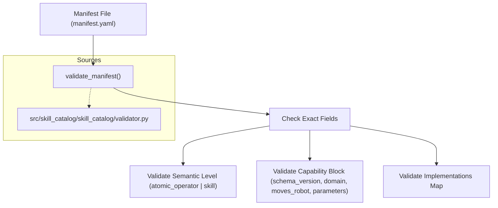
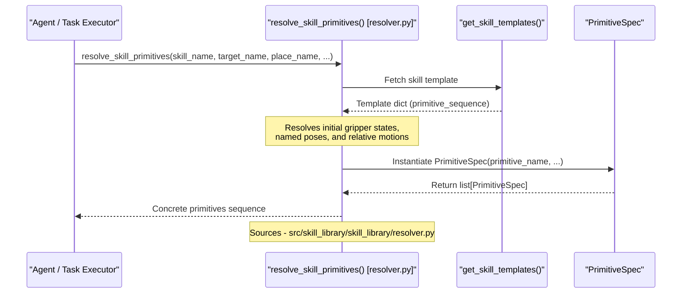
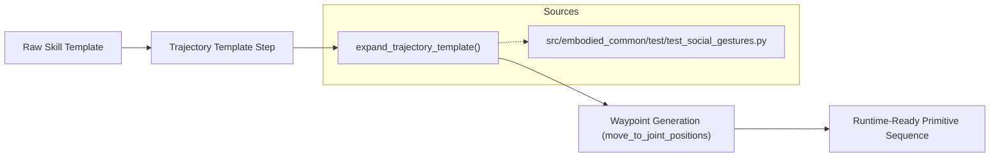

# 技能目录与技能库

<details>
<summary>相关源码文件</summary>

以下文件被用作生成此 wiki 页面的上下文：

- [src/embodied_common/embodied_common/trajectory_templates.py](https://atomgit.com/openeuler/IB_Robot/blob/openEuler-26.09/src/embodied_common/embodied_common/trajectory_templates.py)
- [src/embodied_common/test/test_skill_templates.py](https://atomgit.com/openeuler/IB_Robot/blob/openEuler-26.09/src/embodied_common/test/test_skill_templates.py)
- [src/embodied_common/test/test_social_gestures.py](https://atomgit.com/openeuler/IB_Robot/blob/openEuler-26.09/src/embodied_common/test/test_social_gestures.py)
- [src/skill_catalog/config/profiles/lekiwi_handeye_realsense_grasp_lidar.yaml](https://atomgit.com/openeuler/IB_Robot/blob/openEuler-26.09/src/skill_catalog/config/profiles/lekiwi_handeye_realsense_grasp_lidar.yaml)
- [src/skill_catalog/config/profiles/lekiwi_lidar.yaml](https://atomgit.com/openeuler/IB_Robot/blob/openEuler-26.09/src/skill_catalog/config/profiles/lekiwi_lidar.yaml)
- [src/skill_catalog/config/skills/resolve_object_pose/SKILL.md](https://atomgit.com/openeuler/IB_Robot/blob/openEuler-26.09/src/skill_catalog/config/skills/resolve_object_pose/SKILL.md)
- [src/skill_catalog/config/skills/resolve_object_pose/implementations/lekiwi_navigation_v2.yaml](https://atomgit.com/openeuler/IB_Robot/blob/openEuler-26.09/src/skill_catalog/config/skills/resolve_object_pose/implementations/lekiwi_navigation_v2.yaml)
- [src/skill_catalog/config/skills/resolve_object_pose/manifest.yaml](https://atomgit.com/openeuler/IB_Robot/blob/openEuler-26.09/src/skill_catalog/config/skills/resolve_object_pose/manifest.yaml)
- [src/skill_catalog/skill_catalog/validator.py](https://atomgit.com/openeuler/IB_Robot/blob/openEuler-26.09/src/skill_catalog/skill_catalog/validator.py)
- [src/skill_catalog/test/test_navigation_catalog.py](https://atomgit.com/openeuler/IB_Robot/blob/openEuler-26.09/src/skill_catalog/test/test_navigation_catalog.py)
- [src/skill_catalog/test/test_resolve_object_pose_skill.py](https://atomgit.com/openeuler/IB_Robot/blob/openEuler-26.09/src/skill_catalog/test/test_resolve_object_pose_skill.py)
- [src/skill_library/resource/skill_library](https://atomgit.com/openeuler/IB_Robot/blob/openEuler-26.09/src/skill_library/resource/skill_library)
- [src/skill_library/setup.cfg](https://atomgit.com/openeuler/IB_Robot/blob/openEuler-26.09/src/skill_library/setup.cfg)
- [src/skill_library/setup.py](https://atomgit.com/openeuler/IB_Robot/blob/openEuler-26.09/src/skill_library/setup.py)
- [src/skill_library/skill_library/resolver.py](https://atomgit.com/openeuler/IB_Robot/blob/openEuler-26.09/src/skill_library/skill_library/resolver.py)
- [src/skill_library/skill_library/skill_templates.py](https://atomgit.com/openeuler/IB_Robot/blob/openEuler-26.09/src/skill_library/skill_library/skill_templates.py)
- [src/skill_library/test/test_resolver.py](https://atomgit.com/openeuler/IB_Robot/blob/openEuler-26.09/src/skill_library/test/test_resolver.py)

</details>

## 目的与范围

7.2 节覆盖 RoboFrame 的技能管理生态系统，横跨两个核心包：`skill_catalog` 与 `skill_library`。

- **`skill_catalog`**：为技能包、实现与档案实现闭模式校验 [src/skill_catalog/skill_catalog/validator.py](https://atomgit.com/openeuler/IB_Robot/blob/openEuler-26.09/src/skill_catalog/skill_catalog/validator.py)。它提供清单、能力模式、档案（`so101_single_arm.yaml`、`lekiwi_lidar.yaml`、`lekiwi_handeye_realsense_grasp_lidar.yaml`）以及编译本地快照的编译逻辑 [src/embodied_common/test/test_social_gestures.py](https://atomgit.com/openeuler/IB_Robot/blob/openEuler-26.09/src/embodied_common/test/test_social_gestures.py)。
- **`skill_library`**：提供运行时辅助工具，将抽象技能、目标、命名位姿与方向到偏移量的变换解析为具体的 ROS 原语序列 [src/skill_library/skill_library/resolver.py](https://atomgit.com/openeuler/IB_Robot/blob/openEuler-26.09/src/skill_library/skill_library/resolver.py)。

---

## 1. 技能清单与能力模式

RoboFrame 中的每个技能都由一个带版本的技能包定义，包含 `manifest.yaml`、描述变体、实现映射与能力契约。

### 清单结构与闭模式校验

清单通过 `skill_catalog.validator` 中的 `validate_manifest` 严格校验 [src/skill_catalog/skill_catalog/validator.py](https://atomgit.com/openeuler/IB_Robot/blob/openEuler-26.09/src/skill_catalog/skill_catalog/validator.py)，确保字段精确匹配（`schema_version`、`name`、`version`、`semantic_level`、`description`、`capability`、`implementations`）。



来源：[src/skill_catalog/skill_catalog/validator.py](https://atomgit.com/openeuler/IB_Robot/blob/openEuler-26.09/src/skill_catalog/skill_catalog/validator.py)

以 `resolve_object_pose` 等导航能力为例，清单结构指定参数、恢复策略与所需控制模式 [src/skill_catalog/config/skills/resolve_object_pose/manifest.yaml](https://atomgit.com/openeuler/IB_Robot/blob/openEuler-26.09/src/skill_catalog/config/skills/resolve_object_pose/manifest.yaml)：

```yaml
schema_version: 2
name: resolve_object_pose
version: 1.1.0
semantic_level: atomic_operator
description:
  summary: Query the semantic map for a named object and return its stand-off navigation target.
  category: navigation
capability:
  schema_version: 2
  summary: Query the semantic map and return a stand-off [x, y, yaw_degrees] target.
  domain: navigation
  moves_robot: false
  required_control_mode: base_navigation
  parameters:
    type: object
    additionalProperties: false
    properties:
      target_name:
        type: string
        enum: [banana, basket, paper ball, toy, ballpoint pen, grapes]
      stand_off_distance_m:
        type: number
        exclusiveMinimum: 0
        unit: meters
    required: [target_name]
  recovery_policy: ask_user
implementations:
  lekiwi_navigation_v2: implementations/lekiwi_navigation_v2.yaml
```

来源：[src/skill_catalog/config/skills/resolve_object_pose/manifest.yaml](https://atomgit.com/openeuler/IB_Robot/blob/openEuler-26.09/src/skill_catalog/config/skills/resolve_object_pose/manifest.yaml)

---

## 2. 技能档案与机器人关联

档案为特定机器人硬件配置定制一组启用的技能。它们将高层技能映射到机器人特定的实现包，并指定规划器可见性。

### 档案结构

档案位于 `src/skill_catalog/config/profiles/` 下。例如 `lekiwi_handeye_realsense_grasp_lidar.yaml` 配置 `act_cute`、`resolve_object_pose`、`close_gripper_skill` 与 `imitate_human_motion` 等技能 [src/skill_catalog/config/profiles/lekiwi_handeye_realsense_grasp_lidar.yaml](https://atomgit.com/openeuler/IB_Robot/blob/openEuler-26.09/src/skill_catalog/config/profiles/lekiwi_handeye_realsense_grasp_lidar.yaml)：

```yaml
schema_version: 1
name: lekiwi_handeye_realsense_grasp_lidar
robot_name: lekiwi_handeye_realsense_grasp_lidar
enabled_skills:
- name: act_cute
  implementation: so101_arm_v1
  planner_visible: true
- name: resolve_object_pose
  implementation: lekiwi_navigation_v2
  planner_visible: true
- name: imitate_human_motion
  implementation: lekiwi_handeye_realsense_grasp_lidar
  planner_visible: true
```

来源：[src/skill_catalog/config/profiles/lekiwi_handeye_realsense_grasp_lidar.yaml](https://atomgit.com/openeuler/IB_Robot/blob/openEuler-26.09/src/skill_catalog/config/profiles/lekiwi_handeye_realsense_grasp_lidar.yaml), [src/skill_catalog/config/profiles/lekiwi_lidar.yaml](https://atomgit.com/openeuler/IB_Robot/blob/openEuler-26.09/src/skill_catalog/config/profiles/lekiwi_lidar.yaml)

---

## 3. 技能解析器与原语映射

`skill_library.resolver` 模块将高层请求与技能模板转换为有序的 `PrimitiveSpec` 执行 dataclass 列表 [src/skill_library/skill_library/resolver.py](https://atomgit.com/openeuler/IB_Robot/blob/openEuler-26.09/src/skill_library/skill_library/resolver.py)。

### `PrimitiveSpec` 与解析流程



来源：[src/skill_library/skill_library/resolver.py](https://atomgit.com/openeuler/IB_Robot/blob/openEuler-26.09/src/skill_library/skill_library/resolver.py)

### `resolver.py` 中的关键函数

- `direction_to_delta(direction, distance, direction_mapping)`：将分类方向（`forward`、`backward`、`left`、`right`、`up`、`down`）转换为笛卡尔坐标偏移 `(dx, dy, dz)` [src/skill_library/skill_library/resolver.py:30-48](https://atomgit.com/openeuler/IB_Robot/blob/openEuler-26.09/src/skill_library/skill_library/resolver.py#L30-L48)。
- `_resolve_pose_name(...)`：解析显式位姿名称、放置请求名称或命名目标字典 [src/skill_library/skill_library/resolver.py:51-77](https://atomgit.com/openeuler/IB_Robot/blob/openEuler-26.09/src/skill_library/skill_library/resolver.py#L51-L77)。
- `resolve_skill_primitives(...)`：校验模板激活，处理 `initial_gripper_state`（`open`、`closed`、`hold`、`none`），并遍历 `primitive_sequence` 构建 `PrimitiveSpec` 对象列表 [src/skill_library/skill_library/resolver.py:99-172](https://atomgit.com/openeuler/IB_Robot/blob/openEuler-26.09/src/skill_library/skill_library/resolver.py#L99-L172)。

---

## 4. 技能模板与轨迹展开

技能模板将静态步骤定义与动态轨迹展开组合，用于复杂社交手势与运动例程（如 `wave_hello`、`nod_yes`、`shake_no`、`celebrate` 与 `dance_basic`）[src/embodied_common/test/test_social_gestures.py](https://atomgit.com/openeuler/IB_Robot/blob/openEuler-26.09/src/embodied_common/test/test_social_gestures.py)。

### 轨迹展开流程



来源：[src/embodied_common/test/test_social_gestures.py](https://atomgit.com/openeuler/IB_Robot/blob/openEuler-26.09/src/embodied_common/test/test_social_gestures.py)

模板确保安全检查，例如验证绝对关节轨迹具有安全进入点与正确的时长估计 [src/embodied_common/test/test_social_gestures.py:122-163](https://atomgit.com/openeuler/IB_Robot/blob/openEuler-26.09/src/embodied_common/test/test_social_gestures.py#L122-L163)。

---

来源：[src/skill_catalog/skill_catalog/validator.py](https://atomgit.com/openeuler/IB_Robot/blob/openEuler-26.09/src/skill_catalog/skill_catalog/validator.py), [src/skill_library/skill_library/resolver.py](https://atomgit.com/openeuler/IB_Robot/blob/openEuler-26.09/src/skill_library/skill_library/resolver.py), [src/skill_catalog/config/profiles/lekiwi_handeye_realsense_grasp_lidar.yaml](https://atomgit.com/openeuler/IB_Robot/blob/openEuler-26.09/src/skill_catalog/config/profiles/lekiwi_handeye_realsense_grasp_lidar.yaml), [src/skill_catalog/config/profiles/lekiwi_lidar.yaml](https://atomgit.com/openeuler/IB_Robot/blob/openEuler-26.09/src/skill_catalog/config/profiles/lekiwi_lidar.yaml), [src/skill_catalog/config/skills/resolve_object_pose/manifest.yaml](https://atomgit.com/openeuler/IB_Robot/blob/openEuler-26.09/src/skill_catalog/config/skills/resolve_object_pose/manifest.yaml), [src/embodied_common/test/test_social_gestures.py](https://atomgit.com/openeuler/IB_Robot/blob/openEuler-26.09/src/embodied_common/test/test_social_gestures.py), [src/skill_library/test/test_resolver.py](https://atomgit.com/openeuler/IB_Robot/blob/openEuler-26.09/src/skill_library/test/test_resolver.py)
