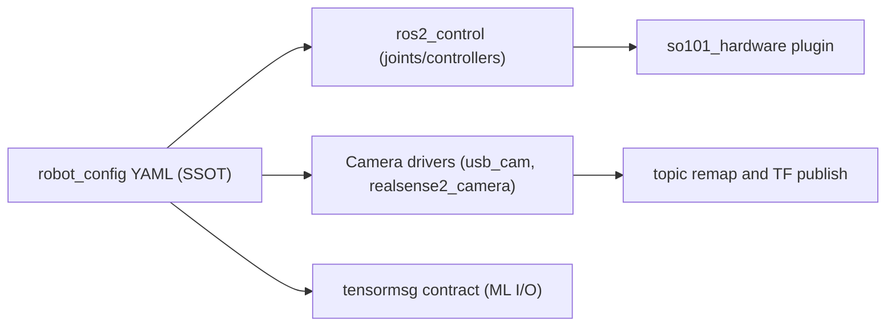
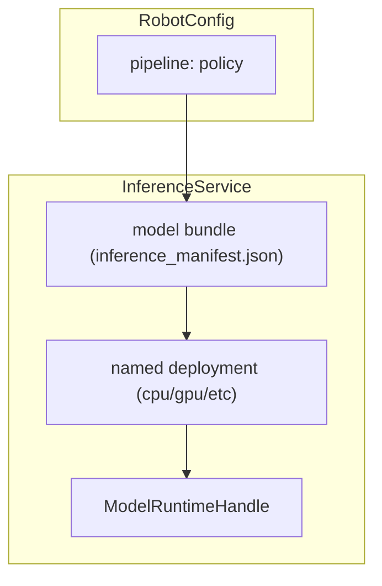
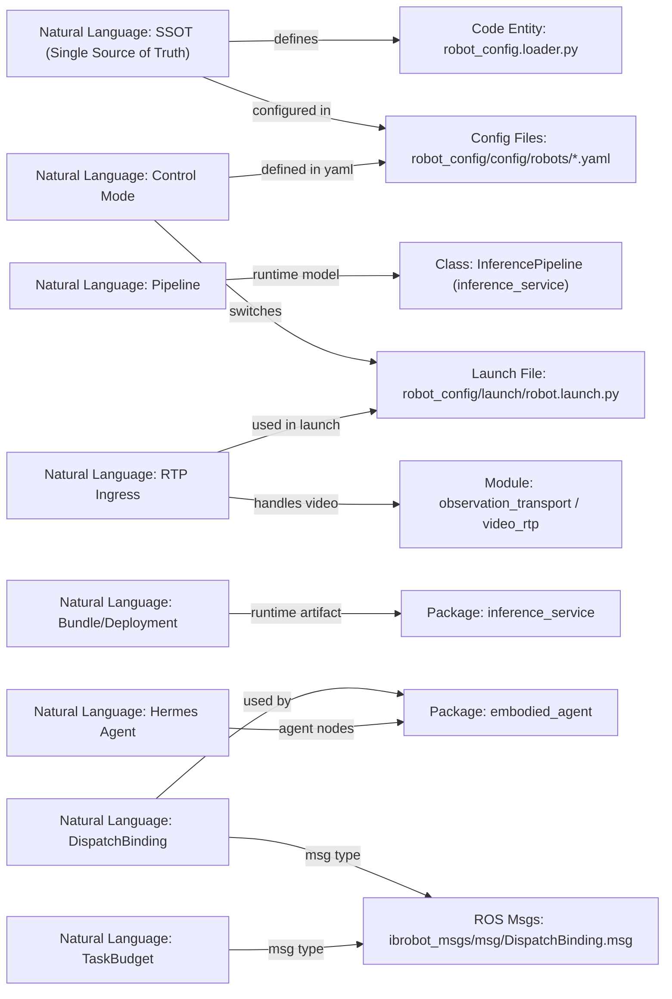
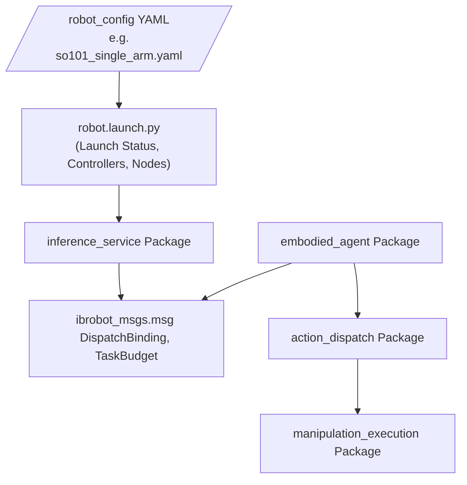

# 术语表

相关源码文件

以下文件被用作生成此 wiki 页面的上下文：

- [.agents/skills/README.md](https://atomgit.com/openeuler/IB_Robot/blob/openEuler-26.09/.agents/skills/README.md)
- [.agents/skills/ibrobot-build/references/package-notes.md](https://atomgit.com/openeuler/IB_Robot/blob/openEuler-26.09/.agents/skills/ibrobot-build/references/package-notes.md)
- [.agents/skills/ibrobot-build/references/troubleshooting.md](https://atomgit.com/openeuler/IB_Robot/blob/openEuler-26.09/.agents/skills/ibrobot-build/references/troubleshooting.md)
- [.agents/skills/ibrobot-launch/references/troubleshooting.md](https://atomgit.com/openeuler/IB_Robot/blob/openEuler-26.09/.agents/skills/ibrobot-launch/references/troubleshooting.md)
- [.agents/skills/ibrobot-launch/references/ubuntu.md](https://atomgit.com/openeuler/IB_Robot/blob/openEuler-26.09/.agents/skills/ibrobot-launch/references/ubuntu.md)
- [.agents/skills/ibrobot-robot-skill-design/SKILL.md](https://atomgit.com/openeuler/IB_Robot/blob/openEuler-26.09/.agents/skills/ibrobot-robot-skill-design/SKILL.md)
- [.agents/skills/intro/SKILL.md](https://atomgit.com/openeuler/IB_Robot/blob/openEuler-26.09/.agents/skills/intro/SKILL.md)
- [AGENTS.md](https://atomgit.com/openeuler/IB_Robot/blob/openEuler-26.09/AGENTS.md)
- [README.en.md](https://atomgit.com/openeuler/IB_Robot/blob/openEuler-26.09/README.en.md)
- [README.md](https://atomgit.com/openeuler/IB_Robot/blob/openEuler-26.09/README.md)
- [src/embodied_common/embodied_common/skill_request.py](https://atomgit.com/openeuler/IB_Robot/blob/openEuler-26.09/src/embodied_common/embodied_common/skill_request.py)
- [src/embodied_common/embodied_common/workflow_contracts.py](https://atomgit.com/openeuler/IB_Robot/blob/openEuler-26.09/src/embodied_common/embodied_common/workflow_contracts.py)
- [src/ibrobot_msgs/CMakeLists.txt](https://atomgit.com/openeuler/IB_Robot/blob/openEuler-26.09/src/ibrobot_msgs/CMakeLists.txt)
- [src/ibrobot_msgs/README.md](https://atomgit.com/openeuler/IB_Robot/blob/openEuler-26.09/src/ibrobot_msgs/README.md)
- [src/ibrobot_msgs/action/ClosePipelineBinding.action](https://atomgit.com/openeuler/IB_Robot/blob/openEuler-26.09/src/ibrobot_msgs/action/ClosePipelineBinding.action)
- [src/ibrobot_msgs/action/DispatchPipelineBinding.action](https://atomgit.com/openeuler/IB_Robot/blob/openEuler-26.09/src/ibrobot_msgs/action/DispatchPipelineBinding.action)
- [src/ibrobot_msgs/action/ExecuteAgentPlan.action](https://atomgit.com/openeuler/IB_Robot/blob/openEuler-26.09/src/ibrobot_msgs/action/ExecuteAgentPlan.action)
- [src/ibrobot_msgs/action/ImitateHumanMotion.action](https://atomgit.com/openeuler/IB_Robot/blob/openEuler-26.09/src/ibrobot_msgs/action/ImitateHumanMotion.action)
- [src/ibrobot_msgs/action/OpenPipelineBinding.action](https://atomgit.com/openeuler/IB_Robot/blob/openEuler-26.09/src/ibrobot_msgs/action/OpenPipelineBinding.action)
- [src/ibrobot_msgs/msg/DispatchBinding.msg](https://atomgit.com/openeuler/IB_Robot/blob/openEuler-26.09/src/ibrobot_msgs/msg/DispatchBinding.msg)
- [src/ibrobot_msgs/srv/PearParameterPredict.srv](https://atomgit.com/openeuler/IB_Robot/blob/openEuler-26.09/src/ibrobot_msgs/srv/PearParameterPredict.srv)
- [src/ibrobot_msgs/srv/PrepareAgentPlan.srv](https://atomgit.com/openeuler/IB_Robot/blob/openEuler-26.09/src/ibrobot_msgs/srv/PrepareAgentPlan.srv)
- [src/ibrobot_msgs/srv/YoloXDetect.srv](https://atomgit.com/openeuler/IB_Robot/blob/openEuler-26.09/src/ibrobot_msgs/srv/YoloXDetect.srv)
- [src/inference_manifest/README.md](https://atomgit.com/openeuler/IB_Robot/blob/openEuler-26.09/src/inference_manifest/README.md)
- [src/inference_manifest/inference_manifest/__init__.py](https://atomgit.com/openeuler/IB_Robot/blob/openEuler-26.09/src/inference_manifest/inference_manifest/__init__.py)
- [src/inference_manifest/inference_manifest/inference_manifest.schema.json](https://atomgit.com/openeuler/IB_Robot/blob/openEuler-26.09/src/inference_manifest/inference_manifest/inference_manifest.schema.json)
- [src/inference_manifest/inference_manifest/integrity.py](https://atomgit.com/openeuler/IB_Robot/blob/openEuler-26.09/src/inference_manifest/inference_manifest/integrity.py)
- [src/inference_manifest/inference_manifest/json_utils.py](https://atomgit.com/openeuler/IB_Robot/blob/openEuler-26.09/src/inference_manifest/inference_manifest/json_utils.py)
- [src/inference_manifest/inference_manifest/loader.py](https://atomgit.com/openeuler/IB_Robot/blob/openEuler-26.09/src/inference_manifest/inference_manifest/loader.py)
- [src/inference_manifest/inference_manifest/metadata.py](https://atomgit.com/openeuler/IB_Robot/blob/openEuler-26.09/src/inference_manifest/inference_manifest/metadata.py)
- [src/inference_manifest/inference_manifest/writer.py](https://atomgit.com/openeuler/IB_Robot/blob/openEuler-26.09/src/inference_manifest/inference_manifest/writer.py)
- [src/inference_manifest/test/test_v3_manifest.py](https://atomgit.com/openeuler/IB_Robot/blob/openEuler-26.09/src/inference_manifest/test/test_v3_manifest.py)
- [src/inference_service/README.en.md](https://atomgit.com/openeuler/IB_Robot/blob/openEuler-26.09/src/inference_service/README.en.md)
- [src/inference_service/README.md](https://atomgit.com/openeuler/IB_Robot/blob/openEuler-26.09/src/inference_service/README.md)
- [src/inference_service/tests/manifest_fixtures.py](https://atomgit.com/openeuler/IB_Robot/blob/openEuler-26.09/src/inference_service/tests/manifest_fixtures.py)
- [src/inference_service/tests/test_bundle_metadata.py](https://atomgit.com/openeuler/IB_Robot/blob/openEuler-26.09/src/inference_service/tests/test_bundle_metadata.py)
- [src/inference_service/tests/test_inference_manifest.py](https://atomgit.com/openeuler/IB_Robot/blob/openEuler-26.09/src/inference_service/tests/test_inference_manifest.py)
- [src/manipulation_execution/README.md](https://atomgit.com/openeuler/IB_Robot/blob/openEuler-26.09/src/manipulation_execution/README.md)
- [src/manipulation_execution/manipulation_execution/imitate_human_motion_executor.py](https://atomgit.com/openeuler/IB_Robot/blob/openEuler-26.09/src/manipulation_execution/manipulation_execution/imitate_human_motion_executor.py)
- [src/manipulation_execution/manipulation_execution/imitate_human_motion_executor_node.py](https://atomgit.com/openeuler/IB_Robot/blob/openEuler-26.09/src/manipulation_execution/manipulation_execution/imitate_human_motion_executor_node.py)
- [src/manipulation_execution/test/test_imitate_human_motion_vision.py](https://atomgit.com/openeuler/IB_Robot/blob/openEuler-26.09/src/manipulation_execution/test/test_imitate_human_motion_vision.py)
- [src/model_utils/model_utils/inference_manifest_export.py](https://atomgit.com/openeuler/IB_Robot/blob/openEuler-26.09/src/model_utils/model_utils/inference_manifest_export.py)
- [src/model_utils/model_utils/package_torch_deployment.py](https://atomgit.com/openeuler/IB_Robot/blob/openEuler-26.09/src/model_utils/model_utils/package_torch_deployment.py)
- [src/robot_config/README.en.md](https://atomgit.com/openeuler/IB_Robot/blob/openEuler-26.09/src/robot_config/README.en.md)
- [src/robot_config/README.md](https://atomgit.com/openeuler/IB_Robot/blob/openEuler-26.09/src/robot_config/README.md)
- [src/robot_config/config/robots/so101_single_arm.yaml](https://atomgit.com/openeuler/IB_Robot/blob/openEuler-26.09/src/robot_config/config/robots/so101_single_arm.yaml)
- [src/robot_config/launch/robot.launch.py](https://atomgit.com/openeuler/IB_Robot/blob/openEuler-26.09/src/robot_config/launch/robot.launch.py)
- [src/robot_config/robot_config/config.py](https://atomgit.com/openeuler/IB_Robot/blob/openEuler-26.09/src/robot_config/robot_config/config.py)
- [src/robot_config/robot_config/loader.py](https://atomgit.com/openeuler/IB_Robot/blob/openEuler-26.09/src/robot_config/robot_config/loader.py)
- [src/robot_config/test/test_config.py](https://atomgit.com/openeuler/IB_Robot/blob/openEuler-26.09/src/robot_config/test/test_config.py)
- [src/robot_config/test/test_embodied_entry_config.py](https://atomgit.com/openeuler/IB_Robot/blob/openEuler-26.09/src/robot_config/test/test_embodied_entry_config.py)
- [src/robot_config/test/test_launch_readiness.py](https://atomgit.com/openeuler/IB_Robot/blob/openEuler-26.09/src/robot_config/test/test_launch_readiness.py)
- [third_party/patches/lerobot/v0.5.1/0017-diffusion-accept-observation-histories.patch](https://atomgit.com/openeuler/IB_Robot/blob/openEuler-26.09/third_party/patches/lerobot/v0.5.1/0017-diffusion-accept-observation-histories.patch)

本页面定义 IB-Robot / RoboFrame 代码库特有的关键术语与概念。每个条目解释术语的含义、在系统中的实现或使用方式、相关数据流，以及关键的相关函数或类。同时提供文件指针，精确定位术语在代码库中实现或文档化的位置。本术语表为在该代码库中工作与扩展的开发者提供单一技术事实源。

---

## 单一事实源（SSOT）

**定义：**  
`robot_config` 中的一种设计原则：由单个 YAML 配置文件定义完整的机器人硬件、外设、控制器与 ML 契约。这避免了配置源重复，并提供规范化、可合并的机器人设置。

**实现与数据流：**

- `robot_config` 包加载这些 YAML 文件，统一 `ros2_control` 硬件、相机驱动（usb_cam 或 realsense2_camera）与面向 ML 推理的 tensor message 契约。
- YAML 一并定义关节、控制器、外设与推理流水线。
- 通过 `base_config` 的 overlay 与继承机制支持无重复的扩展。
- 校验与合并逻辑保证类型安全且继承无环（[src/robot_config/robot_config/loader.py:90-133](https://atomgit.com/openeuler/IB_Robot/blob/openEuler-26.09/src/robot_config/robot_config/loader.py#L90-L133)、[src/robot_config/README.md:5-145](https://atomgit.com/openeuler/IB_Robot/blob/openEuler-26.09/src/robot_config/README.md#L5-L145)、[src/robot_config/config/robots/so101_single_arm.yaml:5-195](https://atomgit.com/openeuler/IB_Robot/blob/openEuler-26.09/src/robot_config/config/robots/so101_single_arm.yaml#L5-L195)）。

来源：[src/robot_config/README.md:5-68](https://atomgit.com/openeuler/IB_Robot/blob/openEuler-26.09/src/robot_config/README.md#L5-L68), [src/robot_config/robot_config/loader.py:90-133](https://atomgit.com/openeuler/IB_Robot/blob/openEuler-26.09/src/robot_config/robot_config/loader.py#L90-L133), [src/robot_config/config/robots/so101_single_arm.yaml:5-195](https://atomgit.com/openeuler/IB_Robot/blob/openEuler-26.09/src/robot_config/config/robots/so101_single_arm.yaml#L5-L195)

---

## 控制模式（Control Mode）

**定义：**  
预定义的机器人运行模式，决定控制接口与推理行为。例如 `teleop`、`model_inference` 和 `moveit_planning`。

**实现：**

- 在机器人 YAML 的 `control_modes` 下配置，含控制器列表、推理开关与执行器类型/模式。
- launch 文件据此启动相应控制器与节点：如 `model_inference` 启用推理流水线，`moveit_planning` 启动 MoveIt 轨迹服务器（[src/robot_config/config/robots/so101_single_arm.yaml:50-120](https://atomgit.com/openeuler/IB_Robot/blob/openEuler-26.09/src/robot_config/config/robots/so101_single_arm.yaml#L50-L120)、[src/robot_config/launch/robot.launch.py:1-136](https://atomgit.com/openeuler/IB_Robot/blob/openEuler-26.09/src/robot_config/launch/robot.launch.py#L1-L136)）。

来源：[src/robot_config/config/robots/so101_single_arm.yaml:50-120](https://atomgit.com/openeuler/IB_Robot/blob/openEuler-26.09/src/robot_config/config/robots/so101_single_arm.yaml#L50-L120), [src/robot_config/launch/robot.launch.py:1-136](https://atomgit.com/openeuler/IB_Robot/blob/openEuler-26.09/src/robot_config/launch/robot.launch.py#L1-L136)

---

## 流水线（Pipeline，推理流水线）

**定义：**  
表示推理服务中模型执行流水线的逻辑标识符。每个流水线拥有模型 bundle、部署目标、前/后处理器、运行时句柄与通信端点。

**实现与数据流：**

- 在机器人 YAML 的 `control_modes.<mode>.inference.pipelines` 下定义，含模型路径、部署与执行模式。
- 推理服务（`inference_service`）按流水线从 `inference_manifest.json` 加载 bundle 与 deployment。
- `InferencePipeline` 门面管理运行时句柄、生命周期、准入控制与诊断（[src/inference_service/README.md:1-200](https://atomgit.com/openeuler/IB_Robot/blob/openEuler-26.09/src/inference_service/README.md#L1-L200)、[src/robot_config/config/robots/so101_single_arm.yaml:75-105](https://atomgit.com/openeuler/IB_Robot/blob/openEuler-26.09/src/robot_config/config/robots/so101_single_arm.yaml#L75-L105)）。

来源：[src/inference_service/README.md:1-200](https://atomgit.com/openeuler/IB_Robot/blob/openEuler-26.09/src/inference_service/README.md#L1-L200), [src/robot_config/config/robots/so101_single_arm.yaml:75-105](https://atomgit.com/openeuler/IB_Robot/blob/openEuler-26.09/src/robot_config/config/robots/so101_single_arm.yaml#L75-L105)

---

## Bundle

**定义：**  
自包含的文件目录，代表可部署的 AI 模型，包括配置、权重、tokenizer、前/后处理器与 `inference_manifest.json`。

**实现：**

- 要求 manifest v3 格式，列出全部文件、文件摘要与 deployment。
- 可包含面向不同后端目标（Torch、RKNN、OM、HMM）的多个 artifact。
- 由 `inference_service` 与 `robot_config` 用于模型加载与运行时选择（[src/inference_service/README.md:37-60](https://atomgit.com/openeuler/IB_Robot/blob/openEuler-26.09/src/inference_service/README.md#L37-L60)、[src/inference_manifest/README.md](https://atomgit.com/openeuler/IB_Robot/blob/openEuler-26.09/src/inference_manifest/README.md)）。

来源：[src/inference_service/README.md:37-60](https://atomgit.com/openeuler/IB_Robot/blob/openEuler-26.09/src/inference_service/README.md#L37-L60), [src/inference_manifest/README.md](https://atomgit.com/openeuler/IB_Robot/blob/openEuler-26.09/src/inference_manifest/README.md)

---

## Deployment

**定义：**  
bundle 内命名的运行时 profile，指定后端类型、硬件目标、设备细节与 artifact 引用。

**实现：**

- 在 `inference_manifest.json` 中声明，含 UUID、修订版本、运行时 profile、执行契约与 artifact 路径。
- deployment 名称（如 `cpu`、`rk3588`）用于流水线选择与运行时实例化。
- 支持多目标模型分发与硬件特定优化（[src/inference_service/README.md:62-152](https://atomgit.com/openeuler/IB_Robot/blob/openEuler-26.09/src/inference_service/README.md#L62-L152)）。

来源：[src/inference_service/README.md:62-152](https://atomgit.com/openeuler/IB_Robot/blob/openEuler-26.09/src/inference_service/README.md#L62-L152)

---

## Manifest v3

**定义：**  
`inference_manifest.json` 的第 3 版 JSON schema，定义 bundle 结构、文件、deployment、执行顺序与 ABI 绑定。

**实现：**

- 作为运行时加载与完整性校验的权威来源。
- 描述 bundle、含运行时 profile 与 artifact 的 deployment、执行阶段与张量绑定。
- 包含密码学摘要以保护文件完整性（[src/inference_manifest/inference_manifest/loader.py](https://atomgit.com/openeuler/IB_Robot/blob/openEuler-26.09/src/inference_manifest/inference_manifest/loader.py)、[src/inference_manifest/inference_manifest/integrity.py](https://atomgit.com/openeuler/IB_Robot/blob/openEuler-26.09/src/inference_manifest/inference_manifest/integrity.py)）。

来源：[src/inference_manifest/inference_manifest/loader.py](https://atomgit.com/openeuler/IB_Robot/blob/openEuler-26.09/src/inference_manifest/inference_manifest/loader.py), [src/inference_manifest/inference_manifest/integrity.py](https://atomgit.com/openeuler/IB_Robot/blob/openEuler-26.09/src/inference_manifest/inference_manifest/integrity.py)

---

## DispatchBinding

**定义：**  
Protocol Buffer/ROS 2 消息，表示分布式任务分发与技能调用中委托执行的绑定根标识符。

**实现：**

- 在 `ibrobot_msgs/msg/DispatchBinding.msg` 中定义为 ROS 消息类型。
- 随委托动作（`PickObject`、`PlaceObject`）传递，用于关联 goal 请求与技能注册身份及任务预算。
- 确保分布式或委托执行的准入控制与跟踪一致（[src/ibrobot_msgs/msg/DispatchBinding.msg](https://atomgit.com/openeuler/IB_Robot/blob/openEuler-26.09/src/ibrobot_msgs/msg/DispatchBinding.msg)、[src/manipulation_execution/README.md:74-80](https://atomgit.com/openeuler/IB_Robot/blob/openEuler-26.09/src/manipulation_execution/README.md#L74-L80)）。

来源：[src/ibrobot_msgs/msg/DispatchBinding.msg](https://atomgit.com/openeuler/IB_Robot/blob/openEuler-26.09/src/ibrobot_msgs/msg/DispatchBinding.msg), [src/manipulation_execution/README.md:74-80](https://atomgit.com/openeuler/IB_Robot/blob/openEuler-26.09/src/manipulation_execution/README.md#L74-L80)

---

## TaskBudget

**定义：**  
表示动作或任务段执行时间/资源预算的消息，便于调度与取消。

**实现：**

- 在 `ibrobot_msgs/msg/TaskBudget.msg` 中定义。
- 在分发绑定与技能命令请求中传播，允许执行器强制执行限制并从超限中恢复。
- 用于具身 agent 与动作分发框架（[src/ibrobot_msgs/msg/TaskBudget.msg](https://atomgit.com/openeuler/IB_Robot/blob/openEuler-26.09/src/ibrobot_msgs/msg/TaskBudget.msg)、[src/robot_config/robot_config/loader.py:57-60](https://atomgit.com/openeuler/IB_Robot/blob/openEuler-26.09/src/robot_config/robot_config/loader.py#L57-L60)）。

来源：[src/ibrobot_msgs/msg/TaskBudget.msg](https://atomgit.com/openeuler/IB_Robot/blob/openEuler-26.09/src/ibrobot_msgs/msg/TaskBudget.msg), [src/robot_config/robot_config/loader.py:57-60](https://atomgit.com/openeuler/IB_Robot/blob/openEuler-26.09/src/robot_config/robot_config/loader.py#L57-L60)

---

## AutoHorizon

**定义：**  
动态控制特性或参数，在模型推理或分发调度中启用自适应视界（horizon），平衡延迟与预测窗口长度。

**实现：**

- 该参数或概念隐式存在于 `action_dispatch` 与推理调度层，但文档化为平衡动作块（chunk）长度与延迟的调优旋钮。
- 在推理与分发系统的调度配置中管理。

来源：[src/inference_service/README.md](https://atomgit.com/openeuler/IB_Robot/blob/openEuler-26.09/src/inference_service/README.md), [src/action_dispatch](https://atomgit.com/openeuler/IB_Robot/tree/openEuler-26.09/src/action_dispatch)

---

## Temporal Ensemble（时间集成）

**定义：**  
跨多个相邻推理结果的时间平滑或集成技术，提升预测随时间的稳定性。

**实现：**

- 推理服务内的遗留与调度分发策略中隐含支持，在时间窗口上合并重叠输出。
- 实现于处理 act 类策略控制分块与平滑的分发策略代码中（[src/robot_config/robot_config/launch_builders/execution.py](https://atomgit.com/openeuler/IB_Robot/blob/openEuler-26.09/src/robot_config/robot_config/launch_builders/execution.py)、[src/inference_service/README.md]）。

来源：[src/robot_config/robot_config/launch_builders/execution.py](https://atomgit.com/openeuler/IB_Robot/blob/openEuler-26.09/src/robot_config/robot_config/launch_builders/execution.py), [src/inference_service/README.md](https://atomgit.com/openeuler/IB_Robot/blob/openEuler-26.09/src/inference_service/README.md)

---

## 运动模式（Motion Mode）

**定义：**  
与控制模式同义；机器人的不同运行状态，决定命令如何生成与执行（如遥操作、模型推理、轨迹规划）。

**实现：**

- 在机器人 YAML 的 `control_modes` 下指定。
- 决定启动哪些控制器与推理节点。
- 模式切换逻辑见 `default_control_mode` 与 `skill_required_control_mode` 设置（[src/robot_config/config/robots/so101_single_arm.yaml:50-120](https://atomgit.com/openeuler/IB_Robot/blob/openEuler-26.09/src/robot_config/config/robots/so101_single_arm.yaml#L50-L120)）。

来源：[src/robot_config/config/robots/so101_single_arm.yaml:50-120](https://atomgit.com/openeuler/IB_Robot/blob/openEuler-26.09/src/robot_config/config/robots/so101_single_arm.yaml#L50-L120)

---

## 能力网关（Capability Gateway）

**定义：**  
中央执行网关，管理技能准入、请求规范化、能力校验与委托执行。

**实现：**

- 存在于 `skill_library` 与 `embodied_agent` 的技能执行框架中。
- 校验 `DispatchBinding` 与 `DelegatedExecutorIdentity`，确保请求被许可且关联有效技能会话。
- 被 `manipulation_execution` 与具身执行流水线大量使用，保障下游执行安全（[src/manipulation_execution/README.md:74-93](https://atomgit.com/openeuler/IB_Robot/blob/openEuler-26.09/src/manipulation_execution/README.md#L74-L93)、[src/embodied_agent/README.md](https://atomgit.com/openeuler/IB_Robot/blob/openEuler-26.09/src/embodied_agent/README.md)）。

来源：[src/manipulation_execution/README.md:74-93](https://atomgit.com/openeuler/IB_Robot/blob/openEuler-26.09/src/manipulation_execution/README.md#L74-L93), [src/embodied_agent/README.md](https://atomgit.com/openeuler/IB_Robot/blob/openEuler-26.09/src/embodied_agent/README.md)

---

## Hermes

**定义：**  
IB-Robot 的具身 agent 计划生命周期管理器与自然语言接口。

**实现：**

- 实现于 `embodied_agent` ROS 节点（`agent_plan_node`、`task_executor_node`）。
- 管理规划、技能分发、状态上报与技能目录编排。
- 与语音命令输入及能力网关集成（[src/embodied_agent/README.md](https://atomgit.com/openeuler/IB_Robot/blob/openEuler-26.09/src/embodied_agent/README.md)、[src/robot_config/config/robots/so101_single_arm.yaml:176-195](https://atomgit.com/openeuler/IB_Robot/blob/openEuler-26.09/src/robot_config/config/robots/so101_single_arm.yaml#L176-L195)）。

来源：[src/embodied_agent/README.md](https://atomgit.com/openeuler/IB_Robot/blob/openEuler-26.09/src/embodied_agent/README.md), [src/robot_config/config/robots/so101_single_arm.yaml:176-195](https://atomgit.com/openeuler/IB_Robot/blob/openEuler-26.09/src/robot_config/config/robots/so101_single_arm.yaml#L176-L195)

---

## LeRobot 补丁栈（LeRobot Patch Stack）

**定义：**  
通过补丁文件而非直接提交改动，管理第三方 LeRobot submodule 本地修改的系统。

**实现：**

- `libs/lerobot` 是核心 LeRobot 代码的 git submodule。
- 本地改动通过 `third_party/patches/lerobot/` 的补丁栈导出、跟踪与应用。
- 由 `ibrobot-lerobot-patch` 技能及相关脚本管理（[.agents/skills/README.md:63-68](https://atomgit.com/openeuler/IB_Robot/blob/openEuler-26.09/.agents/skills/README.md#L63-L68)）。

来源：[.agents/skills/README.md:63-68](https://atomgit.com/openeuler/IB_Robot/blob/openEuler-26.09/.agents/skills/README.md#L63-L68), [README.md:140-144](https://atomgit.com/openeuler/IB_Robot/blob/openEuler-26.09/README.md#L140-L144)

---

## Mixin

**定义：**  
执行器类中使用的设计模式，将共享行为封装在 mixin 类中，支持阶段或方法的模块化组合。

**实现：**

- 见于 `manipulation_execution` 的抓取规划与执行等阶段（`phases/planning.py`、`phases/execution.py`）。
- 无需深层继承树即可复用行为，提升可测试性与模块化（[src/manipulation_execution/manipulation_execution/phases/flow.py](https://atomgit.com/openeuler/IB_Robot/blob/openEuler-26.09/src/manipulation_execution/manipulation_execution/phases/flow.py)）。

来源：[src/manipulation_execution/manipulation_execution/phases/flow.py](https://atomgit.com/openeuler/IB_Robot/blob/openEuler-26.09/src/manipulation_execution/manipulation_execution/phases/flow.py)

---

## Setup Profile（Setup 配置档案）

**定义：**  
命名的 launch 与运行时参数集合，为特定机器人或场景配置模型 deployment、推理执行模式、控制模式与硬件接口。

**实现：**

- 在 `robot_config` YAML 文件的 `robot.embodied.skill_catalog_profile` 等处定义。
- 控制使用哪些技能目录、流水线与外部服务。
- profile 支持机器人设置间的一致复用与切换（[src/robot_config/config/robots/so101_single_arm.yaml:174-195](https://atomgit.com/openeuler/IB_Robot/blob/openEuler-26.09/src/robot_config/config/robots/so101_single_arm.yaml#L174-L195)）。

来源：[src/robot_config/config/robots/so101_single_arm.yaml:174-195](https://atomgit.com/openeuler/IB_Robot/blob/openEuler-26.09/src/robot_config/config/robots/so101_single_arm.yaml#L174-L195)

---

## OM / ATC / CANN

**定义：**  
与昇腾 NPU 上 AI 模型编译和运行时加速相关的平台特定术语。

- **OM：** Offline Model 格式，昇腾 NPU 的编译后二进制模型对象。
- **ATC：** Ascend Tensor Compiler，将 ONNX 等模型转换为 OM 的编译器工具。
- **CANN：** Computing Architecture for Neural Networks，昇腾 AI 软件栈，提供运行时与驱动。

**实现：**

- 在模型转换流水线（`om-convert` 技能）中管理。
- OM bundle 由使用昇腾后端的推理服务 deployment 加载。
- 流水线校验与 CANN 运行时及 ATC 选项的兼容性（[.agents/skills/README.md:63-64](https://atomgit.com/openeuler/IB_Robot/blob/openEuler-26.09/.agents/skills/README.md#L63-L64)、[src/model_utils/model_utils/package_torch_deployment.py](https://atomgit.com/openeuler/IB_Robot/blob/openEuler-26.09/src/model_utils/model_utils/package_torch_deployment.py)）。

来源：[.agents/skills/README.md:63-64](https://atomgit.com/openeuler/IB_Robot/blob/openEuler-26.09/.agents/skills/README.md#L63-L64), [src/model_utils/model_utils/package_torch_deployment.py](https://atomgit.com/openeuler/IB_Robot/blob/openEuler-26.09/src/model_utils/model_utils/package_torch_deployment.py)

---

## RKNN

**定义：**  
Rockchip Neural Network 格式，面向 Rockchip SoC NPU 的模型格式，用于嵌入式推理加速。

**实现：**

- `rknn-convert` 技能将 ONNX 模型转换为 RKNN，面向 RK3588 等设备。
- 运行时部署 bundle 使用在 `inference_manifest.json` 中声明的 RKNN artifact。
- 以正确的设备 profile 在目标设备上执行（[.agents/skills/README.md:64](https://atomgit.com/openeuler/IB_Robot/blob/openEuler-26.09/.agents/skills/README.md#L64)、[src/inference_service/README.md:88-147](https://atomgit.com/openeuler/IB_Robot/blob/openEuler-26.09/src/inference_service/README.md#L88-L147)）。

来源：[.agents/skills/README.md:64](https://atomgit.com/openeuler/IB_Robot/blob/openEuler-26.09/.agents/skills/README.md#L64), [src/inference_service/README.md:88-147](https://atomgit.com/openeuler/IB_Robot/blob/openEuler-26.09/src/inference_service/README.md#L88-L147)

---

## HMM

**定义：**  
Hidden Markov Model 格式，作为 PI0.5 / SmolVLA 模型在 xh2 等华为 NPU 平台上的编译运行时部署格式。

**实现：**

- `hmm-convert` 技能将编译后的 xhquant/tcim 文件打包为与推理服务兼容的统一 HMM 部署 bundle。
- 不支持 ACT 模型的 HMM bundle。
- 作为 artifact 包含在 HMM 后端的推理 manifest 中（[.agents/skills/README.md:65](https://atomgit.com/openeuler/IB_Robot/blob/openEuler-26.09/.agents/skills/README.md#L65)）。

来源：[.agents/skills/README.md:65](https://atomgit.com/openeuler/IB_Robot/blob/openEuler-26.09/.agents/skills/README.md#L65), [src/inference_service/README.md](https://atomgit.com/openeuler/IB_Robot/blob/openEuler-26.09/src/inference_service/README.md)

---

## RTP Ingress（RTP 接入）

**定义：**  
分布式推理流水线中观测视频的实时传输协议（RTP）接入流处理。

**实现：**

- 由 `video_rtp` 与 `observation_transport` 子系统管理。
- 支持软件、NVIDIA、昇腾 FFmpeg 编解码器之间的切换。
- 协调观测传输的流协商、编码与解码（目录中的 [观测视频传输（RTP/H.264）](./inference_service/observation_video_transport.md)）。

来源：[src/robot_config/launch/robot.launch.py:99-150](https://atomgit.com/openeuler/IB_Robot/blob/openEuler-26.09/src/robot_config/launch/robot.launch.py#L99-L150)（隐含于观测传输 / RTP 接入代码）

---

## 会话滚转（Session Rollover）

**定义：**  
推理运行时会话管理机制，允许在推理会话或运行时上下文之间无缝切换，不丢失状态或动作连续性。

**实现：**

- 实现于 `ModelRuntimeHandle` 及相关会话逻辑。
- 支持分阶段或分布式运行时组装中的取消、超时处理与升级/降级场景。
- 确保流水线可透明地重启或重载模型（[src/inference_service/README.md](https://atomgit.com/openeuler/IB_Robot/blob/openEuler-26.09/src/inference_service/README.md)）。

来源：[src/inference_service/README.md](https://atomgit.com/openeuler/IB_Robot/blob/openEuler-26.09/src/inference_service/README.md)

---

## 技能目录纪元（Skill Catalog Epoch）

**定义：**  
技能目录的单调递增标识符或版本，代表技能定义的一个独立世代。

**实现：**

- 在 `embodied_agent` 中用于检测变更并重载技能模板。
- 编码在技能 manifest 与运行时状态中，确保 agent 与 Hermes 在技能定义上保持同步（[src/embodied_agent/README.md](https://atomgit.com/openeuler/IB_Robot/blob/openEuler-26.09/src/embodied_agent/README.md)）。

来源：[src/embodied_agent/README.md](https://atomgit.com/openeuler/IB_Robot/blob/openEuler-26.09/src/embodied_agent/README.md)

---

## 自然语言空间到代码实体的映射

下面两张图展示上述若干系统级术语如何从 IB-Robot 系统中的自然语言概念关联到具体代码实体与文件。

---

## 术语汇总表

| 术语                 | 描述                                           | 主要位置                          |
|----------------------|---------------------------------------------|----------------------------------------------|
| SSOT                 | robot_config YAML 中的单一事实源         | `src/robot_config/robot_config/loader.py`，机器人 YAML    |
| Control Mode         | 机器人运行模式（teleop、model_inference、moveit_planning） | 机器人 YAML、launch 文件                  |
| Pipeline             | 推理运行时流水线（模型 + deployment）     | `inference_service`、机器人 YAML              |
| Bundle               | 含 manifest 的模型文件集                     | `inference_manifest/`、models 目录            |
| Deployment           | manifest 中命名的运行时 profile                     | `inference_manifest/`                         |
| Manifest v3          | 推理 bundle 的 manifest JSON schema v3        | `inference_manifest/`                         |
| DispatchBinding      | 关联委托动作绑定的 ROS 消息    | `ibrobot_msgs/msg/DispatchBinding.msg`       |
| TaskBudget           | 执行预算/时间的 ROS 消息                 | `ibrobot_msgs/msg/TaskBudget.msg`             |
| AutoHorizon          | 自适应视界长度的调度参数     | `action_dispatch/`、`inference_service/`     |
| Temporal Ensemble    | 跨模型推理结果的输出平滑       | `action_dispatch/`、`inference_service/`     |
| Motion Mode          | 与 Control Mode 相同                                  | 机器人 YAML                                    |
| Capability Gateway   | 技能准入与执行网关                 | `skill_library/`、`embodied_agent/`           |
| Hermes               | 具身 agent 计划与执行管理器               | `embodied_agent/`                             |
| LeRobot Patch Stack  | LeRobot submodule 的补丁管理                | `third_party/patches/lerobot/`、`libs/lerobot` |
| Mixin                | 执行器使用的模块化可复用代码模式       | `manipulation_execution/phases/flow.py`     |
| Setup Profile        | 命名的运行时与技能目录 profile               | 机器人 YAML `embodied.skill_catalog_profile`  |
| OM/ATC/CANN          | 昇腾 AI 模型编译器/运行时格式              | `model_utils`、`.agents/skills/om-convert`   |
| RKNN                 | Rockchip NPU 模型格式                              | `.agents/skills/rknn-convert`                 |
| HMM                  | Hidden Markov Model 部署格式                  | `.agents/skills/hmm-convert`                   |
| RTP Ingress          | 实时视频流接收协议               | `observation_transport/`、`video_rtp/`       |
| Session Rollover     | 无缝推理会话切换                  | `inference_service/` 运行时代码             |
| Skill Catalog Epoch  | 技能目录的版本标识符                | `embodied_agent/`                             |

---

## 说明

- 所有机器人配置位于 `src/robot_config/config/robots/` 下的 YAML 文件，`so101_single_arm.yaml` 是规范示例。
- 机器人 launch 流程（`robot.launch.py`）基于配置与控制模式动态加载硬件、控制器、感知服务、moveit、遥操作与推理流水线。
- 推理 bundle 使用模块化且可扩展的 manifest v3 schema，对在异构后端上运行模型至关重要。
- `DispatchBinding` 与 `TaskBudget` 消息表示分布式技能编排所需的委托动作元数据。
- 嵌入式具身 agent（`Hermes`）管理高层 AI 驱动的任务执行，依赖技能目录与能力网关。
- OM、ATC、CANN（昇腾）、RKNN（Rockchip）、HMM（华为）等平台特定术语表示通过构建与部署工具标准化的模型部署格式与工具链。

---

## 关键文件与模块参考

| 术语 / 概念               | 相关文件与行号                                      |
|-----------------------------|----------------------------------------------------------------|
| SSOT、robot_config YAML      | src/robot_config/config/robots/so101_single_arm.yaml:5-195      |
| robot_config loader/merge    | src/robot_config/robot_config/loader.py:90-133                  |
| robot.launch.py              | src/robot_config/launch/robot.launch.py:1-136                   |
| Inference bundle & deployment| src/inference_service/README.md:37-152                          |
| Manifest v3, loader & integrity | src/inference_manifest/inference_manifest/loader.py, integrity.py |
| DispatchBinding message      | src/ibrobot_msgs/msg/DispatchBinding.msg                        |
| TaskBudget message           | src/ibrobot_msgs/msg/TaskBudget.msg                             |
| Hermes Agent configuration   | src/robot_config/config/robots/so101_single_arm.yaml:176-195    |
| LeRobot patch stack          | third_party/patches/lerobot/, .agents/skills/ibrobot-lerobot-patch/ |
| Mixin executors              | src/manipulation_execution/manipulation_execution/phases/flow.py                      |
| OM/ATC/CANN conversions      | .agents/skills/om-convert, src/model_utils/model_utils/package_torch_deployment.py |
| RKNN conversion skill        | .agents/skills/rknn-convert                                     |
| HMM conversion skill         | .agents/skills/hmm-convert                                      |
| RTP ingress transport        | src/robot_config/launch_builders/perception.py (video_rtp submodule) |
