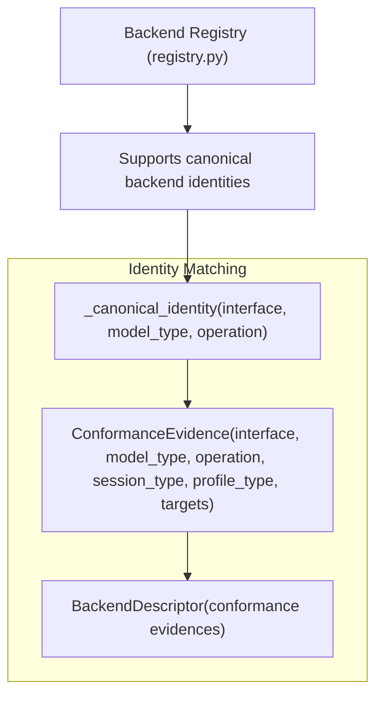
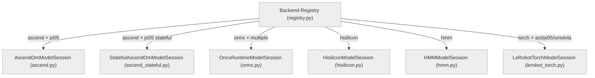
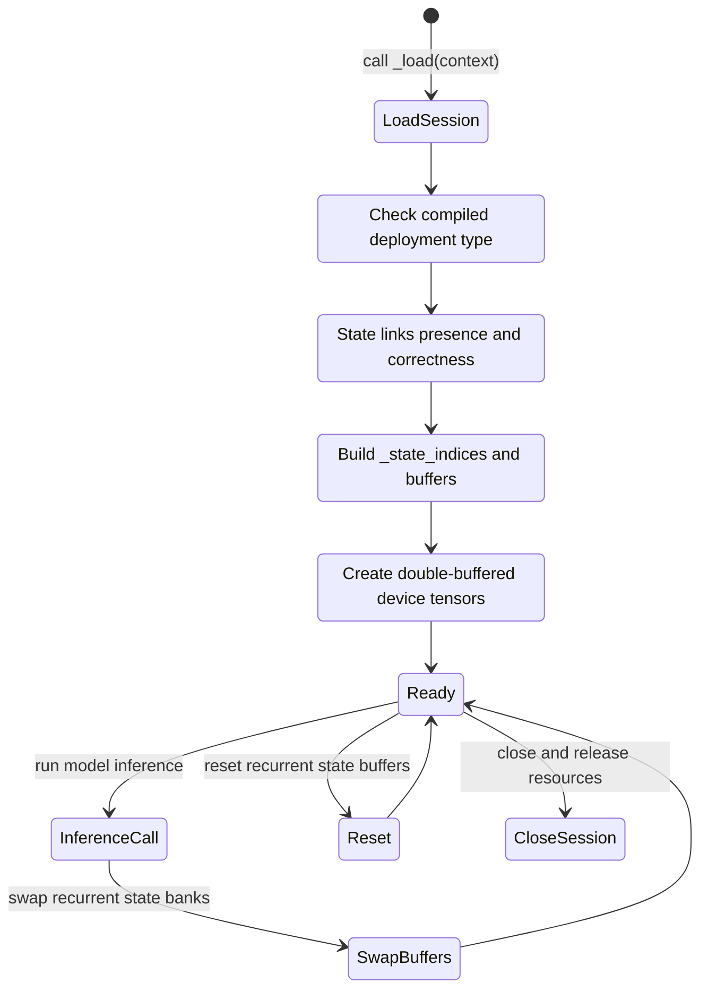
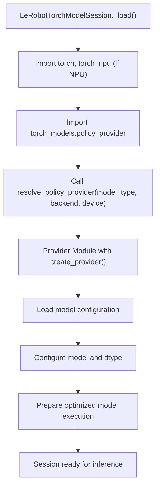

# 后端与模型会话

<details>
<summary>相关源码文件</summary>

以下文件被用作生成此 wiki 页面的上下文：

- [docs/unify.md](https://atomgit.com/openeuler/IB_Robot/blob/openEuler-26.09/docs/unify.md)
- [src/inference_service/inference_service/backends/admission.py](https://atomgit.com/openeuler/IB_Robot/blob/openEuler-26.09/src/inference_service/inference_service/backends/admission.py)
- [src/inference_service/inference_service/backends/ascend/__init__.py](https://atomgit.com/openeuler/IB_Robot/blob/openEuler-26.09/src/inference_service/inference_service/backends/ascend/__init__.py)
- [src/inference_service/inference_service/backends/ascend/acl_runtime.py](https://atomgit.com/openeuler/IB_Robot/blob/openEuler-26.09/src/inference_service/inference_service/backends/ascend/acl_runtime.py)
- [src/inference_service/inference_service/backends/ascend/model.py](https://atomgit.com/openeuler/IB_Robot/blob/openEuler-26.09/src/inference_service/inference_service/backends/ascend/model.py)
- [src/inference_service/inference_service/backends/errors.py](https://atomgit.com/openeuler/IB_Robot/blob/openEuler-26.09/src/inference_service/inference_service/backends/errors.py)
- [src/inference_service/inference_service/backends/hisilicon/__init__.py](https://atomgit.com/openeuler/IB_Robot/blob/openEuler-26.09/src/inference_service/inference_service/backends/hisilicon/__init__.py)
- [src/inference_service/inference_service/backends/hisilicon/sd3403_protocol.py](https://atomgit.com/openeuler/IB_Robot/blob/openEuler-26.09/src/inference_service/inference_service/backends/hisilicon/sd3403_protocol.py)
- [src/inference_service/inference_service/backends/registry.py](https://atomgit.com/openeuler/IB_Robot/blob/openEuler-26.09/src/inference_service/inference_service/backends/registry.py)
- [src/inference_service/inference_service/backends/types.py](https://atomgit.com/openeuler/IB_Robot/blob/openEuler-26.09/src/inference_service/inference_service/backends/types.py)
- [src/inference_service/inference_service/model_sessions/__init__.py](https://atomgit.com/openeuler/IB_Robot/blob/openEuler-26.09/src/inference_service/inference_service/model_sessions/__init__.py)
- [src/inference_service/inference_service/model_sessions/ascend.py](https://atomgit.com/openeuler/IB_Robot/blob/openEuler-26.09/src/inference_service/inference_service/model_sessions/ascend.py)
- [src/inference_service/inference_service/model_sessions/ascend_stateful.py](https://atomgit.com/openeuler/IB_Robot/blob/openEuler-26.09/src/inference_service/inference_service/model_sessions/ascend_stateful.py)
- [src/inference_service/inference_service/model_sessions/base.py](https://atomgit.com/openeuler/IB_Robot/blob/openEuler-26.09/src/inference_service/inference_service/model_sessions/base.py)
- [src/inference_service/inference_service/model_sessions/lerobot_torch.py](https://atomgit.com/openeuler/IB_Robot/blob/openEuler-26.09/src/inference_service/inference_service/model_sessions/lerobot_torch.py)
- [src/inference_service/inference_service/model_sessions/onnx.py](https://atomgit.com/openeuler/IB_Robot/blob/openEuler-26.09/src/inference_service/inference_service/model_sessions/onnx.py)
- [src/inference_service/tests/test_ascend_stateful_session.py](https://atomgit.com/openeuler/IB_Robot/blob/openEuler-26.09/src/inference_service/tests/test_ascend_stateful_session.py)
- [src/inference_service/tests/test_onnx_model_session.py](https://atomgit.com/openeuler/IB_Robot/blob/openEuler-26.09/src/inference_service/tests/test_onnx_model_session.py)
- [src/inference_service/tests/test_stateful_ascend_session.py](https://atomgit.com/openeuler/IB_Robot/blob/openEuler-26.09/src/inference_service/tests/test_stateful_ascend_session.py)
- [src/inference_service/tests/test_v3_routing.py](https://atomgit.com/openeuler/IB_Robot/blob/openEuler-26.09/src/inference_service/tests/test_v3_routing.py)
- [src/robot_config/config/robots/lekiwi_nav_grasp_sound_real.yaml](https://atomgit.com/openeuler/IB_Robot/blob/openEuler-26.09/src/robot_config/config/robots/lekiwi_nav_grasp_sound_real.yaml)
- [src/torch_models/NOTICE](https://atomgit.com/openeuler/IB_Robot/blob/openEuler-26.09/src/torch_models/NOTICE)
- [src/torch_models/README.md](https://atomgit.com/openeuler/IB_Robot/blob/openEuler-26.09/src/torch_models/README.md)
- [src/torch_models/package.xml](https://atomgit.com/openeuler/IB_Robot/blob/openEuler-26.09/src/torch_models/package.xml)
- [src/torch_models/resource/torch_models](https://atomgit.com/openeuler/IB_Robot/blob/openEuler-26.09/src/torch_models/resource/torch_models)
- [src/torch_models/setup.cfg](https://atomgit.com/openeuler/IB_Robot/blob/openEuler-26.09/src/torch_models/setup.cfg)
- [src/torch_models/setup.py](https://atomgit.com/openeuler/IB_Robot/blob/openEuler-26.09/src/torch_models/setup.py)
- [src/torch_models/test/test_policy_provider.py](https://atomgit.com/openeuler/IB_Robot/blob/openEuler-26.09/src/torch_models/test/test_policy_provider.py)
- [src/torch_models/torch_models/__init__.py](https://atomgit.com/openeuler/IB_Robot/blob/openEuler-26.09/src/torch_models/torch_models/__init__.py)
- [src/torch_models/torch_models/demo_torch_model/__init__.py](https://atomgit.com/openeuler/IB_Robot/blob/openEuler-26.09/src/torch_models/torch_models/demo_torch_model/__init__.py)
- [src/torch_models/torch_models/demo_torch_model/demo_torch_model.py](https://atomgit.com/openeuler/IB_Robot/blob/openEuler-26.09/src/torch_models/torch_models/demo_torch_model/demo_torch_model.py)
- [src/torch_models/torch_models/policy_provider.py](https://atomgit.com/openeuler/IB_Robot/blob/openEuler-26.09/src/torch_models/torch_models/policy_provider.py)
- [src/voice_asr_service/voice_asr_service/model_session_builders.py](https://atomgit.com/openeuler/IB_Robot/blob/openEuler-26.09/src/voice_asr_service/voice_asr_service/model_session_builders.py)

</details>

本节记录 RoboFrame 具身智能框架中用于集成多种软硬件推理后端的**后端注册表**、关键**模型会话实现**以及会话**策略提供者**机制。内容涵盖 ONNX Runtime、Ascend/Hisilicon/HMM 后端，以及有状态 Ascend 模型会话变体；此外还详述基于 PyTorch 的 torch_models 策略提供者集成。

---

## 目的与范围

RoboFrame 推理支持面向各类 AI 加速器平台优化的多种软硬件后端。本页面说明：

- 推理服务后端如何在系统中注册与识别。
- 具体的后端会话实现：ONNX、Ascend OM、Hisilicon SDK、HMM 与 LeRobot Torch 会话。
- 支持循环模型状态的**有状态 Ascend OM 模型会话**的生命周期与能力。
- 与模型会话框架集成的 `torch_models` 原生 PyTorch 策略提供者。

目标是建立统一的模型会话抽象，覆盖后端身份、实例化、推理执行与资源生命周期管理。

---

## 后端注册表

### 概览

后端注册表是支撑推理运行时的后端能力与一致性证据的**静态惰性注册表**。它枚举规范后端与接口、各自支持的模型类型和操作，并将其映射到会话实现。

- 已识别后端：`"torch"`、`"ascend"`、`"hisilicon"`、`"rknn"`、`"hmm"`、`"onnx"`
- 接口：`"policy"` 与 `"tensor_model"`
- 模型类型包括策略变体（`"act"`、`"pi05"` 等）与其他专用网络（如 `"ram_plus"`、`"sam2"`、`"grounding_dino"`、`"zipvoice"`）
- 每个后端/会话提供声明其支持的 `(interface, model_type, operation)` 三元组的一致性元数据。

注册表条目包括：

- 会话类型字符串标识符
- 后端运行时 profile 类
- 支持的运行时目标与 SoC
- 平台专属的设备集合

该注册表入口**不导入**ACL SDK、Torch 或厂商运行时等重依赖；这些在会话实例化时才延迟加载。

---

### 关键概念与类型

- `ConformanceEvidence`：记录对特定 `(interface, model_type, operation)` 支持情况的数据类，附会话后端、运行时 profile、目标硬件与设备的元数据。

- `_canonical_identity`：校验并规范化后端身份元组。

- `BackendDescriptor`：单个后端的不可变声明，可携带多条一致性证据。

该注册表支持按推理 manifest 与运行时 profile 将调用分派到正确的具体会话类。

---

### Mermaid 图：后端注册表身份映射



---
来源：[src/inference_service/inference_service/backends/registry.py:1-169](https://atomgit.com/openeuler/IB_Robot/blob/openEuler-26.09/src/inference_service/inference_service/backends/registry.py#L1-L169)

---

## 模型会话

模型会话是**运行时可执行的绑定对象**，管理部署 manifest 中一个或多个角色的模型加载、设备内存、资源租约、推理调用与生命周期阶段。它们抽象硬件细节并统一分派。

---

### Ascend OM 模型会话

- **`AscendOmModelSession`** 是使用华为 ACL 运行时租约与模型句柄进行 Ascend NPU 推理的主实现。
- 加载与部署 manifest 角色绑定的 `om` 格式产物。
- 支持独占设备分配与可选的优先级调度，用于资源仲裁。
- 管理 ACL 运行时租约以共享设备会话，并具备健壮的错误与生命周期处理。
- 强制执行 manifest 与运行时 profile 校验，确保部署兼容性。
- 支持对被隔离推理调用的排空（drain），实现确定性的清理而无需卸载模型。

---

### 有状态 Ascend OM 模型会话

- `StatefulAscendOmModelSession` 在基础 Ascend 会话之上扩展了**有状态循环链路支持**。
- 为部署 manifest 中由**状态链路**标记的模型角色管理**双缓冲的设备侧循环状态张量**。
- 校验循环输入/输出张量对的严格 ABI 一致性（静态形状与类型）。
- 要求 `runtime_exclusive` **状态 bank 模式**，且所有执行角色都具备链路状态。
- 不支持设备链路与状态 bank 组合使用。
- 实现 `reset()` 以清空循环状态。
- 内部维护：
  - `_state_indices`：将角色映射到定义循环输入-输出绑定对的元组的字典。
  - `_state_buffers`：每条状态链路的双缓冲设备缓冲。
  - `_state_banks`：整数标记当前活跃的 bank 缓冲。

该会话对 LSTM、RNN 等需要在 Ascend 设备上帧间就地传递循环状态的模型至关重要。

---

### Hisilicon 与 HMM 会话

- `HisiliconModelSession` 与 `HMMModelSession` 提供 Hisilicon SDK 与 HMM 加速后端的运行时集成。
- 它们绑定原生设备运行时并暴露标准会话生命周期。
- 支持与 manifest 绑定的产物加载及运行时 ABI 校验。

---

### ONNX Runtime 会话

- `OnnxRuntimeModelSession` 支持通过 ONNX Runtime 在 CPU 或 GPU 后端上推理。
- 加载标准 ONNX 格式模型。
- 提供标准的后端生命周期与推理调用语义。

---

### LeRobot Torch 会话（策略提供者）

- `LeRobotTorchModelSession` 封装实现 LeRobot 策略接口的原生 PyTorch 模型。
- 支持：
  - 加载 PyTorch 运行时，以及面向 NPU 设备的可选 torch_npu。
  - 模型设备分配与 dtype 配置（`fp16`、`bf16`、`fp32` 或原生）。
  - 前后处理钩子。
  - 执行元数据收集（attention、中间诊断信息）。
- 使用 `torch_models.policy_provider` 中定义的**策略提供者机制**：
  - 加载期间按 `(model_type, backend, device)` 动态解析提供者模块。
  - 提供者实现加载配置、配置模型、校验兼容性、准备优化推理对象与提供元数据的钩子。
- 该方式将策略实现与核心推理运行时解耦，并支持“自研” PyTorch 模型的动态加载。

---

### Mermaid 图：模型会话实现与后端注册表身份



---
来源：`src/inference_service/inference_service/model_sessions/ascend.py:1-156`, `src/inference_service/inference_service/model_sessions/ascend_stateful.py:1-143`, `src/inference_service/inference_service/model_sessions/lerobot_torch.py:1-161`, `src/inference_service/inference_service/model_sessions/__init__.py:1-26`, `src/inference_service/inference_service/backends/registry.py:1-169`

---

## 有状态 Ascend OM 模型会话：实现细节

### 初始化与能力

- 声明支持：
  - 有状态执行
  - 通过 `reset()` API 重置状态
  - 运行时独占状态 bank（由 manifest 契约强制）
- 维护循环状态索引、设备缓冲与双 bank 状态的内部映射，保证循环输入/输出缓冲安全。

### 加载期校验

- 确认 manifest 是在执行契约中声明了状态链路的已编译部署。
- 校验所有执行角色都有状态链路绑定。
- 校验循环张量对的形状与 dtype 一致性。
- 检查状态 bank 模式为 `"runtime_exclusive"`。
- 校验部署未将设备链路与状态链路混用。
- 任何契约不匹配都会抛出 `BackendLoadError`。

### 模型准备

- 为每个模型角色的每对循环状态张量创建双缓冲。
- 检查引用的输入/输出绑定确实存在于模型运行时 ABI 中。
- 通过继承的 `_prepare_models()` 方法准备 Ascend OM 模型角色。

### 会话使用

- 推理调用时，用双缓冲交换活跃循环状态缓冲，把上一次调用的输出作为下一次的输入。
- 处理状态重置以初始化循环缓冲。
- 与 ACL 运行时管理器和设备租约集成，管理 Ascend 设备生命周期。

---

### Mermaid 图：StatefulAscendOmModelSession 数据流



---
来源：`src/inference_service/inference_service/model_sessions/ascend_stateful.py:1-143`, `src/inference_service/tests/test_ascend_stateful_session.py:1-180`, `src/inference_service/tests/test_stateful_ascend_session.py:1-61`

---

## torch_models 策略提供者

### 概览

- `torch_models` 包含**自研 PyTorch 模型**，不依赖 ROS 运行时。
- 模型按隔离的子目录组织，例如：

  ```text
  src/torch_models/
    torch_models/
      demo_torch_model/
      pi05_ascend_310p/
      pi05_ascend_910b/
  ```

- 每个模型子目录导出一个 `provider.py`，其 `create_provider()` 函数返回支持以下能力的 `PolicyProvider`：
   - 配置加载与校验
   - 模型准备（如设备放置、dtype 转换）
   - 执行钩子
   - 诊断元数据
- `torch_models.policy_provider` 按目标设备名（如带物理 SKU `"Ascend310P"` 或 `"Ascend910B"` 的 `"npu"`）动态解析 `(model_type, backend, device)` 元组对应的提供者。
- `LeRobotTorchModelSession` 在其 `_load()` 方法中使用该提供者解析，实例化实际的 PyTorch 策略模型并挂接前后处理。

---

### 构建与安装 torch_models

- 使用 `ament_python` 风格的 `setup.py` 构建，支持纯 Python 包数据与对 `"torch"` 的依赖。
- 模型不内嵌权重或部署配置——这些来自外部 bundle。
- torch_models 包设计为零依赖导入，并使用运行时动态导入避免加载不必要的重型模块。

---

### 与推理运行时集成

- 加载类型为 `"torch"` 的策略部署时，`LeRobotTorchModelSession`：
  - 校验设备与运行时 profile。
  - 按需导入 torch/torch_npu 模块。
  - 通过 `torch_models.policy_provider.resolve_policy_provider()` 解析提供者。
  - 加载模型配置与权重。
  - 以可选的 dtype 转换准备推理模型。
  - 管理设备与优先级调度。
- 自定义运行时选项（如 dtype）会被校验并透传。
- 新增 provider 条目即可扩展新的基于 torch 的策略。

---

### Mermaid 图：torch_models 提供者解析流程



---
来源：`src/torch_models/README.md:1-127`, `src/inference_service/inference_service/model_sessions/lerobot_torch.py:1-161`, `src/torch_models/setup.py:1-26`, `src/torch_models/torch_models/policy_provider.py` (mentioned but not listed)

---

## 汇总表：后端与会话职责

| 后端       | 会话类                | 模型格式 | 关键特性                                     | 位置                                  |
|---------------|-----------------------------|--------------|-------------------------------------------------|-------------------------------------------|
| Ascend OM     | `AscendOmModelSession`      | OM           | ACL 租约、设备管理、优先级调度 | `model_sessions/ascend.py`                 |
| Ascend OM 有状态 | `StatefulAscendOmModelSession` | OM        | 循环状态处理、双缓冲状态 | `model_sessions/ascend_stateful.py`       |
| ONNX Runtime  | `OnnxRuntimeModelSession`   | ONNX         | 标准 ONNX RT 集成                      | `model_sessions/onnx.py`                    |
| Hisilicon SDK | `HisiliconModelSession`     | 专有格式  | Hisilicon 设备/SDK 集成                   | `model_sessions/hisilicon.py`               |
| HMM           | `HMMModelSession`           | 专有格式  | HMM 硬件加速                          | `model_sessions/hmm.py`                      |
| Torch Models  | `LeRobotTorchModelSession`  | PyTorch      | 带 provider 钩子的原生 PyTorch 策略模型  | `model_sessions/lerobot_torch.py`            |

---

## 结语

RoboFrame 的**后端与模型会话**层使 AI 模型能够在多种 NPU/CPU 加速器上执行，既与硬件无关又可优化。通过集中式后端注册表与统一会话接口，系统灵活支持华为昇腾 NPU 与自定义 PyTorch 策略等不断演进的架构。有状态循环会话实现增强了对序列敏感推理的模型支持。torch_models 的 provider 模式进一步将策略逻辑与推理运行时模块化解耦。

---

## 附录：关键类与函数（用于检索）

| 名称                                    | 描述                                  | 文件与行号                              |
|-----------------------------------------|----------------------------------------------|----------------------------------------|
| `BackendRegistry`                       | 静态后端能力注册表            | `backends/registry.py:1-169`            |
| `AscendOmModelSession`                  | Ascend OM 模型会话                       | `model_sessions/ascend.py:1-156`        |
| `StatefulAscendOmModelSession`          | 带循环状态的有状态 Ascend OM 会话 | `model_sessions/ascend_stateful.py:1-143` |
| `LeRobotTorchModelSession`              | 带 provider 的 PyTorch 策略会话         | `model_sessions/lerobot_torch.py:1-161` |
| `build_speech_direction_session()`     | 语音方向在 ascend 上的示例会话构建器 | `voice_asr_service/model_session_builders.py:21-50` |
| `resolve_policy_provider()`             | 动态解析 torch_models provider     | `torch_models/torch_models/policy_provider.py` (not shown) |

---

## 相关 Wiki 页面引用

- 流水线执行细节见 **3.1 流水线运行时**。
- 管辖部署元数据的 manifest 格式见 **3.4 推理清单 Schema**。
