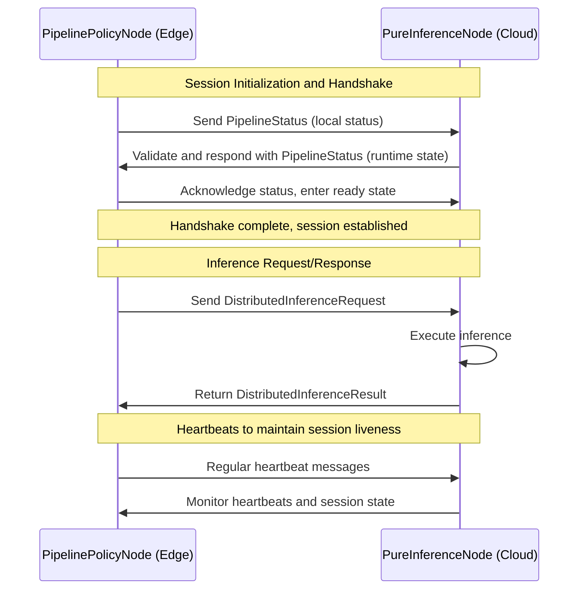

# 分布式边云推理

<details>
<summary>相关源码文件</summary>

以下文件被用作生成此 wiki 页面的上下文：

- [src/ibrobot_msgs/msg/DistributedInferenceRequest.msg](https://atomgit.com/openeuler/IB_Robot/blob/openEuler-26.09/src/ibrobot_msgs/msg/DistributedInferenceRequest.msg)
- [src/inference_service/inference_service/compute_video_streams.py](https://atomgit.com/openeuler/IB_Robot/blob/openEuler-26.09/src/inference_service/inference_service/compute_video_streams.py)
- [src/inference_service/inference_service/core/__init__.py](https://atomgit.com/openeuler/IB_Robot/blob/openEuler-26.09/src/inference_service/inference_service/core/__init__.py)
- [src/inference_service/inference_service/core/pure_inference_engine.py](https://atomgit.com/openeuler/IB_Robot/blob/openEuler-26.09/src/inference_service/inference_service/core/pure_inference_engine.py)
- [src/inference_service/inference_service/device_video_streams.py](https://atomgit.com/openeuler/IB_Robot/blob/openEuler-26.09/src/inference_service/inference_service/device_video_streams.py)
- [src/inference_service/inference_service/distributed/__init__.py](https://atomgit.com/openeuler/IB_Robot/blob/openEuler-26.09/src/inference_service/inference_service/distributed/__init__.py)
- [src/inference_service/inference_service/distributed/ros_protocol.py](https://atomgit.com/openeuler/IB_Robot/blob/openEuler-26.09/src/inference_service/inference_service/distributed/ros_protocol.py)
- [src/inference_service/inference_service/distributed/runtime.py](https://atomgit.com/openeuler/IB_Robot/blob/openEuler-26.09/src/inference_service/inference_service/distributed/runtime.py)
- [src/inference_service/inference_service/distributed/service.py](https://atomgit.com/openeuler/IB_Robot/blob/openEuler-26.09/src/inference_service/inference_service/distributed/service.py)
- [src/inference_service/inference_service/distributed/session.py](https://atomgit.com/openeuler/IB_Robot/blob/openEuler-26.09/src/inference_service/inference_service/distributed/session.py)
- [src/inference_service/inference_service/distributed/types.py](https://atomgit.com/openeuler/IB_Robot/blob/openEuler-26.09/src/inference_service/inference_service/distributed/types.py)
- [src/inference_service/inference_service/pipeline_policy_node.py](https://atomgit.com/openeuler/IB_Robot/blob/openEuler-26.09/src/inference_service/inference_service/pipeline_policy_node.py)
- [src/inference_service/inference_service/pure_inference_node.py](https://atomgit.com/openeuler/IB_Robot/blob/openEuler-26.09/src/inference_service/inference_service/pure_inference_node.py)
- [src/inference_service/inference_service/recording_node.py](https://atomgit.com/openeuler/IB_Robot/blob/openEuler-26.09/src/inference_service/inference_service/recording_node.py)
- [src/inference_service/inference_service/video_recording_coordinator.py](https://atomgit.com/openeuler/IB_Robot/blob/openEuler-26.09/src/inference_service/inference_service/video_recording_coordinator.py)
- [src/inference_service/inference_service/video_rtp.py](https://atomgit.com/openeuler/IB_Robot/blob/openEuler-26.09/src/inference_service/inference_service/video_rtp.py)
- [src/inference_service/launch/cloud_inference.launch.py](https://atomgit.com/openeuler/IB_Robot/blob/openEuler-26.09/src/inference_service/launch/cloud_inference.launch.py)
- [src/inference_service/launch/eval_inference.launch.py](https://atomgit.com/openeuler/IB_Robot/blob/openEuler-26.09/src/inference_service/launch/eval_inference.launch.py)
- [src/inference_service/launch/local_distributed_inference.launch.py](https://atomgit.com/openeuler/IB_Robot/blob/openEuler-26.09/src/inference_service/launch/local_distributed_inference.launch.py)
- [src/inference_service/test/test_distributed_handshake_logging.py](https://atomgit.com/openeuler/IB_Robot/blob/openEuler-26.09/src/inference_service/test/test_distributed_handshake_logging.py)
- [src/inference_service/tests/ci_smoke/video_distributed_launch_smoke.py](https://atomgit.com/openeuler/IB_Robot/blob/openEuler-26.09/src/inference_service/tests/ci_smoke/video_distributed_launch_smoke.py)
- [src/inference_service/tests/ci_smoke/video_e2e_client.py](https://atomgit.com/openeuler/IB_Robot/blob/openEuler-26.09/src/inference_service/tests/ci_smoke/video_e2e_client.py)
- [src/inference_service/tests/test_compute_video_streams.py](https://atomgit.com/openeuler/IB_Robot/blob/openEuler-26.09/src/inference_service/tests/test_compute_video_streams.py)
- [src/inference_service/tests/test_distributed_integration.py](https://atomgit.com/openeuler/IB_Robot/blob/openEuler-26.09/src/inference_service/tests/test_distributed_integration.py)
- [src/inference_service/tests/test_distributed_protocol.py](https://atomgit.com/openeuler/IB_Robot/blob/openEuler-26.09/src/inference_service/tests/test_distributed_protocol.py)
- [src/inference_service/tests/test_recording_node.py](https://atomgit.com/openeuler/IB_Robot/blob/openEuler-26.09/src/inference_service/tests/test_recording_node.py)
- [src/inference_service/tests/test_video_rtp.py](https://atomgit.com/openeuler/IB_Robot/blob/openEuler-26.09/src/inference_service/tests/test_video_rtp.py)
- [src/robot_config/robot_config/launch_builders/benchmark.py](https://atomgit.com/openeuler/IB_Robot/blob/openEuler-26.09/src/robot_config/robot_config/launch_builders/benchmark.py)
- [src/robot_config/robot_config/observation_transport.py](https://atomgit.com/openeuler/IB_Robot/blob/openEuler-26.09/src/robot_config/robot_config/observation_transport.py)

</details>

本节概述 RoboFrame 框架内的分布式推理架构，描述在边缘设备与云服务之间拆分运行统一推理流水线的关键组件。覆盖 *PipelinePolicyNode*（边缘运行时）与 *PureInferenceNode*（云端运行时）的角色与区别、支撑健壮分布式通信的握手与会话管理协议、云端 launch 配置，以及面向无 ROS 依赖单流水线部署的轻量 *pure_inference_engine* 门面。

以下是高层摘要，并链接到详细子页面以获取实现细节与底层传输机制。

---

## PipelinePolicyNode 与 PureInferenceNode

分布式推理系统利用两种主要节点类型，分别管理边/云拆分的一侧：

- **PipelinePolicyNode**  
  该 ROS 2 节点运行在边缘设备上。它暴露经校验的统一推理流水线，并在本地环境内管理推理请求。节点处理混合运行时策略执行、传输协议协商、动作分发与边缘算力资源管理。它与 ROS topic 和服务紧密集成，用于推理请求/响应绑定、视频流状态与心跳存活检查。  
  该节点还通过 RTP 或 DDS 传输编排视频流的接入与处理，适配本地设备硬件约束。  
  （见源码：`src/inference_service/inference_service/pipeline_policy_node.py:1-220`）

- **PureInferenceNode**  
  该节点面向云端部署。它运行单一经校验的分布式推理流水线后端，不直接依赖 ROS。它接收边缘设备的请求，处理会话作用域的请求传输，并管理推理运行时实例的生命周期。其职责包括维护与边缘对端的分布式握手协议状态、管理视频流状态 topic，以及响应多个客户端的推理请求。  
  该节点在分布式拓扑中充当纯计算后端，为云端推理提供简化接口。  
  （见源码：`src/inference_service/inference_service/pure_inference_node.py:1-171`）

这两种节点通过分布式会话与握手协议协作，确保在推理请求进行之前完成身份验证、版本兼容与操作就绪。

### 角色总览图

```mermaid
graph LR
  EdgeNode["PipelinePolicyNode\n(src/inference_service/pipeline_policy_node.py)"]
  CloudNode["PureInferenceNode\n(src/inference_service/pure_inference_node.py)"]
  RobotApp[Robot Application]
  CloudCompute[Cloud Inference Backend]

  RobotApp -->|Inference Requests| EdgeNode
  EdgeNode -->|"Distributed Protocol (handshake, sessions)"| CloudNode
  CloudNode -->|Inference Responses| EdgeNode
  CloudNode -->|Inference Execution| CloudCompute

  style EdgeNode fill:#f9f,stroke:#333,stroke-width:1px
  style CloudNode fill:#bbf,stroke:#333,stroke-width:1px
```



来源：`src/inference_service/inference_service/pipeline_policy_node.py:1-220`, `src/inference_service/inference_service/pure_inference_node.py:1-171`

---

## 握手 / 会话协议

分布式推理基础设施内嵌健壮的握手与会话管理协议，确保边云组件间的一致性与存活状态。该协议校验流水线身份、部署指纹与 manifest schema 版本，拒绝版本不匹配或状态无效的连接。

握手交换反映就绪状态与运行时状态的 *PipelineStatus* 消息，从初始会话建立推进到 idle 或 ready 状态。握手完成后，系统使用会话 ID 与世代计数器进行请求路由与错误恢复。

心跳消息丢失会触发在途请求的会话失效，将流水线转入降级状态。恢复需要新的会话握手周期，以保证同步。

协议中的关键组件包括：

- **PipelineIdentity**：规范化流水线版本信息，组合流水线 ID、manifest 与部署 UUID、修订版本与指纹。
- **PipelineStatus**：对端角色、序列计数器、会话标识符、运行时就绪状态与错误上报字段。
- **Operation Codes**：枚举值，包括 INFER、RESET、CANCEL，用于分类分布式流水线操作。
- **StreamReferences**：观测键到关联视频数据流 ID 的映射。

该协议支持握手时的强校验，确保不兼容对端被拒绝，且操作只能在有效会话上下文中进行。

### 握手消息流图



来源：`src/inference_service/tests/test_distributed_protocol.py:54-177`, `src/inference_service/distributed/types.py:1-193`

---

## 云端 launch 文件

为简化部署，云端节点使用专门的 ROS 2 launch 文件编排参数、topic 重映射与条件节点启动模式：

- **cloud_inference.launch.py**  
  为单流水线云节点定义 launch 参数，包括流水线 ID、模型 bundle 路径、部署名称、请求超时、运行时选项与机器人配置路径。除非启用录制模式，否则启动 `pure_inference_node`。  
  此外，在绕过云节点的视频录制场景下，可有条件地启动 `recording_node`。  
  （见源码：`src/inference_service/launch/cloud_inference.launch.py:1-88`）

这种模块化 launch 方式支持云运行时的灵活实例化、运行时配置注入，并与机器人配置 YAML 资产集成。

---

## Pure Inference Engine

对于需要最小依赖、单一统一流水线且无 ROS 2 接口的推理运行时，*PureInferenceEngine* 类提供干净的门面：

- 持有一个从 bundle 与 deployment 加载的经校验推理流水线。
- 提供 API，以批量输入张量、可选 prompt、控制输入执行推理，并捕获推理元数据。
- 支持运行时重置与优雅关闭。
- 暴露策略与后端元数据用于内省。
- 为无 ROS 2 生命周期顾虑的纯 Python 或容器化后端而设计。

该引擎实现为对统一流水线管理器的封装调用，抽象了运行时选项与后端注册工厂。它被云节点内部使用，但也可在 Python 工作负载中直接使用。  
（见源码：`src/inference_service/inference_service/core/pure_inference_engine.py:1-194`）

调用示例片段：

```python
engine = PureInferenceEngine(model_path="/path/to/bundle", deployment="cpu")
batch = {"observation.state": some_tensor}
result = engine(batch, prompt="Move forward")
print("Action:", result.action)
```

---

## 视频流支持概览

分布式推理大量依赖从边缘向云端流式传输视频观测。两个管理器根据运行时位置处理传输与解码：

- **DeviceVideoStreamManager**（设备/边缘侧）  
  将遗留 ROS Image topic 包装为直接帧接入流水线，使用 RTP 编码与打包。支持编解码器注册表管理与流诊断。  
  （见源码：`src/inference_service/inference_service/device_video_streams.py:1-154`）

- **ComputeVideoStreamManager**（算力/云端侧）  
  为计算流水线协商、接收、解码、同步并缓冲 RTP 视频流。管理流就绪与诊断，解码器可配置，包括软件与硬件后端。  
  （见源码：`src/inference_service/inference_service/compute_video_streams.py:1-159`）

关于观测视频传输协议、编解码器、流管理器与协商机制的详细探讨，见子节[观测视频传输（RTP/H.264）](./observation_video_transport.md)。

---

## 总结

RoboFrame 的分布式边云推理框架构建了一个横跨设备与云端算力节点的健壮且可扩展的流水线运行时。*PipelinePolicyNode* 充当机器人上的本地推理编排器，*PureInferenceNode* 在云端提供受管、会话感知的后端。二者通信遵循严格的握手与会话协议以保证正确性。云端 launch 文件提供开箱即用的部署方式，*PureInferenceEngine* 类为独立 Python 用例提供轻量运行时。

这种模块化设计支持高效的视频观测传输、向多后端的无缝扩展，以及面向具身机器人的高可用分布式 AI 推理。

---

关于传输、编解码器、流协商与配置的深入细节，见子页面：

- [观测视频传输（RTP/H.264）](./observation_video_transport.md)

---

## 参考文献

- `src/inference_service/inference_service/pipeline_policy_node.py:1-220`
- `src/inference_service/inference_service/pure_inference_node.py:1-171`
- `src/inference_service/inference_service/core/pure_inference_engine.py:1-194`
- `src/inference_service/inference_service/distributed/types.py:1-193`
- `src/inference_service/inference_service/distributed/ros_protocol.py:1-163`
- `src/inference_service/tests/test_distributed_protocol.py:54-177`
- `src/inference_service/inference_service/compute_video_streams.py:1-159`
- `src/inference_service/inference_service/device_video_streams.py:1-154`
- `src/inference_service/launch/cloud_inference.launch.py:1-88`
