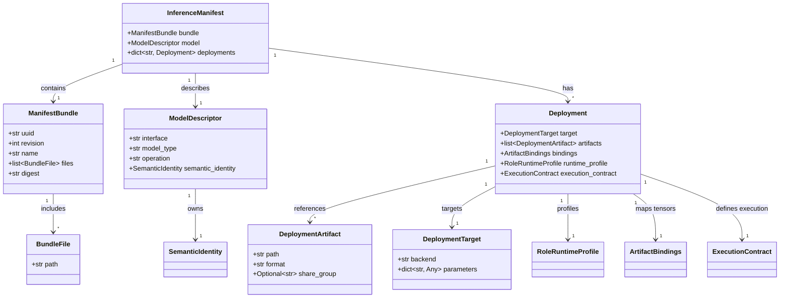
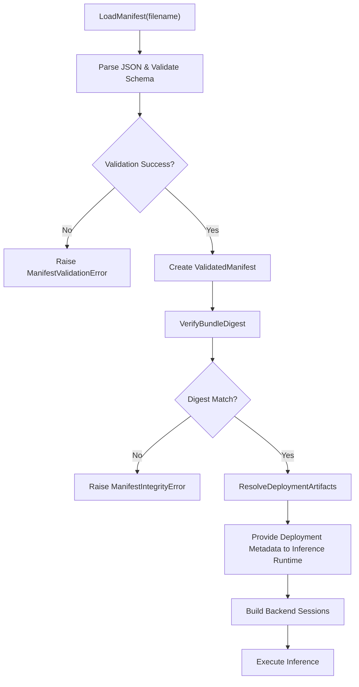

# 推理清单 Schema

相关源码文件

以下文件被用作生成此 wiki 页面的上下文：

- [src/ibrobot_msgs/action/ClosePipelineBinding.action](https://atomgit.com/openeuler/IB_Robot/blob/openEuler-26.09/src/ibrobot_msgs/action/ClosePipelineBinding.action)
- [src/ibrobot_msgs/action/DispatchPipelineBinding.action](https://atomgit.com/openeuler/IB_Robot/blob/openEuler-26.09/src/ibrobot_msgs/action/DispatchPipelineBinding.action)
- [src/ibrobot_msgs/action/OpenPipelineBinding.action](https://atomgit.com/openeuler/IB_Robot/blob/openEuler-26.09/src/ibrobot_msgs/action/OpenPipelineBinding.action)
- [src/inference_manifest/README.md](https://atomgit.com/openeuler/IB_Robot/blob/openEuler-26.09/src/inference_manifest/README.md)
- [src/inference_manifest/inference_manifest/__init__.py](https://atomgit.com/openeuler/IB_Robot/blob/openEuler-26.09/src/inference_manifest/inference_manifest/__init__.py)
- [src/inference_manifest/inference_manifest/inference_manifest.schema.json](https://atomgit.com/openeuler/IB_Robot/blob/openEuler-26.09/src/inference_manifest/inference_manifest/inference_manifest.schema.json)
- [src/inference_manifest/inference_manifest/integrity.py](https://atomgit.com/openeuler/IB_Robot/blob/openEuler-26.09/src/inference_manifest/inference_manifest/integrity.py)
- [src/inference_manifest/inference_manifest/json_utils.py](https://atomgit.com/openeuler/IB_Robot/blob/openEuler-26.09/src/inference_manifest/inference_manifest/json_utils.py)
- [src/inference_manifest/inference_manifest/loader.py](https://atomgit.com/openeuler/IB_Robot/blob/openEuler-26.09/src/inference_manifest/inference_manifest/loader.py)
- [src/inference_manifest/inference_manifest/metadata.py](https://atomgit.com/openeuler/IB_Robot/blob/openEuler-26.09/src/inference_manifest/inference_manifest/metadata.py)
- [src/inference_manifest/inference_manifest/models.py](https://atomgit.com/openeuler/IB_Robot/blob/openEuler-26.09/src/inference_manifest/inference_manifest/models.py)
- [src/inference_manifest/inference_manifest/writer.py](https://atomgit.com/openeuler/IB_Robot/blob/openEuler-26.09/src/inference_manifest/inference_manifest/writer.py)
- [src/inference_manifest/test/test_v3_manifest.py](https://atomgit.com/openeuler/IB_Robot/blob/openEuler-26.09/src/inference_manifest/test/test_v3_manifest.py)
- [src/inference_service/tests/manifest_fixtures.py](https://atomgit.com/openeuler/IB_Robot/blob/openEuler-26.09/src/inference_service/tests/manifest_fixtures.py)
- [src/inference_service/tests/test_bundle_metadata.py](https://atomgit.com/openeuler/IB_Robot/blob/openEuler-26.09/src/inference_service/tests/test_bundle_metadata.py)
- [src/inference_service/tests/test_inference_manifest.py](https://atomgit.com/openeuler/IB_Robot/blob/openEuler-26.09/src/inference_service/tests/test_inference_manifest.py)
- [src/model_utils/model_utils/inference_manifest_export.py](https://atomgit.com/openeuler/IB_Robot/blob/openEuler-26.09/src/model_utils/model_utils/inference_manifest_export.py)
- [src/model_utils/model_utils/package_torch_deployment.py](https://atomgit.com/openeuler/IB_Robot/blob/openEuler-26.09/src/model_utils/model_utils/package_torch_deployment.py)
- [src/perception_service/perception_service/adapter_support.py](https://atomgit.com/openeuler/IB_Robot/blob/openEuler-26.09/src/perception_service/perception_service/adapter_support.py)
- [src/perception_service/perception_service/model_service_plugins.py](https://atomgit.com/openeuler/IB_Robot/blob/openEuler-26.09/src/perception_service/perception_service/model_service_plugins.py)
- [src/perception_service/perception_service/model_session_builders.py](https://atomgit.com/openeuler/IB_Robot/blob/openEuler-26.09/src/perception_service/perception_service/model_session_builders.py)
- [src/perception_service/perception_service/pear_adapter.py](https://atomgit.com/openeuler/IB_Robot/blob/openEuler-26.09/src/perception_service/perception_service/pear_adapter.py)
- [src/perception_service/perception_service/semantic_model_adapters.py](https://atomgit.com/openeuler/IB_Robot/blob/openEuler-26.09/src/perception_service/perception_service/semantic_model_adapters.py)
- [src/perception_service/perception_service/yolox_adapter.py](https://atomgit.com/openeuler/IB_Robot/blob/openEuler-26.09/src/perception_service/perception_service/yolox_adapter.py)
- [src/perception_service/test/test_hri_perception_adapters.py](https://atomgit.com/openeuler/IB_Robot/blob/openEuler-26.09/src/perception_service/test/test_hri_perception_adapters.py)
- [third_party/patches/lerobot/v0.5.1/0017-diffusion-accept-observation-histories.patch](https://atomgit.com/openeuler/IB_Robot/blob/openEuler-26.09/third_party/patches/lerobot/v0.5.1/0017-diffusion-accept-observation-histories.patch)

本文档呈现 RoboFrame 推理子系统中实现的推理清单 schema 第 3 版（v3）的技术细节。推理清单是一种关键契约格式，描述 bundle、其部署、模型元数据、数据契约、摘要与运行时执行角色。它在 RoboFrame 具身 AI 流水线中支撑机器学习模型部署的健壮加载、校验、完整性检查与运行时集成。

---

## 1. 目的与范围

推理清单 schema v3 标准化推理 bundle 包及其所含部署的描述。它是以下内容的单一事实源：

- 模型描述、类型与语义身份。
- 带唯一标识符与完整性摘要的打包 artifact 文件。
- 面向特定硬件后端、运行时 profile 与执行角色的部署。
- 带数据类型、形状与布局标注的语义张量。
- 用于清单与 artifact 校验的完整性验证与加密摘要。
- 用于以编程方式访问与校验清单的 Loader API。

清单与硬件无关，并经 schema 校验，以保证稳定识别、可复现性以及推理运行时与后端会话之间的互操作性。

---

## 2. 推理清单 Schema 结构

清单 schema 以 JSON schema 形式化定义，保证机器可校验的正确性以及对所有字段的稳定约束。根清单对象要求以下顶层属性：

- `schema_version`（常量 3）
- `bundle` — 描述包身份、修订号、文件列表与摘要。
- `model` — 描述模型接口、类型、操作与语义身份。
- `deployments` — 命名部署的字典，每个部署代表面向目标后端与运行时的已配置模型。

### 2.1. Bundle 描述

`bundle` 表示带版本号的模型包，必填字段如下：

- `uuid`：bundle 的规范非空 UUID。
- `revision`：正整数修订号。
- `name`：稳定的人类可读名称。
- `files`：文件元数据对象数组（至少包含规范化后的文件路径字符串）。
- `digest`：覆盖 bundle 结构的加密 SHA-256 摘要。

摘要基于排序后的规范化文件路径、`uuid`、`revision` 与 `name` 规范化计算，用于在不要求文件内容哈希的情况下校验结构完整性（文件内容可按需单独哈希）。

### 2.2. 模型描述符

`model` 节描述 ML 模型的契约：

- `interface`：如 `"tensor_model"` 或 `"policy"`，表示模型 API 风格。
- `model_type`：概念模型类型的字符串标识符。
- `operation`：描述模型操作或能力的字符串。
- `semantic_identity`：捕获输入输出的版本化数据契约、预处理与嵌入元数据。

### 2.3. 部署

`deployments` 映射按部署名称枚举模型的基于角色的已部署 artifact：

- 每个部署定义：
  - `target`：描述硬件与运行时平台约束的 `DeploymentTarget`。
  - `artifacts`：与该部署关联的文件、其格式、共享组与摘要。
  - `bindings`：将 artifact 张量映射到语义名称、形状、dtype 与布局。
  - `runtime_profile`：可选的 `RoleRuntimeProfile`，指定后端特定的调优参数。
  - `execution_contract`：描述执行结构、取消粒度与角色的编排级元数据。

部署表示运行时将加载用于推理的、模型 bundle 面向特定硬件与运行时的实例化。

---

## 3. 核心运行时 API 类

清单 schema v3 由 Python `inference_manifest` 包实现，提供类 dataclass 的 Pydantic 模型，用于类型安全的加载、校验与检查。

### 关键类（src/inference_manifest/inference_manifest/models.py）

- **`InferenceManifest`**：根清单类型，包含 bundle、model、deployments。
- **`ManifestBundle`**：Bundle 元数据，包括 UUID、修订号、名称、文件条目与摘要校验。
- **`Deployment`**：描述命名部署，包括 artifacts、target 与执行契约。
- **`DeploymentArtifact`**：表示部署中的文件 artifact，包括路径与格式。
- **`DeploymentTarget`**：目标运行时/硬件说明符，用于将部署匹配到运行时。
- **`ModelDescriptor`**：带语义身份的模型接口/类型/操作。
- **`SemanticTensor`**：以语义名称、dtype、形状与布局标注的类型化张量元数据。
- **`ExecutionContract`**：定义执行编排属性与运行时取消行为。
- **`RoleRuntimeProfile`** 及硬件特定子类（如 `AscendRuntimeProfile`）定义调优参数。

models 包将字符串模式限制为稳定的逻辑标识符，并对语义字段强制 JSON 安全值（如 _validate_identifier 与 _json_safe）。它还声明了 `internal.` 与 `host.` 等已知前缀，用于特殊张量语义角色。

### 校验与工具

- 字符串校验器确保适合长期稳定引用的逻辑名称。
- 校验 SHA-256 摘要、UUID 格式与张量形状。
- 摘要函数提供规范化 bundle 哈希计算，用于免 diff 的验证与签名。

---

## 4. 清单加载与验证（Loader API）

`inference_manifest.loader` 模块提供从磁盘安全加载清单并产出 `ValidatedManifest` 实例的 API，保证：

- 完整 schema 合规。
- Bundle 摘要验证。
- 部署 artifact 路径在 bundle 内解析。
- 运行时 profile 一致性。

该 API 与 RoboFrame 统一推理服务紧密集成。它在保持严格契约校验的同时，支持大型 policy 与嵌入模型的惰性加载。

---

## 5. 完整性与摘要检查

`inference_manifest.integrity` 模块提供以下机制：

- 基于 bundle 元数据计算规范化 bundle 摘要。
- 校验 bundle 摘要与声明的 SHA-256 一致。
- 定义 `IntegrityReport` 与 `ArtifactIntegrityStatus` 以跟踪运行时验证状态。
- 以详细错误码报告摘要不匹配。
- 区分完整性处理模式（仅声明、安装时验证、按需验证）。

这使系统能够检测 bundle 的损坏或篡改，保证可信执行。

---

## 6. 数据流与生命周期概览

1. **Bundle 打包**  
   模型与编译产物连同清单一起打包（例如通过 `model_utils/inference_manifest_export.py` 中的工具）。清单在生成时包含 artifact 元数据与摘要。

2. **清单加载**  
   运行时，推理服务加载清单 JSON，校验 schema，验证摘要，并在 bundle 内安全解析相对 artifact 路径。

3. **部署选择**  
   基于硬件与后端运行时 profile，服务选择合适的部署条目。

4. **会话构建**  
   使用部署元数据，推理运行时构建后端会话，提供必要的 artifact 路径与执行角色。

5. **运行时执行**  
   会话执行推理，产生的张量输出映射回语义契约张量。

6. **完整性监控**  
   周期性或按需的完整性验证确保 artifact 文件内容与清单声明保持一致。

---

## 7. 图：桥接概念与代码的清单实体关系

来源：`src/inference_manifest/inference_manifest/models.py:1-207`, `src/inference_manifest/inference_manifest/inference_manifest.schema.json:1-190`, `src/inference_manifest/inference_manifest/__init__.py:1-192`, `src/inference_manifest/inference_manifest/integrity.py:1-193`

---

## 8. 图：清单加载与完整性验证流程（代码上下文）

**代码实体：**

- `inference_manifest.loader` 中的 `load_inference_manifest()` 启动该流程。
- `validate_manifest_schema()` 应用 `inference_manifest.schema.manifest_schema`。
- `inference_manifest.integrity` 中的 `verify_bundle_digest()` 被调用。
- `ValidatedManifest` 持有完整验证、可用的清单状态。

来源：`src/inference_manifest/inference_manifest/__init__.py:31-36`, `src/inference_manifest/inference_manifest/integrity.py:140-173`, `src/inference_manifest/inference_manifest/loader.py` (not fully shown)

---

## 9. 关键实现细节与概念

### 9.1. 运行时角色与执行契约

- 执行角色（`ExecutionRole`）是部署内角色的逻辑名称，按严格正则模式校验。
- `ExecutionContract` 声明执行结构（直接或迭代）与取消粒度等属性。
- 这些允许推理服务内的编排器调度并管理推理的各个阶段，包括流式或批处理流水线。

### 9.2. 语义张量与绑定

- `SemanticTensor` 条目以语义名称（如 `"observation.image"`、`"detection.boxes"`）、数据类型与形状描述张量。
- 张量可在相关时指定数据布局（如图像张量的 `"NCHW"`、`"NHWC"`）。
- `ArtifactBindings` 将运行时 ABI 张量索引或名称链接到语义契约，实现运行时张量映射与适配。

### 9.3. Bundle 路径规范化

- 清单内的路径经 `normalize_bundle_path()` 规范化，以强制安全性与稳定性。
- 这防止路径穿越攻击，并确保所有相对引用都留在 bundle 根目录内。

### 9.4. 模型语义身份

- 语义身份将抽象模型契约关联到具体的预处理与输出语义。
- 嵌入元数据（如维度、归一化方法）可在 `EmbeddingMetadata` 内声明。
- 识别旧版别名以维持向后兼容而不造成污染。

### 9.5. 严格校验器与 JSON 安全

- SHA-256 摘要、UUID、角色与逻辑标识符的校验器防止畸形清单。
- `_json_safe` 确保任意 `details` 字典中的所有细节都是 JSON 安全且规范化可序列化的。

---

## 10. 支持工具与导出 API

`model_utils` 包包含导出期间创建有效清单的工具：

- `load_inference_manifest()` 与 `write_inference_manifest()` 执行带 schema 校验的 IO。
- `canonical_bundle_digest()` 计算纳入清单的结构化 bundle 摘要。
- `deployment_artifact()` 从 bundle 相对路径安全构造部署 artifact 描述符。
- 检查 ONNX 与运行时 ABI 张量的辅助工具将已部署模型链接到清单语义。

---

## 11. 总结

推理清单 Schema v3 为描述 RoboFrame 推理服务中的 ML 模型 bundle 与部署提供健壮、类型安全且安全的契约。它支撑一致的加载、校验、完整性保证与语义运行时映射，这些都是跨多样硬件目标与后端进行生产级具身 AI 模型部署的关键。

---

## 参考

- `src/inference_manifest/inference_manifest/models.py:1-207`
- `src/inference_manifest/inference_manifest/inference_manifest.schema.json:1-190`
- `src/inference_manifest/inference_manifest/__init__.py:1-192`
- `src/inference_manifest/inference_manifest/integrity.py:1-193`
- `src/model_utils/model_utils/inference_manifest_export.py:1-197`
