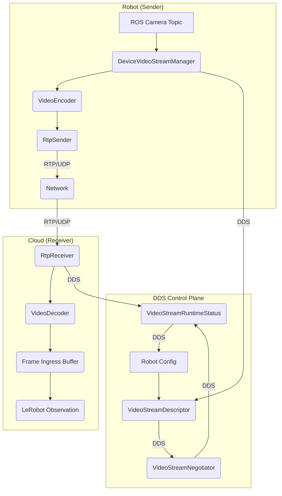
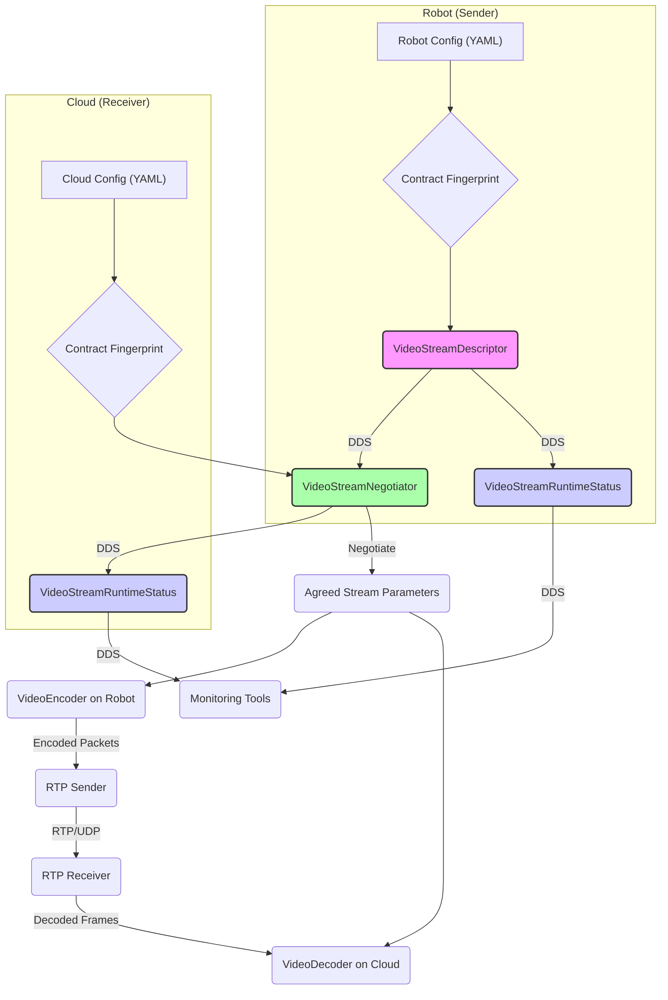

# 观测视频传输（RTP/H.264）

相关源码文件

以下文件被用作生成此 wiki 页面的上下文：

- [docs/observation_video_streaming.md](https://atomgit.com/openeuler/IB_Robot/blob/openEuler-26.09/docs/observation_video_streaming.md)
- [src/benchmark/benchmark_runtime/benchmark_runtime/environment_node.py](https://atomgit.com/openeuler/IB_Robot/blob/openEuler-26.09/src/benchmark/benchmark_runtime/benchmark_runtime/environment_node.py)
- [src/benchmark/benchmark_runtime/benchmark_runtime/evaluator_node.py](https://atomgit.com/openeuler/IB_Robot/blob/openEuler-26.09/src/benchmark/benchmark_runtime/benchmark_runtime/evaluator_node.py)
- [src/benchmark/benchmark_runtime/benchmark_runtime/io_descriptor.py](https://atomgit.com/openeuler/IB_Robot/blob/openEuler-26.09/src/benchmark/benchmark_runtime/benchmark_runtime/io_descriptor.py)
- [src/ibrobot_msgs/msg/VideoStreamDescriptor.msg](https://atomgit.com/openeuler/IB_Robot/blob/openEuler-26.09/src/ibrobot_msgs/msg/VideoStreamDescriptor.msg)
- [src/inference_service/inference_service/ascend_ffmpeg_video_codec.py](https://atomgit.com/openeuler/IB_Robot/blob/openEuler-26.09/src/inference_service/inference_service/ascend_ffmpeg_video_codec.py)
- [src/inference_service/inference_service/distributed/video_streams.py](https://atomgit.com/openeuler/IB_Robot/blob/openEuler-26.09/src/inference_service/inference_service/distributed/video_streams.py)
- [src/inference_service/inference_service/nvidia_video_codec.py](https://atomgit.com/openeuler/IB_Robot/blob/openEuler-26.09/src/inference_service/inference_service/nvidia_video_codec.py)
- [src/inference_service/inference_service/video_codec.py](https://atomgit.com/openeuler/IB_Robot/blob/openEuler-26.09/src/inference_service/inference_service/video_codec.py)
- [src/inference_service/tests/test_ascend_ffmpeg_video_codec.py](https://atomgit.com/openeuler/IB_Robot/blob/openEuler-26.09/src/inference_service/tests/test_ascend_ffmpeg_video_codec.py)
- [src/inference_service/tests/test_device_video_streams.py](https://atomgit.com/openeuler/IB_Robot/blob/openEuler-26.09/src/inference_service/tests/test_device_video_streams.py)
- [src/inference_service/tests/test_nvidia_video_codec.py](https://atomgit.com/openeuler/IB_Robot/blob/openEuler-26.09/src/inference_service/tests/test_nvidia_video_codec.py)
- [src/inference_service/tests/test_software_video_codec.py](https://atomgit.com/openeuler/IB_Robot/blob/openEuler-26.09/src/inference_service/tests/test_software_video_codec.py)
- [src/inference_service/tests/test_video_stream_protocol.py](https://atomgit.com/openeuler/IB_Robot/blob/openEuler-26.09/src/inference_service/tests/test_video_stream_protocol.py)
- [src/observation_transport/observation_transport/__init__.py](https://atomgit.com/openeuler/IB_Robot/blob/openEuler-26.09/src/observation_transport/observation_transport/__init__.py)
- [src/observation_transport/observation_transport/ascend_ffmpeg_video_codec.py](https://atomgit.com/openeuler/IB_Robot/blob/openEuler-26.09/src/observation_transport/observation_transport/ascend_ffmpeg_video_codec.py)
- [src/observation_transport/observation_transport/frame_ingress.py](https://atomgit.com/openeuler/IB_Robot/blob/openEuler-26.09/src/observation_transport/observation_transport/frame_ingress.py)
- [src/observation_transport/observation_transport/native_frame_ingress.py](https://atomgit.com/openeuler/IB_Robot/blob/openEuler-26.09/src/observation_transport/observation_transport/native_frame_ingress.py)
- [src/observation_transport/observation_transport/nvidia_video_codec.py](https://atomgit.com/openeuler/IB_Robot/blob/openEuler-26.09/src/observation_transport/observation_transport/nvidia_video_codec.py)
- [src/observation_transport/observation_transport/rtp_sender.py](https://atomgit.com/openeuler/IB_Robot/blob/openEuler-26.09/src/observation_transport/observation_transport/rtp_sender.py)
- [src/observation_transport/observation_transport/software_video_codec.py](https://atomgit.com/openeuler/IB_Robot/blob/openEuler-26.09/src/observation_transport/observation_transport/software_video_codec.py)
- [src/robot_config/config/robots/so101_rtp_distributed.yaml](https://atomgit.com/openeuler/IB_Robot/blob/openEuler-26.09/src/robot_config/config/robots/so101_rtp_distributed.yaml)
- [src/robot_config/test/test_observation_transport_config.py](https://atomgit.com/openeuler/IB_Robot/blob/openEuler-26.09/src/robot_config/test/test_observation_transport_config.py)

本页面详述 RoboFrame 框架内使用 RTP/H.264 的视频观测传输实现。该机制旨在降低相机观测的网络带宽占用，特别是在分布式推理场景下，同时保持时间戳同步与多相机对齐。内容覆盖视频编解码器、流管理器，以及机器人（发送端）与推理服务（接收端）之间的协商过程。

## 概述

系统支持将相机观测从 DDS 张量传输切换为 H.264 RTP/UDP 视频流。这对分布式推理（`execution_mode: distributed`）与多相机高分辨率观测尤其有利，因为此时网络带宽可能成为瓶颈。非图像观测（如 `observation.state`）、会话协商、时间戳映射与心跳仍使用 DDS。

架构包括：

*   **机器人（发送端）**：采样相机话题，将其编码为 H.264（使用硬件或软件编解码器），并通过 RTP/UDP 流式传输到云端。
*   **云端（接收端）**：解码 H.264 流（使用硬件或软件编解码器），依据推理请求时间戳从环形缓冲取帧，并组装为 LeRobot 观测。

RTP 视频传输的配置定义于机器人 YAML 的 `contract.observations` 部分，如 `so101_rtp_distributed.yaml` 所示 [src/robot_config/config/robots/so101_rtp_distributed.yaml:1-583](https://atomgit.com/openeuler/IB_Robot/blob/openEuler-26.09/src/robot_config/config/robots/so101_rtp_distributed.yaml#L1-L583)。关键参数包括 `mode: rtp`、`stream_id`、`endpoint`（主机与端口）、`encoder_backend`、`decoder_backend`、H.264 特定设置（`bitrate_bps`、`gop_frames`）、媒体属性（`width`、`height`、`frame_rate_hz`、`pixel_format`）、缓冲大小与就绪超时。

来源：[docs/observation_video_streaming.md:1-16], [src/robot_config/config/robots/so101_rtp_distributed.yaml:1-584]

## 视频编解码器

RoboFrame 支持多种 H.264 编码器与解码器后端，允许跨硬件平台灵活部署。`VideoCodecRegistry` [src/inference_service/inference_service/video_codec.py](https://atomgit.com/openeuler/IB_Robot/blob/openEuler-26.09/src/inference_service/inference_service/video_codec.py) 管理这些编解码器的注册与解析。

### 编解码器生命周期与指标

所有编解码器遵循由 `VideoEncoder` 与 `VideoDecoder` 定义的通用接口 [src/inference_service/inference_service/video_codec.py](https://atomgit.com/openeuler/IB_Robot/blob/openEuler-26.09/src/inference_service/inference_service/video_codec.py)。它们暴露 `state` 属性（`CodecLifecycleState.RUNNING`、`CodecLifecycleState.CLOSED`、`CodecLifecycleState.FAILED`）与用于性能监控的 `metrics`（`CodecMetrics`）[src/inference_service/inference_service/video_codec.py](https://atomgit.com/openeuler/IB_Robot/blob/openEuler-26.09/src/inference_service/inference_service/video_codec.py)，包括输入/输出帧数、包数与错误数。编解码器可被复位以处理新的时间戳纪元 [src/inference_service/tests/test_software_video_codec.py:100-109](https://atomgit.com/openeuler/IB_Robot/blob/openEuler-26.09/src/inference_service/tests/test_software_video_codec.py#L100-L109)。

### 软件编解码器（`software`）

软件编解码器通过 PyAV 使用 `libx264` 在 CPU 上进行 H.264 编解码。

*   **依赖**：PyAV 15.1.0+ [docs/observation_video_streaming.md:196-197](https://atomgit.com/openeuler/IB_Robot/blob/openEuler-26.09/docs/observation_video_streaming.md#L196-L197)。
*   **特点**：基于 CPU，无需 GPU。提供良好的编码质量与压缩比，但 CPU 占用较高 [docs/observation_video_streaming.md:198-202](https://atomgit.com/openeuler/IB_Robot/blob/openEuler-26.09/docs/observation_video_streaming.md#L198-L202)。
*   **实现**：`SoftwareH264Encoder` 与 `SoftwareH264Decoder` [src/observation_transport/observation_transport/software_video_codec.py](https://atomgit.com/openeuler/IB_Robot/blob/openEuler-26.09/src/observation_transport/observation_transport/software_video_codec.py)。
*   **注册**：通过 `register_software_backend` 注册到 `VideoCodecRegistry` [src/observation_transport/observation_transport/software_video_codec.py](https://atomgit.com/openeuler/IB_Robot/blob/openEuler-26.09/src/observation_transport/observation_transport/software_video_codec.py)。

来源：[docs/observation_video_streaming.md:193-202], [src/inference_service/inference_service/video_codec.py](https://atomgit.com/openeuler/IB_Robot/blob/openEuler-26.09/src/inference_service/inference_service/video_codec.py), [src/inference_service/tests/test_software_video_codec.py:16-50], [src/inference_service/tests/test_software_video_codec.py:100-109], [src/observation_transport/observation_transport/software_video_codec.py](https://atomgit.com/openeuler/IB_Robot/blob/openEuler-26.09/src/observation_transport/observation_transport/software_video_codec.py)

### NVIDIA 编解码器（`nvidia`）

NVIDIA 编解码器利用带 NVENC 的 NVIDIA GPU 进行硬件加速 H.264 编码。

*   **依赖**：NVIDIA GPU（支持 NVENC）、NVIDIA 驱动（`libnvidia-encode.so`）、PyAV 15.1.0+ [docs/observation_video_streaming.md:174-178](https://atomgit.com/openeuler/IB_Robot/blob/openEuler-26.09/docs/observation_video_streaming.md#L174-L178)。
*   **特点**：硬件加速，CPU 占用低，适合配备 NVIDIA GPU 的机器人。相比软件编解码器提供更好的编码质量与码率控制 [docs/observation_video_streaming.md:179-182](https://atomgit.com/openeuler/IB_Robot/blob/openEuler-26.09/docs/observation_video_streaming.md#L179-L182)。
*   **实现**：`NvidiaH264Encoder` 与 `NvidiaH264Decoder` [src/observation_transport/observation_transport/nvidia_video_codec.py](https://atomgit.com/openeuler/IB_Robot/blob/openEuler-26.09/src/observation_transport/observation_transport/nvidia_video_codec.py)。
*   **注册**：通过 `register_nvidia_backend` 注册到 `VideoCodecRegistry` [src/observation_transport/observation_transport/nvidia_video_codec.py](https://atomgit.com/openeuler/IB_Robot/blob/openEuler-26.09/src/observation_transport/observation_transport/nvidia_video_codec.py)。`probe_nvidia_codec` 函数 [src/observation_transport/observation_transport/nvidia_video_codec.py](https://atomgit.com/openeuler/IB_Robot/blob/openEuler-26.09/src/observation_transport/observation_transport/nvidia_video_codec.py) 检查硬件加速能力。

来源：[docs/observation_video_streaming.md:171-191], [src/inference_service/tests/test_nvidia_video_codec.py:13-17], [src/observation_transport/observation_transport/nvidia_video_codec.py](https://atomgit.com/openeuler/IB_Robot/blob/openEuler-26.09/src/observation_transport/observation_transport/nvidia_video_codec.py)

### Ascend FFmpeg 编解码器（`ascend`）

Ascend FFmpeg 编解码器利用 Ascend NPU（如 310P/310B），通过 FFmpeg 的 DVPP（数字视频处理平台）支持进行硬件加速 H.264 解码。

*   **依赖**：Ascend 310P/310B NPU、支持 `h264_ascend` 的 Ascend FFmpeg 构建、CANN toolkit [docs/observation_video_streaming.md:203-206](https://atomgit.com/openeuler/IB_Robot/blob/openEuler-26.09/docs/observation_video_streaming.md#L203-L206)。
*   **特点**：硬件加速解码，CPU 占用低，为 Ascend 平台优化。
*   **实现**：`AscendFfmpegH264Decoder` 与 `AscendFfmpegH264Encoder` [src/observation_transport/observation_transport/ascend_ffmpeg_video_codec.py:17-18](https://atomgit.com/openeuler/IB_Robot/blob/openEuler-26.09/src/observation_transport/observation_transport/ascend_ffmpeg_video_codec.py#L17-L18)。
*   **FFmpeg 解析**：`resolve_ascend_ffmpeg` 函数 [src/observation_transport/observation_transport/ascend_ffmpeg_video_codec.py:85-100](https://atomgit.com/openeuler/IB_Robot/blob/openEuler-26.09/src/observation_transport/observation_transport/ascend_ffmpeg_video_codec.py#L85-L100) 考虑显式配置与已知私有路径，找到合适的 FFmpeg 二进制。
*   **环境隔离**：`build_ascend_child_environment` [src/observation_transport/observation_transport/ascend_ffmpeg_video_codec.py:122-157](https://atomgit.com/openeuler/IB_Robot/blob/openEuler-26.09/src/observation_transport/observation_transport/ascend_ffmpeg_video_codec.py#L122-L157) 为 FFmpeg 子进程创建隔离环境，防止与继承的 CANN 安装路径冲突。这对 RPM 安装的 `ffmpeg-ascend` 运行时至关重要 [src/observation_transport/observation_transport/ascend_ffmpeg_video_codec.py:103-120](https://atomgit.com/openeuler/IB_Robot/blob/openEuler-26.09/src/observation_transport/observation_transport/ascend_ffmpeg_video_codec.py#L103-L120)。
*   **注册**：通过 `register_ascend_backend` 注册到 `VideoCodecRegistry` [src/observation_transport/observation_transport/ascend_ffmpeg_video_codec.py](https://atomgit.com/openeuler/IB_Robot/blob/openEuler-26.09/src/observation_transport/observation_transport/ascend_ffmpeg_video_codec.py)（经由 `inference_service.ascend_ffmpeg_video_codec` 别名隐式完成 [src/inference_service/inference_service/ascend_ffmpeg_video_codec.py:1-7](https://atomgit.com/openeuler/IB_Robot/blob/openEuler-26.09/src/inference_service/inference_service/ascend_ffmpeg_video_codec.py#L1-L7)）。
*   **探测**：`probe_ascend_codec_diagnostic` [src/observation_transport/observation_transport/ascend_ffmpeg_video_codec.py:160-180](https://atomgit.com/openeuler/IB_Robot/blob/openEuler-26.09/src/observation_transport/observation_transport/ascend_ffmpeg_video_codec.py#L160-L180) 检查编解码器可用性并提供诊断信息。

来源：[docs/observation_video_streaming.md:203-206], [src/inference_service/inference_service/ascend_ffmpeg_video_codec.py:1-7], [src/inference_service/tests/test_ascend_ffmpeg_video_codec.py:17-18], [src/inference_service/tests/test_ascend_ffmpeg_video_codec.py:179-197], [src/observation_transport/observation_transport/ascend_ffmpeg_video_codec.py:17-18], [src/observation_transport/observation_transport/ascend_ffmpeg_video_codec.py:85-100], [src/observation_transport/observation_transport/ascend_ffmpeg_video_codec.py:103-120], [src/observation_transport/observation_transport/ascend_ffmpeg_video_codec.py:122-157], [src/observation_transport/observation_transport/ascend_ffmpeg_video_codec.py:160-180]

## 设备与计算流管理器

机器人侧的 `DeviceVideoStreamManager` [src/inference_service/inference_service/device_video_streams.py:9](https://atomgit.com/openeuler/IB_Robot/blob/openEuler-26.09/src/inference_service/inference_service/device_video_streams.py#L9) 与计算（推理服务）侧的 `VideoStreamNegotiator` [src/inference_service/inference_service/distributed/video_streams.py:23](https://atomgit.com/openeuler/IB_Robot/blob/openEuler-26.09/src/inference_service/inference_service/distributed/video_streams.py#L23) 负责管理视频流。

### DeviceVideoStreamManager（机器人侧）

`DeviceVideoStreamManager` [src/inference_service/inference_service/device_video_streams.py:9](https://atomgit.com/openeuler/IB_Robot/blob/openEuler-26.09/src/inference_service/inference_service/device_video_streams.py#L9) 处理机器人侧视频帧的编码与发送。

*   **初始化**：接收 `pipeline_id`、`contract_fingerprint`、`deployment_fingerprint`、`observation_specs`、`codec_registry` 与 `sender_factory` [src/inference_service/tests/test_device_video_streams.py:162-168](https://atomgit.com/openeuler/IB_Robot/blob/openEuler-26.09/src/inference_service/tests/test_device_video_streams.py#L162-L168)。
*   **帧提交**：`submit_ros_image` [src/inference_service/tests/test_device_video_streams.py:181-187](https://atomgit.com/openeuler/IB_Robot/blob/openEuler-26.09/src/inference_service/tests/test_device_video_streams.py#L181-L187) 接收 ROS 图像消息，转换为 `VideoFrame` 对象并入队等待编码。
*   **编码与发送**：使用配置的 `VideoEncoder` 将帧编码为 `EncodedPacket`，再由 `RtpSender` 打包并通过 UDP 发送。
*   **会话绑定**：`bind_session` [src/inference_service/tests/test_device_video_streams.py:208-214](https://atomgit.com/openeuler/IB_Robot/blob/openEuler-26.09/src/inference_service/tests/test_device_video_streams.py#L208-L214) 将管理器关联到特定推理会话。
*   **状态上报**：提供 `VideoStreamRuntimeStatus` [src/inference_service/inference_service/distributed/video_streams.py:83-182](https://atomgit.com/openeuler/IB_Robot/blob/openEuler-26.09/src/inference_service/inference_service/distributed/video_streams.py#L83-L182)，包含已编码帧、已发包与队列深度等指标。

### VideoStreamNegotiator（计算侧）

计算侧的 `VideoStreamNegotiator` [src/inference_service/inference_service/distributed/video_streams.py:23](https://atomgit.com/openeuler/IB_Robot/blob/openEuler-26.09/src/inference_service/inference_service/distributed/video_streams.py#L23) 管理视频流的接收与解码。

*   **协商**：使用 `StreamNegotiationRequirements` 与 `VideoTransportCapabilities` [src/inference_service/inference_service/distributed/video_streams.py:21-22](https://atomgit.com/openeuler/IB_Robot/blob/openEuler-26.09/src/inference_service/inference_service/distributed/video_streams.py#L21-L22) 与机器人协商流参数。
*   **描述符处理**：`observe_descriptor` [src/inference_service/tests/test_video_stream_protocol.py:153](https://atomgit.com/openeuler/IB_Robot/blob/openEuler-26.09/src/inference_service/tests/test_video_stream_protocol.py#L153) 处理来自机器人的 `VideoStreamDescriptor` 消息，其中包含流配置细节。
*   **请求校验**：`validate_request` [src/inference_service/tests/test_video_stream_protocol.py:155](https://atomgit.com/openeuler/IB_Robot/blob/openEuler-26.09/src/inference_service/tests/test_video_stream_protocol.py#L155) 确保传入的推理请求在已协商流下有效。
*   **复位**：协商器可为新会话复位，使旧描述符与世代失效 [src/inference_service/tests/test_video_stream_protocol.py:180-187](https://atomgit.com/openeuler/IB_Robot/blob/openEuler-26.09/src/inference_service/tests/test_video_stream_protocol.py#L180-L187)。

### 数据流

视频观测的整体数据流如下：

**图：视频流数据流**

来源：[src/inference_service/inference_service/device_video_streams.py:9], [src/inference_service/inference_service/distributed/video_streams.py:21-23], [src/inference_service/inference_service/distributed/video_streams.py:83-182], [src/inference_service/tests/test_device_video_streams.py:162-168], [src/inference_service/tests/test_device_video_streams.py:181-187], [src/inference_service/tests/test_device_video_streams.py:208-214], [src/inference_service/tests/test_video_stream_protocol.py:153], [src/inference_service/tests/test_video_stream_protocol.py:155], [src/inference_service/tests/test_video_stream_protocol.py:180-187]

## RTP/H.264 传输细节

RTP 传输遵循 RFC 6184 的 H.264 打包规范。

### RTP 包结构

`RtpPacket` dataclass [src/observation_transport/observation_transport/rtp_sender.py:102-110](https://atomgit.com/openeuler/IB_Robot/blob/openEuler-26.09/src/observation_transport/observation_transport/rtp_sender.py#L102-L110) 定义 RTP 包结构，包括 payload type、marker 位、序列号、时间戳、SSRC 与 payload。它还包括一个私有扩展，用于原始采集时间戳（纳秒）[src/observation_transport/observation_transport/rtp_sender.py:24-26](https://atomgit.com/openeuler/IB_Robot/blob/openEuler-26.09/src/observation_transport/observation_transport/rtp_sender.py#L24-L26)。

*   `to_bytes` [src/observation_transport/observation_transport/rtp_sender.py:123-134](https://atomgit.com/openeuler/IB_Robot/blob/openEuler-26.09/src/observation_transport/observation_transport/rtp_sender.py#L123-L134) 序列化数据包。
*   `from_bytes` [src/observation_transport/observation_transport/rtp_sender.py:137-167](https://atomgit.com/openeuler/IB_Robot/blob/openEuler-26.09/src/observation_transport/observation_transport/rtp_sender.py#L137-L167) 反序列化数据包，处理 RTP 头解析、CSRC 列表与自定义采集时间戳扩展。

### H.264 打包模式

支持两种打包模式 [src/observation_transport/observation_transport/rtp_sender.py:35-37](https://atomgit.com/openeuler/IB_Robot/blob/openEuler-26.09/src/observation_transport/observation_transport/rtp_sender.py#L35-L37)：

1.  **`rfc6184`**：默认模式，每个数据报保持在路径 MTU 以内，使用单一 NAL 单元或 FU-A 包 [src/observation_transport/observation_transport/rtp_sender.py:35](https://atomgit.com/openeuler/IB_Robot/blob/openEuler-26.09/src/observation_transport/observation_transport/rtp_sender.py#L35)。
2.  **`access_unit`**：每个 RTP 数据报发送一个完整的 Annex-B 访问单元，依赖 IP 层分片。该模式 CPU 开销更低，但仅适用于不丢弃 IP 分片的可信局域网 [docs/observation_video_streaming.md:83-91](https://atomgit.com/openeuler/IB_Robot/blob/openEuler-26.09/docs/observation_video_streaming.md#L83-L91)。若访问单元超过最大 UDP payload 大小（约 64KB），自动回退到 `rfc6184` 分片 [docs/observation_video_streaming.md:92-93](https://atomgit.com/openeuler/IB_Robot/blob/openEuler-26.09/docs/observation_video_streaming.md#L92-L93)。

`packetize_h264` 与 `packetize_h264_datagrams` 函数 [src/observation_transport/observation_transport/rtp_sender.py:170-190](https://atomgit.com/openeuler/IB_Robot/blob/openEuler-26.09/src/observation_transport/observation_transport/rtp_sender.py#L170-L190) 按所选模式将 `EncodedPacket` 转换为 RTP 数据报。

来源：[docs/observation_video_streaming.md:83-93], [src/observation_transport/observation_transport/rtp_sender.py:24-26], [src/observation_transport/observation_transport/rtp_sender.py:35-37], [src/observation_transport/observation_transport/rtp_sender.py:102-110], [src/observation_transport/observation_transport/rtp_sender.py:123-134], [src/observation_transport/observation_transport/rtp_sender.py:137-167], [src/observation_transport/observation_transport/rtp_sender.py:170-190]

## 流协商

流协商是建立机器人与推理服务之间稳定视频链路的关键阶段。它通过 DDS 进行，确保双方就视频流参数达成一致。

### `VideoStreamDescriptor`

`VideoStreamDescriptor` [src/inference_service/inference_service/distributed/video_streams.py:25-49](https://atomgit.com/openeuler/IB_Robot/blob/openEuler-26.09/src/inference_service/inference_service/distributed/video_streams.py#L25-L49) 是封装视频流全部必要信息的 dataclass，包括：

*   `protocol_version`、`pipeline_id`、`session_id`、`session_generation`
*   `observation_key`、`stream_id`
*   `endpoint_host`、`endpoint_port`、`ssrc`、`payload_type`
*   `codec`、`codec_profile`、`width`、`height`、`frame_rate_hz`、`rtp_clock_rate`、`pixel_format`、`color_space`、`color_range`
*   `encoder_backend`、`contract_fingerprint`、`deployment_fingerprint`
*   `packetization` 模式（`rfc6184` 或 `access_unit`）

该描述符通过 DDS 从机器人发送到云端。

### 协商过程

`negotiate_video_streams` 函数 [src/inference_service/inference_service/distributed/video_streams.py:400-401](https://atomgit.com/openeuler/IB_Robot/blob/openEuler-26.09/src/inference_service/inference_service/distributed/video_streams.py#L400-L401)（以及 `VideoStreamNegotiator` [src/inference_service/inference_service/distributed/video_streams.py:23](https://atomgit.com/openeuler/IB_Robot/blob/openEuler-26.09/src/inference_service/inference_service/distributed/video_streams.py#L23)）执行协商。

1.  **需求与能力**：计算侧提供 `StreamNegotiationRequirements` 与 `VideoTransportCapabilities` [src/inference_service/inference_service/distributed/video_streams.py:21-22](https://atomgit.com/openeuler/IB_Robot/blob/openEuler-26.09/src/inference_service/inference_service/distributed/video_streams.py#L21-L22)。
2.  **描述符匹配**：协商器尝试将来自机器人的 `VideoStreamDescriptor` 与其需求和能力匹配。
3.  **指纹校验**：机器人与云端的 `contract_fingerprint` 与 `deployment_fingerprint` 必须匹配，以确保配置一致 [src/inference_service/tests/test_video_stream_protocol.py:84-87](https://atomgit.com/openeuler/IB_Robot/blob/openEuler-26.09/src/inference_service/tests/test_video_stream_protocol.py#L84-L87)。
4.  **参数校验**：校验 `VideoStreamDescriptor` 的所有字段。`protocol_version`、`session_generation`、`stream_id`、`packetization` 不匹配或不支持 `decoder_backend` 将导致 `StreamNegotiationError` [src/inference_service/tests/test_video_stream_protocol.py:91-117](https://atomgit.com/openeuler/IB_Robot/blob/openEuler-26.09/src/inference_service/tests/test_video_stream_protocol.py#L91-L117)。
5.  **DDS 兼容性**：若 `transport_mode` 为 `dds`，则不协商任何视频流，且任何 RTP 描述符都会被拒绝 [src/inference_service/tests/test_video_stream_protocol.py:120-127](https://atomgit.com/openeuler/IB_Robot/blob/openEuler-26.09/src/inference_service/tests/test_video_stream_protocol.py#L120-L127)。
6.  **迟到描述符发现**：协商器可处理随时间发现的流，但会拒绝意外迟到的描述符 [src/inference_service/tests/test_video_stream_protocol.py:143-177](https://atomgit.com/openeuler/IB_Robot/blob/openEuler-26.09/src/inference_service/tests/test_video_stream_protocol.py#L143-L177)。

### `VideoStreamRuntimeStatus`

机器人（发送端）与云端（接收端）都通过 DDS 发布 `VideoStreamRuntimeStatus` 消息 [src/inference_service/inference_service/distributed/video_streams.py:83-182](https://atomgit.com/openeuler/IB_Robot/blob/openEuler-26.09/src/inference_service/inference_service/distributed/video_streams.py#L83-L182)。这些消息提供每个视频流的实时指标与生命周期状态，用于监控与调试。关键字段包括：

*   `lifecycle_state`（如 `ready`、`waiting_for_keyframe`、`failed`）[src/observation_transport/observation_transport/rtp_sender.py:40-48](https://atomgit.com/openeuler/IB_Robot/blob/openEuler-26.09/src/observation_transport/observation_transport/rtp_sender.py#L40-L48)
*   `ready` 状态
*   `selected_backend`
*   `timestamp_mapping_valid`、`mapping_rtp_timestamp`、`mapping_capture_timestamp_ns`
*   `keyframe_ready`
*   `encoded_frames`、`decoded_frames`、`sent_packets`、`received_packets`、`dropped_frames`、`lost_packets`、队列深度与 `reconnect_count` 计数器 [src/inference_service/inference_service/distributed/video_streams.py:98-114](https://atomgit.com/openeuler/IB_Robot/blob/openEuler-26.09/src/inference_service/inference_service/distributed/video_streams.py#L98-L114)。

**图：流协商与状态流**

来源：[src/inference_service/inference_service/distributed/video_streams.py:23], [src/inference_service/inference_service/distributed/video_streams.py:25-49], [src/inference_service/inference_service/distributed/video_streams.py:83-182], [src/inference_service/inference_service/distributed/video_streams.py:400-401], [src/inference_service/tests/test_video_stream_protocol.py:84-87], [src/inference_service/tests/test_video_stream_protocol.py:91-117], [src/inference_service/tests/test_video_stream_protocol.py:120-127], [src/inference_service/tests/test_video_stream_protocol.py:143-177], [src/observation_transport/observation_transport/rtp_sender.py:40-48]
