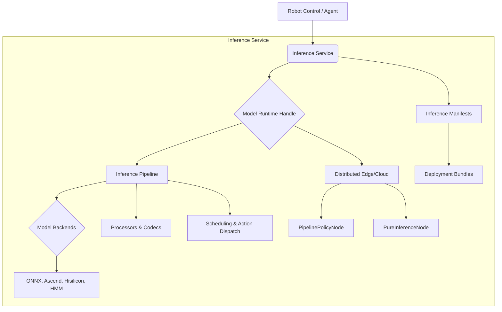
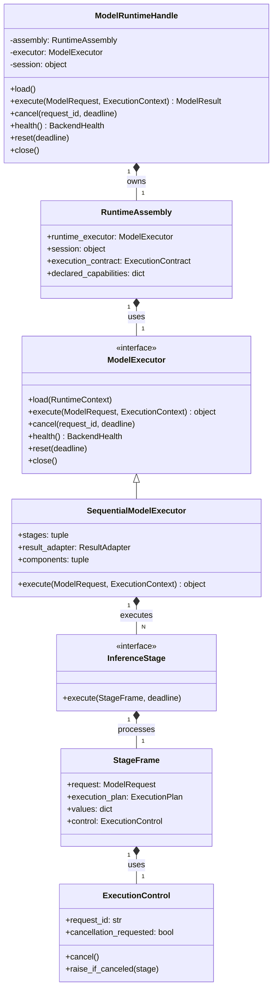

# 推理服务概述

相关源码文件

以下文件被用作生成此 wiki 页面的上下文：

- [src/inference_service/inference_service/pipeline/executor.py](https://atomgit.com/openeuler/IB_Robot/blob/openEuler-26.09/src/inference_service/inference_service/pipeline/executor.py)
- [src/inference_service/inference_service/pipeline/factory.py](https://atomgit.com/openeuler/IB_Robot/blob/openEuler-26.09/src/inference_service/inference_service/pipeline/factory.py)
- [src/inference_service/inference_service/pipeline/runtime.py](https://atomgit.com/openeuler/IB_Robot/blob/openEuler-26.09/src/inference_service/inference_service/pipeline/runtime.py)
- [src/inference_service/inference_service/pipeline/runtime_core.py](https://atomgit.com/openeuler/IB_Robot/blob/openEuler-26.09/src/inference_service/inference_service/pipeline/runtime_core.py)
- [src/inference_service/inference_service/pipeline/stages.py](https://atomgit.com/openeuler/IB_Robot/blob/openEuler-26.09/src/inference_service/inference_service/pipeline/stages.py)
- [src/inference_service/inference_service/unified_runtime/handle.py](https://atomgit.com/openeuler/IB_Robot/blob/openEuler-26.09/src/inference_service/inference_service/unified_runtime/handle.py)
- [src/inference_service/tests/test_native_runtime_pipeline.py](https://atomgit.com/openeuler/IB_Robot/blob/openEuler-26.09/src/inference_service/tests/test_native_runtime_pipeline.py)
- [src/inference_service/tests/test_runtime_migration.py](https://atomgit.com/openeuler/IB_Robot/blob/openEuler-26.09/src/inference_service/tests/test_runtime_migration.py)
- [src/perception_service/perception_service/graspgen_session.py](https://atomgit.com/openeuler/IB_Robot/blob/openEuler-26.09/src/perception_service/perception_service/graspgen_session.py)
- [src/perception_service/perception_service/sam2_automatic_ascend_session.py](https://atomgit.com/openeuler/IB_Robot/blob/openEuler-26.09/src/perception_service/perception_service/sam2_automatic_ascend_session.py)

推理服务负责执行机器学习模型，涵盖从定义模型流水线到管理跨边缘与云端环境的分布式推理。它为多种模型后端提供统一运行时，并通过 manifest 驱动的系统管理模型部署的生命周期。

本节提供推理服务核心组件及其交互的高层概览。关于每个主题的详细信息，请参阅链接的子页面。

## 推理服务概览

推理服务编排机器学习模型的执行，将原始传感器数据转化为机器人动作。它围绕 `InferencePipeline` [src/inference_service/inference_service/pipeline/runtime.py:3-4](https://atomgit.com/openeuler/IB_Robot/blob/openEuler-26.09/src/inference_service/inference_service/pipeline/runtime.py#L3-L4) 的概念构建，该流水线封装从观测预处理到模型输出后处理的整个推理过程。该流水线利用统一的 `ModelRuntimeHandle` [src/inference_service/inference_service/unified_runtime/handle.py:15-16](https://atomgit.com/openeuler/IB_Robot/blob/openEuler-26.09/src/inference_service/inference_service/unified_runtime/handle.py#L15-L16) 跨不同后端与部署策略管理模型执行。

推理服务的一个关键方面是支持多样的模型架构与部署场景，包括边缘设备上的本地执行以及涉及云端资源的分布式推理。这种灵活性通过分离模型加载、执行与数据处理等关注点的模块化设计实现。该服务依赖 `inference_manifest` [src/inference_service/inference_service/pipeline/factory.py:9-19](https://atomgit.com/openeuler/IB_Robot/blob/openEuler-26.09/src/inference_service/inference_service/pipeline/factory.py#L9-L19) 定义模型部署及其关联配置，确保全系统的一致性与完整性。

下图展示推理服务的高层组件：

来源：[src/inference_service/inference_service/pipeline/runtime.py:3-4](https://atomgit.com/openeuler/IB_Robot/blob/openEuler-26.09/src/inference_service/inference_service/pipeline/runtime.py#L3-L4), [src/inference_service/inference_service/unified_runtime/handle.py:15-16](https://atomgit.com/openeuler/IB_Robot/blob/openEuler-26.09/src/inference_service/inference_service/unified_runtime/handle.py#L15-L16), [src/inference_service/inference_service/pipeline/factory.py:9-19](https://atomgit.com/openeuler/IB_Robot/blob/openEuler-26.09/src/inference_service/inference_service/pipeline/factory.py#L9-L19)

### 流水线运行时与处理器

推理服务的核心是 `InferencePipeline` [src/inference_service/inference_service/pipeline/runtime.py:3-4](https://atomgit.com/openeuler/IB_Robot/blob/openEuler-26.09/src/inference_service/inference_service/pipeline/runtime.py#L3-L4)，它通过一系列阶段编排模型的执行。这些阶段由 `SequentialModelExecutor` [src/inference_service/inference_service/pipeline/executor.py:161-167](https://atomgit.com/openeuler/IB_Robot/blob/openEuler-26.09/src/inference_service/inference_service/pipeline/executor.py#L161-L167) 与 `StagedModelExecutor` [src/inference_service/inference_service/pipeline/staged_executor.py:1-2](https://atomgit.com/openeuler/IB_Robot/blob/openEuler-26.09/src/inference_service/inference_service/pipeline/staged_executor.py#L1-L2) 等执行器管理，后者定义数据与计算的流动。处理器负责数据变换，编解码器管理各类模型输入输出的数据编码与解码。`ModelRuntimeHandle` [src/inference_service/inference_service/unified_runtime/handle.py:15-16](https://atomgit.com/openeuler/IB_Robot/blob/openEuler-26.09/src/inference_service/inference_service/unified_runtime/handle.py#L15-L16) 为与这些流水线交互提供统一接口，抽象掉不同后端与执行策略的复杂性。

详情见 [流水线运行时与处理器](./pipeline_runtime_processors.md)。

来源：[src/inference_service/inference_service/pipeline/runtime.py:3-4](https://atomgit.com/openeuler/IB_Robot/blob/openEuler-26.09/src/inference_service/inference_service/pipeline/runtime.py#L3-L4), [src/inference_service/inference_service/pipeline/executor.py:161-167](https://atomgit.com/openeuler/IB_Robot/blob/openEuler-26.09/src/inference_service/inference_service/pipeline/executor.py#L161-L167), [src/inference_service/inference_service/pipeline/staged_executor.py:1-2](https://atomgit.com/openeuler/IB_Robot/blob/openEuler-26.09/src/inference_service/inference_service/pipeline/staged_executor.py#L1-L2), [src/inference_service/inference_service/unified_runtime/handle.py:15-16](https://atomgit.com/openeuler/IB_Robot/blob/openEuler-26.09/src/inference_service/inference_service/unified_runtime/handle.py#L15-L16)

### 分布式边缘/云端推理

推理服务支持分布式推理，允许模型跨边缘设备与云端资源的组合执行。这通过不同的节点类型实现：用于本地策略执行的 `PipelinePolicyNode` 与将计算卸载到云端的 `PureInferenceNode`。握手与会话协议确保这些分布式组件之间的无缝通信与数据传输。云端 launch 文件与 `pure_inference_engine` 管理云端环境中模型的部署与执行。

详情见 [分布式边缘/云端推理](./distributed_edge_cloud_inference.md)。

来源：[src/inference_service/inference_service/core/pure_inference_engine.py](https://atomgit.com/openeuler/IB_Robot/blob/openEuler-26.09/src/inference_service/inference_service/core/pure_inference_engine.py) (Implicitly referenced by "pure_inference_engine")

### 后端与模型会话

推理服务集成多种模型后端，包括 ONNX、Ascend、Hisilicon 与 HMM。每个后端提供 `ModelSession` [src/inference_service/inference_service/model_sessions/ascend.py:1-2](https://atomgit.com/openeuler/IB_Robot/blob/openEuler-26.09/src/inference_service/inference_service/model_sessions/ascend.py#L1-L2) 实现（如 `AscendOmModelSession` [src/inference_service/inference_service/model_sessions/ascend.py:1-2](https://atomgit.com/openeuler/IB_Robot/blob/openEuler-26.09/src/inference_service/inference_service/model_sessions/ascend.py#L1-L2)、`HisiliconModelSession` [src/inference_service/inference_service/model_sessions/hisilicon.py:1-2](https://atomgit.com/openeuler/IB_Robot/blob/openEuler-26.09/src/inference_service/inference_service/model_sessions/hisilicon.py#L1-L2)、`HMMModelSession` [src/inference_service/inference_service/model_sessions/hmm.py:1-2](https://atomgit.com/openeuler/IB_Robot/blob/openEuler-26.09/src/inference_service/inference_service/model_sessions/hmm.py#L1-L2)、`LeRobotTorchModelSession` [src/inference_service/inference_service/model_sessions/lerobot_torch.py:1-2](https://atomgit.com/openeuler/IB_Robot/blob/openEuler-26.09/src/inference_service/inference_service/model_sessions/lerobot_torch.py#L1-L2)），处理该硬件或框架特有的模型加载、执行与资源管理。`BackendRegistry` [src/inference_service/inference_service/backends/__init__.py:1-2](https://atomgit.com/openeuler/IB_Robot/blob/openEuler-26.09/src/inference_service/inference_service/backends/__init__.py#L1-L2) 管理可用后端，而专用会话如 `SAM2AutomaticAscendSession` [src/perception_service/perception_service/sam2_automatic_ascend_session.py:39-40](https://atomgit.com/openeuler/IB_Robot/blob/openEuler-26.09/src/perception_service/perception_service/sam2_automatic_ascend_session.py#L39-L40) 与 `GraspGenAscendSession` [src/perception_service/perception_service/graspgen_session.py:44-45](https://atomgit.com/openeuler/IB_Robot/blob/openEuler-26.09/src/perception_service/perception_service/graspgen_session.py#L44-L45) 展示了复杂的多阶段模型如何在特定硬件上编排。

详情见 [后端与模型会话](./backends_model_sessions.md)。

来源：[src/inference_service/inference_service/model_sessions/ascend.py:1-2](https://atomgit.com/openeuler/IB_Robot/blob/openEuler-26.09/src/inference_service/inference_service/model_sessions/ascend.py#L1-L2), [src/inference_service/inference_service/model_sessions/hisilicon.py:1-2](https://atomgit.com/openeuler/IB_Robot/blob/openEuler-26.09/src/inference_service/inference_service/model_sessions/hisilicon.py#L1-L2), [src/inference_service/inference_service/model_sessions/hmm.py:1-2](https://atomgit.com/openeuler/IB_Robot/blob/openEuler-26.09/src/inference_service/inference_service/model_sessions/hmm.py#L1-L2), [src/inference_service/inference_service/model_sessions/lerobot_torch.py:1-2](https://atomgit.com/openeuler/IB_Robot/blob/openEuler-26.09/src/inference_service/inference_service/model_sessions/lerobot_torch.py#L1-L2), [src/inference_service/inference_service/backends/__init__.py:1-2](https://atomgit.com/openeuler/IB_Robot/blob/openEuler-26.09/src/inference_service/inference_service/backends/__init__.py#L1-L2), [src/perception_service/perception_service/sam2_automatic_ascend_session.py:39-40](https://atomgit.com/openeuler/IB_Robot/blob/openEuler-26.09/src/perception_service/perception_service/sam2_automatic_ascend_session.py#L39-L40), [src/perception_service/perception_service/graspgen_session.py:44-45](https://atomgit.com/openeuler/IB_Robot/blob/openEuler-26.09/src/perception_service/perception_service/graspgen_session.py#L44-L45)

### 推理清单 Schema

模型部署使用 `inference_manifest` schema v3 定义。该 schema 规定模型如何打包、部署与校验。它包括模型文件、输入/输出绑定、运行时 profile 与执行契约的细节。manifest 通过摘要保证模型部署的完整性，并提供加载与校验模型配置的 API。

详情见 [推理清单 Schema](./inference_manifest_schema.md)。

来源：[src/inference_manifest/inference_manifest/schema.py](https://atomgit.com/openeuler/IB_Robot/blob/openEuler-26.09/src/inference_manifest/inference_manifest/schema.py) (Implicitly referenced by "inference_manifest schema v3")

### 调度与动作分发

推理服务包含一个全局推理调度器，负责管理推理请求的执行。它同时处理调度式与遗留式动作分发，确保模型推理高效且及时地执行。分块（chunking）与时序平滑等特性被用于优化性能并保持机器人运行的平滑。执行器（如 `SequentialModelExecutor` [src/inference_service/inference_service/pipeline/executor.py:161-167](https://atomgit.com/openeuler/IB_Robot/blob/openEuler-26.09/src/inference_service/inference_service/pipeline/executor.py#L161-L167)）在执行已定义的推理阶段中扮演关键角色。

详情见 [调度与动作分发](./scheduling_action_dispatch.md)。

来源：[src/inference_service/inference_service/pipeline/executor.py:161-167](https://atomgit.com/openeuler/IB_Robot/blob/openEuler-26.09/src/inference_service/inference_service/pipeline/executor.py#L161-L167)

下图展示推理服务中 `ModelRuntimeHandle`、`ModelExecutor` 与 `InferenceStage` 之间的关系。

来源：[src/inference_service/inference_service/unified_runtime/handle.py:15-16](https://atomgit.com/openeuler/IB_Robot/blob/openEuler-26.09/src/inference_service/inference_service/unified_runtime/handle.py#L15-L16), [src/inference_service/inference_service/unified_runtime/assembly.py:1-2](https://atomgit.com/openeuler/IB_Robot/blob/openEuler-26.09/src/inference_service/inference_service/unified_runtime/assembly.py#L1-L2) (Implicitly referenced by `RuntimeAssembly`), [src/inference_service/inference_service/pipeline/runtime_core.py:18-33](https://atomgit.com/openeuler/IB_Robot/blob/openEuler-26.09/src/inference_service/inference_service/pipeline/runtime_core.py#L18-L33), [src/inference_service/inference_service/pipeline/executor.py:161-167](https://atomgit.com/openeuler/IB_Robot/blob/openEuler-26.09/src/inference_service/inference_service/pipeline/executor.py#L161-L167), [src/inference_service/inference_service/pipeline/stages.py:17-20](https://atomgit.com/openeuler/IB_Robot/blob/openEuler-26.09/src/inference_service/inference_service/pipeline/stages.py#L17-L20), [src/inference_service/inference_service/pipeline/runtime_core.py:77-95](https://atomgit.com/openeuler/IB_Robot/blob/openEuler-26.09/src/inference_service/inference_service/pipeline/runtime_core.py#L77-L95), [src/inference_service/inference_service/pipeline/runtime_core.py:34-58](https://atomgit.com/openeuler/IB_Robot/blob/openEuler-26.09/src/inference_service/inference_service/pipeline/runtime_core.py#L34-L58)
