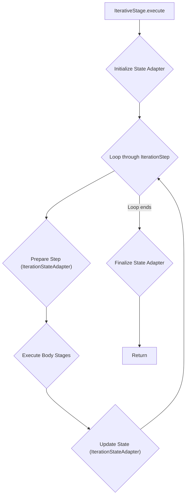
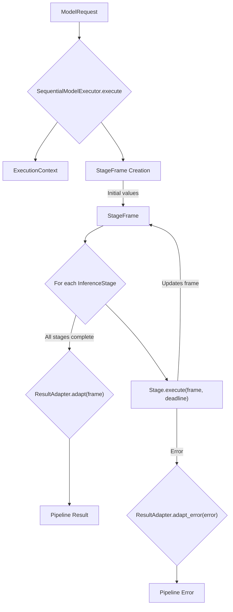
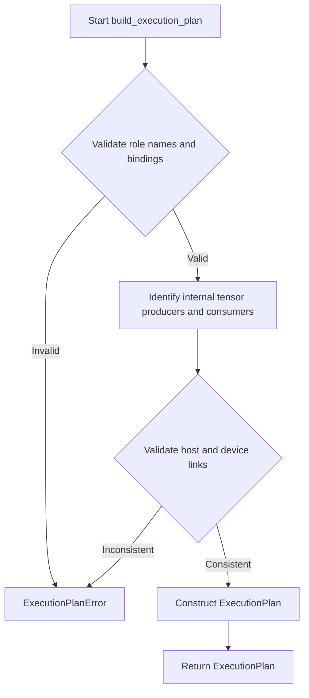

# 流水线运行时与处理器

相关源码文件

以下文件被用作生成此 wiki 页面的上下文：

- [.agents/skills/oh-build-roboframe/SKILL.md](https://atomgit.com/openeuler/IB_Robot/blob/openEuler-26.09/.agents/skills/oh-build-roboframe/SKILL.md)
- [.agents/skills/oh-cross-build-ros-pkg/SKILL.md](https://atomgit.com/openeuler/IB_Robot/blob/openEuler-26.09/.agents/skills/oh-cross-build-ros-pkg/SKILL.md)
- [.agents/skills/ohloha-build-pkg/SKILL.md](https://atomgit.com/openeuler/IB_Robot/blob/openEuler-26.09/.agents/skills/ohloha-build-pkg/SKILL.md)
- [src/inference_service/inference_service/backends/__init__.py](https://atomgit.com/openeuler/IB_Robot/blob/openEuler-26.09/src/inference_service/inference_service/backends/__init__.py)
- [src/inference_service/inference_service/codecs/__init__.py](https://atomgit.com/openeuler/IB_Robot/blob/openEuler-26.09/src/inference_service/inference_service/codecs/__init__.py)
- [src/inference_service/inference_service/codecs/bindings.py](https://atomgit.com/openeuler/IB_Robot/blob/openEuler-26.09/src/inference_service/inference_service/codecs/bindings.py)
- [src/inference_service/inference_service/codecs/execution.py](https://atomgit.com/openeuler/IB_Robot/blob/openEuler-26.09/src/inference_service/inference_service/codecs/execution.py)
- [src/inference_service/inference_service/codecs/types.py](https://atomgit.com/openeuler/IB_Robot/blob/openEuler-26.09/src/inference_service/inference_service/codecs/types.py)
- [src/inference_service/inference_service/lerobot_assets.py](https://atomgit.com/openeuler/IB_Robot/blob/openEuler-26.09/src/inference_service/inference_service/lerobot_assets.py)
- [src/inference_service/inference_service/pipeline/__init__.py](https://atomgit.com/openeuler/IB_Robot/blob/openEuler-26.09/src/inference_service/inference_service/pipeline/__init__.py)
- [src/inference_service/inference_service/pipeline/executor.py](https://atomgit.com/openeuler/IB_Robot/blob/openEuler-26.09/src/inference_service/inference_service/pipeline/executor.py)
- [src/inference_service/inference_service/pipeline/factory.py](https://atomgit.com/openeuler/IB_Robot/blob/openEuler-26.09/src/inference_service/inference_service/pipeline/factory.py)
- [src/inference_service/inference_service/pipeline/manager.py](https://atomgit.com/openeuler/IB_Robot/blob/openEuler-26.09/src/inference_service/inference_service/pipeline/manager.py)
- [src/inference_service/inference_service/pipeline/processors.py](https://atomgit.com/openeuler/IB_Robot/blob/openEuler-26.09/src/inference_service/inference_service/pipeline/processors.py)
- [src/inference_service/inference_service/pipeline/runtime.py](https://atomgit.com/openeuler/IB_Robot/blob/openEuler-26.09/src/inference_service/inference_service/pipeline/runtime.py)
- [src/inference_service/inference_service/pipeline/runtime_core.py](https://atomgit.com/openeuler/IB_Robot/blob/openEuler-26.09/src/inference_service/inference_service/pipeline/runtime_core.py)
- [src/inference_service/inference_service/pipeline/stages.py](https://atomgit.com/openeuler/IB_Robot/blob/openEuler-26.09/src/inference_service/inference_service/pipeline/stages.py)
- [src/inference_service/inference_service/unified_runtime/handle.py](https://atomgit.com/openeuler/IB_Robot/blob/openEuler-26.09/src/inference_service/inference_service/unified_runtime/handle.py)
- [src/inference_service/tests/test_codec_execution_plan.py](https://atomgit.com/openeuler/IB_Robot/blob/openEuler-26.09/src/inference_service/tests/test_codec_execution_plan.py)
- [src/inference_service/tests/test_native_runtime_pipeline.py](https://atomgit.com/openeuler/IB_Robot/blob/openEuler-26.09/src/inference_service/tests/test_native_runtime_pipeline.py)
- [src/inference_service/tests/test_pipeline_processors.py](https://atomgit.com/openeuler/IB_Robot/blob/openEuler-26.09/src/inference_service/tests/test_pipeline_processors.py)
- [src/inference_service/tests/test_policy_codecs.py](https://atomgit.com/openeuler/IB_Robot/blob/openEuler-26.09/src/inference_service/tests/test_policy_codecs.py)
- [src/inference_service/tests/test_runtime_migration.py](https://atomgit.com/openeuler/IB_Robot/blob/openEuler-26.09/src/inference_service/tests/test_runtime_migration.py)
- [src/model_utils/test/test_pi05_export_manifest.py](https://atomgit.com/openeuler/IB_Robot/blob/openEuler-26.09/src/model_utils/test/test_pi05_export_manifest.py)
- [src/perception_service/perception_service/graspgen_session.py](https://atomgit.com/openeuler/IB_Robot/blob/openEuler-26.09/src/perception_service/perception_service/graspgen_session.py)
- [src/perception_service/perception_service/sam2_automatic_ascend_session.py](https://atomgit.com/openeuler/IB_Robot/blob/openEuler-26.09/src/perception_service/perception_service/sam2_automatic_ascend_session.py)

本页面详述 RoboFrame 中执行推理流水线的核心组件。它覆盖流水线工厂、构成流水线的阶段与处理器、管理其执行的执行器、抽象模型交互的统一运行时句柄，以及促进数据流动的编解码器与绑定。

## 流水线工厂

`inference_service.pipeline.factory` 模块负责构建和校验后端与流水线实例。它是创建 `InferencePipeline` 对象的中心点，后者封装给定模型部署的整个推理过程。

工厂使用 `RuntimeAssemblerRegistry` 管理各类模型会话与执行器的创建。它通过提供专用会话构建器支持不同后端类型，包括 LeRobot Torch、Ascend OM、HMM、RKNN 与 Hisilicon [src/inference_service/inference_service/pipeline/factory.py:68-134](https://atomgit.com/openeuler/IB_Robot/blob/openEuler-26.09/src/inference_service/inference_service/pipeline/factory.py#L68-L134)。

关键函数与类：

*   `_new_lerobot_torch_session`：为 Torch 部署创建 `LeRobotTorchModelSession` [src/inference_service/inference_service/pipeline/factory.py:68-83](https://atomgit.com/openeuler/IB_Robot/blob/openEuler-26.09/src/inference_service/inference_service/pipeline/factory.py#L68-L83)。
*   `_new_ascend_session`：为 Ascend 部署创建 `AscendOmModelSession` [src/inference_service/inference_service/pipeline/factory.py:86-99](https://atomgit.com/openeuler/IB_Robot/blob/openEuler-26.09/src/inference_service/inference_service/pipeline/factory.py#L86-L99)。
*   `_new_hmm_session`：创建 `HMMModelSession` [src/inference_service/inference_service/pipeline/factory.py:102-112](https://atomgit.com/openeuler/IB_Robot/blob/openEuler-26.09/src/inference_service/inference_service/pipeline/factory.py#L102-L112)。
*   `_new_rknn_session`：创建 `RKNNModelSession` [src/inference_service/inference_service/pipeline/factory.py:115-123](https://atomgit.com/openeuler/IB_Robot/blob/openEuler-26.09/src/inference_service/inference_service/pipeline/factory.py#L115-L123)。
*   `_new_hisilicon_session`：创建 `HisiliconModelSession` [src/inference_service/inference_service/pipeline/factory.py:126-134](https://atomgit.com/openeuler/IB_Robot/blob/openEuler-26.09/src/inference_service/inference_service/pipeline/factory.py#L126-L134)。
*   `_create_policy_session`：使用已注册构建器创建模型会话的辅助函数 [src/inference_service/inference_service/pipeline/factory.py:136-162](https://atomgit.com/openeuler/IB_Robot/blob/openEuler-26.09/src/inference_service/inference_service/pipeline/factory.py#L136-L162)。
*   `_PolicyRuntimeAssembly`：将 `_PolicySessionHandle` 适配到 `RuntimeAssembly` 接口的私有桥接类 [src/inference_service/inference_service/pipeline/factory.py:165-173](https://atomgit.com/openeuler/IB_Robot/blob/openEuler-26.09/src/inference_service/inference_service/pipeline/factory.py#L165-L173)。

工厂还处理为 PI0.5 与 SmolVLA 等模型创建专用执行器，推导其拓扑并加载配置 [src/inference_service/inference_service/pipeline/factory.py:35-49](https://atomgit.com/openeuler/IB_Robot/blob/openEuler-26.09/src/inference_service/inference_service/pipeline/factory.py#L35-L49)。

来源：[src/inference_service/inference_service/pipeline/factory.py:1-194](https://atomgit.com/openeuler/IB_Robot/blob/openEuler-26.09/src/inference_service/inference_service/pipeline/factory.py#L1-L194)

## 阶段

推理流水线由有序的 `InferenceStage` 对象组成，每个对象表示一个独立操作。这些阶段作用于持有请求数据与中间值的 `StageFrame`。

`inference_service.pipeline.stages` 模块定义这些阶段的接口与具体实现。

关键接口：

*   `InferenceStage`：定义 `execute` 方法的协议，接收 `StageFrame` 与截止时间 [src/inference_service/inference_service/pipeline/stages.py:17-20](https://atomgit.com/openeuler/IB_Robot/blob/openEuler-26.09/src/inference_service/inference_service/pipeline/stages.py#L17-L20)。
*   `ResultAdapter`：将最终 `StageFrame` 转换为领域专用结果或适配错误的协议 [src/inference_service/inference_service/pipeline/stages.py:24-29](https://atomgit.com/openeuler/IB_Robot/blob/openEuler-26.09/src/inference_service/inference_service/pipeline/stages.py#L24-L29)。
*   `IterationStateAdapter`：在迭代式模型中管理族专用循环状态的协议 [src/inference_service/inference_service/pipeline/stages.py:51-63](https://atomgit.com/openeuler/IB_Robot/blob/openEuler-26.09/src/inference_service/inference_service/pipeline/stages.py#L51-L63)。

具体阶段实现：

*   `ModelResultAdapter`：从 `StageFrame` 提取模型结果 [src/inference_service/inference_service/pipeline/stages.py:33-49](https://atomgit.com/openeuler/IB_Robot/blob/openEuler-26.09/src/inference_service/inference_service/pipeline/stages.py#L33-L49)。
*   `IterativeStage`：基于 `IterationStep` 计划与 `IterationStateAdapter` 重复执行一系列阶段 [src/inference_service/inference_service/pipeline/stages.py:78-107](https://atomgit.com/openeuler/IB_Robot/blob/openEuler-26.09/src/inference_service/inference_service/pipeline/stages.py#L78-L107)。
*   `EulerIterationStateAdapter`：对语义循环状态应用 Euler 更新，通常用于扩散模型 [src/inference_service/inference_service/pipeline/stages.py:110-149](https://atomgit.com/openeuler/IB_Robot/blob/openEuler-26.09/src/inference_service/inference_service/pipeline/stages.py#L110-L149)。
*   `DirectIterationStateAdapter`：用每次模型输出替换迭代状态 [src/inference_service/inference_service/pipeline/stages.py:152-175](https://atomgit.com/openeuler/IB_Robot/blob/openEuler-26.09/src/inference_service/inference_service/pipeline/stages.py#L152-L175)。

### 迭代阶段执行

Title: Iterative Stage Execution Flow
来源：[src/inference_service/inference_service/pipeline/stages.py:78-107](https://atomgit.com/openeuler/IB_Robot/blob/openEuler-26.09/src/inference_service/inference_service/pipeline/stages.py#L78-L107)

来源：[src/inference_service/inference_service/pipeline/stages.py:1-175](https://atomgit.com/openeuler/IB_Robot/blob/openEuler-26.09/src/inference_service/inference_service/pipeline/stages.py#L1-L175)

## 处理器

处理器负责推理前的输入观测变换与模型输出的后处理。对 LeRobot 模型，它们由 `_ProcessorPair` 及其视图管理。

`inference_service.pipeline.processors` 模块提供 `create_lerobot_processor_views` 函数，为已编译的 LeRobot 部署实例化前处理与后处理器 [src/inference_service/inference_service/pipeline/processors.py:145-147](https://atomgit.com/openeuler/IB_Robot/blob/openEuler-26.09/src/inference_service/inference_service/pipeline/processors.py#L145-L147)。

关键类：

*   `_ProcessorPair`：管理 LeRobot 前处理器与后处理器的加载与生命周期。它确保这些组件只加载一次并提供线程安全访问 [src/inference_service/inference_service/pipeline/processors.py:16-111](https://atomgit.com/openeuler/IB_Robot/blob/openEuler-26.09/src/inference_service/inference_service/pipeline/processors.py#L16-L111)。
    *   `load`：导入 LeRobot 策略配置与工厂模块以创建前/后处理器，处理 tokenizer 路径解析 [src/inference_service/inference_service/pipeline/processors.py:23-71](https://atomgit.com/openeuler/IB_Robot/blob/openEuler-26.09/src/inference_service/inference_service/pipeline/processors.py#L23-L71)。
    *   `preprocess`：将已加载的前处理器应用于输入数据 [src/inference_service/inference_service/pipeline/processors.py:73-78](https://atomgit.com/openeuler/IB_Robot/blob/openEuler-26.09/src/inference_service/inference_service/pipeline/processors.py#L73-L78)。
    *   `postprocess`：将已加载的后处理器应用于模型动作，必要时转换为 `torch.Tensor` [src/inference_service/inference_service/pipeline/processors.py:80-87](https://atomgit.com/openeuler/IB_Robot/blob/openEuler-26.09/src/inference_service/inference_service/pipeline/processors.py#L80-L87)。
    *   `reset`：若前处理器与后处理器支持，重置二者状态 [src/inference_service/inference_service/pipeline/processors.py:89-103](https://atomgit.com/openeuler/IB_Robot/blob/openEuler-26.09/src/inference_service/inference_service/pipeline/processors.py#L89-L103)。
    *   `close`：释放处理器持有的资源 [src/inference_service/inference_service/pipeline/processors.py:105-111](https://atomgit.com/openeuler/IB_Robot/blob/openEuler-26.09/src/inference_service/inference_service/pipeline/processors.py#L105-L111)。
*   `_PreprocessorView`：封装 `_ProcessorPair` 并暴露前处理器功能的包装器 [src/inference_service/inference_service/pipeline/processors.py:114-129](https://atomgit.com/openeuler/IB_Robot/blob/openEuler-26.09/src/inference_service/inference_service/pipeline/processors.py#L114-L129)。
*   `_PostprocessorView`：封装 `_ProcessorPair` 并暴露后处理器功能的包装器 [src/inference_service/inference_service/pipeline/processors.py:132-143](https://atomgit.com/openeuler/IB_Robot/blob/openEuler-26.09/src/inference_service/inference_service/pipeline/processors.py#L132-L143)。

来源：[src/inference_service/inference_service/pipeline/processors.py:1-147](https://atomgit.com/openeuler/IB_Robot/blob/openEuler-26.09/src/inference_service/inference_service/pipeline/processors.py#L1-L147), [src/inference_service/tests/test_pipeline_processors.py:17-60](https://atomgit.com/openeuler/IB_Robot/blob/openEuler-26.09/src/inference_service/tests/test_pipeline_processors.py#L17-L60), [src/inference_service/tests/test_pipeline_processors.py:63-88](https://atomgit.com/openeuler/IB_Robot/blob/openEuler-26.09/src/inference_service/tests/test_pipeline_processors.py#L63-L88), [src/inference_service/tests/test_pipeline_processors.py:90-121](https://atomgit.com/openeuler/IB_Robot/blob/openEuler-26.09/src/inference_service/tests/test_pipeline_processors.py#L90-L121)

## 执行器

执行器负责编排流水线内各阶段的执行。它们管理组件生命周期并处理错误上报。

`inference_service.pipeline.executor` 模块定义基类 `ComponentModelExecutor` 及其具体实现 `SequentialModelExecutor`。

关键类：

*   `ComponentModelExecutor`：模型执行器基类，管理共享组件所有权、健康检查与取消。它提供执行 `InferenceStage` 序列的核心逻辑 [src/inference_service/inference_service/pipeline/executor.py:14-160](https://atomgit.com/openeuler/IB_Robot/blob/openEuler-26.09/src/inference_service/inference_service/pipeline/executor.py#L14-L160)。
    *   `_execute_stages`：遍历各阶段并传入 `StageFrame` 与 `ExecutionContext` 的内部方法 [src/inference_service/inference_service/pipeline/executor.py:73-96](https://atomgit.com/openeuler/IB_Robot/blob/openEuler-26.09/src/inference_service/inference_service/pipeline/executor.py#L73-L96)。
    *   `cancel`：尝试取消所拥有组件上的进行中操作 [src/inference_service/inference_service/pipeline/executor.py:98-111](https://atomgit.com/openeuler/IB_Robot/blob/openEuler-26.09/src/inference_service/inference_service/pipeline/executor.py#L98-L111)。
    *   `health`：聚合所有已拥有组件的健康状态 [src/inference_service/inference_service/pipeline/executor.py:113-142](https://atomgit.com/openeuler/IB_Robot/blob/openEuler-26.09/src/inference_service/inference_service/pipeline/executor.py#L113-L142)。
*   `SequentialModelExecutor`：`ComponentModelExecutor` 的具体实现，以固定顺序执行各阶段 [src/inference_service/inference_service/pipeline/executor.py:163-167](https://atomgit.com/openeuler/IB_Robot/blob/openEuler-26.09/src/inference_service/inference_service/pipeline/executor.py#L163-L167)。

### 执行器数据流

Title: Sequential Model Executor Data Flow
来源：[src/inference_service/inference_service/pipeline/executor.py:73-96](https://atomgit.com/openeuler/IB_Robot/blob/openEuler-26.09/src/inference_service/inference_service/pipeline/executor.py#L73-L96)

来源：[src/inference_service/inference_service/pipeline/executor.py:1-167](https://atomgit.com/openeuler/IB_Robot/blob/openEuler-26.09/src/inference_service/inference_service/pipeline/executor.py#L1-L167)

## 统一运行时句柄

`ModelRuntimeHandle` 在底层模型运行时之上提供统一门面，抽象掉不同后端与执行策略的复杂性。它确保策略请求与结果遵循一致的契约。

`inference_service.pipeline.runtime` 模块定义 `InferencePipeline` 类，该类在本地执行中使用 `ModelRuntimeHandle`。

关键类：

*   `InferencePipeline`：充当策略门面的主类。它将所有本地执行路由到 `ModelRuntimeHandle`，并管理前/后处理、调度与结果归一化 [src/inference_service/inference_service/pipeline/runtime.py:1-182](https://atomgit.com/openeuler/IB_Robot/blob/openEuler-26.09/src/inference_service/inference_service/pipeline/runtime.py#L1-L182)。
    *   `_PolicyFrameResult`：用于在发布公开 `PipelineResult` 前归一化各后端结果的内部数据结构 [src/inference_service/inference_service/pipeline/runtime.py:101-120](https://atomgit.com/openeuler/IB_Robot/blob/openEuler-26.09/src/inference_service/inference_service/pipeline/runtime.py#L101-L120)。
    *   `_normalize_policy_frame`：将不同的模型输出格式转换为一致的 `_PolicyFrameResult` [src/inference_service/inference_service/pipeline/runtime.py:123-163](https://atomgit.com/openeuler/IB_Robot/blob/openEuler-26.09/src/inference_service/inference_service/pipeline/runtime.py#L123-L163)。
    *   `_PolicyPreprocessStage`：处理提示选择、处理器应用、控制输入合并与截止时间门控 [src/inference_service/inference_service/pipeline/runtime.py:176-182](https://atomgit.com/openeuler/IB_Robot/blob/openEuler-26.09/src/inference_service/inference_service/pipeline/runtime.py#L176-L182)。

来源：[src/inference_service/inference_service/pipeline/runtime.py:1-182](https://atomgit.com/openeuler/IB_Robot/blob/openEuler-26.09/src/inference_service/inference_service/pipeline/runtime.py#L1-L182)

## 编解码器与绑定

编解码器与绑定对于在应用使用的语义张量表示与模型后端期望的运行时专用格式之间进行转换至关重要。

`inference_service.codecs.bindings` 模块定义 manifest 驱动的转换如何发生。

关键类与函数：

*   `BindingError`：绑定期间问题的基础异常 [src/inference_service/inference_service/codecs/bindings.py:20-20](https://atomgit.com/openeuler/IB_Robot/blob/openEuler-26.09/src/inference_service/inference_service/codecs/bindings.py#L20)。
*   `MissingSemanticTensorError`：找不到必需语义张量时抛出 [src/inference_service/inference_service/codecs/bindings.py:23-23](https://atomgit.com/openeuler/IB_Robot/blob/openEuler-26.09/src/inference_service/inference_service/codecs/bindings.py#L23)。
*   `validate_artifact_bindings`：确保输入与输出绑定的一致性，检查重复的语义、运行时名称与索引 [src/inference_service/inference_service/codecs/bindings.py:53-59](https://atomgit.com/openeuler/IB_Robot/blob/openEuler-26.09/src/inference_service/inference_service/codecs/bindings.py#L53-L59)。
*   `_numpy_dtype`：将字符串 dtype 转换为 NumPy dtype，必要时用 `ml_dtypes` 处理 `bfloat16` [src/inference_service/inference_service/codecs/bindings.py:60-71](https://atomgit.com/openeuler/IB_Robot/blob/openEuler-26.09/src/inference_service/inference_service/codecs/bindings.py#L60-L71)。
*   `_as_numpy`：将任意对象转换为指定 dtype 的 NumPy 数组，处理 PyTorch 张量并确保连续性 [src/inference_service/inference_service/codecs/bindings.py:73-95](https://atomgit.com/openeuler/IB_Robot/blob/openEuler-26.09/src/inference_service/inference_service/codecs/bindings.py#L73-L95)。
*   `_validate_shape`：检查 NumPy 数组的形状是否与 `TensorBinding` 中定义的期望形状匹配 [src/inference_service/inference_service/codecs/bindings.py:97-110](https://atomgit.com/openeuler/IB_Robot/blob/openEuler-26.09/src/inference_service/inference_service/codecs/bindings.py#L97-L110)。
*   `convert_input`：将单个规范张量转换为其声明的运行时 ABI，包括布局变换（如图像的 NCHW 到 NHWC） [src/inference_service/inference_service/codecs/bindings.py:113-124](https://atomgit.com/openeuler/IB_Robot/blob/openEuler-26.09/src/inference_service/inference_service/codecs/bindings.py#L113-L124)。
*   `bind_inputs`：从 `CodecRequest` 解析语义输入，并依据 `ArtifactBindings` 将其转换为 `BoundInputs` [src/inference_service/inference_service/codecs/bindings.py:127-146](https://atomgit.com/openeuler/IB_Robot/blob/openEuler-26.09/src/inference_service/inference_service/codecs/bindings.py#L127-L146)。
*   `_resolve_output_value`：依据语义、运行时名称或索引从运行时输出中提取输出值 [src/inference_service/inference_service/codecs/bindings.py:149-167](https://atomgit.com/openeuler/IB_Robot/blob/openEuler-26.09/src/inference_service/inference_service/codecs/bindings.py#L149-L167)。

### 执行计划

`inference_service.codecs.execution` 模块负责构建与校验有序的多模块执行计划。这对由多个需按特定顺序执行、可能在彼此间传递中间张量的子模型（角色）组成的模型尤为重要。

关键类与函数：

*   `ExecutionPlanError`：声明的多模块张量所有权不一致时抛出 [src/inference_service/inference_service/codecs/execution.py:15-15](https://atomgit.com/openeuler/IB_Robot/blob/openEuler-26.09/src/inference_service/inference_service/codecs/execution.py#L15)。
*   `ExecutionRolePlan`：表示执行计划中的单个角色（子模型），包括其名称、位置与产物绑定 [src/inference_service/inference_service/codecs/execution.py:19-22](https://atomgit.com/openeuler/IB_Robot/blob/openEuler-26.09/src/inference_service/inference_service/codecs/execution.py#L19-L22)。
*   `HostInternalLink`：描述角色间由主机管理的张量链接，指定其语义、生产者、消费者与生命周期 [src/inference_service/inference_service/codecs/execution.py:25-34](https://atomgit.com/openeuler/IB_Robot/blob/openEuler-26.09/src/inference_service/inference_service/codecs/execution.py#L25-L34)。
*   `DeviceLinkMetadata`：描述角色间由设备管理的张量链接，指示设备指针传输 [src/inference_service/inference_service/codecs/execution.py:37-48](https://atomgit.com/openeuler/IB_Robot/blob/openEuler-26.09/src/inference_service/inference_service/codecs/execution.py#L37-L48)。
*   `ExecutionPlan`：完整计划，由有序角色、主机管理的链接与设备管理的链接组成 [src/inference_service/inference_service/codecs/execution.py:51-55](https://atomgit.com/openeuler/IB_Robot/blob/openEuler-26.09/src/inference_service/inference_service/codecs/execution.py#L51-L55)。
*   `build_execution_plan`：从一系列执行角色及其产物绑定构建并校验 `ExecutionPlan`。它检查重复角色、缺失绑定，并确保正确的生产者-消费者顺序与张量兼容性 [src/inference_service/inference_service/codecs/execution.py:104-178](https://atomgit.com/openeuler/IB_Robot/blob/openEuler-26.09/src/inference_service/inference_service/codecs/execution.py#L104-L178)。

### 执行计划构建

Title: Execution Plan Building Process
来源：[src/inference_service/inference_service/codecs/execution.py:104-178](https://atomgit.com/openeuler/IB_Robot/blob/openEuler-26.09/src/inference_service/inference_service/codecs/execution.py#L104-L178)

来源：[src/inference_service/inference_service/codecs/bindings.py:1-167](https://atomgit.com/openeuler/IB_Robot/blob/openEuler-26.09/src/inference_service/inference_service/codecs/bindings.py#L1-L167), [src/inference_service/inference_service/codecs/execution.py:1-178](https://atomgit.com/openeuler/IB_Robot/blob/openEuler-26.09/src/inference_service/inference_service/codecs/execution.py#L1-L178)
