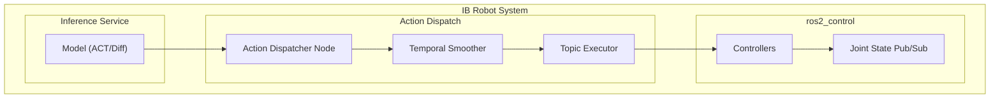
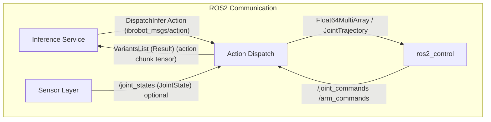
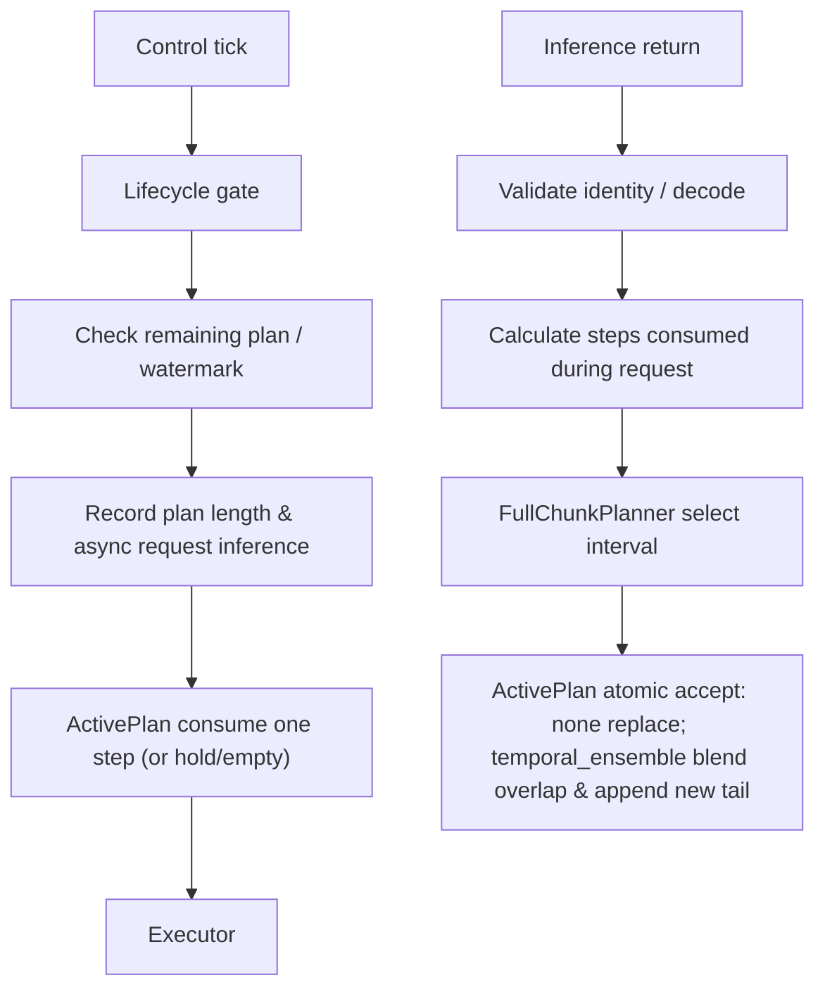
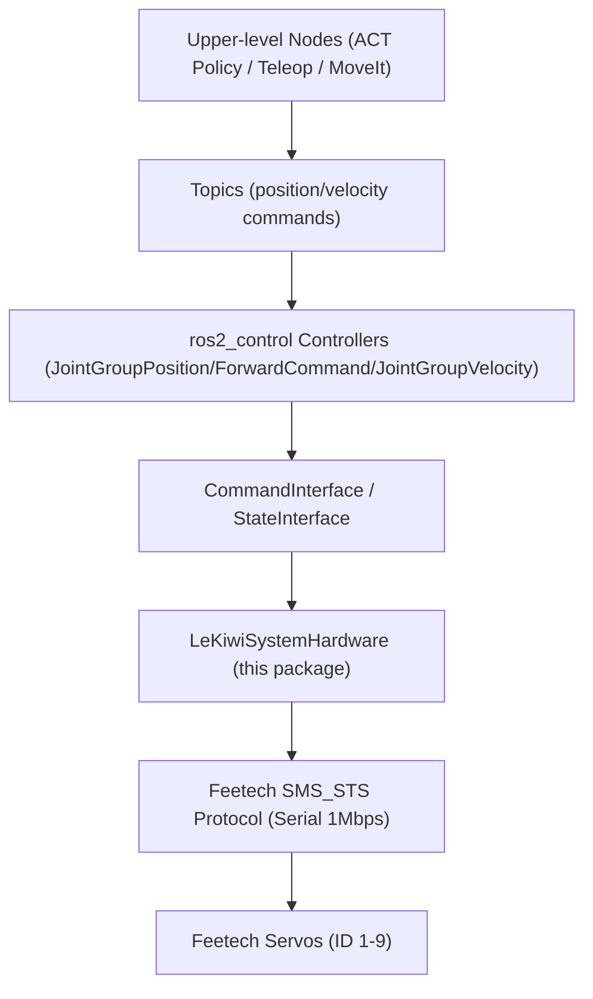

# 调度与动作分发

相关源码文件

以下文件被用作生成此 wiki 页面的上下文：

- [src/action_dispatch/README.en.md](https://atomgit.com/openeuler/IB_Robot/blob/openEuler-26.09/src/action_dispatch/README.en.md)
- [src/action_dispatch/README.md](https://atomgit.com/openeuler/IB_Robot/blob/openEuler-26.09/src/action_dispatch/README.md)
- [src/action_dispatch/action_dispatch/__init__.py](https://atomgit.com/openeuler/IB_Robot/blob/openEuler-26.09/src/action_dispatch/action_dispatch/__init__.py)
- [src/action_dispatch/action_dispatch/action_dispatcher_node.py](https://atomgit.com/openeuler/IB_Robot/blob/openEuler-26.09/src/action_dispatch/action_dispatch/action_dispatcher_node.py)
- [src/action_dispatch/action_dispatch/scheduled_action_dispatcher_node.py](https://atomgit.com/openeuler/IB_Robot/blob/openEuler-26.09/src/action_dispatch/action_dispatch/scheduled_action_dispatcher_node.py)
- [src/action_dispatch/action_dispatch/temporal_smoother.py](https://atomgit.com/openeuler/IB_Robot/blob/openEuler-26.09/src/action_dispatch/action_dispatch/temporal_smoother.py)
- [src/action_dispatch/test/test_scheduled_dispatcher_lifecycle.py](https://atomgit.com/openeuler/IB_Robot/blob/openEuler-26.09/src/action_dispatch/test/test_scheduled_dispatcher_lifecycle.py)
- [src/action_dispatch/test/test_temporal_smoother.py](https://atomgit.com/openeuler/IB_Robot/blob/openEuler-26.09/src/action_dispatch/test/test_temporal_smoother.py)
- [src/inference_service/inference_service/global_inference_scheduler_node.py](https://atomgit.com/openeuler/IB_Robot/blob/openEuler-26.09/src/inference_service/inference_service/global_inference_scheduler_node.py)
- [src/inference_service/test/test_scheduler_node_guards.py](https://atomgit.com/openeuler/IB_Robot/blob/openEuler-26.09/src/inference_service/test/test_scheduler_node_guards.py)
- [src/inference_service/test/test_scheduler_ros_integration.py](https://atomgit.com/openeuler/IB_Robot/blob/openEuler-26.09/src/inference_service/test/test_scheduler_ros_integration.py)
- [src/lekiwi_description/urdf/lekiwi_assembled.urdf.xacro](https://atomgit.com/openeuler/IB_Robot/blob/openEuler-26.09/src/lekiwi_description/urdf/lekiwi_assembled.urdf.xacro)
- [src/lekiwi_hardware/CMakeLists.txt](https://atomgit.com/openeuler/IB_Robot/blob/openEuler-26.09/src/lekiwi_hardware/CMakeLists.txt)
- [src/lekiwi_hardware/README.md](https://atomgit.com/openeuler/IB_Robot/blob/openEuler-26.09/src/lekiwi_hardware/README.md)
- [src/lekiwi_hardware/config/lekiwi_controllers.yaml](https://atomgit.com/openeuler/IB_Robot/blob/openEuler-26.09/src/lekiwi_hardware/config/lekiwi_controllers.yaml)
- [src/lekiwi_hardware/include/lekiwi_hardware/lekiwi_system_hardware.hpp](https://atomgit.com/openeuler/IB_Robot/blob/openEuler-26.09/src/lekiwi_hardware/include/lekiwi_hardware/lekiwi_system_hardware.hpp)
- [src/lekiwi_hardware/lekiwi_hardware_plugin.xml](https://atomgit.com/openeuler/IB_Robot/blob/openEuler-26.09/src/lekiwi_hardware/lekiwi_hardware_plugin.xml)
- [src/lekiwi_hardware/package.xml](https://atomgit.com/openeuler/IB_Robot/blob/openEuler-26.09/src/lekiwi_hardware/package.xml)
- [src/lekiwi_hardware/src/lekiwi_system_hardware.cpp](https://atomgit.com/openeuler/IB_Robot/blob/openEuler-26.09/src/lekiwi_hardware/src/lekiwi_system_hardware.cpp)
- [src/robot_config/launch/teleop_operator.launch.py](https://atomgit.com/openeuler/IB_Robot/blob/openEuler-26.09/src/robot_config/launch/teleop_operator.launch.py)
- [src/robot_config/robot_config/launch_builders/execution.py](https://atomgit.com/openeuler/IB_Robot/blob/openEuler-26.09/src/robot_config/robot_config/launch_builders/execution.py)
- [src/robot_config/test/test_execution_scheduler_branch.py](https://atomgit.com/openeuler/IB_Robot/blob/openEuler-26.09/src/robot_config/test/test_execution_scheduler_branch.py)
- [src/robot_config/test/test_teleop_operator_launch.py](https://atomgit.com/openeuler/IB_Robot/blob/openEuler-26.09/src/robot_config/test/test_teleop_operator_launch.py)

本页面详述 RoboFrame 中的全局推理调度器与动作分发机制。它覆盖推理结果如何被调度、处理并分发给机器人控制器，包括动作分块、时间平滑及各类执行器等概念。

## 动作分发概览

`action_dispatch` 包提供拉取式动作分发层，将推理模型（如 ACT 与 Diffusion Policy）桥接到 `ros2_control`。它管理动作块的流转，确保其及时且连贯地交付给机器人控制器。系统支持时间混合以平滑重叠预测之间的过渡，目标是实现连续的物理运动。

有两个互斥的分发节点，依据 `control_modes.<mode>.inference.scheduler.enable` 配置选择：

1.  **`action_dispatcher_node`**：旧版分发器。在 `scheduler.enable` 缺失或为 `false` 时运行。它通过 `DispatchInfer /dispatch` 与 `/reset` 服务使用指定的 `executor.inference_pipeline`。
2.  **`scheduled_action_dispatcher_node`**：调度式分发器，在 `scheduler.enable` 为 `true` 时激活。它与全局推理调度器集成，等待全局就绪后使用 `OpenInferenceSession`、`ScheduledDispatchInfer` 与 `CloseInferenceSession`。该分发器管理逻辑会话、校验结果身份，并通过清空队列、发布安全停止命令并关闭会话来处理终结失败。它支持带绝对截止时间与优先级 0 请求回退链的优先级分发。

两个分发器都使用 `/action_dispatcher` 话题，并暴露启动、停止、状态与时间平滑开关的公共接口。它们被设计为不在同一 launch 图中并存。调度式分发器消费全局推理调度器返回的全图动作块。

来源：[src/action_dispatch/README.en.md:1-34](https://atomgit.com/openeuler/IB_Robot/blob/openEuler-26.09/src/action_dispatch/README.en.md#L1-L34), [src/action_dispatch/README.md:1-29](https://atomgit.com/openeuler/IB_Robot/blob/openEuler-26.09/src/action_dispatch/README.md#L1-L29)

## 系统架构

动作分发系统充当推理服务与 `ros2_control` 之间的中介。

### 组件架构

下图展示高层组件交互：

图题：动作分发组件架构
来源：[src/action_dispatch/README.en.md:35-68](https://atomgit.com/openeuler/IB_Robot/blob/openEuler-26.09/src/action_dispatch/README.en.md#L35-L68), [src/action_dispatch/README.md:30-64](https://atomgit.com/openeuler/IB_Robot/blob/openEuler-26.09/src/action_dispatch/README.md#L30-L64)

### 通信架构

通信架构突出用于数据交换的 ROS 2 接口。

图题：动作分发通信架构
来源：[src/action_dispatch/README.en.md:70-104](https://atomgit.com/openeuler/IB_Robot/blob/openEuler-26.09/src/action_dispatch/README.en.md#L70-L104), [src/action_dispatch/README.md:65-101](https://atomgit.com/openeuler/IB_Robot/blob/openEuler-26.09/src/action_dispatch/README.md#L65-L101)

### 内部数据流

`continuous` 策略的内部数据流包括每个控制节拍消费一个动作，将剩余规划长度对照水位线检查，并异步请求新的推理结果。

图题：连续分发的内部数据流
来源：[src/action_dispatch/README.en.md:107-117](https://atomgit.com/openeuler/IB_Robot/blob/openEuler-26.09/src/action_dispatch/README.en.md#L107-L117), [src/action_dispatch/README.md:104-117](https://atomgit.com/openeuler/IB_Robot/blob/openEuler-26.09/src/action_dispatch/README.md#L104-L117)

`TopicExecutor` 路由 `Float64MultiArray` 或 `JointTrajectory` 消息。用于基准评测时，反馈提交驱动消费。

来源：[src/action_dispatch/README.en.md:119-122](https://atomgit.com/openeuler/IB_Robot/blob/openEuler-26.09/src/action_dispatch/README.en.md#L119-L122), [src/action_dispatch/README.md:119-122](https://atomgit.com/openeuler/IB_Robot/blob/openEuler-26.09/src/action_dispatch/README.md#L119-L122)

## 分发节点

### `action_dispatcher_node`（旧版）

`action_dispatcher_node` [src/action_dispatch/action_dispatch/action_dispatcher_node.py](https://atomgit.com/openeuler/IB_Robot/blob/openEuler-26.09/src/action_dispatch/action_dispatch/action_dispatcher_node.py) 是一个最小动作分发器。它维护一个动作队列，当队列低于水位线阈值时触发推理。动作通过 `TopicExecutor` 以固定频率发布到 `ros2_control`。它支持动作块的跨帧时间平滑。

该节点声明的关键参数包括：

*   `queue_size`：动作队列的最大长度（默认：100）。
*   `watermark_threshold`：触发新推理请求的阈值（默认：20）。
*   `control_frequency`：动作分发频率（默认：100.0 Hz）。
*   `inference_action_server`：推理请求的 ROS 动作服务器（默认：`/inference/policy/dispatch`）。
*   `inference_reset_service`：重置推理的 ROS 服务（默认：`/inference/policy/reset`）。
*   `inference_prompt`：推理的 prompt。
*   `policy_reset_timeout_sec`：策略重置超时（默认：2.0 秒）。
*   `inference_timeout_sec`：推理目标超时（默认：10.0 秒）。
*   `robot_config_path`：机器人配置路径。
*   `joint_state_topic`：关节状态反馈话题（默认：`/joint_states`）。
*   `navigation_mode`：导航模式布尔标志。
*   `executor_type`：使用的执行器类型（默认：`topic`）。

该节点基于 `executor_type`、`scheduler_mode`、`chunking_strategy` 与 `blending_strategy` 等参数解析分发策略 [src/action_dispatch/action_dispatch/action_dispatcher_node.py:145-158](https://atomgit.com/openeuler/IB_Robot/blob/openEuler-26.09/src/action_dispatch/action_dispatch/action_dispatcher_node.py#L145-L158)。它还处理旧版执行器类型别名，将 `"action"` 映射为 `"topic"` 以保持兼容 [src/robot_config/robot_config/launch_builders/execution.py:34-55](https://atomgit.com/openeuler/IB_Robot/blob/openEuler-26.09/src/robot_config/robot_config/launch_builders/execution.py#L34-L55)。

来源：[src/action_dispatch/action_dispatch/action_dispatcher_node.py:1-179](https://atomgit.com/openeuler/IB_Robot/blob/openEuler-26.09/src/action_dispatch/action_dispatch/action_dispatcher_node.py#L1-L179), [src/robot_config/robot_config/launch_builders/execution.py:34-55](https://atomgit.com/openeuler/IB_Robot/blob/openEuler-26.09/src/robot_config/robot_config/launch_builders/execution.py#L34-L55)

### `scheduled_action_dispatcher_node`

`scheduled_action_dispatcher_node` 为与全局推理调度器集成而设计。它管理推理会话、校验结果并以更健壮的方式处理失败。它使用 `OpenInferenceSession`、`ScheduledDispatchInfer` 与 `CloseInferenceSession` 与推理服务交互。该节点确保动作块与推理期间消费的步数对齐，并可在队列暂时耗尽时保持最后一个动作。

来源：[src/action_dispatch/README.en.md:14-30](https://atomgit.com/openeuler/IB_Robot/blob/openEuler-26.09/src/action_dispatch/README.en.md#L14-L30), [src/action_dispatch/README.md:15-29](https://atomgit.com/openeuler/IB_Robot/blob/openEuler-26.09/src/action_dispatch/README.md#L15-L29)

## 全局推理调度器

全局推理调度器负责跨多条流水线编排推理请求并管理其执行。它确保推理请求被高效处理，尊重截止时间与资源约束。

`GlobalInferenceSchedulerNode` [src/inference_service/inference_service/global_inference_scheduler_node.py](https://atomgit.com/openeuler/IB_Robot/blob/openEuler-26.09/src/inference_service/inference_service/global_inference_scheduler_node.py) 是关键组件。它与 `PipelinePolicyNode` 实例交互以管理推理会话与分发请求。

### 调度逻辑

调度器采用精密的逻辑管理推理请求：

*   **会话管理**：处理推理会话的打开与关闭（`OpenInferenceSession`、`CloseInferenceSession`）及流水线绑定（`OpenPipelineBinding`、`ClosePipelineBinding`）。
*   **请求分发**：将调度的推理请求（`ScheduledDispatchInfer`）分发给可用流水线。
*   **幂等账本**：使用 `IdempotencyLedger` [src/inference_service/test/test_scheduler_node_guards.py:95](https://atomgit.com/openeuler/IB_Robot/blob/openEuler-26.09/src/inference_service/test/test_scheduler_node_guards.py#L95) 追踪推理操作，防止重复处理并支持终结结果重放。
*   **截止时间预订**：`DeadlineReservationTable` [src/inference_service/test/test_scheduler_node_guards.py:41](https://atomgit.com/openeuler/IB_Robot/blob/openEuler-26.09/src/inference_service/test/test_scheduler_node_guards.py#L41) 管理推理请求的截止时间，确保按时完成。
*   **工作容量**：`WorkClassCapacity` [src/inference_service/test/test_scheduler_node_guards.py:85](https://atomgit.com/openeuler/IB_Robot/blob/openEuler-26.09/src/inference_service/test/test_scheduler_node_guards.py#L85) 定义不同类型工作（如会话控制、动作生成）的容量，允许调度器排定优先级并管理资源分配。

### 错误处理与防护

调度器包含健壮的错误处理与防护以确保系统稳定：

*   **`ExecutorSchedulerPairingError`**：在 launch 时检测到不兼容的执行器/调度器配对时抛出 [src/robot_config/robot_config/launch_builders/execution.py:112-114](https://atomgit.com/openeuler/IB_Robot/blob/openEuler-26.09/src/robot_config/robot_config/launch_builders/execution.py#L112-L114)。该检查委托给 `robot_config.dispatch_strategies` 以快速失败。
*   **`BenchmarkEvaluationError`**：在基准评测选择校验期间抛出 [src/robot_config/robot_config/launch_builders/execution.py:134-136](https://atomgit.com/openeuler/IB_Robot/blob/openEuler-26.09/src/robot_config/robot_config/launch_builders/execution.py#L134-L136)。
*   **线上传输边界**：调度器对错误消息与详情强制线上传输边界，防止消息过大 [src/inference_service/test/test_scheduler_node_guards.py:87](https://atomgit.com/openeuler/IB_Robot/blob/openEuler-26.09/src/inference_service/test/test_scheduler_node_guards.py#L87)。
*   **终结重放**：`replay_terminal` 函数 [src/inference_service/test/test_scheduler_node_guards.py:32](https://atomgit.com/openeuler/IB_Robot/blob/openEuler-26.09/src/inference_service/test/test_scheduler_node_guards.py#L32) 允许为幂等操作重放终结结果。

来源：[src/inference_service/test/test_scheduler_node_guards.py:1-172](https://atomgit.com/openeuler/IB_Robot/blob/openEuler-26.09/src/inference_service/test/test_scheduler_node_guards.py#L1-L172), [src/robot_config/robot_config/launch_builders/execution.py:112-136](https://atomgit.com/openeuler/IB_Robot/blob/openEuler-26.09/src/robot_config/robot_config/launch_builders/execution.py#L112-L136)

## 动作分块与时间平滑

动作分块指从推理模型接收一串动作（一个"块"）。随后对这些块应用时间平滑以确保流畅的机器人运动，尤其是当新推理结果到达并与现有动作规划重叠时。

### `TemporalSmoother`

`TemporalSmoother` [src/action_dispatch/action_dispatch/temporal_smoother.py:45](https://atomgit.com/openeuler/IB_Robot/blob/openEuler-26.09/src/action_dispatch/action_dispatch/temporal_smoother.py#L45) 模块为动作块提供跨帧指数平滑。它对产生分块输出的策略（如 ACT 与 Diffusion Policy）至关重要。

*   **`TemporalSmootherConfig`**：以 `enabled`、`chunk_size`、`temporal_ensemble_coeff` 与 `device` 等参数配置平滑器 [src/action_dispatch/action_dispatch/temporal_smoother.py:19-40](https://atomgit.com/openeuler/IB_Robot/blob/openEuler-26.09/src/action_dispatch/action_dispatch/temporal_smoother.py#L19-L40)。
    *   `chunk_size`：块中动作的最大数量。
    *   `temporal_ensemble_coeff`：平滑权重的指数衰减系数。正值给较旧动作更多权重（稳定），负值给较新动作更多权重（灵敏）。默认 0.01，与原始 ACT 论文一致。
*   **`update(new_actions, actions_executed_during_inference)`**：核心方法。当新动作到达时，将其与当前规划中的剩余动作混合。`actions_executed_during_inference` 参数计入推理运行期间被消费的动作，确保正确的时间对齐 [src/action_dispatch/action_dispatch/temporal_smoother.py:151-173](https://atomgit.com/openeuler/IB_Robot/blob/openEuler-26.09/src/action_dispatch/action_dispatch/temporal_smoother.py#L151-L173)。
*   **`get_next_action()`**：弹出并返回平滑后规划中的下一个动作 [src/action_dispatch/action_dispatch/temporal_smoother.py:130-149](https://atomgit.com/openeuler/IB_Robot/blob/openEuler-26.09/src/action_dispatch/action_dispatch/temporal_smoother.py#L130-L149)。
*   **`reset()`**：清空内部状态，在新回合开始时使用 [src/action_dispatch/action_dispatch/temporal_smoother.py:112-116](https://atomgit.com/openeuler/IB_Robot/blob/openEuler-26.09/src/action_dispatch/action_dispatch/temporal_smoother.py#L112-L116)。
*   **权重预计算**：指数权重基于 `temporal_ensemble_coeff` 与 `chunk_size` 预计算以优化平滑计算 [src/action_dispatch/action_dispatch/temporal_smoother.py:89-96](https://atomgit.com/openeuler/IB_Robot/blob/openEuler-26.09/src/action_dispatch/action_dispatch/temporal_smoother.py#L89-L96)。

若平滑被禁用（`config.enabled=False`），`update` 方法在对齐后直接以新动作替换剩余规划，实际上作为直通 [src/action_dispatch/action_dispatch/temporal_smoother.py:170-173](https://atomgit.com/openeuler/IB_Robot/blob/openEuler-26.09/src/action_dispatch/action_dispatch/temporal_smoother.py#L170-L173)。

来源：[src/action_dispatch/action_dispatch/temporal_smoother.py:1-184](https://atomgit.com/openeuler/IB_Robot/blob/openEuler-26.09/src/action_dispatch/action_dispatch/temporal_smoother.py#L1-L184), [src/action_dispatch/test/test_temporal_smoother.py:1-211](https://atomgit.com/openeuler/IB_Robot/blob/openEuler-26.09/src/action_dispatch/test/test_temporal_smoother.py#L1-L211)

## 执行器

执行器负责将处理后的动作发送给机器人的硬件接口，通常经由 `ros2_control`。

### `TopicExecutor`

`TopicExecutor` 是 `action_dispatcher_node` 使用的主要执行器。它将动作命令作为 ROS 2 消息（如 `Float64MultiArray` 或 `JointTrajectory`）发布到 `ros2_control` 控制器。这允许以高频（如 100 Hz）向机器人连续流式发送命令。

来源：[src/action_dispatch/action_dispatch/action_dispatcher_node.py:179](https://atomgit.com/openeuler/IB_Robot/blob/openEuler-26.09/src/action_dispatch/action_dispatch/action_dispatcher_node.py#L179)

### `BenchmarkExecutor`

虽然提供的片段未明确详述，`benchmark` 执行器类型在 `_validate_executor_scheduler_pairing` 的上下文中被提及 [src/robot_config/robot_config/launch_builders/execution.py:128](https://atomgit.com/openeuler/IB_Robot/blob/openEuler-26.09/src/robot_config/robot_config/launch_builders/execution.py#L128)。该执行器可能用于评估与测试场景，动作可能通过反馈机制提交而非直接流式发送到硬件。

来源：[src/robot_config/robot_config/launch_builders/execution.py:128](https://atomgit.com/openeuler/IB_Robot/blob/openEuler-26.09/src/robot_config/robot_config/launch_builders/execution.py#L128)

## 硬件接口示例：LeKiwi

LeKiwi 机器人的硬件接口（`lekiwi_hardware`）提供了动作最终如何转化为物理机器人运动的具体示例。它是一个驱动 Feetech SMS_STS 串行总线舵机的 `ros2_control` `SystemInterface` 插件。

### LeKiwi 硬件架构

图题：LeKiwi 硬件接口架构
来源：[src/lekiwi_hardware/README.md:18-42](https://atomgit.com/openeuler/IB_Robot/blob/openEuler-26.09/src/lekiwi_hardware/README.md#L18-L42)

### 关键特性

*   **`ros2_control` 插件**：实现 `SystemInterface` 以即插即用集成。
*   **舵机控制**：驱动 6 个手臂位置舵机（ID 1-6）与 3 个全向轮速度舵机（ID 7-9）。
*   **同步读写**：使用 `SyncRead` / `SyncWrite` 保证一致的多电机时序。
*   **标定**：支持用于归零偏移与关节限位的 JSON 标定文件。
*   **控制频率**：以 100 Hz 运行。
*   **`scan_motors` 工具**：扫描已连接电机的诊断工具 [src/lekiwi_hardware/tools/scan_motors.cpp](https://atomgit.com/openeuler/IB_Robot/blob/openEuler-26.09/src/lekiwi_hardware/tools/scan_motors.cpp)。

### 关节映射与控制模式

LeKiwi 机器人定义了具体的关节 ID 及其对应的控制模式：

| 关节 ID | 命名约定 | 控制模式 | 描述 |
|----------|-----------------|--------------|-------------|
| 1        | arm_shoulder_pan | 位置     | 肩部偏航 |
| 2        | arm_shoulder_lift | 位置     | 肩部俯仰 |
| 3        | arm_elbow_flex   | 位置     | 肘部弯曲 |
| 4        | arm_wrist_flex   | 位置     | 腕部弯曲 |
| 5        | arm_wrist_roll   | 位置     | 腕部滚转 |
| 6        | arm_gripper      | 位置     | 夹爪 |
| 7        | base_left_wheel  | 速度     | 底盘左轮 |
| 8        | base_back_wheel  | 速度     | 底盘后轮 |
| 9        | base_right_wheel | 速度     | 底盘右轮 |

来源：[src/lekiwi_hardware/README.md:181-193](https://atomgit.com/openeuler/IB_Robot/blob/openEuler-26.09/src/lekiwi_hardware/README.md#L181-L193)

### 坐标转换

所有坐标转换逻辑集中在 `lekiwi_conversions.hpp` [src/lekiwi_hardware/include/lekiwi_hardware/lekiwi_conversions.hpp](https://atomgit.com/openeuler/IB_Robot/blob/openEuler-26.09/src/lekiwi_hardware/include/lekiwi_hardware/lekiwi_conversions.hpp)，提供纯函数：

*   `ticks_to_radians(raw_ticks)`：手臂位置：原始 ticks → 弧度。
*   `radians_to_ticks(radians)`：手臂位置：弧度 → ticks（截断 [0, 4095]）。
*   `steps_to_rad_s(raw_speed)`：速度：原始 steps/s → rad/s。
*   `rad_s_to_steps(rad_per_sec)`：速度：rad/s → 原始 steps/s（截断 [-32768, 32767]）。
*   `decode_motor_register(low, high)`：解码 2 字节寄存器。
*   `encode_homing_offset(offset)`：编码归零偏移。

来源：[src/lekiwi_hardware/README.md:198-207](https://atomgit.com/openeuler/IB_Robot/blob/openEuler-26.09/src/lekiwi_hardware/README.md#L198-L207)

转换公式基于手臂位置 4096 ticks = 2π 弧度、中心点在 2048 ticks。底盘速度使用 `TICKS_PER_RAD` 在 rad/s 与原始 steps/s 之间转换。

来源：[src/lekiwi_hardware/README.md:209-216](https://atomgit.com/openeuler/IB_Robot/blob/openEuler-26.09/src/lekiwi_hardware/README.md#L209-L216)

来源：[src/lekiwi_hardware/CMakeLists.txt:1-104](https://atomgit.com/openeuler/IB_Robot/blob/openEuler-26.09/src/lekiwi_hardware/CMakeLists.txt#L1-L104), [src/lekiwi_hardware/README.md:1-234](https://atomgit.com/openeuler/IB_Robot/blob/openEuler-26.09/src/lekiwi_hardware/README.md#L1-L234), [src/lekiwi_hardware/src/lekiwi_system_hardware.cpp](https://atomgit.com/openeuler/IB_Robot/blob/openEuler-26.09/src/lekiwi_hardware/src/lekiwi_system_hardware.cpp), [src/lekiwi_hardware/include/lekiwi_hardware/lekiwi_system_hardware.hpp](https://atomgit.com/openeuler/IB_Robot/blob/openEuler-26.09/src/lekiwi_hardware/include/lekiwi_hardware/lekiwi_system_hardware.hpp), [src/lekiwi_hardware/package.xml](https://atomgit.com/openeuler/IB_Robot/blob/openEuler-26.09/src/lekiwi_hardware/package.xml), [src/lekiwi_hardware/lekiwi_hardware_plugin.xml](https://atomgit.com/openeuler/IB_Robot/blob/openEuler-26.09/src/lekiwi_hardware/lekiwi_hardware_plugin.xml), [src/lekiwi_hardware/config/lekiwi_controllers.yaml](https://atomgit.com/openeuler/IB_Robot/blob/openEuler-26.09/src/lekiwi_hardware/config/lekiwi_controllers.yaml)
