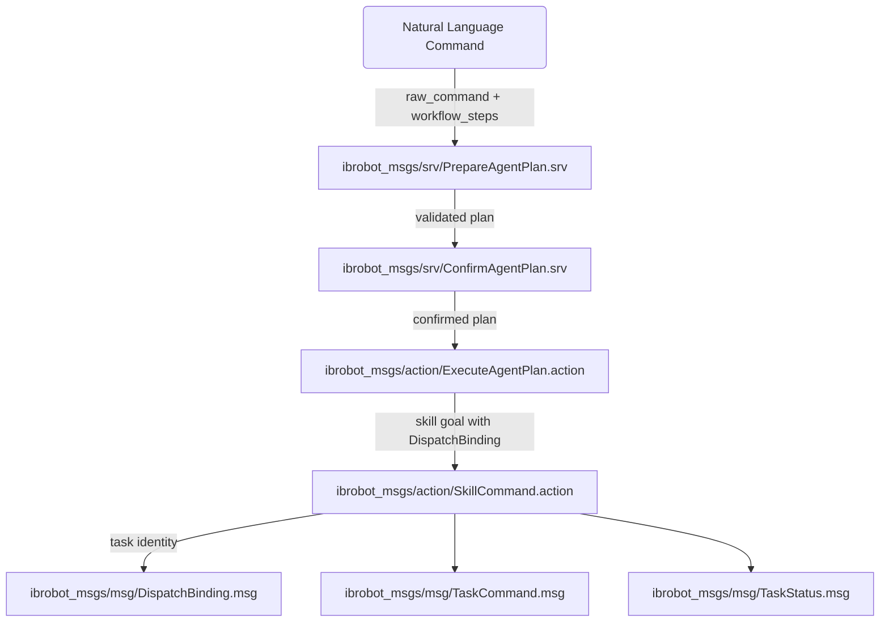
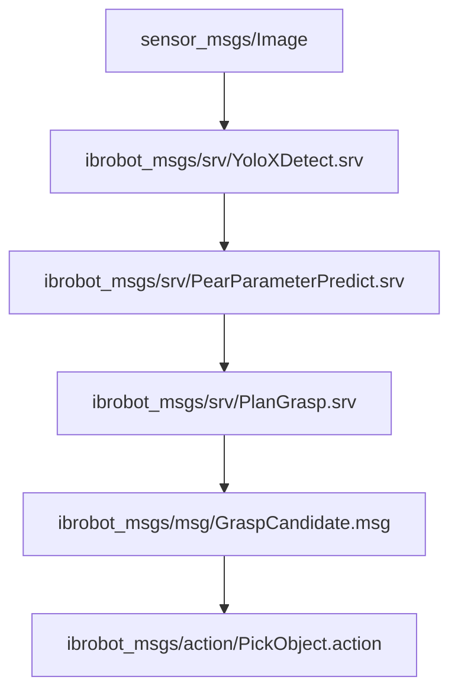

# 接口（ibrobot_msgs）概述

相关源码文件

以下文件被用作生成此 wiki 页面的上下文：

- [src/embodied_common/embodied_common/skill_request.py](https://atomgit.com/openeuler/IB_Robot/blob/openEuler-26.09/src/embodied_common/embodied_common/skill_request.py)
- [src/embodied_common/embodied_common/workflow_contracts.py](https://atomgit.com/openeuler/IB_Robot/blob/openEuler-26.09/src/embodied_common/embodied_common/workflow_contracts.py)
- [src/ibrobot_msgs/CMakeLists.txt](https://atomgit.com/openeuler/IB_Robot/blob/openEuler-26.09/src/ibrobot_msgs/CMakeLists.txt)
- [src/ibrobot_msgs/README.md](https://atomgit.com/openeuler/IB_Robot/blob/openEuler-26.09/src/ibrobot_msgs/README.md)
- [src/ibrobot_msgs/action/ExecuteAgentPlan.action](https://atomgit.com/openeuler/IB_Robot/blob/openEuler-26.09/src/ibrobot_msgs/action/ExecuteAgentPlan.action)
- [src/ibrobot_msgs/action/ImitateHumanMotion.action](https://atomgit.com/openeuler/IB_Robot/blob/openEuler-26.09/src/ibrobot_msgs/action/ImitateHumanMotion.action)
- [src/ibrobot_msgs/msg/DispatchBinding.msg](https://atomgit.com/openeuler/IB_Robot/blob/openEuler-26.09/src/ibrobot_msgs/msg/DispatchBinding.msg)
- [src/ibrobot_msgs/srv/PearParameterPredict.srv](https://atomgit.com/openeuler/IB_Robot/blob/openEuler-26.09/src/ibrobot_msgs/srv/PearParameterPredict.srv)
- [src/ibrobot_msgs/srv/PrepareAgentPlan.srv](https://atomgit.com/openeuler/IB_Robot/blob/openEuler-26.09/src/ibrobot_msgs/srv/PrepareAgentPlan.srv)
- [src/ibrobot_msgs/srv/YoloXDetect.srv](https://atomgit.com/openeuler/IB_Robot/blob/openEuler-26.09/src/ibrobot_msgs/srv/YoloXDetect.srv)
- [src/manipulation_execution/README.md](https://atomgit.com/openeuler/IB_Robot/blob/openEuler-26.09/src/manipulation_execution/README.md)
- [src/manipulation_execution/manipulation_execution/imitate_human_motion_executor.py](https://atomgit.com/openeuler/IB_Robot/blob/openEuler-26.09/src/manipulation_execution/manipulation_execution/imitate_human_motion_executor.py)
- [src/manipulation_execution/manipulation_execution/imitate_human_motion_executor_node.py](https://atomgit.com/openeuler/IB_Robot/blob/openEuler-26.09/src/manipulation_execution/manipulation_execution/imitate_human_motion_executor_node.py)
- [src/manipulation_execution/test/test_imitate_human_motion_vision.py](https://atomgit.com/openeuler/IB_Robot/blob/openEuler-26.09/src/manipulation_execution/test/test_imitate_human_motion_vision.py)

本节提供 IB-Robot 框架内 ROS 接口定义的高层概览，这些定义集中在 `ibrobot_msgs` 包中。它是所有 ROS 2 消息类型、服务与 action 的统一注册中心，支撑 RoboFrame 具身 AI 系统内的通信与协调。该包强制执行严格的 schema 版本化与契约校验，保证各系统组件间的互操作性与一致性。

关于特定接口的详细描述与用例（包括技能契约、感知与推理相关消息），请参阅链接的子页面。

---

## 1. `ibrobot_msgs` 概览

`ibrobot_msgs` 包是所有 ROS 2 通信接口定义的单一来源。它包含支撑系统操作的消息（`msg`）、服务（`srv`）与 action（`action`）定义，覆盖技能执行、原语命令、任务工作流、感知结果、抓取规划、推理请求与分布式动作分发。

`ibrobot_msgs` 的要点：

- 它为所有对外请求与内部协调消息提供 schema。
- 它对关键请求严格强制版本化，保证兼容性与安全性。
- 它封装复杂的任务、技能与工作流绑定身份，在分布式组件间维持一致的调度与执行语义。

接口通过 `src/ibrobot_msgs/` 中的 `CMakeLists.txt` 使用 ROSIDL 生成器生成，其中枚举了全部支持的类型，包括超过 70 个消息定义以及大量服务与 action 文件 [src/ibrobot_msgs/CMakeLists.txt:11-133](https://atomgit.com/openeuler/IB_Robot/blob/openEuler-26.09/src/ibrobot_msgs/CMakeLists.txt#L11-L133)。

---

## 2. Schema 版本化与契约校验

为保持前向兼容并安全演进系统，`ibrobot_msgs` 对核心请求类型强制显式 schema 版本化：

- 四个主要公开请求类型——`SkillCommand.Goal`、`PrimitiveCommand.Goal`、`ValidateSkill.Request`、`ValidatePrimitive.Request`——以强制的 `uint32 schema_version` 字段开头。
- 允许的 schema 版本为 `{1, 2}`；其他值触发 `SKILL_SCHEMA_INVALID` 错误，阻止不兼容运行。

Schema 版本区别：

- **v1** 仅支持操作（manipulation）相关字段，含 10 种原语类型与 3 种控制模式；禁止导航相关字段。
- **v2** 增加额外导航字段与原语（`nav_straight`、`nav_turn`、`nav_abs_coordinate`）并要求显式版本标记。

该版本化方案强制在接口变化时原子重建所有相关节点（`skill_library`、`safety_guard`、`embodied_agent`、`robot_skill_cli`），防止混合版本部署 [src/ibrobot_msgs/README.md:5-28](https://atomgit.com/openeuler/IB_Robot/blob/openEuler-26.09/src/ibrobot_msgs/README.md#L5-L28)。

规划与任务请求内的工作流步骤同样镜像 schema 版本化，以对齐能力声明与执行器逻辑 [src/embodied_common/embodied_common/workflow_contracts.py:34-154](https://atomgit.com/openeuler/IB_Robot/blob/openEuler-26.09/src/embodied_common/embodied_common/workflow_contracts.py#L34-L154)。

---

## 3. 主要接口类别

### 3.1 消息（`msg/`）

消息定义覆盖广泛的系统概念，如：

- **任务与技能执行：** `TaskCommand`、`TaskStatus`、`SkillCapabilityStatus`、`DispatchBinding` 封装请求、状态报告、能力就绪与任务身份信封。
- **感知与抓取：** `Detection2D`、`GraspCandidate`、`SceneObservation`、`SemanticObject3D` 等消息支撑语义地图与物体操作。
- **推理与流水线状态：** `InferencePolicySummary`、`DistributedInferenceRequest`、`InferenceOutcome` 支撑分布式模型推理协调。
- **音频与视觉：** `SpeechDirection`、`SynthesizedAudio` 跟踪音频事件；`VideoStreamDescriptor` 与 `VideoStreamStatus` 管理视频传输。
- **人体动作模仿：** `HumanHandState` 与 `MHandProFrame` 携带用于重定向到机器人臂的感知输入状态。

这些消息支撑从感知到决策再到物理执行的丰富数据流编排 [src/ibrobot_msgs/CMakeLists.txt:22-70](https://atomgit.com/openeuler/IB_Robot/blob/openEuler-26.09/src/ibrobot_msgs/CMakeLists.txt#L22-L70)。

### 3.2 服务（`srv/`）

服务接口提供 RPC 风格交互，用于：

- 校验：`ValidateSkill.srv`、`ValidatePrimitive.srv` 动态校验契约一致性。
- 感知与推理：`YoloXDetect.srv`、`PearParameterPredict.srv`、`PlanGrasp.srv`、`GenerateMasks.srv` 调用模型服务。
- Agent 规划：`PrepareAgentPlan.srv`、`ConfirmAgentPlan.srv` 管理 NL 规划快照的生命周期。
- 技能目录与网关控制：`GetSkillGatewayStatus.srv`、`ReloadSkillCatalog.srv`。

RPC 服务为紧耦合的感知、技能准入、规划确认与基准测试提供必要的同步协调点 [src/ibrobot_msgs/CMakeLists.txt:89-131](https://atomgit.com/openeuler/IB_Robot/blob/openEuler-26.09/src/ibrobot_msgs/CMakeLists.txt#L89-L131)。

### 3.3 Action（`action/`）

ROS action 表达带反馈、结果与目标状态的异步、可取消任务。该包为以下场景定义 action：

- 技能与原语命令（`SkillCommand.action`、`PrimitiveCommand.action`）
- 物体操作（`PickObject.action`、`PlaceObject.action`）
- 模仿与人体动作（`ImitateHumanMotion.action`）
- 情景录制（`RecordEpisode.action`）
- 推理分发（`DispatchInfer.action`、`ScheduledDispatchInfer.action`）
- Agent 规划执行（`ExecuteAgentPlan.action`），与自然语言规划流集成。

Action 建模具身机器人技能与系统级编排核心的异步、有状态行为 [src/ibrobot_msgs/CMakeLists.txt:71-88](https://atomgit.com/openeuler/IB_Robot/blob/openEuler-26.09/src/ibrobot_msgs/CMakeLists.txt#L71-L88)。

---

## 4. DispatchBinding：强类型任务信封

`DispatchBinding` 消息封装强类型的任务/版本信封，由所有委托与原语技能调度携带。它整合：

- 任务身份字段：`task_id`、`root_task_id`
- 执行契约：`task_budget`
- 运行时注册表纪元与摘要期望，用于强制代码/数据快照一致性
- 工作流步骤索引与租约 nonce，用于编排多步工作流

该信封统一了临时 ID，支持在异步、分布式执行间进行精确的身份传播、安全检查与契约强制 [src/ibrobot_msgs/msg/DispatchBinding.msg](https://atomgit.com/openeuler/IB_Robot/blob/openEuler-26.09/src/ibrobot_msgs/msg/DispatchBinding.msg)。

---

## 5. 与子页面的关系

本概览为理解 RoboFrame 的 ROS 接口层奠定基础。以下子页面覆盖特定接口领域，提供详细描述、契约与使用模式：

- **10.1 技能与原语契约**  
  探讨 `SkillCommand` 与 `PrimitiveCommand` 等 action 接口、校验服务、任务与工作流状态消息，以及 `DispatchBinding` 契约强制机制——这些对技能执行与安全绑定至关重要。

- **10.2 感知、抓取与推理接口**  
  聚焦感知相关服务与消息，如 `PickObject`、`PlanGrasp`、`DetectSegment`，以及 `DispatchInfer` 与 `DistributedInference` 等推理分发请求。本节详述语义感知与抓取通信。

---

## 6. 示例图：通过技能执行接口将自然语言映射到代码实体

该流程展示了从自然语言命令处理到紧密绑定、经 schema 校验的技能执行请求的流水线，这些请求携带强任务身份信封，用于 RoboFrame 中安全的调度与监控。

---

## 7. 示例图：感知到抓取到执行的接口桥接

该图突出感知服务与消息的链式使用，最终汇聚为以 ROS action 形式分发的可执行抓取命令。

---

## 总结

`ibrobot_msgs` 包是 RoboFrame ROS 2 接口架构的关键枢纽。它定义了一套全面、版本化且受契约守护的消息、服务与 action，实现任务管理、技能执行、感知集成、推理分发与分布式协调。这一基础层保证具身 AI 系统内可扩展且稳定的通信。

技能执行契约、任务工作流与原语命令语义的详情见[技能与原语契约（10.1）]。与感知、抓取规划及推理工作流相关的接口见[感知、抓取与推理接口（10.2）]。

---

来源：`src/ibrobot_msgs/CMakeLists.txt:11-133`, `src/ibrobot_msgs/README.md:1-139`, `src/embodied_common/embodied_common/workflow_contracts.py:34-154`, `src/ibrobot_msgs/msg/DispatchBinding.msg`, `src/ibrobot_msgs/srv/YoloXDetect.srv`, `src/ibrobot_msgs/srv/PrepareAgentPlan.srv`, `src/ibrobot_msgs/action/ExecuteAgentPlan.action`
