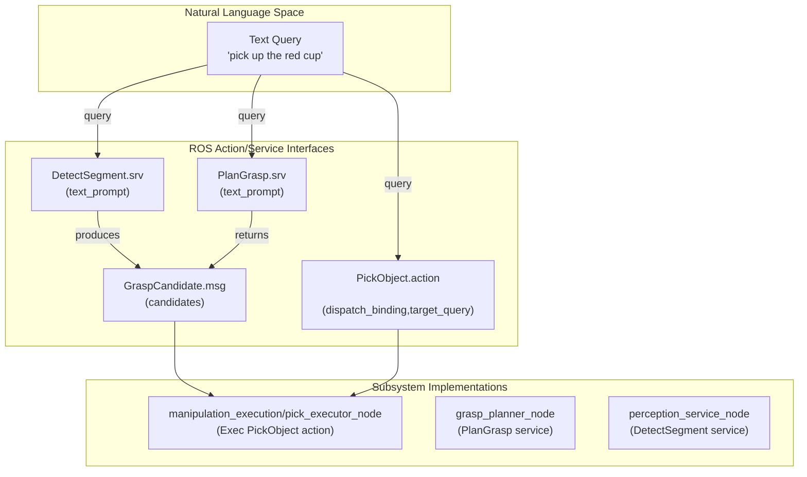
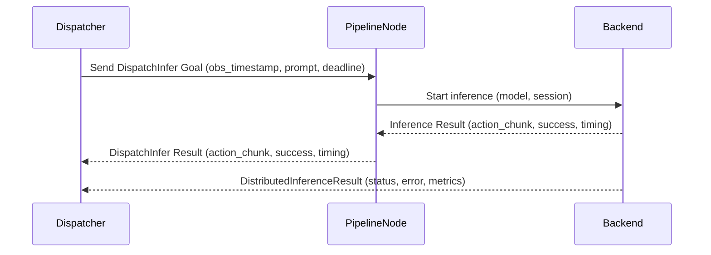

# 感知、抓取与推理接口

相关源码文件

以下文件被用作生成此 wiki 页面的上下文：

- [src/ibrobot_msgs/action/DispatchInfer.action](https://atomgit.com/openeuler/IB_Robot/blob/openEuler-26.09/src/ibrobot_msgs/action/DispatchInfer.action)
- [src/ibrobot_msgs/action/ExecuteTaskPlan.action](https://atomgit.com/openeuler/IB_Robot/blob/openEuler-26.09/src/ibrobot_msgs/action/ExecuteTaskPlan.action)
- [src/ibrobot_msgs/action/PickObject.action](https://atomgit.com/openeuler/IB_Robot/blob/openEuler-26.09/src/ibrobot_msgs/action/PickObject.action)
- [src/ibrobot_msgs/msg/Detection2D.msg](https://atomgit.com/openeuler/IB_Robot/blob/openEuler-26.09/src/ibrobot_msgs/msg/Detection2D.msg)
- [src/ibrobot_msgs/msg/DetectionArray.msg](https://atomgit.com/openeuler/IB_Robot/blob/openEuler-26.09/src/ibrobot_msgs/msg/DetectionArray.msg)
- [src/ibrobot_msgs/msg/DistributedInferenceResult.msg](https://atomgit.com/openeuler/IB_Robot/blob/openEuler-26.09/src/ibrobot_msgs/msg/DistributedInferenceResult.msg)
- [src/ibrobot_msgs/msg/GraspCandidate.msg](https://atomgit.com/openeuler/IB_Robot/blob/openEuler-26.09/src/ibrobot_msgs/msg/GraspCandidate.msg)
- [src/ibrobot_msgs/msg/GraspCandidateArray.msg](https://atomgit.com/openeuler/IB_Robot/blob/openEuler-26.09/src/ibrobot_msgs/msg/GraspCandidateArray.msg)
- [src/ibrobot_msgs/msg/InferenceError.msg](https://atomgit.com/openeuler/IB_Robot/blob/openEuler-26.09/src/ibrobot_msgs/msg/InferenceError.msg)
- [src/ibrobot_msgs/msg/InferenceFeatureSummary.msg](https://atomgit.com/openeuler/IB_Robot/blob/openEuler-26.09/src/ibrobot_msgs/msg/InferenceFeatureSummary.msg)
- [src/ibrobot_msgs/msg/InferencePipelineStatus.msg](https://atomgit.com/openeuler/IB_Robot/blob/openEuler-26.09/src/ibrobot_msgs/msg/InferencePipelineStatus.msg)
- [src/ibrobot_msgs/msg/InferencePolicySummary.msg](https://atomgit.com/openeuler/IB_Robot/blob/openEuler-26.09/src/ibrobot_msgs/msg/InferencePolicySummary.msg)
- [src/ibrobot_msgs/msg/TaskStep.msg](https://atomgit.com/openeuler/IB_Robot/blob/openEuler-26.09/src/ibrobot_msgs/msg/TaskStep.msg)
- [src/ibrobot_msgs/package.xml](https://atomgit.com/openeuler/IB_Robot/blob/openEuler-26.09/src/ibrobot_msgs/package.xml)
- [src/ibrobot_msgs/srv/DetectSegment.srv](https://atomgit.com/openeuler/IB_Robot/blob/openEuler-26.09/src/ibrobot_msgs/srv/DetectSegment.srv)
- [src/ibrobot_msgs/srv/MoveToPose.srv](https://atomgit.com/openeuler/IB_Robot/blob/openEuler-26.09/src/ibrobot_msgs/srv/MoveToPose.srv)
- [src/ibrobot_msgs/srv/PlanGrasp.srv](https://atomgit.com/openeuler/IB_Robot/blob/openEuler-26.09/src/ibrobot_msgs/srv/PlanGrasp.srv)
- [src/ibrobot_msgs/srv/SegmentDetections.srv](https://atomgit.com/openeuler/IB_Robot/blob/openEuler-26.09/src/ibrobot_msgs/srv/SegmentDetections.srv)
- [src/robot_config/robot_config/__init__.py](https://atomgit.com/openeuler/IB_Robot/blob/openEuler-26.09/src/robot_config/robot_config/__init__.py)
- [src/robot_config/robot_config/inference_config.py](https://atomgit.com/openeuler/IB_Robot/blob/openEuler-26.09/src/robot_config/robot_config/inference_config.py)

本页面记录 `ibrobot_msgs` 包中与 RoboFrame_stable 代码库的**感知**、**抓取**和**推理**工作流相关的关键 ROS 消息、服务与动作接口。这些接口促进感知流水线、抓取规划器、操作执行器与推理调度器等各子系统之间的通信。它们定义交换的数据，包括物体拾取、抓取规划、语义分割与分布式推理管理的命令、结果、反馈与配置。

---

## 1. 目的与范围

这些接口的主要目的是在以下模块之间实现模块化、定义良好的通信契约：

- 在相机图像中检测与分割物体的视觉和感知服务；
- 为物体操作评估候选抓取的抓取规划模块；
- 执行带反馈与校验的拾取动作的操作执行节点；
- 管理模型调用与分布式执行的通用推理服务。

覆盖的接口包括：

- **PickObject Action** —— 拾取指定物体的高层动作，支持闭环控制、委托与阶段反馈。
- **PlanGrasp Service** —— 依据文本提示请求抓取候选规划；返回候选抓取与场景元数据。
- **DetectSegment Service** —— 依据提示请求物体检测与分割；返回分割与检测结果。
- **GraspCandidate Message** —— 描述单个抓取候选的位姿、置信度、几何与碰撞过滤结果。
- **DispatchInfer Action** —— 带反馈与计时诊断的模型流水线遗留推理请求接口。
- **DistributedInference Result Message** —— 用于编排与上报分布式推理操作的低层消息。

这些接口对 RoboFrame 具身 AI 系统中高层技能规划、语义感知与底层机器人控制节点之间的集成至关重要。

---

## 2. PickObject Action 接口

`PickObject.action` 定义用于请求机器人拾取物体的面向目标**动作**接口。该动作由 ROS 动作服务器 `/manipulation/execute_pick` 上的操作执行系统实现。

### 关键特性：

- **委托支持**：该动作支持带身份（`expected_executor` 与 `actual_executor`）的委托执行，由服务器指定并校验，以提供安全的执行路由。
- **模式**：
  - `MODE_EXECUTE` (0)：包含抓取的完整执行。
  - `MODE_PLAN_ONLY` (1)：仅规划抓取，不执行。
  - `MODE_OBSERVE_ONLY` (2)：仅观测模式，不规划也不执行。
- **分发绑定**：包含技能分发元数据（经由 `DispatchBinding`）。
- **超时与控制标志**：包含超时、受监督直接控制标志、成功抓取后释放。

### 数据字段：

| 字段              | 类型                       | 描述                                      |
|--------------------|----------------------------|------------------------------------------------|
| `dispatch_binding`  | `DispatchBinding`           | 技能分发与任务绑定的元数据    |
| `target_query`      | `string`                    | 供感知流水线使用的物体查询字符串     |
| `timeout_sec`       | `float32`                   | 拾取尝试允许的最大时间       |
| `expected_executor` | `DelegatedExecutorIdentity` | 预期执行该动作的主体          |
| `supervised_direct` | `bool`                      | 面向受监督的硬件 bring-up 客户端        |
| `mode`             | `uint8`                     | 操作模式（execute、plan、observe）         |
| `release_after_success` | `bool`                  | 成功后是否释放物体     |

### 结果反馈：

| 字段                | 类型  | 描述                                  |
|----------------------|-------|----------------------------------------------|
| `success`            | bool  | 拾取是否成功                        |
| `error_code`         | string| 失败时的错误码                          |
| `message`            | string| 诊断或状态消息                  |
| `attempts`           | uint32| 拾取尝试次数                        |
| `verification_status`| uint8 | 抓取校验结果状态             |
| `verification_confidence` | float32 | 校验置信度               |
| `debug_output_dir`   | string| 调试信息文件目录                  |
| `completed_phases`   | string array | 拾取操作期间完成的阶段  |
| `actual_executor`    | `DelegatedExecutorIdentity` | 实际动作执行者                    |
| `candidate_index`    | int32 | 所选抓取候选的索引                |
| `released_after_success` | bool | 成功后是否已释放物体   |
| `pipeline_timings_json` | string | JSON 序列化的计时诊断          |

### 反馈：

| 字段     | 类型    | 描述                     |
|-----------|---------|---------------------------------|
| `phase`   | string  | 当前拾取阶段指示器     |
| `progress`| float32 | 进度百分比 [0.0-1.0]   |
| `attempt` | uint32  | 当前尝试计数            |
| `detail`  | string  | 反馈的附加细节   |

该动作是操作任务的基础，紧密集成感知与执行。

来源：[src/ibrobot_msgs/action/PickObject.action:1-54](https://atomgit.com/openeuler/IB_Robot/blob/openEuler-26.09/src/ibrobot_msgs/action/PickObject.action#L1-L54)

---

## 3. PlanGrasp Service 接口

`PlanGrasp.srv` 是一个**服务**接口，使客户端能够基于文本提示请求物体的候选抓取。

### 请求字段：

| 字段                 | 类型    | 描述                                         |
|-----------------------|---------|-----------------------------------------------------|
| `text_prompt`         | string  | 物体的自然语言或描述字符串    |
| `confidence_threshold`| float32 | 返回抓取的最低置信度              |
| `grasp_threshold`     | float32 | 抓取评分阈值                          |
| `debug_output_mode`   | string  | 调试模式：`none`、`diagnostic` 或 `full`         |

### 响应字段：

| 字段                     | 类型                 | 描述                                           |
|---------------------------|----------------------|-------------------------------------------------------|
| `grasps`                  | `GraspCandidateArray`| 返回的候选抓取数组                     |
| `object_centroid_xyz`      | `geometry_msgs/Point`| 所选检测质心（偏向中心）           |
| `object_volume_centroid_xyz` | `geometry_msgs/Point`| 物体凸包的体积质心                |
| `object_volume_m3`         | float32              | 物体体积（立方米）                          |
| `object_point_count`       | int32                | 掩码内的 3D 点数                            |
| `table_plane_found`        | bool                 | 是否找到桌面平面                              |
| `table_plane_normal`       | `geometry_msgs/Vector3` | 桌面法向量                     |
| `table_plane_offset`       | float32              | 平面偏移（距离）                                |
| `table_plane_inlier_ratio` | float32              | 拟合平面的点比例                       |
| `object_top_xyz`           | `geometry_msgs/Point`| 相机坐标系下物体的顶部点                    |
| `execution_table_plane_found` | bool             | 是否找到执行侧平面                              |
| `execution_table_plane_normal` | `geometry_msgs/Vector3` | 执行平面法向量                           |
| `execution_table_plane_offset` | float32          | 执行平面偏移                                 |
| `execution_table_plane_inlier_ratio` | float32    | 执行平面点比例                            |
| `inference_time_ms`        | float32              | 推理耗时（ms）                          |
| `success`                 | bool                 | 规划是否成功                             |
| `message`                 | string               | 诊断或错误消息                            |
| `debug_output_dir`         | string               | 调试输出目录                     |
| `diagnostic_details`       | string array         | 键值对诊断字符串                            |

该服务将感知（分割/检测）与抓取规划结果关联，包括桌面几何与 3D 物体质心等详细场景理解。

来源：[src/ibrobot_msgs/srv/PlanGrasp.srv:1-57](https://atomgit.com/openeuler/IB_Robot/blob/openEuler-26.09/src/ibrobot_msgs/srv/PlanGrasp.srv#L1-L57)

---

## 4. DetectSegment Service 接口

`DetectSegment.srv` 服务定义对物体的语义检测与分割请求。

### 请求字段：

| 字段                 | 类型    | 描述                    |
|-----------------------|---------|--------------------------------|
| `text_prompt`         | string  | 物体的自然语言描述或查询 |
| `confidence_threshold`| float32 | 检测的置信度阈值|

### 响应字段：

| 字段           | 类型               | 描述                  |
|-----------------|--------------------|------------------------------|
| `detections`    | `DetectionArray`    | 检测到的物体与分割数组 |
| `inference_time_ms` | float32          | 推理耗时（ms）|
| `success`       | bool               | 检测是否成功  |
| `message`       | string             | 失败时的诊断消息 |

该接口用于请求感知模块定位并分割由文本提示指定的物体，返回详细的 2D 检测与掩码。

来源：[src/ibrobot_msgs/srv/DetectSegment.srv:1-9](https://atomgit.com/openeuler/IB_Robot/blob/openEuler-26.09/src/ibrobot_msgs/srv/DetectSegment.srv#L1-L9)

---

## 5. GraspCandidate Message

`GraspCandidate.msg` 定义单个候选抓取的位姿与关联指标。

### 字段：

| 字段                  | 类型                 | 描述                                           |
|------------------------|----------------------|-------------------------------------------------------|
| `header`               | `std_msgs/Header`    | 时间戳与坐标系信息                              |
| `pose_matrix`          | `float32[16]`        | 4x4 SE(3) 齐次变换矩阵（行主序）  |
| `confidence`           | `float32`            | 抓取置信度，范围 [0, 1]                           |
| `collision_free`       | `bool`               | 抓取是否通过碰撞过滤             |
| `target_width_m`       | `float32`            | 沿夹爪闭合轴的物体估计宽度 |
| `target_width_quality` | `float32`            | 宽度估计置信度 [0 = 无可靠宽度]|
| `width_axis_camera`    | `float32[3]`         | 相机坐标系下的轴向向量           |
| `target_width_min_offset_m` | `float32`        | 相对位姿的轴向最小偏移                 |
| `target_width_max_offset_m` | `float32`        | 相对位姿的轴向最大偏移                 |

该消息提供表示单个抓取假设的核心数据，对抓取规划与校验步骤至关重要。

来源：[src/ibrobot_msgs/msg/GraspCandidate.msg:1-24](https://atomgit.com/openeuler/IB_Robot/blob/openEuler-26.09/src/ibrobot_msgs/msg/GraspCandidate.msg#L1-L24)

---

## 6. DispatchInfer Action 接口（遗留推理）

`DispatchInfer.action` 是一个遗留**动作**接口，用于在特定观测时间戳请求推理。

### Goal 字段：

| 字段          | 类型               | 描述                                |
|----------------|--------------------|--------------------------------------------|
| `obs_timestamp`| `builtin_interfaces/Time` | 请求观测的时间戳      |
| `prompt`       | string             | 可选的推理字符串任务提示|
| `inference_id` | string             | 唯一请求 ID（UUID4）                  |
| `deadline`     | `builtin_interfaces/Time` | 绝对截止时间 UTC（零值使用默认超时） |

### Result 字段：

| 字段                | 类型               | 描述                                     |
|----------------------|--------------------|-------------------------------------------------|
| `action_chunk`       | `VariantsList`      | 模型返回的动作序列            |
| `chunk_size`         | int32              | 返回的动作数                        |
| `execution_horizon`  | int32              | 可立即执行的 chunk 前缀（0=全部）  |
| `success`            | bool               | 推理是否成功                  |
| `message`            | string             | 失败时的错误消息                           |
| `inference_latency_ms` | float64           | 从请求到结果的延迟（ms）               |
| `pipeline_id`        | string             | 所用流水线标识                        |
| `request_id`         | string             | 回显的请求 ID                             |
| `deployment_fingerprint` | string          | 部署指纹/版本                     |
| `backend_latency_ms` | float64            | 模型后端处理时间                    |
| `performance_json`   | string             | 流水线阶段的 JSON 诊断                |
| `error`              | `InferenceError`   | 失败的错误详情                          |

### Feedback：

| 字段    | 类型    | 描述                          |
|----------|---------|-------------------------------------|
| `progress` | float32 | 进度比例 [0.0 到 1.0]     |
| `status`   | string  | 状态消息                      |

该接口处理异步推理请求并提供详细诊断，但已被更新的基于会话的接口取代。

来源：[src/ibrobot_msgs/action/DispatchInfer.action:1-28](https://atomgit.com/openeuler/IB_Robot/blob/openEuler-26.09/src/ibrobot_msgs/action/DispatchInfer.action#L1-L28)

---

## 7. DistributedInferenceResult Message

该消息用于分布式推理子系统内，上报推理操作的结果与状态。

### 字段：

| 字段             | 类型         | 描述                                  |
|-------------------|--------------|----------------------------------------------|
| `protocol_version`| uint32       | 协议版本号                       |
| `operation`       | uint8        | 操作码（如 infer、reset、cancel） |
| `pipeline_id`     | string       | 流水线标识                        |
| `request_id`      | string       | 请求标识                            |
| `target_request_id` | string     | 转发场景下的目标请求 ID       |
| `session_id`      | string       | 控制该请求的会话             |
| `session_generation` | uint64    | 递增的会话版本                   |
| `deployment_fingerprint` | string | 流水线部署指纹               |
| `success`         | bool         | 后端是否成功运行推理   |
| `error`           | `InferenceError` | 失败时的错误详情                       |
| `action_chunk`    | `VariantsList` | 推理成功时输出的动作块   |
| `actual_chunk_size` | uint32     | 返回的 chunk 大小                            |
| `execution_horizon` | uint32     | 可执行前缀的视界                   |
| `backend_latency_ms` | float64    | 后端处理延迟                      |
| `performance_json` | string      | 带阶段/计时诊断的 JSON             |
| `backend_ready`   | bool         | 后端就绪状态                        |
| `backend_state`   | string       | 当前后端运行时状态（诊断信息） |

该低层消息支持推理负载跨边缘/云端节点拆分或委托的系统中同步与异步分布式推理编排。

来源：[src/ibrobot_msgs/msg/DistributedInferenceResult.msg:1-22](https://atomgit.com/openeuler/IB_Robot/blob/openEuler-26.09/src/ibrobot_msgs/msg/DistributedInferenceResult.msg#L1-L22)

---

## 8. 数据流与实现评注

这里解释这些消息与服务如何连接 RoboFrame 中的关键子系统：

- **自然语言查询到感知/抓取：**  
  用户或 agent 发出文本查询（如 `"pick up the red cup"`），包含在 `PickObject.dispatch_binding.target_query`、`PlanGrasp.text_prompt` 或 `DetectSegment.text_prompt` 中。  
  这些传播到运行分割/检测的感知模块，产生 `DetectionArray` 结果。  
  抓取规划器接收这些检测结果，产生排序后的 `GraspCandidateArray` 输出。  
  操作执行器消费这些输出执行物理抓取。

- **推理调度与执行：**  
  感知、抓取规划及其他任务使用的模型流水线通过 `DispatchInfer.action` 等推理动作管理。  
  调度器发送指定时间戳与提示的请求，并接收反馈与计时结果。  
  分布式推理使用 `DistributedInferenceResult` 消息进行详细的后端编排。

- **闭环操作：**  
  `PickObject.action` 实现复杂的基于阶段的控制，带持续反馈、校验、重试计数与详细诊断输出，用于运行时保障。

---

## 9. 图

### 图 1：拾取与抓取的自然语言到代码实体

来源：`src/ibrobot_msgs/action/PickObject.action:1-54`, `src/ibrobot_msgs/srv/PlanGrasp.srv:1-57`, `src/ibrobot_msgs/srv/DetectSegment.srv:1-9`, `src/ibrobot_msgs/msg/GraspCandidate.msg:1-24`

---

### 图 2：带 DispatchInfer 与 DistributedInferenceResult 的推理请求与结果流

该图将自然语言/agent 的推理请求经由流水线节点桥接到执行模型的后端，并以遗留与分布式格式上报结果。

来源：`src/ibrobot_msgs/action/DispatchInfer.action:1-28`, `src/ibrobot_msgs/msg/DistributedInferenceResult.msg:1-22`

---

## 10. 汇总表

| 接口               | 类型     | 关键目的                        | 备注                             |
|-------------------------|----------|----------------------------------|----------------------------------|
| `PickObject.action`      | Action   | 请求物体拾取操作  | 委托式多阶段控制   |
| `PlanGrasp.srv`          | Service  | 生成抓取候选         | 返回几何与桌面数据 |
| `DetectSegment.srv`      | Service  | 检测并分割物体          | 感知分割          |
| `GraspCandidate.msg`     | Message  | 单个抓取候选描述| 位姿、置信度、几何       |
| `DispatchInfer.action`   | Action   | 遗留推理请求          | 带时间戳的模型推理      |
| `DistributedInferenceResult.msg` | Message | 分布式推理结果 | 后端编排信息       |

---

## 11. 附加说明

- 这些接口属于 `ibrobot_msgs` 包，包含 IB-Robot 的全部 ROS 消息/动作/服务定义。
- `robot_config` 包配置与这些接口抽象隔离的推理流水线与调度 [src/robot_config/robot_config/inference_config.py:1-217](https://atomgit.com/openeuler/IB_Robot/blob/openEuler-26.09/src/robot_config/robot_config/inference_config.py#L1-L217)
- 更新的推理框架偏好基于会话的调度式流水线，而非遗留 `DispatchInfer` [src/robot_config/robot_config/inference_config.py](https://atomgit.com/openeuler/IB_Robot/blob/openEuler-26.09/src/robot_config/robot_config/inference_config.py)
- `PlanGrasp.srv` 中的调试模式为开发与诊断提供细粒度输出。
- `PickObject.action` 在生产操作工作流中至关重要，与技能分发和校验子系统紧密交互。

---

## 参考

- `src/ibrobot_msgs/action/PickObject.action:1-54`
- `src/ibrobot_msgs/srv/PlanGrasp.srv:1-57`
- `src/ibrobot_msgs/srv/DetectSegment.srv:1-9`
- `src/ibrobot_msgs/msg/GraspCandidate.msg:1-24`
- `src/ibrobot_msgs/action/DispatchInfer.action:1-28`
- `src/ibrobot_msgs/msg/DistributedInferenceResult.msg:1-22`
- `src/robot_config/robot_config/inference_config.py:1-217`
- [src/robot_config/robot_config/__init__.py:1-120](https://atomgit.com/openeuler/IB_Robot/blob/openEuler-26.09/src/robot_config/robot_config/__init__.py#L1-L120)
