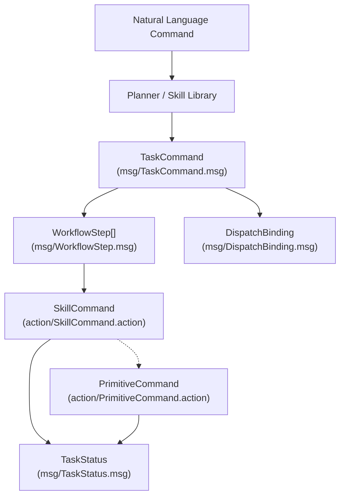
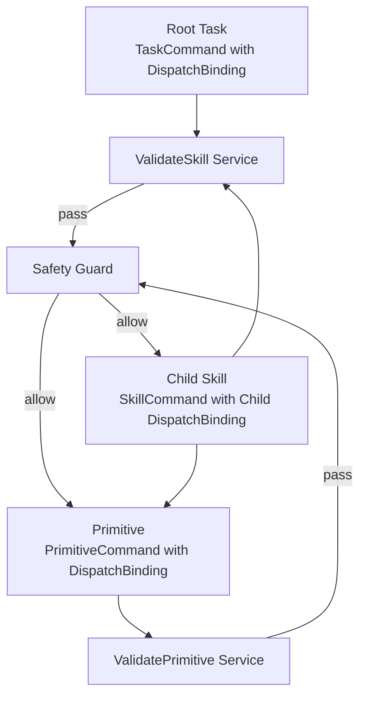

# 技能与原语契约

相关源码文件

以下文件被用作生成此 wiki 页面的上下文：

- [src/embodied_common/embodied_common/skill_request.py](https://atomgit.com/openeuler/IB_Robot/blob/openEuler-26.09/src/embodied_common/embodied_common/skill_request.py)
- [src/embodied_common/embodied_common/workflow_contracts.py](https://atomgit.com/openeuler/IB_Robot/blob/openEuler-26.09/src/embodied_common/embodied_common/workflow_contracts.py)
- [src/ibrobot_msgs/CMakeLists.txt](https://atomgit.com/openeuler/IB_Robot/blob/openEuler-26.09/src/ibrobot_msgs/CMakeLists.txt)
- [src/ibrobot_msgs/README.md](https://atomgit.com/openeuler/IB_Robot/blob/openEuler-26.09/src/ibrobot_msgs/README.md)
- [src/ibrobot_msgs/action/ExecuteAgentPlan.action](https://atomgit.com/openeuler/IB_Robot/blob/openEuler-26.09/src/ibrobot_msgs/action/ExecuteAgentPlan.action)
- [src/ibrobot_msgs/action/ImitateHumanMotion.action](https://atomgit.com/openeuler/IB_Robot/blob/openEuler-26.09/src/ibrobot_msgs/action/ImitateHumanMotion.action)
- [src/ibrobot_msgs/action/PrimitiveCommand.action](https://atomgit.com/openeuler/IB_Robot/blob/openEuler-26.09/src/ibrobot_msgs/action/PrimitiveCommand.action)
- [src/ibrobot_msgs/action/SkillCommand.action](https://atomgit.com/openeuler/IB_Robot/blob/openEuler-26.09/src/ibrobot_msgs/action/SkillCommand.action)
- [src/ibrobot_msgs/msg/DispatchBinding.msg](https://atomgit.com/openeuler/IB_Robot/blob/openEuler-26.09/src/ibrobot_msgs/msg/DispatchBinding.msg)
- [src/ibrobot_msgs/msg/SceneAnalysisRequest.msg](https://atomgit.com/openeuler/IB_Robot/blob/openEuler-26.09/src/ibrobot_msgs/msg/SceneAnalysisRequest.msg)
- [src/ibrobot_msgs/msg/SceneAnalysisResult.msg](https://atomgit.com/openeuler/IB_Robot/blob/openEuler-26.09/src/ibrobot_msgs/msg/SceneAnalysisResult.msg)
- [src/ibrobot_msgs/msg/TaskCommand.msg](https://atomgit.com/openeuler/IB_Robot/blob/openEuler-26.09/src/ibrobot_msgs/msg/TaskCommand.msg)
- [src/ibrobot_msgs/msg/TaskStatus.msg](https://atomgit.com/openeuler/IB_Robot/blob/openEuler-26.09/src/ibrobot_msgs/msg/TaskStatus.msg)
- [src/ibrobot_msgs/msg/WorkflowStep.msg](https://atomgit.com/openeuler/IB_Robot/blob/openEuler-26.09/src/ibrobot_msgs/msg/WorkflowStep.msg)
- [src/ibrobot_msgs/srv/PearParameterPredict.srv](https://atomgit.com/openeuler/IB_Robot/blob/openEuler-26.09/src/ibrobot_msgs/srv/PearParameterPredict.srv)
- [src/ibrobot_msgs/srv/PrepareAgentPlan.srv](https://atomgit.com/openeuler/IB_Robot/blob/openEuler-26.09/src/ibrobot_msgs/srv/PrepareAgentPlan.srv)
- [src/ibrobot_msgs/srv/ValidatePrimitive.srv](https://atomgit.com/openeuler/IB_Robot/blob/openEuler-26.09/src/ibrobot_msgs/srv/ValidatePrimitive.srv)
- [src/ibrobot_msgs/srv/ValidateSkill.srv](https://atomgit.com/openeuler/IB_Robot/blob/openEuler-26.09/src/ibrobot_msgs/srv/ValidateSkill.srv)
- [src/ibrobot_msgs/srv/YoloXDetect.srv](https://atomgit.com/openeuler/IB_Robot/blob/openEuler-26.09/src/ibrobot_msgs/srv/YoloXDetect.srv)
- [src/manipulation_execution/README.md](https://atomgit.com/openeuler/IB_Robot/blob/openEuler-26.09/src/manipulation_execution/README.md)
- [src/manipulation_execution/manipulation_execution/imitate_human_motion_executor.py](https://atomgit.com/openeuler/IB_Robot/blob/openEuler-26.09/src/manipulation_execution/manipulation_execution/imitate_human_motion_executor.py)
- [src/manipulation_execution/manipulation_execution/imitate_human_motion_executor_node.py](https://atomgit.com/openeuler/IB_Robot/blob/openEuler-26.09/src/manipulation_execution/manipulation_execution/imitate_human_motion_executor_node.py)
- [src/manipulation_execution/test/test_imitate_human_motion_vision.py](https://atomgit.com/openeuler/IB_Robot/blob/openEuler-26.09/src/manipulation_execution/test/test_imitate_human_motion_vision.py)

本页面记录 IB-Robot / RoboFrame 系统中**技能与原语契约**的详细实现、数据流与关键类型。这些契约规范化了高层技能、底层原语、校验例程与任务编排具身 AI 框架中运作和交互的方式。

---

## 目的与范围

**技能与原语契约**定义了连接以下内容的统一通信接口与工作流：

- 抽象的 **SkillCommand** 动作（组合原语的高层能力）。
- 具体的 **PrimitiveCommand** 动作（原子、可执行的机器人动作）。
- 技能与原语的校验服务。
- 体现任务请求与状态的 **TaskCommand** 与 **TaskStatus** 消息的生命周期。
- 指导任务分解的工作流步骤与构造。
- 在分发层之间承载身份、授权与版本信息的 **DispatchBinding** 信封。

这些契约主要以 `ibrobot_msgs` ROS 包中定义的 ROS 2 动作、消息与服务形式实现。消费者与生产者节点对这些契约进行严格的正确性、授权与协调校验。

---

## 1. SkillCommand 与 PrimitiveCommand ROS 动作

### SkillCommand

- 表示一个**高层机器人技能**，可以是由多个原语或子任务组合而成的复杂行为。
- 该动作接口包括目标、结果与反馈字段。
- 目标携带 `schema_version`（版本控制）与 `DispatchBinding` 信封，以维持一致的任务身份。
- 技能命令通常经 `/embodied/execute_skill` 分发。

---

### PrimitiveCommand

- 表示一个**原子机器人运动或控制原语**。
- 主要由 `skill_executor_node` 在 `/embodied/execute_primitive` 提供。
- 目标包含详细控制参数，如关节角度、位姿、夹爪状态、相对运动、速度缩放与超时。
- 同样携带精确的 `DispatchBinding` 用于授权与追踪。
- 执行令牌将原语与其父 SkillCommand 请求关联。
- 结果包含成功标志、错误码与注册表身份确认。
- 反馈由执行期间的状态字符串与文本细节组成。

---

### 模式版本与兼容性

SkillCommand 与 PrimitiveCommand 及相关请求类型都显式将 `schema_version` 字段作为首个字段。支持的版本包括：

- **v1**：面向操作的基础字段，无导航参数。
- **v2**：在 v1 基础上扩展了附加导航命令字段与新的控制模式。

该版本机制严格防止生产者与消费者之间的二进制不兼容，运行时检查阻止 v1 与 v2 二进制混用。

---

## 2. 校验服务：ValidateSkill 与 ValidatePrimitive

- 两个同步服务（`ValidateSkill.srv`、`ValidatePrimitive.srv`）在执行前校验传入的技能或原语请求是否符合系统策略与机器人约束。
- 两个服务都要求精确的 `DispatchBinding` 用于版本控制与授权。
- 响应指示成功或拒绝原因。
- 该机制与**安全防护（Safety Guard）**集成，确保正确的控制模式、工作空间边界与资源可用性。

---

## 3. TaskCommand 与 TaskStatus 消息

### TaskCommand

- 端到端任务请求的主要数据载体，包括原始自然语言命令输入、任务类型、顶层目标与有序工作流步骤。
- 持有完整的 `DispatchBinding` 信封，携带任务/版本身份（`task_id`、`root_task_id`）与任务预算。
- `workflow_steps` 字段由零个或多个 `WorkflowStep` 条目组成，详述任务所需的顺序技能执行。
- 附加字段包括优先级、超时、上下文 JSON 注释与顶层地点/目标/容器提示。

### TaskStatus

- 向 `/embodied/task_status` 报告任务的当前执行状态。
- 包含状态（`planned`、`executing`、`completed`、`failed`）、成功标志、错误、当前执行技能、累计完成技能与完整注册表版本信息的字段。
- 提供详细的诊断与溯源信息，用于可追溯性与审计。

---

## 4. 工作流步骤与规范化 WorkflowStep 类型

- `CanonicalWorkflowStep` 类强制一个冻结、类型化且经校验的原子工作流步骤表示。
- 字段包括模式版本、技能名称、各类目标提示、方向运动提示、时长、超时与导航参数。
- 校验例程确保字段符合预期类型、合法取值与模式版本约束。
- 每个任务的步骤通常不超过 16 个。
- 工作流步骤可包含导航命令（v2 模式）或仅操作命令（v1 模式）。

---

## 5. DispatchBinding：任务与版本信封

`DispatchBinding` 消息是关键的容器，在运行时内将每次分发的技能或原语调用一致地绑定。它通过包含以下内容强制跨进程一致性：

- `task_id`：当前活动任务的唯一 ID。
- `root_task_id`：整个工作流根任务的稳定标识符。
- `task_budget`：任务执行的时间或资源预算。
- 期望的机器人注册表 epoch、generation 与 digest 字段，用于版本一致性。
- `workflow_digest` 与 `workflow_step_index`，用于定位多步工作流中的位置。
- 租约随机数（`root_lease_nonce` 与 `dispatch_nonce`），用于委托或子原语的并发授权。
- 用于分布式追踪与诊断的 `trace_id`。

DispatchBinding 是不可变的，必须在动作分发链中被严格遵守，以维持安全性、授权与审计属性。

---

## 6. 工作流与分发流程（摘要）

RoboFrame 中技能与原语的基本工作流如下：

1. **TaskCommand 接收：**
   - 接收带有原始自然语言和/或 `workflow_steps` 中规划结果的请求。
   - 包含标记任务状态与预算的新鲜 `DispatchBinding`。

2. **校验：**
   - `ValidateSkill` 与 `ValidatePrimitive` 服务确认合规与安全。
   - 安全防护可拒绝违反工作空间或模式约束的请求。

3. **SkillCommand 分发：**
   - 在 `/embodied/execute_skill` 带完整 `DispatchBinding` 分发。
   - 对组合任务，可链接或嵌套多个技能。

4. **PrimitiveCommand 分发：**
   - 技能在内部经 `/embodied/execute_primitive` 分发 `PrimitiveCommand` 动作。
   - 原语继承并维持精确的 `DispatchBinding`，包括子随机数。

5. **TaskStatus 更新：**
   - 执行期间，状态消息在 `/embodied/task_status` 报告进度与错误。
   - 终结与取消沿链向下传播。

这在具身 AI 控制框架内确保了严格的数据溯源、版本一致性与操作安全。

---

## 7. 关键代码实体及其角色

| 代码实体                          | 描述                                                                                  |
|------------------------------------|----------------------------------------------------------------------------------------------|
| `ibrobot_msgs/action/SkillCommand.action`      | 用于执行带版本化数据与绑定的高层技能的 ROS2 动作定义。     |
| `ibrobot_msgs/action/PrimitiveCommand.action`  | 定义原子运动原语的 ROS2 动作，含丰富关节控制参数。          |
| `ibrobot_msgs/srv/ValidateSkill.srv`           | 校验 SkillCommand 请求的服务。                                                  |
| `ibrobot_msgs/srv/ValidatePrimitive.srv`       | 校验 PrimitiveCommand 请求的服务。                                              |
| `ibrobot_msgs/msg/TaskCommand.msg`             | 定义完整任务负载的消息，包括有序工作流步骤与任务元数据。   |
| `ibrobot_msgs/msg/TaskStatus.msg`              | 报告任务当前执行状态、错误与进度的消息。                  |
| `ibrobot_msgs/msg/WorkflowStep.msg`            | 任务工作流中的单个步骤，携带技能名称、目标与运动提示。    |
| `ibrobot_msgs/msg/DispatchBinding.msg`         | 强类型、不可变的信封，绑定任务、子任务、步骤、执行预算与授权信息。 |
| `embodied_common/embodied_common/workflow_contracts.py` | 强制 WorkflowStep 校验与规范化的类型化 dataclass。                      |

---

## 8. 图：自然语言任务到代码实体

---

## 9. 图：分发绑定与授权流程

---

## 10. 数据流与控制逻辑摘要

- 任务以携带不可变 `DispatchBinding` 的 `TaskCommand` 开始。
- `workflow_steps` 描述从自然语言指令分解出的有序 `SkillCommand`。
- 每个分发的 `SkillCommand` 进一步发出原子 `PrimitiveCommand`。
- 每个动作或服务调用都携带同一份精确的 `DispatchBinding`，确保可追溯性与授权。
- 校验器与安全防护在执行前强制正确性。
- 进度与错误以 `TaskStatus` 消息回传。
- 强模式版本（`schema_version` 字段）确保技能与原语接口的运行时兼容与安全演进。

---

## 参考与来源

- `src/ibrobot_msgs/action/SkillCommand.action:1-82`
- `src/ibrobot_msgs/action/PrimitiveCommand.action:1-50`
- `src/ibrobot_msgs/msg/TaskCommand.msg:1-70`
- `src/ibrobot_msgs/msg/TaskStatus.msg:1-92`
- `src/ibrobot_msgs/msg/WorkflowStep.msg:1-140`
- `src/ibrobot_msgs/msg/DispatchBinding.msg:1-29`
- `src/embodied_common/embodied_common/workflow_contracts.py:1-154`
- `src/ibrobot_msgs/README.md:1-139`

---

以上是对 IB-Robot RoboFrame 中技能与原语契约的详细技术说明，涵盖具身 AI 技能执行基础的契约、校验与工作流分发逻辑。
