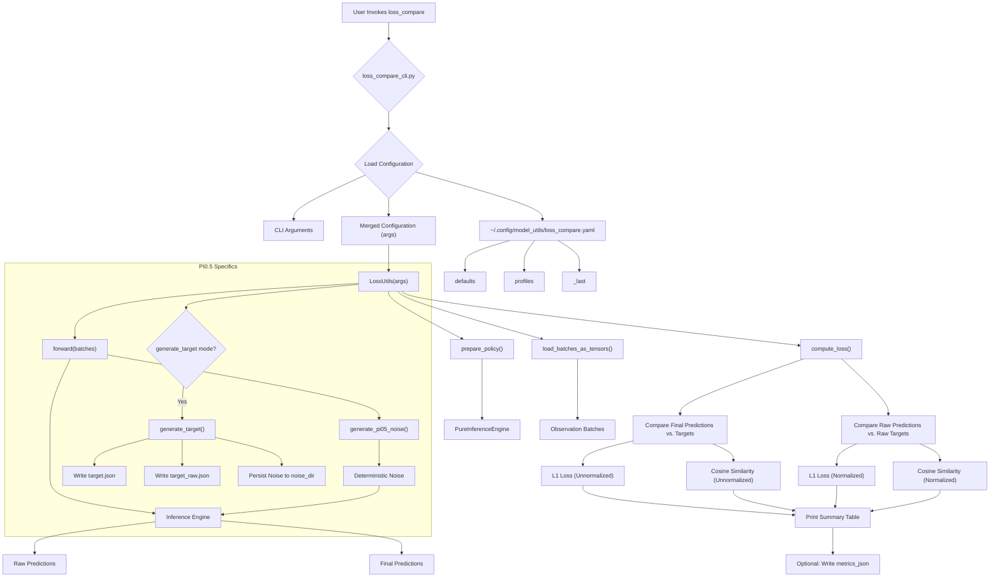
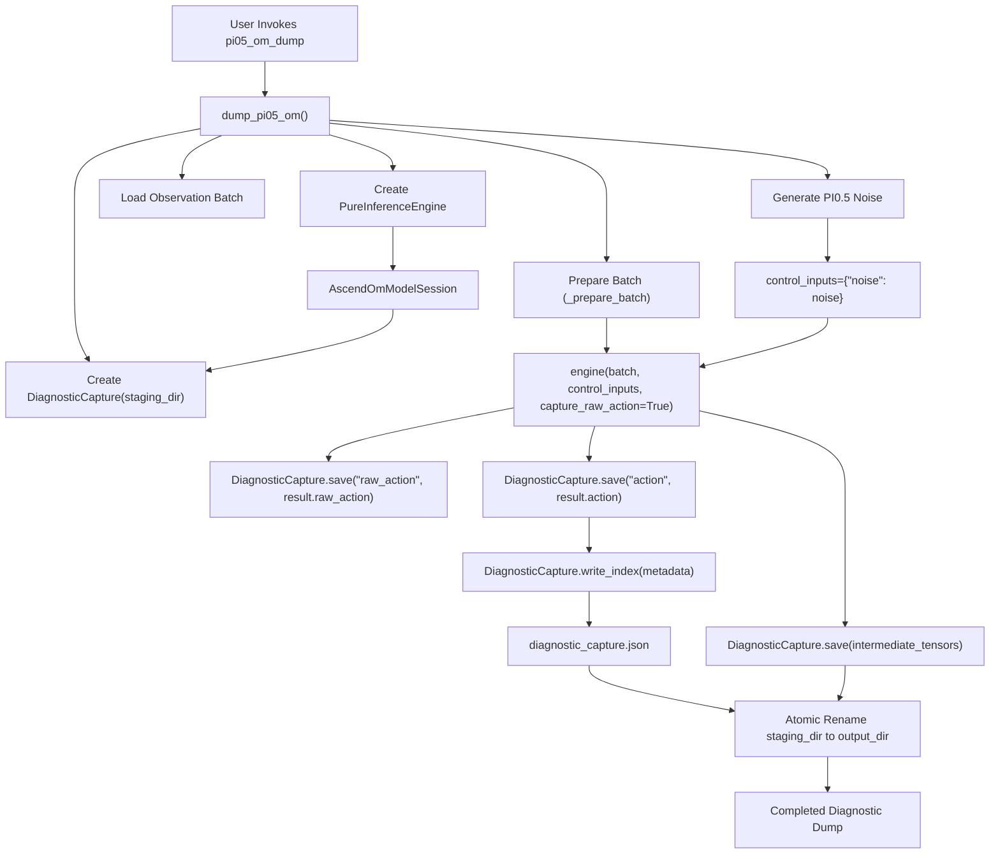
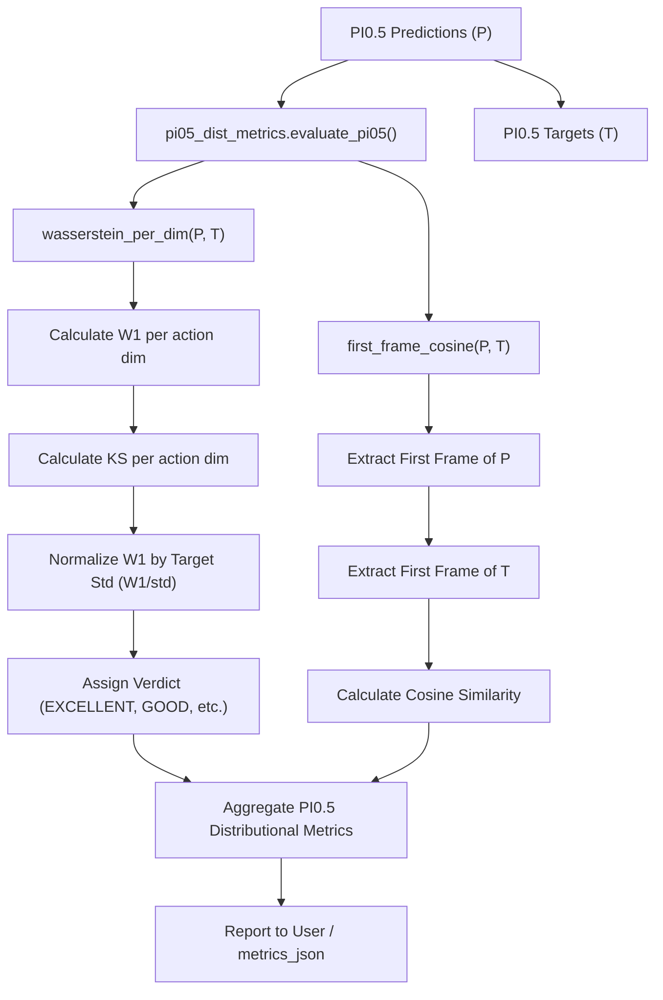

# 精度诊断与调度表

相关源码文件

以下文件被用作生成此 wiki 页面的上下文：

- [src/model_utils/model_utils/loss_compare.py](https://atomgit.com/openeuler/IB_Robot/blob/openEuler-26.09/src/model_utils/model_utils/loss_compare.py)
- [src/model_utils/model_utils/loss_compare_cli.py](https://atomgit.com/openeuler/IB_Robot/blob/openEuler-26.09/src/model_utils/model_utils/loss_compare_cli.py)
- [src/model_utils/model_utils/observation_batch.py](https://atomgit.com/openeuler/IB_Robot/blob/openEuler-26.09/src/model_utils/model_utils/observation_batch.py)
- [src/model_utils/model_utils/observation_batch_cli.py](https://atomgit.com/openeuler/IB_Robot/blob/openEuler-26.09/src/model_utils/model_utils/observation_batch_cli.py)
- [src/model_utils/model_utils/pi05_dist_metrics.py](https://atomgit.com/openeuler/IB_Robot/blob/openEuler-26.09/src/model_utils/model_utils/pi05_dist_metrics.py)
- [src/model_utils/model_utils/pi05_export/curvature_schedule.py](https://atomgit.com/openeuler/IB_Robot/blob/openEuler-26.09/src/model_utils/model_utils/pi05_export/curvature_schedule.py)
- [src/model_utils/model_utils/pi05_export/quant/profiles.py](https://atomgit.com/openeuler/IB_Robot/blob/openEuler-26.09/src/model_utils/model_utils/pi05_export/quant/profiles.py)
- [src/model_utils/model_utils/pi05_export/quantization_profiles/pi05-ae-attn-v1.yaml](https://atomgit.com/openeuler/IB_Robot/blob/openEuler-26.09/src/model_utils/model_utils/pi05_export/quantization_profiles/pi05-ae-attn-v1.yaml)
- [src/model_utils/model_utils/pi05_export/tune_schedule.py](https://atomgit.com/openeuler/IB_Robot/blob/openEuler-26.09/src/model_utils/model_utils/pi05_export/tune_schedule.py)
- [src/model_utils/model_utils/pi05_om_dump.py](https://atomgit.com/openeuler/IB_Robot/blob/openEuler-26.09/src/model_utils/model_utils/pi05_om_dump.py)
- [src/model_utils/test/test_ascend_diagnostic_capture.py](https://atomgit.com/openeuler/IB_Robot/blob/openEuler-26.09/src/model_utils/test/test_ascend_diagnostic_capture.py)
- [src/model_utils/test/test_curvature_schedule.py](https://atomgit.com/openeuler/IB_Robot/blob/openEuler-26.09/src/model_utils/test/test_curvature_schedule.py)
- [src/model_utils/test/test_loss_compare.py](https://atomgit.com/openeuler/IB_Robot/blob/openEuler-26.09/src/model_utils/test/test_loss_compare.py)
- [src/model_utils/test/test_loss_compare_cli.py](https://atomgit.com/openeuler/IB_Robot/blob/openEuler-26.09/src/model_utils/test/test_loss_compare_cli.py)
- [src/model_utils/test/test_observation_batch.py](https://atomgit.com/openeuler/IB_Robot/blob/openEuler-26.09/src/model_utils/test/test_observation_batch.py)
- [src/model_utils/test/test_observation_batch_cli.py](https://atomgit.com/openeuler/IB_Robot/blob/openEuler-26.09/src/model_utils/test/test_observation_batch_cli.py)
- [src/model_utils/test/test_pi05_dist_metrics.py](https://atomgit.com/openeuler/IB_Robot/blob/openEuler-26.09/src/model_utils/test/test_pi05_dist_metrics.py)
- [src/model_utils/test/test_pi05_export_cli.py](https://atomgit.com/openeuler/IB_Robot/blob/openEuler-26.09/src/model_utils/test/test_pi05_export_cli.py)
- [src/model_utils/test/test_pi05_om_dump.py](https://atomgit.com/openeuler/IB_Robot/blob/openEuler-26.09/src/model_utils/test/test_pi05_om_dump.py)
- [src/model_utils/test/test_pi05_quant_profiles.py](https://atomgit.com/openeuler/IB_Robot/blob/openEuler-26.09/src/model_utils/test/test_pi05_quant_profiles.py)
- [src/model_utils/test/test_pi05_quantize_ae.py](https://atomgit.com/openeuler/IB_Robot/blob/openEuler-26.09/src/model_utils/test/test_pi05_quantize_ae.py)

本页面详细介绍 RoboFrame 项目中用于诊断模型精度和管理推理调度表的工具与方法，重点关注 PI0.5 模型。内容涵盖用于定量评估的 `loss_compare`、用于详尽诊断数据采集的 `pi05_om_dump`、用于稳健验证 PI0.5 的分布度量指标，以及曲率与调优调度表的管理、量化 profile 与观测批次。

## 损失对比（`loss_compare`）

`loss_compare` 工具是相对于基线定量评估已部署策略精度的关键工具。它计算预测动作与目标动作之间的 L1 损失和余弦相似度，同时覆盖非归一化（物理）与归一化（后处理器之前）两个动作空间。这种双空间对比有助于区分模型漂移与动作反归一化引发的问题。

该工具通过 `loss_compare_cli.py` 调用 [src/model_utils/model_utils/loss_compare_cli.py:1-22](https://atomgit.com/openeuler/IB_Robot/blob/openEuler-26.09/src/model_utils/model_utils/loss_compare_cli.py#L1-L22)，由其负责参数解析、配置加载与派生路径解析。

### 核心功能

`LossUtils` 类 [src/model_utils/model_utils/loss_compare.py:32-37](https://atomgit.com/openeuler/IB_Robot/blob/openEuler-26.09/src/model_utils/model_utils/loss_compare.py#L32-L37) 统筹整个对比流程：

1.  **策略准备**：`prepare_policy()` [src/model_utils/model_utils/loss_compare.py:500-503](https://atomgit.com/openeuler/IB_Robot/blob/openEuler-26.09/src/model_utils/model_utils/loss_compare.py#L500-L503) 根据提供的 `policy_path` 与 `deployment` 初始化推理引擎，还可将 `schedule_override_path`、`curvature_log_path` 等临时诊断选项透传给运行时 [src/model_utils/test/test_loss_compare.py:116-147](https://atomgit.com/openeuler/IB_Robot/blob/openEuler-26.09/src/model_utils/test/test_loss_compare.py#L116-L147)。
2.  **批次加载**：`load_batches_as_tensors()` [src/model_utils/model_utils/loss_compare.py:52](https://atomgit.com/openeuler/IB_Robot/blob/openEuler-26.09/src/model_utils/model_utils/loss_compare.py#L52) 加载观测批次，支持 `.safetensors` 或旧版 `.json` 格式。
3.  **执行推理**：`forward()` [src/model_utils/model_utils/loss_compare.py:53](https://atomgit.com/openeuler/IB_Robot/blob/openEuler-26.09/src/model_utils/model_utils/loss_compare.py#L53) 使用已加载的策略执行推理。对于有状态流水线（如 PI0.5），它会确保每个批次前重置引擎以保持确定性 [src/model_utils/test/test_loss_compare.py:78-96](https://atomgit.com/openeuler/IB_Robot/blob/openEuler-26.09/src/model_utils/test/test_loss_compare.py#L78-L96)。若启用了 `capture_raw_action`，它还会采集原始（后处理器之前）动作。
4.  **损失计算**：`compute_loss()` [src/model_utils/model_utils/loss_compare.py:43-44](https://atomgit.com/openeuler/IB_Robot/blob/openEuler-26.09/src/model_utils/model_utils/loss_compare.py#L43-L44) 计算非归一化与归一化两个动作空间的 L1 损失和余弦相似度。
5.  **噪声生成**：对于 PI0.5 策略，`generate_pi05_noise()` [src/model_utils/model_utils/loss_compare.py:20-29](https://atomgit.com/openeuler/IB_Robot/blob/openEuler-26.09/src/model_utils/model_utils/loss_compare.py#L20-L29) 会在 CPU 上生成确定性的 fp32 噪声，这对可复现的扩散/flow-matching 至关重要。该噪声可持久化到 `noise_dir` 以便跨机器对比 [src/model_utils/test/test_loss_compare.py:161-169](https://atomgit.com/openeuler/IB_Robot/blob/openEuler-26.09/src/model_utils/test/test_loss_compare.py#L161-L169)。
6.  **目标生成**：该工具可在 `generate_target` 模式 [src/model_utils/model_utils/loss_compare.py:40-41](https://atomgit.com/openeuler/IB_Robot/blob/openEuler-26.09/src/model_utils/model_utils/loss_compare.py#L40-L41) 下运行，基于给定策略与观测批次生成基线目标 JSON 文件（`target.json` 与 `target_raw.json`）。这有助于为后续对比建立真值（ground truth）[src/model_utils/test/test_loss_compare.py:183-188](https://atomgit.com/openeuler/IB_Robot/blob/openEuler-26.09/src/model_utils/test/test_loss_compare.py#L183-L188)。

### 归一化与非归一化动作空间

`loss_compare` 的一个关键特性是能够在非归一化与归一化两个空间中对比动作 [src/model_utils/model_utils/loss_compare.py:102-110](https://atomgit.com/openeuler/IB_Robot/blob/openEuler-26.09/src/model_utils/model_utils/loss_compare.py#L102-L110)。

*   **非归一化**：经过后处理器之后的动作，代表物理机器人指令。
*   **归一化**：直接来自模型输出的动作，尚未经后处理器做任何缩放或变换。

这一区分对于诊断较大的 L1 误差究竟源自模型预测本身不准确，还是后处理问题（如缩放系数错误）至关重要。

### CLI 与配置

`loss_compare_cli.py` 模块 [src/model_utils/model_utils/loss_compare_cli.py:1-22](https://atomgit.com/openeuler/IB_Robot/blob/openEuler-26.09/src/model_utils/model_utils/loss_compare_cli.py#L1-L22) 提供了功能完善的命令行接口，包括：

*   **参数元数据**：定义 CLI 标志位、含义、示例与默认值 [src/model_utils/model_utils/loss_compare_cli.py:57-87](https://atomgit.com/openeuler/IB_Robot/blob/openEuler-26.09/src/model_utils/model_utils/loss_compare_cli.py#L57-L87)。
*   **YAML 配置**：支持通过 `~/.config/model_utils/loss_compare.yaml` 持久化设置，包括 `defaults`、`profiles` 与 `_last` 运行参数 [src/model_utils/model_utils/loss_compare_cli.py:9-16](https://atomgit.com/openeuler/IB_Robot/blob/openEuler-26.09/src/model_utils/model_utils/loss_compare_cli.py#L9-L16)。
*   **合并优先级**：CLI 参数覆盖 profile 设置，profile 设置再覆盖默认值，依此类推 [src/model_utils/model_utils/loss_compare_cli.py:13-15](https://atomgit.com/openeuler/IB_Robot/blob/openEuler-26.09/src/model_utils/model_utils/loss_compare_cli.py#L13-L15)。
*   **派生路径**：`--exp-dir` 可自动解析 `target.json`、`target_raw.json` 与 `noises/` 路径，简化常用操作 [src/model_utils/model_utils/loss_compare_cli.py:16-18](https://atomgit.com/openeuler/IB_Robot/blob/openEuler-26.09/src/model_utils/model_utils/loss_compare_cli.py#L16-L18)。
*   **向导模式**：引导首次使用的用户完成参数设置 [src/model_utils/model_utils/loss_compare_cli.py:18-20](https://atomgit.com/openeuler/IB_Robot/blob/openEuler-26.09/src/model_utils/model_utils/loss_compare_cli.py#L18-L20)。

标题：`loss_compare` 数据流与配置
来源：[src/model_utils/model_utils/loss_compare.py:32-37](https://atomgit.com/openeuler/IB_Robot/blob/openEuler-26.09/src/model_utils/model_utils/loss_compare.py#L32-L37), [src/model_utils/model_utils/loss_compare.py:40-41](https://atomgit.com/openeuler/IB_Robot/blob/openEuler-26.09/src/model_utils/model_utils/loss_compare.py#L40-L41), [src/model_utils/model_utils/loss_compare.py:43-44](https://atomgit.com/openeuler/IB_Robot/blob/openEuler-26.09/src/model_utils/model_utils/loss_compare.py#L43-L44), [src/model_utils/model_utils/loss_compare.py:52](https://atomgit.com/openeuler/IB_Robot/blob/openEuler-26.09/src/model_utils/model_utils/loss_compare.py#L52), [src/model_utils/model_utils/loss_compare.py:53](https://atomgit.com/openeuler/IB_Robot/blob/openEuler-26.09/src/model_utils/model_utils/loss_compare.py#L53), [src/model_utils/model_utils/loss_compare.py:102-110](https://atomgit.com/openeuler/IB_Robot/blob/openEuler-26.09/src/model_utils/model_utils/loss_compare.py#L102-L110), [src/model_utils/model_utils/loss_compare.py:20-29](https://atomgit.com/openeuler/IB_Robot/blob/openEuler-26.09/src/model_utils/model_utils/loss_compare.py#L20-L29), [src/model_utils/model_utils/loss_compare.py:500-503](https://atomgit.com/openeuler/IB_Robot/blob/openEuler-26.09/src/model_utils/model_utils/loss_compare.py#L500-L503), [src/model_utils/model_utils/loss_compare_cli.py:1-22](https://atomgit.com/openeuler/IB_Robot/blob/openEuler-26.09/src/model_utils/model_utils/loss_compare_cli.py#L1-L22), [src/model_utils/model_utils/loss_compare_cli.py:9-16](https://atomgit.com/openeuler/IB_Robot/blob/openEuler-26.09/src/model_utils/model_utils/loss_compare_cli.py#L9-L16), [src/model_utils/model_utils/loss_compare_cli.py:13-15](https://atomgit.com/openeuler/IB_Robot/blob/openEuler-26.09/src/model_utils/model_utils/loss_compare_cli.py#L13-L15), [src/model_utils/model_utils/loss_compare_cli.py:16-18](https://atomgit.com/openeuler/IB_Robot/blob/openEuler-26.09/src/model_utils/model_utils/loss_compare_cli.py#L16-L18), [src/model_utils/model_utils/loss_compare_cli.py:18-20](https://atomgit.com/openeuler/IB_Robot/blob/openEuler-26.09/src/model_utils/model_utils/loss_compare_cli.py#L18-L20), [src/model_utils/model_utils/loss_compare_cli.py:57-87](https://atomgit.com/openeuler/IB_Robot/blob/openEuler-26.09/src/model_utils/model_utils/loss_compare_cli.py#L57-L87), [src/model_utils/test/test_loss_compare.py:78-96](https://atomgit.com/openeuler/IB_Robot/blob/openEuler-26.09/src/model_utils/test/test_loss_compare.py#L78-L96), [src/model_utils/test/test_loss_compare.py:116-147](https://atomgit.com/openeuler/IB_Robot/blob/openEuler-26.09/src/model_utils/test/test_loss_compare.py#L116-L147), [src/model_utils/test/test_loss_compare.py:161-169](https://atomgit.com/openeuler/IB_Robot/blob/openEuler-26.09/src/model_utils/test/test_loss_compare.py#L161-L169), [src/model_utils/test/test_loss_compare.py:183-188](https://atomgit.com/openeuler/IB_Robot/blob/openEuler-26.09/src/model_utils/test/test_loss_compare.py#L183-L188)

## PI0.5 OM 转储（`pi05_om_dump`）

`pi05_om_dump` 工具用于从昇腾（Ascend）上部署的 PI0.5 模型采集详尽的诊断数据。由于基于 ODE 的推理（如 PI0.5 的 Euler 积分）具有混沌特性，微小的数值差异会随步数放大，导致逐点对比不可靠。该工具采集中间张量与输出，便于深入分析模型在目标硬件上的行为。

### 诊断采集（`DiagnosticCapture`）

`DiagnosticCapture` 类 [src/model_utils/model_utils/pi05_om_dump.py:22-71](https://atomgit.com/openeuler/IB_Robot/blob/openEuler-26.09/src/model_utils/model_utils/pi05_om_dump.py#L22-L71) 是该工具的核心。它将显式请求的诊断值保存为 NumPy 文件（`.npy`），并生成包含所采集张量元数据的 `diagnostic_capture.json` 索引文件。

*   **`save(name, value)`**：将张量或数组存入输出目录下的 `.npy` 文件。必要时它会处理计算图脱离（detach）与搬运到 CPU。对 PI0.5 特定张量（如 `action_expert_in_noise` 重命名为 `ae_in_noise` 或 `x_t_stepXX`，`action_expert_out_action` 重命名为 `velocity_stepXX`）会应用特殊命名约定 [src/model_utils/model_utils/pi05_om_dump.py:34-40](https://atomgit.com/openeuler/IB_Robot/blob/openEuler-26.09/src/model_utils/model_utils/pi05_om_dump.py#L34-L40)。
*   **`reset(output_dir)`**：允许为后续采集启用新的样本目录 [src/model_utils/model_utils/pi05_om_dump.py:58-63](https://atomgit.com/openeuler/IB_Robot/blob/openEuler-26.09/src/model_utils/model_utils/pi05_om_dump.py#L58-L63)。
*   **`write_index(metadata)`**：创建 `diagnostic_capture.json` 文件，列出所有已采集张量及其形状与 dtype，并附带策略和部署的通用元数据 [src/model_utils/model_utils/pi05_om_dump.py:65-71](https://atomgit.com/openeuler/IB_Robot/blob/openEuler-26.09/src/model_utils/model_utils/pi05_om_dump.py#L65-L71)。

### 转储流程

`dump_pi05_om` 函数 [src/model_utils/model_utils/pi05_om_dump.py:200-201](https://atomgit.com/openeuler/IB_Robot/blob/openEuler-26.09/src/model_utils/model_utils/pi05_om_dump.py#L200-L201) 统筹整个诊断转储流程：

1.  **创建引擎**：创建 `PureInferenceEngine`，配置为使用集成了 `DiagnosticCapture` 实例的 `AscendOmModelSession` [src/model_utils/model_utils/pi05_om_dump.py:104-131](https://atomgit.com/openeuler/IB_Robot/blob/openEuler-26.09/src/model_utils/model_utils/pi05_om_dump.py#L104-L131)。
2.  **批次准备**：`_prepare_batch()` [src/model_utils/model_utils/pi05_om_dump.py:73-101](https://atomgit.com/openeuler/IB_Robot/blob/openEuler-26.09/src/model_utils/model_utils/pi05_om_dump.py#L73-L101) 加载并预处理观测批次，包括图像归一化与任务字符串处理。
3.  **噪声生成**：使用 `generate_pi05_noise()` [src/model_utils/model_utils/pi05_om_dump.py:154-157](https://atomgit.com/openeuler/IB_Robot/blob/openEuler-26.09/src/model_utils/model_utils/pi05_om_dump.py#L154-L157) 为 PI0.5 模型生成确定性噪声，确保可复现。
4.  **推理与采集**：引擎执行推理，传入 `AscendOmModelSession` 的 `DiagnosticCapture` 实例采集指定的中间张量以及最终的 `raw_action` 与 `action` 输出 [src/model_utils/model_utils/pi05_om_dump.py:163-172](https://atomgit.com/openeuler/IB_Robot/blob/openEuler-26.09/src/model_utils/model_utils/pi05_om_dump.py#L163-L172)。
5.  **原子输出**：转储流程使用暂存目录（`_staging_path` [src/model_utils/model_utils/pi05_om_dump.py:193-197](https://atomgit.com/openeuler/IB_Robot/blob/openEuler-26.09/src/model_utils/model_utils/pi05_om_dump.py#L193-L197)）与原子重命名（`_rename_exchange` [src/model_utils/model_utils/pi05_om_dump.py:209-210](https://atomgit.com/openeuler/IB_Robot/blob/openEuler-26.09/src/model_utils/model_utils/pi05_om_dump.py#L209-L210)），确保输出目录要么完整写入、要么完全不创建，防止出现残缺或损坏的转储 [src/model_utils/test/test_pi05_om_dump.py:95-140](https://atomgit.com/openeuler/IB_Robot/blob/openEuler-26.09/src/model_utils/test/test_pi05_om_dump.py#L95-L140)。

标题：`pi05_om_dump` 流程
来源：[src/model_utils/model_utils/pi05_om_dump.py:22-71](https://atomgit.com/openeuler/IB_Robot/blob/openEuler-26.09/src/model_utils/model_utils/pi05_om_dump.py#L22-L71), [src/model_utils/model_utils/pi05_om_dump.py:34-40](https://atomgit.com/openeuler/IB_Robot/blob/openEuler-26.09/src/model_utils/model_utils/pi05_om_dump.py#L34-L40), [src/model_utils/model_utils/pi05_om_dump.py:58-63](https://atomgit.com/openeuler/IB_Robot/blob/openEuler-26.09/src/model_utils/model_utils/pi05_om_dump.py#L58-L63), [src/model_utils/model_utils/pi05_om_dump.py:65-71](https://atomgit.com/openeuler/IB_Robot/blob/openEuler-26.09/src/model_utils/model_utils/pi05_om_dump.py#L65-L71), [src/model_utils/model_utils/pi05_om_dump.py:73-101](https://atomgit.com/openeuler/IB_Robot/blob/openEuler-26.09/src/model_utils/model_utils/pi05_om_dump.py#L73-L101), [src/model_utils/model_utils/pi05_om_dump.py:104-131](https://atomgit.com/openeuler/IB_Robot/blob/openEuler-26.09/src/model_utils/model_utils/pi05_om_dump.py#L104-L131), [src/model_utils/model_utils/pi05_om_dump.py:154-157](https://atomgit.com/openeuler/IB_Robot/blob/openEuler-26.09/src/model_utils/model_utils/pi05_om_dump.py#L154-L157), [src/model_utils/model_utils/pi05_om_dump.py:163-172](https://atomgit.com/openeuler/IB_Robot/blob/openEuler-26.09/src/model_utils/model_utils/pi05_om_dump.py#L163-L172), [src/model_utils/model_utils/pi05_om_dump.py:193-197](https://atomgit.com/openeuler/IB_Robot/blob/openEuler-26.09/src/model_utils/model_utils/pi05_om_dump.py#L193-L197), [src/model_utils/model_utils/pi05_om_dump.py:200-201](https://atomgit.com/openeuler/IB_Robot/blob/openEuler-26.09/src/model_utils/model_utils/pi05_om_dump.py#L200-L201), [src/model_utils/model_utils/pi05_om_dump.py:209-210](https://atomgit.com/openeuler/IB_Robot/blob/openEuler-26.09/src/model_utils/model_utils/pi05_om_dump.py#L209-L210), [src/model_utils/test/test_pi05_om_dump.py:95-140](https://atomgit.com/openeuler/IB_Robot/blob/openEuler-26.09/src/model_utils/test/test_pi05_om_dump.py#L95-L140)

## PI0.5 的分布度量（`pi05_dist_metrics`）

对于 PI0.5 模型，由于基于 ODE 的推理具有混沌特性，L1 损失、余弦相似度等传统逐点度量指标可能产生误导。`pi05_dist_metrics` 模块 [src/model_utils/model_utils/pi05_dist_metrics.py:1-46](https://atomgit.com/openeuler/IB_Robot/blob/openEuler-26.09/src/model_utils/model_utils/pi05_dist_metrics.py#L1-L46) 提供了抗混沌的度量指标，用于验证 PI0.5 部署。

### 为什么需要分布度量？

PI0.5 使用 10 步 Euler 积分求解 flow-matching ODE。微小的扰动（例如 FP16 KV-cache 漂移）会呈指数放大，导致轨迹去相关。这意味着即使两个实现在数学上都是正确的，其逐点输出也可能显著发散。分布度量关注输出的整体统计特性，而非精确的逐点匹配。

### 关键指标

该模块实现了两种主要方法：

1.  **按动作维度计算的边际 Wasserstein-1（`wasserstein_per_dim`）** [src/model_utils/model_utils/pi05_dist_metrics.py:98-171](https://atomgit.com/openeuler/IB_Robot/blob/openEuler-26.09/src/model_utils/model_utils/pi05_dist_metrics.py#L98-L171)：
    *   对比预测与目标在每个动作维度上的取值分布。
    *   对动作顺序不敏感，因此对 ODE 混沌具有鲁棒性。
    *   计算每个维度的 Wasserstein-1 距离（W1）与 Kolmogorov-Smirnov（KS）统计量。
    *   用目标标准差对 W1 归一化（`W1/std`），得到尺度无关的指标，从而可在不同动作空间（归一化与非归一化）之间比较。
    *   基于平均 `W1/std` 比值给出“判定结果”（EXCELLENT、GOOD、MARGINAL、POOR）。

2.  **首帧余弦相似度（`first_frame_cosine`）** [src/model_utils/model_utils/pi05_dist_metrics.py:173-209](https://atomgit.com/openeuler/IB_Robot/blob/openEuler-26.09/src/model_utils/model_utils/pi05_dist_metrics.py#L173-L209)：
    *   在滚动时域控制中，通常只有第一个动作帧（`chunk[:, 0, :]`）会在下一次推理前发送给机器人。
    *   该指标仅对比第一个动作帧的余弦相似度，这是轨迹中最稳定、物理上最相关的部分。

### 用法

指定 `--policy_type pi05` 时，`loss_compare.py` 会自动调用这些指标。它们也可独立用于自定义分析。

标题：PI0.5 分布度量流程
来源：[src/model_utils/model_utils/pi05_dist_metrics.py:1-46](https://atomgit.com/openeuler/IB_Robot/blob/openEuler-26.09/src/model_utils/model_utils/pi05_dist_metrics.py#L1-L46), [src/model_utils/model_utils/pi05_dist_metrics.py:98-171](https://atomgit.com/openeuler/IB_Robot/blob/openEuler-26.09/src/model_utils/model_utils/pi05_dist_metrics.py#L98-L171), [src/model_utils/model_utils/pi05_dist_metrics.py:173-209](https://atomgit.com/openeuler/IB_Robot/blob/openEuler-26.09/src/model_utils/model_utils/pi05_dist_metrics.py#L173-L209)

## 曲率与调优调度表

对于 PI0.5 模型，去噪过程依赖一个调度表，它决定 Euler 积分的时间步与其他参数。该调度表会显著影响模型的行为与精度。

### 曲率调度表（`curvature_schedule.py`）

`curvature_schedule.py` 模块 [src/model_utils/model_utils/pi05_export/curvature_schedule.py](https://atomgit.com/openeuler/IB_Robot/blob/openEuler-26.09/src/model_utils/model_utils/pi05_export/curvature_schedule.py) 用于分析去噪过程的曲率。该分析可为设计更有效的去噪调度表提供依据。`loss_compare` 的 `curvature_log_path` 参数允许在推理过程中记录曲率数据 [src/model_utils/model_utils/loss_compare_cli.py:184-185](https://atomgit.com/openeuler/IB_Robot/blob/openEuler-26.09/src/model_utils/model_utils/loss_compare_cli.py#L184-L185)，供后续分析使用。

### 调优调度表（`tune_schedule.py`）

`tune_schedule.py` 模块 [src/model_utils/model_utils/pi05_export/tune_schedule.py](https://atomgit.com/openeuler/IB_Robot/blob/openEuler-26.09/src/model_utils/model_utils/pi05_export/tune_schedule.py) 提供去噪调度表的调优功能，通过优化时间步等参数来提升生成动作的质量。`loss_compare` 的 `schedule_override_path` 参数允许临时覆盖默认的 PI0.5 调度表，从而无需直接修改模型 bundle 即可试验不同调度表 [src/model_utils/model_utils/loss_compare_cli.py:180-183](https://atomgit.com/openeuler/IB_Robot/blob/openEuler-26.09/src/model_utils/model_utils/loss_compare_cli.py#L180-L183)。

## 量化 Profile

量化 profile 定义了可复用的模型量化策略，尤其面向昇腾等 NPU 上的 PI0.5 模型。这些 profile 确保不同部署之间的量化一致且经过验证。

### `QuantizationProfile` 与 `QuantizationRoleProfile`

`profiles.py` 模块 [src/model_utils/model_utils/pi05_export/quant/profiles.py:1-472](https://atomgit.com/openeuler/IB_Robot/blob/openEuler-26.09/src/model_utils/model_utils/pi05_export/quant/profiles.py#L1-L472) 定义了量化 profile 的数据结构：

*   **`QuantizationProfile`** [src/model_utils/model_utils/pi05_export/quant/profiles.py:48-83](https://atomgit.com/openeuler/IB_Robot/blob/openEuler-26.09/src/model_utils/model_utils/pi05_export/quant/profiles.py#L48-L83)：表示一套完整的量化策略，包括名称、状态、目标 SoC、导出设备/dtype、donor 设备、fast GELU 范围，以及 VLM 与 Action Expert 两个角色各自的具体 profile。它还包含用于完整性校验的 `digest`。
*   **`QuantizationRoleProfile`** [src/model_utils/model_utils/pi05_export/quant/profiles.py:30-45](https://atomgit.com/openeuler/IB_Robot/blob/openEuler-26.09/src/model_utils/model_utils/pi05_export/quant/profiles.py#L30-L45)：定义特定模型角色（如 VLM 或 Action Expert）的量化设置，包括是否启用、节点选择器（正则与期望数量）、禁用正则、期望量化节点数，以及融合 GELU、校准步数和 SmoothQuant 参数的具体设置。

### 内置与自定义 Profile

*   **内置 profile**：系统提供一组预定义且经过验证的量化 profile（如 `pi05-q40-v1`、`pi05-ae-attn-v1`、`pi05-vlm-text-ae-attn-mlp-sq-v1`）[src/model_utils/test/test_pi05_quant_profiles.py:49-62](https://atomgit.com/openeuler/IB_Robot/blob/openEuler-26.09/src/model_utils/test/test_pi05_quant_profiles.py#L49-L62)。它们通过 `bundled_quantization_profiles()` [src/model_utils/model_utils/pi05_export/quant/profiles.py:300-301](https://atomgit.com/openeuler/IB_Robot/blob/openEuler-26.09/src/model_utils/model_utils/pi05_export/quant/profiles.py#L300-L301) 加载，确保经过验证的量化策略开箱可用。
*   **自定义 profile**：用户可在 `pi05-export.yaml` 配置文件中定义自己的量化 profile [src/model_utils/test/test_pi05_quant_profiles.py:172-177](https://atomgit.com/openeuler/IB_Robot/blob/openEuler-26.09/src/model_utils/test/test_pi05_quant_profiles.py#L172-L177)。

### 节点选择与校验

量化 profile 使用正则表达式（`regex`）与期望节点数（`expected`）精确选择 ONNX 图中需要量化的节点 [src/model_utils/model_utils/pi05_export/quant/profiles.py:23-27](https://atomgit.com/openeuler/IB_Robot/blob/openEuler-26.09/src/model_utils/model_utils/pi05_export/quant/profiles.py#L23-L27)。这确保量化过程作用于模型的预期部分，并有助于在模型架构变化时检测图漂移 [src/model_utils/test/test_pi05_quant_profiles.py:114-139](https://atomgit.com/openeuler/IB_Robot/blob/openEuler-26.09/src/model_utils/test/test_pi05_quant_profiles.py#L114-L139)。

### SmoothQuant

部分 profile 包含 SmoothQuant 参数。SmoothQuant 是一种训练后量化技术，通过对激活值做平滑来降低量化误差。相关参数包括 `smoothquant_alpha`、`smoothquant_epsilon` 以及校验容差（`smoothquant_verify_rtol`、`smoothquant_verify_atol`）[src/model_utils/model_utils/pi05_export/quant/profiles.py:41-44](https://atomgit.com/openeuler/IB_Robot/blob/openEuler-26.09/src/model_utils/model_utils/pi05_export/quant/profiles.py#L41-L44)。

```mermaid
graph TD
    A[QuantizationProfile] --> B[name]
    A --> C[status]
    A --> D[target_soc]
    A --> E[export_device]
    A --> F[export_dtype]
    A --> G[donor_device]
    A --> H[fast_gelu_scope]
    A --> I[vlm: QuantizationRoleProfile]
    A --> J[action_expert: QuantizationRoleProfile]
    A --> K[digest]

    I --> I1[enabled]
    I --> I2[selectors: List<QuantizationSelector>]
    I --> I3[disable_regex: List<str>]
    I --> I4[expected_selected_nodes]
    I --> I5[expected_quantized_nodes]
    I --> I6[quantize_convs]
    I --> I7[fused_geglu_donor]
    I --> I8[expected_npu_geglu_nodes]
    I --> I9[expected_calibration_steps]
    I --> I10[donor_dtype]
    I --> I11[smoothquant_alpha]
    I --> I12[smoothquant_epsilon]
    I --> I13[smoothquant_verify_rtol]
    I --> I14[smoothquant_verify_atol]

    J --> J1[enabled]
    J --> J2[selectors: List<QuantizationSelector>]
    J --> J3[disable_regex: List<str>]
    J --> J4[expected_selected_nodes]
    J --> J5[expected_quantized_nodes]
    J --> J6[quantize_convs]
    J --> J7[fused_geglu_donor]
    J --> J8[expected_npu_geglu_nodes]
    J --> J9[expected_calibration_steps]
    J --> J10[donor_dtype]
    J --> J11[smoothquant_alpha]
    J --> J12[smoothquant_epsilon]
    J --> J13[smoothquant_verify_rtol]
    J --> J14[smoothquant_verify_atol]

    I2 --> I2a[QuantizationSelector: name, regex, expected]
    J2 --> J2a[QuantizationSelector: name, regex, expected]

    L[Bundled Profiles] --> A
    M["Custom Profiles (pi05-export.yaml)"] --> A
```

标题：量化 Profile 结构
来源：[src/model_utils/model_utils/pi05_export/quant/profiles.py:1-472](https://atomgit.com/openeuler/IB_Robot/blob/openEuler-26.09/src/model_utils/model_utils/pi05_export/quant/profiles.py#L1-L472), [src/model_utils/model_utils/pi05_export/quant/profiles.py:23-27](https://atomgit.com/openeuler/IB_Robot/blob/openEuler-26.09/src/model_utils/model_utils/pi05_export/quant/profiles.py#L23-L27), [src/model_utils/model_utils/pi05_export/quant/profiles.py:30-45](https://atomgit.com/openeuler/IB_Robot/blob/openEuler-26.09/src/model_utils/model_utils/pi05_export/quant/profiles.py#L30-L45), [src/model_utils/model_utils/pi05_export/quant/profiles.py:41-44](https://atomgit.com/openeuler/IB_Robot/blob/openEuler-26.09/src/model_utils/model_utils/pi05_export/quant/profiles.py#L41-L44), [src/model_utils/model_utils/pi05_export/quant/profiles.py:48-83](https://atomgit.com/openeuler/IB_Robot/blob/openEuler-26.09/src/model_utils/model_utils/pi05_export/quant/profiles.py#L48-L83), [src/model_utils/test/test_pi05_quant_profiles.py:49-62](https://atomgit.com/openeuler/IB_Robot/blob/openEuler-26.09/src/model_utils/test/test_pi05_quant_profiles.py#L49-L62), [src/model_utils/test/test_pi05_quant_profiles.py:114-139](https://atomgit.com/openeuler/IB_Robot/blob/openEuler-26.09/src/model_utils/test/test_pi05_quant_profiles.py#L114-L139), [src/model_utils/test/test_pi05_quant_profiles.py:172-177](https://atomgit.com/openeuler/IB_Robot/blob/openEuler-26.09/src/model_utils/test/test_pi05_quant_profiles.py#L172-L177)

## 观测批次（`observation_batch`）

观测批次是传感器读数及其他上下文数据的集合，用作策略的输入。`observation_batch` 模块 [src/model_utils/model_utils/observation_batch.py](https://atomgit.com/openeuler/IB_Robot/blob/openEuler-26.09/src/model_utils/model_utils/observation_batch.py) 提供了创建、加载与操作这些批次的工具。

### `FieldSpec`

`FieldSpec` 类 [src/model_utils/model_utils/observation_batch.py:19-27](https://atomgit.com/openeuler/IB_Robot/blob/openEuler-26.09/src/model_utils/model_utils/observation_batch.py#L19-L27) 定义观测中每个字段的期望形状、dtype 与语义（例如 "image"）。对于图像字段，它还指定 `layout`（如 "CHW" 或 "HWC"）[src/model_utils/model_utils/observation_batch.py:19-27](https://atomgit.com/openeuler/IB_Robot/blob/openEuler-26.09/src/model_utils/model_utils/observation_batch.py#L19-L27)。

### 加载与保存

*   **`load_observation_batch(path)`**：从文件加载观测批次，同时支持旧版 JSON 格式与更高效的 `safetensors` 格式 [src/model_utils/model_utils/observation_batch.py:100-101](https://atomgit.com/openeuler/IB_Robot/blob/openEuler-26.09/src/model_utils/model_utils/observation_batch.py#L100-L101)。加载时图像会被规范化为 HWC（Height, Width, Channel）格式，若是浮点型则转换为 `uint8` [src/model_utils/test/test_observation_batch.py:37-65](https://atomgit.com/openeuler/IB_Robot/blob/openEuler-26.09/src/model_utils/test/test_observation_batch.py#L37-L65)。
*   **`save_observation_batch(path, samples, field_specs, ...)`**：将一组观测样本保存为 `safetensors` 文件。它要求为所有数值字段提供显式 `FieldSpec`，并校验数据与声明的形状和 dtype 一致 [src/model_utils/test/test_observation_batch.py:134-141](https://atomgit.com/openeuler/IB_Robot/blob/openEuler-26.09/src/model_utils/test/test_observation_batch.py#L134-L141)。它还负责保存时的图像布局转换 [src/model_utils/test/test_observation_batch.py:70-84](https://atomgit.com/openeuler/IB_Robot/blob/openEuler-26.09/src/model_utils/test/test_observation_batch.py#L70-L84)。

### 批次生成与选取

*   **`generate_random_observations(field_specs, count, seed)`**：根据提供的 `FieldSpec` 生成随机观测批次。这适用于测试与校准，并可通过 `seed` 保证确定性 [src/model_utils/test/test_observation_batch.py:20-26](https://atomgit.com/openeuler/IB_Robot/blob/openEuler-26.09/src/model_utils/test/test_observation_batch.py#L20-L26)。
*   **`select_dataset_indices(episode_groups, count, seed)`**：从数据集中选取指定数量的不重复帧，并确保覆盖不同 episode。这对构建有代表性的校准数据集至关重要 [src/model_utils/test/test_observation_batch.py:154-158](https://atomgit.com/openeuler/IB_Robot/blob/openEuler-26.09/src/model_utils/test/test_observation_batch.py#L154-L158)。

### `observation_batch_cli.py`

`observation_batch_cli.py` 模块 [src/model_utils/model_utils/observation_batch_cli.py](https://atomgit.com/openeuler/IB_Robot/blob/openEuler-26.09/src/model_utils/model_utils/observation_batch_cli.py) 提供与观测批次交互的命令行接口，包括生成、查看与转换。

来源：[src/model_utils/model_utils/observation_batch.py](https://atomgit.com/openeuler/IB_Robot/blob/openEuler-26.09/src/model_utils/model_utils/observation_batch.py), [src/model_utils/model_utils/observation_batch.py:19-27](https://atomgit.com/openeuler/IB_Robot/blob/openEuler-26.09/src/model_utils/model_utils/observation_batch.py#L19-L27), [src/model_utils/model_utils/observation_batch.py:100-101](https://atomgit.com/openeuler/IB_Robot/blob/openEuler-26.09/src/model_utils/model_utils/observation_batch.py#L100-L101), [src/model_utils/model_utils/observation_batch_cli.py](https://atomgit.com/openeuler/IB_Robot/blob/openEuler-26.09/src/model_utils/model_utils/observation_batch_cli.py), [src/model_utils/test/test_observation_batch.py:20-26](https://atomgit.com/openeuler/IB_Robot/blob/openEuler-26.09/src/model_utils/test/test_observation_batch.py#L20-L26), [src/model_utils/test/test_observation_batch.py:37-65](https://atomgit.com/openeuler/IB_Robot/blob/openEuler-26.09/src/model_utils/test/test_observation_batch.py#L37-L65), [src/model_utils/test/test_observation_batch.py:70-84](https://atomgit.com/openeuler/IB_Robot/blob/openEuler-26.09/src/model_utils/test/test_observation_batch.py#L70-L84), [src/model_utils/test/test_observation_batch.py:134-141](https://atomgit.com/openeuler/IB_Robot/blob/openEuler-26.09/src/model_utils/test/test_observation_batch.py#L134-L141), [src/model_utils/test/test_observation_batch.py:154-158](https://atomgit.com/openeuler/IB_Robot/blob/openEuler-26.09/src/model_utils/test/test_observation_batch.py#L154-L158)
