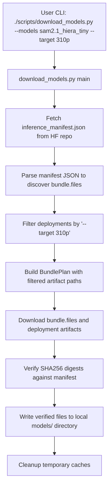
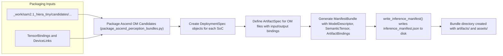
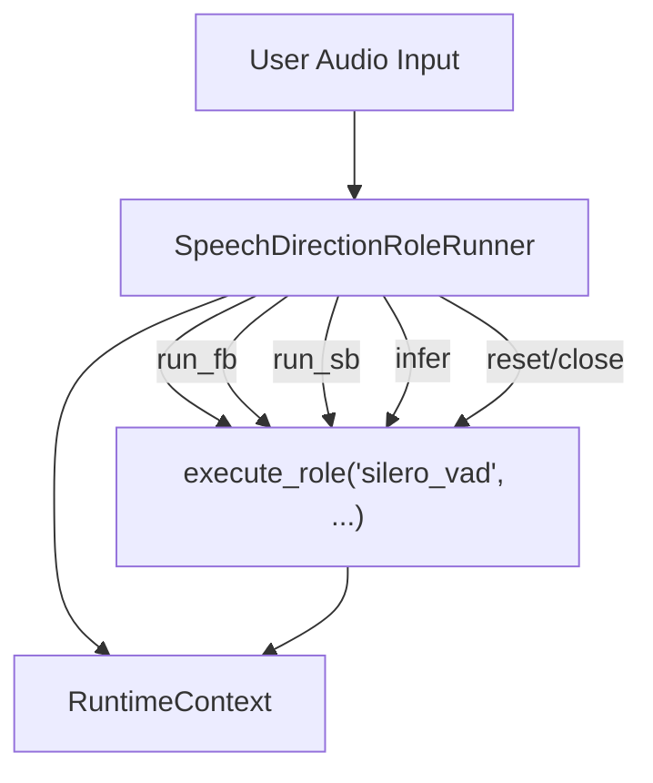

# 模型 Bundle 分发

<details>
<summary>相关源码文件</summary>

以下文件被用作生成此 wiki 页面的上下文：

- [.agents/skills/ibrobot-inference-verify/SKILL.md](https://atomgit.com/openeuler/IB_Robot/blob/openEuler-26.09/.agents/skills/ibrobot-inference-verify/SKILL.md)
- [.agents/skills/ibrobot-inference-verify/references/board.md](https://atomgit.com/openeuler/IB_Robot/blob/openEuler-26.09/.agents/skills/ibrobot-inference-verify/references/board.md)
- [.agents/skills/ibrobot-inference-verify/references/host.md](https://atomgit.com/openeuler/IB_Robot/blob/openEuler-26.09/.agents/skills/ibrobot-inference-verify/references/host.md)
- [.agents/skills/ibrobot-inference-verify/references/troubleshooting.md](https://atomgit.com/openeuler/IB_Robot/blob/openEuler-26.09/.agents/skills/ibrobot-inference-verify/references/troubleshooting.md)
- [.agents/skills/ibrobot-inference-verify/scripts/generate_verify_yaml.py](https://atomgit.com/openeuler/IB_Robot/blob/openEuler-26.09/.agents/skills/ibrobot-inference-verify/scripts/generate_verify_yaml.py)
- [.gitattributes](https://atomgit.com/openeuler/IB_Robot/blob/openEuler-26.09/.gitattributes)
- [docs/embodied_pipeline.md](https://atomgit.com/openeuler/IB_Robot/blob/openEuler-26.09/docs/embodied_pipeline.md)
- [docs/fullsubnet_310b_deployment.md](https://atomgit.com/openeuler/IB_Robot/blob/openEuler-26.09/docs/fullsubnet_310b_deployment.md)
- [docs/so101_banana_pick_pipeline_commands.md](https://atomgit.com/openeuler/IB_Robot/blob/openEuler-26.09/docs/so101_banana_pick_pipeline_commands.md)
- [docs/so101_handeye_calibration_commands.md](https://atomgit.com/openeuler/IB_Robot/blob/openEuler-26.09/docs/so101_handeye_calibration_commands.md)
- [requirements/perception.txt](https://atomgit.com/openeuler/IB_Robot/blob/openEuler-26.09/requirements/perception.txt)
- [scripts/build_ram_plus_wheel.sh](https://atomgit.com/openeuler/IB_Robot/blob/openEuler-26.09/scripts/build_ram_plus_wheel.sh)
- [scripts/download_models.py](https://atomgit.com/openeuler/IB_Robot/blob/openEuler-26.09/scripts/download_models.py)
- [scripts/download_perception_models.sh](https://atomgit.com/openeuler/IB_Robot/blob/openEuler-26.09/scripts/download_perception_models.sh)
- [scripts/verify_speech_direction_assets.py](https://atomgit.com/openeuler/IB_Robot/blob/openEuler-26.09/scripts/verify_speech_direction_assets.py)
- [src/perception_service/README.md](https://atomgit.com/openeuler/IB_Robot/blob/openEuler-26.09/src/perception_service/README.md)
- [src/perception_service/perception_service/package_ascend_perception_bundles.py](https://atomgit.com/openeuler/IB_Robot/blob/openEuler-26.09/src/perception_service/perception_service/package_ascend_perception_bundles.py)
- [src/perception_service/perception_service/ram_plus_wrapper.py](https://atomgit.com/openeuler/IB_Robot/blob/openEuler-26.09/src/perception_service/perception_service/ram_plus_wrapper.py)
- [src/perception_service/perception_service/torch_model_loaders.py](https://atomgit.com/openeuler/IB_Robot/blob/openEuler-26.09/src/perception_service/perception_service/torch_model_loaders.py)
- [src/perception_service/test/test_package_ascend_perception_bundles.py](https://atomgit.com/openeuler/IB_Robot/blob/openEuler-26.09/src/perception_service/test/test_package_ascend_perception_bundles.py)
- [src/robot_config/config/robots/lekiwi_handeye_realsense_grasp.yaml](https://atomgit.com/openeuler/IB_Robot/blob/openEuler-26.09/src/robot_config/config/robots/lekiwi_handeye_realsense_grasp.yaml)
- [src/robot_config/config/robots/lekiwi_handeye_realsense_grasp_pc.yaml](https://atomgit.com/openeuler/IB_Robot/blob/openEuler-26.09/src/robot_config/config/robots/lekiwi_handeye_realsense_grasp_pc.yaml)
- [src/robot_config/config/robots/lekiwi_nav_grasp.yaml](https://atomgit.com/openeuler/IB_Robot/blob/openEuler-26.09/src/robot_config/config/robots/lekiwi_nav_grasp.yaml)
- [src/robot_config/test/test_unified_lekiwi_grasp_navigation_config.py](https://atomgit.com/openeuler/IB_Robot/blob/openEuler-26.09/src/robot_config/test/test_unified_lekiwi_grasp_navigation_config.py)
- [src/robot_config/test/test_voice_tts_launch_builder.py](https://atomgit.com/openeuler/IB_Robot/blob/openEuler-26.09/src/robot_config/test/test_voice_tts_launch_builder.py)
- [src/voice_asr_service/test/speech_direction/test_model_sessions.py](https://atomgit.com/openeuler/IB_Robot/blob/openEuler-26.09/src/voice_asr_service/test/speech_direction/test_model_sessions.py)
- [src/voice_asr_service/test/test_audio_contract_validation.py](https://atomgit.com/openeuler/IB_Robot/blob/openEuler-26.09/src/voice_asr_service/test/test_audio_contract_validation.py)
- [src/voice_asr_service/test/test_package_fullsubnet_bundle.py](https://atomgit.com/openeuler/IB_Robot/blob/openEuler-26.09/src/voice_asr_service/test/test_package_fullsubnet_bundle.py)
- [src/voice_asr_service/test/test_package_silero_vad_bundle.py](https://atomgit.com/openeuler/IB_Robot/blob/openEuler-26.09/src/voice_asr_service/test/test_package_silero_vad_bundle.py)
- [src/voice_asr_service/voice_asr_service/package_fullsubnet_bundle.py](https://atomgit.com/openeuler/IB_Robot/blob/openEuler-26.09/src/voice_asr_service/voice_asr_service/package_fullsubnet_bundle.py)
- [src/voice_asr_service/voice_asr_service/package_silero_vad_bundle.py](https://atomgit.com/openeuler/IB_Robot/blob/openEuler-26.09/src/voice_asr_service/voice_asr_service/package_silero_vad_bundle.py)
- [src/voice_asr_service/voice_asr_service/speech_direction/model_sessions.py](https://atomgit.com/openeuler/IB_Robot/blob/openEuler-26.09/src/voice_asr_service/voice_asr_service/speech_direction/model_sessions.py)
- [src/voice_tts_service/test/test_model_service_plugin.py](https://atomgit.com/openeuler/IB_Robot/blob/openEuler-26.09/src/voice_tts_service/test/test_model_service_plugin.py)
- [src/voice_tts_service/voice_tts_service/model_service_plugin.py](https://atomgit.com/openeuler/IB_Robot/blob/openEuler-26.09/src/voice_tts_service/voice_tts_service/model_service_plugin.py)
- [tests/test_download_models.py](https://atomgit.com/openeuler/IB_Robot/blob/openEuler-26.09/tests/test_download_models.py)
- [third_party/README.md](https://atomgit.com/openeuler/IB_Robot/blob/openEuler-26.09/third_party/README.md)

</details>

## 目的与范围

本节详述 RoboFrame_stable 中模型 bundle 分发工具与基础设施的实现与用法。聚焦：

- 统一模型 bundle 下载脚本 `download_models.py`，从 HuggingFace 仓库拉取 IB-Robot 推理模型 bundle。
- 感知与语音模型 bundle 的打包工具，特别是 Ascend OM 感知 bundle 与 Silero VAD 语音 bundle。
- 依据 schema v3 处理与校验 HuggingFace 清单，清单编码 bundle 内容、面向不同硬件的部署与文件 SHA256 摘要。
- 确保下载的 artifact 与其声明摘要一致的校验机制，保证模型资产完整性。

本页面面向管理感知、策略推理与语音服务运行时所用 AI 模型包的部署、更新与校验的开发者与系统集成者。

---

## 1. `download_models.py` 统一下载器

`scripts/download_models.py` 脚本是从 HuggingFace Hub 上 `openEuler` 组织或其他白名单仓库下载推理模型 bundle 的中心工具。它支持 schema v3 推理清单格式——一种描述模型 bundle 文件及其面向不同硬件目标（如 Ascend 310P、Torch CPU/GPU）的变体部署的 JSON 清单。

### 关键特性

- 下载 `bundle.files` 下的共享基础文件，如通用 tokenizer 与资产文件。
- 下载 `deployments` 中按硬件目标划定的编译产物，对 `--target` 参数应用关键字过滤（如 `310p`、`rk3588`）。
- 校验每个下载文件的 SHA256 哈希与清单声明一致。
- 通过手动解析清单处理清单与 schema 兼容性，不完全依赖代码库 inference_manifest loader。
- 通过环境变量 `HF_TOKEN` 与 `HF_ENDPOINT` 支持认证与端点镜像。

### 核心数据结构

- **BundleSource（`@dataclass`）：** 表示白名单 bundle 定义，指定本地 bundle 名称、HuggingFace 仓库、预期模型接口与操作，指导校验与下载行为。
- **BundlePlan（`@dataclass`）：** 封装单个 bundle 的已解析下载计划，包括待下载文件模式、artifact 路径、校验映射与匹配的部署。
- **DownloadError、NoMatchingDeploymentError：** 用于下载失败或不支持目标的自定义异常。

### 工作流概览

1. 脚本维护可信 bundle 白名单（`MODEL_BUNDLE_ALLOWLIST`）及其仓库名与运行时模型身份。
2. 以模型名称（或 `all` 下载全部白名单 bundle）调用时，它从 HF 仓库下载 `inference_manifest.json` 解析 bundle 清单。
3. 应用目标与部署过滤器，选择特定硬件后端的 artifact。
4. 调度 `bundle.files`（共享资产）加上部署特定 artifact 的下载。
5. 下载后校验 SHA256 摘要，确保文件完整性。
6. 可选清理 HuggingFace 缓存残留。

### CLI 使用示例

```bash
./scripts/download_models.py --list
./scripts/download_models.py --models sam2.1_hiera_tiny --target 310p
./scripts/download_models.py --models pi05,fullsubnet
./scripts/download_models.py --models ACT_1arm_2cam_banana_pick_v1_step_160000_distill_20260515 --target rk3588 --dest /data/models
```

代码组织使用 dataclass、按关键字过滤部署的辅助函数、解析清单与 SHA256 校验逻辑。

---

## 2. 感知与语音 Bundle 打包器

### 2.1. 感知服务 Bundle 打包

感知服务使用专用打包器，将 Ascend OM 目标检测与分割模型准备为一致的 schema-v3 bundle 以供部署。`src/perception_service/perception_service/package_ascend_perception_bundles.py` 中的打包代码以编程方式为以下场景构建丰富清单：

- 面向不同 Ascend 片上系统（SoC）（如 `Ascend310P1`）的多个部署。
- Artifact 规格包括输入/输出张量绑定、语义身份与面向多部件运行时执行的设备链接。
- 语义张量为运行时定义输入/输出形状、dtype 与语义角色。

bundle 规格 dataclass 表达这些信息，生成清单文件并打包 OM 模型文件。

### 2.2. 语音模型 Bundle

语音 ASR 与语音方向模型的会话适配器依赖清单兼容性，特别是 Silero VAD 与 FullSubNet 模型。`src/voice_asr_service/voice_asr_service/speech_direction/model_sessions.py` 模块定义 `SpeechDirectionRoleRunner`，一个管理流水线与面向 Ascend 硬件或 CPU 后端的有状态模型会话之间交互的适配器类。该类处理：

- 基于角色的推理调用执行（"silero_vad"、"fullsubnet_fb"、"fullsubnet_sb"）。
- 作用域执行，将多个角色分组到单一上下文。
- 与清单声明的张量语义匹配的输入整形与输出提取。
- 状态复位与资源管理。

打包脚本与测试工具帮助生成可被运行时服务消费的经过校验的 bundle。

---

## 3. HuggingFace 清单与模型资产校验

bundle 分发的基石是带版本的推理清单（`inference_manifest.json`），它编码：

- schema 版本 3 合规。
- `bundle.files` 公共文件列表（tokenizer、适配器 JSON、权重文件）。
- 多个 `deployments` 条目，每个带名称与指定后端、目标 SoC、设备 profile 的运行时 profile。
- `deployments.artifacts` 携带每个编译运行时 artifact（如 ONNX、OM、RKNN 文件）的文件路径与 SHA256 校验和。
- 可选字段如嵌入元数据与逻辑模型修订号。

下载器使用 SHA256 摘要校验，确保下载的 artifact 与清单声明完全一致。任何不匹配都会抛出异常并中止部署。

校验也是集成测试的一部分，体现在 `tests/test_download_models.py` 中，它使用伪造清单对部署过滤、文件选择与校验映射进行单元测试。

---

## 4. 数据流与实现概览 Mermaid 图

### 4.1. 从自然语言命令到代码执行的模型 Bundle 下载流



### 图例：

- `download_models.py` 协调整个下载与校验过程。
- `BundlePlan` 表示每个 bundle 已解析的待下载文件集合。
- SHA256 校验保证模型资产完整性。

来源：[scripts/download_models.py:1-194](https://atomgit.com/openeuler/IB_Robot/blob/openEuler-26.09/scripts/download_models.py#L1-L194)

### 4.2. 带代码实体的感知 Bundle 打包数据流



来源：[src/perception_service/perception_service/package_ascend_perception_bundles.py:1-207](https://atomgit.com/openeuler/IB_Robot/blob/openEuler-26.09/src/perception_service/perception_service/package_ascend_perception_bundles.py#L1-L207)

### 4.3. 代码中的语音方向模型会话交互



来源：[src/voice_asr_service/voice_asr_service/speech_direction/model_sessions.py:15-104](https://atomgit.com/openeuler/IB_Robot/blob/openEuler-26.09/src/voice_asr_service/voice_asr_service/speech_direction/model_sessions.py#L15-L104)

---

## 5. 测试中的模型资产校验

- `tests/test_download_models.py` 定义了用于校验下载期间 artifact 选择与 SHA256 摘要匹配的测试与 mock。
- 它创建模拟真实 bundle（如 `sam2` 与 `pi05` 风格清单）的代表性清单。
- 测试覆盖按目标关键字过滤部署、共享文件存在性、未匹配部署的失败模式与清单解析正确性。

该单元测试骨架保证下载器的正确性，防止跨硬件变体的意外部署不匹配。

来源：[tests/test_download_models.py:1-176](https://atomgit.com/openeuler/IB_Robot/blob/openEuler-26.09/tests/test_download_models.py#L1-L176)

---

## 总结

模型 Bundle 分发系统为 RoboFrame 具身 AI 流水线提供一致、经过校验且目标明确的 AI 模型分发：

- `download_models.py` 提供从 HuggingFace 仓库下载模型 bundle 的健壮、经过校验的统一方法。
- 感知与语音服务使用声明式打包，严格遵循清单，面向多种硬件后端。
- SHA256 摘要校验结合基于 schema-v3 推理清单的部署过滤，保证运行时模型正确性。
- 该设计支持异构计算平台（CPU、CUDA、Ascend NPU、RKNN 目标），简化维护与部署自动化。
- 测试与校验脚本对在运行时使用前验证清单与部署基础设施至关重要。

开发者可以参考上文详述的数据流与代码实体，自信地扩展或审计 bundle 定义与部署逻辑。

---

## 参考

- scripts/download_models.py:1-194
- tests/test_download_models.py:1-176
- src/perception_service/perception_service/package_ascend_perception_bundles.py:1-207
- src/voice_asr_service/voice_asr_service/speech_direction/model_sessions.py:15-104
