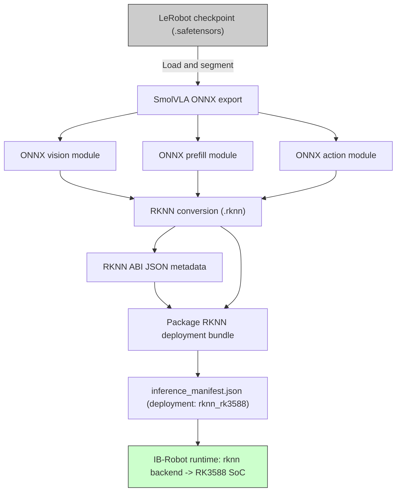
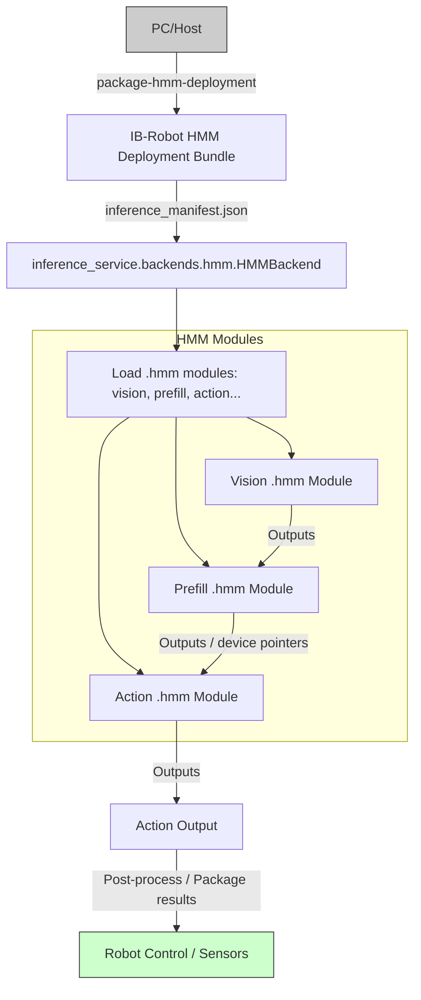
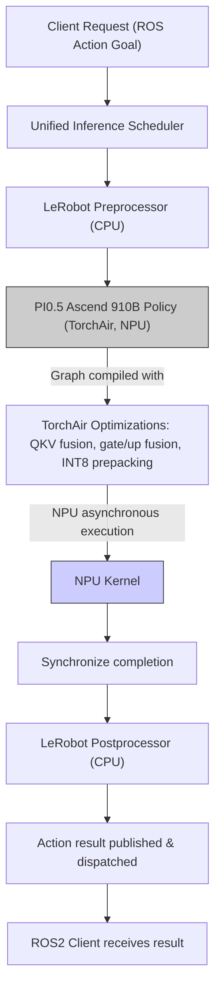

# 其他目标：RKNN、HMM、910B Torch

<details>
<summary>相关源码文件</summary>

以下文件被用作生成此 wiki 页面的上下文：

- [.agents/skills/hmm-convert/SKILL.md](https://atomgit.com/openeuler/IB_Robot/blob/openEuler-26.09/.agents/skills/hmm-convert/SKILL.md)
- [.agents/skills/rknn-convert/SKILL.md](https://atomgit.com/openeuler/IB_Robot/blob/openEuler-26.09/.agents/skills/rknn-convert/SKILL.md)
- [.agents/skills/rknn-convert/convert_to_rknn.py](https://atomgit.com/openeuler/IB_Robot/blob/openEuler-26.09/.agents/skills/rknn-convert/convert_to_rknn.py)
- [.agents/skills/rknn-convert/references/policy-workflows.md](https://atomgit.com/openeuler/IB_Robot/blob/openEuler-26.09/.agents/skills/rknn-convert/references/policy-workflows.md)
- [.agents/skills/rknn-convert/test_convert_to_rknn.py](https://atomgit.com/openeuler/IB_Robot/blob/openEuler-26.09/.agents/skills/rknn-convert/test_convert_to_rknn.py)
- [docs/Houmo_HMM_Conversion.md](https://atomgit.com/openeuler/IB_Robot/blob/openEuler-26.09/docs/Houmo_HMM_Conversion.md)
- [docs/OpenHarmony_EmbodiedAI_RKNN_Inference.md](https://atomgit.com/openeuler/IB_Robot/blob/openEuler-26.09/docs/OpenHarmony_EmbodiedAI_RKNN_Inference.md)
- [docs/pi05_npu_910b_inference_latency_zh.md](https://atomgit.com/openeuler/IB_Robot/blob/openEuler-26.09/docs/pi05_npu_910b_inference_latency_zh.md)
- [docs/pi05_npu_910b_update_zh.md](https://atomgit.com/openeuler/IB_Robot/blob/openEuler-26.09/docs/pi05_npu_910b_update_zh.md)
- [scripts/convert_hmm.sh](https://atomgit.com/openeuler/IB_Robot/blob/openEuler-26.09/scripts/convert_hmm.sh)
- [scripts/npu/pi05_910b/README.md](https://atomgit.com/openeuler/IB_Robot/blob/openEuler-26.09/scripts/npu/pi05_910b/README.md)
- [scripts/npu/pi05_910b/benchmark_pi05.py](https://atomgit.com/openeuler/IB_Robot/blob/openEuler-26.09/scripts/npu/pi05_910b/benchmark_pi05.py)
- [scripts/npu/pi05_910b/make_int8_rtn_perchannel_source.py](https://atomgit.com/openeuler/IB_Robot/blob/openEuler-26.09/scripts/npu/pi05_910b/make_int8_rtn_perchannel_source.py)
- [scripts/npu/pi05_910b/make_selective_positive_quant_pi05_checkpoint.py](https://atomgit.com/openeuler/IB_Robot/blob/openEuler-26.09/scripts/npu/pi05_910b/make_selective_positive_quant_pi05_checkpoint.py)
- [src/inference_service/inference_service/backends/hmm/__init__.py](https://atomgit.com/openeuler/IB_Robot/blob/openEuler-26.09/src/inference_service/inference_service/backends/hmm/__init__.py)
- [src/inference_service/inference_service/backends/hmm/backend.py](https://atomgit.com/openeuler/IB_Robot/blob/openEuler-26.09/src/inference_service/inference_service/backends/hmm/backend.py)
- [src/model_utils/model_utils/export_onnx_rknn.py](https://atomgit.com/openeuler/IB_Robot/blob/openEuler-26.09/src/model_utils/model_utils/export_onnx_rknn.py)
- [src/model_utils/model_utils/hmm_export.py](https://atomgit.com/openeuler/IB_Robot/blob/openEuler-26.09/src/model_utils/model_utils/hmm_export.py)
- [src/model_utils/model_utils/pi05_export/build_hmm_modules.py](https://atomgit.com/openeuler/IB_Robot/blob/openEuler-26.09/src/model_utils/model_utils/pi05_export/build_hmm_modules.py)
- [src/model_utils/model_utils/pi05_export/convert_hmm.sh](https://atomgit.com/openeuler/IB_Robot/blob/openEuler-26.09/src/model_utils/model_utils/pi05_export/convert_hmm.sh)
- [src/model_utils/model_utils/pi05_export/export_hmm_modules.py](https://atomgit.com/openeuler/IB_Robot/blob/openEuler-26.09/src/model_utils/model_utils/pi05_export/export_hmm_modules.py)
- [src/model_utils/model_utils/pi05_export/houmo_pi_gemma.py](https://atomgit.com/openeuler/IB_Robot/blob/openEuler-26.09/src/model_utils/model_utils/pi05_export/houmo_pi_gemma.py)
- [src/model_utils/model_utils/pi05_export/package_hmm_modules.py](https://atomgit.com/openeuler/IB_Robot/blob/openEuler-26.09/src/model_utils/model_utils/pi05_export/package_hmm_modules.py)
- [src/model_utils/model_utils/smolvla_export/__init__.py](https://atomgit.com/openeuler/IB_Robot/blob/openEuler-26.09/src/model_utils/model_utils/smolvla_export/__init__.py)
- [src/model_utils/model_utils/smolvla_export/build_hmm_modules.py](https://atomgit.com/openeuler/IB_Robot/blob/openEuler-26.09/src/model_utils/model_utils/smolvla_export/build_hmm_modules.py)
- [src/model_utils/model_utils/smolvla_export/convert_hmm.sh](https://atomgit.com/openeuler/IB_Robot/blob/openEuler-26.09/src/model_utils/model_utils/smolvla_export/convert_hmm.sh)
- [src/model_utils/model_utils/smolvla_export/export_hmm_modules.py](https://atomgit.com/openeuler/IB_Robot/blob/openEuler-26.09/src/model_utils/model_utils/smolvla_export/export_hmm_modules.py)
- [src/model_utils/model_utils/smolvla_export/export_onnx.py](https://atomgit.com/openeuler/IB_Robot/blob/openEuler-26.09/src/model_utils/model_utils/smolvla_export/export_onnx.py)
- [src/model_utils/model_utils/smolvla_export/export_rknn_modules.py](https://atomgit.com/openeuler/IB_Robot/blob/openEuler-26.09/src/model_utils/model_utils/smolvla_export/export_rknn_modules.py)
- [src/model_utils/model_utils/smolvla_export/package_hmm_modules.py](https://atomgit.com/openeuler/IB_Robot/blob/openEuler-26.09/src/model_utils/model_utils/smolvla_export/package_hmm_modules.py)
- [src/robot_config/config/robots/franka_libero_pi05_910b_latency.yaml](https://atomgit.com/openeuler/IB_Robot/blob/openEuler-26.09/src/robot_config/config/robots/franka_libero_pi05_910b_latency.yaml)
- [src/torch_models/torch_models/pi05_ascend_910b/README.md](https://atomgit.com/openeuler/IB_Robot/blob/openEuler-26.09/src/torch_models/torch_models/pi05_ascend_910b/README.md)
- [src/torch_models/torch_models/pi05_ascend_910b/patch/PATCH_UPDATE.md](https://atomgit.com/openeuler/IB_Robot/blob/openEuler-26.09/src/torch_models/torch_models/pi05_ascend_910b/patch/PATCH_UPDATE.md)
- [src/torch_models/torch_models/pi05_ascend_910b/patch/README.md](https://atomgit.com/openeuler/IB_Robot/blob/openEuler-26.09/src/torch_models/torch_models/pi05_ascend_910b/patch/README.md)
- [src/torch_models/torch_models/pi05_ascend_910b/patch/lerobot_pi05_npu_inference_b74a551.patch](https://atomgit.com/openeuler/IB_Robot/blob/openEuler-26.09/src/torch_models/torch_models/pi05_ascend_910b/patch/lerobot_pi05_npu_inference_b74a551.patch)
- [src/torch_models/torch_models/pi05_ascend_910b/patch/test/pi05_latency.py](https://atomgit.com/openeuler/IB_Robot/blob/openEuler-26.09/src/torch_models/torch_models/pi05_ascend_910b/patch/test/pi05_latency.py)
- [src/torch_models/torch_models/pi05_ascend_910b/quantization/README.md](https://atomgit.com/openeuler/IB_Robot/blob/openEuler-26.09/src/torch_models/torch_models/pi05_ascend_910b/quantization/README.md)
- [third_party/patches/lerobot/v0.5.1/0016-smolvla-improve-graph-export-compatibility.patch](https://atomgit.com/openeuler/IB_Robot/blob/openEuler-26.09/third_party/patches/lerobot/v0.5.1/0016-smolvla-improve-graph-export-compatibility.patch)

</details>

本节详述 RoboFrame / IB-Robot 框架支持的各种替代模型部署目标的导出、转换、运行时集成与基准测试。覆盖：

- SmolVLA RKNN 导出与打包工作流。
- 面向 XH2（LQ50 / M50）运行时的后摩 HMM 模型转换与打包。
- Ascend 910B 原生 PyTorch NPU provider、选择性 INT8 量化、推理优化与延迟基准。

这些目标补充了主线的 PI0.5 导出与 OM 转换流水线，允许部署到不同的硬件与运行时环境，如使用 RKNN 推理的 RK3588 SoC、使用 TCIM 运行时的后摩 XH2 加速卡，以及基于 TorchAir 的 PyTorch 执行的 Ascend 910B NPU。

---

## 4.3.1 SmolVLA RKNN 导出

### 目的与实现

SmolVLA 是一种视觉语言策略，可导出为与 RKNN 模型部署工具链兼容的分段 ONNX 模块。导出过程：

- 镜像后摩 HMM 模块拆分（`vision → prefill → action`），但保存独立的 ONNX 图而非 HMONNX。
- 这种解耦允许用 `rknn-toolkit2` 对每段独立进行 RKNN 转换。
- 保存附带 artifact：`token_embedding.pt`（CPU 侧文本嵌入）与 `meta_info.json`。

这些使得可以将结果打包为严格的 IB-Robot RKNN 部署。

### 关键文件与函数

- `src/model_utils/model_utils/smolvla_export/export_rknn_modules.py` 实现：
  - 封装于 `SmolVLAVisionPart` 的视觉部分，导出固定尺寸 patch 嵌入 ONNX 图。
  - 从 safetensors 加载预训练 SmolVLA 策略（`load_smolvla_policy`）。
  - 种子设置、HF 缓存解析与离线导出的环境配置。
- 导出流程将 SmolVLA 策略转换为按 vision、prefill、action 分段的 ONNX 模块。
- 下游打包由工具支持，将 ABI 元数据与 manifest 更新并入 RKNN 部署。

### RKNN 转换工作流

- 从 LeRobot checkpoint 导出 ONNX 图。
- 使用带 `rknn-toolkit2` 与 `onnxruntime` 的隔离 Python 虚拟环境 `.venv-rknn`。
- 调用 RKNN 转换脚本（如 `convert_to_rknn.py` skill 或 CLI 辅助工具）。
- 将编译后的 RKNN artifact 与 ABI JSON 元数据打包进原始 LeRobot bundle。
- 在 `inference_manifest.json` 中注册命名的 `rknn_rk3588` 部署，不使用全局 per-backend manifest 或指定设备的后端选项。
- 校验严格 loader 接受性，并可选在板上或仿真中测试运行时。

### 图：SmolVLA RKNN 导出流水线与部署



来源：`src/model_utils/model_utils/smolvla_export/export_rknn_modules.py:1-175`, `.agents/skills/rknn-convert/SKILL.md:1-167`, `src/model_utils/model_utils/export_onnx_rknn.py:1-200`

---

## 4.3.2 后摩 HMM 模型转换与部署

### 概述

后摩后端支持为后摩 XH2 加速卡（LQ50 / M50 平台）设计的 TCIM 编译 HMM 可部署物。该工作流：

- 将 PI0.5 或 SmolVLA 编译模块打包为严格的 IB-Robot HMM 部署。
- 使用后摩 OpenHarmony 1.3.0 运行时与 TCIM Python 绑定。
- 不支持在 HMM 上运行 ACT 策略；那些必须使用 torch、ascend、hisilicon 或 rknn 运行时。
- 不依赖动态目录扫描或遗留环境变量（`HMM_MODEL_PATH`）。

### 模块组成

- **PI0.5** bundle 包含多个角色：
  - `vision`、`prefill`、`action_in_proj`、`time_mlp`、`decode`、`action_out_proj`。
  - 主机侧 artifact：`embedding.pt`。
  - prefill 输出将设备指针链接到 decode 输入。
- **SmolVLA** bundle 包含：
  - `vision`、`prefill`、`action`。
  - 主机侧 artifact：`token_embedding.pt` 与 `state_projection.pt`。
  - prefill 输出链接到 action 输入的设备指针。

### 转换过程

- 使用 `houmo-examples-xh2` 工具链进行：
  - ONNX → HMONNX → TCIM `.hmm` 模块编译。
  - 使用 `xhquant` 进行 PTQ 校准/插桩。
- 中间 artifact（`.onnx`、`.hmonnx`、`.tcim_cache`、`calibration/`）保留在 bundle 之外的工作区管理的 `_work` 目录。
- 使用提供的通用打包脚本（`package-hmm-deployment`）创建 IB-Robot 兼容 bundle。
- 生成的 `inference_manifest.json` 包括执行顺序、语义输入/输出绑定、设备链接与 bundle 完整性哈希。

### 打包规格示例（SmolVLA）

```json
{
  "vision": {
    "artifact": "/compiler/smolvla/smolvla_vision.hmm",
    "abi": "/compiler/smolvla/vision/model.json"
  },
  "embedding": "/compiler/smolvla/token_embedding.pt",
  "roles": {
    "prefill": {
      "artifact": "/compiler/smolvla/smolvla_llm_prefill.hmm",
      "abi": "/compiler/smolvla/prefill/model.json"
    },
    "action": {
      "artifact": "/compiler/smolvla/smolvla_action.hmm",
      "abi": "/compiler/smolvla/action/model.json"
    }
  },
  "state_projection": "/compiler/smolvla/state_projection.pt",
  "vision_layout": "NCHW"
}
```

### 运行时

- `inference_service.backends.hmm.HMMBackend` 类管理加载 `.hmm` 模块并执行。
- 模块以 ABI 校验过的张量绑定加载，并支持设备输入/输出指针链接。
- 严格的运行时输入校验避免静默不匹配或无效张量形状。
- 执行序列遵循角色顺序，输出与输入之间进行设备张量链接。

### 图：后摩 HMM 部署数据流与运行时模块



来源：`docs/Houmo_HMM_Conversion.md:1-183`, `src/inference_service/inference_service/backends/hmm/backend.py:1-162`, `.agents/skills/hmm-convert/SKILL.md:1-165`

---

## 4.3.3 Ascend 910B Torch 原生 NPU 推理

### 目的

该运行时路径提供：

- 使用 `torch_npu` 与 TorchAir 图优化在 Ascend 910B NPU 上的原生 PyTorch 执行。
- 避免 Ascend 310P 路径使用的 ONNX 或 OM 转换。
- 支持 BF16 与 Selective-99 INT8 量化权重。
- 启用 NPU 算子融合、QKV 与前缀 MLP 融合、AdaRMS 偏置融合。
- 实现 AB2 去噪步骤，推理步数可配置（默认 6）。
- 提供与 IB-Robot 推理 manifest 及调度兼容的完整运行时 provider。

### 关键文件与结构

- `src/torch_models/torch_models/pi05_ascend_910b/`：
  - `provider.py`：加载模型 bundle、校验环境、强制设备与版本策略、初始化模型。
  - `modeling_pi05_ascend_910b.py`：定义带 TorchAir 图编译、优化与推理的 PI0.5 策略。
  - `quantization/`：实现 Selective-99 W8A8 INT8 量化、权重替换与内核融合。
  - `patch/`：维护对官方 LeRobot PI0.5 源码的补丁，用于兼容性与 NPU 优化。

### 模型加载与运行时流程

```text
schema-v3 inference manifest
  -> Select provider based on policy=pi05, deployment=torch-npu, device Ascend910B or Ascend910_93x
  -> Load and normalize config.json and bundle metadata (using CPU temporarily)
  -> Strictly load model.safetensors, tokenizer, processor assets
  -> Initialize PI05Ascend910BPolicy with TorchAir compilation
  -> Enable NPU op fusion and selective INT8 prepacking
  -> Run LeRobot preprocessors on CPU
  -> policy.predict_action_chunk() executes on NPU asynchronously
  -> LeRobot postprocessors validate and unify output actions
```

- provider 拒绝在不兼容硬件上回退到 CPU 或较旧的 310P 后端。
- 使用固定配置以产生可复现的 TorchAir 图缓存。
- 支持带正确 manifest 摘要校验的 float BF16 或 INT8 模型。
- tokenizer 最大长度默认 200 token 以固定图形状。
- AB2 去噪方法与推理步数可在 `config.json` 中配置。

### 量化与性能分析工具

- Selective-99 INT8 量化的两阶段流水线：
  1. 从 BF16 checkpoint 生成 RTN INT8 per-channel 权重源。
  2. 合并 BF16 与 RTN 张量合成最终 INT8 checkpoint。

- CLI 脚本：
  - `scripts/npu/pi05_910b/make_int8_rtn_perchannel_source.py`
  - `scripts/npu/pi05_910b/make_selective_positive_quant_pi05_checkpoint.py`
  - `scripts/npu/pi05_910b/benchmark_pi05.py` 用于同步的纯模型延迟基准测试。

- 通过 `./scripts/setup.sh --profile inference` 与 `.shrc_local` 准备 Python 环境运行。

### 延迟与性能

- 预热后纯模型推理延迟在 Ascend 910B 硬件上约为 48-53 ms。
- 包含传输与框架开销的 ROS 2 服务端到端延迟约增加 8-9 ms。
- INT8 量化不会显著降低精度，但改善内存与速度效率。
- 详细延迟分析将纯 NPU 调用与框架开销分离。

### 使用示例（Selective-99 INT8 量化）

```bash
export PI05_FP_MODEL_DIR="<bf16_model_directory>"
export PI05_RTN_SOURCE_DIR="<RTN_intermediate_directory>"
export PI05_INT8_MODEL_DIR="<final_int8_model_directory>"

source .shrc_local && python3 scripts/npu/pi05_910b/make_int8_rtn_perchannel_source.py \
  --fp-model-path "${PI05_FP_MODEL_DIR}" \
  --output-dir "${PI05_RTN_SOURCE_DIR}"

source .shrc_local && python3 scripts/npu/pi05_910b/make_selective_positive_quant_pi05_checkpoint.py \
  --fp-model-path "${PI05_FP_MODEL_DIR}" \
  --quant-model-path "${PI05_RTN_SOURCE_DIR}" \
  --source-manifest "${PI05_RTN_SOURCE_DIR}/selection_provenance.csv" \
  --output-dir "${PI05_INT8_MODEL_DIR}"
```

### 部署配置

- payload 必须包含带以下内容的 `inference_manifest.json`：
  - policy: `pi05`
  - deployment: `torch-npu`
  - model interface: `policy/pi05/predict`

- 激活 910B 模型的机器人 profile 片段示例：

```yaml
model_path: models/franka_libero_pi05_910b_latency
deployment: torch-npu
execution_mode: monolithic
```

### 图：Ascend 910B Torch NPU 推理流程



来源：`src/torch_models/torch_models/pi05_ascend_910b/README.md:1-244`, `scripts/npu/pi05_910b/README.md:1-114`, `src/torch_models/torch_models/pi05_ascend_910b/quantization/README.md:1-178`, `docs/pi05_npu_910b_inference_latency_zh.md:1-192`, `docs/pi05_npu_910b_update_zh.md:1-141`, `scripts/npu/pi05_910b/make_int8_rtn_perchannel_source.py` (referenced), `scripts/npu/pi05_910b/make_selective_positive_quant_pi05_checkpoint.py` (referenced), `scripts/npu/pi05_910b/benchmark_pi05.py` (referenced)

---

## RoboFrame / IB-Robot 支持的其他目标汇总表

| 目标                    | 类型          | 支持的模型      | 关键技术               | 部署格式           | 运行时后端                | 主要用例                          |
|---------------------------|---------------|----------------------|-----------------------------|-----------------------------|-------------------------------|---------------------------------------|
| SmolVLA RKNN              | ONNX → RKNN   | SmolVLA               | Segmented ONNX + RKNN       | RKNN bundle + ABI JSON      | `inference_service.backends.rknn`| RK3588 NPU 端侧推理        |
| 后摩 HMM XH2             | HMM compiled  | PI0.5, SmolVLA        | 后摩 TCIM `.hmm` artifacts | `.hmm` files + manifest      | `inference_service.backends.hmm`| 后摩加速卡（LQ50/M50）      |
| Ascend 910B PyTorch NPU   | Native Torch  | PI0.5                 | PyTorch + `torch_npu`, TorchAir | safetensors + manifest       | `torch_models.pi05_ascend_910b` | Ascend 910B NPU 原生推理      |

---

## 延伸文档参考

- RKNN 导出：`.agents/skills/rknn-convert/SKILL.md`、`src/model_utils/model_utils/smolvla_export/export_rknn_modules.py`
- 后摩 HMM 转换：`docs/Houmo_HMM_Conversion.md`、`.agents/skills/hmm-convert/SKILL.md`、`src/inference_service/inference_service/backends/hmm/backend.py`
- Ascend 910B Torch：`src/torch_models/torch_models/pi05_ascend_910b/README.md`、`scripts/npu/pi05_910b/README.md`、`docs/pi05_npu_910b_inference_latency_zh.md`、`docs/pi05_npu_910b_update_zh.md`、`src/torch_models/torch_models/pi05_ascend_910b/quantization/README.md`

---

本页面是叶子节点，不再细分。

来源：`src/model_utils/model_utils/smolvla_export/export_rknn_modules.py:1-175`, `.agents/skills/rknn-convert/SKILL.md:1-167`, `src/model_utils/model_utils/export_onnx_rknn.py:1-199`, `docs/Houmo_HMM_Conversion.md:1-183`, `src/inference_service/inference_service/backends/hmm/backend.py:1-162`, `.agents/skills/hmm-convert/SKILL.md:1-165`, `src/torch_models/torch_models/pi05_ascend_910b/README.md:1-244`, `scripts/npu/pi05_910b/README.md:1-114`, `src/torch_models/torch_models/pi05_ascend_910b/quantization/README.md:1-178`, `docs/pi05_npu_910b_inference_latency_zh.md:1-192`, `docs/pi05_npu_910b_update_zh.md:1-141`
