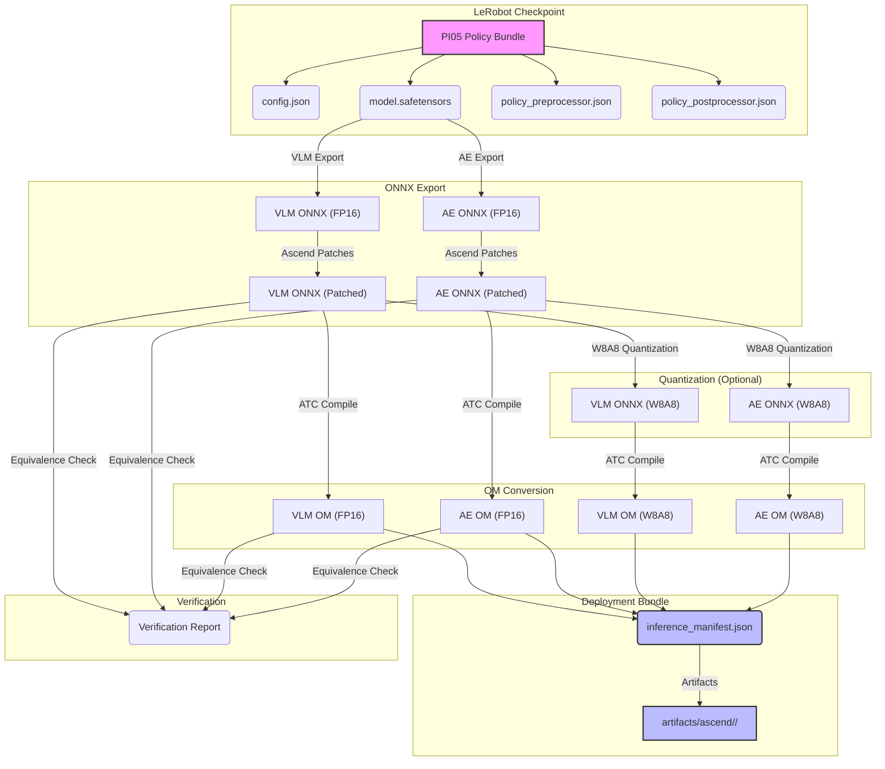
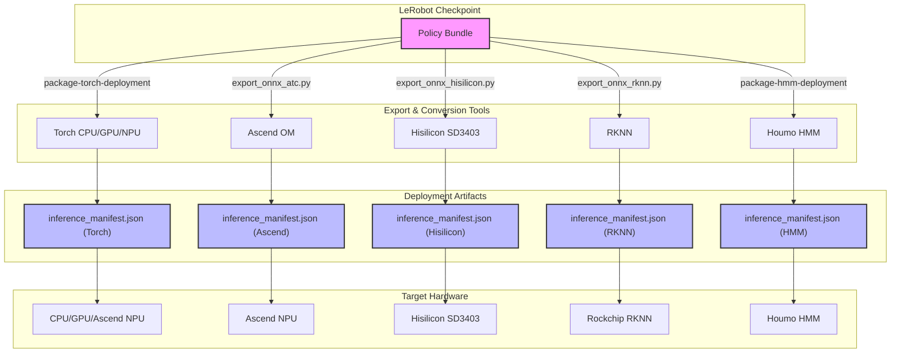

# 模型导出与部署工具链概述

相关源码文件

以下文件被用作生成此 wiki 页面的上下文：

- [src/model_utils/model_utils/README.md](https://atomgit.com/openeuler/IB_Robot/blob/openEuler-26.09/src/model_utils/model_utils/README.md)
- [src/model_utils/model_utils/pi05_export/__main__.py](https://atomgit.com/openeuler/IB_Robot/blob/openEuler-26.09/src/model_utils/model_utils/pi05_export/__main__.py)
- [src/model_utils/model_utils/pi05_export/_cli.py](https://atomgit.com/openeuler/IB_Robot/blob/openEuler-26.09/src/model_utils/model_utils/pi05_export/_cli.py)
- [src/model_utils/model_utils/pi05_export/_cli_ui.py](https://atomgit.com/openeuler/IB_Robot/blob/openEuler-26.09/src/model_utils/model_utils/pi05_export/_cli_ui.py)
- [src/model_utils/model_utils/pi05_export/convert_om.py](https://atomgit.com/openeuler/IB_Robot/blob/openEuler-26.09/src/model_utils/model_utils/pi05_export/convert_om.py)
- [src/model_utils/model_utils/pi05_export/convert_onnx_action_expert.py](https://atomgit.com/openeuler/IB_Robot/blob/openEuler-26.09/src/model_utils/model_utils/pi05_export/convert_onnx_action_expert.py)
- [src/model_utils/model_utils/pi05_export/convert_onnx_vlm.py](https://atomgit.com/openeuler/IB_Robot/blob/openEuler-26.09/src/model_utils/model_utils/pi05_export/convert_onnx_vlm.py)
- [src/model_utils/model_utils/pi05_export/quant/__init__.py](https://atomgit.com/openeuler/IB_Robot/blob/openEuler-26.09/src/model_utils/model_utils/pi05_export/quant/__init__.py)
- [src/model_utils/model_utils/pi05_export/quant/inventory_quant_nodes.py](https://atomgit.com/openeuler/IB_Robot/blob/openEuler-26.09/src/model_utils/model_utils/pi05_export/quant/inventory_quant_nodes.py)
- [src/model_utils/model_utils/pi05_export/quant/w8a8_common.py](https://atomgit.com/openeuler/IB_Robot/blob/openEuler-26.09/src/model_utils/model_utils/pi05_export/quant/w8a8_common.py)
- [src/model_utils/setup.py](https://atomgit.com/openeuler/IB_Robot/blob/openEuler-26.09/src/model_utils/setup.py)

`model_utils` 包提供全面的工具链，将 LeRobot checkpoint 转换为面向多种硬件目标优化的可部署 bundle，包括 CPU、GPU 以及 Ascend、Hisilicon、RKNN 等 NPU。该工具链标准化导出流程，确保跨后端一致的 artifact 打包、清单生成与精度验证。

`model_utils` 的核心原则是对所有可部署 policy 目录使用统一的 `inference_manifest.json`。该清单由共享 writer 生成，保证稳定的 UUID、自动修订、轻量结构摘要、执行角色与运行时张量绑定 [src/model_utils/model_utils/README.md:3-6](https://atomgit.com/openeuler/IB_Robot/blob/openEuler-26.09/src/model_utils/model_utils/README.md#L3-L6)。工具链严格区分 LeRobot 的语义文件（如 `config.json` 与 processor 文件）与后端特定 artifact，后者存储在 `artifacts/<backend>/<deployment>/` 目录 [src/model_utils/model_utils/README.md:9-12, 20-21](https://atomgit.com/openeuler/IB_Robot/blob/openEuler-26.09/src/model_utils/model_utils/README.md#L9-L21)。中间构建产物保存在 `models/_work/`，不属于最终可部署 bundle [src/model_utils/model_utils/README.md:43-45](https://atomgit.com/openeuler/IB_Robot/blob/openEuler-26.09/src/model_utils/model_utils/README.md#L43-L45)。

本页面提供模型导出与部署流程的高层概览。关于特定步骤与工具的详细信息，请参阅链接的子页面。

## PI0.5 拆分导出流水线

PI0.5 拆分导出流水线是将 PI0.5 模型（由视觉语言模型（VLM）与动作专家（AE）组成）转换为 Ascend OM 格式的专用工作流。该流水线由 `pi05_export.__main__.py` 编排 [src/model_utils/model_utils/pi05_export/__main__.py:11-12](https://atomgit.com/openeuler/IB_Robot/blob/openEuler-26.09/src/model_utils/model_utils/pi05_export/__main__.py#L11-L12)，包含若干不同步骤：

1.  **VLM/AE ONNX 导出**：VLM（如 Gemma 2B）与动作专家（如 Gemma 300M）首先被导出为 ONNX 格式 [src/model_utils/model_utils/pi05_export/__main__.py:21-22](https://atomgit.com/openeuler/IB_Robot/blob/openEuler-26.09/src/model_utils/model_utils/pi05_export/__main__.py#L21-L22)。该步骤分别使用 `convert_onnx_vlm.py` [src/model_utils/model_utils/pi05_export/convert_onnx_vlm.py:11](https://atomgit.com/openeuler/IB_Robot/blob/openEuler-26.09/src/model_utils/model_utils/pi05_export/convert_onnx_vlm.py#L11) 与 `convert_onnx_action_expert.py` [src/model_utils/model_utils/pi05_export/convert_onnx_action_expert.py:11](https://atomgit.com/openeuler/IB_Robot/blob/openEuler-26.09/src/model_utils/model_utils/pi05_export/convert_onnx_action_expert.py#L11)。
2.  **Ascend 补丁**：ONNX 导出期间应用特定补丁以确保与 Ascend 工具链兼容，如清理 ONNX domain、处理 NaN 初始化器、降级 IR 版本 [src/model_utils/model_utils/pi05_export/convert_onnx_action_expert.py:41-45, 76-135](https://atomgit.com/openeuler/IB_Robot/blob/openEuler-26.09/src/model_utils/model_utils/pi05_export/convert_onnx_action_expert.py#L41-L135)。
3.  **W8A8 量化**：可选地，使用 `msModelSlim` 将 ONNX 模型量化为 W8A8（权重 8 位、激活 8 位），以在 Ascend NPU 上获得更好性能并降低内存占用 [src/model_utils/model_utils/pi05_export/__main__.py:23-24](https://atomgit.com/openeuler/IB_Robot/blob/openEuler-26.09/src/model_utils/model_utils/pi05_export/__main__.py#L23-L24)。该过程涉及校准以及谨慎选择量化或保持 FP16 的节点 [src/model_utils/model_utils/pi05_export/quant/w8a8_common.py:11-20](https://atomgit.com/openeuler/IB_Robot/blob/openEuler-26.09/src/model_utils/model_utils/pi05_export/quant/w8a8_common.py#L11-L20)。
4.  **OM 转换**：ONNX 模型（FP16 或 W8A8 量化）随后使用 `atc`（Ascend Tensor Compiler）工具编译为 Ascend 特定的 OM（离线模型）格式 [src/model_utils/model_utils/pi05_export/__main__.py:25-26](https://atomgit.com/openeuler/IB_Robot/blob/openEuler-26.09/src/model_utils/model_utils/pi05_export/__main__.py#L25-L26)。`convert_om.py` 脚本封装 `atc` 命令并处理输入形状推导 [src/model_utils/model_utils/pi05_export/convert_om.py:11-17, 76-104](https://atomgit.com/openeuler/IB_Robot/blob/openEuler-26.09/src/model_utils/model_utils/pi05_export/convert_om.py#L11-L104)。
5.  **等价性验证**：转换后，可选的验证步骤将拆分 ONNX/OM 模型的行为与整体原模型对比，确保精度保持 [src/model_utils/model_utils/pi05_export/__main__.py:23](https://atomgit.com/openeuler/IB_Robot/blob/openEuler-26.09/src/model_utils/model_utils/pi05_export/__main__.py#L23)。

`pi05-export` 控制台脚本为整条流水线提供单一入口 [src/model_utils/setup.py:40](https://atomgit.com/openeuler/IB_Robot/blob/openEuler-26.09/src/model_utils/setup.py#L40)。

详情见 [PI0.5 拆分导出流水线](./pi0_5_split_export_pipeline.md)。

### 图：PI0.5 导出流水线概览

来源：[src/model_utils/model_utils/README.md:9-12, 20-21](https://atomgit.com/openeuler/IB_Robot/blob/openEuler-26.09/src/model_utils/model_utils/README.md#L9-L21), [src/model_utils/model_utils/pi05_export/__main__.py:11-26](https://atomgit.com/openeuler/IB_Robot/blob/openEuler-26.09/src/model_utils/model_utils/pi05_export/__main__.py#L11-L26), [src/model_utils/model_utils/pi05_export/convert_onnx_vlm.py:11](https://atomgit.com/openeuler/IB_Robot/blob/openEuler-26.09/src/model_utils/model_utils/pi05_export/convert_onnx_vlm.py#L11), [src/model_utils/model_utils/pi05_export/convert_onnx_action_expert.py:11, 41-45, 76-135](https://atomgit.com/openeuler/IB_Robot/blob/openEuler-26.09/src/model_utils/model_utils/pi05_export/convert_onnx_action_expert.py#L11-L135), [src/model_utils/model_utils/pi05_export/quant/w8a8_common.py:11-20](https://atomgit.com/openeuler/IB_Robot/blob/openEuler-26.09/src/model_utils/model_utils/pi05_export/quant/w8a8_common.py#L11-L20), [src/model_utils/model_utils/pi05_export/convert_om.py:11-17, 76-104](https://atomgit.com/openeuler/IB_Robot/blob/openEuler-26.09/src/model_utils/model_utils/pi05_export/convert_om.py#L11-L104), [src/model_utils/setup.py:40](https://atomgit.com/openeuler/IB_Robot/blob/openEuler-26.09/src/model_utils/setup.py#L40)

## 精度诊断与调度表

在导出与量化全流程中保持模型精度至关重要。`model_utils` 提供诊断与量化调度管理工具：

*   **`loss_compare`**：该工具用于对比不同模型版本（如 Torch vs. ONNX、FP16 vs. W8A8）的输出，识别精度回退。
*   **`pi05_om_dump`**：该工具帮助检查 Ascend 设备上 OM 模型的中间输出，对调试量化问题或异常行为至关重要。`pi05-om-dump` 控制台脚本可用于此目的 [src/model_utils/setup.py:42](https://atomgit.com/openeuler/IB_Robot/blob/openEuler-26.09/src/model_utils/setup.py#L42)。
*   **分布度量**：工具链支持计算多种分布度量，评估量化对张量分布的影响。
*   **曲率/调优调度**：对 PI0.5 模型，提供 `pi05-curvature-schedule` 与 `pi05-tune-schedule` 控制台脚本 [src/model_utils/setup.py:41, 43](https://atomgit.com/openeuler/IB_Robot/blob/openEuler-26.09/src/model_utils/setup.py#L41-L43)。它们用于生成并应用微调量化参数的调度表，通常涉及观测批次。
*   **量化 Profile**：系统使用量化 profile 定义带版本的 W8A8 节点选择策略，确保量化结果一致且可复现 [src/model_utils/model_utils/pi05_export/_cli.py:22-23, 47-50](https://atomgit.com/openeuler/IB_Robot/blob/openEuler-26.09/src/model_utils/model_utils/pi05_export/_cli.py#L22-L50)。
*   **观测批次**：这些是量化校准与模型等价性验证所用的规范化数据集。量化与验证步骤通常需要 `--batch-path` 参数 [src/model_utils/model_utils/pi05_export/__main__.py:23-24](https://atomgit.com/openeuler/IB_Robot/blob/openEuler-26.09/src/model_utils/model_utils/pi05_export/__main__.py#L23-L24)。

详情见 [精度诊断与调度表](./accuracy_diagnostics_schedules.md)。

## 其他目标：RKNN、HMM、910B Torch

除 Ascend 外，`model_utils` 支持面向其他 NPU 目标的导出与部署：

*   **SmolVLA RKNN 导出**：对于 Rockchip RKNN 设备，`export_onnx_rknn.py` 脚本处理 ONNX 模型到 RKNN 格式的转换。由于与主环境可能存在依赖冲突，这需要建立专用 Python 虚拟环境（`.venv-rknn`）[src/model_utils/model_utils/README.md:175-179](https://atomgit.com/openeuler/IB_Robot/blob/openEuler-26.09/src/model_utils/model_utils/README.md#L175-L179)。该脚本可从 checkpoint 直接转换，也可从已有 ONNX 文件转换 [src/model_utils/model_utils/README.md:183-209](https://atomgit.com/openeuler/IB_Robot/blob/openEuler-26.09/src/model_utils/model_utils/README.md#L183-L209)。
*   **后摩 HMM 转换**：工具链还支持转换为后摩 HMM 格式，`package-hmm-deployment` 是相关控制台脚本 [src/model_utils/setup.py:38](https://atomgit.com/openeuler/IB_Robot/blob/openEuler-26.09/src/model_utils/setup.py#L38)。
*   **Ascend 910B Torch 补丁与基准**：对 Ascend 910B，支持原生 Torch 部署。`package-torch-deployment` 工具可生成 `torch-npu` 部署，由 `model_type: pi05`、`backend: torch`、`device: npu` 选择 [src/model_utils/model_utils/README.md:89-93](https://atomgit.com/openeuler/IB_Robot/blob/openEuler-26.09/src/model_utils/model_utils/README.md#L89-L93)。这允许在 Ascend NPU 上直接以 PyTorch 运行模型，通常附带特定补丁与基准测试以确保最优性能。

详情见 [其他目标：RKNN、HMM、910B Torch](./other_targets_rknn_hmm_910b_torch.md)。

### 图：模型导出目标

来源：[src/model_utils/model_utils/README.md:59-93, 99-171, 173-217](https://atomgit.com/openeuler/IB_Robot/blob/openEuler-26.09/src/model_utils/model_utils/README.md#L59-L217), [src/model_utils/setup.py:38-39](https://atomgit.com/openeuler/IB_Robot/blob/openEuler-26.09/src/model_utils/setup.py#L38-L39)

## 模型 Bundle 分发

模型导出与转换完成后，需要打包并分发以供部署。`model_utils` 工具链支持该流程：

*   **`download_models.py`**：该脚本负责下载预训练模型及其关联资产，通常来自远程仓库。
*   **感知/语音 Bundle 打包器**：专用打包器用于为不同模型类型创建可部署 bundle，如感知模型（如 VLM、动作专家）与语音模型（如 ASR、TTS）。这些打包器确保所有必要文件（包括 `inference_manifest.json`）被正确组装。
*   **HuggingFace 清单**：系统利用 HuggingFace 进行模型存储与分发，清单定义模型 bundle 的结构与内容。
*   **模型资产校验**：部署前，内置机制校验 bundle 内模型资产的完整性与正确性，确保所有依赖满足且模型就绪可推理。

详情见 [模型 Bundle 分发](./model_bundle_distribution.md)。

来源：[src/model_utils/model_utils/README.md:3-6](https://atomgit.com/openeuler/IB_Robot/blob/openEuler-26.09/src/model_utils/model_utils/README.md#L3-L6)
