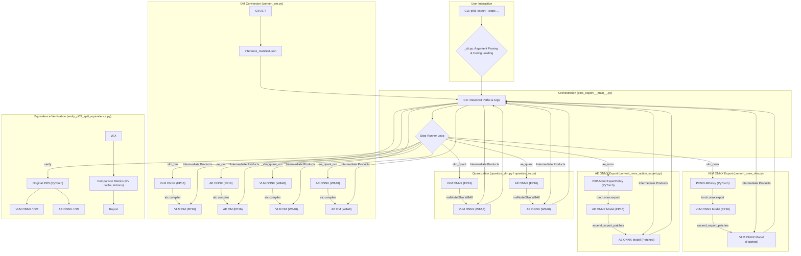
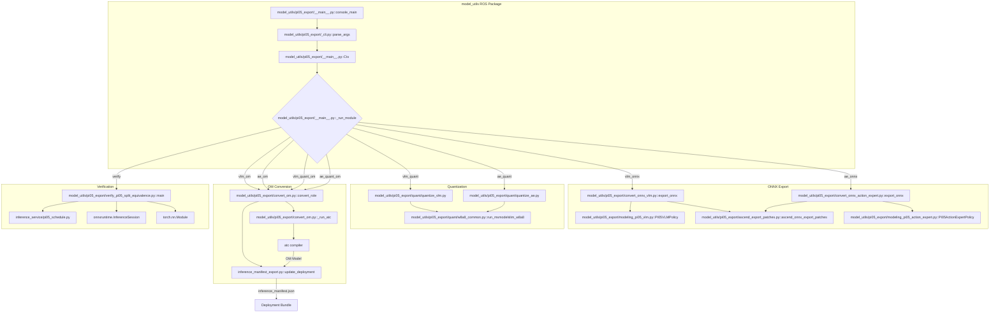

# PI0.5 分离式导出流水线

相关源码文件

以下文件被用作生成此 wiki 页面的上下文：

- [scripts/check_inference_legacy_identifiers.py](https://atomgit.com/openeuler/IB_Robot/blob/openEuler-26.09/scripts/check_inference_legacy_identifiers.py)
- [src/model_utils/model_utils/README.md](https://atomgit.com/openeuler/IB_Robot/blob/openEuler-26.09/src/model_utils/model_utils/README.md)
- [src/model_utils/model_utils/export_onnx_atc.py](https://atomgit.com/openeuler/IB_Robot/blob/openEuler-26.09/src/model_utils/model_utils/export_onnx_atc.py)
- [src/model_utils/model_utils/export_onnx_hisilicon.py](https://atomgit.com/openeuler/IB_Robot/blob/openEuler-26.09/src/model_utils/model_utils/export_onnx_hisilicon.py)
- [src/model_utils/model_utils/package_compiled_deployment.py](https://atomgit.com/openeuler/IB_Robot/blob/openEuler-26.09/src/model_utils/model_utils/package_compiled_deployment.py)
- [src/model_utils/model_utils/pi05_export/.gitignore](https://atomgit.com/openeuler/IB_Robot/blob/openEuler-26.09/src/model_utils/model_utils/pi05_export/.gitignore)
- [src/model_utils/model_utils/pi05_export/__init__.py](https://atomgit.com/openeuler/IB_Robot/blob/openEuler-26.09/src/model_utils/model_utils/pi05_export/__init__.py)
- [src/model_utils/model_utils/pi05_export/__main__.py](https://atomgit.com/openeuler/IB_Robot/blob/openEuler-26.09/src/model_utils/model_utils/pi05_export/__main__.py)
- [src/model_utils/model_utils/pi05_export/_cli.py](https://atomgit.com/openeuler/IB_Robot/blob/openEuler-26.09/src/model_utils/model_utils/pi05_export/_cli.py)
- [src/model_utils/model_utils/pi05_export/_cli_ui.py](https://atomgit.com/openeuler/IB_Robot/blob/openEuler-26.09/src/model_utils/model_utils/pi05_export/_cli_ui.py)
- [src/model_utils/model_utils/pi05_export/ascend_export_patches.py](https://atomgit.com/openeuler/IB_Robot/blob/openEuler-26.09/src/model_utils/model_utils/pi05_export/ascend_export_patches.py)
- [src/model_utils/model_utils/pi05_export/convert_om.py](https://atomgit.com/openeuler/IB_Robot/blob/openEuler-26.09/src/model_utils/model_utils/pi05_export/convert_om.py)
- [src/model_utils/model_utils/pi05_export/convert_onnx_action_expert.py](https://atomgit.com/openeuler/IB_Robot/blob/openEuler-26.09/src/model_utils/model_utils/pi05_export/convert_onnx_action_expert.py)
- [src/model_utils/model_utils/pi05_export/convert_onnx_vlm.py](https://atomgit.com/openeuler/IB_Robot/blob/openEuler-26.09/src/model_utils/model_utils/pi05_export/convert_onnx_vlm.py)
- [src/model_utils/model_utils/pi05_export/dump_ae_pt.py](https://atomgit.com/openeuler/IB_Robot/blob/openEuler-26.09/src/model_utils/model_utils/pi05_export/dump_ae_pt.py)
- [src/model_utils/model_utils/pi05_export/dump_vlm_ort.py](https://atomgit.com/openeuler/IB_Robot/blob/openEuler-26.09/src/model_utils/model_utils/pi05_export/dump_vlm_ort.py)
- [src/model_utils/model_utils/pi05_export/dump_vlm_pt.py](https://atomgit.com/openeuler/IB_Robot/blob/openEuler-26.09/src/model_utils/model_utils/pi05_export/dump_vlm_pt.py)
- [src/model_utils/model_utils/pi05_export/modeling_pi05_action_expert.py](https://atomgit.com/openeuler/IB_Robot/blob/openEuler-26.09/src/model_utils/model_utils/pi05_export/modeling_pi05_action_expert.py)
- [src/model_utils/model_utils/pi05_export/modeling_pi05_vlm.py](https://atomgit.com/openeuler/IB_Robot/blob/openEuler-26.09/src/model_utils/model_utils/pi05_export/modeling_pi05_vlm.py)
- [src/model_utils/model_utils/pi05_export/prefix_mask_utils.py](https://atomgit.com/openeuler/IB_Robot/blob/openEuler-26.09/src/model_utils/model_utils/pi05_export/prefix_mask_utils.py)
- [src/model_utils/model_utils/pi05_export/quant/__init__.py](https://atomgit.com/openeuler/IB_Robot/blob/openEuler-26.09/src/model_utils/model_utils/pi05_export/quant/__init__.py)
- [src/model_utils/model_utils/pi05_export/quant/inventory_quant_nodes.py](https://atomgit.com/openeuler/IB_Robot/blob/openEuler-26.09/src/model_utils/model_utils/pi05_export/quant/inventory_quant_nodes.py)
- [src/model_utils/model_utils/pi05_export/quant/quantize_ae.py](https://atomgit.com/openeuler/IB_Robot/blob/openEuler-26.09/src/model_utils/model_utils/pi05_export/quant/quantize_ae.py)
- [src/model_utils/model_utils/pi05_export/quant/quantize_vlm.py](https://atomgit.com/openeuler/IB_Robot/blob/openEuler-26.09/src/model_utils/model_utils/pi05_export/quant/quantize_vlm.py)
- [src/model_utils/model_utils/pi05_export/quant/w8a8_common.py](https://atomgit.com/openeuler/IB_Robot/blob/openEuler-26.09/src/model_utils/model_utils/pi05_export/quant/w8a8_common.py)
- [src/model_utils/model_utils/pi05_export/verify_pi05_split_equivalence.py](https://atomgit.com/openeuler/IB_Robot/blob/openEuler-26.09/src/model_utils/model_utils/pi05_export/verify_pi05_split_equivalence.py)
- [src/model_utils/package.xml](https://atomgit.com/openeuler/IB_Robot/blob/openEuler-26.09/src/model_utils/package.xml)
- [src/model_utils/setup.py](https://atomgit.com/openeuler/IB_Robot/blob/openEuler-26.09/src/model_utils/setup.py)
- [src/model_utils/test/test_pi05_export_optimizations.py](https://atomgit.com/openeuler/IB_Robot/blob/openEuler-26.09/src/model_utils/test/test_pi05_export_optimizations.py)
- [src/model_utils/test/test_pi05_quantize_vlm.py](https://atomgit.com/openeuler/IB_Robot/blob/openEuler-26.09/src/model_utils/test/test_pi05_quantize_vlm.py)

本页面详述 PI0.5 分离式导出流水线，它将 LeRobot PI0.5 模型转换为可部署到 Ascend NPU 的 bundle。该流水线编排多个步骤：VLM/AE ONNX 导出、Ascend 专用补丁、W8A8 量化、OM（离线模型）转换与等价性验证。该流程的主入口是 `pi05-export` 命令，属于 `model_utils` ROS 包 [src/model_utils/setup.py:40](https://atomgit.com/openeuler/IB_Robot/blob/openEuler-26.09/src/model_utils/setup.py#L40)。

## 目的与范围

`model_utils` 包提供模型导出、编译产物打包、精度比对与数据集帧检视工具 [src/model_utils/model_utils/README.md:3-4](https://atomgit.com/openeuler/IB_Robot/blob/openEuler-26.09/src/model_utils/model_utils/README.md#L3-L4)。本流水线聚焦 PI0.5 模型，它被拆分为视觉语言模型（VLM）与动作专家（AE），以便高效部署到 Ascend 硬件。目标是产出在利用 Ascend NPU 能力的同时与原始 PyTorch 模型保持数值等价的优化 `.om` 模型。流水线确保所有部署产物遵循统一 bundle 规则，包括用于稳定 UUID、自动修订与运行时张量绑定的 `inference_manifest.json` [src/model_utils/model_utils/README.md:7-11](https://atomgit.com/openeuler/IB_Robot/blob/openEuler-26.09/src/model_utils/model_utils/README.md#L7-L11)。

## 流水线概览

PI0.5 导出流水线是 PI0.5 到 Ascend OM 工具链的统一入口。它按定义的顺序串联既有的分阶段脚本，管理文件流转并确保各步骤间的一致性 [src/model_utils/model_utils/pi05_export/__main__.py:13-16](https://atomgit.com/openeuler/IB_Robot/blob/openEuler-26.09/src/model_utils/model_utils/pi05_export/__main__.py#L13-L16)。用户通过 `--steps` 参数指定所需步骤，可包括 VLM 与 AE 的 ONNX 导出、量化、OM 编译与验证。

### 关键原则

*   **显式执行**：`--steps` 中列出的步骤总是运行，即使其产物已存在 [src/model_utils/model_utils/pi05_export/__main__.py:37-39](https://atomgit.com/openeuler/IB_Robot/blob/openEuler-26.09/src/model_utils/model_utils/pi05_export/__main__.py#L37-L39)。
*   **依赖强制**：某步骤的上游产物必须存在或在本次运行中被请求。若必需产物缺失，流水线将报错停止 [src/model_utils/model_utils/pi05_export/__main__.py:40-43](https://atomgit.com/openeuler/IB_Robot/blob/openEuler-26.09/src/model_utils/model_utils/pi05_export/__main__.py#L40-L43)。
*   **中间产物保留**：所有中间文件（ONNX、编译后的 OM、运行时保存文件、manifest）均保留，以供检视与部分重跑 [src/model_utils/model_utils/pi05_export/__main__.py:54-56](https://atomgit.com/openeuler/IB_Robot/blob/openEuler-26.09/src/model_utils/model_utils/pi05_export/__main__.py#L54-L56)。
*   **实时反馈**：各阶段作为子进程运行，输出流式打印到控制台 [src/model_utils/model_utils/pi05_export/__main__.py:57-58](https://atomgit.com/openeuler/IB_Robot/blob/openEuler-26.09/src/model_utils/model_utils/pi05_export/__main__.py#L57-L58)。

### 可用步骤

`_cli.py` 模块定义可用步骤及其依赖 [src/model_utils/model_utils/pi05_export/_cli.py:83-132](https://atomgit.com/openeuler/IB_Robot/blob/openEuler-26.09/src/model_utils/model_utils/pi05_export/_cli.py#L83-L132)。

| 步骤名         | 摘要                                                                                                | 参数依赖               | 步骤依赖                                        |
| :------------- | :-------------------------------------------------------------------------------------------------- | :--------------------- | :---------------------------------------------- |
| `vlm_onnx`     | 将 VLM (gemma_2b) 导出为 ONNX                                                                       |                        |                                                 |
| `ae_onnx`      | 将动作专家 (gemma_300m) 导出为 ONNX                                                                 |                        | `vlm_onnx`                                      |
| `verify`       | 运行分离式与单体式等价性验证                                                                        | `batch_path`           | `vlm_onnx`, `ae_onnx`                           |
| `vlm_quant`    | 将 VLM ONNX 量化为 W8A8                                                                             | `batch_path`           | `vlm_onnx`                                      |
| `vlm_om`       | 经 ATC 将 VLM FP16 ONNX 编译为 OM                                                                   | `soc_version`          | `vlm_onnx`                                      |
| `ae_om`        | 经 ATC 将动作专家 FP16 ONNX 编译为 OM                                                               | `soc_version`          | `ae_onnx`                                       |
| `ae_quant`     | 以自动采集的 FP16 轨迹将动作专家 ONNX 量化为 W8A8                                                  | `batch_path`, `soc_version` | `vlm_onnx`, `ae_onnx`, `vlm_om`, `ae_om`        |
| `vlm_quant_om` | 经 ATC 将 VLM W8A8 ONNX 编译为 OM                                                                   | `soc_version`          | `vlm_quant`                                     |
| `ae_quant_om`  | 经 ATC 将动作专家 W8A8 ONNX 编译为 OM                                                               | `soc_version`          | `ae_quant`                                      |

来源：[src/model_utils/model_utils/pi05_export/__main__.py:18-30](https://atomgit.com/openeuler/IB_Robot/blob/openEuler-26.09/src/model_utils/model_utils/pi05_export/__main__.py#L18-L30), [src/model_utils/model_utils/pi05_export/_cli.py:83-132](https://atomgit.com/openeuler/IB_Robot/blob/openEuler-26.09/src/model_utils/model_utils/pi05_export/_cli.py#L83-L132)

## 数据流与架构

`pi05-export` 脚本（`src/model_utils/model_utils/pi05_export/__main__.py`）充当编排器。它使用 `Ctx` 数据类管理跨步骤共享的已解析路径与参数 [src/model_utils/model_utils/pi05_export/__main__.py:107-126](https://atomgit.com/openeuler/IB_Robot/blob/openEuler-26.09/src/model_utils/model_utils/pi05_export/__main__.py#L107-L126)。每个步骤实现为独立 Python 模块，保证模块化与可复用性。

### 图：PI0.5 导出流水线数据流

来源：[src/model_utils/model_utils/pi05_export/__main__.py:107-126](https://atomgit.com/openeuler/IB_Robot/blob/openEuler-26.09/src/model_utils/model_utils/pi05_export/__main__.py#L107-L126), [src/model_utils/model_utils/pi05_export/_cli.py:83-132](https://atomgit.com/openeuler/IB_Robot/blob/openEuler-26.09/src/model_utils/model_utils/pi05_export/_cli.py#L83-L132), [src/model_utils/model_utils/pi05_export/convert_onnx_vlm.py](https://atomgit.com/openeuler/IB_Robot/blob/openEuler-26.09/src/model_utils/model_utils/pi05_export/convert_onnx_vlm.py), [src/model_utils/model_utils/pi05_export/convert_onnx_action_expert.py](https://atomgit.com/openeuler/IB_Robot/blob/openEuler-26.09/src/model_utils/model_utils/pi05_export/convert_onnx_action_expert.py), [src/model_utils/model_utils/pi05_export/quant/w8a8_common.py](https://atomgit.com/openeuler/IB_Robot/blob/openEuler-26.09/src/model_utils/model_utils/pi05_export/quant/w8a8_common.py), [src/model_utils/model_utils/pi05_export/convert_om.py](https://atomgit.com/openeuler/IB_Robot/blob/openEuler-26.09/src/model_utils/model_utils/pi05_export/convert_om.py), [src/model_utils/model_utils/pi05_export/verify_pi05_split_equivalence.py](https://atomgit.com/openeuler/IB_Robot/blob/openEuler-26.09/src/model_utils/model_utils/pi05_export/verify_pi05_split_equivalence.py)

## 实现细节

### 1. ONNX 导出（VLM 与动作专家）

VLM 与动作专家模型使用 `torch.onnx.export` 导出为 ONNX 格式。

#### VLM ONNX 导出

`convert_onnx_vlm.py` 脚本处理 VLM 导出。
`PI05VLMPolicy` 类 [src/model_utils/model_utils/pi05_export/modeling_pi05_vlm.py:39](https://atomgit.com/openeuler/IB_Robot/blob/openEuler-26.09/src/model_utils/model_utils/pi05_export/modeling_pi05_vlm.py#L39) 表示 PI05 模型的 VLM 部分，负责前缀编码（将图像与语言 token 处理为 KV cache）。
关键组件是 `ONNXWrapper` 类 [src/model_utils/model_utils/pi05_export/convert_onnx_vlm.py:164-188](https://atomgit.com/openeuler/IB_Robot/blob/openEuler-26.09/src/model_utils/model_utils/pi05_export/convert_onnx_vlm.py#L164-L188)，它封装 `policy.select_action`，将其暴露为 ONNX 导出的单一前向操作。该封装为各相机输入与语言 token 准备哑张量 [src/model_utils/model_utils/pi05_export/convert_onnx_vlm.py:134-161](https://atomgit.com/openeuler/IB_Robot/blob/openEuler-26.09/src/model_utils/model_utils/pi05_export/convert_onnx_vlm.py#L134-L161)。

#### 动作专家 ONNX 导出

`convert_onnx_action_expert.py` 脚本处理动作专家导出。
`PI05ActionExpertPolicy` 类 [src/model_utils/model_utils/pi05_export/modeling_pi05_action_expert.py](https://atomgit.com/openeuler/IB_Robot/blob/openEuler-26.09/src/model_utils/model_utils/pi05_export/modeling_pi05_action_expert.py) 表示动作专家，它接收 KV cache、时间与噪声来预测速度。与 PI0 不同，PI05 的动作专家不接收状态输入；它使用来自时间嵌入的 `adaRMS` 条件化 [src/model_utils/model_utils/pi05_export/convert_onnx_action_expert.py:16-17](https://atomgit.com/openeuler/IB_Robot/blob/openEuler-26.09/src/model_utils/model_utils/pi05_export/convert_onnx_action_expert.py#L16-L17)。

#### Ascend 补丁

ONNX 导出期间，通过上下文管理器应用 `ascend_onnx_export_patches` [src/model_utils/model_utils/pi05_export/ascend_export_patches.py:21](https://atomgit.com/openeuler/IB_Robot/blob/openEuler-26.09/src/model_utils/model_utils/pi05_export/ascend_export_patches.py#L21)。这些补丁是临时性的，旨在确保与 Ascend ATC 编译器的兼容性。关键补丁包括：

*   **`_patch_rotate_half()`**：将 Gemma 模块中的 `rotate_half` 替换为基于 chunk 的版本，避免 ATC `StridedSliceD` 在形状派生常量上的问题。这会导出为 ATC 可正确编译的 ONNX `Split` 算子 [src/model_utils/model_utils/pi05_export/ascend_export_patches.py:46-83](https://atomgit.com/openeuler/IB_Robot/blob/openEuler-26.09/src/model_utils/model_utils/pi05_export/ascend_export_patches.py#L46-L83)。
*   **`_patch_gemma_ada_rmsnorm()`**：修改 `PiGemmaRMSNorm.forward`，在 scale/shift 操作中使用 `model_dtype` 而非 `float32`，防止可能引发 ATC 混合精度 pass 问题的 `Cast(fp32)` 节点 [src/model_utils/model_utils/pi05_export/ascend_export_patches.py:137-181](https://atomgit.com/openeuler/IB_Robot/blob/openEuler-26.09/src/model_utils/model_utils/pi05_export/ascend_export_patches.py#L137-L181)。
*   **`_patch_apply_rotary_pos_emb()`**：移除 `apply_rotary_pos_emb` 中的 `q/k float32` 上转型 [src/model_utils/model_utils/pi05_export/ascend_export_patches.py:200-201](https://atomgit.com/openeuler/IB_Robot/blob/openEuler-26.09/src/model_utils/model_utils/pi05_export/ascend_export_patches.py#L200-L201)。
*   **`_patch_eager_attention_forward()`**：在 `eager_attention_forward` 中 matmul 前将 `value_states` 转换为 query dtype [src/model_utils/model_utils/pi05_export/ascend_export_patches.py:202-203](https://atomgit.com/openeuler/IB_Robot/blob/openEuler-26.09/src/model_utils/model_utils/pi05_export/ascend_export_patches.py#L202-L203)。
*   **`_clean_onnx_domains()`**：移除多余的 `opset_import` 条目并清空节点 domain 字段，防止 ATC 因未识别的自定义 domain 而失败 [src/model_utils/model_utils/pi05_export/convert_onnx_action_expert.py:81-82](https://atomgit.com/openeuler/IB_Robot/blob/openEuler-26.09/src/model_utils/model_utils/pi05_export/convert_onnx_action_expert.py#L81-L82)。它还将外部数据合并到单一 `.data` 文件 [src/model_utils/model_utils/pi05_export/convert_onnx_action_expert.py:82-83](https://atomgit.com/openeuler/IB_Robot/blob/openEuler-26.09/src/model_utils/model_utils/pi05_export/convert_onnx_action_expert.py#L82-L83)。
*   **`downgrade_split_for_atc()`**：处理 ATC 不解析 `num_outputs` 属性的 `Opset-18 Split` 问题 [src/model_utils/model_utils/pi05_export/convert_onnx_action_expert.py:132](https://atomgit.com/openeuler/IB_Robot/blob/openEuler-26.09/src/model_utils/model_utils/pi05_export/convert_onnx_action_expert.py#L132)。
*   **`downgrade_ir_version()`**：降级 ONNX IR 版本以兼容 ORT ≤ 1.18 [src/model_utils/model_utils/pi05_export/convert_onnx_action_expert.py:135](https://atomgit.com/openeuler/IB_Robot/blob/openEuler-26.09/src/model_utils/model_utils/pi05_export/convert_onnx_action_expert.py#L135)。
*   **`sanitize_nan_initializers()`**：清理初始化器中的 NaN 值 [src/model_utils/model_utils/pi05_export/convert_onnx_action_expert.py:129](https://atomgit.com/openeuler/IB_Robot/blob/openEuler-26.09/src/model_utils/model_utils/pi05_export/convert_onnx_action_expert.py#L129)。

### 2. W8A8 量化

流水线支持对 VLM 与动作专家模型的 W8A8 量化。该过程使用 `msModelSlim`，涉及：

*   **ONNX 图检视**：识别可量化节点（`MatMul`、`Gemm`、`Conv`）与需排除量化（保持 FP16）的节点 [src/model_utils/model_utils/pi05_export/quant/w8a8_common.py:41](https://atomgit.com/openeuler/IB_Robot/blob/openEuler-26.09/src/model_utils/model_utils/pi05_export/quant/w8a8_common.py#L41)。
*   **运行时 Monkey-Patch**：在 Ascend 板上为 `msModelSlim` 应用必要补丁，包括 `onnx.mapping` shim、大型外部数据保存处理、校准 `DataReader` 修复与 opset-17 修复 [src/model_utils/model_utils/pi05_export/quant/w8a8_common.py:20-23](https://atomgit.com/openeuler/IB_Robot/blob/openEuler-26.09/src/model_utils/model_utils/pi05_export/quant/w8a8_common.py#L20-L23)。
*   **W8A8 驱动**：`run_msmodelslim_w8a8` 函数编排量化过程。
*   **AscendDequant FP16 输出钉住**：确保 ATC kernel 选择时 FP16 输出正确。

`quantize_vlm.py` 与 `quantize_ae.py` 脚本提供模型专用的校准数据构建与 FP16 排除正则。

### 3. OM 转换

`convert_om.py` 脚本负责使用 `atc` 编译器将 ONNX 模型（FP16 或 W8A8）编译为 Ascend 的 `.om` 格式 [src/model_utils/model_utils/pi05_export/convert_om.py:11-15](https://atomgit.com/openeuler/IB_Robot/blob/openEuler-26.09/src/model_utils/model_utils/pi05_export/convert_om.py#L11-L15)。

#### 关键函数：

*   **`_run_atc()`**：调用 `atc` 命令行工具。若指定 `--input-shape auto` 且未通过 `--atc-arg` 提供显式 `--input_shape`，它会自动从 ONNX 图推导输入形状 [src/model_utils/model_utils/pi05_export/convert_om.py:139-150](https://atomgit.com/openeuler/IB_Robot/blob/openEuler-26.09/src/model_utils/model_utils/pi05_export/convert_om.py#L139-L150)。它还默认确保 `precision_mode_v2=origin` [src/model_utils/model_utils/pi05_export/convert_om.py:155](https://atomgit.com/openeuler/IB_Robot/blob/openEuler-26.09/src/model_utils/model_utils/pi05_export/convert_om.py#L155)。
*   **`_derive_input_shape()`**：解析 ONNX 图以确定静态输入维度，并为 `atc` 构造 `--input_shape` 字符串 [src/model_utils/model_utils/pi05_export/convert_om.py:77-104](https://atomgit.com/openeuler/IB_Robot/blob/openEuler-26.09/src/model_utils/model_utils/pi05_export/convert_om.py#L77-L104)。发现动态维度时报错，因为 ATC 要求 OM 产物使用完全静态形状。
*   **`write_pi05_ascend_deployment()`**：调用该函数完成 manifest，将编译后的 OM 文件及其关联元数据加入 `inference_manifest.json` [src/model_utils/model_utils/pi05_export/convert_om.py:719](https://atomgit.com/openeuler/IB_Robot/blob/openEuler-26.09/src/model_utils/model_utils/pi05_export/convert_om.py#L719)。

### 4. 等价性验证

`verify_pi05_split_equivalence.py` 脚本将分离式 PI05 模型（VLM + 动作专家）的输出与原始单体 PI05 模型比对 [src/model_utils/model_utils/pi05_export/verify_pi05_split_equivalence.py:12-13](https://atomgit.com/openeuler/IB_Robot/blob/openEuler-26.09/src/model_utils/model_utils/pi05_export/verify_pi05_split_equivalence.py#L12-L13)。该步骤对确保拆分与转换过程不引入显著数值偏差至关重要。

#### 验证检查：

1.  **KV cache 等价**：将 VLM 分离式前缀编码产生的 KV cache 与完整模型前缀编码的比对 [src/model_utils/model_utils/pi05_export/verify_pi05_split_equivalence.py:19-20](https://atomgit.com/openeuler/IB_Robot/blob/openEuler-26.09/src/model_utils/model_utils/pi05_export/verify_pi05_split_equivalence.py#L19-L20)。
2.  **动作等价**：将完整去噪循环（VLM → N × AE 步骤）预测的动作与单体式 `sample_actions` 的比对 [src/model_utils/model_utils/pi05_export/verify_pi05_split_equivalence.py:21-22](https://atomgit.com/openeuler/IB_Robot/blob/openEuler-26.09/src/model_utils/model_utils/pi05_export/verify_pi05_split_equivalence.py#L21-L22)。

脚本报告最大绝对差、平均绝对差与余弦相似度等指标以量化等价性 [src/model_utils/model_utils/pi05_export/verify_pi05_split_equivalence.py:148-155](https://atomgit.com/openeuler/IB_Robot/blob/openEuler-26.09/src/model_utils/model_utils/pi05_export/verify_pi05_split_equivalence.py#L148-L155)。`cosine ≥ 0.9999` 表示数值等价，而 `0.999 ≤ cosine < 0.9999` 提示边缘差异（例如由 dtype 差异导致）[src/model_utils/model_utils/pi05_export/verify_pi05_split_equivalence.py:54-56](https://atomgit.com/openeuler/IB_Robot/blob/openEuler-26.09/src/model_utils/model_utils/pi05_export/verify_pi05_split_equivalence.py#L54-L56)。

### 图：PI0.5 导出的代码实体映射

来源：[src/model_utils/setup.py:40](https://atomgit.com/openeuler/IB_Robot/blob/openEuler-26.09/src/model_utils/setup.py#L40), [src/model_utils/model_utils/pi05_export/__main__.py](https://atomgit.com/openeuler/IB_Robot/blob/openEuler-26.09/src/model_utils/model_utils/pi05_export/__main__.py), [src/model_utils/model_utils/pi05_export/_cli.py](https://atomgit.com/openeuler/IB_Robot/blob/openEuler-26.09/src/model_utils/model_utils/pi05_export/_cli.py), [src/model_utils/model_utils/pi05_export/convert_onnx_vlm.py](https://atomgit.com/openeuler/IB_Robot/blob/openEuler-26.09/src/model_utils/model_utils/pi05_export/convert_onnx_vlm.py), [src/model_utils/model_utils/pi05_export/modeling_pi05_vlm.py](https://atomgit.com/openeuler/IB_Robot/blob/openEuler-26.09/src/model_utils/model_utils/pi05_export/modeling_pi05_vlm.py), [src/model_utils/model_utils/pi05_export/ascend_export_patches.py](https://atomgit.com/openeuler/IB_Robot/blob/openEuler-26.09/src/model_utils/model_utils/pi05_export/ascend_export_patches.py), [src/model_utils/model_utils/pi05_export/convert_onnx_action_expert.py](https://atomgit.com/openeuler/IB_Robot/blob/openEuler-26.09/src/model_utils/model_utils/pi05_export/convert_onnx_action_expert.py), [src/model_utils/model_utils/pi05_export/modeling_pi05_action_expert.py](https://atomgit.com/openeuler/IB_Robot/blob/openEuler-26.09/src/model_utils/model_utils/pi05_export/modeling_pi05_action_expert.py), [src/model_utils/model_utils/pi05_export/quant/quantize_vlm.py](https://atomgit.com/openeuler/IB_Robot/blob/openEuler-26.09/src/model_utils/model_utils/pi05_export/quant/quantize_vlm.py), [src/model_utils/model_utils/pi05_export/quant/quantize_ae.py](https://atomgit.com/openeuler/IB_Robot/blob/openEuler-26.09/src/model_utils/model_utils/pi05_export/quant/quantize_ae.py), [src/model_utils/model_utils/pi05_export/quant/w8a8_common.py](https://atomgit.com/openeuler/IB_Robot/blob/openEuler-26.09/src/model_utils/model_utils/pi05_export/quant/w8a8_common.py), [src/model_utils/model_utils/pi05_export/convert_om.py](https://atomgit.com/openeuler/IB_Robot/blob/openEuler-26.09/src/model_utils/model_utils/pi05_export/convert_om.py), [src/model_utils/model_utils/pi05_export/verify_pi05_split_equivalence.py](https://atomgit.com/openeuler/IB_Robot/blob/openEuler-26.09/src/model_utils/model_utils/pi05_export/verify_pi05_split_equivalence.py)
