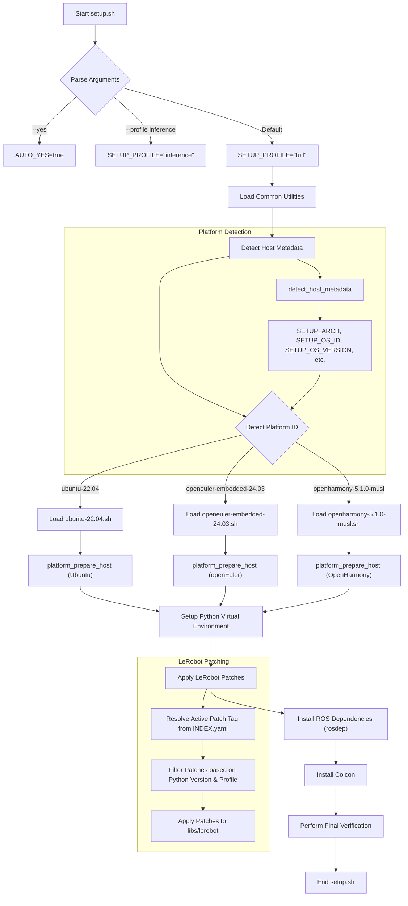
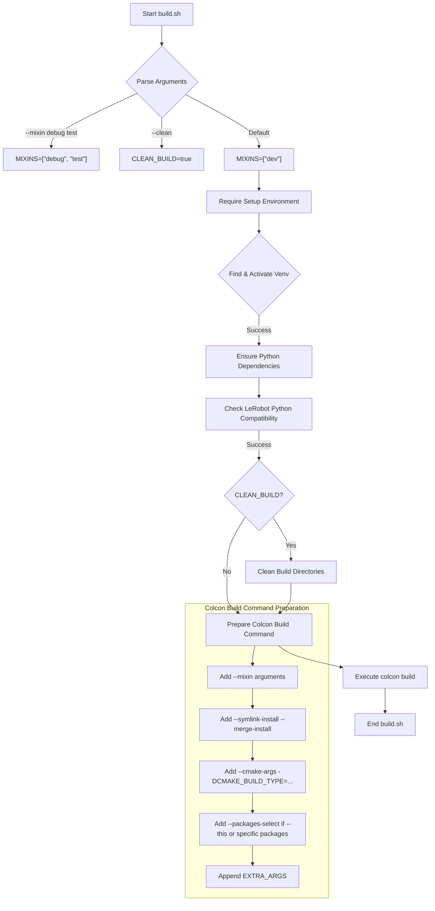
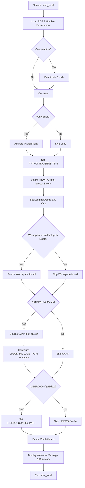

# 入门与环境

相关源码文件

以下文件被用作生成此 wiki 页面的上下文：

- [.shrc_local](https://atomgit.com/openeuler/IB_Robot/blob/openEuler-26.09/.shrc_local)
- [scripts/build.sh](https://atomgit.com/openeuler/IB_Robot/blob/openEuler-26.09/scripts/build.sh)
- [scripts/cleanup_ros.sh](https://atomgit.com/openeuler/IB_Robot/blob/openEuler-26.09/scripts/cleanup_ros.sh)
- [scripts/install_ros.sh](https://atomgit.com/openeuler/IB_Robot/blob/openEuler-26.09/scripts/install_ros.sh)
- [scripts/run_agent_chat.sh](https://atomgit.com/openeuler/IB_Robot/blob/openEuler-26.09/scripts/run_agent_chat.sh)
- [scripts/setup.sh](https://atomgit.com/openeuler/IB_Robot/blob/openEuler-26.09/scripts/setup.sh)
- [scripts/setup/detect.sh](https://atomgit.com/openeuler/IB_Robot/blob/openEuler-26.09/scripts/setup/detect.sh)
- [scripts/setup/lerobot_patches.sh](https://atomgit.com/openeuler/IB_Robot/blob/openEuler-26.09/scripts/setup/lerobot_patches.sh)
- [scripts/setup/openeuler_ros_repo.sh](https://atomgit.com/openeuler/IB_Robot/blob/openEuler-26.09/scripts/setup/openeuler_ros_repo.sh)
- [scripts/setup/platforms/openeuler-embedded-24.03.sh](https://atomgit.com/openeuler/IB_Robot/blob/openEuler-26.09/scripts/setup/platforms/openeuler-embedded-24.03.sh)
- [scripts/setup/platforms/openharmony-5.1.0-musl.sh](https://atomgit.com/openeuler/IB_Robot/blob/openEuler-26.09/scripts/setup/platforms/openharmony-5.1.0-musl.sh)
- [scripts/setup/platforms/ubuntu-22.04.sh](https://atomgit.com/openeuler/IB_Robot/blob/openEuler-26.09/scripts/setup/platforms/ubuntu-22.04.sh)
- [src/ibrobot_agent/README.md](https://atomgit.com/openeuler/IB_Robot/blob/openEuler-26.09/src/ibrobot_agent/README.md)
- [src/ibrobot_agent/ibrobot_agent/chat_tui.py](https://atomgit.com/openeuler/IB_Robot/blob/openEuler-26.09/src/ibrobot_agent/ibrobot_agent/chat_tui.py)
- [src/ibrobot_agent/package.xml](https://atomgit.com/openeuler/IB_Robot/blob/openEuler-26.09/src/ibrobot_agent/package.xml)
- [src/ibrobot_agent/setup.py](https://atomgit.com/openeuler/IB_Robot/blob/openEuler-26.09/src/ibrobot_agent/setup.py)
- [src/ibrobot_agent/test/test_chat_tui.py](https://atomgit.com/openeuler/IB_Robot/blob/openEuler-26.09/src/ibrobot_agent/test/test_chat_tui.py)
- [src/robot_config/config/robots/so101_single_arm_agent_hardware.yaml](https://atomgit.com/openeuler/IB_Robot/blob/openEuler-26.09/src/robot_config/config/robots/so101_single_arm_agent_hardware.yaml)
- [src/robot_config/config/robots/so101_single_arm_agent_hardware_stop.yaml](https://atomgit.com/openeuler/IB_Robot/blob/openEuler-26.09/src/robot_config/config/robots/so101_single_arm_agent_hardware_stop.yaml)
- [src/robot_description/CMakeLists.txt](https://atomgit.com/openeuler/IB_Robot/blob/openEuler-26.09/src/robot_description/CMakeLists.txt)

本页面详细介绍 RoboFrame 代码库开发环境的搭建过程，包括安装、引导初始化与日常工作流。内容涵盖用 `setup.sh` 完成初始环境配置、用 `build.sh` 编译工作区、用 `.shrc_local` 加载环境、ROS 安装，以及用 `cleanup_ros.sh` 管理进程。

## 使用 `setup.sh` 进行初始搭建

`setup.sh` 脚本是配置开发环境的主入口。它负责仓库导入、依赖安装与环境设置，确保构建和运行 RoboFrame 的所有前置条件就绪。

该脚本支持以下命令行参数以自定义行为：

- `--yes`：自动确认所有提示。
- `--with-diagnostics`：安装语音方向报告所需的依赖。
- `--skip-verify`：跳过最后的 ROS/Python 校验步骤。
- `--only-patch`：仅应用 LeRobot 补丁，不执行其他搭建任务。
- `--platform <id>`：覆盖检测到的平台 ID。
- `--profile <name>`：指定依赖范围，如 `full`（默认）或 `inference`。
- `--help`：显示用法信息。

该脚本执行以下高层步骤：

1.  **配置初始化**：设置 `WORKSPACE`、`AUTO_YES`、`USE_SUDO` 等变量及各平台细节 [scripts/setup.sh:24-78](https://atomgit.com/openeuler/IB_Robot/blob/openEuler-26.09/scripts/setup.sh#L24-L78)。
2.  **加载共享基础设施**：source 子模块、ROS 第三方依赖、rosdep、Python 虚拟环境与基准 profile 等公共工具脚本 [scripts/setup.sh:102-113](https://atomgit.com/openeuler/IB_Robot/blob/openEuler-26.09/scripts/setup.sh#L102-L113)。
3.  **平台检测**：使用 `detect_host_metadata` 与 `detect_platform_id` 函数识别操作系统、架构及其他主机元数据 [scripts/setup/detect.sh:116-169](https://atomgit.com/openeuler/IB_Robot/blob/openEuler-26.09/scripts/setup/detect.sh#L116-L169)，以此决定执行哪套平台专属搭建流程。
4.  **主机准备**：执行平台专属的准备步骤，如安装主机包、配置软件仓库、确保 CA 证书就位。例如 openEuler 的 `platform_prepare_host` 负责处理 `dnf` 安装与仓库配置 [scripts/setup/platforms/openeuler-embedded-24.03.sh:15-40](https://atomgit.com/openeuler/IB_Robot/blob/openEuler-26.09/scripts/setup/platforms/openeuler-embedded-24.03.sh#L15-L40)。
5.  **Python 虚拟环境搭建**：创建并激活 Python 虚拟环境（`venv`）以隔离项目依赖，同时确保设置 `PYTHONNOUSERSITE=1`，避免与用户安装的包冲突 [scripts/setup.sh:78-78](https://atomgit.com/openeuler/IB_Robot/blob/openEuler-26.09/scripts/setup.sh#L78)。
6.  **LeRobot 补丁应用**：对 `libs/lerobot` 子模块应用所需补丁。包括从 `third_party/patches/lerobot/INDEX.yaml` 解析活跃补丁 tag，并按主机 Python 版本与活跃 profile 过滤补丁 [scripts/setup/lerobot_patches.sh:6-12](https://atomgit.com/openeuler/IB_Robot/blob/openEuler-26.09/scripts/setup/lerobot_patches.sh#L6-L12)。
7.  **ROS 依赖安装**：使用 `rosdep` 安装 ROS 包所需的系统依赖。此步骤通常先更新软件包列表（`apt-get update` 或 `dnf update`）[scripts/setup/platforms/ubuntu-22.04.sh:33-35](https://atomgit.com/openeuler/IB_Robot/blob/openEuler-26.09/scripts/setup/platforms/ubuntu-22.04.sh#L33-L35)。
8.  **Colcon 安装**：安装用于构建 ROS 2 包的 `colcon-common-extensions` [scripts/setup/platforms/ubuntu-22.04.sh:14-15](https://atomgit.com/openeuler/IB_Robot/blob/openEuler-26.09/scripts/setup/platforms/ubuntu-22.04.sh#L14-L15)。
9.  **校验**：执行最终检查，确保 ROS 与 Python 环境配置正确。

### 平台专属搭建

`setup.sh` 脚本根据检测到的操作系统动态加载平台专属实现。

-   **Ubuntu 22.04**：由 `scripts/setup/platforms/ubuntu-22.04.sh` 处理。该脚本定义 `platform_lerobot_profiles`、`platform_prepare_host`、`platform_install_colcon`、`platform_install_python_bootstrap`、`platform_pre_install_rosdeps` 与 `platform_post_install_rosdeps` [scripts/setup/platforms/ubuntu-22.04.sh:1-49](https://atomgit.com/openeuler/IB_Robot/blob/openEuler-26.09/scripts/setup/platforms/ubuntu-22.04.sh#L1-L49)。
-   **openEuler Embedded 24.03**：由 `scripts/setup/platforms/openeuler-embedded-24.03.sh` 处理。该脚本配置 `dnf` 仓库，安装 `gcc-c++`、`ffmpeg-devel`、`opencv` 等主机包并管理 GPG 密钥 [scripts/setup/platforms/openeuler-embedded-24.03.sh:1-190](https://atomgit.com/openeuler/IB_Robot/blob/openEuler-26.09/scripts/setup/platforms/openeuler-embedded-24.03.sh#L1-L190)。它还为 rosdep 兼容性设置 `ROS_OS_OVERRIDE=rhel:8` [scripts/setup/platforms/openeuler-embedded-24.03.sh:16-16](https://atomgit.com/openeuler/IB_Robot/blob/openEuler-26.09/scripts/setup/platforms/openeuler-embedded-24.03.sh#L16)。
-   **OpenHarmony 5.1.0 musl**：由 `scripts/setup/platforms/openharmony-5.1.0-musl.sh` 处理。该平台主要用于验证板端运行时，会跳过本地工作区构建步骤，因为产物是在主机上交叉构建的 [scripts/setup/platforms/openharmony-5.1.0-musl.sh:30-35](https://atomgit.com/openeuler/IB_Robot/blob/openEuler-26.09/scripts/setup/platforms/openharmony-5.1.0-musl.sh#L30-L35)。

**图表：`setup.sh` 工作流**

来源：[scripts/setup.sh:24-78](https://atomgit.com/openeuler/IB_Robot/blob/openEuler-26.09/scripts/setup.sh#L24-L78), [scripts/setup.sh:102-113](https://atomgit.com/openeuler/IB_Robot/blob/openEuler-26.09/scripts/setup.sh#L102-L113), [scripts/setup.sh:78-78](https://atomgit.com/openeuler/IB_Robot/blob/openEuler-26.09/scripts/setup.sh#L78), [scripts/setup/detect.sh:116-169](https://atomgit.com/openeuler/IB_Robot/blob/openEuler-26.09/scripts/setup/detect.sh#L116-L169), [scripts/setup/platforms/ubuntu-22.04.sh:1-49](https://atomgit.com/openeuler/IB_Robot/blob/openEuler-26.09/scripts/setup/platforms/ubuntu-22.04.sh#L1-L49), [scripts/setup/platforms/openeuler-embedded-24.03.sh:1-190](https://atomgit.com/openeuler/IB_Robot/blob/openEuler-26.09/scripts/setup/platforms/openeuler-embedded-24.03.sh#L1-L190), [scripts/setup/platforms/openeuler-embedded-24.03.sh:16-16](https://atomgit.com/openeuler/IB_Robot/blob/openEuler-26.09/scripts/setup/platforms/openeuler-embedded-24.03.sh#L16), [scripts/setup/platforms/openharmony-5.1.0-musl.sh:30-35](https://atomgit.com/openeuler/IB_Robot/blob/openEuler-26.09/scripts/setup/platforms/openharmony-5.1.0-musl.sh#L30-L35), [scripts/setup/lerobot_patches.sh:6-12](https://atomgit.com/openeuler/IB_Robot/blob/openEuler-26.09/scripts/setup/lerobot_patches.sh#L6-L12), [scripts/setup/platforms/ubuntu-22.04.sh:33-35](https://atomgit.com/openeuler/IB_Robot/blob/openEuler-26.09/scripts/setup/platforms/ubuntu-22.04.sh#L33-L35), [scripts/setup/platforms/ubuntu-22.04.sh:14-15](https://atomgit.com/openeuler/IB_Robot/blob/openEuler-26.09/scripts/setup/platforms/ubuntu-22.04.sh#L14-L15)

## 使用 `build.sh` 构建工作区

`build.sh` 脚本用于编译 ROS 2 工作区。它基于 `colcon`，并通过 “mixin” 支持多种构建配置。

用法：

- `./scripts/build.sh`：默认开发构建。
- `./scripts/build.sh --mixin release`：发布构建。
- `./scripts/build.sh --mixin debug test`：带测试的调试构建。
- `./scripts/build.sh --list-mixins`：列出可用的 mixin。
- `./scripts/build.sh --packages-select tensormsg`：构建指定包。

关键特性：

-   **Mixin 支持**：允许组合多种构建配置（如 `debug`、`release`、`test`、`lint`、`prod`）[scripts/build.sh:39-55](https://atomgit.com/openeuler/IB_Robot/blob/openEuler-26.09/scripts/build.sh#L39-L55)。Mixin 定义在 `MIXIN_DIR`（`.colcon/mixin/build.mixin.yaml`）中。
-   **虚拟环境集成**：确保构建前激活正确的 Python 虚拟环境（由 `setup.sh` 创建）。它会在常见位置搜索 `venv/bin/activate` [scripts/build.sh:137-152](https://atomgit.com/openeuler/IB_Robot/blob/openEuler-26.09/scripts/build.sh#L137-L152)。
-   **Python 依赖检查**：若缺失则在当前虚拟环境内安装 `typing_extensions`、`pyserial`、`feetech-servo-sdk`、`sherpa-onnx`、`soundfile`、`sounddevice` 等关键 Python 包 [scripts/build.sh:154-165](https://atomgit.com/openeuler/IB_Robot/blob/openEuler-26.09/scripts/build.sh#L154-L165)。
-   **LeRobot Python 兼容性**：检查当前 Python 解释器是否满足 `libs/lerobot/pyproject.toml` 规定的最低版本要求 [scripts/build.sh:167-194](https://atomgit.com/openeuler/IB_Robot/blob/openEuler-26.09/scripts/build.sh#L167-L194)。
-   **Colcon 参数透传**：`--` 之后的参数会直接传给 `colcon build` [scripts/build.sh:120-122](https://atomgit.com/openeuler/IB_Robot/blob/openEuler-26.09/scripts/build.sh#L120-L122)。
-   **干净构建**：`--clean` 选项会在构建前删除 `build`、`install`、`log` 目录 [scripts/build.sh:210-217](https://atomgit.com/openeuler/IB_Robot/blob/openEuler-26.09/scripts/build.sh#L210-L217)。

**图表：`build.sh` 工作流**

来源：[scripts/build.sh:39-55](https://atomgit.com/openeuler/IB_Robot/blob/openEuler-26.09/scripts/build.sh#L39-L55), [scripts/build.sh:137-152](https://atomgit.com/openeuler/IB_Robot/blob/openEuler-26.09/scripts/build.sh#L137-L152), [scripts/build.sh:154-165](https://atomgit.com/openeuler/IB_Robot/blob/openEuler-26.09/scripts/build.sh#L154-L165), [scripts/build.sh:167-194](https://atomgit.com/openeuler/IB_Robot/blob/openEuler-26.09/scripts/build.sh#L167-L194), [scripts/build.sh:120-122](https://atomgit.com/openeuler/IB_Robot/blob/openEuler-26.09/scripts/build.sh#L120-L122), [scripts/build.sh:210-217](https://atomgit.com/openeuler/IB_Robot/blob/openEuler-26.09/scripts/build.sh#L210-L217)

## 使用 `.shrc_local` 加载环境

`.shrc_local` 脚本用于日常在 shell 中搭建开发环境，兼容 Bash 与 Zsh。

`.shrc_local` 执行的关键步骤：

1.  **加载 ROS 2 Humble**：source `/opt/ros/humble/setup.sh` 建立 ROS 2 基础环境，并显式将 `/opt/ros/humble/lib64` 加入 `LD_LIBRARY_PATH` 以兼容 openEuler [.shrc_local:13-23](https://atomgit.com/openeuler/IB_Robot/blob/openEuler-26.09/.shrc_local#L13-L23)。
2.  **停用 Conda**：若检测到激活的 Conda 环境则将其停用，以避免冲突 [.shrc_local:25-29](https://atomgit.com/openeuler/IB_Robot/blob/openEuler-26.09/.shrc_local#L25-L29)。
3.  **激活虚拟环境**：激活位于 `venv/bin/activate` 的项目 Python 虚拟环境 [.shrc_local:31-36](https://atomgit.com/openeuler/IB_Robot/blob/openEuler-26.09/.shrc_local#L31-L36)。
4.  **禁用用户 site-packages**：设置 `PYTHONNOUSERSITE=1`，阻止 Python 在 `~/.local` 中查找包，确保只使用虚拟环境与系统中的包 [.shrc_local:39-39](https://atomgit.com/openeuler/IB_Robot/blob/openEuler-26.09/.shrc_local#L39)。
5.  **PYTHONPATH 设置**：将 `libs/lerobot/src` 与虚拟环境的 site-packages 加入 `PYTHONPATH`，优先使用本地源码 [.shrc_local:58-59](https://atomgit.com/openeuler/IB_Robot/blob/openEuler-26.09/.shrc_local#L58-L59)。
6.  **日志与调试增强**：设置 `RCUTILS_COLORIZED_OUTPUT=1` 与 `PYTHONUNBUFFERED=1` 以改善控制台输出 [.shrc_local:62-64](https://atomgit.com/openeuler/IB_Robot/blob/openEuler-26.09/.shrc_local#L62-L64)。
7.  **加载工作区安装**：若存在则 source 工作区的 `install/setup.sh`，将本地构建的 ROS 包纳入环境 [.shrc_local:67-72](https://atomgit.com/openeuler/IB_Robot/blob/openEuler-26.09/.shrc_local#L67-L72)。
8.  **CANN 环境加载**：若可用则检测并 source 华为昇腾 CANN 工具链的环境脚本（`set_env.sh`），并尝试为 CANN C++ 头文件配置 `CPLUS_INCLUDE_PATH` [.shrc_local:74-124](https://atomgit.com/openeuler/IB_Robot/blob/openEuler-26.09/.shrc_local#L74-L124)。
9.  **LIBERO 基准配置**：若存在 LIBERO 基准配置（由 `setup.sh --with-benchmark` 生成），则设置 `LIBERO_CONFIG_PATH` 环境变量 [.shrc_local:128-132](https://atomgit.com/openeuler/IB_Robot/blob/openEuler-26.09/.shrc_local#L128-L132)。
10. **别名**：为常用 `colcon` 命令定义便捷别名：`cb` 全量 release 构建、`cbp` 构建指定包、`src` 重新 source 工作区 [.shrc_local:136-138](https://atomgit.com/openeuler/IB_Robot/blob/openEuler-26.09/.shrc_local#L136-L138)。
11. **欢迎信息**：在交互式 shell 中输出已激活与已跳过步骤的摘要 [.shrc_local:141-147](https://atomgit.com/openeuler/IB_Robot/blob/openEuler-26.09/.shrc_local#L141-L147)。

**图表：`.shrc_local` 工作流**

来源：[.shrc_local:13-23](https://atomgit.com/openeuler/IB_Robot/blob/openEuler-26.09/.shrc_local#L13-L23), [.shrc_local:25-29](https://atomgit.com/openeuler/IB_Robot/blob/openEuler-26.09/.shrc_local#L25-L29), [.shrc_local:31-36](https://atomgit.com/openeuler/IB_Robot/blob/openEuler-26.09/.shrc_local#L31-L36), [.shrc_local:39-39](https://atomgit.com/openeuler/IB_Robot/blob/openEuler-26.09/.shrc_local#L39), [.shrc_local:58-59](https://atomgit.com/openeuler/IB_Robot/blob/openEuler-26.09/.shrc_local#L58-L59), [.shrc_local:62-64](https://atomgit.com/openeuler/IB_Robot/blob/openEuler-26.09/.shrc_local#L62-L64), [.shrc_local:67-72](https://atomgit.com/openeuler/IB_Robot/blob/openEuler-26.09/.shrc_local#L67-L72), [.shrc_local:74-124](https://atomgit.com/openeuler/IB_Robot/blob/openEuler-26.09/.shrc_local#L74-L124), [.shrc_local:128-132](https://atomgit.com/openeuler/IB_Robot/blob/openEuler-26.09/.shrc_local#L128-L132), [.shrc_local:136-138](https://atomgit.com/openeuler/IB_Robot/blob/openEuler-26.09/.shrc_local#L136-L138), [.shrc_local:141-147](https://atomgit.com/openeuler/IB_Robot/blob/openEuler-26.09/.shrc_local#L141-L147)

## 使用 `install_ros.sh` 安装 ROS

`install_ros.sh` 脚本自动在受支持的 Linux 发行版上安装 ROS 2 Humble。它会检测操作系统、配置软件仓库并安装 IB-Robot 项目所需的组件。

用法：

- `./scripts/install_ros.sh`：交互模式，带提示。
- `./scripts/install_ros.sh --yes`：自动模式（跳过提示）。
- `./scripts/install_ros.sh --help`：显示帮助信息。

该脚本执行以下步骤：

1.  **参数解析**：处理 `--yes`、`--no-sudo`、`--sudo` 与 `--help` 参数 [scripts/install_ros.sh:68-82](https://atomgit.com/openeuler/IB_Robot/blob/openEuler-26.09/scripts/install_ros.sh#L68-L82)。
2.  **Sudo 检查**：确认是否具备 `sudo` 权限或当前以 root 运行 [scripts/install_ros.sh:87-96](https://atomgit.com/openeuler/IB_Robot/blob/openEuler-26.09/scripts/install_ros.sh#L87-L96)。
3.  **OS 检测**：通过 `/etc/os-release` 识别操作系统（Ubuntu 或 openEuler）及其版本 [scripts/install_ros.sh:129-147](https://atomgit.com/openeuler/IB_Robot/blob/openEuler-26.09/scripts/install_ros.sh#L129-L147)。
4.  **架构检测**：确定系统架构（如 `aarch64`、`x86_64`）[scripts/install_ros.sh:149-158](https://atomgit.com/openeuler/IB_Robot/blob/openEuler-26.09/scripts/install_ros.sh#L149-L158)。
5.  **OS 变量设置**：根据检测到的 OS 配置包管理器（`apt` 或 `dnf`）、ROS 发行版（`humble`）与仓库 URL [scripts/install_ros.sh:160-174](https://atomgit.com/openeuler/IB_Robot/blob/openEuler-26.09/scripts/install_ros.sh#L160-L174)。
6.  **ROS 安装检查**：通过检查 `/opt/ros/${ROS_DISTRO}/setup.bash` 判断 ROS 2 Humble 是否已安装 [scripts/install_ros.sh:179-188](https://atomgit.com/openeuler/IB_Robot/blob/openEuler-26.09/scripts/install_ros.sh#L179-L188)。
7.  **平台专属安装**：
    -   **Ubuntu**：添加 ROS 2 官方 APT 仓库、导入 GPG 密钥，并安装 `ros-humble-desktop` 及 `ros-humble-moveit`、`ros-humble-ros2-control` 等其他所需包。
    -   **openEuler**：配置 ROS-SIG 社区仓库、导入 GPG 密钥，并使用 `dnf` 安装 `ros-humble-ros-base` 及其他必要包。它借助 `openeuler_ros_repo.sh` 管理仓库配置 [scripts/install_ros.sh:59-59](https://atomgit.com/openeuler/IB_Robot/blob/openEuler-26.09/scripts/install_ros.sh#L59)。

来源：[scripts/install_ros.sh:68-82](https://atomgit.com/openeuler/IB_Robot/blob/openEuler-26.09/scripts/install_ros.sh#L68-L82), [scripts/install_ros.sh:87-96](https://atomgit.com/openeuler/IB_Robot/blob/openEuler-26.09/scripts/install_ros.sh#L87-L96), [scripts/install_ros.sh:129-147](https://atomgit.com/openeuler/IB_Robot/blob/openEuler-26.09/scripts/install_ros.sh#L129-L147), [scripts/install_ros.sh:149-158](https://atomgit.com/openeuler/IB_Robot/blob/openEuler-26.09/scripts/install_ros.sh#L149-L158), [scripts/install_ros.sh:160-174](https://atomgit.com/openeuler/IB_Robot/blob/openEuler-26.09/scripts/install_ros.sh#L160-L174), [scripts/install_ros.sh:179-188](https://atomgit.com/openeuler/IB_Robot/blob/openEuler-26.09/scripts/install_ros.sh#L179-L188), [scripts/install_ros.sh:59-59](https://atomgit.com/openeuler/IB_Robot/blob/openEuler-26.09/scripts/install_ros.sh#L59)

## 使用 `cleanup_ros.sh` 清理 ROS 进程

`cleanup_ros.sh` 脚本用于终止残留的 ROS 2 进程、清理共享内存并重置守护进程状态。这有助于在启动新的 ROS 应用之前或崩溃之后获得干净的环境。

关键动作：

1.  **安全终止进程**：首先对已知的 ROS 2 launch 父进程与特定节点（如 `ros2 launch`、`move_group`、`ign gazebo`）尝试 `SIGINT` 优雅关闭 [scripts/cleanup_ros.sh:38-45](https://atomgit.com/openeuler/IB_Robot/blob/openEuler-26.09/scripts/cleanup_ros.sh#L38-L45)。
2.  **强制杀死残留进程**：短暂等待后，强制（`KILL`）终止所有剩余的 ROS 2 相关进程，包括各类 IB-Robot 应用节点（如 `lerobot_policy_node`、`action_dispatcher_node`、`moveit_gateway`）、辅助 TF/中继节点以及 IK worker [scripts/cleanup_ros.sh:48-100](https://atomgit.com/openeuler/IB_Robot/blob/openEuler-26.09/scripts/cleanup_ros.sh#L48-L100)。
3.  **停止 ROS 2 守护进程**：停止 `ros2 daemon`，刷新陈旧的图数据 [scripts/cleanup_ros.sh:104-105](https://atomgit.com/openeuler/IB_Robot/blob/openEuler-26.09/scripts/cleanup_ros.sh#L104-L105)。
4.  **共享内存清理**：从 `/dev/shm`（共享内存）中删除 ROS 2 相关文件，ROS 2 Humble 使用它进行进程间通信 [scripts/cleanup_ros.sh:108-113](https://atomgit.com/openeuler/IB_Robot/blob/openEuler-26.09/scripts/cleanup_ros.sh#L108-L113)。
5.  **受保护的 PID**：脚本内含逻辑，防止清理过程中杀死自身及其祖先 shell [scripts/cleanup_ros.sh:12-35](https://atomgit.com/openeuler/IB_Robot/blob/openEuler-26.09/scripts/cleanup_ros.sh#L12-L35)。

来源：[scripts/cleanup_ros.sh:38-45](https://atomgit.com/openeuler/IB_Robot/blob/openEuler-26.09/scripts/cleanup_ros.sh#L38-L45), [scripts/cleanup_ros.sh:48-100](https://atomgit.com/openeuler/IB_Robot/blob/openEuler-26.09/scripts/cleanup_ros.sh#L48-L100), [scripts/cleanup_ros.sh:104-105](https://atomgit.com/openeuler/IB_Robot/blob/openEuler-26.09/scripts/cleanup_ros.sh#L104-L105), [scripts/cleanup_ros.sh:108-113](https://atomgit.com/openeuler/IB_Robot/blob/openEuler-26.09/scripts/cleanup_ros.sh#L108-L113), [scripts/cleanup_ros.sh:12-35](https://atomgit.com/openeuler/IB_Robot/blob/openEuler-26.09/scripts/cleanup_ros.sh#L12-L35)
