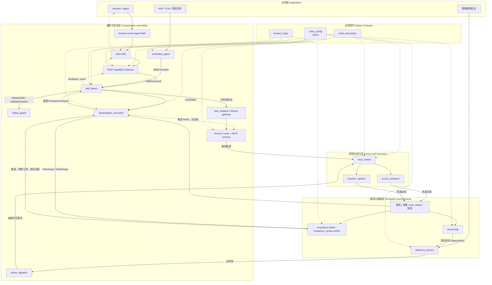

# 项目概览概述

<details>
<summary>相关源码文件</summary>

以下文件被用作生成此 wiki 页面的上下文：

- [.agents/skills/README.md](https://atomgit.com/openeuler/IB_Robot/blob/openEuler-26.09/.agents/skills/README.md)
- [.agents/skills/ibrobot-architecture/SKILL.md](https://atomgit.com/openeuler/IB_Robot/blob/openEuler-26.09/.agents/skills/ibrobot-architecture/SKILL.md)
- [.agents/skills/ibrobot-architecture/references/data-flow.md](https://atomgit.com/openeuler/IB_Robot/blob/openEuler-26.09/.agents/skills/ibrobot-architecture/references/data-flow.md)
- [.agents/skills/ibrobot-architecture/references/key-files.md](https://atomgit.com/openeuler/IB_Robot/blob/openEuler-26.09/.agents/skills/ibrobot-architecture/references/key-files.md)
- [.agents/skills/ibrobot-architecture/references/launch-and-troubleshooting.md](https://atomgit.com/openeuler/IB_Robot/blob/openEuler-26.09/.agents/skills/ibrobot-architecture/references/launch-and-troubleshooting.md)
- [.agents/skills/ibrobot-build/SKILL.md](https://atomgit.com/openeuler/IB_Robot/blob/openEuler-26.09/.agents/skills/ibrobot-build/SKILL.md)
- [.agents/skills/ibrobot-build/references/package-notes.md](https://atomgit.com/openeuler/IB_Robot/blob/openEuler-26.09/.agents/skills/ibrobot-build/references/package-notes.md)
- [.agents/skills/ibrobot-build/references/troubleshooting.md](https://atomgit.com/openeuler/IB_Robot/blob/openEuler-26.09/.agents/skills/ibrobot-build/references/troubleshooting.md)
- [.agents/skills/ibrobot-env/SKILL.md](https://atomgit.com/openeuler/IB_Robot/blob/openEuler-26.09/.agents/skills/ibrobot-env/SKILL.md)
- [.agents/skills/ibrobot-launch/SKILL.md](https://atomgit.com/openeuler/IB_Robot/blob/openEuler-26.09/.agents/skills/ibrobot-launch/SKILL.md)
- [.agents/skills/ibrobot-launch/references/troubleshooting.md](https://atomgit.com/openeuler/IB_Robot/blob/openEuler-26.09/.agents/skills/ibrobot-launch/references/troubleshooting.md)
- [.agents/skills/ibrobot-launch/references/ubuntu.md](https://atomgit.com/openeuler/IB_Robot/blob/openEuler-26.09/.agents/skills/ibrobot-launch/references/ubuntu.md)
- [.agents/skills/ibrobot-robot-skill-design/SKILL.md](https://atomgit.com/openeuler/IB_Robot/blob/openEuler-26.09/.agents/skills/ibrobot-robot-skill-design/SKILL.md)
- [.agents/skills/intro/SKILL.md](https://atomgit.com/openeuler/IB_Robot/blob/openEuler-26.09/.agents/skills/intro/SKILL.md)
- [AGENTS.md](https://atomgit.com/openeuler/IB_Robot/blob/openEuler-26.09/AGENTS.md)
- [README.en.md](https://atomgit.com/openeuler/IB_Robot/blob/openEuler-26.09/README.en.md)
- [README.md](https://atomgit.com/openeuler/IB_Robot/blob/openEuler-26.09/README.md)
- [docs/architecture.md](https://atomgit.com/openeuler/IB_Robot/blob/openEuler-26.09/docs/architecture.md)
- [docs/ib_robot_social_skill.md](https://atomgit.com/openeuler/IB_Robot/blob/openEuler-26.09/docs/ib_robot_social_skill.md)
- [docs/pictures/architecture.png](https://atomgit.com/openeuler/IB_Robot/blob/openEuler-26.09/docs/pictures/architecture.png)
- [docs/roadmap.md](https://atomgit.com/openeuler/IB_Robot/blob/openEuler-26.09/docs/roadmap.md)
- [docs/videos/openclaw_real.mp4](https://atomgit.com/openeuler/IB_Robot/blob/openEuler-26.09/docs/videos/openclaw_real.mp4)
- [docs/videos/openclaw_sim.mp4](https://atomgit.com/openeuler/IB_Robot/blob/openEuler-26.09/docs/videos/openclaw_sim.mp4)
- [scripts/start_rosclaw.sh](https://atomgit.com/openeuler/IB_Robot/blob/openEuler-26.09/scripts/start_rosclaw.sh)
- [src/README.md](https://atomgit.com/openeuler/IB_Robot/blob/openEuler-26.09/src/README.md)

</details>

IB-Robot（Intelligence Boom Robot）是一个一体化具身智能框架，旨在打通 Hugging Face LeRobot 机器学习生态与 ROS 2 机器人中间件。它为具身智能的研究与开发提供完整工具链，覆盖数据采集、模型训练与真实世界部署。该框架解决机器学习与机器人控制之间的"世界观"差异、科研与产业部署之间的鸿沟，以及具身智能对健壮数据生命周期的需求。

关于详细的安装与配置说明，请参阅[入门与环境](./getting_started_environment.md)。若想深入了解系统组件及数据在其中的流转方式，参见[系统架构与数据流](./system_architecture_data_flow.md)。受支持的操作系统与硬件平台信息见[支持的平台](./supported_platforms.md)。

来源：[README.md:1-3](https://atomgit.com/openeuler/IB_Robot/blob/openEuler-26.09/README.md#L1-L3), [README.en.md:1-3](https://atomgit.com/openeuler/IB_Robot/blob/openEuler-26.09/README.en.md#L1-L3), [docs/architecture.md:18-30](https://atomgit.com/openeuler/IB_Robot/blob/openEuler-26.09/docs/architecture.md#L18-L30)

## 核心集成能力

IB-Robot 提供融合 LeRobot 与 ROS 2 生态的核心能力，为具身智能开发提供统一路径。它处理数据流的转换与对齐，管理不同的时间概念，支持双模控制策略，并支撑分布式边云部署。

| 维度 | LeRobot 生态 | ROS 2 生态 | IB-Robot 解决方案 |
|---|---|---|---|
| **数据流** | 基于 Episode | 基于 Topic | 契约驱动的双向实时转换 |
| **时间** | 离散步数 | 连续实时流 | 自动对齐与高频插值 |
| **控制** | 端到端策略 | 分层规划 | **双模控制（ACT vs. MoveIt）** |
| **部署** | Python 脚本 | ROS 2 节点 | 分布式边云协同部署 |

来源：[README.md:23-29](https://atomgit.com/openeuler/IB_Robot/blob/openEuler-26.09/README.md#L23-L29), [README.en.md:23-29](https://atomgit.com/openeuler/IB_Robot/blob/openEuler-26.09/README.en.md#L23-L29), [docs/architecture.md:52-55](https://atomgit.com/openeuler/IB_Robot/blob/openEuler-26.09/docs/architecture.md#L52-L55)

## 系统架构

IB-Robot 建立了覆盖感知、决策与执行的端到端闭环系统，无缝连接机器学习与机器人两个领域。该架构以分层解耦、配置驱动行为、仿真到实机对齐以及完整的数据生命周期管理为设计原则。

### 高层架构图



IB-Robot 的架构建立在以下关键组件之上：

*   **多模态感知与采集**：利用 ROS 2 驱动统一访问各类传感器（相机、LiDAR、麦克风），并支持多种数据采集方式，包括用于专家示教的 VR 手柄、Xbox 手柄和移动端 IMU [README.md:48-51](https://atomgit.com/openeuler/IB_Robot/blob/openEuler-26.09/README.md#L48-L51)。
*   **协议转换枢纽（`tensormsg`）**：作为 `ros_msg` 与 `tensor` 数据类型之间双向转换的中央枢纽，通过契约机制保证数据一致性与类型安全 [README.md:52-55](https://atomgit.com/openeuler/IB_Robot/blob/openEuler-26.09/README.md#L52-L55)。
*   **推理与研发服务（`inference_service`）**：支持多种视觉-语言-动作（VLA）模型与端到端策略模型，并根据控制模式自动检测并启动合适的后端 [README.md:56-58](https://atomgit.com/openeuler/IB_Robot/blob/openEuler-26.09/README.md#L56-L58)。
*   **统一动作分发器（`action_dispatch`）**：充当机器人的“小脑”，在 ACT 模式下管理动作分块与高频插值，在规划模式下对接 MoveIt 2 执行受约束的轨迹 [README.md:59-61](https://atomgit.com/openeuler/IB_Robot/blob/openEuler-26.09/README.md#L59-L61)。
*   **配置驱动中心（`robot_config`）**：通过单一 YAML 文件定义机器人行为，指定关节、控制器模式与传感器参数，实现仿真与实机环境的无缝切换 [README.md:62-64](https://atomgit.com/openeuler/IB_Robot/blob/openEuler-26.09/README.md#L62-L64)。

关于系统架构与数据流的详细拆解，请参阅[系统架构与数据流](./system_architecture_data_flow.md)。

来源：[README.md:40-64](https://atomgit.com/openeuler/IB_Robot/blob/openEuler-26.09/README.md#L40-L64), [README.en.md:40-59](https://atomgit.com/openeuler/IB_Robot/blob/openEuler-26.09/README.en.md#L40-L59), [docs/architecture.md:87-177](https://atomgit.com/openeuler/IB_Robot/blob/openEuler-26.09/docs/architecture.md#L87-L177)

## 仓库布局

IB-Robot 仓库的结构对其各组件进行了组织，包括核心 ROS 2 包、外部依赖、AI Agent 技能与文档。

```text
IB_Robot/                           # Main Workspace
├── .gitmodules                     # Git submodule configuration
├── README.md                       # Main documentation (Chinese)
├── README.en.md                    # Main documentation (English)
├── LICENSE                         # Apache 2.0 License
├── config.json                     # AI Agent configuration (AtomGit API tokens, etc.)
│
├── .agents/                        # AI Agent configuration directory
│   └── skills/                     # AI Agent skills (see .agents/skills/README.md)
│
├── libs/                           # External dependencies
│   └── lerobot/                    # [Submodule] LeRobot training framework
│
├── src/                            # Core source packages
│   ├── robot_config/               # System master control, specs, and launch entry
│   ├── action_dispatch/            # Unified action dispatcher (Dual-mode)
│   ├── task_dispatch/              # Task scheduling and dispatch service
│   ├── tensormsg/                  # LeRobot ↔ ROS 2 protocol conversion hub
│   ├── ibrobot_msgs/               # Unified system interfaces (Message/Action/Service)
│   ├── ibrobot_tracing/            # Non-intrusive tracing and offline trace analysis
│   ├── dataset_tools/              # Dataset collection & conversion (Episode Recorder)
│   ├── robot_teleop/               # Teleoperation (Leader Arm/Xbox controller)
│   ├── robot_description/          # Unified URDF/SRDF/MJCF model descriptions
│   ├── lekiwi_description/         # Lekiwi chassis URDF/Mesh model descriptions
│   ├── robot_moveit/               # MoveIt 2 motion planning integration
│   ├── robot_navigation/           # Navigation package
│   ├── inference_service/          # Multi-model inference & deployment service
│   ├── so101_hardware/             # SO-101 motor driver interface
│   ├── lekiwi_hardware/            # Lekiwi chassis hardware driver interface
│   ├── hardware_mock/              # Hardware mock interface
│   ├── omni_wheel_controller/      # Omni-wheel controller plugin
│   ├── pymoveit2/                  # [Submodule] MoveIt2 Python interface
│   ├── rosclaw/                    # [Submodule] OpenClaw social control integration
│   ├── sim_models/                 # Simulation scene models (Gazebo/MuJoCo)
│   ├── model_utils/                # Model utility library
│   ├── torch_models/               # Self-developed PyTorch models, one directory per model
│   ├── attention_viz/              # Attention visualization tool
│   ├── voice_asr_service/          # Voice recognition service
│   ├── workflows/                  # CI/CD configuration
│   │
│   ├── embodied_agent/             # Hermes Agent plan lifecycle and execution orchestration
│   ├── perception_service/         # Continuous scene understanding service (RGB-D / multi-view)
│   ├── skill_library/              # Skill execution layer (skill → primitive → MoveIt)
│   └── safety_guard/               # Explicit safety validation layer (whitelist + workspace boundary)
│
├── tools/ibrobot_tracing_web/       # Explicitly enabled Web API toolkit
├── web/ibrobot_tracing_ui/          # Vue trace performance workbench
├── docs/                           # Deep architecture documentation and development guide
│   ├── pictures/                   # Architecture diagrams and demo GIFs
│   └── videos/                     # Demo videos (source files)
├── scripts/                        # Environment configuration and validation scripts
└── build/                          # Compilation output (automatically created)
```

### 关键目录及其内容

*   **`.agents/skills/`**：包含 AI Agent 技能。这些技能是为 IB-Robot 项目内各类开发工作流自动化而设计的插件，每个技能定义触发条件并为复杂任务提供工具。更多细节见 [.agents/skills/README.md](https://atomgit.com/openeuler/IB_Robot/blob/openEuler-26.09/.agents/skills/README.md)。
*   **`libs/lerobot/`**：LeRobot 训练框架的 Git 子模块。对该子模块的修改通过 `third_party/patches/lerobot/` 中的补丁管理，不应直接提交 [AGENTS.md:141-143](https://atomgit.com/openeuler/IB_Robot/blob/openEuler-26.09/AGENTS.md#L141-L143)。
*   **`src/`**：该目录承载构成 IB-Robot 框架的核心 ROS 2 包。
    *   `robot_config/`：管理系统级配置、规范与 launch 入口，是机器人定义的单一事实源（SSOT）[README.en.md:79](https://atomgit.com/openeuler/IB_Robot/blob/openEuler-26.09/README.en.md#L79)。
    *   `tensormsg/`：LeRobot 与 ROS 2 之间的协议转换枢纽，处理 `ros_msg` 到 `tensor` 的变换 [README.en.md:82](https://atomgit.com/openeuler/IB_Robot/blob/openEuler-26.09/README.en.md#L82)。
    *   `ibrobot_msgs/`：定义统一的系统接口，包括自定义消息、动作与服务 [README.en.md:83](https://atomgit.com/openeuler/IB_Robot/blob/openEuler-26.09/README.en.md#L83)。
    *   `inference_service/`：提供多模型推理与部署服务 [README.en.md:90](https://atomgit.com/openeuler/IB_Robot/blob/openEuler-26.09/README.en.md#L90)。
    *   `action_dispatch/`：统一动作分发器，支持双模控制 [README.en.md:80](https://atomgit.com/openeuler/IB_Robot/blob/openEuler-26.09/README.en.md#L80)。
    *   `skill_library/`：机器人技能的执行层，将高层技能转译为原语与 MoveIt 指令 [README.en.md:106](https://atomgit.com/openeuler/IB_Robot/blob/openEuler-26.09/README.en.md#L106)。
    *   `safety_guard/`：实现显式安全校验，包括白名单与工作空间边界约束 [README.en.md:107](https://atomgit.com/openeuler/IB_Robot/blob/openEuler-26.09/README.en.md#L107)。
*   **`scripts/`**：包含用于环境搭建、构建与校验的各类实用脚本。例如 `setup.sh` 负责初始环境配置，`build.sh` 用于编译项目 [README.md:135-145](https://atomgit.com/openeuler/IB_Robot/blob/openEuler-26.09/README.md#L135-L145)。
*   **`third_party/patches/`**：存放外部依赖的补丁，尤其是 `lerobot` 子模块的补丁 [AGENTS.md:33](https://atomgit.com/openeuler/IB_Robot/blob/openEuler-26.09/AGENTS.md#L33)。
*   **`web/ibrobot_tracing_ui/`**：追踪性能工作台的 Vue.js 前端，用于可视化系统追踪 [README.md:65](https://atomgit.com/openeuler/IB_Robot/blob/openEuler-26.09/README.md#L65)。

来源：[README.md:67-119](https://atomgit.com/openeuler/IB_Robot/blob/openEuler-26.09/README.md#L67-L119), [README.en.md:64-107](https://atomgit.com/openeuler/IB_Robot/blob/openEuler-26.09/README.en.md#L64-L107), [AGENTS.md:8-37](https://atomgit.com/openeuler/IB_Robot/blob/openEuler-26.09/AGENTS.md#L8-L37)

## 入门与环境

开始使用 IB-Robot 前，需要完成一次性的环境搭建，随后进入一致的日常开发工作流：初始化环境、构建项目并管理 ROS 2 设置。

关于安装、环境配置与日常工作流的详细说明，请参阅[入门与环境](./getting_started_environment.md)。

### 系统要求

*   **操作系统**：支持 Ubuntu 22.04（主机/开发机）、openEuler Embedded 24.03（边缘板）与 OpenHarmony 5.1（边缘板）[README.md:33-38](https://atomgit.com/openeuler/IB_Robot/blob/openEuler-26.09/README.md#L33-L38)。
*   **ROS 版本**：ROS 2 Humble [README.md:130](https://atomgit.com/openeuler/IB_Robot/blob/openEuler-26.09/README.md#L130)。
*   **Python**：Python >= 3.10。务必避免在 Conda 激活环境中运行，以防动态库冲突 [README.md:131](https://atomgit.com/openeuler/IB_Robot/blob/openEuler-26.09/README.md#L131)。
*   **加速器**：支持 NVIDIA GPU、昇腾 310B 与昇腾 310P；未检测到加速器时默认仅用 CPU [README.md:132](https://atomgit.com/openeuler/IB_Robot/blob/openEuler-26.09/README.md#L132)。

### 初始搭建

初始搭建是克隆仓库后执行一次的过程。`./scripts/setup.sh` 脚本自动完成以下关键步骤：

1.  **子模块同步**：初始化并更新 Git 子模块 [README.md:138](https://atomgit.com/openeuler/IB_Robot/blob/openEuler-26.09/README.md#L138)。
2.  **平台与硬件检测**：自动识别操作系统与可用硬件加速器 [README.md:139](https://atomgit.com/openeuler/IB_Robot/blob/openEuler-26.09/README.md#L139)。
3.  **ROS 2 安装**：若尚未安装，则安装 ROS 2 Humble 与 `colcon` [README.md:140](https://atomgit.com/openeuler/IB_Robot/blob/openEuler-26.09/README.md#L140)。
4.  **系统依赖安装**：通过系统包管理器安装 C++ 编译工具与硬件驱动依赖 [README.md:141](https://atomgit.com/openeuler/IB_Robot/blob/openEuler-26.09/README.md#L141)。
5.  **虚拟环境（venv）创建**：在根目录创建 `venv` 目录，隔离 ML 依赖的同时复用系统 `rclpy` [README.md:142](https://atomgit.com/openeuler/IB_Robot/blob/openEuler-26.09/README.md#L142)。
6.  **ML 技术栈安装**：在 `venv` 内安装 `lerobot`、硬件依赖以及与 ROS 2 Humble 兼容的 NumPy [README.md:143](https://atomgit.com/openeuler/IB_Robot/blob/openEuler-26.09/README.md#L143)。
7.  **环境校验**：验证 `rosdepc`、`colcon`、`rclpy`、`lerobot` 与 NumPy 的兼容性 [README.md:144](https://atomgit.com/openeuler/IB_Robot/blob/openEuler-26.09/README.md#L144)。

来源：[README.md:123-145](https://atomgit.com/openeuler/IB_Robot/blob/openEuler-26.09/README.md#L123-L145), [README.en.md:123-144](https://atomgit.com/openeuler/IB_Robot/blob/openEuler-26.09/README.en.md#L123-L144)

### 开发工作流

日常开发中保持一致的工作流至关重要：

1.  **加载环境**：在每个新终端中进入 `IB_Robot` 根目录并执行 `source .shrc_local` [README.md:153-154](https://atomgit.com/openeuler/IB_Robot/blob/openEuler-26.09/README.md#L153-L154)。该脚本会激活 `venv`、加载 ROS 2 环境并 source 工作区的 `install/setup.sh` [README.md:156](https://atomgit.com/openeuler/IB_Robot/blob/openEuler-26.09/README.md#L156)。
2.  **分配 Domain ID**：为每个会话设置唯一的 `ROS_DOMAIN_ID`，避免与其他 ROS 2 用户冲突 [README.md:168-170](https://atomgit.com/openeuler/IB_Robot/blob/openEuler-26.09/README.md#L168-L170)。这对节点发现与通信至关重要 [.agents/skills/ibrobot-build/references/troubleshooting.md:11-14](https://atomgit.com/openeuler/IB_Robot/blob/openEuler-26.09/.agents/skills/ibrobot-build/references/troubleshooting.md#L11-L14)。
3.  **编译项目**：代码修改后使用 `./scripts/build.sh` 编译项目。该脚本保证正确的构建设置与环境激活 [README.md:179-180](https://atomgit.com/openeuler/IB_Robot/blob/openEuler-26.09/README.md#L179-L180)。

关于环境搭建、构建与常见问题排查的更多细节，请参阅[入门与环境](./getting_started_environment.md)。

来源：[README.md:147-180](https://atomgit.com/openeuler/IB_Robot/blob/openEuler-26.09/README.md#L147-L180), [README.en.md:146-179](https://atomgit.com/openeuler/IB_Robot/blob/openEuler-26.09/README.en.md#L146-L179), [.agents/skills/ibrobot-build/SKILL.md:39-43](https://atomgit.com/openeuler/IB_Robot/blob/openEuler-26.09/.agents/skills/ibrobot-build/SKILL.md#L39-L43), [.agents/skills/ibrobot-build/references/troubleshooting.md:11-14](https://atomgit.com/openeuler/IB_Robot/blob/openEuler-26.09/.agents/skills/ibrobot-build/references/troubleshooting.md#L11-L14)

## 支持的平台

IB-Robot 设计为跨平台运行，同时支持开发与部署场景。框架主线工作流当前支持三种主要运行环境：

*   **Ubuntu 22.04**：作为主力主机与开发机，完整支持环境搭建、构建、仿真（Gazebo）、数据录制、MoveIt 集成与推理调试，是数据采集与单机推理的理想平台 [README.md:34-36](https://atomgit.com/openeuler/IB_Robot/blob/openEuler-26.09/README.md#L34-L36)。
*   **openEuler Embedded 24.03**：面向边缘侧开发板，支持环境搭建、干净构建与板端运行。典型用途包括 NPU 推理、真机控制以及充当录制客户端 [README.md:34-36](https://atomgit.com/openeuler/IB_Robot/blob/openEuler-26.09/README.md#L34-L36)。
*   **OpenHarmony 5.1**：同样面向边缘侧开发板，支持板端运行时工作流、HDC 调试、最小推理工作区构建与 LeRobot 补丁 profile 支持。用于 BQ3588HM 等板卡上的推理，以及通过 HDC/SSH 调试 [README.md:34-38](https://atomgit.com/openeuler/IB_Robot/blob/openEuler-26.09/README.md#L34-L38)。

关于各平台的具体配置、构建流程与发布打包的详细信息，请参阅[支持的平台](./supported_platforms.md)。

来源：[README.md:31-38](https://atomgit.com/openeuler/IB_Robot/blob/openEuler-26.09/README.md#L31-L38), [README.en.md:30-38](https://atomgit.com/openeuler/IB_Robot/blob/openEuler-26.09/README.en.md#L30-L38)
