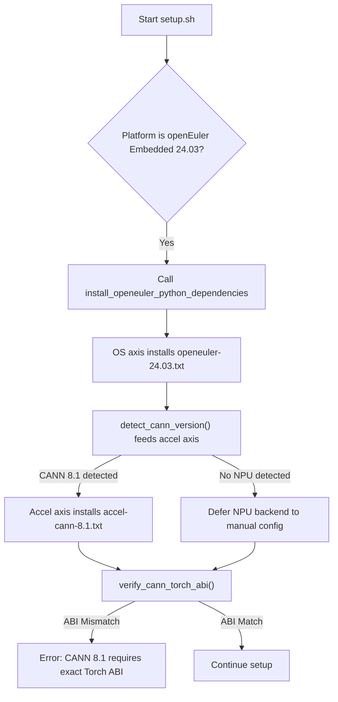
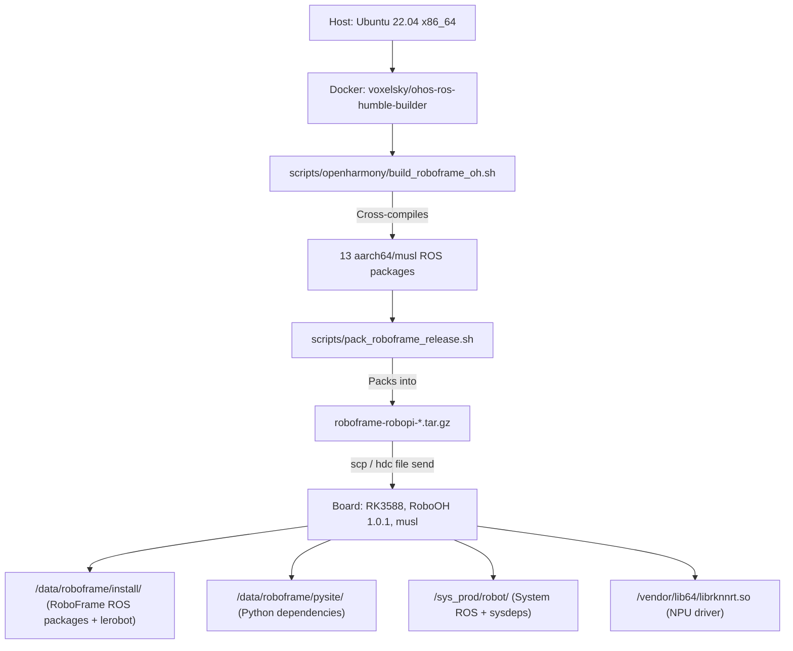
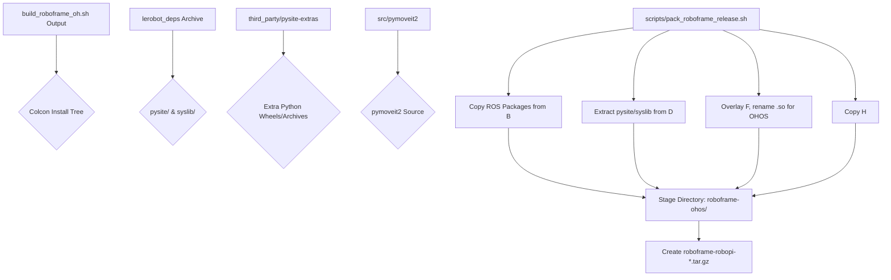

# 支持的平台

<details>
<summary>相关源码文件</summary>

以下文件被用作生成此 wiki 页面的上下文：

- [.pre-commit-config.yaml](https://atomgit.com/openeuler/IB_Robot/blob/openEuler-26.09/.pre-commit-config.yaml)
- [README.OpenHarmony.md](https://atomgit.com/openeuler/IB_Robot/blob/openEuler-26.09/README.OpenHarmony.md)
- [docs/pictures/lerobot_deps_release_asset.png](https://atomgit.com/openeuler/IB_Robot/blob/openEuler-26.09/docs/pictures/lerobot_deps_release_asset.png)
- [docs/pictures/lerobot_deps_repository.png](https://atomgit.com/openeuler/IB_Robot/blob/openEuler-26.09/docs/pictures/lerobot_deps_repository.png)
- [requirements/constraints-cann-8.1.txt](https://atomgit.com/openeuler/IB_Robot/blob/openEuler-26.09/requirements/constraints-cann-8.1.txt)
- [requirements/inference.txt](https://atomgit.com/openeuler/IB_Robot/blob/openEuler-26.09/requirements/inference.txt)
- [requirements/accel-cann-8.1.txt](https://atomgit.com/openeuler/IB_Robot/blob/openEuler-26.09/requirements/accel-cann-8.1.txt)
- [requirements/openeuler-24.03.txt](https://atomgit.com/openeuler/IB_Robot/blob/openEuler-26.09/requirements/openeuler-24.03.txt)
- [scripts/openharmony/build_roboframe_oh.sh](https://atomgit.com/openeuler/IB_Robot/blob/openEuler-26.09/scripts/openharmony/build_roboframe_oh.sh)
- [scripts/pack_roboframe_release.sh](https://atomgit.com/openeuler/IB_Robot/blob/openEuler-26.09/scripts/pack_roboframe_release.sh)
- [scripts/robooh_1.0.1.env](https://atomgit.com/openeuler/IB_Robot/blob/openEuler-26.09/scripts/robooh_1.0.1.env)
- [scripts/setup/README.en.md](https://atomgit.com/openeuler/IB_Robot/blob/openEuler-26.09/scripts/setup/README.en.md)
- [scripts/setup/README.md](https://atomgit.com/openeuler/IB_Robot/blob/openEuler-26.09/scripts/setup/README.md)
- [scripts/setup/python_venv.sh](https://atomgit.com/openeuler/IB_Robot/blob/openEuler-26.09/scripts/setup/python_venv.sh)
- [scripts/setup/rosdep.sh](https://atomgit.com/openeuler/IB_Robot/blob/openEuler-26.09/scripts/setup/rosdep.sh)
- [scripts/setup/submodules.sh](https://atomgit.com/openeuler/IB_Robot/blob/openEuler-26.09/scripts/setup/submodules.sh)
- [scripts/setup/tests/test_cann_torch_versions.sh](https://atomgit.com/openeuler/IB_Robot/blob/openEuler-26.09/scripts/setup/tests/test_cann_torch_versions.sh)
- [scripts/setup/verify_env.sh](https://atomgit.com/openeuler/IB_Robot/blob/openEuler-26.09/scripts/setup/verify_env.sh)
- [scripts/tracing/README.en.md](https://atomgit.com/openeuler/IB_Robot/blob/openEuler-26.09/scripts/tracing/README.en.md)
- [scripts/tracing/README.md](https://atomgit.com/openeuler/IB_Robot/blob/openEuler-26.09/scripts/tracing/README.md)
- [src/robot_config/package.xml](https://atomgit.com/openeuler/IB_Robot/blob/openEuler-26.09/src/robot_config/package.xml)
- [src/robot_config/robot_config/launch_builders/tracing.py](https://atomgit.com/openeuler/IB_Robot/blob/openEuler-26.09/src/robot_config/robot_config/launch_builders/tracing.py)
- [src/robot_config/robot_config/tracing_utils.py](https://atomgit.com/openeuler/IB_Robot/blob/openEuler-26.09/src/robot_config/robot_config/tracing_utils.py)
- [src/robot_config/setup.py](https://atomgit.com/openeuler/IB_Robot/blob/openEuler-26.09/src/robot_config/setup.py)
- [src/torch_models/torch_models/pi05_ascend_310p/README.md](https://atomgit.com/openeuler/IB_Robot/blob/openEuler-26.09/src/torch_models/torch_models/pi05_ascend_310p/README.md)

</details>

RoboFrame 设计为跨一系列平台运行，同时关注开发与部署环境。主要支持的平台包括用于开发与高性能推理的 Ubuntu 22.04、用于边缘 AI 加速的 openEuler Embedded 24.03（含 CANN 支持），以及用于嵌入式机器人的 OpenHarmony 5.1 musl。本页面详述实现 RoboFrame 跨平台兼容性的平台特定配置、构建流程与发布打包机制。

## 平台总览

框架利用 ROS 2 Humble 进行进程间通信与硬件抽象，并针对依赖、工具链与运行时环境进行平台特定调整。

### Ubuntu 22.04

Ubuntu 22.04 是主要开发环境。它支持 RoboFrame 的全部功能，包括硬件控制、遥操作、感知、抓取、语音交互、仿真与开发工具。Ubuntu 上的 setup 过程包括安装 ROS 2 Humble、管理 Python 虚拟环境与应用 LeRobot 补丁。

### openEuler Embedded 24.03（CANN）

openEuler Embedded 24.03 的支持聚焦于通过华为 CANN（Compute Architecture for Neural Networks）工具包实现昇腾 NPU 加速。该平台面向边缘推理场景优化，提供最小运行时档案。setup 脚本处理 CANN 版本检测、特定 Python 依赖需求（如 `torch_npu` 版本），以及对 `cv_bridge` 等关键组件的 ABI 兼容性检查。

#### CANN 版本检测与要求

`scripts/setup/python_venv.sh` 脚本包含检测已安装 CANN 版本并选择相应 Python 依赖的逻辑。`detect_cann_version()` 函数 [scripts/setup/detect.sh:92-122](https://atomgit.com/openeuler/IB_Robot/blob/openEuler-26.09/scripts/setup/detect.sh#L92-L122) 尝试查找 CANN 工具包根目录并从多个配置文件中提取版本。检测到的版本馈给独立的加速器轴：`install_openeuler_python_dependencies()` [scripts/setup/python_venv.sh:81-84](https://atomgit.com/openeuler/IB_Robot/blob/openEuler-26.09/scripts/setup/python_venv.sh#L81-L84) 安装 OS 轴清单（`requirements/openeuler-24.03.txt`），而 `install_accel_requirements()` [scripts/setup/python_venv.sh:89-120](https://atomgit.com/openeuler/IB_Robot/blob/openEuler-26.09/scripts/setup/python_venv.sh#L89-L120) 在承载 NPU 的任意 OS 上安装由 `accels/cann.sh` 选定的加速器轴清单（如 CANN 8.1 使用 `requirements/accel-cann-8.1.txt`）。

`verify_cann_torch_abi()` 函数 [scripts/setup/python_venv.sh:126-154](https://atomgit.com/openeuler/IB_Robot/blob/openEuler-26.09/scripts/setup/python_venv.sh#L126-L154) 确保已安装的 PyTorch、`torch_npu` 与 `torchvision` 版本精确匹配 CANN 8.1 的 ABI 要求。这对防止因 ABI 不匹配导致的运行时崩溃至关重要。



**图：CANN 依赖解析流程**
来源：[scripts/setup/python_venv.sh:81-154](https://atomgit.com/openeuler/IB_Robot/blob/openEuler-26.09/scripts/setup/python_venv.sh#L81-L154), [scripts/setup/detect.sh:92-122](https://atomgit.com/openeuler/IB_Robot/blob/openEuler-26.09/scripts/setup/detect.sh#L92-L122), [requirements/openeuler-24.03.txt:1-9](https://atomgit.com/openeuler/IB_Robot/blob/openEuler-26.09/requirements/openeuler-24.03.txt#L1-L9), [requirements/accel-cann-8.1.txt](https://atomgit.com/openeuler/IB_Robot/blob/openEuler-26.09/requirements/accel-cann-8.1.txt)

### OpenHarmony 5.1 musl

OpenHarmony 5.1 musl 面向嵌入式设备，特别是带 NPU 加速的 Rockchip RK3588 板（如 BQ3588HM、RoboPi、Robo3588）。由于该平台的 `musl libc` 与 `aarch64` 架构与标准 `glibc` 构建不兼容，需要交叉编译。`README.OpenHarmony.md` [README.OpenHarmony.md:1-397](https://atomgit.com/openeuler/IB_Robot/blob/openEuler-26.09/README.OpenHarmony.md#L1-L397) 提供搭建开发环境、交叉编译 RoboFrame 并部署到 OpenHarmony 设备的详细说明。

OpenHarmony 的部署拓扑涉及一台主机（Ubuntu 22.04 x86_64）运行 Docker 容器进行交叉编译，产出 `aarch64/musl` 包。这些包连同预构建的 Python 依赖（`pysite/`）与系统库（`syslib/`）随后被传输到 OpenHarmony 板上。



**图：OpenHarmony 部署拓扑**
来源：[README.OpenHarmony.md:80-103](https://atomgit.com/openeuler/IB_Robot/blob/openEuler-26.09/README.OpenHarmony.md#L80-L103)

## 平台特定脚本与配置

RoboFrame 使用位于 `scripts/setup/` 的模块化 setup 系统管理平台特定差异。

### Setup 档案

`setup.sh` 脚本支持不同"档案"以控制依赖安装范围，针对不同用例优化 [scripts/setup/README.en.md:17-27](https://atomgit.com/openeuler/IB_Robot/blob/openEuler-26.09/scripts/setup/README.en.md#L17-L27)。

*   `full`（默认）：为完整开发工作区安装全部依赖，包括硬件、遥操作、感知、抓取、语音、仿真与开发工具。
*   `inference`：安装用于策略推理的最小运行时，面向边云协同推理验证主机。该档案显著减少安装的子模块、ROS 依赖与 Python 包数量 [scripts/setup/README.en.md:28-35](https://atomgit.com/openeuler/IB_Robot/blob/openEuler-26.09/scripts/setup/README.en.md#L28-L35)。

例如，搭建边云推理主机：

```bash
./scripts/setup.sh --yes --profile inference
./scripts/build.sh --packages-up-to inference_service
```

来源：[scripts/setup/README.en.md:36-40](https://atomgit.com/openeuler/IB_Robot/blob/openEuler-26.09/scripts/setup/README.en.md#L36-L40)

### LeRobot 补丁分发

`libs/lerobot` 子模块经常需要平台特定补丁。这些补丁在 `third_party/patches/lerobot/` 下管理，由 `scripts/setup/lerobot_patches.sh` 应用。`lerobot_filter_series.py` 脚本基于主机事实（Python 版本、活动档案）与 `manifest.yaml` 中定义的谓词过滤补丁 [scripts/setup/README.en.md:58-65](https://atomgit.com/openeuler/IB_Robot/blob/openEuler-26.09/scripts/setup/README.en.md#L58-L65)。

用于补丁过滤的活动档案集合由以下方式决定：

1.  `setup.sh` 上的 `--lerobot-profiles` CLI 标志。
2.  `IBR_LEROBOT_PROFILES` 环境变量。
3.  活动平台脚本中的 `platform_lerobot_profiles` 回调。
4.  回退到 `core,ros,hardware,dev` [scripts/setup/README.en.md:70-76](https://atomgit.com/openeuler/IB_Robot/blob/openEuler-26.09/scripts/setup/README.en.md#L70-L76)。

这允许对应用哪些补丁进行细粒度控制，确保兼容性并避免针对特定平台或档案的不必要修改。

### 环境校验

`scripts/setup/verify_env.sh` 脚本提供独立的环境校验函数 [scripts/setup/verify_env.sh:1-23](https://atomgit.com/openeuler/IB_Robot/blob/openEuler-26.09/scripts/setup/verify_env.sh#L1-L23)。这些函数检查 ROS 2 安装正确性、`colcon` 功能、`rosdep` 配置、NumPy 兼容性，以及 openEuler 上 `pygraphviz` 与 `yaml-cpp` ABI 等平台特定要求 [scripts/setup/verify_env.sh:31-159](https://atomgit.com/openeuler/IB_Robot/blob/openEuler-26.09/scripts/setup/verify_env.sh#L31-L159)。

openEuler 的一项关键检查是 `verify_openeuler_cv_bridge_abi()` [scripts/setup/verify_env.sh:161-183](https://atomgit.com/openeuler/IB_Robot/blob/openEuler-26.09/scripts/setup/verify_env.sh#L161-L183)，它确保 `opencv` 与 `ros-humble-cv-bridge` RPM 兼容，特别是 OpenCV 4.13。

## OpenHarmony 发布打包

`scripts/pack_roboframe_release.sh` 脚本负责为 OpenHarmony 设备创建可部署的 tarball [scripts/pack_roboframe_release.sh:1-36](https://atomgit.com/openeuler/IB_Robot/blob/openEuler-26.09/scripts/pack_roboframe_release.sh#L1-L36)。该脚本将交叉编译的 ROS 包、Python 依赖与系统库整合进单一归档。

打包过程包括：

1.  **复制 ROS install 包**：遍历 `build_roboframe_oh.sh` 生成的 `colcon` install 树，将相关包（若 `lerobot` 单独处理则排除）复制到发布包的 `install/` 目录 [scripts/pack_roboframe_release.sh:70-80](https://atomgit.com/openeuler/IB_Robot/blob/openEuler-26.09/scripts/pack_roboframe_release.sh#L70-L80)。
2.  **提取基础 `pysite` 与 `syslib`**：从预构建的 `roboframe-deps` 归档或旧版 `skh-run` tarball 中提取 Python 依赖与系统库 [scripts/pack_roboframe_release.sh:88-106](https://atomgit.com/openeuler/IB_Robot/blob/openEuler-26.09/scripts/pack_roboframe_release.sh#L88-L106)。这确保包括 `torch` 在内的所有必要 Python 包存在。
3.  **叠加额外 OpenHarmony 兼容 Python 包**：从 `third_party/pysite-extras` 复制附加 Python 归档与 wheel，并将 `.so` 文件重命名以匹配 OpenHarmony 的 `linux-ohos` ABI [scripts/pack_roboframe_release.sh:114-132](https://atomgit.com/openeuler/IB_Robot/blob/openEuler-26.09/scripts/pack_roboframe_release.sh#L114-L132)。该步骤对确保为 `musl` 编译的 Python 扩展正确链接至关重要。
4.  **从源码复制 `pymoveit2`**：由于 `pymoveit2` 是纯 Python 包且在此场景不由 `colcon` 安装，直接从其源码目录复制 [scripts/pack_roboframe_release.sh:152-159](https://atomgit.com/openeuler/IB_Robot/blob/openEuler-26.09/scripts/pack_roboframe_release.sh#L152-L159)。
5.  **提取可选 `syslib`**：若提供了旧版 `skh-run.tar.gz`，则从中提取附加系统库 [scripts/pack_roboframe_release.sh:162-177](https://atomgit.com/openeuler/IB_Robot/blob/openEuler-26.09/scripts/pack_roboframe_release.sh#L162-L177)。

生成的 tarball（`roboframe-robopi-*.tar.gz`）包含 `install/`、`pysite/` 与 `syslib/` 目录，以及用于设备端部署的 `install.sh` 脚本。



**图：OpenHarmony 发布打包流程**
来源：[scripts/pack_roboframe_release.sh:1-177](https://atomgit.com/openeuler/IB_Robot/blob/openEuler-26.09/scripts/pack_roboframe_release.sh#L1-L177)

## OpenHarmony 运行时环境

在 OpenHarmony 设备上，`scripts/robooh_1.0.1.env` 脚本 [scripts/robooh_1.0.1.env:1-40](https://atomgit.com/openeuler/IB_Robot/blob/openEuler-26.09/scripts/robooh_1.0.1.env#L1-L40) 搭建运行时环境。这包括：

*   **`LD_PRELOAD`**：预加载 Python C 扩展所需的系统 `libpython3.12.so.1.0` [scripts/robooh_1.0.1.env:9](https://atomgit.com/openeuler/IB_Robot/blob/openEuler-26.09/scripts/robooh_1.0.1.env#L9)。
*   **`PATH`**：扩展系统 `PATH` 以包含 ROS 2 二进制、系统工具与 RoboFrame 可执行文件 [scripts/robooh_1.0.1.env:12](https://atomgit.com/openeuler/IB_Robot/blob/openEuler-26.09/scripts/robooh_1.0.1.env#L12)。
*   **`ROS_LOG_DIR` 与 `HOME`**：将 ROS 日志与用户 home 目录重定向到可写的 `/data` 分区，因为根文件系统是只读的 [scripts/robooh_1.0.1.env:15-21](https://atomgit.com/openeuler/IB_Robot/blob/openEuler-26.09/scripts/robooh_1.0.1.env#L15-L21)。
*   **`WORKSPACE`**：设置机器人配置路径的根 [scripts/robooh_1.0.1.env:24](https://atomgit.com/openeuler/IB_Robot/blob/openEuler-26.09/scripts/robooh_1.0.1.env#L24)。
*   **后摩 NPU 驱动**：若可用则加载原生后摩 NPU 驱动 [scripts/robooh_1.0.1.env:26-28](https://atomgit.com/openeuler/IB_Robot/blob/openEuler-26.09/scripts/robooh_1.0.1.env#L26-L28)。
*   **`LD_LIBRARY_PATH`**：配置库搜索路径，优先 RoboFrame 的 `syslib` 与 `install/patches/lib` 以覆盖系统库，其后是 `pysite` 与 ROS 2 库 [scripts/robooh_1.0.1.env:31](https://atomgit.com/openeuler/IB_Robot/blob/openEuler-26.09/scripts/robooh_1.0.1.env#L31)。
*   **`PYTHONPATH`**：设置 Python 模块搜索路径，优先 RoboFrame 的 `pysite`、`lerobot` 与已安装的 ROS 包，而非系统 Python 路径 [scripts/robooh_1.0.1.env:34](https://atomgit.com/openeuler/IB_Robot/blob/openEuler-26.09/scripts/robooh_1.0.1.env#L34)。
*   **ROS 2 环境变量**：设置 `AMENT_PREFIX_PATH`、`ROS_DISTRO`、`ROS_VERSION`、`ROS_PYTHON_VERSION` 与 `RMW_IMPLEMENTATION` [scripts/robooh_1.0.1.env:37-40](https://atomgit.com/openeuler/IB_Robot/blob/openEuler-26.09/scripts/robooh_1.0.1.env#L37-L40)。

来源：[scripts/robooh_1.0.1.env:1-40](https://atomgit.com/openeuler/IB_Robot/blob/openEuler-26.09/scripts/robooh_1.0.1.env#L1-L40)
[README.OpenHarmony.md:30-49](https://atomgit.com/openeuler/IB_Robot/blob/openEuler-26.09/README.OpenHarmony.md#L30-L49)
[src/robot_config/package.xml:1-98](https://atomgit.com/openeuler/IB_Robot/blob/openEuler-26.09/src/robot_config/package.xml#L1-L98)
[src/robot_config/setup.py:1-55](https://atomgit.com/openeuler/IB_Robot/blob/openEuler-26.09/src/robot_config/setup.py#L1-L55)
[scripts/setup/python_venv.sh:1-195](https://atomgit.com/openeuler/IB_Robot/blob/openEuler-26.09/scripts/setup/python_venv.sh#L1-L195)
[scripts/setup/README.md:1-144](https://atomgit.com/openeuler/IB_Robot/blob/openEuler-26.09/scripts/setup/README.md#L1-L144)
[scripts/setup/README.en.md:1-107](https://atomgit.com/openeuler/IB_Robot/blob/openEuler-26.09/scripts/setup/README.en.md#L1-L107)
[scripts/openharmony/build_roboframe_oh.sh:1-191](https://atomgit.com/openeuler/IB_Robot/blob/openEuler-26.09/scripts/openharmony/build_roboframe_oh.sh#L1-L191)
[scripts/pack_roboframe_release.sh:1-177](https://atomgit.com/openeuler/IB_Robot/blob/openEuler-26.09/scripts/pack_roboframe_release.sh#L1-L177)
[scripts/setup/verify_env.sh:1-183](https://atomgit.com/openeuler/IB_Robot/blob/openEuler-26.09/scripts/setup/verify_env.sh#L1-L183)
[requirements/openeuler-24.03.txt:1-9](https://atomgit.com/openeuler/IB_Robot/blob/openEuler-26.09/requirements/openeuler-24.03.txt#L1-L9)
[requirements/accel-cann-8.1.txt](https://atomgit.com/openeuler/IB_Robot/blob/openEuler-26.09/requirements/accel-cann-8.1.txt)
[requirements/constraints-cann-8.1.txt](https://atomgit.com/openeuler/IB_Robot/blob/openEuler-26.09/requirements/constraints-cann-8.1.txt)
[requirements/inference.txt](https://atomgit.com/openeuler/IB_Robot/blob/openEuler-26.09/requirements/inference.txt)
[.pre-commit-config.yaml:1-48](https://atomgit.com/openeuler/IB_Robot/blob/openEuler-26.09/.pre-commit-config.yaml#L1-L48)
