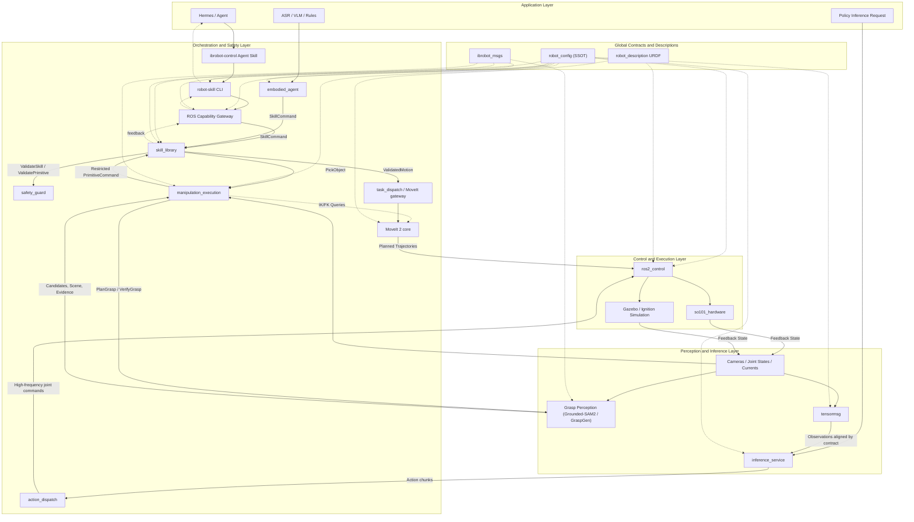
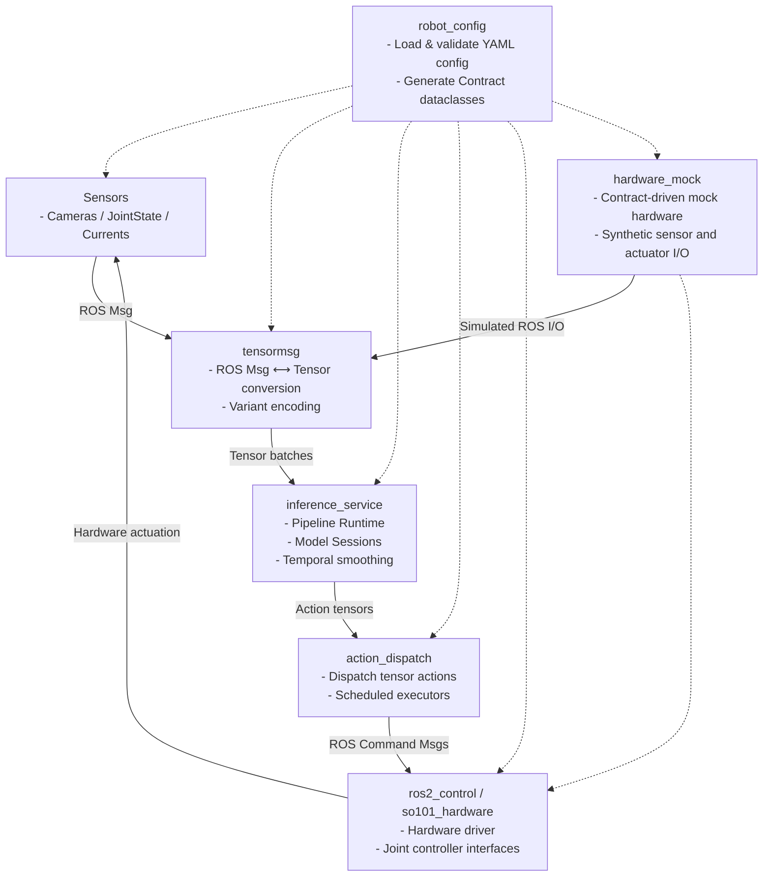
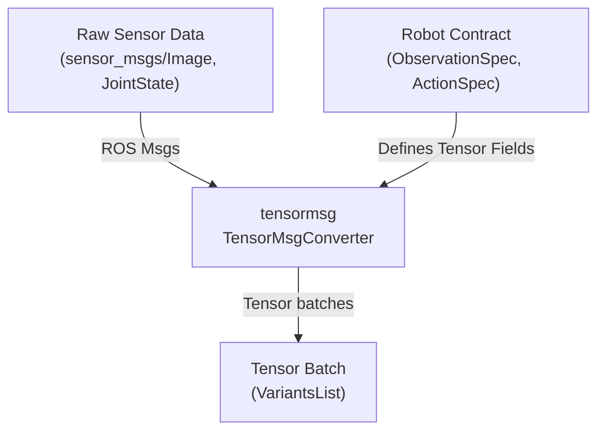

# 系统架构与数据流

<details>
<summary>相关源码文件</summary>

以下文件被用作生成此 wiki 页面的上下文：

- [.agents/skills/ibrobot-architecture/SKILL.md](https://atomgit.com/openeuler/IB_Robot/blob/openEuler-26.09/.agents/skills/ibrobot-architecture/SKILL.md)
- [.agents/skills/ibrobot-architecture/references/data-flow.md](https://atomgit.com/openeuler/IB_Robot/blob/openEuler-26.09/.agents/skills/ibrobot-architecture/references/data-flow.md)
- [.agents/skills/ibrobot-architecture/references/key-files.md](https://atomgit.com/openeuler/IB_Robot/blob/openEuler-26.09/.agents/skills/ibrobot-architecture/references/key-files.md)
- [.agents/skills/ibrobot-architecture/references/launch-and-troubleshooting.md](https://atomgit.com/openeuler/IB_Robot/blob/openEuler-26.09/.agents/skills/ibrobot-architecture/references/launch-and-troubleshooting.md)
- [.agents/skills/ibrobot-build/SKILL.md](https://atomgit.com/openeuler/IB_Robot/blob/openEuler-26.09/.agents/skills/ibrobot-build/SKILL.md)
- [.agents/skills/ibrobot-env/SKILL.md](https://atomgit.com/openeuler/IB_Robot/blob/openEuler-26.09/.agents/skills/ibrobot-env/SKILL.md)
- [.agents/skills/ibrobot-launch/SKILL.md](https://atomgit.com/openeuler/IB_Robot/blob/openEuler-26.09/.agents/skills/ibrobot-launch/SKILL.md)
- [docs/architecture.md](https://atomgit.com/openeuler/IB_Robot/blob/openEuler-26.09/docs/architecture.md)
- [docs/ib_robot_social_skill.md](https://atomgit.com/openeuler/IB_Robot/blob/openEuler-26.09/docs/ib_robot_social_skill.md)
- [docs/libero_310b_transport_validation.md](https://atomgit.com/openeuler/IB_Robot/blob/openEuler-26.09/docs/libero_310b_transport_validation.md)
- [docs/pictures/architecture.png](https://atomgit.com/openeuler/IB_Robot/blob/openEuler-26.09/docs/pictures/architecture.png)
- [docs/roadmap.md](https://atomgit.com/openeuler/IB_Robot/blob/openEuler-26.09/docs/roadmap.md)
- [docs/videos/openclaw_real.mp4](https://atomgit.com/openeuler/IB_Robot/blob/openEuler-26.09/docs/videos/openclaw_real.mp4)
- [docs/videos/openclaw_sim.mp4](https://atomgit.com/openeuler/IB_Robot/blob/openEuler-26.09/docs/videos/openclaw_sim.mp4)
- [scripts/start_rosclaw.sh](https://atomgit.com/openeuler/IB_Robot/blob/openEuler-26.09/scripts/start_rosclaw.sh)
- [src/README.md](https://atomgit.com/openeuler/IB_Robot/blob/openEuler-26.09/src/README.md)
- [src/dataset_tools/dataset_tools/frame_detector.py](https://atomgit.com/openeuler/IB_Robot/blob/openEuler-26.09/src/dataset_tools/dataset_tools/frame_detector.py)
- [src/dataset_tools/test/test_frame_detector.py](https://atomgit.com/openeuler/IB_Robot/blob/openEuler-26.09/src/dataset_tools/test/test_frame_detector.py)
- [src/hardware_mock/hardware_mock/contract_mock_node.py](https://atomgit.com/openeuler/IB_Robot/blob/openEuler-26.09/src/hardware_mock/hardware_mock/contract_mock_node.py)
- [src/hardware_mock/hardware_mock/contract_plan.py](https://atomgit.com/openeuler/IB_Robot/blob/openEuler-26.09/src/hardware_mock/hardware_mock/contract_plan.py)
- [src/hardware_mock/hardware_mock/image_sources.py](https://atomgit.com/openeuler/IB_Robot/blob/openEuler-26.09/src/hardware_mock/hardware_mock/image_sources.py)
- [src/hardware_mock/hardware_mock/joint_model.py](https://atomgit.com/openeuler/IB_Robot/blob/openEuler-26.09/src/hardware_mock/hardware_mock/joint_model.py)
- [src/hardware_mock/test/test_contract_plan.py](https://atomgit.com/openeuler/IB_Robot/blob/openEuler-26.09/src/hardware_mock/test/test_contract_plan.py)
- [src/hardware_mock/test/test_image_sources.py](https://atomgit.com/openeuler/IB_Robot/blob/openEuler-26.09/src/hardware_mock/test/test_image_sources.py)
- [src/inference_service/inference_service/observation_sync.py](https://atomgit.com/openeuler/IB_Robot/blob/openEuler-26.09/src/inference_service/inference_service/observation_sync.py)
- [src/inference_service/pytest.ini](https://atomgit.com/openeuler/IB_Robot/blob/openEuler-26.09/src/inference_service/pytest.ini)
- [src/inference_service/tests/test_observation_sync.py](https://atomgit.com/openeuler/IB_Robot/blob/openEuler-26.09/src/inference_service/tests/test_observation_sync.py)
- [src/inference_service/tests/test_observation_video_verification.py](https://atomgit.com/openeuler/IB_Robot/blob/openEuler-26.09/src/inference_service/tests/test_observation_video_verification.py)
- [src/robot_config/robot_config/contract_utils.py](https://atomgit.com/openeuler/IB_Robot/blob/openEuler-26.09/src/robot_config/robot_config/contract_utils.py)
- [src/tensormsg/tensormsg/converter.py](https://atomgit.com/openeuler/IB_Robot/blob/openEuler-26.09/src/tensormsg/tensormsg/converter.py)
- [src/tensormsg/test/test_converter.py](https://atomgit.com/openeuler/IB_Robot/blob/openEuler-26.09/src/tensormsg/test/test_converter.py)

</details>

本页面呈现 IB-Robot / RoboFrame_stable 项目的端到端系统架构与数据流，强调传感器、张量消息协议、AI 模型推理、动作分发机制与 ros2_control 硬件接口的集成。它是导航包图、核心数据路径与系统实现细节的综合技术参考，这些内容对理解原始传感器数据如何被转化为机器人控制命令至关重要。

---

## 1. 目的与范围

IB-Robot 框架无缝桥接 LeRobot AI 策略模型与 ROS 2 生态，以支撑具身 AI 机器人应用。系统摄取传感器数据流，通过契约驱动的张量消息协议转换，在 tensormsg 上执行推理流水线，分发高频关节命令，并最终通过 ros2_control 接口驱动执行器。

本页面聚焦：

- 从 sensors → tensormsg → inference_service → action_dispatch → ros2_control 的分层的数据流
- 作为系统一致性与类型化基础的契约驱动配置（机器人 YAML）
- 负责消息转换、同步、mock 仿真与真实硬件接口的关键实现类与函数
- `src/README.md` 中概述的包关系与模块职责
- 连接自然语言概念与代码实体的详细 Mermaid 图，以增强清晰度

---

## 2. 系统总览与包角色

### 2.1 高层架构

系统以分层组件组织，如归档架构图（[docs/architecture.md:86-177](https://atomgit.com/openeuler/IB_Robot/blob/openEuler-26.09/docs/architecture.md#L86-L177)）所示：



该分层设计强调模块化分离：数据契约与机器人配置持有唯一事实来源，tensormsg 桥接 ROS 消息与张量，inference_service 执行 AI 策略，action_dispatch 向 ros2_control 发送命令。

### 2.2 包布局（src/README.md 摘要）

- `robot_config`：中央配置加载与校验；契约 schema；launch 文件编排。
- `tensormsg`：在 ROS 2 消息与张量之间转换，以兼容 ML。
- `inference_service`：运行推理流水线；观测契约对齐的数据流。
- `action_dispatch`：将模型动作分发到 ROS 话题或基准服务。
- `hardware_mock`：提供契约驱动的 mock 硬件仿真节点，用于无真实硬件的测试。
- `so101_hardware`：用于真实机器人驱动的 ros2_control 硬件接口插件。
- 以及用于数据处理、标定与评估的 dataset_tools 等工具。

来源：[docs/architecture.md:1-246](https://atomgit.com/openeuler/IB_Robot/blob/openEuler-26.09/docs/architecture.md#L1-L246), [src/README.md](https://atomgit.com/openeuler/IB_Robot/blob/openEuler-26.09/src/README.md)

---

## 3. 契约驱动的数据流：从传感器到 ros2_control

### 3.1 机器人配置唯一事实来源（SSOT）

机器人的全部运行时 I/O 契约定义在 `robot_config/config/robots/` 下的 YAML 配置中。该配置指定：

- **观测（Observations）**：命名的传感器数据流及其 ROS 话题、类型、QoS、对齐策略、图像缩放选项等。
- **动作（Actions）**：机器人命令的发布话题，以及从张量输出索引到关节的映射。
- **控制模式（Control Modes）**：遥操作、model_inference、moveit_planning 等映射到不同 ros2_control 控制器。

YAML 通过 `robot_config.loader.load_robot_config_dict()` 加载与校验，并合成为不可变的 `Contract` dataclass（`robot_config.contract_utils.Contract`）。该契约为张量与 ROS 消息互转暴露统一、类型化的 schema。

契约包括：

```python
@dataclass(frozen=True, slots=True)
class Contract:
    name: str
    version: int
    rate_hz: float
    max_duration_s: float
    observations: list[ObservationSpec]
    actions: list[ActionSpec]
    tasks: list[TaskSpec]
```

每个 `ObservationSpec` 详述话题、ROS 类型、对齐策略、QoS、传输与张量编解码提示。

契约系统还包括运行时辅助函数 `decode_value()` 与 `encode_value()`，它们使用 `tensormsg` 内的注册表进行序列化。

来源：[src/robot_config/robot_config/contract_utils.py:1-216](https://atomgit.com/openeuler/IB_Robot/blob/openEuler-26.09/src/robot_config/robot_config/contract_utils.py#L1-L216), [.agents/skills/ibrobot-architecture/SKILL.md:14-90](https://atomgit.com/openeuler/IB_Robot/blob/openEuler-26.09/.agents/skills/ibrobot-architecture/SKILL.md#L14-L90)

---

### 3.2 tensormsg：ROS 消息与张量的双向转换

`tensormsg` 包是将 ROS 2 消息转换为 ML 推理模型所需张量数据（及反向转换）的关键桥梁。

- 核心类：`TensorMsgConverter`，提供 `encode()`、`decode()`、`to_variant()`、`from_variant()` 静态方法实现透明转换。
- 编解码器按 ROS 消息类型字符串注册，支持可扩展的编解码。
- 支持带缩放、颜色格式转换的图像及数值张量等复杂类型。

例如，`TensorMsgConverter.decode(msg)` 将 `sensor_msgs/msg/Image` 等 ROS 消息转换为 Numpy 数组，并应用指定的缩放或颜色通道映射。

张量批次被编码为 `ibrobot_msgs/msg/VariantsList`，以便高效传输到推理节点。

该逻辑实现了契约驱动的类型安全以及 ROS 层与神经网络流水线之间的零拷贝张量传递。

来源：[src/tensormsg/tensormsg/converter.py:1-181](https://atomgit.com/openeuler/IB_Robot/blob/openEuler-26.09/src/tensormsg/tensormsg/converter.py#L1-L181)

---

### 3.3 观测同步与时间戳映射

由于传感器异步运作且 ROS 时间戳可能不同，系统实现了健壮的同步层，确保推理的张量输入对应于对齐的采集时间。

- `observation_sync.py` 实现时间戳映射器（`RtpTimestampMapper`）与同步流选择器（`select_synchronized_streams()`）。
- 来自相机的 RTP 时间戳被映射到公共采集时钟，并修正回绕。
- 同步选择校验相机间偏差容限、新鲜度与帧完整性。
- 该同步确保推理在契约容限内获得时间上连贯的多模态输入。

该层带来少量对齐延迟，但关键在于防止对陈旧或未对齐数据进行推理。

来源：[src/inference_service/inference_service/observation_sync.py:1-180](https://atomgit.com/openeuler/IB_Robot/blob/openEuler-26.09/src/inference_service/inference_service/observation_sync.py#L1-L180), [src/inference_service/tests/test_observation_sync.py:1-175](https://atomgit.com/openeuler/IB_Robot/blob/openEuler-26.09/src/inference_service/tests/test_observation_sync.py#L1-L175)

---

### 3.4 推理服务流水线

同步后的张量批次馈入 `inference_service` 节点：

- LeRobot 训练的模型经清单驱动的运行时会话加载。
- 流水线处理多模态输入，应用时间平滑、分块与分布式边云调度。
- 输出是与契约对齐的动作张量。

推理服务发出动作块，由动作分发节点接收。

来源：[.agents/skills/ibrobot-architecture/SKILL.md:80-97](https://atomgit.com/openeuler/IB_Robot/blob/openEuler-26.09/.agents/skills/ibrobot-architecture/SKILL.md#L80-L97)

---

### 3.5 动作分发与控制模式切换

`action_dispatch` 包接收推理输出张量并承担以下职责：

- 将张量解码为机器人控制话题（如 `Float64MultiArray`）的 ROS 消息。
- 支持依赖模式的执行器：话题发布或基准服务。
- 管理分发调度器与时序平滑器以确保连续控制。
- 将策略释放时机与底层硬件接口解耦。
- 按契约中的关节顺序将动作向量索引映射到关节命令。

四种控制模式统一于 `ros2_control`：

| 模式             | 控制器                     | 执行方式 | 用例            |
|------------------|---------------------------------|-----------------|---------------------|
| teleop           | *_position_controller           | topic           | 人工遥操作  |
| model_inference  | *_position_controller           | topic           | AI 策略控制   |
| moveit_planning  | *_trajectory_controller         | action (MoveIt) | 规划与技能 |
| base_navigation  | base_controller / velocity     | topic (cmd_vel)  | 移动底盘         |

来源：[.agents/skills/ibrobot-architecture/SKILL.md:60-81](https://atomgit.com/openeuler/IB_Robot/blob/openEuler-26.09/.agents/skills/ibrobot-architecture/SKILL.md#L60-L81)

---

### 3.6 ros2_control 硬件接口与 Mock 仿真

`so101_hardware` 包为 `ros2_control` 实现真实机器人硬件接口。

用于测试与离线开发的契约驱动 mock 节点存在于 `hardware_mock`，它：

- 读取同一份机器人 YAML 契约。
- 以合成数据发布全部观测话题。
- 订阅动作话题并即时回馈关节状态更新以闭环控制。
- 仅支持 `model_inference` 模式，无真实硬件依赖。
- 以简单内部关节模型模拟关节位置与电流。

这允许在无硬件情况下对从传感器到动作分发的数据流进行完整端到端校验。

来源：[src/hardware_mock/hardware_mock/contract_mock_node.py:1-159](https://atomgit.com/openeuler/IB_Robot/blob/openEuler-26.09/src/hardware_mock/hardware_mock/contract_mock_node.py#L1-L159), [src/hardware_mock/hardware_mock/contract_plan.py:1-183](https://atomgit.com/openeuler/IB_Robot/blob/openEuler-26.09/src/hardware_mock/hardware_mock/contract_plan.py#L1-L183)

---

## 4. 包图与关系

以下是与系统数据流相关的主要包及其职责的简化映射：



---

## 5. 数据流详细时序

1. **传感器输入：**

   - 物理传感器发布 ROS 消息（如 `sensor_msgs/Image`、`sensor_msgs/JointState`、`ibrobot_msgs/JointCurrent`）。
   - 话题与 QoS 与机器人契约对齐。

2. **张量转换（`tensormsg`）：**

   - 传入的 ROS 消息被 tensormsg 转换器拦截。
   - 数据被解码为 Numpy 数组或 Torch 张量，应用缩放与颜色转换，并保持契约字段顺序。
   - 张量批次被封装为 `ibrobot_msgs/msg/VariantsList` 消息以供传输。

3. **同步（`inference_service/observation_sync.py`）：**

   - RTP 时间戳映射器与流选择器确保多相机流在容限内对齐。
   - 迟到或偏斜的帧触发可恢复的错误以等待或重试。

4. **推理执行：**

   - 张量批次馈入运行于 CPU、GPU 或 NPU 后端的推理流水线，后端由部署清单决定。
   - AI 模型产生符合契约动作规范的动作块。

5. **动作分发：**

   - 分发节点将输出张量解码为 ROS 消息命令。
   - 时序平滑器跨块边界混合，确保平滑控制。
   - 所选执行器方案（话题或基准）以契约频率发布命令。

6. **ROS 2 控制与硬件接口：**

   - ros2_control 控制器接受关节命令消息。
   - 驱动器将命令施加到电机或仿真器。
   - 状态反馈以关节状态/电流形式回传到传感器。

7. **Mock 仿真（可选）：**

   - `hardware_mock` 作为节点运行，基于契约仿真传感器与执行器。
   - 支持无硬件情况下测试整条流水线。

---

## 6. 关键类与函数参考

| 概念                   | 代码实体                                 | 位置                          | 描述                                 |
|---------------------------|---------------------------------------------|---------------------------------|---------------------------------------------|
| 机器人契约 dataclasses | `Contract`, `ObservationSpec`, `ActionSpec` | `robot_config/contract_utils.py` | 定义类型化的观测与动作 schema |
| 机器人配置加载器        | `load_robot_config_dict()`                  | `robot_config/loader.py`         | 加载并校验 YAML SSOT                |
| 张量 ↔ ROS 转换    | `TensorMsgConverter`                         | `tensormsg/converter.py`         | 编解码 ROS 消息与张量           |
| 观测同步           | `RtpTimestampMapper`, `select_synchronized_streams()` | `inference_service/observation_sync.py` | 映射 RTP 时间戳并选择同步流 |
| 动作分发节点       | `ActionDispatcherNode`, `ScheduledActionDispatcherNode` | `action_dispatch` (implied)      | 将 AI 动作分发到 ROS 控制器话题 |
| Mock 仿真计划       | `MockPlan`, `build_plan()`                   | `hardware_mock/contract_plan.py` | 为 mock 节点编译契约规格         |
| Mock 契约节点         | `ContractMockNode`                           | `hardware_mock/contract_mock_node.py` | 运行 mock 传感器与执行器               |

---

## 7. 连接概念与代码的摘要图

### 7.1 自然语言到契约与 tensormsg 转换



来源：[src/tensormsg/tensormsg/converter.py:32-100](https://atomgit.com/openeuler/IB_Robot/blob/openEuler-26.09/src/tensormsg/tensormsg/converter.py#L32-L100), [src/robot_config/robot_config/contract_utils.py:25-150](https://atomgit.com/openeuler/IB_Robot/blob/openEuler-26.09/src/robot_config/robot_config/contract_utils.py#L25-L150)

---

### 7.2 从传感器经推理到 ros2_control 的数据流

```mermaid
flowchart LR
    Sensors["Sensors\n(sensor_msgs/JointState, Image, Current)"]
    TensorConv["tensormsg\nTensorMsgConverter"]
    Sync["observation_sync\nRtpTimestampMapper + StreamSelector"]
    Inference["inference_service\nModel sessions + runtime"]
    ActionDisp["action_dispatch\nDispatchInfer clients + Executors"]
    ros2Ctrl["ros2_control\nControllers + Hardware Interface"]
    Hardware["Physical Robot Hardware"]

    Sensors -->|ROS Messages| TensorConv
    TensorConv -->|Tensor Batches| Sync
    Sync -->|Aligned Tensors| Inference
    Inference -->|Actions Tensors| ActionDisp
    ActionDisp -->|ROS Control Commands| ros2Ctrl
    ros2Ctrl -->|Actuation| Hardware
    Hardware -->|State Feedback| Sensors
```



来源：[docs/architecture.md:86-177](https://atomgit.com/openeuler/IB_Robot/blob/openEuler-26.09/docs/architecture.md#L86-L177), [src/inference_service/inference_service/observation_sync.py:1-180](https://atomgit.com/openeuler/IB_Robot/blob/openEuler-26.09/src/inference_service/inference_service/observation_sync.py#L1-L180), [.agents/skills/ibrobot-architecture/SKILL.md:14-97](https://atomgit.com/openeuler/IB_Robot/blob/openEuler-26.09/.agents/skills/ibrobot-architecture/SKILL.md#L14-L97)

---

## 8. 参考与延伸阅读

- `robot_config` 目录：机器人 YAML 配置、契约 schema 与配置加载器（`robot_config/robot_config/`）
- `tensormsg` 包：ROS 消息与张量间的灵活转换（`tensormsg/tensormsg/converter.py`）
- `inference_service`：推理运行时、流水线处理、同步（`inference_service/`）
- `action_dispatch`：发送命令的执行器节点（`action_dispatch/`）
- `hardware_mock`：用于离线测试的 mock 节点与契约计划构建器（`hardware_mock/contract_mock_node.py`、`hardware_mock/contract_plan.py`）
- `docs/architecture.md` 中的系统架构文档
- 源仓库 `src/README.md`，含包角色与 launch 编排

---

以上完成了 IB-Robot RoboFrame_stable 的详细系统架构与数据流描述，为使用机器人配置、数据处理、模型推理与控制分发的开发者与集成者提供坚实基础。

---

**来源：**

- `.agents/skills/ibrobot-architecture/SKILL.md:14-97`
- `src/robot_config/robot_config/contract_utils.py:1-216`
- `src/tensormsg/tensormsg/converter.py:1-181`
- `src/inference_service/inference_service/observation_sync.py:1-180`
- `src/hardware_mock/hardware_mock/contract_mock_node.py:1-159`
