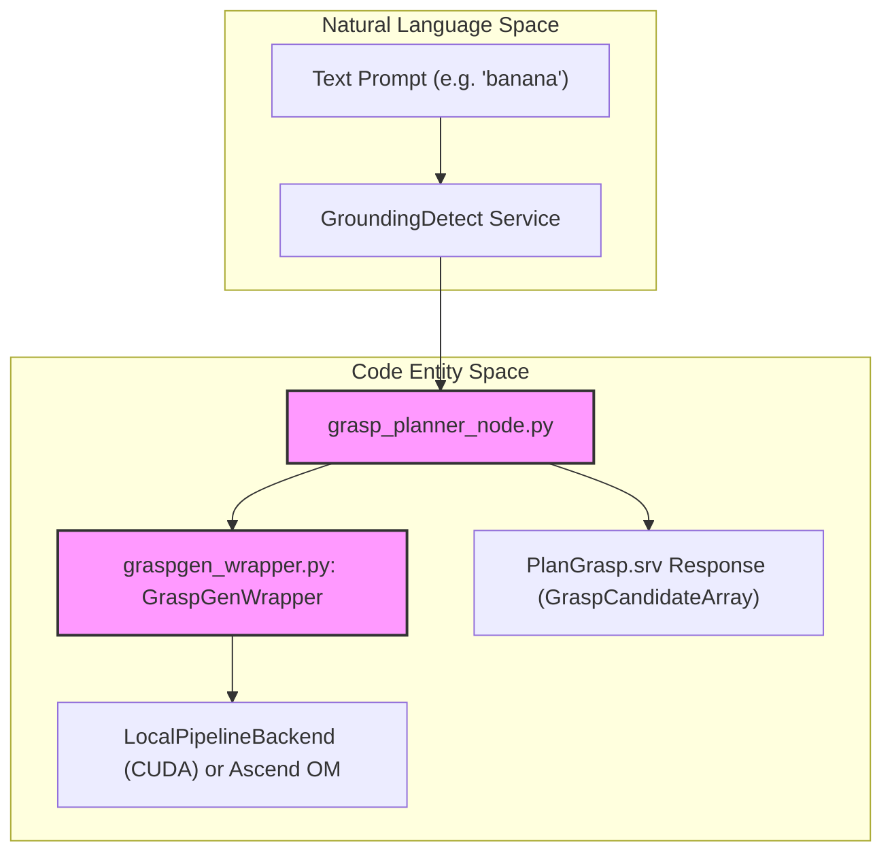
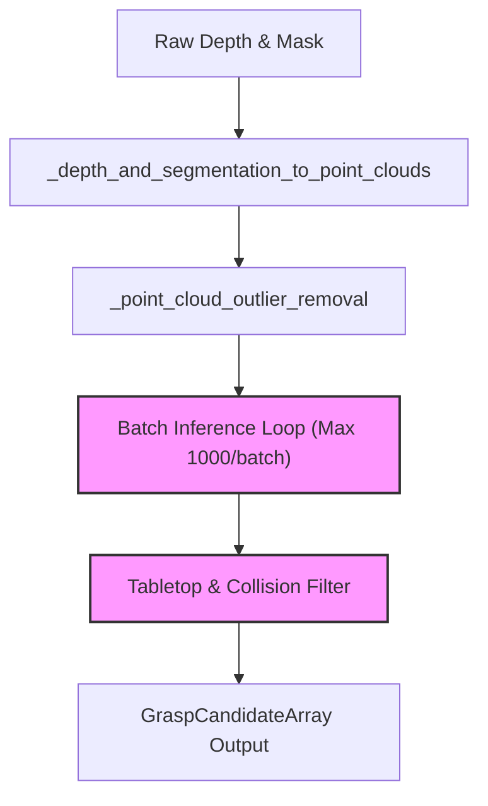
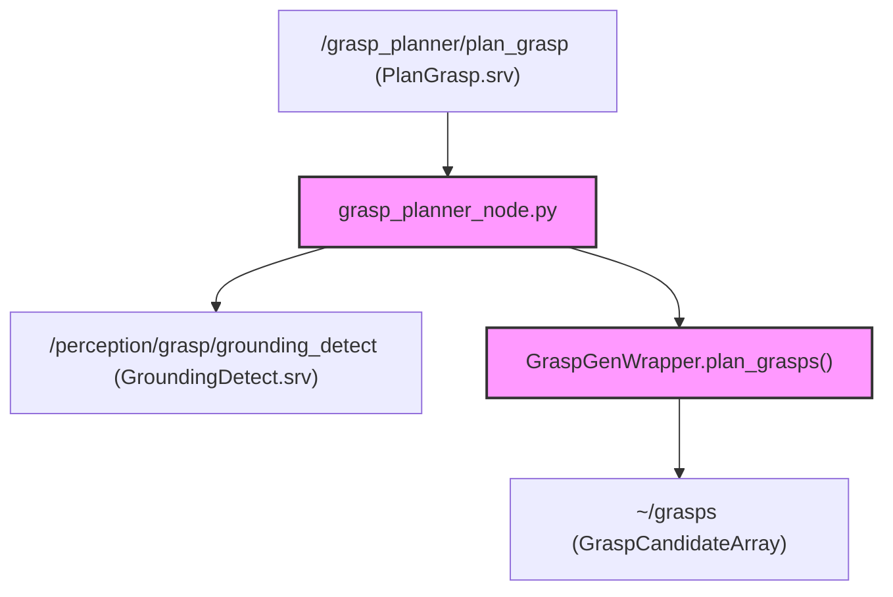
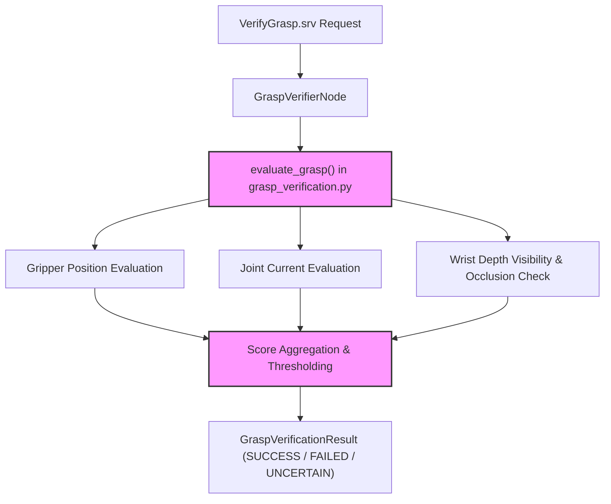

# 抓取规划与验证

相关源码文件

以下文件被用作生成此 wiki 页面的上下文：

- [scripts/build_pointnet2ops_wheel.sh](https://atomgit.com/openeuler/IB_Robot/blob/openEuler-26.09/scripts/build_pointnet2ops_wheel.sh)
- [scripts/setup/install_graspgen_pip.sh](https://atomgit.com/openeuler/IB_Robot/blob/openEuler-26.09/scripts/setup/install_graspgen_pip.sh)
- [src/ibrobot_msgs/srv/VerifyGrasp.srv](https://atomgit.com/openeuler/IB_Robot/blob/openEuler-26.09/src/ibrobot_msgs/srv/VerifyGrasp.srv)
- [src/manipulation_service/README.md](https://atomgit.com/openeuler/IB_Robot/blob/openEuler-26.09/src/manipulation_service/README.md)
- [src/manipulation_service/manipulation_service/grasp_planner_node.py](https://atomgit.com/openeuler/IB_Robot/blob/openEuler-26.09/src/manipulation_service/manipulation_service/grasp_planner_node.py)
- [src/manipulation_service/manipulation_service/grasp_verification.py](https://atomgit.com/openeuler/IB_Robot/blob/openEuler-26.09/src/manipulation_service/manipulation_service/grasp_verification.py)
- [src/manipulation_service/manipulation_service/grasp_verifier_node.py](https://atomgit.com/openeuler/IB_Robot/blob/openEuler-26.09/src/manipulation_service/manipulation_service/grasp_verifier_node.py)
- [src/manipulation_service/manipulation_service/graspgen_wrapper.py](https://atomgit.com/openeuler/IB_Robot/blob/openEuler-26.09/src/manipulation_service/manipulation_service/graspgen_wrapper.py)
- [src/manipulation_service/package.xml](https://atomgit.com/openeuler/IB_Robot/blob/openEuler-26.09/src/manipulation_service/package.xml)
- [src/manipulation_service/setup.py](https://atomgit.com/openeuler/IB_Robot/blob/openEuler-26.09/src/manipulation_service/setup.py)
- [src/manipulation_service/test/test_grasp_planner_timestamps.py](https://atomgit.com/openeuler/IB_Robot/blob/openEuler-26.09/src/manipulation_service/test/test_grasp_planner_timestamps.py)
- [src/manipulation_service/test/test_grasp_verification.py](https://atomgit.com/openeuler/IB_Robot/blob/openEuler-26.09/src/manipulation_service/test/test_grasp_verification.py)
- [src/manipulation_service/test/test_graspgen_timing.py](https://atomgit.com/openeuler/IB_Robot/blob/openEuler-26.09/src/manipulation_service/test/test_graspgen_timing.py)
- [src/manipulation_service/test/test_object_cloud_completion.py](https://atomgit.com/openeuler/IB_Robot/blob/openEuler-26.09/src/manipulation_service/test/test_object_cloud_completion.py)
- [src/manipulation_service/test/test_tabletop_filter.py](https://atomgit.com/openeuler/IB_Robot/blob/openEuler-26.09/src/manipulation_service/test/test_tabletop_filter.py)
- [src/manipulation_service/test_graspgen.py](https://atomgit.com/openeuler/IB_Robot/blob/openEuler-26.09/src/manipulation_service/test_graspgen.py)
- [third_party/patches/pointnet2_ops/a56d518/0001-package-pointnet2-ops-wheel.patch](https://atomgit.com/openeuler/IB_Robot/blob/openEuler-26.09/third_party/patches/pointnet2_ops/a56d518/0001-package-pointnet2-ops-wheel.patch)
- [third_party/patches/pointnet2_ops/a56d518/LICENSE](https://atomgit.com/openeuler/IB_Robot/blob/openEuler-26.09/third_party/patches/pointnet2_ops/a56d518/LICENSE)
- [third_party/patches/pointnet2_ops/a56d518/manifest.yaml](https://atomgit.com/openeuler/IB_Robot/blob/openEuler-26.09/third_party/patches/pointnet2_ops/a56d518/manifest.yaml)
- [third_party/patches/pointnet2_ops/a56d518/series.txt](https://atomgit.com/openeuler/IB_Robot/blob/openEuler-26.09/third_party/patches/pointnet2_ops/a56d518/series.txt)
- [third_party/wheels/pointnet2_ops/a56d518/SHA256SUMS](https://atomgit.com/openeuler/IB_Robot/blob/openEuler-26.09/third_party/wheels/pointnet2_ops/a56d518/SHA256SUMS)
- [third_party/wheels/pointnet2_ops/a56d518/pointnet2_ops-3.0.0+ibrobot.1-cp310-cp310-manylinux_2_17_x86_64.whl](https://atomgit.com/openeuler/IB_Robot/blob/openEuler-26.09/third_party/wheels/pointnet2_ops/a56d518/pointnet2_ops-3.0.0+ibrobot.1-cp310-cp310-manylinux_2_17_x86_64.whl)

## 目的与范围

本页面详述 `manipulation_service` ROS 2 包（`src/manipulation_service/package.xml:1-34]`）内的实现、数据流与验证机制。该模块提供围绕 GraspGen 封装构建的 6-DOF 抓取生成（`src/manipulation_service/manipulation_service/graspgen_wrapper.py:1-183]`）、通过 `grasp_planner_node.py` 的在线规划（`src/manipulation_service/manipulation_service/grasp_planner_node.py:1-49]`）、传感器融合的抓取后成功验证（`src/manipulation_service/manipulation_service/grasp_verifier_node.py:1-169]`）、桌面过滤与物体点云补全。

---

## 1. 架构与组件布局

操作栈将机器人无关的 6-DOF 抓取假设生成与机器人特定的运动执行解耦。`manipulation_service` 负责深度/mask 转换、GraspGen 调用、桌面 RANSAC 平面拟合、碰撞过滤与候选属性提取。

来源：`src/manipulation_service/README.md:1-41]`, `src/manipulation_service/manipulation_service/grasp_planner_node.py:1-38]`, `src/manipulation_service/manipulation_service/graspgen_wrapper.py:164-183]

---

## 2. GraspGen 封装与推理流水线

核心推理桥接位于 `src/manipulation_service/manipulation_service/graspgen_wrapper.py`。它通过 Python 可编辑安装或昇腾运行时会话（`inference_manifest.json`）与上游 GraspGen 库交互（`src/manipulation_service/README.md:56-62]`）。

### 关键类与执行流

- `GraspGenWrapper`：管理点云准备、批量分块、评分与几何后处理。
- `LocalPipelineBackend`：驱动进程内 Torch CUDA 执行或八角色昇腾执行（`src/manipulation_service/manipulation_service/graspgen_wrapper.py:164-183]`）。
- **批量拆分**：`num_grasps` 较大的推理请求被拆分为每批至多 `1000` 的批次（`src/manipulation_service/README.md:58-60]`），并在拼接结果上应用全局 `topk`。

来源：`src/manipulation_service/manipulation_service/graspgen_wrapper.py:70-140]`, `src/manipulation_service/README.md:58-60]

---

## 3. 抓取规划节点与 ROS 2 接口

`grasp_planner_node.py` 暴露 `~/plan_grasp` 服务（`ibrobot_msgs/srv/PlanGrasp.srv`）并发布候选数组（`ibrobot_msgs/msg/GraspCandidateArray.msg`）。

### 服务与 topic 契约

- **服务请求**：`PlanGrasp` 接受 `text_prompt`、`confidence_threshold`、`grasp_threshold` 与 `debug_output_mode`（`src/manipulation_service/README.md:141-152]`）。
- **服务响应**：返回 `diagnostic_details`、`debug_output_dir` 以及包含 4x4 行主序位姿矩阵、置信度值与碰撞标志的 `GraspCandidateArray`（`src/manipulation_service/README.md:153-164]`）。
- **时间戳跟踪**：`PlanGrasp.grasps.header` 中的 `stamp` 对应深度帧采集时间，确保下游节点准确查询 TF 树（`src/manipulation_service/README.md:27-31]`）。

来源：`src/manipulation_service/manipulation_service/grasp_planner_node.py:1-49]`, `src/manipulation_service/README.md:12-48]

---

## 4. 桌面过滤与物体点云补全

为防止与工作面碰撞，`manipulation_service` 对场景点云执行 RANSAC 平面拟合（`src/manipulation_service/test/test_tabletop_filter.py:21-40]`）。

### 过滤模式与参数

- **模式**：支持 `strict`、`adaptive`、`soft` 与 `diagnostic` 四种桌面过滤行为（`src/manipulation_service/manipulation_service/graspgen_wrapper.py:31-31]`）。
- **RANSAC 平面拟合**：分块评估（`_RANSAC_PLANE_CHUNK_SIZE = 64`），置信度阈值 `_RANSAC_CONFIDENCE = 0.999`，用于将桌面平面从物体点云中分离（`src/manipulation_service/manipulation_service/graspgen_wrapper.py:38-39]`）。
- **预抓取间隙**：沿接近路径计算间隙指标，拒绝与拟合桌面平面相交或过于接近的候选（`src/manipulation_service/test/test_tabletop_filter.py:78-102]`）。

来源：`src/manipulation_service/manipulation_service/graspgen_wrapper.py:31-40]`, `src/manipulation_service/test/test_tabletop_filter.py:13-102]`

---

## 5. 抓取验证与传感器融合

`grasp_verifier_node.py` 与 `grasp_verification.py` 通过融合多模态传感器输入实现抓取后成功确认（`src/manipulation_service/manipulation_service/grasp_verifier_node.py:1-97]`、`src/manipulation_service/manipulation_service/grasp_verification.py:1-78]`）。

### 融合逻辑

验证器评估三条独立证据流：

1. **夹爪开度 / 位置**：将残余开度距离与闭合位置比对（`src/manipulation_service/manipulation_service/grasp_verification.py:88-106]`）。
2. **关节电流**：评估绝对电流异常（`gripper_current_abs_a`）是否超过接触阈值（`src/manipulation_service/manipulation_service/grasp_verification.py:107-120]`）。
3. **腕部深度可见性**：评估腕载深度图像统计（`valid_fraction`、`near_fraction`、`occluded`）。腕部遮挡被有意处理为弱正向证据而非硬失败，因为大体积被抓物体经常遮挡腕部相机（`src/manipulation_service/manipulation_service/grasp_verification.py:121-139]`）。

来源：`src/manipulation_service/manipulation_service/grasp_verifier_node.py:96-169]`, `src/manipulation_service/manipulation_service/grasp_verification.py:68-177]

---

## Sources

- `src/manipulation_service/package.xml`
- `src/manipulation_service/README.md`
- `src/manipulation_service/manipulation_service/graspgen_wrapper.py`
- `src/manipulation_service/manipulation_service/grasp_planner_node.py`
- `src/manipulation_service/manipulation_service/grasp_verifier_node.py`
- `src/manipulation_service/manipulation_service/grasp_verification.py`
- `src/manipulation_service/test/test_tabletop_filter.py`
- `src/manipulation_service/test/test_grasp_verification.py`
