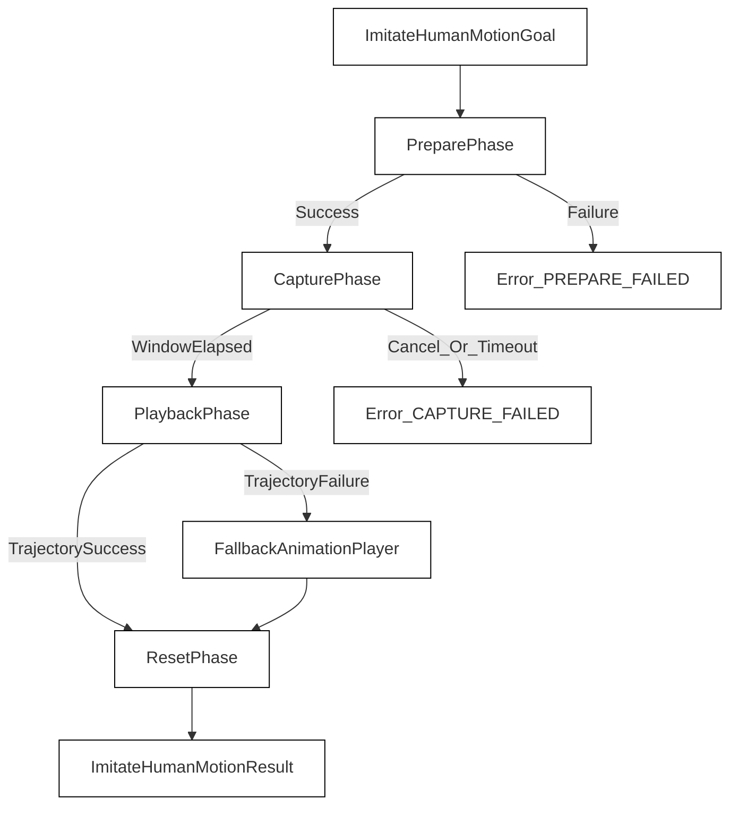
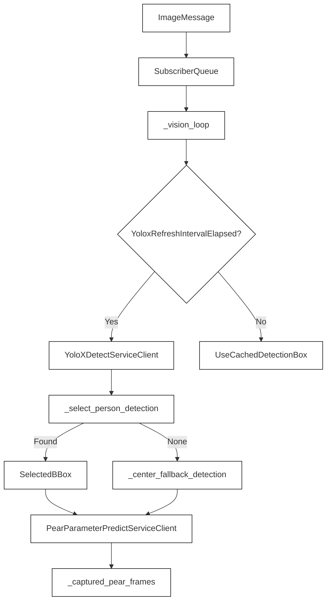
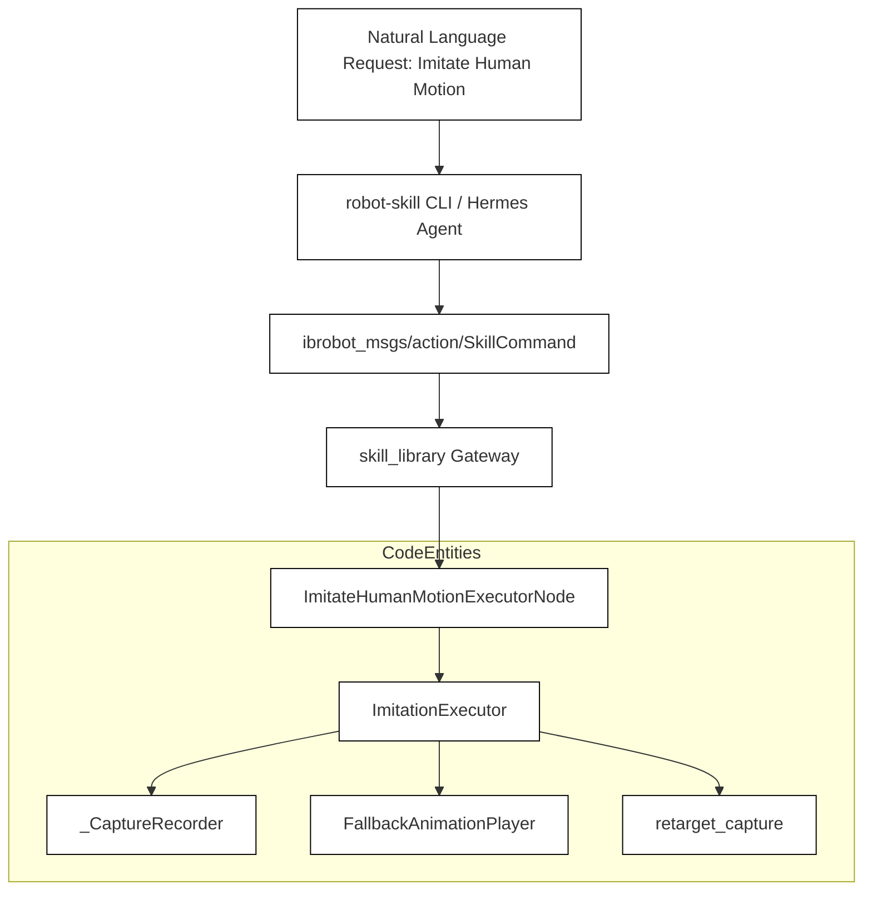
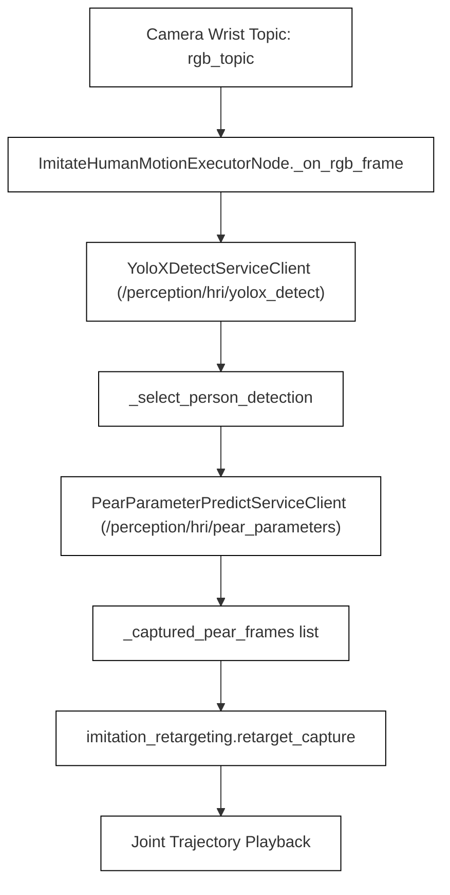

# 人体动作模仿（HRI）

相关源码文件

以下文件被用作生成此 wiki 页面的上下文：

- [src/embodied_common/embodied_common/skill_request.py](https://atomgit.com/openeuler/IB_Robot/blob/openEuler-26.09/src/embodied_common/embodied_common/skill_request.py)
- [src/embodied_common/embodied_common/workflow_contracts.py](https://atomgit.com/openeuler/IB_Robot/blob/openEuler-26.09/src/embodied_common/embodied_common/workflow_contracts.py)
- [src/ibrobot_msgs/CMakeLists.txt](https://atomgit.com/openeuler/IB_Robot/blob/openEuler-26.09/src/ibrobot_msgs/CMakeLists.txt)
- [src/ibrobot_msgs/README.md](https://atomgit.com/openeuler/IB_Robot/blob/openEuler-26.09/src/ibrobot_msgs/README.md)
- [src/ibrobot_msgs/action/ExecuteAgentPlan.action](https://atomgit.com/openeuler/IB_Robot/blob/openEuler-26.09/src/ibrobot_msgs/action/ExecuteAgentPlan.action)
- [src/ibrobot_msgs/action/ImitateHumanMotion.action](https://atomgit.com/openeuler/IB_Robot/blob/openEuler-26.09/src/ibrobot_msgs/action/ImitateHumanMotion.action)
- [src/ibrobot_msgs/msg/DispatchBinding.msg](https://atomgit.com/openeuler/IB_Robot/blob/openEuler-26.09/src/ibrobot_msgs/msg/DispatchBinding.msg)
- [src/ibrobot_msgs/srv/PearParameterPredict.srv](https://atomgit.com/openeuler/IB_Robot/blob/openEuler-26.09/src/ibrobot_msgs/srv/PearParameterPredict.srv)
- [src/ibrobot_msgs/srv/PrepareAgentPlan.srv](https://atomgit.com/openeuler/IB_Robot/blob/openEuler-26.09/src/ibrobot_msgs/srv/PrepareAgentPlan.srv)
- [src/ibrobot_msgs/srv/YoloXDetect.srv](https://atomgit.com/openeuler/IB_Robot/blob/openEuler-26.09/src/ibrobot_msgs/srv/YoloXDetect.srv)
- [src/manipulation_execution/README.md](https://atomgit.com/openeuler/IB_Robot/blob/openEuler-26.09/src/manipulation_execution/README.md)
- [src/manipulation_execution/manipulation_execution/imitate_human_motion_executor.py](https://atomgit.com/openeuler/IB_Robot/blob/openEuler-26.09/src/manipulation_execution/manipulation_execution/imitate_human_motion_executor.py)
- [src/manipulation_execution/manipulation_execution/imitate_human_motion_executor_node.py](https://atomgit.com/openeuler/IB_Robot/blob/openEuler-26.09/src/manipulation_execution/manipulation_execution/imitate_human_motion_executor_node.py)
- [src/manipulation_execution/manipulation_execution/imitation_retargeting/__init__.py](https://atomgit.com/openeuler/IB_Robot/blob/openEuler-26.09/src/manipulation_execution/manipulation_execution/imitation_retargeting/__init__.py)
- [src/manipulation_execution/manipulation_execution/imitation_retargeting/base.py](https://atomgit.com/openeuler/IB_Robot/blob/openEuler-26.09/src/manipulation_execution/manipulation_execution/imitation_retargeting/base.py)
- [src/manipulation_execution/manipulation_execution/imitation_retargeting/cadence.py](https://atomgit.com/openeuler/IB_Robot/blob/openEuler-26.09/src/manipulation_execution/manipulation_execution/imitation_retargeting/cadence.py)
- [src/manipulation_execution/manipulation_execution/imitation_retargeting/frames.py](https://atomgit.com/openeuler/IB_Robot/blob/openEuler-26.09/src/manipulation_execution/manipulation_execution/imitation_retargeting/frames.py)
- [src/manipulation_execution/manipulation_execution/imitation_retargeting/idle.py](https://atomgit.com/openeuler/IB_Robot/blob/openEuler-26.09/src/manipulation_execution/manipulation_execution/imitation_retargeting/idle.py)
- [src/manipulation_execution/manipulation_execution/imitation_retargeting/plan_builder.py](https://atomgit.com/openeuler/IB_Robot/blob/openEuler-26.09/src/manipulation_execution/manipulation_execution/imitation_retargeting/plan_builder.py)
- [src/manipulation_execution/manipulation_execution/imitation_retargeting/rotations.py](https://atomgit.com/openeuler/IB_Robot/blob/openEuler-26.09/src/manipulation_execution/manipulation_execution/imitation_retargeting/rotations.py)
- [src/manipulation_execution/manipulation_execution/imitation_retargeting/scoring.py](https://atomgit.com/openeuler/IB_Robot/blob/openEuler-26.09/src/manipulation_execution/manipulation_execution/imitation_retargeting/scoring.py)
- [src/manipulation_execution/manipulation_execution/imitation_retargeting/smoothing.py](https://atomgit.com/openeuler/IB_Robot/blob/openEuler-26.09/src/manipulation_execution/manipulation_execution/imitation_retargeting/smoothing.py)
- [src/manipulation_execution/manipulation_execution/imitation_retargeting/smplx2so101.py](https://atomgit.com/openeuler/IB_Robot/blob/openEuler-26.09/src/manipulation_execution/manipulation_execution/imitation_retargeting/smplx2so101.py)
- [src/manipulation_execution/test/test_imitate_human_motion_vision.py](https://atomgit.com/openeuler/IB_Robot/blob/openEuler-26.09/src/manipulation_execution/test/test_imitate_human_motion_vision.py)

## 目的与范围

本页面文档化 `manipulation_execution` 包内的人体动作模仿（HRI）子系统（`src/manipulation_execution/README.md:1-6` [src/manipulation_execution/README.md:1-6](https://atomgit.com/openeuler/IB_Robot/blob/openEuler-26.09/src/manipulation_execution/README.md#L1-L6)）。详述由 `ImitateHumanMotionExecutorNode` 管理的生命周期、结合 YOLOX 目标检测与 PEAR 人体参数化模型估计的感知流水线，以及将 SMPL-X 输出转换为 SO-101 臂轨迹的运动学重定向模块。

来源：`src/manipulation_execution/README.md:1-6` [src/manipulation_execution/README.md:1-6](https://atomgit.com/openeuler/IB_Robot/blob/openEuler-26.09/src/manipulation_execution/README.md#L1-L6)

---

## 1. HRI 执行器生命周期与 action 架构

HRI 执行层处理 `ImitateHumanMotion` action 请求（`src/ibrobot_msgs/CMakeLists.txt:85` [src/ibrobot_msgs/CMakeLists.txt:85](https://atomgit.com/openeuler/IB_Robot/blob/openEuler-26.09/src/ibrobot_msgs/CMakeLists.txt#L85)、`src/manipulation_execution/README.md:3-6` [src/manipulation_execution/README.md:3-6](https://atomgit.com/openeuler/IB_Robot/blob/openEuler-26.09/src/manipulation_execution/README.md#L3-L6)）。一个模仿任务依次经历四个不同阶段：

1. **Prepare（准备）**：驱动真实机械臂到达指定的模仿起始位姿（`_PREPARE_JOINT_POSITIONS`），将关节 3 后倾 45°、关节 5 侧滚 -90°，使腕部相机朝向站立人体头部高度 [src/manipulation_execution/manipulation_execution/imitate_human_motion_executor_node.py:39-68](https://atomgit.com/openeuler/IB_Robot/blob/openEuler-26.09/src/manipulation_execution/manipulation_execution/imitate_human_motion_executor_node.py#L39-L68)。
2. **Capture（采集）**：保持臂静止 `imitation_duration_sec`（上限 `MAX_IMITATION_DURATION_SEC = 20.0` 秒），同时收集同步 RGB 帧并查询 YOLOX/PEAR 感知服务 [src/manipulation_execution/README.md:26-44](https://atomgit.com/openeuler/IB_Robot/blob/openEuler-26.09/src/manipulation_execution/README.md#L26-L44)、[src/manipulation_execution/manipulation_execution/imitate_human_motion_executor.py:13-16](https://atomgit.com/openeuler/IB_Robot/blob/openEuler-26.09/src/manipulation_execution/manipulation_execution/imitate_human_motion_executor.py#L13-L16)。
3. **Playback（回放）**：将录制的 PEAR 帧送入 `imitation_retargeting` 模块生成关节轨迹（`move_through_joint_positions`），失败时回退到预录动画 [src/manipulation_execution/README.md:5-6](https://atomgit.com/openeuler/IB_Robot/blob/openEuler-26.09/src/manipulation_execution/README.md#L5-L6)。
4. **Reset（复位）**：使用 `move_to_named_pose` 将臂返回 home 位形 [src/manipulation_execution/README.md:26-44](https://atomgit.com/openeuler/IB_Robot/blob/openEuler-26.09/src/manipulation_execution/README.md#L26-L44)。

来源：`src/manipulation_execution/README.md:26-44` [src/manipulation_execution/README.md:26-44](https://atomgit.com/openeuler/IB_Robot/blob/openEuler-26.09/src/manipulation_execution/README.md#L26-L44), `src/manipulation_execution/manipulation_execution/imitate_human_motion_executor_node.py:39-68` [src/manipulation_execution/manipulation_execution/imitate_human_motion_executor_node.py:39-68](https://atomgit.com/openeuler/IB_Robot/blob/openEuler-26.09/src/manipulation_execution/manipulation_execution/imitate_human_motion_executor_node.py#L39-L68), `src/manipulation_execution/manipulation_execution/imitate_human_motion_executor.py:13-16` [src/manipulation_execution/manipulation_execution/imitate_human_motion_executor.py:13-16](https://atomgit.com/openeuler/IB_Robot/blob/openEuler-26.09/src/manipulation_execution/manipulation_execution/imitate_human_motion_executor.py#L13-L16)

---

## 2. YOLOX 与 PEAR 感知循环

在采集阶段，`ImitateHumanMotionExecutorNode` 运行异步视觉工作循环，不直接控制或初始化相机设备 [src/manipulation_execution/README.md:11-23](https://atomgit.com/openeuler/IB_Robot/blob/openEuler-26.09/src/manipulation_execution/README.md#L11-L23)。

### 配置参数

* `rgb_topic`：通过 `qos_profile_sensor_data` 订阅（默认：`/camera/wrist/image_raw`）[src/manipulation_execution/README.md:11-23](https://atomgit.com/openeuler/IB_Robot/blob/openEuler-26.09/src/manipulation_execution/README.md#L11-L23)、[src/manipulation_execution/manipulation_execution/imitate_human_motion_executor_node.py:17](https://atomgit.com/openeuler/IB_Robot/blob/openEuler-26.09/src/manipulation_execution/manipulation_execution/imitate_human_motion_executor_node.py#L17)
* `yolox_detect_service`：目标边界框服务端点（默认：`/perception/hri/yolox_detect`）[src/manipulation_execution/README.md:11-23](https://atomgit.com/openeuler/IB_Robot/blob/openEuler-26.09/src/manipulation_execution/README.md#L11-L23)
* `pear_parameters_service`：SMPL-X 参数估计服务端点（默认：`/perception/hri/pear_parameters`）[src/manipulation_execution/README.md:11-23](https://atomgit.com/openeuler/IB_Robot/blob/openEuler-26.09/src/manipulation_execution/README.md#L11-L23)
* `person_confidence_threshold`：有效检测所需的最小概率（默认：`0.30`，范围 `[0, 1]`）[src/manipulation_execution/README.md:11-23](https://atomgit.com/openeuler/IB_Robot/blob/openEuler-26.09/src/manipulation_execution/README.md#L11-L23)、[src/manipulation_execution/manipulation_execution/imitate_human_motion_executor_node.py:71-75](https://atomgit.com/openeuler/IB_Robot/blob/openEuler-26.09/src/manipulation_execution/manipulation_execution/imitate_human_motion_executor_node.py#L71-L75)
* `yolox_refresh_interval_sec`：边界框刷新节奏（默认：`0.25s`）[src/manipulation_execution/README.md:11-23](https://atomgit.com/openeuler/IB_Robot/blob/openEuler-26.09/src/manipulation_execution/README.md#L11-L23)、[src/manipulation_execution/manipulation_execution/imitate_human_motion_executor_node.py:78-83](https://atomgit.com/openeuler/IB_Robot/blob/openEuler-26.09/src/manipulation_execution/manipulation_execution/imitate_human_motion_executor_node.py#L78-L83)

### 回退与边界框处理

YOLOX 检测结果按标签 `person` 过滤，且置信度为有限值并超过阈值（`_select_person_detection`）[src/manipulation_execution/manipulation_execution/imitate_human_motion_executor_node.py:85-94](https://atomgit.com/openeuler/IB_Robot/blob/openEuler-26.09/src/manipulation_execution/manipulation_execution/imitate_human_motion_executor_node.py#L85-L94)。若未检测到合格人员，则生成中心回退边界框（`_center_fallback_detection`），宽/高缩放系数为 `1.25`（`_PEAR_CROP_EXPANSION`）[src/manipulation_execution/manipulation_execution/imitate_human_motion_executor_node.py:96-115](https://atomgit.com/openeuler/IB_Robot/blob/openEuler-26.09/src/manipulation_execution/manipulation_execution/imitate_human_motion_executor_node.py#L96-L115)。采集帧缓冲至多 `_MAX_CAPTURED_PEAR_FRAMES = 2000` 以防内存耗尽 [src/manipulation_execution/manipulation_execution/imitate_human_motion_executor_node.py:48](https://atomgit.com/openeuler/IB_Robot/blob/openEuler-26.09/src/manipulation_execution/manipulation_execution/imitate_human_motion_executor_node.py#L48)。

来源：`src/manipulation_execution/README.md:11-73` [src/manipulation_execution/README.md:11-73](https://atomgit.com/openeuler/IB_Robot/blob/openEuler-26.09/src/manipulation_execution/README.md#L11-L73), `src/manipulation_execution/manipulation_execution/imitate_human_motion_executor_node.py:48-115` [src/manipulation_execution/manipulation_execution/imitate_human_motion_executor_node.py:48-115](https://atomgit.com/openeuler/IB_Robot/blob/openEuler-26.09/src/manipulation_execution/manipulation_execution/imitate_human_motion_executor_node.py#L48-L115)

---

## 3. SMPL-X 到 SO-101 的重定向

采集阶段结束后，录制的 PEAR 帧（包含来自 `PearParameterPredict.srv` 的 `smplx_pose_raw`、`smplx_scale`、`smplx_shape` 等原始 SMPL-X 参数）被传递给 `retarget_capture`（`src/manipulation_execution/manipulation_execution/imitation_retargeting/__init__.py`）[src/manipulation_execution/manipulation_execution/imitate_human_motion_executor_node.py:37](https://atomgit.com/openeuler/IB_Robot/blob/openEuler-26.09/src/manipulation_execution/manipulation_execution/imitate_human_motion_executor_node.py#L37)。

重定向流水线执行：

1. **帧解析**：从 SMPL-X 运动学链表示中提取关节朝向。
2. **坐标变换**：将人体解剖坐标系与 SO-101 机械臂的工作空间对齐。
3. **关节映射**：求解逆运动学或几何映射约束，将人体上半身姿态映射到 SO-101 的自由度。
4. **平滑与轨迹生成**：应用时间平滑滤波，产生适合 `move_through_joint_positions` 的连续多路点轨迹。

来源：`src/manipulation_execution/README.md:41-47` [src/manipulation_execution/README.md:41-47](https://atomgit.com/openeuler/IB_Robot/blob/openEuler-26.09/src/manipulation_execution/README.md#L41-L47), `src/manipulation_execution/manipulation_execution/imitate_human_motion_executor_node.py:37` [src/manipulation_execution/manipulation_execution/imitate_human_motion_executor_node.py:37](https://atomgit.com/openeuler/IB_Robot/blob/openEuler-26.09/src/manipulation_execution/manipulation_execution/imitate_human_motion_executor_node.py#L37), `src/ibrobot_msgs/srv/PearParameterPredict.srv:1-17` [src/ibrobot_msgs/srv/PearParameterPredict.srv:1-16](https://atomgit.com/openeuler/IB_Robot/blob/openEuler-26.09/src/ibrobot_msgs/srv/PearParameterPredict.srv#L1-L16)

---

## 4. 自然语言空间到代码实体空间的映射

下图桥接高层自然语言意图与 RoboFrame 工作空间中的具体代码实体。

### 自然语言到 action 服务器映射

来源：`src/manipulation_execution/README.md:1-6` [src/manipulation_execution/README.md:1-6](https://atomgit.com/openeuler/IB_Robot/blob/openEuler-26.09/src/manipulation_execution/README.md#L1-L6), `src/manipulation_execution/manipulation_execution/imitate_human_motion_executor_node.py:1-25` [src/manipulation_execution/manipulation_execution/imitate_human_motion_executor_node.py:1-25](https://atomgit.com/openeuler/IB_Robot/blob/openEuler-26.09/src/manipulation_execution/manipulation_execution/imitate_human_motion_executor_node.py#L1-L25), `src/manipulation_execution/manipulation_execution/imitate_human_motion_executor.py:59-108` [src/manipulation_execution/manipulation_execution/imitate_human_motion_executor.py:59-108](https://atomgit.com/openeuler/IB_Robot/blob/openEuler-26.09/src/manipulation_execution/manipulation_execution/imitate_human_motion_executor.py#L59-L108)

### 感知与重定向数据流映射

来源：`src/manipulation_execution/README.md:11-23` [src/manipulation_execution/README.md:11-23](https://atomgit.com/openeuler/IB_Robot/blob/openEuler-26.09/src/manipulation_execution/README.md#L11-L23), `src/manipulation_execution/manipulation_execution/imitate_human_motion_executor_node.py:37-115` [src/manipulation_execution/manipulation_execution/imitate_human_motion_executor_node.py:37-115](https://atomgit.com/openeuler/IB_Robot/blob/openEuler-26.09/src/manipulation_execution/manipulation_execution/imitate_human_motion_executor_node.py#L37-L115)
