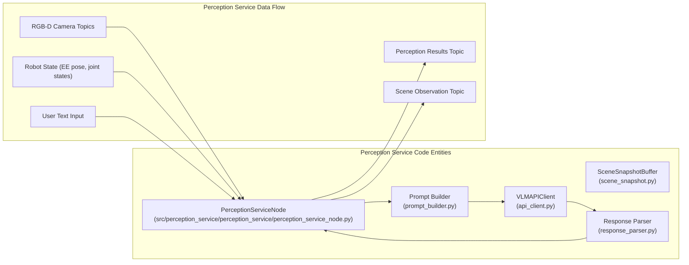
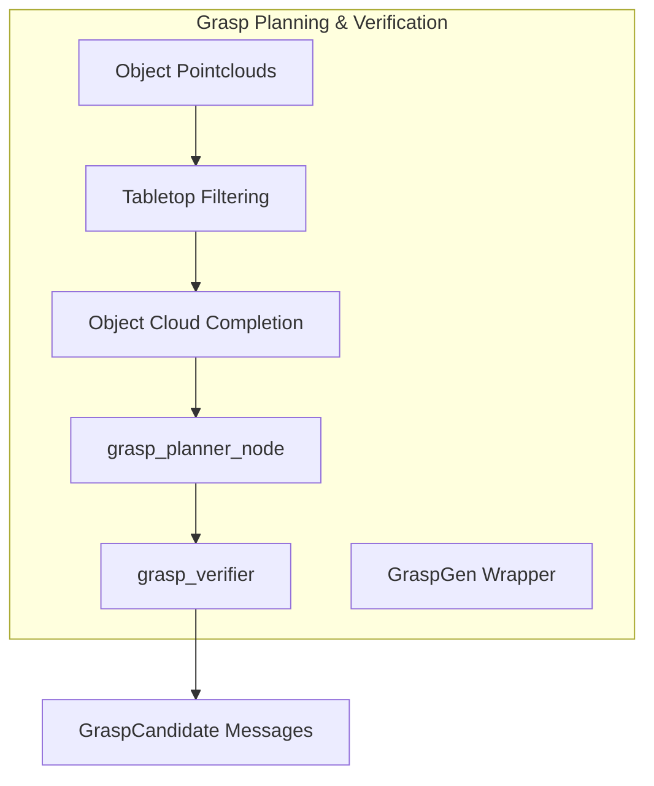
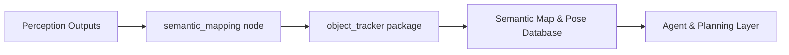
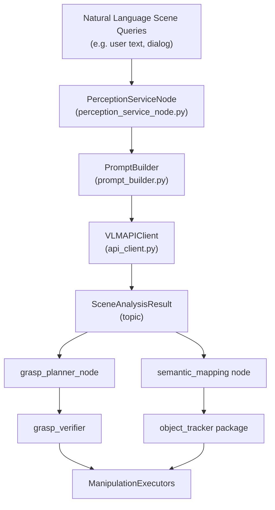

# 感知、操作与语义建图概述

相关源码文件

以下文件被用作生成此 wiki 页面的上下文：

- [src/perception_service/perception_service/__init__.py](https://atomgit.com/openeuler/IB_Robot/blob/openEuler-26.09/src/perception_service/perception_service/__init__.py)
- [src/perception_service/perception_service/api_client.py](https://atomgit.com/openeuler/IB_Robot/blob/openEuler-26.09/src/perception_service/perception_service/api_client.py)
- [src/perception_service/perception_service/depth_context.py](https://atomgit.com/openeuler/IB_Robot/blob/openEuler-26.09/src/perception_service/perception_service/depth_context.py)
- [src/perception_service/perception_service/model_timeout.py](https://atomgit.com/openeuler/IB_Robot/blob/openEuler-26.09/src/perception_service/perception_service/model_timeout.py)
- [src/perception_service/perception_service/perception_service_node.py](https://atomgit.com/openeuler/IB_Robot/blob/openEuler-26.09/src/perception_service/perception_service/perception_service_node.py)
- [src/perception_service/perception_service/prompt_builder.py](https://atomgit.com/openeuler/IB_Robot/blob/openEuler-26.09/src/perception_service/perception_service/prompt_builder.py)
- [src/perception_service/perception_service/response_parser.py](https://atomgit.com/openeuler/IB_Robot/blob/openEuler-26.09/src/perception_service/perception_service/response_parser.py)
- [src/perception_service/perception_service/rgbd_snapshot.py](https://atomgit.com/openeuler/IB_Robot/blob/openEuler-26.09/src/perception_service/perception_service/rgbd_snapshot.py)
- [src/perception_service/perception_service/scene_snapshot.py](https://atomgit.com/openeuler/IB_Robot/blob/openEuler-26.09/src/perception_service/perception_service/scene_snapshot.py)
- [src/perception_service/test/test_api_client.py](https://atomgit.com/openeuler/IB_Robot/blob/openEuler-26.09/src/perception_service/test/test_api_client.py)

RoboFrame_stable 代码库的这一部分覆盖集成的感知到抓取软件栈，支撑实时场景理解、抓取规划、操作执行、人体动作模仿以及带物体跟踪的语义环境地图构建等具身 AI 能力。它充当原始传感器输入与高层具身技能之间的关键层，将视觉与空间感知与物理交互和长期空间推理关联起来。

## 范围与目的

感知-操作-语义建图子系统包含若干紧耦合但模块化的组件，处理：

- **感知：** 使用 RGB-D 相机与视觉语言模型（VLM），经由本地托管或云端推理引擎进行多模态场景分析。
- **抓取规划与校验：** 对检测到的物体生成并过滤候选抓取，使用几何补全与校验服务。
- **操作执行：** 编排拾取与放置动作，包括相位状态机、运动学安全守护、重试与恢复行为。
- **人体动作模仿：** 通过将感知输出重定向到机器人运动学模型，复现人体姿态与手势。
- **语义建图与物体跟踪：** 维护带持久物体身份、位姿跟踪与离线地图构建的语义世界模型。

每个子领域都实现为专用的 ROS 2 节点、库与服务/插件适配器集合，面向实时响应性与下游 agent 规划层的集成设计。

下面提供高层概览，将主要功能区域与其实现角色及代码库内的关系关联起来。详细技术文档与 API 参考见专门的子页面。

---

## 6.1 感知服务

感知服务节点（`perception_service_node.py`）负责持续的多模态场景理解，将来自相机的实时 RGB-D 数据、机器人状态信息与用户提供的文本上下文整合为丰富的语义场景分析。它支持多相机话题、深度与点云输入，并托管内部场景快照缓冲（`SceneSnapshotBuffer`）以控制输入新鲜度与一致性。

核心感知逻辑调用外部视觉语言模型 API 客户端（`VLMAPIClient`），该客户端管理对本地或远程 VLM 提供方（如 "openai_compatible"）的推理请求。与 VLM 的交互包括构建封装图像与机器人上下文的提示消息（`prompt_builder.py`）、解析返回的场景分析响应（`response_parser.py`），并在 ROS 话题上发布汇总结果与场景观测。

该节点控制并发、管理会话历史，并基于可配置的置信度阈值过滤检测到的物体。其灵活的参数化允许自定义话题、推理模型选择、超时与输出格式。

详情见 [感知服务](./perception_service.md)。

来源：`src/perception_service/perception_service/perception_service_node.py:27-123`, `src/perception_service/perception_service/api_client.py:1-6`, `src/perception_service/perception_service/prompt_builder.py:1-8`, `src/perception_service/perception_service/response_parser.py:1-6`, `src/perception_service/perception_service/scene_snapshot.py:1-6`

---

## 6.2 抓取规划与校验

该模块封装 GraspGen 及相关 Python 节点，为场景中已分割的物体生成抓取假设。它对部分物体点云应用几何补全以及桌面支撑分割等过滤启发式，以提升候选质量。

`grasp_planner_node` 服务为检测到的物体点云启动抓取生成流水线，而 `grasp_verifier` 依据运动学与碰撞约束评估抓取。这些节点将抓取候选以消息形式发布，供执行规划器消费。

抓取规划系统与感知流水线紧密集成，订阅物体分割话题并接收补全后的物体点云。校验反馈控制重试逻辑与抓取候选剪枝。

详情见 [抓取规划与校验](./grasp_planning_verification.md)。

来源：Child page reference as detailed code lies outside this overview.

---

## 6.3 操作执行

操作执行层负责基于抓取候选安全地执行拾取与放置及其他操作动作。这包括建模操作生命周期阶段的相位状态机、抓取几何变换，以及拒绝不安全运动的运动学安全守护。

执行器处理发往机器人控制器的底层动作命令，同时支持失败时的重试与恢复行为。它们订阅来自感知与建图层的抓取候选消息与语义物体信息。

这确保了由高层感知与规划模块驱动的稳健物理交互。

详情见 [操作执行](./manipulation_execution.md)。

---

## 6.4 人体动作模仿（HRI）

该组件允许机器人利用采集到的人体姿态数据模仿人体动作。模仿的执行器生命周期集成 YOLOX 与 PEAR 感知回路，用于检测人体部位。

采集到的人体姿态表示经由 SMPL-X 人体模型重定向到 SO-101 机器人关节配置，实现类似人类示教者的自然机器人行为。

详情见 [人体动作模仿（HRI）](./human_motion_imitation.md)。

---

## 6.5 语义建图与物体跟踪

语义建图节点维护持久的语义世界模型，跨时间关联感知检测以跟踪物体身份与位姿（物体跟踪）。它支持其他系统组件的 standoff 空间查询以及离线语义地图生成。

该节点查询特征描述子、过滤噪声关联，并输出供 agent 级推理与记忆使用的语义地图。

相关的 `object_tracker` 包实现核心跟踪工具。

详情见 [语义建图与物体跟踪](./semantic_mapping_object_tracking.md)。

来源：Child page reference for in-depth implementation.

---

## 集成概览：从感知到操作再到建图

下图捕捉高层数据与控制流，将自然语言场景理解桥接到抓取执行与语义世界建模，并直接引用关键代码实体。

该图展示高层用户输入如何流经感知与 VLM 提示，馈入抓取规划、操作执行以及带物体跟踪的语义建图，构成闭环具身 AI 系统。

---

## 子页面

- 关于感知服务插件、支持的 VLM 适配器、快照缓冲与提示构建的详细架构与 API，见 [感知服务](./perception_service.md)。
- 关于抓取生成算法、规划器节点实现、物体点云处理与校验逻辑，见 [抓取规划与校验](./grasp_planning_verification.md)。
- 关于操作执行器状态机、几何、运动学守护与恢复策略，见 [操作执行](./manipulation_execution.md)。
- 关于人体姿态采集、模仿动作执行器与重定向框架，见 [人体动作模仿（HRI）](./human_motion_imitation.md)。
- 关于语义建图节点设计、关联方法、离线建图与物体跟踪器实现，见 [语义建图与物体跟踪](./semantic_mapping_object_tracking.md)。

---

本父页面提供架构背景与简明描述，帮助开发者导航感知、操作与语义建图子系统。每个子页面包含带代码级细节、参数与使用示例的全面技术文档。

---

来源：`src/perception_service/perception_service/perception_service_node.py:1-123`, `src/perception_service/perception_service/api_client.py:1-6`, `src/perception_service/perception_service/prompt_builder.py:1-8`, `src/perception_service/perception_service/response_parser.py:1-6`, `src/perception_service/perception_service/scene_snapshot.py:1-6`
