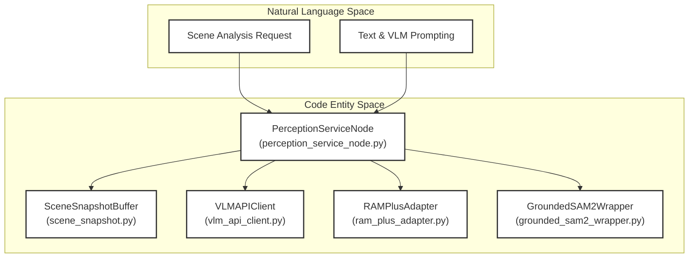
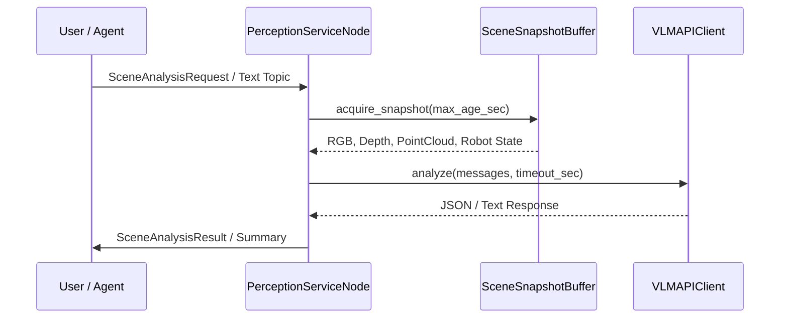
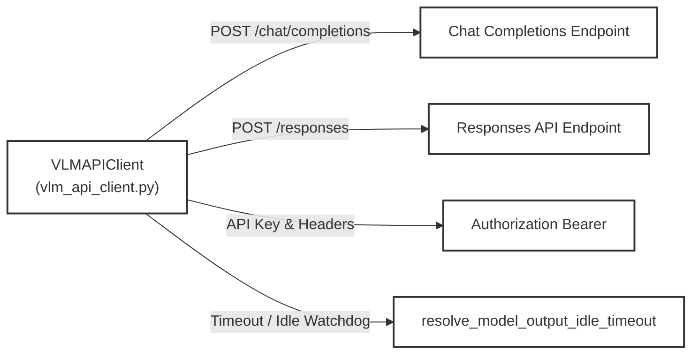

# 感知服务

<details>
<summary>相关源码文件</summary>

以下文件被用作生成此 wiki 页面的上下文：

- [src/embodied_common/embodied_common/vlm_api_client.py](https://atomgit.com/openeuler/IB_Robot/blob/openEuler-26.09/src/embodied_common/embodied_common/vlm_api_client.py)
- [src/embodied_common/embodied_common/vlm_models.yaml](https://atomgit.com/openeuler/IB_Robot/blob/openEuler-26.09/src/embodied_common/embodied_common/vlm_models.yaml)
- [src/embodied_common/package.xml](https://atomgit.com/openeuler/IB_Robot/blob/openEuler-26.09/src/embodied_common/package.xml)
- [src/embodied_common/setup.py](https://atomgit.com/openeuler/IB_Robot/blob/openEuler-26.09/src/embodied_common/setup.py)
- [src/embodied_common/test/test_vlm_responses_api.py](https://atomgit.com/openeuler/IB_Robot/blob/openEuler-26.09/src/embodied_common/test/test_vlm_responses_api.py)
- [src/ibrobot_msgs/srv/RecognizeTags.srv](https://atomgit.com/openeuler/IB_Robot/blob/openEuler-26.09/src/ibrobot_msgs/srv/RecognizeTags.srv)
- [src/perception_service/package.xml](https://atomgit.com/openeuler/IB_Robot/blob/openEuler-26.09/src/perception_service/package.xml)
- [src/perception_service/perception_service/__init__.py](https://atomgit.com/openeuler/IB_Robot/blob/openEuler-26.09/src/perception_service/perception_service/__init__.py)
- [src/perception_service/perception_service/api_client.py](https://atomgit.com/openeuler/IB_Robot/blob/openEuler-26.09/src/perception_service/perception_service/api_client.py)
- [src/perception_service/perception_service/depth_context.py](https://atomgit.com/openeuler/IB_Robot/blob/openEuler-26.09/src/perception_service/perception_service/depth_context.py)
- [src/perception_service/perception_service/graspgen_adapter.py](https://atomgit.com/openeuler/IB_Robot/blob/openEuler-26.09/src/perception_service/perception_service/graspgen_adapter.py)
- [src/perception_service/perception_service/grounded_sam2_wrapper.py](https://atomgit.com/openeuler/IB_Robot/blob/openEuler-26.09/src/perception_service/perception_service/grounded_sam2_wrapper.py)
- [src/perception_service/perception_service/grounding_dino_tokenizer.py](https://atomgit.com/openeuler/IB_Robot/blob/openEuler-26.09/src/perception_service/perception_service/grounding_dino_tokenizer.py)
- [src/perception_service/perception_service/model_timeout.py](https://atomgit.com/openeuler/IB_Robot/blob/openEuler-26.09/src/perception_service/perception_service/model_timeout.py)
- [src/perception_service/perception_service/package_perception_bundles.py](https://atomgit.com/openeuler/IB_Robot/blob/openEuler-26.09/src/perception_service/perception_service/package_perception_bundles.py)
- [src/perception_service/perception_service/perception_service_node.py](https://atomgit.com/openeuler/IB_Robot/blob/openEuler-26.09/src/perception_service/perception_service/perception_service_node.py)
- [src/perception_service/perception_service/prompt_builder.py](https://atomgit.com/openeuler/IB_Robot/blob/openEuler-26.09/src/perception_service/perception_service/prompt_builder.py)
- [src/perception_service/perception_service/ram_plus_adapter.py](https://atomgit.com/openeuler/IB_Robot/blob/openEuler-26.09/src/perception_service/perception_service/ram_plus_adapter.py)
- [src/perception_service/perception_service/response_parser.py](https://atomgit.com/openeuler/IB_Robot/blob/openEuler-26.09/src/perception_service/perception_service/response_parser.py)
- [src/perception_service/perception_service/rgbd_snapshot.py](https://atomgit.com/openeuler/IB_Robot/blob/openEuler-26.09/src/perception_service/perception_service/rgbd_snapshot.py)
- [src/perception_service/perception_service/scene_snapshot.py](https://atomgit.com/openeuler/IB_Robot/blob/openEuler-26.09/src/perception_service/perception_service/scene_snapshot.py)
- [src/perception_service/setup.py](https://atomgit.com/openeuler/IB_Robot/blob/openEuler-26.09/src/perception_service/setup.py)
- [src/perception_service/test/test_api_client.py](https://atomgit.com/openeuler/IB_Robot/blob/openEuler-26.09/src/perception_service/test/test_api_client.py)
- [src/perception_service/test/test_grasp_perception_adapters.py](https://atomgit.com/openeuler/IB_Robot/blob/openEuler-26.09/src/perception_service/test/test_grasp_perception_adapters.py)
- [src/perception_service/test/test_grounding_dino_config.py](https://atomgit.com/openeuler/IB_Robot/blob/openEuler-26.09/src/perception_service/test/test_grounding_dino_config.py)
- [src/perception_service/test/test_model_service_plugins.py](https://atomgit.com/openeuler/IB_Robot/blob/openEuler-26.09/src/perception_service/test/test_model_service_plugins.py)
- [src/perception_service/test/test_package_perception_bundles.py](https://atomgit.com/openeuler/IB_Robot/blob/openEuler-26.09/src/perception_service/test/test_package_perception_bundles.py)
- [src/perception_service/test/test_torch_model_loaders.py](https://atomgit.com/openeuler/IB_Robot/blob/openEuler-26.09/src/perception_service/test/test_torch_model_loaders.py)

</details>

## 目的与范围

感知服务模块（`perception_service`）为具身交互提供持续的多模态场景理解，将原始传感器输入（RGB 相机、深度流、点云、关节状态）与神经推理流水线及视觉语言模型（VLM）推理 API 桥接。其范围涵盖 ROS 2 节点编排（`PerceptionServiceNode`）、模型服务插件与适配器（Grounding DINO、SAM2、RAM++、YOLOX、PEAR）、多传感器场景快照缓冲（`SceneSnapshotBuffer`）以及 OpenAI 兼容的 VLM API 客户端（`VLMAPIClient`）。

来源：`src/perception_service/package.xml:1-35` [], `src/perception_service/setup.py:1-28` [], `src/perception_service/perception_service/perception_service_node.py:1-28` []

---

## 架构概览与包布局

感知栈构建为一个 ROS 2 Python 包，包含可执行节点、张量适配器与运行时封装。它与 `embodied_common` 交互以共享提示、深度上下文辅助与 VLM 通信协议，同时消费来自 `inference_service` 的已编译部署 bundle 与推理运行时。



*图 1：将自然语言场景请求与 VLM 提示桥接到 `perception_service` 与 `embodied_common` 内的底层 Python 类与执行节点。*

来源：`src/perception_service/setup.py:1-28` [], `src/perception_service/package.xml:10-26` []

---

## 感知服务节点与请求生命周期

核心服务运行时由 `PerceptionServiceNode` 承载，它订阅场景分析请求、文本命令与相机流，同时发布结构化的场景分析、摘要与观测。



*图 2：从 ROS 2 订阅进入到同步快照采集与 VLM API 推理分发的请求执行生命周期。*

`PerceptionServiceNode` 初始化话题、超时与相机命名空间的参数，并通过线程信号量管理并发请求：

```python
class PerceptionServiceNode(Node):
    def __init__(self, parameter_overrides=None) -> None:
        super().__init__("perception_service_node", parameter_overrides=parameter_overrides)
        self.declare_parameter("request_topic", "/embodied/perception_request")
        self.declare_parameter("text_input_topic", "/embodied/perception_text")
        self.declare_parameter("result_topic", "/embodied/perception_result")
        ...
```

*(引自 `src/perception_service/perception_service/perception_service_node.py:27-79`)*

来源：`src/perception_service/perception_service/perception_service_node.py:27-103` []

---

## 模型服务插件与适配器

该服务为深度感知模型提供具体的适配器与封装，将原始张量输出转换为语义对象、边界框、分割掩码与标签属性。

### RAM++ 标签识别适配器

`RAMPlusAdapter` 处理预处理（缩放到 384x384、ImageNet 归一化）以及对 4,585 个标签类别的 sigmoid 分数阈值过滤。

```python
class RAMPlusAdapter(PerceptionAdapter):
    identity = AdapterIdentity(
        model_type="ram_plus",
        preprocessing=RAM_PLUS_PREPROCESSING,
        postprocessing=RAM_PLUS_POSTPROCESSING,
        supported_deployments=frozenset({"torch_cpu", "torch_cuda", "ascend_310p", "ascend_310b"}),
        operation="recognize_tags",
    )
```

*(引自 `src/perception_service/perception_service/ram_plus_adapter.py:68-75`)*

它将模型输出解码为排序的 `RecognizedTag` 条目，同时通过 `select_mask_tags` 过滤排除的背景或颜色标签 [src/perception_service/perception_service/ram_plus_adapter.py:45-50](https://atomgit.com/openeuler/IB_Robot/blob/openEuler-26.09/src/perception_service/perception_service/ram_plus_adapter.py#L45-L50)。

### Grounded SAM 2 封装

`GroundedSAM2Wrapper` 将 Grounding DINO 检测与 SAM 2 分割掩码耦合。它依据审计密钥校验 checkpoint 兼容性，启用 CUDA autocast 精度，并使用凸包单纯形分解（`volume_centroid_hull`）计算 3D 体积质心 [src/perception_service/perception_service/grounded_sam2_wrapper.py:43-121](https://atomgit.com/openeuler/IB_Robot/blob/openEuler-26.09/src/perception_service/perception_service/grounded_sam2_wrapper.py#L43-L121)。

```python
class GroundedSAM2Wrapper:
    def __init__(
        self,
        device: str = "cuda",
        sam_checkpoint: str = "grounded_sam2_swint_ogc/assets/sam2.1_hiera_tiny.pt",
        sam_config: str = "configs/sam2.1/sam2.1_hiera_t.yaml",
        gdino_checkpoint: str = "grounded_sam2_swint_ogc/assets/groundingdino_swint_ogc.pth",
        gdino_text_encoder: str = "grounded_sam2_swint_ogc/assets/bert-base-uncased",
        model_dir: str | None = None,
    ):
        ...
```

*(引自 `src/perception_service/perception_service/grounded_sam2_wrapper.py:139-166`)*

来源：`src/perception_service/perception_service/ram_plus_adapter.py:1-157` [], `src/perception_service/perception_service/grounded_sam2_wrapper.py:1-166` []

---

## VLM API 客户端与 OpenAI 兼容集成

`VLMAPIClient` 提供与 OpenAI 兼容的 Chat Completions 与 Responses API 的通信（支持 `kimicode` 与通用 `openai_compatible` 端点等提供方）。



*图 3：`VLMAPIClient` 协议路由、认证注入与超时管理的架构。*

该客户端构造载荷消息、追加授权头、通过标准库（`urllib.request`）分发 HTTP 请求，并解析结构化 JSON 响应 [src/embodied_common/embodied_common/vlm_api_client.py:46-136](https://atomgit.com/openeuler/IB_Robot/blob/openEuler-26.09/src/embodied_common/embodied_common/vlm_api_client.py#L46-L136)。

来源：`src/embodied_common/embodied_common/vlm_api_client.py:1-179` [], `src/perception_service/perception_service/api_client.py:1-6` []
