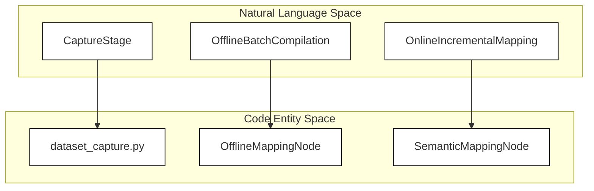
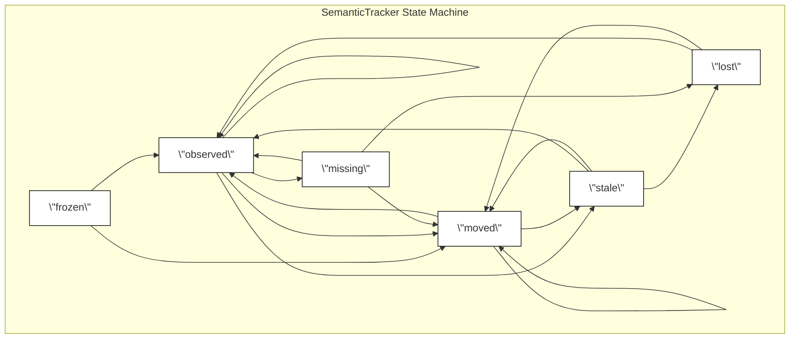

# 语义建图与目标跟踪

<details>
<summary>相关源码文件</summary>

以下文件被用作生成此 wiki 页面的上下文：

- [src/robot_config/test/test_semantic_mapping_config.py](https://atomgit.com/openeuler/IB_Robot/blob/openEuler-26.09/src/robot_config/test/test_semantic_mapping_config.py)
- [src/semantic_mapping/README.md](https://atomgit.com/openeuler/IB_Robot/blob/openEuler-26.09/src/semantic_mapping/README.md)
- [src/semantic_mapping/launch/offline_mapping.launch.py](https://atomgit.com/openeuler/IB_Robot/blob/openEuler-26.09/src/semantic_mapping/launch/offline_mapping.launch.py)
- [src/semantic_mapping/launch/semantic_mapping.launch.py](https://atomgit.com/openeuler/IB_Robot/blob/openEuler-26.09/src/semantic_mapping/launch/semantic_mapping.launch.py)
- [src/semantic_mapping/package.xml](https://atomgit.com/openeuler/IB_Robot/blob/openEuler-26.09/src/semantic_mapping/package.xml)
- [src/semantic_mapping/semantic_mapping/association.py](https://atomgit.com/openeuler/IB_Robot/blob/openEuler-26.09/src/semantic_mapping/semantic_mapping/association.py)
- [src/semantic_mapping/semantic_mapping/configuration.py](https://atomgit.com/openeuler/IB_Robot/blob/openEuler-26.09/src/semantic_mapping/semantic_mapping/configuration.py)
- [src/semantic_mapping/semantic_mapping/final_label_visualization.py](https://atomgit.com/openeuler/IB_Robot/blob/openEuler-26.09/src/semantic_mapping/semantic_mapping/final_label_visualization.py)
- [src/semantic_mapping/semantic_mapping/label_refinement.py](https://atomgit.com/openeuler/IB_Robot/blob/openEuler-26.09/src/semantic_mapping/semantic_mapping/label_refinement.py)
- [src/semantic_mapping/semantic_mapping/offline_bag.py](https://atomgit.com/openeuler/IB_Robot/blob/openEuler-26.09/src/semantic_mapping/semantic_mapping/offline_bag.py)
- [src/semantic_mapping/semantic_mapping/offline_mapping_node.py](https://atomgit.com/openeuler/IB_Robot/blob/openEuler-26.09/src/semantic_mapping/semantic_mapping/offline_mapping_node.py)
- [src/semantic_mapping/semantic_mapping/semantic_mapping_node.py](https://atomgit.com/openeuler/IB_Robot/blob/openEuler-26.09/src/semantic_mapping/semantic_mapping/semantic_mapping_node.py)
- [src/semantic_mapping/semantic_mapping/standoff_query.py](https://atomgit.com/openeuler/IB_Robot/blob/openEuler-26.09/src/semantic_mapping/semantic_mapping/standoff_query.py)
- [src/semantic_mapping/setup.py](https://atomgit.com/openeuler/IB_Robot/blob/openEuler-26.09/src/semantic_mapping/setup.py)
- [src/semantic_mapping/test/test_association.py](https://atomgit.com/openeuler/IB_Robot/blob/openEuler-26.09/src/semantic_mapping/test/test_association.py)
- [src/semantic_mapping/test/test_configuration.py](https://atomgit.com/openeuler/IB_Robot/blob/openEuler-26.09/src/semantic_mapping/test/test_configuration.py)
- [src/semantic_mapping/test/test_final_label_visualization.py](https://atomgit.com/openeuler/IB_Robot/blob/openEuler-26.09/src/semantic_mapping/test/test_final_label_visualization.py)
- [src/semantic_mapping/test/test_standalone_launch.py](https://atomgit.com/openeuler/IB_Robot/blob/openEuler-26.09/src/semantic_mapping/test/test_standalone_launch.py)
- [src/semantic_mapping/test/test_target_resolution.py](https://atomgit.com/openeuler/IB_Robot/blob/openEuler-26.09/src/semantic_mapping/test/test_target_resolution.py)

</details>

## 目的与范围

`semantic_mapping` 子系统使用来自底盘相机（如 Intel RealSense D435）的同步 RGB-D 数据与同步 TF 流，构建并维护持久的开放词汇 3D 语义目标地图 [src/semantic_mapping/README.md:1-4](https://atomgit.com/openeuler/IB_Robot/blob/openEuler-26.09/src/semantic_mapping/README.md#L1-L4)。它独立于内部 SLAM 地图表示运行，仅依赖时间戳匹配的变换 [src/semantic_mapping/README.md:3-4](https://atomgit.com/openeuler/IB_Robot/blob/openEuler-26.09/src/semantic_mapping/README.md#L3-L4)。

本页面覆盖 `semantic_mapping_node` 的架构、离线建图运行器、跟踪关联逻辑、生命周期管理、配置转换及 standoff 目标解析查询。

来源：[src/semantic_mapping/README.md:1-4](https://atomgit.com/openeuler/IB_Robot/blob/openEuler-26.09/src/semantic_mapping/README.md#L1-L4), [src/semantic_mapping/semantic_mapping/semantic_mapping_node.py:1-4](https://atomgit.com/openeuler/IB_Robot/blob/openEuler-26.09/src/semantic_mapping/semantic_mapping/semantic_mapping_node.py#L1-L4)

---

## 1. 建图阶段：采集、离线与在线

该框架将语义建图划分为三个不同的操作阶段，以解耦传感器记录、批量编译与增量在线更新 [src/semantic_mapping/README.md:6-13](https://atomgit.com/openeuler/IB_Robot/blob/openEuler-26.09/src/semantic_mapping/README.md#L6-L13)。

| 阶段 | 入口 / 档案 | 职责 |
|---|---|---|
| **采集** | `robot_config:=lekiwi_semantic_capture` | 同步 MID-360、D435i、TF 与标定记录；录制连续 MCAP rosbag 流并构建基线占据地图 [src/semantic_mapping/README.md:8-10](https://atomgit.com/openeuler/IB_Robot/blob/openEuler-26.09/src/semantic_mapping/README.md#L8-L10) |
| **离线建图** | `offline_mapping.launch.py` / `offline_mapping_node` | 处理录制的采集 bag，批量初始化或重建持久的 3D 语义目标数据库 [src/semantic_mapping/README.md:11](https://atomgit.com/openeuler/IB_Robot/blob/openEuler-26.09/src/semantic_mapping/README.md#L11)，实现于 [src/semantic_mapping/semantic_mapping/offline_mapping_node.py:40-151](https://atomgit.com/openeuler/IB_Robot/blob/openEuler-26.09/src/semantic_mapping/semantic_mapping/offline_mapping_node.py#L40-L151) |
| **在线建图与查询** | `semantic_mapping.launch.py` / `semantic_mapping_node` | 消费实时 RGB-D 流进行增量目标更新，提供查询服务与导航 standoff 解析 [src/semantic_mapping/README.md:12](https://atomgit.com/openeuler/IB_Robot/blob/openEuler-26.09/src/semantic_mapping/README.md#L12) |

### 图：自然语言建图概念到代码实体

图题：“桥接自然语言与代码的建图流水线”



来源：`[src/semantic_mapping/README.md:6-13]`, `[src/semantic_mapping/semantic_mapping/offline_mapping_node.py:40-151]`, `[src/semantic_mapping/semantic_mapping/semantic_mapping_node.py:101-125]`

---

## 2. 关联与生命周期管理

目标跟踪与数据关联由 `SemanticTracker` 及 [src/semantic_mapping/semantic_mapping/association.py:1-174](https://atomgit.com/openeuler/IB_Robot/blob/openEuler-26.09/src/semantic_mapping/semantic_mapping/association.py#L1-L174) 中定义的数据类管理。处理观测时，跟踪器评估空间距离、尺寸比约束与 SigLIP 嵌入相似度，将新观测与既有持久轨迹关联 [src/semantic_mapping/semantic_mapping/association.py:113-152](https://atomgit.com/openeuler/IB_Robot/blob/openEuler-26.09/src/semantic_mapping/semantic_mapping/association.py#L113-L152)。

### 生命周期状态与迁移

轨迹在定义的生命周期状态间演进 [src/semantic_mapping/semantic_mapping/association.py:9-24](https://atomgit.com/openeuler/IB_Robot/blob/openEuler-26.09/src/semantic_mapping/semantic_mapping/association.py#L9-L24)：

* `frozen`：锁定状态，阻止自动变更。
* `observed`：被主动检测与更新。
* `stale`：在可配置时长（`stale_after_sec`）内未命中，仍可查询但对直接操作不活跃。
* `missing`：暂时从视野中丢失。
* `moved`：检测到超出稳定性阈值的位置偏移。
* `lost`：终结的轨迹状态。

动作就绪状态（`ACTION_READY_STATES`）包括 `observed` 与 `moved` [src/semantic_mapping/semantic_mapping/association.py:15](https://atomgit.com/openeuler/IB_Robot/blob/openEuler-26.09/src/semantic_mapping/semantic_mapping/association.py#L15)。

### 图：语义跟踪状态机

图题：“语义轨迹生命周期状态机”



来源：[src/semantic_mapping/semantic_mapping/association.py:9-24](https://atomgit.com/openeuler/IB_Robot/blob/openEuler-26.09/src/semantic_mapping/semantic_mapping/association.py#L9-L24), [src/semantic_mapping/semantic_mapping/association.py:113-152](https://atomgit.com/openeuler/IB_Robot/blob/openEuler-26.09/src/semantic_mapping/semantic_mapping/association.py#L113-L152)

---

## 3. 配置与 SSOT 转换

语义建图模块通过 `robot.semantic_mapping` 下的唯一事实来源（SSOT）机器人配置结构参数化 [src/semantic_mapping/README.md:155-157](https://atomgit.com/openeuler/IB_Robot/blob/openEuler-26.09/src/semantic_mapping/README.md#L155-L157)。转换工具 `semantic_mapping_parameters()` 提取嵌套字典（相机、SLAM、感知、生命周期、过滤）并将其展平为 ROS 节点参数 [src/semantic_mapping/semantic_mapping/configuration.py:30-111](https://atomgit.com/openeuler/IB_Robot/blob/openEuler-26.09/src/semantic_mapping/semantic_mapping/configuration.py#L30-L111)。

关键转换参数：

* **后端选择**：`mapping_backend` 可设为 `"service"`（依赖外部模型服务节点）或 `"embedded"` [src/semantic_mapping/semantic_mapping/configuration.py:46-47](https://atomgit.com/openeuler/IB_Robot/blob/openEuler-26.09/src/semantic_mapping/semantic_mapping/configuration.py#L46-L47) [src/semantic_mapping/test/test_configuration.py:98-119](https://atomgit.com/openeuler/IB_Robot/blob/openEuler-26.09/src/semantic_mapping/test/test_configuration.py#L98-L119)。
* **模型身份**：为 SAM2（`sam_model_identity`）、RAM++（`ram_plus_model_identity`）与 SigLIP2（`siglip2_model_identity`）注入规范化语义身份 JSON 字符串 [src/semantic_mapping/semantic_mapping/configuration.py:53-56](https://atomgit.com/openeuler/IB_Robot/blob/openEuler-26.09/src/semantic_mapping/semantic_mapping/configuration.py#L53-L56)。
* **配置世代**：基于活动模型服务版本计算唯一世代整数，以检测流水线失步 [src/semantic_mapping/semantic_mapping/configuration.py:57-59](https://atomgit.com/openeuler/IB_Robot/blob/openEuler-26.09/src/semantic_mapping/semantic_mapping/configuration.py#L57-L59)。

来源：[src/semantic_mapping/semantic_mapping/configuration.py:30-111](https://atomgit.com/openeuler/IB_Robot/blob/openEuler-26.09/src/semantic_mapping/semantic_mapping/configuration.py#L30-L111), [src/semantic_mapping/README.md:155-188](https://atomgit.com/openeuler/IB_Robot/blob/openEuler-26.09/src/semantic_mapping/README.md#L155-L188)

---

## 4. 公共接口、Standoff 查询与目标解析

`semantic_mapping` 节点向下游导航与操作规划器暴露持久状态与查询 API。

### 公共 ROS 接口

| 接口类型 | 名称 | 描述 |
|---|---|---|
| **话题** | `/semantic_mapping/objects` | `SemanticObject3DArray` 持久目标快照（Reliable、Transient Local）[src/semantic_mapping/README.md:125-127](https://atomgit.com/openeuler/IB_Robot/blob/openEuler-26.09/src/semantic_mapping/README.md#L125-L127) |
| **话题** | `/semantic_mapping/object_cloud` | 活动帧中目标的世界坐标点云 [src/semantic_mapping/README.md:128](https://atomgit.com/openeuler/IB_Robot/blob/openEuler-26.09/src/semantic_mapping/README.md#L128) |
| **服务** | `/semantic_mapping/get_objects` | 按 ID、标签、文本、生命周期状态、年龄或空间边界区域查询目标 [src/semantic_mapping/README.md:129](https://atomgit.com/openeuler/IB_Robot/blob/openEuler-26.09/src/semantic_mapping/README.md#L129) |
| **服务** | `/semantic_mapping/resolve_target` | 计算膨胀的目标站位与 Nav2 standoff 接近位姿 [src/semantic_mapping/README.md:130](https://atomgit.com/openeuler/IB_Robot/blob/openEuler-26.09/src/semantic_mapping/README.md#L130) |

### Standoff 查询工具（`semantic_map_standoff`）

独立工具 `semantic_map_standoff` 查询 `/semantic_mapping/get_objects` 服务以获取给定手动标签，并输出紧凑的 standoff 位姿 `[x, y, theta_degrees]` [src/semantic_mapping/README.md:138-146](https://atomgit.com/openeuler/IB_Robot/blob/openEuler-26.09/src/semantic_mapping/README.md#L138-L146)。

```bash
ros2 run semantic_mapping semantic_map_standoff banana 0.2 --reference-x 0.24 --reference-y 0.09
```

* **朝向输出**：角度以度为单位返回，相对于地图坐标系正 $X$ 轴，逆时针为正 [src/semantic_mapping/README.md:148-153](https://atomgit.com/openeuler/IB_Robot/blob/openEuler-26.09/src/semantic_mapping/README.md#L148-L153)。
* **失败处理**：若查询超时或未找到匹配，命令打印 `[]` 并以错误状态退出 [src/semantic_mapping/semantic_mapping/standoff_query.py:51-68](https://atomgit.com/openeuler/IB_Robot/blob/openEuler-26.09/src/semantic_mapping/semantic_mapping/standoff_query.py#L51-L68) [src/semantic_mapping/semantic_mapping/standoff_query.py:82-104](https://atomgit.com/openeuler/IB_Robot/blob/openEuler-26.09/src/semantic_mapping/semantic_mapping/standoff_query.py#L82-L104)。

来源：[src/semantic_mapping/README.md:123-154](https://atomgit.com/openeuler/IB_Robot/blob/openEuler-26.09/src/semantic_mapping/README.md#L123-L154), [src/semantic_mapping/semantic_mapping/standoff_query.py:50-109](https://atomgit.com/openeuler/IB_Robot/blob/openEuler-26.09/src/semantic_mapping/semantic_mapping/standoff_query.py#L50-L109)
