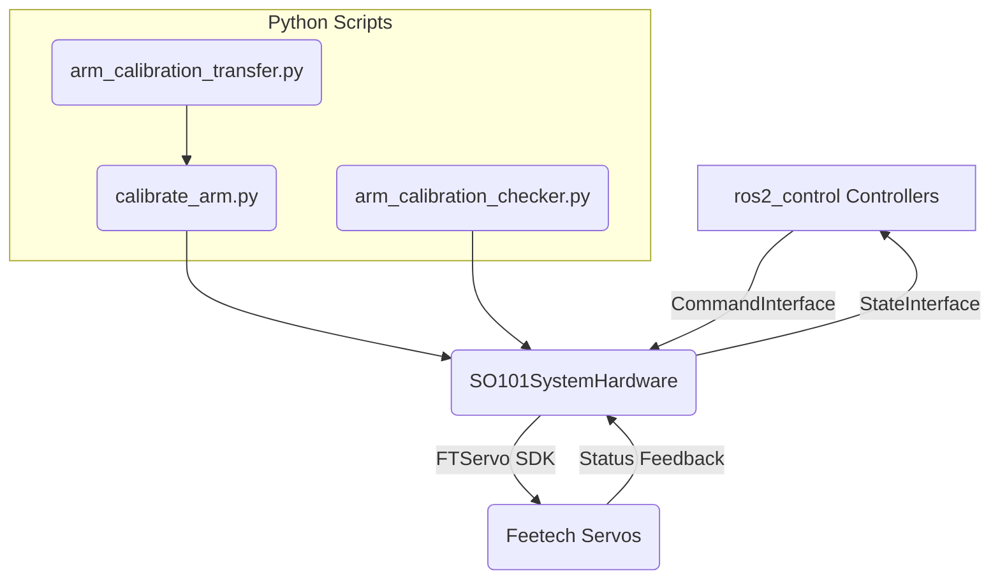
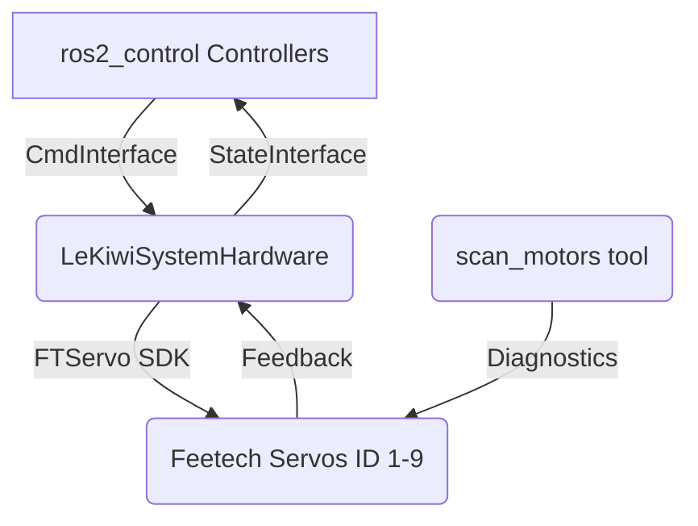
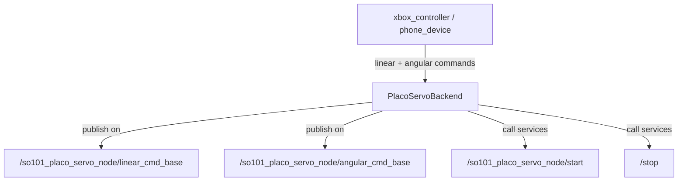
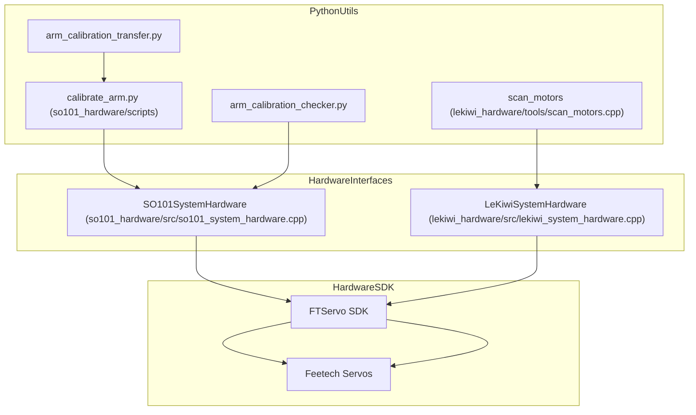
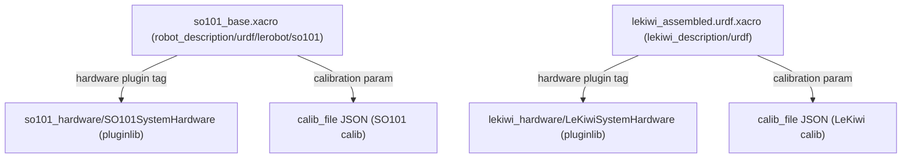

# 硬件接口与描述

<details>
<summary>相关源码文件</summary>

以下文件被用作生成此 wiki 页面的上下文：

- [src/action_dispatch/action_dispatch/__init__.py](https://atomgit.com/openeuler/IB_Robot/blob/openEuler-26.09/src/action_dispatch/action_dispatch/__init__.py)
- [src/action_dispatch/action_dispatch/temporal_smoother.py](https://atomgit.com/openeuler/IB_Robot/blob/openEuler-26.09/src/action_dispatch/action_dispatch/temporal_smoother.py)
- [src/action_dispatch/test/test_temporal_smoother.py](https://atomgit.com/openeuler/IB_Robot/blob/openEuler-26.09/src/action_dispatch/test/test_temporal_smoother.py)
- [src/lekiwi_description/urdf/lekiwi_assembled.urdf.xacro](https://atomgit.com/openeuler/IB_Robot/blob/openEuler-26.09/src/lekiwi_description/urdf/lekiwi_assembled.urdf.xacro)
- [src/lekiwi_hardware/CMakeLists.txt](https://atomgit.com/openeuler/IB_Robot/blob/openEuler-26.09/src/lekiwi_hardware/CMakeLists.txt)
- [src/lekiwi_hardware/README.md](https://atomgit.com/openeuler/IB_Robot/blob/openEuler-26.09/src/lekiwi_hardware/README.md)
- [src/lekiwi_hardware/config/lekiwi_controllers.yaml](https://atomgit.com/openeuler/IB_Robot/blob/openEuler-26.09/src/lekiwi_hardware/config/lekiwi_controllers.yaml)
- [src/lekiwi_hardware/include/lekiwi_hardware/lekiwi_system_hardware.hpp](https://atomgit.com/openeuler/IB_Robot/blob/openEuler-26.09/src/lekiwi_hardware/include/lekiwi_hardware/lekiwi_system_hardware.hpp)
- [src/lekiwi_hardware/lekiwi_hardware_plugin.xml](https://atomgit.com/openeuler/IB_Robot/blob/openEuler-26.09/src/lekiwi_hardware/lekiwi_hardware_plugin.xml)
- [src/lekiwi_hardware/package.xml](https://atomgit.com/openeuler/IB_Robot/blob/openEuler-26.09/src/lekiwi_hardware/package.xml)
- [src/lekiwi_hardware/src/lekiwi_system_hardware.cpp](https://atomgit.com/openeuler/IB_Robot/blob/openEuler-26.09/src/lekiwi_hardware/src/lekiwi_system_hardware.cpp)
- [src/robot_description/urdf/lerobot/so101/so101_base.xacro](https://atomgit.com/openeuler/IB_Robot/blob/openEuler-26.09/src/robot_description/urdf/lerobot/so101/so101_base.xacro)
- [src/robot_moveit/config/lerobot/so101/so101.srdf](https://atomgit.com/openeuler/IB_Robot/blob/openEuler-26.09/src/robot_moveit/config/lerobot/so101/so101.srdf)
- [src/robot_moveit/scripts/so101_placo_kinematics.py](https://atomgit.com/openeuler/IB_Robot/blob/openEuler-26.09/src/robot_moveit/scripts/so101_placo_kinematics.py)
- [src/robot_moveit/test/test_so101_placo_kinematics.py](https://atomgit.com/openeuler/IB_Robot/blob/openEuler-26.09/src/robot_moveit/test/test_so101_placo_kinematics.py)
- [src/robot_teleop/robot_teleop/cartesian_backend/__init__.py](https://atomgit.com/openeuler/IB_Robot/blob/openEuler-26.09/src/robot_teleop/robot_teleop/cartesian_backend/__init__.py)
- [src/robot_teleop/robot_teleop/cartesian_backend/placo_servo.py](https://atomgit.com/openeuler/IB_Robot/blob/openEuler-26.09/src/robot_teleop/robot_teleop/cartesian_backend/placo_servo.py)
- [src/so101_hardware/CMakeLists.txt](https://atomgit.com/openeuler/IB_Robot/blob/openEuler-26.09/src/so101_hardware/CMakeLists.txt)
- [src/so101_hardware/README.en.md](https://atomgit.com/openeuler/IB_Robot/blob/openEuler-26.09/src/so101_hardware/README.en.md)
- [src/so101_hardware/README.md](https://atomgit.com/openeuler/IB_Robot/blob/openEuler-26.09/src/so101_hardware/README.md)
- [src/so101_hardware/docs/tools/arm_calibration_transfer.md](https://atomgit.com/openeuler/IB_Robot/blob/openEuler-26.09/src/so101_hardware/docs/tools/arm_calibration_transfer.md)
- [src/so101_hardware/scripts/arm_calibration_transfer.py](https://atomgit.com/openeuler/IB_Robot/blob/openEuler-26.09/src/so101_hardware/scripts/arm_calibration_transfer.py)
- [src/so101_hardware/so101_hardware/calibration/transfer.py](https://atomgit.com/openeuler/IB_Robot/blob/openEuler-26.09/src/so101_hardware/so101_hardware/calibration/transfer.py)
- [src/so101_hardware/so101_hardware/calibration/validation.py](https://atomgit.com/openeuler/IB_Robot/blob/openEuler-26.09/src/so101_hardware/so101_hardware/calibration/validation.py)
- [src/so101_hardware/test/test_transfer.py](https://atomgit.com/openeuler/IB_Robot/blob/openEuler-26.09/src/so101_hardware/test/test_transfer.py)

</details>

本页面详述 RoboFrame stable 代码库为两大机器人平台实现的硬件接口与描述：SO-101 机械臂与 LeKiwi 移动操作平台。覆盖其 ros2_control 插件实现（`so101_hardware` 与 `lekiwi_hardware` 包）、标定迁移工具、URDF/xacro 机器人描述文件，以及 Aero hand 末端执行器集成。重点聚焦驱动与仿真这些硬件组件所用的架构、数据流、关键类/函数与配置格式。

---

## 1. 概述

RoboFrame stable 的硬件控制通过以 Feetech SMS_STS 舵机协议为底座的原生 ros2_control 插件，将物理机器人模型（SO-101 与 LeKiwi）与 ROS 2 控制器基础设施桥接。

- **SO-101 硬件**提供高性能 C++ 硬件接口插件与 Python 标定/诊断工具。
- **LeKiwi 硬件**支持机械臂 + 移动底盘组合平台，包含 6 个位置控制的臂关节与 3 个速度控制的万向轮。
- **标定迁移** Python 脚本在臂从动（follower）与主动（leader）模式间迁移臂标定数据并校验标定完整性。
- 机器人 **URDF/xacro 描述**表示机器人结构，内嵌 ros2_control 硬件配置，将关节绑定到物理电机与插件。
- **Aero hand** 集成在臂硬件之外提供额外的末端执行器接口。

硬件通信运行在 1 Mbps 串行协议之上，基于 Feetech SMS_STS SDK。数据与命令从 ros2_control 控制器经硬件接口插件流入舵机命令，并以 100 Hz 一致地读取反馈。

---

## 2. SO-101 ros2_control 插件（`so101_hardware`）

### 2.1 包架构

`so101_hardware` 是混合 C++ / Python 包，提供：

- C++ ros2_control `SystemInterface` 插件 `SO101SystemHardware`，使用 FTServo SDK 通过串口直接管理与 Feetech 舵机的通信。
- 用于臂标定（`calibrate_arm.py`）、标定迁移（`arm_calibration_transfer.py`）与标定检查（`arm_calibration_checker.py`）的 Python 脚本。
- 验证硬件接口正确性的 C++ 单元测试。

该包依赖 `hardware_interface`、`pluginlib`、`rclcpp_lifecycle`、`ibrobot_msgs`，并通过 CMake FetchContent 拉取 Feetech SDK 静态构建。

### 2.2 关键类：`SO101SystemHardware`

定义于 `src/so101_system_hardware.cpp`，该类实现 ros2_control 生命周期接口，关键回调包括：

- **on_init：** 读取机器人关节参数，提取电机 ID，设置缓冲区。
- **on_configure：** 加载将电机 ID 映射到归零偏移与行程限制的标定 JSON 文件。
- **on_activate：** 打开串口，ping 电机，设置安全启动位置，以 fail-closed 回滚管理力矩与 EPROM 锁定。
- **read：** 获取电机反馈（位置、速度、电流），解码舵机寄存器，将步数转换为弧度。
- **write：** 将命令位置/速度转换为舵机步数，经串口同步分发。

该插件以位置控制方式处理 6 个臂关节，并支持主/从臂标定模式。

### 2.3 标定与激活回滚

激活过程使用 `detail::rollback_activation`，在失败时安全地卸力并重新锁定 EPROM。初始同步读取在放开控制前验证电机状态完整性。

### 2.4 Python 标定脚本

- `arm_calibration_transfer.py` 将旧的从臂标定数据迁移为主臂格式。
- `arm_calibration_checker.py` 在物理硬件上校验标定参数。

### 2.5 硬件接口插件注册

在 `so101_hardware_plugin.xml` 中向 pluginlib 注册，插件由 ros2_control 加载：

```xml
<hardware>
  <plugin>so101_hardware/SO101SystemHardware</plugin>
  <param name="port">/dev/ttyACM0</param>
  <param name="calib_file">~/.calibrate/so101_follower_calibrate.json</param>
  <param name="reset_positions">{"1": 0.0, "2": 0.0}</param>
</hardware>
```

### 2.6 数据流汇总



来源：`src/so101_hardware/CMakeLists.txt:13-126`, `src/so101_hardware/README.md:1-162`, `src/so101_hardware/src/so101_system_hardware.cpp:1-195`, `src/so101_hardware/scripts/arm_calibration_transfer.py:1-100` (partial), `src/so101_hardware/so101_hardware/calibration/transfer.py` (partial)

---

## 3. LeKiwi ros2_control 插件（`lekiwi_hardware`）

### 3.1 包架构

`lekiwi_hardware` 暴露控制 LeKiwi 平台的 ros2_control `SystemInterface` 插件 `LeKiwiSystemHardware`：

- 6 个臂关节（位置控制）
- 3 个底盘万向轮（速度控制）

使用 Feetech SMS_STS SDK 进行舵机通信，经 CMake FetchContent 构建。

包含诊断工具 `scan_motors` 以及核心转换的单元测试覆盖。

### 3.2 关键类：`LeKiwiSystemHardware`

实现于 `src/lekiwi_system_hardware.cpp`，遵循 ros2_control 生命周期模式：

- **on_init：** 解析 ROS 硬件信息，提取电机 ID，检测仅底盘模式，初始化缓冲区。
- **on_configure：** 加载含归零偏移与关节限制的臂电机标定 JSON。
- **on_activate：** 打开串口，ping 电机确认就绪。
- **export_state_interfaces：** 发布位置与速度状态。
- **export_command_interfaces：** 为臂关节提供位置命令，为底盘轮提供速度命令。
- **read：** 读取电机位置与速度，将原始 tick 与电机步数转换为弧度。
- **write：** 将命令位置/速度转换回来并同步写入舵机。

该插件运行于 100 Hz 控制循环。

### 3.3 标定格式

标定 JSON 为每个臂关节指定：

```json
{
  "shoulder_pan": {
    "id": 1,
    "homing_offset": 0,
    "range_min": 0,
    "range_max": 4095
  },
  ...
}
```

底盘轮使用默认限制，无需标定条目。

### 3.4 控制器配置

配置的控制器包括：臂与夹爪的关节位置控制器、底盘轮的速度控制器、面向 MoveIt 集成的轨迹控制器，以及关节状态广播器。

### 3.5 数据流汇总



来源：`src/lekiwi_hardware/CMakeLists.txt:12-105`, `src/lekiwi_hardware/README.md:1-234`, `src/lekiwi_hardware/src/lekiwi_system_hardware.cpp:1-60`

---

## 4. URDF / Xacro 描述

### 4.1 SO-101 机器人描述

SO-101 机器人由位于 `src/robot_moveit/config/lerobot/so101/` 与 `src/robot_description/urdf/lerobot/so101/` 下的 URDF 与 SRDF 文件描述。

- `so101_base.xacro` 定义全部 link 与关节（6 DOF 臂 + 夹爪）。
- 关节以数字命名（臂为 `1` 到 `6`，夹爪为 `6`）。
- ros2_control 插件规格通过以下方式内嵌在 URDF 中：

```xml
<hardware>
  <plugin>so101_hardware/SO101SystemHardware</plugin>
  <param name="port">/dev/ttyACM0</param>
  <param name="calib_file">path/to/calibration.json</param>
</hardware>
```

- SRDF `so101.srdf` 定义语义组（arm、gripper）、默认关节状态与禁用碰撞对。

### 4.2 LeKiwi 机器人描述

LeKiwi 的组装 URDF 位于 `src/lekiwi_description/urdf/lekiwi_assembled.urdf.xacro`：

- 组合底盘与 SO-101 臂。
- 定义 9 个关节：6 个位置控制的臂关节 + 3 个速度控制的底盘轮。
- 内嵌 ros2_control 系统硬件：

```xml
<hardware>
  <plugin>lekiwi_hardware/LeKiwiSystemHardware</plugin>
  <param name="port">/dev/ttyACM0</param>
  <param name="calib_file">path/to/lekiwi_calib.json</param>
</hardware>
```

- 轮子为带速度接口的连续关节。

### 4.3 Xacro 中的硬件参数化

内嵌的关键硬件参数说明：

| 参数   | 描述                   | 示例                  |
|-------------|-------------------------------|--------------------------|
| `port`      | 串口设备路径            | `/dev/ttyACM0`           |
| `calib_file`| JSON 标定文件         | `$(env HOME)/.calibrate/so101_follower_calibrate.json` |
| `reset_positions` | 安全启动关节位姿（JSON 映射） | `{"1":0.0,"2":0.0}` |

### 4.4 控制接口映射

在 URDF 关节中，ID 参数将关节映射到物理电机 ID，并附带命令与状态接口标签：

```xml
<joint name="1">
  <param name="id">1</param>
  <command_interface name="position"/>
  <state_interface name="position"/>
  <state_interface name="velocity"/>
</joint>
```

来源：`src/robot_moveit/config/lerobot/so101/so101.srdf:1-106`, `src/robot_description/urdf/lerobot/so101/so101_base.xacro:1-195`, `src/lekiwi_description/urdf/lekiwi_assembled.urdf.xacro:1-185`

---

## 5. 标定迁移与验证

位于 `src/so101_hardware/so101_hardware/calibration/` 目录的 Python 模块支持：

- **标定迁移：** 将旧的从臂标定 JSON 文件迁移到数据采集与控制所用的新主臂格式。
- **标定校验：** 依据硬件限制与一致性规则校验标定参数的工具。

这些脚本支持在机器人部署变体之间安全复用与升级臂标定数据。

---

## 6. Aero Hand 集成

虽然主臂与底盘硬件由上述插件支持，还有一个附加组件：Aero Hand 夹爪末端执行器，集成在机器人描述与硬件栈中。

细节包括：

- Aero Hand 的 URDF/xacro 网格与关节建模，与 SO-101 臂对齐。
- 硬件插件扩展或独立控制器，用于命令气动或电动夹爪动作。
- 在遥操作与运动规划层中使用以执行抓取原语。

Aero Hand 的具体代码指针未出现在摘录中，但在机器人描述与遥操作层中有引用。

---

## 7. 笛卡尔伺服后端（支持 SO-101 遥操作）

`robot_teleop` 包包含 `PlacoServoBackend` 类，提供 `so101_placo_servo_node` 控制器的 ros2 节点客户端接口。

关键细节：

- 以 `geometry_msgs/Vector3Stamped` 在 ROS topic 上发布基座系线速度与角速度命令。
- 角速度命令经 `ToolAngularAdapter` 从工具系旋转到基座系。
- 支持通过 ROS 服务与 action 客户端启用/禁用伺服。
- 被遥操作接口（如 Xbox 手柄、WebXR 手机设备）用于 SO-101 臂的笛卡尔控制。



来源：`src/robot_teleop/robot_teleop/cartesian_backend/placo_servo.py:1-161`, `src/robot_teleop/robot_teleop/cartesian_backend/__init__.py:1-45`

---

## 8. Mermaid 汇总图

### 8.1 硬件接口层总览映射



### 8.2 机器人描述与硬件插件的关联



---

## 总结

本页面描述了 RoboFrame stable 中实现的硬件接口与描述：

- SO-101 与 LeKiwi 机器人使用基于 Feetech SDK 的专用 ros2_control C++ 插件进行实时舵机控制。
- 插件遵循 ROS 生命周期，读取标定 JSON 获取电机偏移与限制，并支持失效安全的激活。
- 标定迁移工具与脚本保证主/从模式间臂标定数据的一致性。
- URDF/xacro 机器人描述文件内嵌 ros2_control 硬件插件，并将关节映射到物理 ID 与接口。
- 遥操作使用与专用伺服节点交互的笛卡尔后端，实现平滑的命令处理。
- 诊断工具与单元测试保证硬件通信与坐标转换逻辑的健壮性。

这些组件共同构成 RoboFrame 中运行具身 AI 机器人演示的硬件基础。

---

来源：`src/so101_hardware/CMakeLists.txt:1-127`, `src/so101_hardware/README.md:1-162`, `src/so101_hardware/src/so101_system_hardware.cpp:1-195`, `src/so101_hardware/scripts/arm_calibration_transfer.py` (partial), `src/lekiwi_hardware/CMakeLists.txt:1-105`, `src/lekiwi_hardware/README.md:1-234`, `src/lekiwi_hardware/src/lekiwi_system_hardware.cpp:1-60`, `src/robot_moveit/config/lerobot/so101/so101.srdf:1-106`, `src/robot_description/urdf/lerobot/so101/so101_base.xacro:1-195`, `src/lekiwi_description/urdf/lekiwi_assembled.urdf.xacro:1-185`, `src/robot_teleop/robot_teleop/cartesian_backend/placo_servo.py:1-161`, `src/robot_teleop/robot_teleop/cartesian_backend/__init__.py:1-45`
