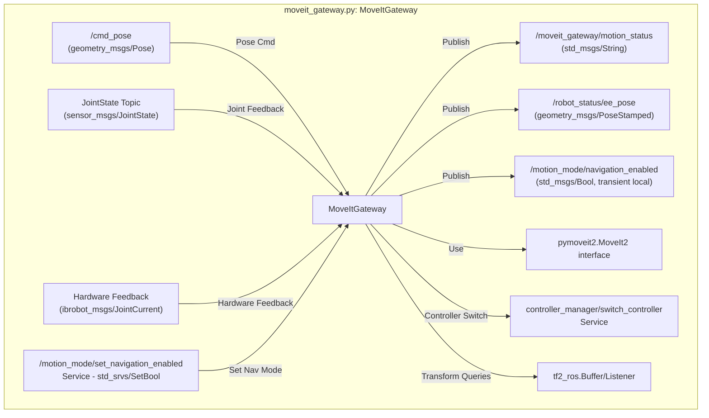
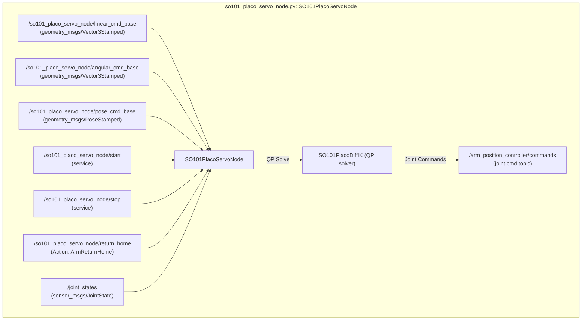
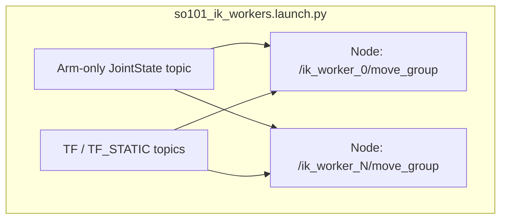
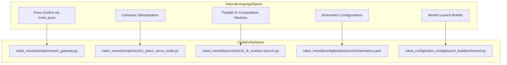

# MoveIt 与运动学

<details>
<summary>相关源码文件</summary>

以下文件被用作生成此 wiki 页面的上下文：

- [src/ibrobot_msgs/srv/MoveToConfiguration.srv](https://atomgit.com/openeuler/IB_Robot/blob/openEuler-26.09/src/ibrobot_msgs/srv/MoveToConfiguration.srv)
- [src/manipulation_execution/test/test_pick_executor_table_plane.py](https://atomgit.com/openeuler/IB_Robot/blob/openEuler-26.09/src/manipulation_execution/test/test_pick_executor_table_plane.py)
- [src/robot_config/robot_config/launch_builders/moveit.py](https://atomgit.com/openeuler/IB_Robot/blob/openEuler-26.09/src/robot_config/robot_config/launch_builders/moveit.py)
- [src/robot_description/urdf/lerobot/so101/so101_base.xacro](https://atomgit.com/openeuler/IB_Robot/blob/openEuler-26.09/src/robot_description/urdf/lerobot/so101/so101_base.xacro)
- [src/robot_moveit/CMakeLists.txt](https://atomgit.com/openeuler/IB_Robot/blob/openEuler-26.09/src/robot_moveit/CMakeLists.txt)
- [src/robot_moveit/README.md](https://atomgit.com/openeuler/IB_Robot/blob/openEuler-26.09/src/robot_moveit/README.md)
- [src/robot_moveit/config/lerobot/so101/kinematics.yaml](https://atomgit.com/openeuler/IB_Robot/blob/openEuler-26.09/src/robot_moveit/config/lerobot/so101/kinematics.yaml)
- [src/robot_moveit/config/lerobot/so101/so101.srdf](https://atomgit.com/openeuler/IB_Robot/blob/openEuler-26.09/src/robot_moveit/config/lerobot/so101/so101.srdf)
- [src/robot_moveit/config/so101_placo_servo.yaml](https://atomgit.com/openeuler/IB_Robot/blob/openEuler-26.09/src/robot_moveit/config/so101_placo_servo.yaml)
- [src/robot_moveit/launch/so101_ik_workers.launch.py](https://atomgit.com/openeuler/IB_Robot/blob/openEuler-26.09/src/robot_moveit/launch/so101_ik_workers.launch.py)
- [src/robot_moveit/launch/so101_moveit.launch.py](https://atomgit.com/openeuler/IB_Robot/blob/openEuler-26.09/src/robot_moveit/launch/so101_moveit.launch.py)
- [src/robot_moveit/package.xml](https://atomgit.com/openeuler/IB_Robot/blob/openEuler-26.09/src/robot_moveit/package.xml)
- [src/robot_moveit/scripts/moveit_gateway.py](https://atomgit.com/openeuler/IB_Robot/blob/openEuler-26.09/src/robot_moveit/scripts/moveit_gateway.py)
- [src/robot_moveit/scripts/so101_placo_kinematics.py](https://atomgit.com/openeuler/IB_Robot/blob/openEuler-26.09/src/robot_moveit/scripts/so101_placo_kinematics.py)
- [src/robot_moveit/scripts/so101_placo_servo_node.py](https://atomgit.com/openeuler/IB_Robot/blob/openEuler-26.09/src/robot_moveit/scripts/so101_placo_servo_node.py)
- [src/robot_moveit/test/test_moveit_gateway_motion_lifecycle.py](https://atomgit.com/openeuler/IB_Robot/blob/openEuler-26.09/src/robot_moveit/test/test_moveit_gateway_motion_lifecycle.py)
- [src/robot_moveit/test/test_so101_ik_workers_launch.py](https://atomgit.com/openeuler/IB_Robot/blob/openEuler-26.09/src/robot_moveit/test/test_so101_ik_workers_launch.py)
- [src/robot_moveit/test/test_so101_placo_home.py](https://atomgit.com/openeuler/IB_Robot/blob/openEuler-26.09/src/robot_moveit/test/test_so101_placo_home.py)
- [src/robot_moveit/test/test_so101_placo_kinematics.py](https://atomgit.com/openeuler/IB_Robot/blob/openEuler-26.09/src/robot_moveit/test/test_so101_placo_kinematics.py)
- [src/robot_teleop/robot_teleop/cartesian_backend/__init__.py](https://atomgit.com/openeuler/IB_Robot/blob/openEuler-26.09/src/robot_teleop/robot_teleop/cartesian_backend/__init__.py)
- [src/robot_teleop/robot_teleop/cartesian_backend/placo_servo.py](https://atomgit.com/openeuler/IB_Robot/blob/openEuler-26.09/src/robot_teleop/robot_teleop/cartesian_backend/placo_servo.py)
- [src/robot_teleop/robot_teleop/vr_teleop.py](https://atomgit.com/openeuler/IB_Robot/blob/openEuler-26.09/src/robot_teleop/robot_teleop/vr_teleop.py)

</details>

本节详述 RoboFrame_stable 代码库中的 MoveIt 2 集成与运动学解决方案，聚焦 `robot_moveit` ROS 2 包。它解释 MoveIt Gateway、Placo Servo 遥操作后端、逆运动学 worker、运动学配置以及 MoveIt launch 编排的设计与实现。

---

## 目的与范围

`robot_moveit` 包为 LeRobot SO101 5 自由度机械臂提供专用 MoveIt 2 集成，支持任务级绝对位姿控制、逆运动学（IK）计算，以及使用 Placo 基于 QP 的微分 IK 的柔顺笛卡尔遥操作后端。本页面覆盖以下关键组件：

- `moveit_gateway` 节点：位姿命令、IK 解执行与运动模式管理的接口。
- `so101_placo_servo_node`：使用 Placo 求解器的微分 IK 笛卡尔遥操作节点。
- IK/FK worker launch 系统：用于抓取候选评估的隔离 MoveIt IK 计算 worker。
- 运动学 YAML 配置：求解器参数与 5 自由度臂特性。
- MoveIt launch 构建器：从机器人配置以编程方式生成 launch 文件。

---

## 1. MoveIt Gateway（`moveit_gateway.py`）

### 概述

`MoveItGateway` 节点充当外部位姿命令与 SO101 的 MoveIt 2 运动规划栈之间的同步桥接。它专为 5 自由度臂的欠约束 IK 场景设计。其接口包括：

- **订阅：**
  - `/cmd_pose`（`geometry_msgs/Pose`）：即发即忘的绝对末端执行器位姿。
  - 特定机械臂的关节状态话题（默认 `/joint_states`）。
  - 导航模式控制话题与硬件反馈话题。

- **发布者：**
  - `/robot_status/ee_pose`（`geometry_msgs/PoseStamped`）：10 Hz 末端执行器位姿更新。
  - `/moveit_gateway/motion_status`（`std_msgs/String`）：运动状态机状态。
  - `/motion_mode/navigation_enabled`（`std_msgs/Bool`）：以 transient local 方式发布的导航授权状态。

- **服务：**
  - `/moveit_gateway/move_to_pose`（`ibrobot_msgs/MoveToPose`）：移动到目标位姿的阻塞调用。
  - `/moveit_gateway/move_to_configuration`（`ibrobot_msgs/MoveToConfiguration`）：执行经过校验的 IK 关节配置。
  - `/motion_mode/set_navigation_enabled`（`std_srvs/SetBool`）：在臂运动与底盘导航控制之间切换。

### 实现要点

- 使用 `pymoveit2.MoveIt2` 接口进行规划、执行与状态查询。
- 参数控制臂组名称、坐标系（`base_link`、`ee_link`、`shoulder_link`）、关节名称、超时、反馈容差以及关节状态与硬件反馈话题。
- 管理状态为 "idle"、"executing"、"succeeded"、"failed" 的运动生命周期。
- 支持关节状态与硬件反馈上的锁定与同步。
- 与 TF2 集成，在运动完成后检查末端执行器位姿一致性。
- 提供导航与操作模式间的运动模式桥接，允许通过 controller_manager 服务安全切换与控制器管理。

### 数据流图：MoveItGateway 关键组件与接口



---

## 2. Placo Servo 节点（`so101_placo_servo_node.py`）

### 目的

Placo Servo 节点为 SO101 5 自由度臂的**笛卡尔遥操作**而设计，实现**基于 QP 的微分逆运动学**（IK）求解器，具有以下特性：

- 以 50 Hz 独立于其他遥操作循环运行，实现低延迟。
- 使用由速度命令积分得到的**命令侧虚拟笛卡尔参考**，而非测量位姿棘轮，避免硬件重力下垂导致的零空间漂移。
- 强调**位置作为主任务**，由于 5 自由度欠驱动，对姿态施加低权重软约束。
- 在 QP 内部以**硬约束**强制关节与速度限制。
- 从上次发布命令为 IK 优化设置种子，实现平滑控制。
- 支持两种输入模式：速度命令（线速度/角速度）与相对离合位姿命令。

### 特性

- ROS 2 参数控制求解器设置，如最大关节速度、阻尼、任务权重、输入模式与话题。
- 提供 `start` 与 `stop` 服务以及 `return_home` 动作，用于向定义的 home 关节配置安全插值回位。
- 实现命令租约超时策略与急停处理。
- 节点通过内部滤波与速度级约束保证命令平滑。

### 数据流：Placo Servo 命令与控制



---

## 3. IK Worker Launch（`so101_ik_workers.launch.py`）

### 目的

- 针对抓取候选评估或高吞吐 IK/FK 计算，启动隔离的 **IK worker 进程**。
- 每个 worker 是独立的 `move_group` 进程，仅启用运动学能力（无规划、执行或场景修改）。
- Worker 订阅过滤后的关节状态话题并共享 TF 数据，但运行在独立命名空间（如 `/ik_worker_0`...`/ik_worker_3`）。
- 主 `manipulation_execution/pick_executor_node` 将 IK 请求分发给 worker 并合并结果用于抓取规划。

### Launch 要点

- `worker_count` 与 `namespace_prefix` 可通过 launch 参数配置。
- 使用 `moveit_configs_utils.MoveItConfigsBuilder` 从标准机器人配置文件加载 URDF、SRDF、运动学与关节限制。
- 禁用除 IK/FK 服务调用外的几乎全部能力。
- 关节状态重映射到仅含臂关节的话题，排除万向轮关节。

### Launch 节点生成图



---

## 4. 运动学配置（`kinematics.yaml`）

### 概要

`src/robot_moveit/config/lerobot/so101/kinematics.yaml` 定义 SO101 臂的运动学插件与参数：

- 使用 **LMA（Levenberg-Marquardt）运动学插件**作为求解器，在 5 自由度欠约束场景下更稳健。
- 设置：

  ```yaml
  arm:
    kinematics_solver: lma_kinematics_plugin/LMAKinematicsPlugin
    kinematics_solver_timeout: 1.0
    kinematics_solver_attempts: 3
    orientation_vs_position_weight: 0.5
    position_only_ik: true
  ```

- `orientation_vs_position_weight` 为 0.5 降低 IK 中姿态权重，提升 5 自由度上的成功率。
- `position_only_ik: true` 标志启用**仅位置 IK 模式**，忽略部分姿态约束以确保能找到解。

### 关键说明

- 该配置在 launch 时加载进 MoveIt。
- 为 5 自由度 SO101 臂维护专用运动学方法，缓解标准 IK 求解器面临的 `NO_IK_SOLUTION` 错误。

---

## 5. MoveIt Launch 构建器（`robot_config.launch_builders.moveit.py`）

### 目的

提供 Python API，基于当前机器人配置以编程方式生成 MoveIt 2 launch 序列：

- 依据控制模式决定是否启动 MoveIt 节点。
- 使用 `ament_index_python` 定位 `robot_moveit` 包及其 `so101_moveit.launch.py`。
- 传递机器人参数，如关节名称、组名称、frame id、运动模式参数、控制器设置与反馈超时。
- 支持仿真模式切换，并可选择禁用 RViz 可视化。

### 高层函数与参数

```python
def generate_moveit_nodes(robot_config, control_mode, use_sim=False, display=True, force=False):
    """Return list of launch actions to include MoveIt."""
    ...
```

- `robot_config`：包含 MoveIt 组名称、frame ID 等的 SSOT 机器人 YAML 字典。
- `control_mode`：当前控制模式字符串，如 `moveit_planning`。
- `use_sim`：是否启动仿真控制器。
- `display`：是否启动 RViz 的标志。
- `force`：即使模式字符串不含 `moveit` 也强制包含。

### 示例：MoveIt launch 包含

- 提取 `joint_names`、`arm_group_name`、`base_link`、`ee_link`、`shoulder_link` 与各类监控超时。
- 为操作与导航模式提供控制器列表。
- 包含来自 `robot_moveit/launch/so101_moveit.launch.py` 的 launch。

---

## 集成概览图：自然语言到代码实体映射



---

## 详细技术洞察

### MoveIt Gateway

- 实现线程安全的接口，管理 MoveIt 运动及其生命周期状态。
- 使用 `moveit_gateway.py`（53-130 行）中声明的 ROS 2 参数配置臂组、超时与运动模式。
- 同时监听 `/joint_states` 与可选的硬件反馈话题用于运动成功验证，采用 TF2 同步检查。
- 集成 controller manager 服务，在导航 ↔ 操作模式切换期间动态切换控制器。
- 运动状态转换与臂运动声明集中协调，在导航启用期间阻塞不兼容请求。
- 反馈容差与超时参数控制运动后验证的稳健性。

### Placo Servo 节点

- 实现自定义笛卡尔伺服，使用封装于 `so101_placo_kinematics.SO101PlacoDiffIK` 的 Placo 二次规划求解器。
- 维护命令侧虚拟笛卡尔位姿，而非每次求解时反馈关节测量值，避免重力引起的伺服滞后带来的零空间误差。
- 支持两种遥操作输入模式：速度与位姿增量，通过 `input_mode` ROS 参数选择。
- 对关节命令与速度限制执行内部安全钳位，与 URDF 定义的约束一致。
- 提供 start/stop 服务处理器与确定性 Home 动作（`ArmReturnHome`），将关节平滑插值回复位配置。

### IK Workers Launch

- 隔离多个 MoveIt `move_group` 节点以获得并行 IK/FK 计算能力。
- 禁用全部运动执行与规划能力（`_DISABLED_CAPABILITIES` 标志）以最小化资源占用。
- 每个 worker 处理 `/compute_ik` 与 `/compute_fk` 服务调用，提升抓取规划吞吐。
- 关节状态重映射经过精心设置，排除机器人底盘或非臂关节，与 SO101 5 自由度臂模型对齐。

### 运动学配置

- 使用 LMA IK 插件，允许多次尝试与求解器超时，稳健求解欠驱动 5 自由度臂 IK。
- 通过权重参数与显式仅位置 IK 标志，优先位置而非姿态，提升求解成功率。
- 配置保留独立的 `arm_tcp` 组用于虚拟 TCP 控制，但应用相同求解器参数以保持一致。

### MoveIt Launch 构建器

- 抽象 MoveIt 集成的 launch 创建，使其可跨不同机器人与控制模式复用。
- 从 SSOT 机器人配置字典提取参数，支持仿真切换与参数覆盖。
- 支持动态包含运动模式、导航启用与针对操作/导航上下文定制的控制器列表。
- 通过向下游 launch 文件提供全部必要参数，保证向后兼容与集成灵活性。

---

## 参考来源

- `src/robot_moveit/scripts/moveit_gateway.py:1-132`
- `src/robot_moveit/README.md:1-181`
- `src/robot_moveit/scripts/so101_placo_servo_node.py:1-174`
- `src/robot_moveit/launch/so101_ik_workers.launch.py:1-96`
- `src/robot_moveit/config/lerobot/so101/kinematics.yaml:1-26`
- `src/robot_config/robot_config/launch_builders/moveit.py:1-137`
- `src/robot_moveit/launch/so101_moveit.launch.py:1-138`

---

本详细技术概览整合了 RoboFrame_stable 中聚焦 SO101 机械臂的 MoveIt 与运动学相关组件。它帮助理解架构、关键算法、工作流，以及配置与 launch 文件如何将系统串联起来。
