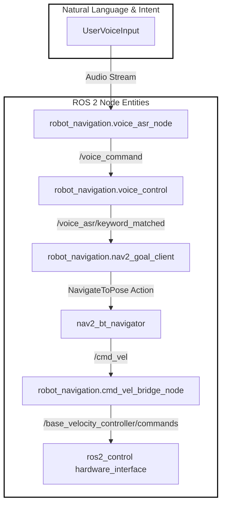
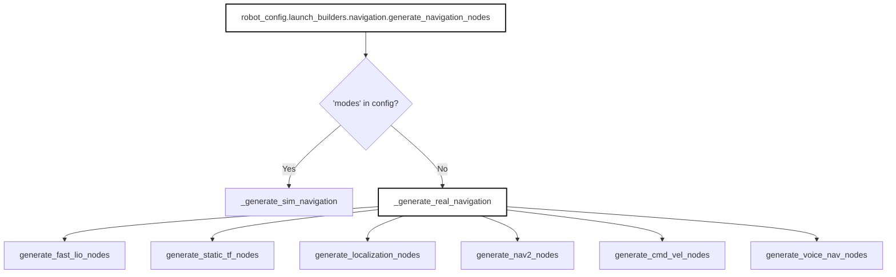
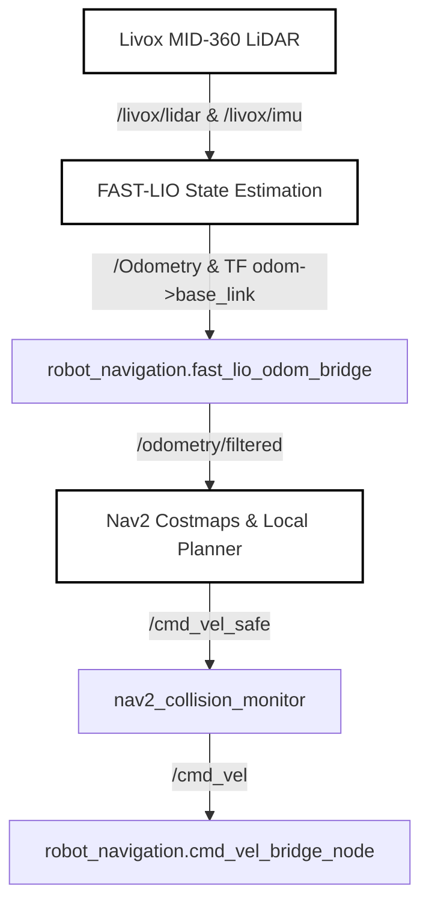

# 导航

<details>
<summary>相关源码文件</summary>

以下文件被用作生成此 wiki 页面的上下文：

- [.gitignore](https://atomgit.com/openeuler/IB_Robot/blob/openEuler-26.09/.gitignore)
- [.gitmodules](https://atomgit.com/openeuler/IB_Robot/blob/openEuler-26.09/.gitmodules)
- [src/robot_config/config/hardware/lekiwi_mid360_mount.yaml](https://atomgit.com/openeuler/IB_Robot/blob/openEuler-26.09/src/robot_config/config/hardware/lekiwi_mid360_mount.yaml)
- [src/robot_config/config/navigation/fast_lio_mid360.yaml](https://atomgit.com/openeuler/IB_Robot/blob/openEuler-26.09/src/robot_config/config/navigation/fast_lio_mid360.yaml)
- [src/robot_config/robot_config/launch_builders/nav2.py](https://atomgit.com/openeuler/IB_Robot/blob/openEuler-26.09/src/robot_config/robot_config/launch_builders/nav2.py)
- [src/robot_config/robot_config/launch_builders/navigation.py](https://atomgit.com/openeuler/IB_Robot/blob/openEuler-26.09/src/robot_config/robot_config/launch_builders/navigation.py)
- [src/robot_config/test/test_nav2_builder.py](https://atomgit.com/openeuler/IB_Robot/blob/openEuler-26.09/src/robot_config/test/test_nav2_builder.py)
- [src/robot_config/test/test_navigation_simulation.py](https://atomgit.com/openeuler/IB_Robot/blob/openEuler-26.09/src/robot_config/test/test_navigation_simulation.py)
- [src/robot_navigation/README.md](https://atomgit.com/openeuler/IB_Robot/blob/openEuler-26.09/src/robot_navigation/README.md)
- [src/robot_navigation/config/nav2/controller_regression.yaml](https://atomgit.com/openeuler/IB_Robot/blob/openEuler-26.09/src/robot_navigation/config/nav2/controller_regression.yaml)
- [src/robot_navigation/config/nav2_params.yaml](https://atomgit.com/openeuler/IB_Robot/blob/openEuler-26.09/src/robot_navigation/config/nav2_params.yaml)
- [src/robot_navigation/config/nav2_params_dwb.yaml](https://atomgit.com/openeuler/IB_Robot/blob/openEuler-26.09/src/robot_navigation/config/nav2_params_dwb.yaml)
- [src/robot_navigation/config/nav2_sim_params.yaml](https://atomgit.com/openeuler/IB_Robot/blob/openEuler-26.09/src/robot_navigation/config/nav2_sim_params.yaml)
- [src/robot_navigation/config/nav2_sim_params_dwb.yaml](https://atomgit.com/openeuler/IB_Robot/blob/openEuler-26.09/src/robot_navigation/config/nav2_sim_params_dwb.yaml)
- [src/robot_navigation/launch/nav2_bringup.launch.py](https://atomgit.com/openeuler/IB_Robot/blob/openEuler-26.09/src/robot_navigation/launch/nav2_bringup.launch.py)
- [src/robot_navigation/package.xml](https://atomgit.com/openeuler/IB_Robot/blob/openEuler-26.09/src/robot_navigation/package.xml)
- [src/robot_navigation/setup.py](https://atomgit.com/openeuler/IB_Robot/blob/openEuler-26.09/src/robot_navigation/setup.py)
- [src/robot_navigation/test/test_nav2_controller_config.py](https://atomgit.com/openeuler/IB_Robot/blob/openEuler-26.09/src/robot_navigation/test/test_nav2_controller_config.py)

</details>

## 目的与范围

导航栈在 RoboFrame 内集成定位、路径规划、局部控制、语音触发与底盘桥接。主要通过 `robot_navigation` ROS 包管理，并由 `robot_config` launch 构建器编排，系统支持双传感器 profile：使用 RealSense 与 RTAB-Map 的视觉惯性配置，以及使用 Livox MID-360、FAST-LIO 与 SLAM Toolbox 或 AMCL 的激光雷达配置 [src/robot_navigation/README.md:5-15](https://atomgit.com/openeuler/IB_Robot/blob/openEuler-26.09/src/robot_navigation/README.md#L5-L15)。

来源：`src/robot_navigation/README.md:1-18`

---

## 系统架构与数据流

导航流水线将用户语音命令或远程目标桥接到 Nav2 动作服务器，通过 MPPI 或 DWB 控制器解析轨迹，并通过 `cmd_vel_bridge_node` 将本体坐标系 twist 命令（`/cmd_vel`）转换为轮空间角速度（`rad/s`）[src/robot_navigation/README.md:19-60](https://atomgit.com/openeuler/IB_Robot/blob/openEuler-26.09/src/robot_navigation/README.md#L19-L60)。



*图 5.5.1：导航执行的自然语言到代码实体数据流映射。*

来源：`src/robot_navigation/README.md:29-60`, `src/robot_navigation/setup.py:37-56`

---

## 导航 Launch 构建器

配置框架区分仿真 bringup 与真机部署。`robot_config/robot_config/launch_builders/navigation.py` 模块评估当前配置 schema，决定加载轻量 EKF 仿真节点还是完整真机导航栈 [src/robot_config/robot_config/launch_builders/navigation.py:1-54](https://atomgit.com/openeuler/IB_Robot/blob/openEuler-26.09/src/robot_config/robot_config/launch_builders/navigation.py#L1-L54)。



*图 5.5.2：导航 launch 构建器的代码实体架构。*

启用真机导航时，`_generate_real_navigation` 对运动速度契约执行断言，并调用针对 FAST-LIO、静态变换、RTAB-Map/AMCL 定位、Nav2 服务器、命令桥接与语音集成的子构建器 [src/robot_config/robot_config/launch_builders/navigation.py:103-157](https://atomgit.com/openeuler/IB_Robot/blob/openEuler-26.09/src/robot_config/robot_config/launch_builders/navigation.py#L103-L157)。

来源：`src/robot_config/robot_config/launch_builders/navigation.py:1-173`

---

## Nav2 Bringup、参数与生命周期

Nav2 通过 `robot_navigation/launch/nav2_bringup.launch.py` 初始化，它使用 `nav2_common.launch.RewrittenYaml` 动态重写参数绑定，以传播 profile 特定的控制器插件、voxel 层与观测源 [src/robot_navigation/launch/nav2_bringup.launch.py:43-56](https://atomgit.com/openeuler/IB_Robot/blob/openEuler-26.09/src/robot_navigation/launch/nav2_bringup.launch.py#L43-L56)。

地图服务器、定位、AMCL 与碰撞监测节点的生命周期协调由 `navigation_lifecycle_coordinator` 管理，它处理开发板启动缓慢与 bond 超时问题 [src/robot_navigation/launch/nav2_bringup.launch.py:146-163](https://atomgit.com/openeuler/IB_Robot/blob/openEuler-26.09/src/robot_navigation/launch/nav2_bringup.launch.py#L146-L163), [src/robot_navigation/test/test_nav2_controller_config.py:45-66](https://atomgit.com/openeuler/IB_Robot/blob/openEuler-26.09/src/robot_navigation/test/test_nav2_controller_config.py#L45-L66)。

### 节点注册表

| 可执行文件 | 模块 / 入口点 | 职责 |
| --- | --- | --- |
| `nav2_goal_client` | `robot_navigation.nav2_goal_client` | Nav2 动作客户端与到达后触发器 |
| `cmd_vel_bridge_node` | `robot_navigation.cmd_vel_bridge_node` | twist 到轮速度的运动学映射（`rad/s`） |
| `fast_lio_odom_bridge` | `robot_navigation.fast_lio_odom_bridge` | 规范化 FAST-LIO 里程计与变换数据 |
| `navigation_lifecycle_coordinator` | `robot_navigation.navigation_lifecycle_coordinator` | 管理 Nav2 生命周期状态转换 |
| `navigation_command_server` | `robot_navigation.navigation_command_server` | 提供原子导航动作与取消 |

来源：`src/robot_navigation/launch/nav2_bringup.launch.py:1-175`, `src/robot_navigation/setup.py:37-56`, `src/robot_navigation/README.md:77-90`

---

## 控制器与运动包络

导航栈同时支持模型预测路径积分控制器（`MPPIController`）与动态窗口方法（`DWBLocalPlanner`）控制器 [src/robot_navigation/config/nav2_params.yaml:116-188](https://atomgit.com/openeuler/IB_Robot/blob/openEuler-26.09/src/robot_navigation/config/nav2_params.yaml#L116-L188), [src/robot_navigation/config/nav2_params_dwb.yaml:116-157](https://atomgit.com/openeuler/IB_Robot/blob/openEuler-26.09/src/robot_navigation/config/nav2_params_dwb.yaml#L116-L157)。

运动边界与控制器参数镜像当前 LeKiwi profile 的运动包络（`robot.navigation.motion_envelope`）[src/robot_navigation/README.md:108-111](https://atomgit.com/openeuler/IB_Robot/blob/openEuler-26.09/src/robot_navigation/README.md#L108-L111)。单元测试验证控制器约束符合硬件限制与轮空间速度可行性 [src/robot_navigation/test/test_nav2_controller_config.py:111-163](https://atomgit.com/openeuler/IB_Robot/blob/openEuler-26.09/src/robot_navigation/test/test_nav2_controller_config.py#L111-L163)。

```python
# Wheel-space feasibility check pattern in test suite
def _assert_wheel_feasible(envelope, bridge):
    velocity = envelope["velocity"]
    for vx, vy, wz in itertools.product(
        (velocity["vx"]["min"], velocity["vx"]["max"]),
        (velocity["vy"]["min"], velocity["vy"]["max"]),
        (velocity["wz"]["min"], velocity["wz"]["max"]),
    ):
        wheel_radps = _body_to_wheel_radps(
            vx, vy, wz,
            bridge["wheel_radius"],
            bridge["base_radius"],
            float("inf"),
        )
        assert max(abs(value) for value in wheel_radps) <= bridge["max_radps"] + 1e-9
```

来源：`src/robot_navigation/config/nav2_params.yaml:116-188`, `src/robot_navigation/test/test_nav2_controller_config.py:111-163`

---

## FAST-LIO 与 Livox 集成

对于基于激光雷达的 profile（MID-360），导航架构集成 Livox SDK2 驱动、FAST-LIO 惯性激光雷达里程计以及 SLAM Toolbox 或 AMCL [.gitmodules:1-35](https://atomgit.com/openeuler/IB_Robot/blob/openEuler-26.09/.gitmodules#L1-L35), [src/robot_navigation/README.md:13-15](https://atomgit.com/openeuler/IB_Robot/blob/openEuler-26.09/src/robot_navigation/README.md#L13-L15)。



*图 5.5.3：FAST-LIO 与激光雷达导航数据流。*

`fast_lio_odom_bridge` 为下游导航消费者规范化官方 FAST-LIO 里程计消息，确保与 Nav2 costmap 传感器源及碰撞监测器兼容 [src/robot_navigation/README.md:84](https://atomgit.com/openeuler/IB_Robot/blob/openEuler-26.09/src/robot_navigation/README.md#L84), [src/robot_navigation/setup.py:49](https://atomgit.com/openeuler/IB_Robot/blob/openEuler-26.09/src/robot_navigation/setup.py#L49)。

来源：`.gitmodules:18-30`, `src/robot_navigation/README.md:13-17`, `src/robot_navigation/setup.py:49-50`
