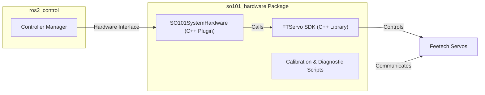
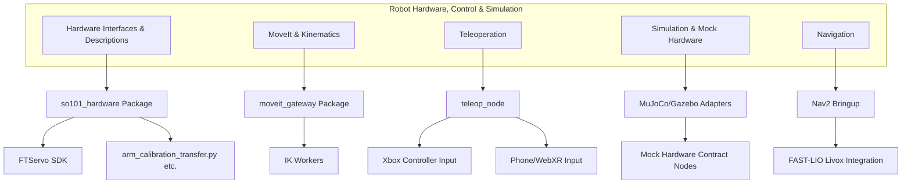

# 机器人硬件、控制与仿真概述

相关源码文件

以下文件被用作生成此 wiki 页面的上下文：

- [src/so101_hardware/CMakeLists.txt](https://atomgit.com/openeuler/IB_Robot/blob/openEuler-26.09/src/so101_hardware/CMakeLists.txt)
- [src/so101_hardware/README.en.md](https://atomgit.com/openeuler/IB_Robot/blob/openEuler-26.09/src/so101_hardware/README.en.md)
- [src/so101_hardware/README.md](https://atomgit.com/openeuler/IB_Robot/blob/openEuler-26.09/src/so101_hardware/README.md)
- [src/so101_hardware/docs/tools/arm_calibration_transfer.md](https://atomgit.com/openeuler/IB_Robot/blob/openEuler-26.09/src/so101_hardware/docs/tools/arm_calibration_transfer.md)
- [src/so101_hardware/scripts/arm_calibration_transfer.py](https://atomgit.com/openeuler/IB_Robot/blob/openEuler-26.09/src/so101_hardware/scripts/arm_calibration_transfer.py)
- [src/so101_hardware/so101_hardware/calibration/transfer.py](https://atomgit.com/openeuler/IB_Robot/blob/openEuler-26.09/src/so101_hardware/so101_hardware/calibration/transfer.py)
- [src/so101_hardware/so101_hardware/calibration/validation.py](https://atomgit.com/openeuler/IB_Robot/blob/openEuler-26.09/src/so101_hardware/so101_hardware/calibration/validation.py)
- [src/so101_hardware/test/test_transfer.py](https://atomgit.com/openeuler/IB_Robot/blob/openEuler-26.09/src/so101_hardware/test/test_transfer.py)

本节提供 RoboFrame_stable 代码库中集成的机器人硬件接口、控制基础设施、运动规划、遥操作能力与仿真后端的高层概览。目标是为以下问题提供上下文：物理机器人硬件如何被接口化与控制、运动如何被规划与执行、遥操作输入设备如何参与机器人控制，以及仿真环境如何支持开发与测试。

每个子领域都有专门的子页面详尽覆盖其技术细节。这里我们呈现架构关系、主要软件组件与工作流集成，帮助理解 RoboFrame 中机器人硬件控制与仿真的整体图景。

---

## 5.1 硬件接口与描述

硬件接口层将物理机器人执行器与传感器桥接到 ROS 2 控制框架。对于 SO-101 机械臂与 LeKiwi 平台，以 C++ 实现的自定义 ros2_control 插件通过 FTServo SDK 提供与 Feetech 舵机的低延迟、高性能通信。

### SO-101 硬件

- SO-101 硬件包（`so101_hardware`）将 Feetech FTServo Linux SDK 作为 git 子模块集成，提供对舵机的直接控制。
- 它暴露名为 `SO101SystemHardware` 的 ros2_control 硬件接口插件（见 `src/so101_hardware/src/so101_system_hardware.cpp`），处理生命周期管理（`on_configure`、`on_activate`、`on_deactivate`）与舵机命令同步。
- 该插件通过实现启动位置保护（`reset_positions` 参数）确保安全，通过指令安全初始位形防止执行器在启动时跳变。
- 来自舵机的电流反馈以固定比例因子（1 LSB = 6.5mA）转换并通过 ROS 话题发布，供外部使用（如数据集导出）。
- 激活回滚语义确保激活期间的失败会安全地关闭力矩并重新锁定舵机 EPROM，以保护执行器设置。
- 该包包含 Python 工具脚本，提供标定工具（`calibrate_arm`）、标定迁移（`arm_calibration_transfer`）、数据采集（`leader_arm_pub`）与诊断命令。

### 标定迁移与校验

- 旧版 SO-101 标定数据可迁移到当前 schema，以保留偏移与驱动模式，允许复用旧数据与模型。
- 标定迁移工具读取旧版与模板 JSON 标定文件，使用向后兼容公式计算兼容的关节限位，应用驱动模式翻转，并写入更新后的标定 JSON 文件供机器人配置使用。
- 全面的校验检查确保标定数据完整性，包括关节 ID 唯一性、有效范围与驱动模式正确性。
- 关于标定迁移与检查的完整用法与细节，见 `so101_hardware` 包文档与脚本（`arm_calibration_transfer.py`）。

### LeKiwi 硬件与 Aero Hand

- LeKiwi 平台的硬件接口遵循类似的 ros2_control 插件模式，处理导航与抓取硬件。
- Aero Hand 夹爪设备及其控制集成在硬件描述子页面中详述。

完整规格、硬件插件实现、标定工作流与 URDF/xacro 机器人描述，请参阅子页面：[硬件接口与描述](./hardware_interfaces_descriptions.md)。

来源：`src/so101_hardware/CMakeLists.txt:13-70`, `src/so101_hardware/README.md:1-161`, `src/so101_hardware/scripts/arm_calibration_transfer.py:1-66`, `src/so101_hardware/so101_hardware/calibration/transfer.py:1-158`

---

## 5.2 MoveIt 与运动学

运动规划与逆解计算对机器人操作任务至关重要。RoboFrame 通过专门的网关包（`moveit_gateway`）集成 MoveIt 2，便于与 MoveIt 的规划流水线与运动学求解器无缝交互。

- 系统使用 `placo` 伺服架构与自定义逆解工作节点，从高层位姿目标计算关节轨迹。
- 运动学配置（包括关节限位与 DH 参数）以声明式存储在配置文件中，并通过动态 launch 构建器传递给 MoveIt。
- moveit launch 构建器装配规划器、运动执行与监视器，提供以 URDF/xacro 派生的机器人描述为基础、开箱即用的规划场景。

该集成允许上层 skill 节点与遥操作客户端下发遵循硬件约束与环境障碍的高效运动规划。

完整细节见专门子页面：[MoveIt 与运动学](./moveit_kinematics.md)。

来源：（未展示，但由仓库结构中 MoveIt 集成部分指示）

---

## 5.3 遥操作

遥操作使人类操作员能够通过多样化输入设备控制机器人的手臂与底盘。

- `teleop_node` 聚合控制输入，支持主臂设备、Xbox 手柄与手机/WebXR XR 设备。
- 主臂可用作发布关节状态的主控制器，其他设备提供互补输入通道。
- 遥操作 launch 构建器将这些节点组装为便捷的 launch 配置，并管理用于交互控制的 Web UI 资产。
- 该子系统支持灵活的实时操作与导航控制，有利于演示数据采集、测试与人在环操作。

实现与使用细节见子页面：[遥操作](./teleoperation.md)。

来源：（由 `teleop_node` 引用推断的用法）

---

## 5.4 仿真与 Mock 硬件

仿真是在无需物理硬件的情况下进行快速原型、验证与测试的基石。

- RoboFrame 支持 MuJoCo 与 Gazebo 仿真后端，通过模拟硬件接口的适配器节点接入。
- Mock 硬件契约节点提供复刻真实硬件行为的仿真话题与服务，用于 CI 与开发环境。
- 仿真模型与场景（如 `pick_banana`）位于 sim_models 中；ArUco 标记生成器辅助标定与定位。
- 这些配置支持在相同软件栈下无缝切换真实与仿真硬件层。

完整细节见子页面：[仿真与 Mock 硬件](./simulation_mock_hardware.md)。

来源：（由仓库仿真适配器描述指示）

---

## 5.5 导航

导航功能利用 Nav2 栈，为 RoboFrame 机器人定制配置参数、控制器与传感器集成。

- 导航 bringup 管理面向移动平台调优的路径规划、定位与避障。
- 与 Livox 激光雷达及 FAST-LIO SLAM 模块的集成支持精确的定位与建图。
- 导航 launch 构建器装配所有组件，形成可部署的机器人导航能力。

详尽的导航节点与 launch 细节，见：[导航](./navigation.md)。

来源：（由仓库导航包指示）

---

## 汇总图：自然语言子系统到代码实体

---

至此完成 RoboFrame_stable 机器人硬件、控制与仿真层的概览。深入的技术细节与使用说明，请参阅每个主题专门的子页面链接。

---

## 子页面深度导读链接

| 子章节                   | 描述                                                         |
|-----------------------------|---------------------------------------------------------------------|
| [硬件接口与描述](./hardware_interfaces_descriptions.md) | 详细的 C++ ros2_control 插件、硬件标定迁移、URDF/xacro 描述、Aero Hand 夹爪集成。 |
| [MoveIt 与运动学](./moveit_kinematics.md)               | 运动规划网关、运动学工作节点、配置与 launch 装配。                    |
| [遥操作](./teleoperation.md)                      | 遥操作架构、输入设备、ROS 节点、launch 构建器与 Web UI 资产。       |
| [仿真与 Mock 硬件](./simulation_mock_hardware.md)        | 仿真后端（MuJoCo、Gazebo）、mock 硬件契约、仿真场景、ArUco 生成器。  |
| [导航](./navigation.md)                         | Nav2 bringup、参数调优、导航控制器与 Livox 集成。                       |

---

**来源：**

- `src/so101_hardware/CMakeLists.txt:13-129`
- `src/so101_hardware/README.md:1-161`
- `src/so101_hardware/scripts/arm_calibration_transfer.py:1-66`
- `src/so101_hardware/so101_hardware/calibration/transfer.py:1-158`
- `src/so101_hardware/so101_hardware/calibration/validation.py:1-65`
