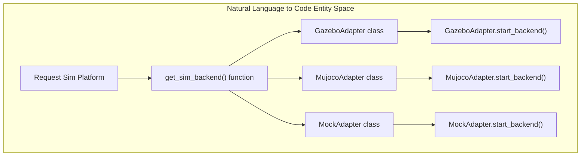
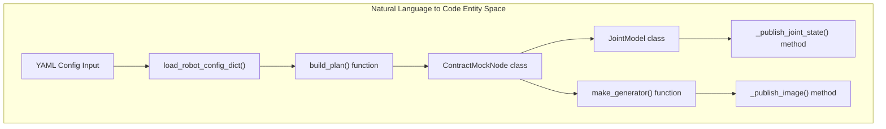

# 仿真与模拟硬件

<details>
<summary>相关源码文件</summary>

以下文件被用作生成此 wiki 页面的上下文：

- [docs/libero_310b_transport_validation.md](https://atomgit.com/openeuler/IB_Robot/blob/openEuler-26.09/docs/libero_310b_transport_validation.md)
- [scripts/model_infer_panel.py](https://atomgit.com/openeuler/IB_Robot/blob/openEuler-26.09/scripts/model_infer_panel.py)
- [src/dataset_tools/dataset_tools/frame_detector.py](https://atomgit.com/openeuler/IB_Robot/blob/openEuler-26.09/src/dataset_tools/dataset_tools/frame_detector.py)
- [src/dataset_tools/test/test_frame_detector.py](https://atomgit.com/openeuler/IB_Robot/blob/openEuler-26.09/src/dataset_tools/test/test_frame_detector.py)
- [src/hardware_mock/README.md](https://atomgit.com/openeuler/IB_Robot/blob/openEuler-26.09/src/hardware_mock/README.md)
- [src/hardware_mock/hardware_mock/contract_mock_node.py](https://atomgit.com/openeuler/IB_Robot/blob/openEuler-26.09/src/hardware_mock/hardware_mock/contract_mock_node.py)
- [src/hardware_mock/hardware_mock/contract_plan.py](https://atomgit.com/openeuler/IB_Robot/blob/openEuler-26.09/src/hardware_mock/hardware_mock/contract_plan.py)
- [src/hardware_mock/hardware_mock/image_sources.py](https://atomgit.com/openeuler/IB_Robot/blob/openEuler-26.09/src/hardware_mock/hardware_mock/image_sources.py)
- [src/hardware_mock/hardware_mock/joint_model.py](https://atomgit.com/openeuler/IB_Robot/blob/openEuler-26.09/src/hardware_mock/hardware_mock/joint_model.py)
- [src/hardware_mock/launch/hardware_mock.launch.py](https://atomgit.com/openeuler/IB_Robot/blob/openEuler-26.09/src/hardware_mock/launch/hardware_mock.launch.py)
- [src/hardware_mock/test/test_contract_plan.py](https://atomgit.com/openeuler/IB_Robot/blob/openEuler-26.09/src/hardware_mock/test/test_contract_plan.py)
- [src/hardware_mock/test/test_image_sources.py](https://atomgit.com/openeuler/IB_Robot/blob/openEuler-26.09/src/hardware_mock/test/test_image_sources.py)
- [src/inference_service/inference_service/observation_sync.py](https://atomgit.com/openeuler/IB_Robot/blob/openEuler-26.09/src/inference_service/inference_service/observation_sync.py)
- [src/inference_service/pytest.ini](https://atomgit.com/openeuler/IB_Robot/blob/openEuler-26.09/src/inference_service/pytest.ini)
- [src/inference_service/tests/test_observation_sync.py](https://atomgit.com/openeuler/IB_Robot/blob/openEuler-26.09/src/inference_service/tests/test_observation_sync.py)
- [src/inference_service/tests/test_observation_video_verification.py](https://atomgit.com/openeuler/IB_Robot/blob/openEuler-26.09/src/inference_service/tests/test_observation_video_verification.py)
- [src/robot_config/robot_config/contract_utils.py](https://atomgit.com/openeuler/IB_Robot/blob/openEuler-26.09/src/robot_config/robot_config/contract_utils.py)
- [src/robot_config/robot_config/launch_builders/control.py](https://atomgit.com/openeuler/IB_Robot/blob/openEuler-26.09/src/robot_config/robot_config/launch_builders/control.py)
- [src/robot_config/robot_config/launch_builders/description.py](https://atomgit.com/openeuler/IB_Robot/blob/openEuler-26.09/src/robot_config/robot_config/launch_builders/description.py)
- [src/robot_config/robot_config/launch_builders/sim_backend/__init__.py](https://atomgit.com/openeuler/IB_Robot/blob/openEuler-26.09/src/robot_config/robot_config/launch_builders/sim_backend/__init__.py)
- [src/robot_config/robot_config/launch_builders/sim_backend/base_adapter.py](https://atomgit.com/openeuler/IB_Robot/blob/openEuler-26.09/src/robot_config/robot_config/launch_builders/sim_backend/base_adapter.py)
- [src/robot_config/robot_config/launch_builders/sim_backend/camera_presets.py](https://atomgit.com/openeuler/IB_Robot/blob/openEuler-26.09/src/robot_config/robot_config/launch_builders/sim_backend/camera_presets.py)
- [src/robot_config/robot_config/launch_builders/sim_backend/gazebo_adapter.py](https://atomgit.com/openeuler/IB_Robot/blob/openEuler-26.09/src/robot_config/robot_config/launch_builders/sim_backend/gazebo_adapter.py)
- [src/robot_config/robot_config/launch_builders/sim_backend/mock_adapter.py](https://atomgit.com/openeuler/IB_Robot/blob/openEuler-26.09/src/robot_config/robot_config/launch_builders/sim_backend/mock_adapter.py)
- [src/robot_config/robot_config/launch_builders/sim_backend/mujoco_adapter.py](https://atomgit.com/openeuler/IB_Robot/blob/openEuler-26.09/src/robot_config/robot_config/launch_builders/sim_backend/mujoco_adapter.py)
- [src/robot_config/robot_config/launch_builders/simulation.py](https://atomgit.com/openeuler/IB_Robot/blob/openEuler-26.09/src/robot_config/robot_config/launch_builders/simulation.py)
- [src/robot_config/test/test_sim_backend.py](https://atomgit.com/openeuler/IB_Robot/blob/openEuler-26.09/src/robot_config/test/test_sim_backend.py)
- [src/robot_description/mujoco/so101.xml.template](https://atomgit.com/openeuler/IB_Robot/blob/openEuler-26.09/src/robot_description/mujoco/so101.xml.template)
- [src/robot_description/urdf/lerobot/so101/so101_cameras.xacro](https://atomgit.com/openeuler/IB_Robot/blob/openEuler-26.09/src/robot_description/urdf/lerobot/so101/so101_cameras.xacro)
- [src/sim_models/scenes/pick_banana/layout.yaml](https://atomgit.com/openeuler/IB_Robot/blob/openEuler-26.09/src/sim_models/scenes/pick_banana/layout.yaml)
- [src/sim_models/scenes/pick_banana/meshes/banana_col_0.stl](https://atomgit.com/openeuler/IB_Robot/blob/openEuler-26.09/src/sim_models/scenes/pick_banana/meshes/banana_col_0.stl)
- [src/sim_models/scenes/pick_banana/meshes/banana_col_1.stl](https://atomgit.com/openeuler/IB_Robot/blob/openEuler-26.09/src/sim_models/scenes/pick_banana/meshes/banana_col_1.stl)
- [src/sim_models/scenes/pick_banana/meshes/banana_col_2.stl](https://atomgit.com/openeuler/IB_Robot/blob/openEuler-26.09/src/sim_models/scenes/pick_banana/meshes/banana_col_2.stl)
- [src/sim_models/scenes/pick_banana/meshes/banana_g.obj](https://atomgit.com/openeuler/IB_Robot/blob/openEuler-26.09/src/sim_models/scenes/pick_banana/meshes/banana_g.obj)
- [src/sim_models/scenes/pick_banana/pick_banana.world.template](https://atomgit.com/openeuler/IB_Robot/blob/openEuler-26.09/src/sim_models/scenes/pick_banana/pick_banana.world.template)
- [src/sim_models/scenes/pick_banana/pick_banana.xml.template](https://atomgit.com/openeuler/IB_Robot/blob/openEuler-26.09/src/sim_models/scenes/pick_banana/pick_banana.xml.template)
- [src/sim_models/setup.py](https://atomgit.com/openeuler/IB_Robot/blob/openEuler-26.09/src/sim_models/setup.py)
- [src/sim_models/sim_models/scene_compiler.py](https://atomgit.com/openeuler/IB_Robot/blob/openEuler-26.09/src/sim_models/sim_models/scene_compiler.py)
- [src/sim_models/sim_models/tasks/__init__.py](https://atomgit.com/openeuler/IB_Robot/blob/openEuler-26.09/src/sim_models/sim_models/tasks/__init__.py)
- [src/sim_models/sim_models/tasks/base.py](https://atomgit.com/openeuler/IB_Robot/blob/openEuler-26.09/src/sim_models/sim_models/tasks/base.py)
- [src/sim_models/sim_models/tasks/pick_banana.py](https://atomgit.com/openeuler/IB_Robot/blob/openEuler-26.09/src/sim_models/sim_models/tasks/pick_banana.py)
- [src/tensormsg/tensormsg/converter.py](https://atomgit.com/openeuler/IB_Robot/blob/openEuler-26.09/src/tensormsg/tensormsg/converter.py)
- [src/tensormsg/test/test_converter.py](https://atomgit.com/openeuler/IB_Robot/blob/openEuler-26.09/src/tensormsg/test/test_converter.py)

</details>

## 目的与范围

本页面记录 `RoboFrame` 中的仿真基础设施、后端适配器、场景资产与硬件 mock 子系统。它详述 `SimBackendAdapter` 实现（`GazeboAdapter`、`MujocoAdapter`、`MockAdapter`）如何管理物理运行时、`sim_models` 如何以 CoACD 碰撞凸包编译 `pick_banana` 等场景，以及 `hardware_mock` 如何在无物理硬件或重型物理引擎的情况下，为离线推理测试提供契约驱动的仿真循环。

---

## 5.4.1 仿真后端适配器

`RoboFrame` 中的仿真平台通过以 `SimBackendAdapter` 为根的适配器模式管理。注册表通过 `get_sim_backend()` 将平台标识（`gazebo`、`mujoco`、`mock`）映射到具体类。

- **`GazeboAdapter`**：配置 Ignition Gazebo 环境路径（`GZ_SIM_RESOURCE_PATH`、`GAZEBO_MODEL_PATH`），从 `/robot_description` 生成机器人实体，并为相机、IMU 与 LiDAR 启动传感器桥 `[src/robot_config/robot_config/launch_builders/sim_backend/gazebo_adapter.py:45-110()]`。
- **`MujocoAdapter`**：将 `mujoco_ros2_control/MujocoSystemInterface` 嵌入 `ros2_control_node`，从模板动态生成 MuJoCo XML 描述，并通过节点重映射直接映射相机话题，无需外部桥接节点 `[src/robot_config/robot_config/launch_builders/sim_backend/mujoco_adapter.py:32-124()]`。
- **`MockAdapter`**：完全绕过物理仿真，直接从机器人配置路径实例化 `ContractMockNode` `[src/robot_config/test/test_sim_backend.py:172-184()]`。



*来源：`src/robot_config/robot_config/launch_builders/sim_backend/mujoco_adapter.py:32-125()`, `src/robot_config/test/test_sim_backend.py:12-45()`*

---

## 5.4.2 场景与资产管理（`sim_models` 与 `pick_banana`）

`sim_models` 包管理静态世界文件、相机标定道具（`aruco_a4`）及 `pick_banana` 等富操作任务场景 `[src/sim_models/setup.py:7-56()]`。

`pick_banana` 场景使用自定义 MJCF 模板（`pick_banana.xml.template`），并为复杂凹几何体（盘与 C 形香蕉）预计算 CoACD 凸分解外壳，以确保稳定的富接触抓取 `[src/sim_models/scenes/pick_banana/pick_banana.xml.template:1-70()]`。

物理选项为稳定接触求解显式调优：

```xml
<option gravity="0 0 -9.81" integrator="implicitfast" timestep="0.001" noslip_iterations="20" cone="elliptic">
  <flag contact="enable" />
</option>
```

`[src/robot_description/mujoco/so101.xml.template:32-58()]`

- `timestep="0.001"`：1 ms 积分步长，确保稳定性比率 `solref / timestep ≥ 10×`。
- `noslip_iterations="20"`：牛顿平滑迭代次数，防止夹爪面微滑移。
- `cone="elliptic"`：精确椭圆锥摩擦，消除扭转摩擦通道（`condim=4`）中的数值抖动。

*来源：`src/robot_description/mujoco/so101.xml.template:32-58()`, `src/sim_models/scenes/pick_banana/pick_banana.xml.template:1-70()`, `src/sim_models/setup.py:7-56()`*

---

## 5.4.3 硬件 Mock 与契约节点（`hardware_mock`）

在无物理硬件的情况下以 `control_mode: model_inference` 运行时，`ContractMockNode` 通过 `load_robot_config_dict()` 读取 SSOT YAML 并构建执行计划 `[src/hardware_mock/hardware_mock/contract_mock_node.py:62-102()]`。

mock 节点执行两个主循环：

1. **观测发布**：遍历 `contract.observations`，以配置速率发布合成图像（经 `make_generator` 生成）与关节状态 `[src/hardware_mock/hardware_mock/contract_mock_node.py:105-156()]`。
2. **动作反馈**：订阅 `contract.actions`，将传入的关节速度/位置命令送入内部 `JointModel` 实例，即时更新并重新发布 `JointState` / `JointCurrent` 话题，实现零滞后闭环行为 `[src/hardware_mock/hardware_mock/contract_mock_node.py:82-97()]`。



*来源：`src/hardware_mock/hardware_mock/contract_mock_node.py:62-102()`, `src/hardware_mock/hardware_mock/contract_mock_node.py:105-156()`*

---

## 5.4.4 动态 URDF 与外设注入

URDF 生成由 `generate_robot_description()` 处理，它处理 Xacro 宏并注入机器人 YAML 配置中定义的动态外设传感器 `[src/robot_config/robot_config/launch_builders/description.py:1-47()]`。

对于 `parent_frame="world"` 的相机，`_get_model_spawn_offset()` 提取仿真生成坐标（`simulation.robot_spawn`）并从绝对世界坐标中减去。这将用户定义的绝对位置映射为相对于 URDF `world` link 的模型局部坐标 `[src/robot_config/robot_config/launch_builders/description.py:25-137()]`。

*来源：`src/robot_config/robot_config/launch_builders/description.py:1-47()`, `src/robot_config/robot_config/launch_builders/description.py:62-145()`*
